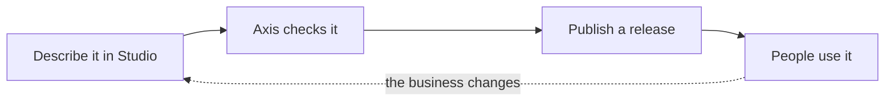

# Axis

Axis is an enterprise application platform for building business applications through
configuration.

You describe the application your business needs: the information it keeps, the forms people fill
in, the steps work goes through, the rules it must follow and who may do what. Axis checks the
description, publishes it and runs it. Nobody writes code, builds or deploys anything, and every
change is a new version that you can go back from.

## Who it is for

Every business runs work that no off-the-shelf product fits exactly: a request that needs two
approvals above a certain amount, a register only one team keeps, a process that changed last month.
Without an IT team, that work lives in spreadsheets, email and chat, where nobody sees its state and
nothing enforces its rules. Custom software fixes that, but it costs a project to build and another
to change.

Axis is for the people who know that work, such as an office manager, a business analyst or the
owner of the business. They build the application themselves in Studio, Axis's editor, and change it
as the business changes. Developers step in only for what configuration cannot express.

## How it works



1. **Describe it in Studio.** Model your data, design forms and pages, draw the steps of a process,
   and set who may see and do what. Start from a ready-made application, such as approvals, or from
   nothing.
2. **Axis checks it.** It finds mistakes before anyone meets them, such as a step that can never
   finish or a field a rule names but nobody fills in, and points to where each one is.
3. **Publish a release.** A release is a fixed version of the whole application. Work already under
   way keeps the version it started on, and an earlier release can be made live again.
4. **People use it.** Each application gets its own site, where people fill in forms, find records,
   work through the tasks assigned to them and follow where their requests are.

## What you get

- **Complete applications.** Data, forms, pages, processes with human tasks, rules, notifications,
  charts and connections to other systems.
- **Security you cannot configure away.** Access is checked on the server, down to each record,
  field and action, and is closed until a policy opens it.
- **Nothing lost, nothing done twice.** A process survives restarts, and an effect such as sending a
  purchase order happens once.
- **Work you can see.** Where a process is, what it did and why it waits or failed.
- **Standard processes you can change.** Built-in modules such as approvals change to fit your
  business and keep their core rules on every change.
- **Vietnamese and English** in every screen.
- **Code where it is needed.** A developer adds what configuration cannot express as a tested
  extension package, without touching the platform.

Coming next, as the [roadmap](docs/roadmap.md) shows: Axis as a service with sign-up and a trial,
plans and online payment, and changes to an application described in words to an AI.

## Try it

You need Docker, the .NET 10 SDK and Node.js.

```sh
scripts/setup.sh
scripts/dev.sh
```

Open http://localhost:5173 and sign in as one of the
[development users](docs/reference/security.md#development-users). Axis starts with sample
applications to try, and Studio to see how they are built. [Development](docs/development.md) says
what runs where. To install Axis for real use, follow the
[installation guide](docs/reference/installation.md).

## Learn more

Read these in order to understand Axis from the outside in:

1. **[What Axis is and why](docs/product-brief.md):** who it serves, how it runs and the goals it
   holds itself to.
2. **[How Axis works](docs/architecture.md):** the parts of the platform and how a request moves
   through them.
3. **[The words Axis uses](docs/domain/concepts.md):** what an entity, a process, a release and a
   tenant are.
4. **[Where it is going](docs/roadmap.md):** what is built and what comes next.

Every other page is in the [docs map](docs/README.md), grouped by what you want to do.

## Contributing

Axis is built in small, tested steps by AI agents through NexKit, from issues that link the docs
they implement. [Delivery](docs/delivery.md) explains how work flows, and [AGENTS.md](AGENTS.md)
holds the working rules and commands, for people and agents alike.

Built with C# on .NET 10 and ASP.NET Core, React with TypeScript and Ant Design, and PostgreSQL.

## Licence

Axis is under the [GNU Affero General Public License, version 3 only](LICENSE). The extension
contract in `src/Axis.Extensions` and everything under `samples/` are under the MIT licence. A
commercial licence is available for those who cannot use the AGPL, see
[D120](docs/decisions/d120-axis-is-agpl-licensed-with-a-commercial-licence.md).
