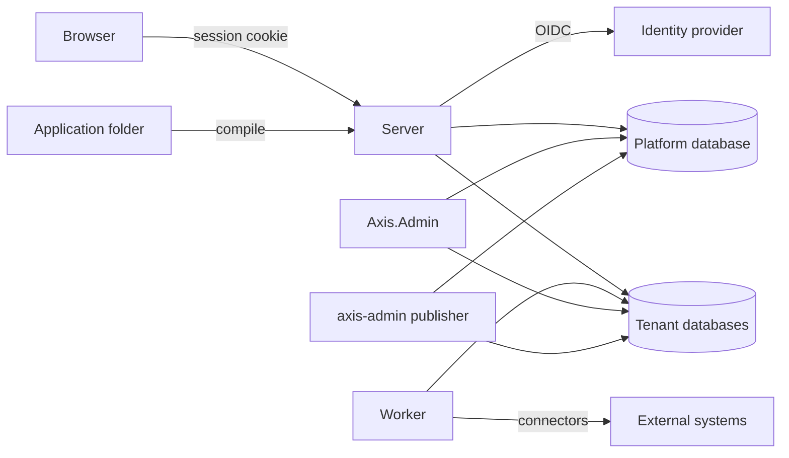

# Axis architecture

This is the target structure. Sections marked _(planned for Mx)_ describe work
that has not been built yet, as defined in
[delivery.md](delivery.md#keeping-the-docs-current). Decisions referenced as
Dn are in [decisions.md](decisions.md). Detailed behaviour is in
[reference/](reference/).

## Overview



- **Axis.Server** serves the SPA and hosts the authoring and runtime APIs.
  It is the BFF: the OIDC client and the cookie session. The record API, the
  data source endpoint, the process start endpoint, the task API and the site
  endpoints require a session.
  It also hosts Studio's
  [authoring API](reference/authoring.md), which works on the application
  folders that `Studio:Folders` lists and needs a session and the author role.
  Its routes that list applications, list, read, patch, create and delete resources, give
  diagnostics and answer where a resource or text key is used are built.
  Its routes that validate, publish and roll back are built too. They store a
  publish request in the tenant database over the runtime role. The server
  never activates a release in its own process, see
  [D47](decisions/d47-publishing-from-studio.md).
- **Axis.Worker** executes durable work. It serves health endpoints on its own
  address, see [health checks](#health-checks).
  It runs work items, and through them
  the `decision`, `task`, `operation` and `end` steps of process instances.
  Operation steps include `updateRecord`, `callConnector` calls with their
  retries and reconciliation, and package operations. `raiseEvent` steps raise
  events. Wait for event, timer and sub-process steps come later. It
  delivers raised events to async event triggers, see
  [events and triggers](reference/process-events.md). It also
  runs the backfill of pending computed fields, see
  [recomputing computed fields](reference/migrations.md#recomputing-computed-fields).
  It runs the occurrences of schedule triggers and their fan-out over the records
  of the trigger's data source, see [schedules](reference/process-events.md#schedules).
  It loads the installed extension packages at startup, as the server does.
  It runs the package operations that process steps call, see
  [extension packages](reference/extension-packages.md).
  It loads the same modules as the server.
- **Axis.Admin** is the console host that the platform
  operator runs. It creates tenants, migrates tenant databases, activates
  releases, and backs up and restores tenants. It is the only host that writes
  the [tenant directory](#tenant-directory), holds an admin connection to the
  database server, and holds the schema database role of a tenant under
  `Tenancy:Source=directory`. See
  [administration](reference/administration.md) and
  [D43](decisions/d43-tenant-provisioning-and-migrations-across-tenant-databases.md)
  and [D45](decisions/d45-tenant-backup-and-restore.md).
  Its `publisher` command is a long-running part of the
  same host. It reads the tenants as the server does, connects to each tenant
  database with that tenant's schema role, and runs the publish requests that
  Studio stores. It has no HTTP endpoint, and the server holds no tenant schema
  connection. The production installs, `scripts/dev.sh`, Docker Compose and the E2E
  script each start one. See
  [publisher](reference/administration.md#publisher) and
  [D47](decisions/d47-publishing-from-studio.md).
- **Platform database** stores installation-level data: the
  [tenant directory](#tenant-directory) in its `platform` schema, and platform
  settings _(both hosts read the tenant directory again every refresh
  interval, and the worker also reads the schema versions every poll round)_.
- **Tenant databases** hold everything else for one tenant: releases, system
  tables, process state, audit and the generated entity tables (D10).

## Repository layout

```text
src/
  Axis.Server/            ASP.NET Core host: API, BFF, SPA hosting
  Axis.Worker/            background host
  Axis.Scenarios.Runner/  library that runs an application's test scenarios, from a folder or from files in memory;
                          used by Axis.Scenarios and, later, by the publisher
  Axis.Scenarios/         console host over Axis.Scenarios.Runner that runs an application's test scenarios
  Axis.Admin/             console host for tenant provisioning, migrations, activation, backup and restore
  Axis.Core/              shared primitives: ids, results, clock, tenant context
  Axis.Configuration/     resource model, file loader, JSON Schemas, compiler, diagnostics, releases, extension package catalog
  Axis.Expressions/       expression parser, type checker, interpreter, SQL translation (M2)
  Axis.Data/              entity storage mapping, schema planning, record commands, data sources
  Axis.Processes/         work items, decision, task, operation and end steps, task API, the record command, connector calls, package operations, events, triggers and schedules, inbound endpoint starts
  Axis.Policy/            policy evaluation: entity, data source and process grants, record filters, field sets
  Axis.Presentation/      site/page/widget metadata served to the SPA
  Axis.Tenancy/           tenant resolution, connection factory, platform schema
  Axis.Extensions/        contracts for extension packages: operation interface, operation context
web/                      React + TypeScript SPA (Vite), Ant Design
tests/
  Axis.<Module>.Tests/    unit tests per module (Axis.Server.Tests, Axis.Configuration.Tests, Axis.Data.Tests, Axis.Expressions.Tests, Axis.Tenancy.Tests)
  Axis.Integration.Tests/ PostgreSQL (Testcontainers) and API integration tests
  Axis.PurchasingStub/    purchasing system stub for tests, scripts/dev.sh and Docker Compose
  packages/               test-only extension package, built as three versions; covers the capability limits
  e2e/                    Playwright journeys against the running server
    fixtures/e2e-app/     generic test application the E2E server activates
    fixtures/release-app/ application a spec activates during the run, to test releases
samples/
  apps/purchase-requests/ the first sample application, as configuration only
  keycloak/               the development Keycloak realm with the sample's users
  postgres/               init-roles.sql, which creates the axis_schema, axis_runtime and axis_scenario database roles, and the preview tenant's database and roles
  packages/               the sample extension package payment-references and its unit tests
deploy/
  compose/                production Compose example
  helm/axis/              Helm chart for Kubernetes
```

Projects are created when the first issue needs them. The solution holds
`Axis.Server`, `Axis.Core` (only the tenant context so far),
`Axis.Configuration`, `Axis.Data`, `Axis.Expressions` (the parser, type
checker, interpreter and SQL translation), `Axis.Extensions` (the contracts
for extension packages), `Axis.Policy` (the evaluation of entity, data source and process grants, record filters and field sets),
`Axis.Presentation` (the platform site, its texts and the
shapes of application site metadata), `Axis.Processes` (work items, the
`decision`, `task`, `operation` and `end` steps, the task API, the record command, connector calls, package operations, events, triggers and schedules, and inbound endpoint starts), `Axis.Scenarios.Runner` (the library that runs an application's test scenarios), `Axis.Scenarios` (the console host over it), `Axis.Tenancy`, `Axis.Worker`, the test projects, the sample extension package
`PaymentReferences` with its `PaymentReferences.Tests`, and `web/`.

## Module rules

- **Ownership.** Each module owns its tables and its public contracts. Other
  modules use only those contracts and never read another module's tables
  directly.
- **Dependency direction.** Dependencies point inward:
  - Hosts depend on modules.
  - Modules depend on `Axis.Core` and on other modules' contracts.
  - Nothing depends on a host.
- **Shared transactions.** A module that takes part in a step transaction
  receives the shared connection and transaction through a unit-of-work
  contract. Writes through EF Core and through Npgsql commit together.
- **Persistence boundary.** Engine logic does not depend on ASP.NET Core or on
  persistence details. It depends on small interfaces with infrastructure
  implementations (ports and adapters).
- **Commands and queries.** Commands enforce state transitions. Queries return
  authorized projections. Both use the same tenant database (no separate read
  store).

## Configuration pipeline

Moved to [reference/configuration.md](reference/configuration.md).

## Storage

Moved to [reference/storage.md](reference/storage.md).

## Record API

Moved to [reference/record-api.md](reference/record-api.md).

## Tenancy (D10)

- **Resolution.** `TenantContext` is resolved from the request host. For
  background work it is set from the work item's tenant ID.
- **Connections.** A connection factory returns connections only for the
  current tenant. Without a tenant context, data access fails.
- **Scoping.** Cache keys, file storage paths, job records and log scopes all
  include the tenant.
- **Tenant source.** The setting `Tenancy:Source` chooses between server
  configuration, the default, and the [tenant directory](#tenant-directory).
  Both hosts read the directory at start and again at every refresh. Under
  `directory` both ignore a `Tenants` section.

### Tenant configuration

The `Tenants` section of the server configuration is keyed by tenant id:

```json
"Tenants": {
  "default": { "Hosts": [ "localhost" ], "ConnectionString": "Host=...;Username=axis_runtime", "SchemaConnectionString": "Host=...;Username=axis_schema" }
}
```

Environment variables override it in the usual form, such as
`Tenants__default__ConnectionString` or `Tenants__default__Hosts__0`.

Each tenant also gets `SchemaConnectionString`, or
`Tenants__default__SchemaConnectionString` as an environment variable.
`ConnectionString` is for the runtime database role, and
`SchemaConnectionString` is for the schema database role. The server reads
both, and only startup activation uses `SchemaConnectionString`. The worker
never uses it and starts with only `ConnectionString`. This is a breaking
setting change: every installation must add the setting, and there is no
fallback to one connection string. `appsettings.Development.json`,
Docker Compose, `scripts/dev.sh` and the E2E server pass `axis_schema` in
`SchemaConnectionString` and `axis_runtime` in the other settings. See [database roles](reference/storage.md#database-roles) and
[D31](decisions/d31-separate-database-roles.md).
Under `Tenancy:Source=directory` there is no `SchemaConnectionString`: the
server and the worker hold only runtime database roles for tenant databases.
In those environments the server's `ConnectionStrings:PlatformSchema` also
uses `axis_schema`, for the platform migrations.
The server builds none from the directory.
`appsettings.Development.json` maps `localhost` to tenant `default` on the
compose database, and `preview.localhost` to its preview tenant `default-preview`
on the `axis_preview` database. The E2E server maps `127.0.0.1` to a tenant on the E2E
database, and `localhost` to its preview tenant. The E2E run maps `127.0.0.2` to the journey tenant on its own server. See
[preview tenants](reference/host-settings.md#preview-tenants). The `Platform` connection string is separate and still serves the
readiness check.

Startup fails with an `InvalidOperationException` naming every problem when:

- no tenant is configured;
- a tenant id contains anything other than lowercase letters, digits and
  hyphens;
- a tenant has no hosts, or a host entry that is blank or only whitespace;
- a tenant has no connection string, or one that is only whitespace;
- the same host is listed under two tenants, compared ignoring letter case;
- in the server, a tenant has no `SchemaConnectionString`, or one that is only
  whitespace. This applies even when no application folder is activated at
  startup;
- in the server, both connection strings name the same user;
- in the server and the worker, the runtime database role
  is a superuser, owns the `axis` or `entities` schema, or may create objects
  in either, or is a member of a role that is or may;
- a binding has a missing `Kind` or one other than `url` or `secret`, a blank
  `Value`, or is a `url` binding whose value is not an absolute `http` or
  `https` URL. The message names the tenant and the binding, never the value;
- outside Development, the configuration source that wins for a `secret`
  binding's `Value` is a file, such as `appsettings.json`. Environment
  variables, command-line arguments, mounted secret files and in-memory
  sources are allowed. The message names the tenant, the binding and the file,
  never the value;
- `PreviewOf` names a tenant that is not configured, or a
  tenant that is itself a preview tenant, or two tenants name the same main
  tenant, or a preview tenant has its own `Oidc` block. See
  [preview tenants](#preview-tenants).

A tenant also holds its deployment bindings under `Bindings`, keyed by name
and matched ignoring letter case. A release names a binding and never holds
its value. The server and the worker both read this section, so both must hold
the same bindings. `IDeploymentBindings` resolves a binding for the tenant of
the current request or work item only. Its `Resolve` returns a `url` binding,
and its `ResolveSecret` returns a `secret` binding as a `SecretValue`. A
`SecretValue` shows `[secret]` as text, as JSON and in logs. Its `Reveal`
returns the plain value at the moment of a call, and it is never read from
JSON. Without a tenant context, for a name the tenant lacks, or for a binding
of the other kind, both throw an `InvalidOperationException` that names the
binding and no value. So `Resolve` never hands out a plain secret. A secret's
`Value` comes from the environment, such as
`Tenants__default__Bindings__PurchasingSystemToken__Value`. See
[connectors and deployment bindings](reference/integration-resources.md#connectors-and-deployment-bindings)
and [D25](decisions/d25-connectors-deployment-bindings-and-secrets.md).

```json
"Bindings": {
  "PurchasingSystemUrl": { "Kind": "url", "Value": "https://purchasing.example.test/api" },
  "PurchasingSystemToken": { "Kind": "secret", "Value": "<from environment>" }
}
```

### Tenant directory

It follows
[D42](decisions/d42-tenant-directory-in-the-platform-database.md).
The server creates the `platform`
tables at start under both tenant sources. Under `Tenancy:Source=directory` it
then reads the tenants, their hosts, database settings, OIDC
settings and bindings from the `platform` schema over
`ConnectionStrings:Platform`. It uses the `active` tenants for host matching,
tenant connections, deployment bindings and sign-in. A password, the client secret
and a `secret` binding stay encrypted in memory and are decrypted only when a
connection opens, the sign-in client is set up or a binding is resolved. The
binding check runs on each read. On failure it names the tenant and the binding,
never the value. If the first load fails, the start stops with an error that names
`ConnectionStrings:Platform` and holds no password. An empty directory starts,
and every host answers `404` until a tenant is added and a refresh serves it.
Under `directory`, a non-empty `ActivateOnStartup` stops the start. Under
`directory` the worker reads the `active` tenants over
`ConnectionStrings:Platform` and runs their work on each tenant's own database,
with its decrypted runtime password. It never reads
`ConnectionStrings:PlatformSchema`. It stops at start when
`ConnectionStrings:Platform` is missing or `Tenancy:RefreshInterval` is invalid.
If the first read fails, it logs the failure once, retries every
`Worker:PollInterval` and is not ready until a read works. It ignores a
`Tenants` section and logs a warning. It also reads the schema version of every
tenant again at each poll round, and claims no work for a tenant whose version
is not its own, see the table below.

Both hosts read the directory again every `Tenancy:RefreshInterval`, without a
restart. A tenant added as `active` is served after the next refresh, once its
runtime database role check passes. A host of a `suspended` or `provisioning`
tenant answers `503`, and a removed host answers `404`. A changed database
setting gets a new connection pool. A tenant whose schema version is not the
server's is not served, see the table below. A refresh also updates sign-in. A tenant
added at a refresh gets its OIDC client and its endpoint caller scheme, a
changed OIDC setting applies at the next refresh, and a tenant that is no
longer served loses both. A failed refresh keeps the last good directory and
makes readiness Degraded. The worker claims no new work item of a tenant that
is no longer `active`, and a work item already claimed finishes. The worker runs
the refresh in its polling loop, between work items.

- **Two sources, one contract.** `Tenancy:Source` is `configuration`, the
  default, or `directory`. Both answer through one tenant catalog contract, so
  request resolution, tenant connections, deployment bindings and sign-in do
  not know the source. Under `directory` both hosts read tenants only from the
  `platform` schema of the platform database, see
  [platform database](reference/storage.md#platform-database), and a `Tenants`
  section is ignored. The start logs a warning when one is present.
- **Refresh.** Both hosts read the directory again every
  `Tenancy:RefreshInterval`, 30 seconds by default, see
  [tenancy settings](reference/host-settings.md#tenancy-settings). A changed
  host, database setting or OIDC setting applies at the next refresh.
- **Read only.** The hosts read the directory over a database role that may
  read the `platform` schema, and the server may also insert its data
  protection keys. [`Axis.Admin`](reference/administration.md)
  writes it, see
  [D43](decisions/d43-tenant-provisioning-and-migrations-across-tenant-databases.md).

What a host answers for a tenant, once the directory is in use:

| Case                                            | Answer                                                                                                                                                                                                                                                                                                                                                                                                                                                                                                                                                                                                                                     |
| ----------------------------------------------- | ------------------------------------------------------------------------------------------------------------------------------------------------------------------------------------------------------------------------------------------------------------------------------------------------------------------------------------------------------------------------------------------------------------------------------------------------------------------------------------------------------------------------------------------------------------------------------------------------------------------------------------------ |
| An `active` tenant                              | The tenant is served after the next refresh, once the runtime database role check passes. Its OIDC client and its endpoint caller scheme are registered then.                                                                                                                                                                                                                                                                                                                                                                                                                                                                              |
| A `suspended` or `provisioning` tenant          | `503` problem details (`application/problem+json`) titled "This tenant is not available.". It names no tenant and no host. The worker claims none of its new work, and work already claimed finishes.                                                                                                                                                                                                                                                                                                                                                                                                                                      |
| A tenant whose schema version is not the host's | `503`, like a suspended tenant, from the first directory refresh that reads the other version. The server logs one warning when a tenant joins this state. The worker re-reads the schema versions at each poll round and claims none of its work, new or old. It starts again once `Axis.Admin migrate` has brought the tenant to the worker's version, with no restart. The schema version is the newest EF Core migration that `Axis.Admin migrate` applied, see [administration](reference/administration.md#migrate). The server registers its sign-in client when the refresh serves it, so it can sign people in without a restart. |
| A removed or unknown host                       | `404`, as today.                                                                                                                                                                                                                                                                                                                                                                                                                                                                                                                                                                                                                           |
| A refresh that fails                            | The last good directory stays in use and one error is logged for each run of failed refreshes. Readiness is Degraded until a refresh works, see [health checks](#health-checks). A tenant suspended during the outage keeps running until a refresh works.                                                                                                                                                                                                                                                                                                                                                                                 |
| The first load fails                            | The server stops its start. The worker waits and retries, and is not ready until the first load works.                                                                                                                                                                                                                                                                                                                                                                                                                                                                                                                                     |

- **New tenants.** A tenant that first appears at a refresh is served only
  after the runtime database role check passes, see
  [database roles](reference/storage.md#database-roles). Until then it answers
  `503`, like a suspended tenant, and the check runs again at each refresh. The
  worker skips such a tenant, logs an error and runs the check again at each
  refresh. A failed check does not stop the worker.
  The same holds for a tenant that becomes `active` again, and for a served
  tenant whose database host, port, name, runtime user or runtime password
  changes. It answers `503` until the check passes on the new settings. Then
  the server drops its old connection pool, and the next request opens one
  with the new settings. The check runs only when the directory changes, so
  privileges granted inside the database with no directory change are not
  caught until a restart. A tenant whose `Oidc` authority, client id or client
  secret is blank at a refresh is withheld in the same way. It answers `503`,
  the server logs the missing setting, and the other tenants keep working.
  `Axis.Admin` creates, migrates, grants and activates the database of a
  tenant, and the server does none of it, see
  [administration](reference/administration.md).
- **Health exemption.** Paths under `/health` stay exempt from resolution.

### Preview tenants

A preview tenant is a tenant that belongs to one main
tenant. An author tries an application there before publishing it to the main
tenant. See [D48](decisions/d48-preview-tenants.md). Under
`Tenancy:Source=configuration` and under `directory`, `PreviewOf`, sign-in and
bindings work. Status rules and publishing are built too.

- **One main tenant, one preview.** A preview tenant belongs to one main tenant,
  and a main tenant has at most one preview tenant. A preview tenant has no
  preview of its own.
- **A tenant like any other.** A preview tenant has its own database, database
  roles, hosts and bindings. Its data never mixes with the main tenant's. Hosts
  resolve it like any tenant's, and a session is still bound to the tenant it
  signed in on, see [tenant binding](reference/security.md#sign-in-and-the-session).
- **Where it is set.** Under `configuration`, the tenant setting `PreviewOf`
  names the main tenant, see
  [preview tenants](reference/host-settings.md#preview-tenants). Under
  `directory`, the entry names it in `platform.tenants.preview_of`, and the
  operator creates it with
  [`tenant create --preview-of`](reference/administration.md#tenant-create). The
  entry stores no sign-in settings. The catalog copies the main tenant's at each
  refresh.
- **Sign-in.** A preview tenant uses its main tenant's authority, client id,
  client secret and claim names. It does not use `Oidc:EndpointAudience`, so it
  accepts no machine-caller token. The operator registers the preview host's
  redirect address at the identity provider.
- **Bindings.** A preview tenant's bindings are its own and empty by default.
  A missing binding is a warning at activation there, not an error, see
  [deployment bindings](reference/integration-resources.md#deployment-bindings).
- **Status.** Each tenant keeps its own status. Suspending a main tenant does
  not suspend its preview tenant.
- **Publishing.** Studio on the main tenant's host stores a preview request in
  the main tenant's database. The publisher runs it against the preview tenant.
  The server never opens a connection to another tenant's database. See
  [preview](reference/authoring.md#preview).

### Request resolution

- **Host matching.** Middleware in `Axis.Server` runs before static files and
  endpoints. It matches `Request.Host.Host` against the configured hosts,
  ignoring letter case. The port is ignored, so `A.Example.TEST:8443` matches
  `a.example.test`.
- **Behind a proxy.** From a proxy named in the
  [forwarded headers settings](reference/host-settings.md#forwarded-headers),
  the host matched is the forwarded host. From any other address it is the
  request's own `Host`.
- **Unknown host.** The response is `404` problem details
  (`application/problem+json`) titled "No tenant is configured for this
  host." It names neither the requested host nor any configured tenant or
  host. This covers API and SPA paths alike.
- **Health exemption.** Paths under `/health` are not resolved, so
  `/health/live` and `/health/ready` answer for any host.
- **Tenant not available.** Under `Tenancy:Source=directory`, a host of a tenant that is not `active` answers
  `503` problem details titled "This tenant is not available.". It names
  neither the tenant nor the host. See [tenant directory](#tenant-directory).
- **Log scope.** While a resolved request runs, the logging scope carries
  `TenantId` with the tenant id.

### Tenant connections

- `ITenantConnectionFactory` opens connections to the current tenant's
  database only. Without a tenant context it throws
  `InvalidOperationException`.
- There is one `NpgsqlDataSource` per tenant. It is created on first use and
  disposed with the host.
- The current tenant is held per asynchronous flow (`AsyncLocal`), so
  concurrent requests never see each other's tenant.
- In the server, a request scope holds one tenant connection, opened on first
  use and disposed with the scope. The module contexts and raw commands share
  it.

## Authentication and authorization

- **Authentication (D9, D23).**
  - The server is the OIDC confidential client.
  - The browser gets a secure, HttpOnly, SameSite cookie session.
  - API writes are protected against CSRF by a required header.
  - Tests and local development use Keycloak in a container.
  - See [Sign-in and the session](reference/security.md#sign-in-and-the-session).
  - Other systems call inbound endpoints with a bearer token instead of the
    session. See [Machine callers](reference/security.md#machine-callers).
- **Authorization (D12, D24).**
  - The record API, the data source endpoint and the process start endpoint
    call the policy module with the entity, data source or process and the
    action. The task API calls it for the fields a task shows. The site
    endpoints call it to shape navigation and page metadata. `GET /api/me`,
    `GET /api/site`, `GET /api/texts/{locale}` and the `/api/auth` endpoints
    carry no application content and call no policy. Worker steps run as `system`,
    outside policies.
  - The [authoring API](reference/authoring.md) checks
    `Studio:AuthorRole`, an installation-level role outside application
    policies, and calls no policy. An author can change every policy of an
    application, so a policy cannot guard authoring. See
    [Studio settings](reference/host-settings.md#studio-settings).
  - Record filters from policies limit every record list and single-record
    check of the record API, data source queries and the subject record of a
    process start.
  - Field policies leave out fields from record API results, data source
    rows, task forms and page metadata, and reject record API writes to
    protected fields.
  - See [Authorization](reference/security.md#authorization).
- **Details.** Sign-in, machine callers, authorization and the
  [development users](reference/security.md#development-users) are in
  [security.md](reference/security.md).

## Process engine (D11)

- **Release pinning.** New work starts on the active
  release, and running work keeps its steps, tasks, forms, texts and package
  versions until it ends. Roles and policies use the active release, see
  [releases and running work](reference/processes.md#releases-and-running-work)
  and [D29](decisions/d29-release-pinning-and-text-resources.md).
- **State.** Instances and step occurrences are rows in the tenant database.
  There is no in-memory state that matters after a crash.
- **Step transactions.** A step transition loads the instance at its current
  revision, executes, and in one transaction writes:
  - business writes
  - the new instance state and revision
  - the step history
  - audit records
  - the next work item
  - staged connector calls and their work items
  - event occurrences, their delivery work items and sync trigger starts

  A revision mismatch aborts the transaction.

- **Workers.** Workers claim ready work with `FOR UPDATE SKIP LOCKED` and a
  lease. Commits check the claim token (fencing). Claims and fencing are
  built for work items and publish requests.
- **External operations.** These run outside the transaction, using the
  operation identity as their idempotency key. The result is recorded by a
  following transaction. A `callConnector` step stages its call in its
  transaction, and the worker sends it and records its result in a
  following transaction. An attempt that is safe to retry is retried under
  the step's retry policy, with the same identity. An unknown outcome is
  reconciled through the operation's lookup. See
  [connector calls](reference/process-execution.md#connector-calls). A package
  operation step is staged and run the same way, see
  [package operations](reference/process-execution.md#package-operations).
- **History.** Every attempt, input, output, decision and error is recorded
  for inspection.

The step transactions, the revision check and the history are built for
`decision`, `task`, `operation` and `end` steps, for the staging and the call
of `callConnector` steps, for `raiseEvent` steps with their sync trigger
starts, and for package operation steps, see
[Running a step](reference/process-execution.md#running-a-step).
The process resource, the start endpoint, the instance and task states, the
task API, the worker settings and the tables are in
[reference/processes.md](reference/processes.md).

## Telemetry

The server and the worker emit correlated logs, metrics and traces with
OpenTelemetry and W3C trace context. Traces and their stored correlation are
built. So are the OTLP logs, the log scope, the problem details `traceId`,
the standard metrics and the work item duration, process instance and call
attempt metrics and the work item and pending computed field gauges. See
[D36](decisions/d36-correlated-logs-metrics-and-traces.md).

### Signals and export

Both hosts export traces, logs and metrics over OTLP. The standard `OTEL_*`
variables set the export, see
[Telemetry export](reference/host-settings.md#telemetry-export). With no
endpoint, nothing is exported and logs still go to the console. Docker Compose
and `scripts/dev.sh` start no collector. The scenario runner, `Axis.Scenarios`,
is not part of this design.

### Standard instrumentation

- **ASP.NET Core.** Each incoming request is a span. The server follows an
  incoming `traceparent`, as the standard says, so a caller can choose the
  trace id stored with its request.
- **HttpClient.** Each outgoing call is a span, and carries `traceparent`.
  The purchasing system receives it, so both sides can find a call. An
  outgoing span never names a bound address: it drops `server.address`,
  `server.port` and `url.query`. A connector call's `url.full` is the
  operation's path template with `{idempotencyKey}` left unexpanded. Other
  outgoing spans, such as a package operation's calls and the sign-in calls to
  Keycloak, have no `url.full`. A trace processor in each host removes these
  attributes when the span ends, before any exporter sees it.
- **Npgsql.** Each command is a span. It keeps the statement text without
  parameter values. Axis never calls `EnableParameterLogging`, and no
  connection string sets `Include Error Detail`.
- **Metrics.** The standard ASP.NET Core, HttpClient, DNS and .NET runtime
  metric sets. The HttpClient and DNS metrics keep only `error.type`,
  `http.connection.state`, `http.request.method`, `http.response.status_code`,
  `network.protocol.version` and `url.scheme`. So `server.address`,
  `server.port`, `network.peer.address` and `dns.question.name` never reach an
  exporter. The Axis metrics are in
  [worker metrics](reference/process-execution.md#worker-metrics). The server's tenant
  database gauge is in [health checks](#health-checks).

### Axis spans

| Span                     | Where             | Attributes                                                                                    |
| ------------------------ | ----------------- | --------------------------------------------------------------------------------------------- |
| `axis.activation`        | server            | `axis.tenant`, `axis.application`                                                             |
| `axis.work_item.run`     | worker            | `axis.tenant`, `axis.work_item.kind`, `axis.outcome`. A link to the span that queued the item |
| `axis.process.step`      | server and worker | `axis.tenant`, `axis.application`, `axis.process`, `axis.step`                                |
| `axis.connector.attempt` | worker            | `axis.tenant`, `axis.application`, `axis.connector`, `axis.operation`, `axis.outcome`         |
| `axis.connector.lookup`  | worker            | `axis.tenant`, `axis.application`, `axis.connector`, `axis.operation`, `axis.outcome`         |
| `axis.package.call`      | worker            | `axis.tenant`, `axis.application`, `axis.package`, `axis.operation`, `axis.outcome`           |

- **Outcomes.** A call span's `axis.outcome` is a call outcome class:
  `succeeded`, `retryable`, `failed` or `unknown`, see
  [call outcomes](reference/process-execution.md#call-outcomes). A work item run's
  outcome is `completed`, `failed` or `fenced`.
- **Links, not children.** A work item stores the trace id and span id of the
  transaction that queued it. Its run starts a new trace with a link to that
  span. Instances wait for days, so a child span would join work days apart
  into one trace. One trace per run stays readable.
- **Errors.** An Axis span that fails records the exception type only, with no
  message.

### Logs

The console always gets logs. OTLP gets them too when an endpoint is set. Each
record carries `TraceId` and `SpanId` in its scope, next to the `TenantId` of
the [log scope](#request-resolution). The console shows scopes, so an operator
can go from a reported `traceId` to its logs with no collector.

- **Failed steps.** A step failure logs the step name, the instance id and the
  same fixed text the step history row stores. It names the error kind, such
  as `DivisionByZero`, and never a value.
- **Failed work items.** A failed work item logs its kind, its id and the
  exception type only. The exception message and its inner exceptions can quote
  a record value, so the log leaves them out.
- **Skipped trigger starts.** A trigger that skips a start because its `when`
  or start condition hit a run-time error logs the error kind, never the
  error message.

### Correlation

- **Problem details.** Every problem details answer carries
  a `traceId`, see [Errors](reference/record-api.md#errors).
- **Stored history.** Step history rows and call attempt rows store the
  `trace_id` of their run, see [Tables](reference/processes.md#tables). A
  row written with no current span stores null. `traceId` and `trace_id` hold
  the same value, the 32-hex W3C trace id.

So a user reports a `traceId`, and an operator searches the history for it.
Finding one user's failed request goes through the stored history, not the
traces, because telemetry holds no user id.

### What telemetry never holds

- Field values, sensitive or not.
- Secrets.
- Binding values.
- Request and response bodies.
- User ids.
- Npgsql parameter values.
- Exception messages on Axis spans. They hold the type only.

Attributes and log texts name things: the tenant, application, process, step,
connector, package, operation and work item kind. Expression and step log
texts are fixed and hold names, not values. Statement text in Npgsql spans
holds table and column names.

## Health checks

The server's `/health/live` and `/health/ready` work as described below, as
[D37](decisions/d37-health-checks-for-the-server-and-the-worker.md)
says.

**The answer.** Each endpoint answers JSON of the form
`{ "status": "Healthy" | "Degraded" | "Unhealthy" }` and nothing else.
`/health` needs no session, so the answer names no tenant, database or error.
Healthy and Degraded answer `200`, so a degraded host still passes a readiness
probe. Unhealthy answers `503`.

**Server `/health/live`.** It runs no checks. It is Healthy while the process
answers requests, with status `200`. It is never Degraded or Unhealthy.

**Server `/health/ready`.**

| Status    | HTTP  | When                                                                                                                |
| --------- | ----- | ------------------------------------------------------------------------------------------------------------------- |
| Healthy   | `200` | The platform database answers, startup activation has finished for every tenant, and every tenant database answers. |
| Degraded  | `200` | The platform database answers and activation has finished, but at least one tenant database does not answer.        |
| Unhealthy | `503` | The platform database does not answer, or startup activation has not finished for every tenant.                     |

Under `Tenancy:Source=directory`, the rows above hold
until the first load of the [tenant directory](#tenant-directory) has worked.
The server does not listen before that. After the first load, a platform
database that does not answer is a failed refresh, and it makes the server
Degraded (`200`), not Unhealthy. So does a refresh that fails while the platform
database still answers. The server then keeps serving from the last good
directory. Readiness returns to Healthy at the next refresh that works. Under
`directory`, no startup activation runs, because `ActivateOnStartup` must be
empty, so "startup activation has finished" holds from the start.

- A tenant on another schema version than the server's is not served, so it
  counts neither against readiness nor as a tenant database that does not
  answer. One tenant whose migration failed cannot keep a deploy from being
  ready.
- One tenant database that is down makes the server Degraded and not
  Unhealthy, so one tenant cannot take the others offline, see
  [tenancy](#tenancy-d10). Requests for that tenant fail and the others work.
- The tenant database checks run in parallel, and each gives up after 2
  seconds. A database that has not answered by then counts as not answering,
  so a hung database makes the server Degraded and does not stall the probe.
- The tenant is named in a warning in the logs on every probe, and in the
  gauge `axis.tenant.database.available`, never in the answer. The gauge is
  labelled `axis.tenant` with the tenant id. It is 1 when the tenant database
  answered the last probe and 0 when it did not. A scrape reads it from memory,
  so it never queries a tenant database. Before the first probe a tenant has no
  point.
- Today the server does not listen until startup activation has finished, see
  [startup activation](reference/host-settings.md#startup-activation). So a
  probe gets no answer in that time. The activation rule matters once the
  server listens earlier.

**Worker.** The worker serves only `/health/live` and `/health/ready`, on the
address `Health:Urls`. The default is `http://127.0.0.1:5208`, so nothing
outside the host reaches it until someone changes the setting. See
[worker settings](reference/process-execution.md#worker-settings). A tenant database
that stops answering after the worker saw it migrated is only logged, and does
not make the worker Degraded. Under `Tenancy:Source=directory`, the worker
answers `503` on `/health/ready` until its first read of the
[tenant directory](#tenant-directory) has worked, while `/health/live` stays
`200`. A failed refresh of the directory makes the worker Degraded (`200`),
and the worker keeps running the last good read. It is Healthy again after the
next refresh that works.

A tenant that waits for its schema version, see
[tenant directory](#tenant-directory), counts as ready for `/health/ready`, and
the worker stays Healthy while it waits. One tenant whose migration failed
cannot keep the worker from being ready.

The loop counts as stalled when it has not polled within twice
`Worker:LeaseDuration`, one minute by default. A poll interval would be too
short, because one work item can run for up to a lease.

| Endpoint        | Status    | HTTP  | When                                                                                                                                                  |
| --------------- | --------- | ----- | ----------------------------------------------------------------------------------------------------------------------------------------------------- |
| `/health/live`  | Healthy   | `200` | The loop has polled within twice `Worker:LeaseDuration`.                                                                                              |
| `/health/live`  | Unhealthy | `503` | The loop has not polled within that time, so an orchestrator restarts the worker.                                                                     |
| `/health/ready` | Healthy   | `200` | Every tenant database has its processes migrations, and the loop has polled within twice `Worker:LeaseDuration`.                                      |
| `/health/ready` | Degraded  | `200` | A refresh of the tenant directory failed, and the last good read stays in use.                                                                        |
| `/health/ready` | Unhealthy | `503` | A tenant database lacks its processes migrations, the first read of the tenant directory has not worked, or the loop has not polled within that time. |

**Docker Compose.** The worker gets a health check on `/health/ready`. It runs
inside the container, and Compose does not publish the worker's health port.
The production Compose example has no container health checks, because the
production images hold no `curl`. It publishes the worker's health port on
`127.0.0.1` only, for probes from the host.

## Installation

Axis ships as three production images, as
[D44](decisions/d44-packaging-for-on-premises-and-cloud-installation.md)
says. The images, the Compose example and the chart are built.

- `axis-server` and `axis-worker` run the hosts. They hold no sample and no
  development setting.
- `axis-admin` runs `Axis.Admin` and holds the PostgreSQL 18 client tools.
  It also runs the publisher, `axis-admin publisher`.
- `deploy/compose/` and `deploy/helm/axis/` install them on one machine and on
  Kubernetes.

See the [installation guide](reference/installation.md) for the steps, every
setting and the upgrade order.

## Frontend

Moved to [reference/frontend.md](reference/frontend.md).

Ant Design is a detail of the SPA. It never shows in configuration, page
metadata, theme tokens or the custom widget API, see
[D58](decisions/d58-ant-design-is-a-detail-of-the-spa-without-procomponents.md).

## Testing

| Level         | Tooling                                        | Scope                                                                                                                                                                                                                                                                                                                                                                       |
| ------------- | ---------------------------------------------- | --------------------------------------------------------------------------------------------------------------------------------------------------------------------------------------------------------------------------------------------------------------------------------------------------------------------------------------------------------------------------- |
| Unit          | xUnit                                          | Compiler, expression engine, policy evaluation, pure logic                                                                                                                                                                                                                                                                                                                  |
| Integration   | xUnit + Testcontainers PostgreSQL and Keycloak | Storage, transactions, concurrency, tenancy isolation, engine recovery, the development realm                                                                                                                                                                                                                                                                               |
| Frontend unit | Vitest + Testing Library                       | Shared components and metadata rendering                                                                                                                                                                                                                                                                                                                                    |
| End to end    | Playwright                                     | Real server + real database + SPA, user journeys and denied access                                                                                                                                                                                                                                                                                                          |
| Scenario      | Axis.Scenarios + Testcontainers PostgreSQL     | Configuration-level tests of an application. Record actions, process starts, task completions and the `expect` steps run, with `now` fixing the time. Stubs answer the calls to connectors and packages. Event deliveries run, so `async` event triggers start their processes. Schedule triggers run through `advanceTime`, which moves `now` and runs every due work item |

Every acceptance criterion maps to at least one of these. The exact commands
are fixed in M0 and listed in [AGENTS.md](../AGENTS.md).

Playwright specs find elements by role, accessible name and ARIA state, and never
select a class of the UI library. `scripts/lint.sh` fails when a file under
`tests/` names a class that starts with `ant-`.

Only `*PerformanceTests` classes may assert on elapsed time, because they run alone.
Other tests prove a bound with a count, such as the steps used or the nodes inlined, and
show that nothing waited through an outcome. `scripts/lint.sh` fails when a test file
that is not named `*PerformanceTests.cs` uses `Stopwatch`, `.Elapsed` or `GetElapsedTime`.
A polling deadline built on `DateTime.UtcNow` only ends a wait and is allowed.

`scripts/integration.sh` runs the scenarios of every application under
`samples/apps/` and of every sample template under `samples/templates/` from the
integration tests, on their Testcontainers PostgreSQL. See
[test scenarios](reference/test-scenarios.md).

The integration tests share one Keycloak container with the development realm
per run. It starts the first time a test needs it, so a run with no such test
starts none. It is removed when the run ends. A test class never starts its own
Keycloak. A test that changes realm state must not use the shared container.

The integration tests also share one PostgreSQL 18 container per run. It starts
the first time a test needs it, so a run with no such test starts none, and it is
removed when the run ends. Each test class works in its own new database on that
server, and every database a fixture creates has a name unique in the run. A
fixture never starts its own container. Tenant isolation tests still use one
tenant database per tenant. Tests that read `pg_stat_activity` must filter on
`current_database()`, so they do not see or end other classes' sessions.

Some doc facts are checked by machine. `scripts/lint.sh` checks every relative
Markdown link and `#anchor` in the repository. Unit tests in
`Axis.Configuration.Tests` compare the diagnostic code table and the resource
kinds in the [configuration pipeline](reference/configuration.md#configuration-pipeline) with
`DiagnosticCodes`, `ResourceKinds` and the schema files. They find them by
heading or table header, so the sections may move within `docs/`.

The E2E server starts with four applications listed in `ActivateOnStartup` (see
[Startup activation](reference/host-settings.md#startup-activation)), so Playwright journeys run against
real metadata and records:

- the generic test application in `tests/e2e/fixtures/e2e-app`, for the
  platform journeys;
- the purchase request sample in `samples/apps/purchase-requests`, for the
  purchase request skeleton journeys;
- the leave request sample in `samples/apps/leave-requests`, for the leave
  request journeys;
- the service desk sample in `samples/apps/service-desk`, for the service
  desk journeys.

The E2E server's `Studio:Folders` does not list that sample. It lists a copy
that `scripts/e2e.sh` makes in a temporary folder for each run and deletes on
exit, and passes in `AXIS_E2E_STUDIO_FOLDER`. No spec writes to that copy, so a
spec that saves a resource in Studio never changes a file under `samples/`.

A spec that writes a Studio folder gives it a folder of its own. It copies the
committed sample, or another folder it made, into a temporary folder, starts a
server over that folder with `startServer`, and deletes the folder and stops the
server when it ends. Tests in one file that change the same folder run in order,
in one worker, under `test.describe.configure({ mode: 'default' })` or
`serial`. No spec opens Studio on the main E2E server or names its folder,
except `studio-new-application`. That spec only reads the main folder, to check
that the main server offers no New application button.

The Studio specs use these folders:

- `studio`, `studio-form-editor`, `studio-page-editor`, `studio-process-editor`,
  `studio-scenario`, `studio-new-resource` (without `texts/vi.json`) and
  `studio-tests`: a temporary copy of `samples/apps/purchase-requests`.
  `studio-tests` also copies it again for its server with `Studio:Tests` off.
- `studio-module-entity`: a temporary copy of `samples/apps/leave-requests`.
- `studio-new-application`, `studio-page-containers` and
  `studio-page-parameters`: a temporary `Studio:ApplicationsPath`.
- `studio-entity-migrations` and `purchase-request-release`: folders under the
  test's output path.
- `service-desk-journey` and `journey-tenant`: each its own application under
  the journey server's applications folder, `AXIS_E2E_JOURNEY_APPLICATIONS`.

A spec can also activate another folder during the run, to test releases. The
helper `tests/e2e/activate.ts` starts the built server once more on a spare
port, with the same settings as the E2E server and that folder in
`ActivateOnStartup`. It waits until `/health/ready` answers, then stops that
server. The E2E server reads the active release on each request, so it serves
the new release at once. The helper throws an error with the server output when
the folder does not activate. Only the spec that needs it uses
`tests/e2e/fixtures/release-app`, so the other specs see no change.

The E2E run also starts the worker against the same database, with a 5 second
lease. Its output goes to `artifacts/logs/e2e-worker.log`. A spec can restart
the worker: it writes the restart file that `scripts/e2e.sh` names, then stops
the worker process, and the script starts a new one. A worker that stops with
no restart request fails the run.

The E2E run also serves a third tenant, `journey`, for Studio journeys. `scripts/e2e.sh` creates its
database `axis_journey` and its roles `axis_journey_schema` and `axis_journey_runtime` through `psql`, so Docker
Compose, `scripts/dev.sh` and `init-roles.sql` stay as they are. A second server serves it on the loopback
address `127.0.0.2`, because the worker and the publisher reject two tenants that share a host. Playwright
starts that server after the main one, so the platform migrations of the two never race, and the two share the
platform database. The journey server runs in the `Testing` environment, because
`appsettings.Development.json` would add the `default` tenant, the startup activation and the Studio folders.
It sets `Studio:ApplicationsPath` to a temporary folder and has no preview tenant or bindings. Only startup
activation migrates a tenant database, so it activates one application at start,
`tests/e2e/fixtures/journey-base`, which holds only a manifest. It clashes with no sample. A journey therefore builds a whole application in Studio and publishes it, with no clash with
the committed samples on the main tenant. The setup step signs the author, the requester, the service desk lead
and the agent in on the journey host and saves those sessions apart from the sessions of the main host. The
worker and the publisher serve the journey tenant too, and the run fails when the worker log lacks
`Tenant journey is ready for work` or the publisher log lacks `journey ready`. The server output goes to
`artifacts/logs/e2e-journey-server.log`.

`tests/e2e/specs/service-desk-journey.spec.ts` builds the service desk on the journey tenant with Studio only, and
never opens the JSON view. It builds the whole data
model: the application, its `en` and `vi` texts, the three roles, the `TicketNumber` sequence, the `Category` and
`Ticket` entities and the `Categories` seed. The entity designer asks a migration question even for a new entity,
because the starter field `name` is renamed to `number`. The journey answers Drop data, then deletes the `Ticket`
migration in Studio, because the sample has no migration and release 1 is the first release, so it needs none. The built
`migrations` folder must be empty at the end. Studio cannot remove a text key yet, and the starter keys of a blank
application are not in the sample. So the journey deletes the starter `en` text resource and creates it again.
The journey then builds the `MyTicketList` and `AllTicketList` data sources, the `TicketTriage`, `TicketResolution` and
`TicketConfirmation` forms, and the `TicketHandling` process in the process editor. Every expression is typed in the
expression editor. It then builds the four pages in the page editor and finishes the site that the blank application
already has: the `vi` locale and three navigation entries. It deletes the starter `Home` page, because the sample has
none. It builds the three access policies in the policy matrix, with their record filters and the field list that keeps
the requester from editing `resolution`. It then writes the six test scenarios in the scenario editor, each with its users, time and steps. Where a step names the Hardware category, the journey types the record id that the Categories seed grid shows. Each scenario must save with no error diagnostic. At the end the whole built folder must match `samples/apps/service-desk`, and it must have no error diagnostic. Only resource ids, seed record ids (paired by position) and key order may differ.
The journey then runs the six scenarios with Run tests, and every one must pass. It publishes release 1, and the release history must show that one row, active. On the `service-desk` site of the journey tenant, anna creates and submits a ticket, linh assigns it to khoa, khoa resolves it and anna confirms it, until the ticket's status is `closed`.

The E2E run also starts the purchasing system stub from the build output, and
fails if it does not answer. Specs find it at `AXIS_E2E_PURCHASING_URL`. Its
output goes to `artifacts/logs/e2e-purchasing.log`.

The E2E server and worker run in the `Development` environment, because only
Development lets a connector call an `http` URL. Their `PurchasingSystemUrl`
and `PurchasingSystemToken` bindings point at the stub, so an approved
purchase request creates its purchase order there.

### Purchasing system stub

`tests/Axis.PurchasingStub` stands in for the external purchasing system that
the purchase request sample's connector calls. It is a test fixture, not
platform code, and references nothing under `src/`. The E2E run,
`scripts/dev.sh` and Docker Compose start it. Its orders live in memory only.

- `POST /purchase-orders` with an `Idempotency-Key` header and a body with
  `requestNumber`, `supplierCode` and `amount` creates an order. It answers
  `201` with an `orderNumber` such as `PO-2026-0001`. A repeat with the same
  key answers `200` with the same order and stores nothing new. A create
  without the key, `requestNumber` or `amount` is a `400`.
- `GET /purchase-orders/by-key/{idempotencyKey}` answers `200` with the
  `orderNumber`, or `404` when the key is unknown.
- `GET /purchase-orders` lists every stored order in creation order.
- `POST /test/drop-next` drops the response of the next create.
  `POST /test/drop/{idempotencyKey}` drops the response of the first create
  with that key. A dropped create stores the order, then closes the connection
  without answering. Each drop happens once, so the retry gets the stored order
  back, as in the [lost response](reference/process-execution.md#lost-response) flow.
  `drop-next` affects the whole stub, so specs that run in parallel should drop
  by key or by request number.
- `POST /test/drop-request/{requestNumber}` drops the response of the first
  create for that `requestNumber`, such as `PR-2026-00042`. A spec knows the
  request number as soon as it creates the request, but not the idempotency
  key, which only the worker knows. Specs that run in parallel can use it,
  since each request has its own number.
- `POST /test/hold-request/{requestNumber}` holds back the response of the
  first create for that `requestNumber`. The held create stores its order
  first, then answers only when
  `POST /test/release-request/{requestNumber}` is called or the caller hangs
  up. Tests use it to stop or overtake a worker while its call is still
  running.
- `POST /test/unknown-request/{requestNumber}` makes the purchase order call
  for that `requestNumber` end `unknown` and stay so. The first create stores
  its order but answers `201` without an `orderNumber`, and every lookup for
  the request answers `503`. A dropped response would not do, because the
  connector declares `idempotency`, so the worker sends the call again under
  the same key and it succeeds. Only a `2xx` body that does not fit the output
  goes straight to reconciliation. An operator then
  [resolves](reference/process-inspection.md#resolve) the call. The switch has no off
  endpoint, since each spec uses its own request number.
- Each drop and each hold happens once. Each test endpoint answers `204`.
- `GET /health` answers `200`.

The stub ignores the `Authorization` header.
