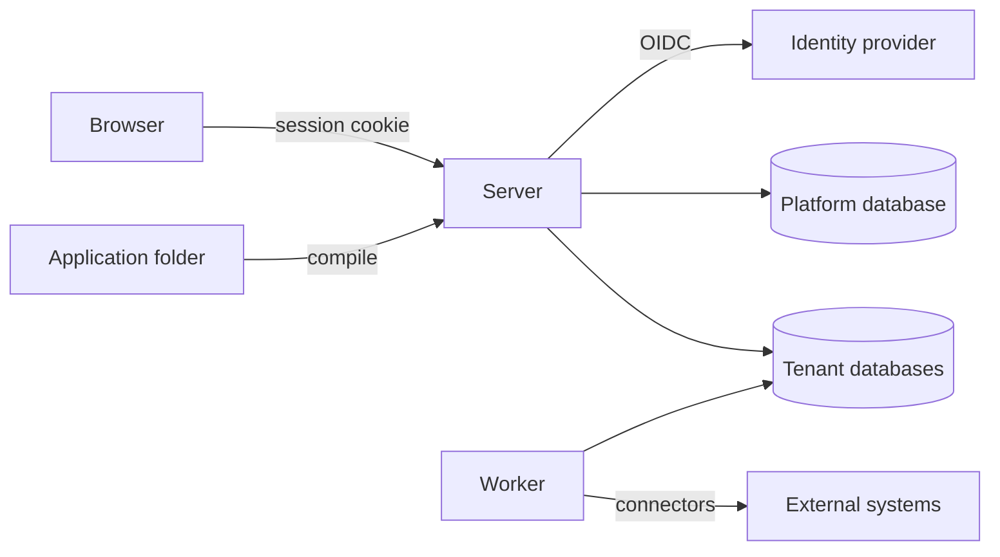

# Axis architecture

This is the target structure. Sections marked *(planned for Mx)* describe work
that has not been built yet, as defined in
[delivery.md](delivery.md#keeping-the-docs-current). Decisions referenced as
Dn are in [decisions.md](decisions.md). Detailed behaviour is in
[reference/](reference/).

## Overview



- **Axis.Server** serves the SPA and hosts the authoring and runtime APIs.
  It becomes the BFF (OIDC client and cookie session) *(planned for M4)*.
- **Axis.Worker** executes durable work. So far it runs work items, and
  through them the `decision`, `task`, `operation` and `end` steps of process
  instances. Wait for event, timer and sub-process steps come later. Outbox
  delivery, triggers and schedules come later *(planned for M5)*. It loads the
  same modules as the server.
- **Platform database** stores installation-level data: the tenant directory
  and platform settings *(tenant directory planned for M9; tenants come from
  server configuration until then)*.
- **Tenant databases** hold everything else for one tenant: releases, system
  tables, process state, audit and the generated entity tables (D10).

## Repository layout

```text
src/
  Axis.Server/            ASP.NET Core host: API, BFF, SPA hosting
  Axis.Worker/            background host
  Axis.Core/              shared primitives: ids, results, clock, tenant context
  Axis.Configuration/     resource model, file loader, JSON Schemas, compiler, diagnostics, releases
  Axis.Expressions/       expression parser, type checker, interpreter, SQL translation (M2)
  Axis.Data/              entity storage mapping, schema planning, record commands, data sources
  Axis.Processes/         work items, decision, task, operation and end steps, task API; outbox (M5)
  Axis.Policy/            roles, policies, evaluation (M4)
  Axis.Presentation/      site/page/widget metadata served to the SPA
  Axis.Tenancy/           tenant resolution, connection factory
web/                      React + TypeScript SPA (Vite), Ant Design, ProComponents
tests/
  Axis.<Module>.Tests/    unit tests per module (Axis.Server.Tests, Axis.Configuration.Tests, Axis.Data.Tests, Axis.Expressions.Tests, Axis.Tenancy.Tests)
  Axis.Integration.Tests/ PostgreSQL (Testcontainers) and API integration tests
  e2e/                    Playwright journeys against the running server
    fixtures/e2e-app/     generic test application the E2E server activates
samples/
  apps/purchase-requests/ the first sample application, as configuration only
```

Projects are created when the first issue needs them. The solution holds
`Axis.Server`, `Axis.Core` (only the tenant context so far),
`Axis.Configuration`, `Axis.Data`, `Axis.Expressions` (the parser, type
checker, interpreter and SQL translation), `Axis.Presentation` (the platform site, its texts and the
shapes of application site metadata), `Axis.Processes` (work items, the
`decision`, `task`, `operation` and `end` steps and the task API), `Axis.Tenancy`, `Axis.Worker`, the test projects and `web/`.
`Axis.Policy` does not exist yet.

## Module rules

- **Ownership.** Each module owns its tables and its public contracts. Other
  modules use only those contracts and never read another module's tables
  directly.
- **Dependency direction.** Dependencies point inward:
  - Hosts depend on modules.
  - Modules depend on `Axis.Core` and on other modules' contracts.
  - Nothing depends on a host.
- **Shared transactions.** A module that takes part in a step transaction
  receives the shared connection and transaction through a unit-of-work
  contract. Writes through EF Core and through Npgsql commit together.
- **Persistence boundary.** Engine logic does not depend on ASP.NET Core or on
  persistence details. It depends on small interfaces with infrastructure
  implementations (ports and adapters).
- **Commands and queries.** Commands enforce state transitions. Queries return
  authorized projections. Both use the same tenant database (no separate read
  store).

## Configuration pipeline

Moved to [reference/configuration.md](reference/configuration.md).

## Storage

Moved to [reference/storage.md](reference/storage.md).

## Record API

Moved to [reference/record-api.md](reference/record-api.md).

## Tenancy (D10)

- **Resolution.** `TenantContext` is resolved from the request host. For
  background work it is set from the work item's tenant ID.
- **Connections.** A connection factory returns connections only for the
  current tenant. Without a tenant context, data access fails.
- **Scoping.** Cache keys, file storage paths, job records and log scopes all
  include the tenant.
- **Tenant source.** Until M9, tenants come from server configuration.

### Tenant configuration

The `Tenants` section of the server configuration is keyed by tenant id:

```json
"Tenants": {
  "default": { "Hosts": [ "localhost" ], "ConnectionString": "Host=..." }
}
```

Environment variables override it in the usual form, such as
`Tenants__default__ConnectionString` or `Tenants__default__Hosts__0`.
`appsettings.Development.json` maps `localhost` to tenant `default` on the
compose database; the E2E server maps `127.0.0.1` to a tenant on the E2E
database. The `Platform` connection string is separate and still serves the
readiness check.

Startup fails with an `InvalidOperationException` naming every problem when:

- no tenant is configured;
- a tenant id contains anything other than lowercase letters, digits and
  hyphens;
- a tenant has no hosts, or a host entry that is blank or only whitespace;
- a tenant has no connection string, or one that is only whitespace;
- the same host is listed under two tenants, compared ignoring letter case.

### Request resolution

- **Host matching.** Middleware in `Axis.Server` runs before static files and
  endpoints. It matches `Request.Host.Host` against the configured hosts,
  ignoring letter case. The port is ignored, so `A.Example.TEST:8443` matches
  `a.example.test`.
- **Unknown host.** The response is `404` problem details
  (`application/problem+json`) titled "No tenant is configured for this
  host." It names neither the requested host nor any configured tenant or
  host. This covers API and SPA paths alike.
- **Health exemption.** Paths under `/health` are not resolved, so
  `/health/live` and `/health/ready` answer for any host.
- **Log scope.** While a resolved request runs, the logging scope carries
  `TenantId` with the tenant id.

### Tenant connections

- `ITenantConnectionFactory` opens connections to the current tenant's
  database only. Without a tenant context it throws
  `InvalidOperationException`.
- There is one `NpgsqlDataSource` per tenant. It is created on first use and
  disposed with the host.
- The current tenant is held per asynchronous flow (`AsyncLocal`), so
  concurrent requests never see each other's tenant.
- In the server, a request scope holds one tenant connection, opened on first
  use and disposed with the scope. The module contexts and raw commands share
  it.

## Authentication and authorization

- **Authentication (D9, D23, planned for M4).**
  - The server is the OIDC confidential client.
  - The browser gets a secure, HttpOnly, SameSite cookie session.
  - API calls from the SPA are protected against CSRF.
  - Tests and local development use Keycloak in a container.
  - See [Sign-in and the session](#sign-in-and-the-session).
- **Authorization (D12, D24, planned for M4).**
  - Every API endpoint and engine command calls the policy module with an
    explicit resource and action.
  - Record filters from policies are added to every record list and data
    source query.
  - Field policies leave out fields from results and reject writes to
    protected fields.
  - See [Authorization](#authorization).
- **Before M4.** There is no authentication yet: every endpoint is open.
  Development test users stand in for sign-in, as described below (D21),
  until [D23](decisions.md#d23-sign-in-through-oidc-and-the-bff-session--agreed)
  replaces them.

### Sign-in and the session

Everything in this section is *(planned for M4)*. It follows
[D23](decisions.md#d23-sign-in-through-oidc-and-the-bff-session--agreed).

- **Flow.** Sign-in uses the OIDC authorization code flow with PKCE. The
  server is the confidential client: it exchanges the code for tokens, reads
  the claims and keeps no token after that (D9).
- **Tenant settings.** Each tenant in the [`Tenants` section](#tenant-configuration)
  has an `Oidc` block. `Claims` names the claims that give the user id, the
  display name and the roles. Each claim name is optional, and the defaults
  are `sub`, `name` and `roles`.

  ```json
  "default": {
    "Hosts": [ "localhost" ],
    "ConnectionString": "Host=...",
    "Oidc": {
      "Authority": "http://localhost:8080/realms/axis",
      "ClientId": "axis",
      "ClientSecret": "...",
      "Claims": { "UserId": "sub", "DisplayName": "name", "Roles": "roles" }
    }
  }
  ```

- **Startup checks.** The server's startup fails, naming every problem as
  for the tenant configuration, when a tenant has no `Oidc` block, or when
  its `Authority`, `ClientId` or `ClientSecret` is missing or blank. Only the
  server reads and checks the block. The worker reads the same `Tenants`
  section but signs nobody in, so it ignores `Oidc`.
- **Secret.** The client secret comes from the environment, such as
  `Tenants__default__Oidc__ClientSecret`. It is never in a committed file,
  except the development fixtures, which are never valid outside
  `Development` and tests.
- **Endpoints.**
  - `GET /api/auth/sign-in?returnUrl=` redirects to the tenant's identity
    provider. `returnUrl` must start with a single `/`. A value that does
    not, or that starts with `//` or `/\`, is a `400` problem details
    response. A missing `returnUrl` means `/`.
  - `GET /api/auth/callback` is where the identity provider returns. It
    creates the session and redirects to `returnUrl`. A callback that fails
    creates no session.
  - `POST /api/auth/sign-out` ends the session and returns `200` with
    `{ "signOutUrl" }`. The SPA then sends the browser to that URL, and the
    identity provider returns it to `/`. The SPA calls sign-out with `fetch`
    so it can send the CSRF header, and a `fetch` call cannot follow a
    redirect to the identity provider as a page.
- **Session.** One HttpOnly, Secure, SameSite=Lax cookie.
  - It holds the user id, the display name, the roles and the tenant id.
  - It holds no access, refresh or ID token, and no token reaches the
    browser.
  - It ends 8 hours after sign-in, or after 1 hour without requests,
    whichever comes first.
- **Tenant binding.** A session whose tenant id differs from the tenant
  [resolved from the host](#request-resolution) counts as no session. So a
  cookie taken to another tenant's host signs nobody in there.
- **Roles.** The roles come from the roles claim at sign-in and are kept in
  the session. A role change at the identity provider applies at the next
  sign-in.
- **Current user.** `GET /api/me` keeps its shape,
  `{ "id", "displayName", "roles" }`, and reads the session. Without a
  session it is a `401`, as today.
- **Sign-in needed.** Without a session, these answer a `401` problem
  details response:
  - every route under `/api/apps/{app}/`: records, record history, data
    source rows, process start and tasks. The session is checked before any
    `404`, so a caller without a session cannot learn which applications or
    records exist;
  - `GET /api/sites`, `GET /api/sites/{path}`,
    `GET /api/sites/{path}/texts/{locale}` and
    `GET /api/sites/{path}/pages/{page}`. Site texts belong to an
    application, so they count as application content;
  - `GET /api/me`.

  These stay open, because the shell needs them before anyone signs in:
  `GET /api/site`, `GET /api/texts/{locale}`, `GET /api/auth/sign-in`,
  `GET /api/auth/callback`, every path under `/health` and the SPA's static
  files. `POST /api/auth/sign-out` needs the CSRF header but no
  session.
- **CSRF.** Every `POST`, `PUT`, `PATCH` and `DELETE` under `/api` must carry
  `X-Axis-Csrf: 1`, otherwise `403`. The CSRF header is checked first, then
  the session. See the record API's
  [CSRF header rule](reference/record-api.md#create-update-and-delete).
- **Tests.** Integration tests sign in through a test authentication scheme
  that only test hosts register. Tests of sign-in itself start the
  development realm in Keycloak through Testcontainers. E2E journeys sign in
  through Keycloak.
- **Keycloak realm.** Docker Compose, `scripts/dev.sh` and the E2E run start
  Keycloak with an imported development realm, `axis`.
  - It holds the purchase request users with the ids they have today as
    test users: `anna` the employee, `binh` and `chau` the department
    managers, and `dung` the finance reviewer. Seed data and E2E journeys
    already name these ids.
  - Every user has the same development-only password.
  - The realm maps each user's roles to the `roles` claim.

### Authorization

Everything in this section is *(planned for M4)*. It follows
[D24](decisions.md#d24-roles-and-policies--agreed) and
[D12](decisions.md#d12-authorization-is-server-side-and-default-deny--agreed).
The `role` and `policy` resource files are described in
[configuration](reference/configuration.md#roles-and-policies).

- **Roles.** A user's roles are the roles claim values kept in the
  [session](#sign-in-and-the-session). A value matches a declared `role` of
  the application by its exact name. A value that names no declared role is
  ignored. A user matches a policy when they hold any of its roles.
- **Grants.** A policy holds grants. Each grant gives actions on one target:
  `read`, `create`, `update` and `delete` on an entity, `read` on a data
  source, or `start` on a process. An entity grant may also have a record
  `filter` and a `fields` list. A user's grants are the grants of every
  policy they match.
- **Default-deny.**
  - A request without a session is a `401`.
  - A signed-in user with no grant for the action on the resource gets a
    `403`.
  - A record outside every read filter does not exist for the user, so it is
    a `404`, as for an unknown record.
  - A policy that cannot be evaluated denies.
- **Reads.** A record is readable when it matches the filter of at least one
  of the user's `read` grants on its entity. A grant without a `filter`
  matches every record. Record lists and data sources add the read filters
  to their SQL. A single record is checked with the interpreter. Both back
  ends give the same answer, as for every
  [expression](reference/expressions.md#sql-subset).
- **Writes.**
  - A create needs the new record to match the filter of a `create` grant.
  - An update needs the stored record to be readable, otherwise `404`. It
    then needs the stored record to match an `update` filter, otherwise
    `403`. The new record must match an `update` filter too, otherwise
    `403`.
  - A delete needs the stored record to be readable, otherwise `404`, and to
    match a `delete` filter, otherwise `403`.
  - The new record is the record as it will be stored: the stored values
    with the body on top, after the creator, sequence and computed fields
    are set. So a user cannot move a record out of their reach.
- **Fields on reads.** The user may read the union of the `fields` of their
  `read` grants on the entity. A `read` grant without `fields` covers every
  field. The readable fields belong to the entity, not to the record, so
  they never depend on which grant matched a record. Other fields are left
  out of records, data source rows, history details, task forms and page
  metadata. A record's `id` and `version` are always shown.
- **Fields on writes.** A create may write the union of the `fields` of the
  user's `create` grants on the entity, and an update the union of their
  `update` grants. Writing any other field is a `403` keyed at the field's
  path, such as `/values/decisionComments`.
- **Child entities.** Grants name only entities that are not child
  entities. Child rows are read and written through their owner's grants. An
  owner's `fields` entry for a `child-collection` field covers its rows as a
  whole. A grant on a child entity is a compile error.
- **Labels and lookups.** The label of a referenced record shows when the
  user may read the target entity's display field. The target's record
  filters do not hide it. Lookups list target records through the record
  API, so through the user's read filters.
- **Data sources.** A data source needs a `read` grant on it and a `read`
  grant on its root entity. The root entity's read filters are added to the
  data source's own filter in SQL. A data source that projects or aggregates
  a field the user may not read is a `403` as a whole. See
  [data sources](reference/data-sources.md#authorization).
- **Processes and tasks.** A process start needs a `start` grant on the
  process and read access to the subject record. The task assignee check
  stays, and it is enough to list, read and complete a task. The task form
  leaves out fields the user may not read. See
  [processes](reference/processes.md#task-api).
- **System work.** The worker, seed data and `updateRecord` steps run as
  `system`. Policies do not check them.
- **Failures.** A filter that fails at run time adds no records through its
  grant. The server logs the policy name and the grant's index, never a
  record value. In SQL, PostgreSQL cannot fail one branch of an `or`, so the
  whole query fails with a `400` and returns no rows.
- **Module.** `Axis.Policy` holds the compiled policies of each release and
  their evaluation. Every endpoint and engine command calls it with a
  resource and an action. It answers allow or deny, the read filters to add,
  and the readable and writable field sets.
- **Only the server decides.** Page metadata and navigation follow the
  policies, but they only shape the UI. The server checks every request.

#### Combining grants

The grants of all the user's policies combine with OR. A record is readable
when any `read` grant's filter is `true` for it. A filter that is `false`,
`null` or fails adds no records through its grant. So a mistake in one
policy can never widen access.

Take the purchase request policies in
[configuration](reference/configuration.md#roles-and-policies), and a user
who holds both `employee` and `finance-reviewer`. The user's read filters on
`PurchaseRequest` are `requester == currentUser()` and
`status == 'submitted'`:

| Request | `requester == currentUser()` | `status == 'submitted'` | Result |
| --- | --- | --- | --- |
| Their own draft | `true` | `false` | Readable |
| Someone else's submitted request | `false` | `true` | Readable |
| Someone else's draft | `false` | `false` | `404` |

The `false` filters add nothing. Someone else's draft matches neither
filter, so it does not exist for them.

Equality is [null-safe](reference/expressions.md#null-semantics), so a
department manager's filter `department.manager == currentUser()` is
`false`, not `null`, for a request whose department has no manager. That
grant adds nothing for the request.

A `null` filter adds nothing either. Suppose a policy granted `read` with the
filter `submittedAt >= dateTime('2026-01-01T00:00:00Z')`. A draft has no
`submittedAt`, so the filter is `null` for it, and that grant gives no access
to the draft. Only another grant can make it readable.

### Development test users

M4 removes `TestUsers`, their endpoints and the SPA picker (D23), and local
sign-in then goes through Keycloak. See
[Sign-in and the session](#sign-in-and-the-session). Until then, this section
holds.

Test users stand in for authentication until OIDC replaces them in M4 (D9).
They exist only in development and tests, never in Production.

- **Configuration.** The `TestUsers` section of the server configuration is
  a fixed list. Each user has an id, a display name and role names:

  ```json
  "TestUsers": [
    { "Id": "anna", "DisplayName": "Anna Employee", "Roles": ["employee"] }
  ]
  ```

- **Allowed environments.** Test users work only in the `Development` and
  `Testing` environments. `Testing` is the environment the server tests
  already use.
- **Startup guard.** When `TestUsers` has any entry in any other
  environment, startup fails with an `InvalidOperationException` before the
  server listens. The message names the environment. This matches how bad
  [tenant configuration](#tenant-configuration) stops startup.
- **Choosing a user.** The SPA lists the users and lets the person pick one
  in the [shell header](reference/frontend.md):
  - `GET /api/test-users` returns `{ "users": [ { "id", "displayName", "roles" } ] }`.
    Each user has the same shape as `GET /api/me`, and the list keeps the
    configuration order.
  - `POST /api/test-users/sign-in` with `{ "id": "..." }` signs that user in.
    It returns `200` with the same body as `GET /api/me`. An id that is not
    configured returns a `400` validation problem keyed `id`, and sets no
    cookie.
  - `POST /api/test-users/sign-out` signs the user out and returns `204`.

  Outside the allowed environments the `POST` endpoints are not mapped. Only
  the SPA fallback matches their paths, and it takes `GET` and `HEAD`, so a
  `POST` answers `405` as on any other unmapped path. `GET /api/test-users`
  is mapped in every environment, so it does not reach the SPA fallback.
  Outside the allowed environments it answers a `404` problem details
  response, and the SPA then shows no picker. The `POST` endpoints
  follow the record API's
  [content type rule](reference/record-api.md#create-update-and-delete),
  sign-out included.
- **Cookie.** The server keeps the chosen user id in an HttpOnly,
  SameSite=Strict cookie. It is an ASP.NET Core authentication cookie: a
  signed ticket that a client cannot change.
- **Current user.** `GET /api/me` returns `{ "id", "displayName", "roles" }`
  for the signed-in user. With nobody signed in, it is a `401` problem
  details response. The name and roles come from `TestUsers` on every
  request, so an id that is no longer configured is nobody signed in.
  `GET /api/me` exists in every environment.
- **Open writes.** Until M4, record writes stay open with nobody signed in.
  Their [audit records](reference/record-api.md#audit-records-and-history)
  then have the actor `anonymous`.
- **Development and E2E users.** `dotnet run` and the E2E server run with
  the purchase request users: an employee, two department managers and a
  finance reviewer. The E2E server runs as `Testing`, so Playwright journeys
  can sign in.

## Process engine (D11)

- **State.** Instances and step occurrences are rows in the tenant database.
  There is no in-memory state that matters after a crash.
- **Step transactions.** A step transition loads the instance at its current
  revision, executes, and in one transaction writes:
  - business writes
  - the new instance state and revision
  - the step history
  - audit records
  - the next work item
  - outbox items *(planned for M5)*

  A revision mismatch aborts the transaction.
- **Workers.** Workers claim ready work with `FOR UPDATE SKIP LOCKED` and a
  lease. Commits check the claim token (fencing). Claims and fencing are
  built for work items.
- **External operations.** These run outside the transaction, using the
  operation identity as their idempotency key. The result is recorded by a
  following transaction.
- **History.** Every attempt, input, output, decision and error is recorded
  for inspection.

The step transactions, the revision check and the history are built for
`decision`, `task`, `operation` and `end` steps, see
[Running a step](reference/processes.md#running-a-step).
The process resource, the start endpoint, the instance and task states, the
task API, the worker settings and the tables are in
[reference/processes.md](reference/processes.md).

## Frontend

Moved to [reference/frontend.md](reference/frontend.md).

## Testing

| Level | Tooling | Scope |
| --- | --- | --- |
| Unit | xUnit | Compiler, expression engine, policy evaluation, pure logic |
| Integration | xUnit + Testcontainers PostgreSQL | Storage, transactions, concurrency, tenancy isolation, engine recovery |
| Frontend unit | Vitest + Testing Library | Shared components and metadata rendering |
| End to end | Playwright | Real server + real database + SPA, user journeys and denied access |

Every acceptance criterion maps to at least one of these. The exact commands
are fixed in M0 and listed in [AGENTS.md](../AGENTS.md).

Some doc facts are checked by machine. `scripts/lint.sh` checks every relative
Markdown link and `#anchor` in the repository. Unit tests in
`Axis.Configuration.Tests` compare the diagnostic code table and the resource
kinds in the [configuration pipeline](reference/configuration.md#configuration-pipeline) with
`DiagnosticCodes`, `ResourceKinds` and the schema files. They find them by
heading or table header, so the sections may move within `docs/`.

The E2E server starts with two applications listed in `ActivateOnStartup` (see
[Startup activation](reference/configuration.md#startup-activation)), so Playwright journeys run against
real metadata and records:

- the generic test application in `tests/e2e/fixtures/e2e-app`, for the
  platform journeys;
- the purchase request sample in `samples/apps/purchase-requests`, for the
  purchase request skeleton journeys.

The E2E run also starts the worker against the same database, with a 5 second
lease. Its output goes to `artifacts/logs/e2e-worker.log`. A spec can restart
the worker: it writes the restart file that `scripts/e2e.sh` names, then stops
the worker process, and the script starts a new one. A worker that stops with
no restart request fails the run.
