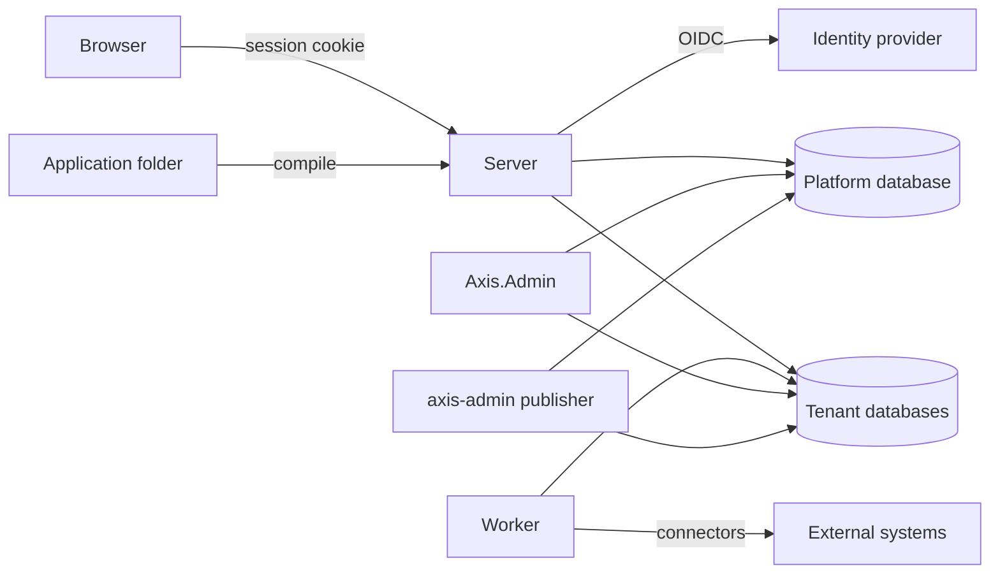

# Axis architecture

This page says how the parts of Axis fit together: the hosts and databases, tenancy, security, the
process engine and how Axis is tested. The detailed behaviour of each part is in
[reference/](reference/), and decisions named as Dn are in [decisions.md](decisions.md). Work that is
agreed but not built yet is marked as [writing the docs](writing-docs.md#planned-work) says.

## Overview

Axis runs as a few hosts over one platform database and one database per tenant. The server answers
people and other systems, the worker runs durable work, and the admin tool and its publisher change
the databases.



- **Axis.Server** serves the SPA and hosts the runtime and authoring APIs. It is the BFF: the OIDC
  client and the cookie session. The record API, the data source endpoint, the process start
  endpoint, the task API and the site endpoints require a session. It also hosts Studio's
  [authoring API](reference/authoring.md), which works on the application folders that
  `Studio:Folders` lists and needs a session and the author role. Validating, publishing and rolling
  back store a publish request in the tenant database over the runtime role, so the server never
  activates a release in its own process, see [D47](decisions/d47-publishing-from-studio.md).
- **Axis.Worker** runs durable work: the steps of process instances, connector and package calls,
  task escalations and deadlines, email, event delivery to async triggers, schedule triggers and
  their fan-out, and the backfill of pending computed fields. The work is described in
  [process execution](reference/process-execution.md), [process flow](reference/process-flow.md),
  [events and triggers](reference/process-events.md) and
  [recomputing computed fields](reference/migrations.md#recomputing-computed-fields). It loads the
  same modules and installed [extension packages](reference/extension-packages.md) as the server, and
  serves its own [health checks](#health-checks).
- **Axis.PackageHost** _(planned for M21)_. It runs package operations in package runners, outside
  the worker, in its own `package-host` container. The worker sends each attempt to a runner, and
  loads package code itself only in Development. See
  [package runners](reference/extension-packages.md#package-runners) and
  [D90](decisions/d90-extension-packages-run-out-of-process.md).
- **Axis.Admin** is the console host that the platform operator runs. It creates tenants, migrates
  tenant databases, activates releases, and backs up and restores tenants. It is the only host that
  writes the [tenant directory](#tenant-directory), holds an admin connection to the database server,
  and holds a tenant's schema database role under `Tenancy:Source=directory`. See
  [administration](reference/administration.md),
  [D43](decisions/d43-tenant-provisioning-and-migrations-across-tenant-databases.md) and
  [D45](decisions/d45-tenant-backup-and-restore.md).
- **The publisher**, `axis-admin publisher`, is a long-running command of `Axis.Admin`. It reads the
  tenants as the server does, connects to each tenant database with that tenant's schema role, and
  runs the publish requests that Studio stores. It has no HTTP endpoint, and the server holds no
  tenant schema connection. The production installs, `scripts/dev.sh`, Docker Compose and the E2E
  script each start one. See [publisher](reference/administration.md#publisher).
- **The platform database** holds installation-level data: the
  [tenant directory](#tenant-directory) in its `platform` schema, and platform settings.
- **A tenant database** holds everything else of one tenant: releases, system tables, process
  state, audit and the generated entity tables (D10).

## Repository layout and module rules

The [repository layout](repository-layout.md#repository-layout) and the
[module rules](repository-layout.md#module-rules) are in their own doc.

## Configuration pipeline

How an application folder is loaded, checked, compiled into a release and activated is in
[configuration](reference/configuration.md).

## Storage

Physical names, column types, database roles, schema planning and audit are in
[storage](reference/storage.md).

## Record API

The record routes, values, paging and errors are in [record API](reference/record-api.md).

## Tenancy (D10)

Every request and every piece of work runs for exactly one tenant, and nothing reaches another
tenant's data.

- **Resolution.** `TenantContext` is resolved from the request host, see
  [request resolution](#request-resolution). For background work it is set from the work item's
  tenant id.
- **Connections.** A connection factory returns connections only for the current tenant. Without a
  tenant context, data access fails, see [tenant connections](#tenant-connections).
- **Scoping.** Cache keys, file storage paths, job records and log scopes all include the tenant.
- **Tenant source.** The setting `Tenancy:Source` chooses where the tenants come from: the server
  configuration, which is the default, or the [tenant directory](#tenant-directory).

### Tenant configuration

Under `Tenancy:Source=configuration` the tenants are the `Tenants` section of the host
configuration, keyed by tenant id:

```json
"Tenants": {
  "default": { "Hosts": [ "localhost" ], "ConnectionString": "Host=...;Username=axis_runtime", "SchemaConnectionString": "Host=...;Username=axis_schema" }
}
```

Environment variables override it in the usual form, such as `Tenants__default__ConnectionString`
or `Tenants__default__Hosts__0`.

`ConnectionString` is for the tenant's runtime database role, and `SchemaConnectionString` for its
schema database role. Every tenant needs both in the server, which uses the schema role only for
startup activation, and there is no fallback to one connection string. The worker never uses
`SchemaConnectionString` and starts with only `ConnectionString`. Which step uses which role is in
[database roles](reference/storage.md#database-roles), and the reasons in
[D31](decisions/d31-separate-database-roles.md). Under `Tenancy:Source=directory` there is no
`SchemaConnectionString`: the server and the worker hold only runtime roles for tenant databases.
The server's `ConnectionStrings:PlatformSchema` serves the platform migrations and the quotas write of
the provisioning API, see [tenancy settings](reference/host-settings.md#tenancy-settings).

The development settings, Docker Compose, `scripts/dev.sh` and the E2E server pass `axis_schema` in
`SchemaConnectionString` and `ConnectionStrings:PlatformSchema`, and `axis_runtime` in the other
settings. `appsettings.Development.json` maps `localhost` to the tenant `default` on the Compose
database, and `preview.localhost` to its preview tenant `default-preview` on the `axis_preview`
database. The E2E server maps `127.0.0.1` to a tenant on the E2E database and `localhost` to its
preview tenant, and the E2E run maps `127.0.0.2` to the journey tenant on a server of its own, see
[the E2E stack](#the-e2e-stack). The `Platform` connection string is separate, and the readiness
check uses it.

Startup fails with an `InvalidOperationException` that names every problem when:

- no tenant is configured;
- a tenant id contains anything other than lowercase letters, digits and hyphens;
- a tenant has no hosts, or a host entry that is blank or only whitespace;
- a tenant has no connection string, or one that is only whitespace;
- the same host is listed under two tenants, compared ignoring letter case;
- in the server, a tenant has no `SchemaConnectionString`, or one that is only whitespace, even when
  no application folder is activated at startup;
- in the server, both connection strings name the same user;
- in the server and the worker, the runtime database role is a superuser, owns the `axis` or
  `entities` schema, may create objects in either, or is a member of a role that is or may;
- a binding fails the startup check or the secret source check of
  [deployment bindings](reference/integration-resources.md#deployment-bindings). The message names the
  tenant and the binding, never the value;
- the preview tenant rules of [preview tenants](reference/host-settings.md#preview-tenants) are
  broken: `PreviewOf` names a tenant that is not configured or is itself a preview tenant, two
  tenants name the same main tenant, or a preview tenant has its own `Oidc` block.

A tenant holds its deployment bindings under `Bindings`, keyed by name and matched ignoring letter
case. A release names a binding and never holds its value, and the server and the worker must hold
the same bindings. `IDeploymentBindings` resolves a binding only for the tenant of the current
request or work item: `Resolve` returns a `url` binding, and `ResolveSecret` returns a `secret`
binding as a `SecretValue`, which shows `[secret]` as text, as JSON and in logs, gives its plain value
only through `Reveal` at the moment of a call, and is never read from JSON. Without a tenant context,
for a name the tenant lacks, or for a binding of the other kind, both throw an
`InvalidOperationException` that names the binding and no value, so `Resolve` never hands out a plain
secret. The kinds, where values live and the checks are in
[deployment bindings](reference/integration-resources.md#deployment-bindings), and the reasons in
[D25](decisions/d25-connectors-deployment-bindings-and-secrets.md).

### Tenant directory

The tenant directory is the list of tenants in the `platform` schema of the platform database, with
each tenant's status, hosts, database settings, OIDC settings and bindings, as
[D42](decisions/d42-tenant-directory-in-the-platform-database.md) agrees.
[`Axis.Admin`](reference/administration.md) writes it, and the server and the worker read it under
`Tenancy:Source=directory`. The server creates the `platform` tables at start under both tenant
sources. The settings are in [tenancy settings](reference/host-settings.md#tenancy-settings), and the
tables in [platform database](reference/storage.md#platform-database).

- **Two sources, one contract.** `Tenancy:Source` is `configuration`, the default, or `directory`.
  Both answer through one tenant catalog contract, so request resolution, tenant connections,
  deployment bindings and sign-in do not know the source. Under `directory` both hosts ignore a
  `Tenants` section and log a warning when one is present, and a non-empty `ActivateOnStartup` stops
  the server's start.
- **Read only.** The hosts read the directory over `ConnectionStrings:Platform`, a role that may read
  the `platform` schema, and the server may also insert its data protection keys. The worker never
  reads `ConnectionStrings:PlatformSchema`.
- **Served tenants.** The hosts use the `active` tenants for host matching, tenant connections,
  deployment bindings and sign-in. The worker runs each tenant's work on the tenant's own database,
  with its decrypted runtime password.
- **Secrets in memory.** A password, the client secret and a `secret` binding stay encrypted in
  memory, and are decrypted only when a connection opens, the sign-in client is set up or a binding is
  resolved. The binding check runs on each read, and a failure names the tenant and the binding,
  never the value.
- **Refresh.** Both hosts read the directory again every `Tenancy:RefreshInterval`, 30 seconds by
  default, without a restart. A changed host, database setting or OIDC setting applies at the next
  refresh, and a changed database setting gets a new connection pool. A tenant added at a refresh gets
  its OIDC client and its endpoint caller scheme, and a tenant that is no longer served loses both.
  The worker runs the refresh in its poll: it pauses its loops and waits for the work items already
  running.
- **Schema versions.** The worker also reads the schema version of every tenant again at each poll
  round, and claims no work of a tenant whose version is not its own.
- **Empty directory.** An empty directory starts, and every host answers `404` until a tenant is added
  and a refresh serves it.
- **Health exemption.** Paths under `/health` stay exempt from resolution.

What a host answers for a tenant under the directory:

| Case                                            | Answer                                                                                                                                                                                                                                                                                                                                                                                                                                                |
| ----------------------------------------------- | ----------------------------------------------------------------------------------------------------------------------------------------------------------------------------------------------------------------------------------------------------------------------------------------------------------------------------------------------------------------------------------------------------------------------------------------------------- |
| An `active` tenant                              | Served after the next refresh, once the runtime database role check passes. Its OIDC client and its endpoint caller scheme are registered then.                                                                                                                                                                                                                                                                                                       |
| A `suspended` or `provisioning` tenant          | `503` problem details (`application/problem+json`) titled "This tenant is not available.", naming no tenant and no host. The worker claims none of its new work, and work already claimed finishes.                                                                                                                                                                                                                                                  |
| A tenant whose schema version is not the host's | `503`, like a suspended tenant, from the first refresh that reads the other version. The server logs one warning when a tenant joins this state. The worker claims none of its work, new or old, and starts again with no restart once `Axis.Admin migrate` has brought the tenant to its version. The schema version is the newest EF Core migration that [`migrate`](reference/administration.md#migrate) applied. The server registers the tenant's sign-in client when a refresh serves it. |
| A removed or unknown host                       | `404`.                                                                                                                                                                                                                                                                                                                                                                                                                                                |
| A refresh that fails                            | The last good directory stays in use, and one error is logged for each run of failed refreshes. Readiness is Degraded until a refresh works, see [health checks](#health-checks). A tenant suspended during the outage keeps running until then.                                                                                                                                                                                                      |
| The first load fails                            | The server stops its start with an error that names `ConnectionStrings:Platform` and holds no password. The worker logs the failure once, retries every `Worker:PollInterval` and is not ready until a read works. The worker also stops at start when `ConnectionStrings:Platform` is missing or `Tenancy:RefreshInterval` is invalid.                                                                                                                 |

- **New tenants.** A tenant that first appears at a refresh is served only after the runtime
  database role check passes, see [database roles](reference/storage.md#database-roles). Until then
  it answers `503`, like a suspended tenant, and the check runs again at each refresh. The worker
  skips such a tenant, logs an error and runs the check again at each refresh, and a failed check
  does not stop it. The same holds for a tenant that becomes `active` again, and for a served tenant
  whose database host, port, name, runtime user or runtime password changes: it answers `503` until
  the check passes on the new settings, then the server drops its old connection pool and the next
  request opens one with the new settings. The check runs only when the directory changes, so
  privileges granted inside the database with no directory change are caught only at a restart.
- **Missing sign-in settings.** A tenant whose `Oidc` authority, client id or client secret is blank
  at a refresh is withheld in the same way: it answers `503`, the server logs the missing setting, and
  the other tenants keep working.
- **No provisioning in the server.** `Axis.Admin` creates, migrates, grants and activates the
  database of a tenant, and the server does none of it, see
  [administration](reference/administration.md).

### Preview tenants

A preview tenant belongs to one main tenant, and an author tries an application there before
publishing it to the main tenant, as [D48](decisions/d48-preview-tenants.md) agrees. It works under
both tenant sources. Its settings are in
[preview tenants](reference/host-settings.md#preview-tenants).

- **One main tenant, one preview.** A preview tenant belongs to one main tenant, a main tenant has at
  most one preview tenant, and a preview tenant has no preview of its own.
- **A tenant like any other.** A preview tenant has its own database, database roles, hosts and
  bindings, and its data never mixes with the main tenant's. Hosts resolve it like any tenant's, and a
  session is bound to the tenant it signed in on, see
  [tenant binding](reference/security.md#sign-in-and-the-session).
- **Where it is set.** Under `configuration`, the tenant setting `PreviewOf` names the main tenant.
  Under `directory`, the entry names it in `platform.tenants.preview_of`, and the operator creates it
  with [`tenant create --preview-of`](reference/administration.md#tenant-create). The entry stores no
  sign-in settings, and the catalog copies the main tenant's at each refresh.
- **Sign-in.** A preview tenant uses its main tenant's authority, client id, client secret and claim
  names. It uses neither `Oidc:EndpointAudience` nor `Oidc:ServiceAudience`, so it accepts no
  machine-caller or service account token. The operator registers the preview host's redirect
  address at the identity provider. A session there reads its main tenant's given roles, see
  [preview tenants](reference/identity-provider.md#preview-tenants).
- **Bindings.** A preview tenant's bindings are its own and empty by default. A missing binding is a
  warning at activation there, not an error, see
  [deployment bindings](reference/integration-resources.md#deployment-bindings).
- **Status.** Each tenant keeps its own status, so suspending a main tenant does not suspend its
  preview tenant.
- **Publishing.** Studio on the main tenant's host stores a preview request in the main tenant's
  database, and the publisher runs it against the preview tenant. The server opens no connection to
  another tenant's database, except that a preview session reads its main tenant's given roles. See
  [preview](reference/authoring.md#preview).

### Request resolution

The server finds the tenant of each request from its host, before static files and endpoints run.

- **Host matching.** Middleware in `Axis.Server` matches `Request.Host.Host` against the configured
  hosts, ignoring letter case and the port, so `A.Example.TEST:8443` matches `a.example.test`.
- **Behind a proxy.** From a proxy named in the
  [forwarded headers settings](reference/host-settings.md#forwarded-headers), the host matched is the
  forwarded host. From any other address it is the request's own `Host`.
- **Unknown host.** The response is `404` problem details (`application/problem+json`) titled "No
  tenant is configured for this host." It names neither the requested host nor any configured tenant
  or host. This covers API and SPA paths alike.
- **Health exemption.** Paths under `/health` are not resolved, so `/health/live` and
  `/health/ready` answer for any host.
- **Tenant not available.** Under `Tenancy:Source=directory`, a host of a tenant that is not served
  answers `503`, as the [tenant directory](#tenant-directory) table says.
- **Log scope.** While a resolved request runs, the logging scope carries `TenantId` with the tenant
  id.

### Tenant connections

A tenant's database is reached only through the current tenant.

- `ITenantConnectionFactory` opens connections to the current tenant's database only. Without a
  tenant context it throws `InvalidOperationException`.
- There is one `NpgsqlDataSource` per tenant, created on first use and disposed with the host.
- **Through PgBouncer** _(planned for M31)_. In a [cell](reference/cells.md#connections) the hosts
  reach the tenant databases through PgBouncer.
- The current tenant is held per asynchronous flow (`AsyncLocal`), so concurrent requests never see
  each other's tenant.
- In the server, a request scope holds one tenant connection, opened on first use and disposed with
  the scope. The module contexts and raw commands share it.

## Authentication and authorization

The server signs people in, accepts tokens from other systems, and checks every access on the
server against the application's policies. The detail is in [security](reference/security.md).

- **Authentication (D9, D23).**
  - The server is the OIDC confidential client, and the browser gets a secure, HttpOnly, SameSite
    cookie session. API writes are protected against CSRF by a required header. See
    [sign-in and the session](reference/security.md#sign-in-and-the-session).
  - The session state is in the tenant database, so sign-out revokes it at once (D84).
  - Other systems call inbound endpoints with a bearer token instead of the session, see
    [machine callers](reference/security.md#machine-callers).
  - Service accounts call the record API, data source rows, process start, process inspection and
    the operator commands with a bearer token (D86), see
    [service accounts](reference/security.md#service-accounts).
  - A tenant can turn on the FAPI 2.0 profile (D83), see
    [FAPI 2.0 profile](reference/fapi2-profile.md).
  - Tests and local development use Keycloak in a container.
- **Hardening (D82, D84, D85).**
  - The server sets security headers on every response and rate limits the routes a caller can
    repeat, see [security headers](reference/headers-and-rate-limits.md#security-headers) and
    [rate limits](reference/headers-and-rate-limits.md#rate-limits).
  - Every route needs a signed-in user or a valid caller token unless it is listed as open (D137),
    see [authorization](reference/security.md#authorization).
  - Axis is checked against ASVS 5.0 Level 2, tracked in [ASVS](reference/asvs.md), with
    `.github/CODEOWNERS` and a threat model (D106) among its
    [other evidence](reference/asvs.md#other-evidence).
  - **The final ASVS sign-off** _(planned for M32)_.
  - Performance objectives and the load test are in [performance](reference/performance.md).
- **Authorization (D12, D24).**
  - The record API, the data source endpoint and the process start endpoint call the policy module
    with the entity, data source or process and the action. The task API calls it for the fields a
    task shows, and the site endpoints call it to shape navigation and page metadata.
    `GET /api/me`, `GET /api/site`, `GET /api/texts/{locale}` and the `/api/auth` endpoints carry no
    application content and call no policy. Worker steps run as `system`, outside policies.
  - The [authoring API](reference/authoring.md) checks `Studio:AuthorRole`, an installation-level
    role outside application policies, and calls no policy. An author can change every policy of an
    application, so a policy cannot guard authoring. See
    [Studio settings](reference/host-settings.md#studio-settings).
  - Record filters from policies limit every record list and single-record check of the record API,
    data source queries and the subject record of a process start.
  - Field policies leave out fields from record API results, data source rows, task forms and page
    metadata, and reject record API writes to protected fields.
  - See [authorization](reference/security.md#authorization).
- **Details.** Sign-in, machine callers, authorization and the
  [development users](reference/security.md#development-users) are in
  [security](reference/security.md).

## Process engine (D11)

The process engine keeps all process state in the tenant database and moves an instance on one
step transaction at a time, so a crash loses nothing that was committed. The process resource, the
start endpoint, the states, the task API, the worker settings and the tables are in
[processes](reference/processes.md) and [running a step](reference/process-execution.md#running-a-step).

- **Release pinning.** New work starts on the active release, and running work keeps its steps,
  tasks, forms, texts and package versions until it ends. Roles and policies use the active release,
  see [releases and running work](reference/processes.md#releases-and-running-work) and
  [D29](decisions/d29-release-pinning-and-text-resources.md).
- **State.** Instances and step occurrences are rows in the tenant database. No in-memory state
  matters after a crash.
- **Step transactions.** A step transition loads the instance at its current revision, executes, and
  in one transaction writes:
  - business writes
  - the new instance state and revision
  - the step history
  - audit records
  - the next work item
  - staged connector calls and their work items
  - event occurrences, their delivery work items and sync trigger starts

  A revision mismatch aborts the transaction.

- **Workers.** Workers claim ready work items and publish requests with `FOR UPDATE SKIP LOCKED` and
  a lease. Commits check the claim token (fencing).
- **External operations.** These run outside the transaction, with the operation identity as their
  idempotency key, and a following transaction records the result. A `callConnector` step stages its
  call in its transaction, and the worker sends it and records its result in a following
  transaction. An attempt that is safe to retry is retried under the step's retry policy, with the
  same identity, and an unknown outcome is reconciled through the operation's lookup. See
  [connector calls](reference/process-execution.md#connector-calls). A package operation step is
  staged and run the same way, see
  [package operations](reference/process-execution.md#package-operations).
- **History.** Every attempt, input, output, decision and error is recorded for inspection.

## Telemetry

Correlated logs, metrics and traces, the OTLP export and what telemetry never holds are in
[telemetry](reference/telemetry.md).

## Health checks

The `/health/live` and `/health/ready` answers of the server and the worker are in
[health checks](reference/health-checks.md).

## Installation

Axis ships as production images, as
[D44](decisions/d44-packaging-for-on-premises-and-cloud-installation.md) agrees.

- `axis-server` and `axis-worker` run the hosts. They hold no sample and no development setting.
- `axis-admin` runs `Axis.Admin` and the publisher, `axis-admin publisher`, and holds the
  PostgreSQL 18 client tools.
- `deploy/compose/` and `deploy/helm/axis/` install them on one machine and on Kubernetes.

The steps, every setting and the upgrade order are in the
[installation guide](reference/installation.md).

## Frontend

The SPA, sites, pages and widgets are in [frontend](reference/frontend.md). Ant Design is a detail
of the SPA. It never shows in configuration, page metadata, theme tokens or the custom widget API, see
[D58](decisions/d58-ant-design-is-a-detail-of-the-spa-without-procomponents.md).

## Testing

Every acceptance criterion maps to at least one of these levels. The commands that run them are in
[AGENTS.md](../AGENTS.md#commands), and how the runs are split and reported is in
[test runs and reports](development.md#test-runs-and-reports).

| Level         | Tooling                                                   | Scope                                                                                                                                                                                                                                                                                                                                                                       |
| ------------- | --------------------------------------------------------- | --------------------------------------------------------------------------------------------------------------------------------------------------------------------------------------------------------------------------------------------------------------------------------------------------------------------------------------------------------------------------- |
| Unit          | xUnit                                                     | Compiler, expression engine, policy evaluation, pure logic                                                                                                                                                                                                                                                                                                                  |
| Integration   | xUnit + Testcontainers PostgreSQL, PgBouncer and Keycloak | Storage, transactions, concurrency, tenancy isolation, engine recovery, the development realm                                                                                                                                                                                                                                                                               |
| Frontend unit | Vitest + Testing Library                                  | Shared components and metadata rendering                                                                                                                                                                                                                                                                                                                                    |
| End to end    | Playwright                                                | Real server + real database + SPA, user journeys and denied access                                                                                                                                                                                                                                                                                                          |
| Scenario      | Axis.Scenarios + Testcontainers PostgreSQL                | Configuration-level tests of an application. Record actions, process starts, task completions and the `expect` steps run, with `now` fixing the time. Stubs answer the calls to connectors and packages. Event deliveries run, so `async` event triggers start their processes. Schedule triggers run through `advanceTime`, which moves `now` and runs every due work item |

### Rules for tests

These rules keep the tests reliable, and `scripts/lint.sh` enforces the ones a machine can check.

- **Locators.** Playwright specs find elements by role, accessible name and ARIA state, and never
  select a class of the UI library. `scripts/lint.sh` fails when a file under `tests/` names a class
  that starts with `ant-`.
- **Exact names.** A string name or text passed to `getByRole`, `getByLabel`, `getByText` or
  `getByTitle` comes with `exact: true`, and only a regular expression matches part of a name.
  `scripts/lint.sh` fails on a call that breaks this.
- **Selects.** Specs pick select options only through the helpers in `tests/e2e/select.ts`. The
  helpers never click an option, because a click can land without choosing it when the open list is
  placed again between the mouse going down and up. They type the option into an editable select,
  move to it with ArrowDown and press Enter.
  - `pickOption` makes a pick that did not land again, for up to 20 seconds, then fails, naming the
    select and the option.
  - `pickOptions` presses Enter only for an option that is not chosen yet, because Enter switches an
    option of a select that allows several on or off. It makes its picks again only when a step
    throws, for up to 20 seconds, then waits up to 5 seconds for each option to show as chosen, and
    does not pick again. A pick that did not land fails, naming the select and the option.
  - `pickAction` serves selects that act and then clear themselves.
- **Dialogs.** Specs reach a dialog only through `waitForDialog` and `confirmDialog` in
  `tests/e2e/dialogs.ts`. A dialog zooms in when it opens, and a click during the zoom is lost, so
  `waitForDialog` returns the dialog once it is fully opaque and its opening animation has ended.
  `confirmDialog` waits the same way before it clicks its button, and retries until the dialog
  closes. `scripts/lint.sh` fails when a file under `tests/e2e/specs/` calls `getByRole('dialog')`
  itself.
- **Elapsed time.** Only `*PerformanceTests` classes may assert on elapsed time, because they run
  alone. Other tests prove a bound with a count, such as the steps used or the nodes inlined, and show
  that nothing waited through an outcome. `scripts/lint.sh` fails when a test file that is not named
  `*PerformanceTests.cs` uses `Stopwatch`, `.Elapsed` or `GetElapsedTime`. A polling deadline built on
  `DateTime.UtcNow` only ends a wait and is allowed.
- **Absent values.** A test that asserts a value is absent from a log entry or a message uses a
  marker that cannot appear there by chance. Record ids are UUIDv7 hex, so a short number or a hex
  word can match one: use a number of ten or more digits.
- **Policy violations.** Every spec imports `test` and `expect` from `tests/e2e/test.ts`. Its `test`
  has an automatic fixture that listens for `securitypolicyviolation` on every page of the test,
  including pages in browser contexts that the spec opens itself, and fails the test that caused a
  violation. `tests/e2e/policy-violations.test.ts` checks the listener, and fails when a spec imports
  `test` from `@playwright/test` instead.
- **Hang guard.** A step that once hung the browser until the test timeout can run through
  `guardStep` in `tests/e2e/hang-guard.ts`. It fails the step after its own limit, and attaches a
  screenshot and a text to the test: the page URL, the console output, the page errors and the failed
  requests since the step began, the load of the machine and its busiest processes. In
  `purchase-request-release.spec.ts` it wraps `editInStudio`, the edit of `texts/en.json` through
  Studio's JSON view in the journey from an edit to activating an earlier release, and
  `openStudio`, which opens Studio before a publish, each with a limit of 60 seconds. The other
  journeys of that spec write their changed files through the Studio resource API, without the
  browser.

### Shared test services

The integration tests share their containers, so a run starts each service at most once.

- **Keycloak.** The integration tests share one Keycloak container with the development realm per
  run. It starts the first time a test needs it, so a run with no such test starts none, and it is
  removed when the run ends. A test class never starts its own Keycloak. A test that changes realm
  state must not use the shared container: it keeps its data in a PostgreSQL container of its own,
  with a read-only role that has `SELECT` on the `credential` table.
- **PostgreSQL.** The integration tests share one PostgreSQL 18 container per run, started and
  removed the same way. Each test class works in its own new database on that server, and every
  database a fixture creates has a name unique in the run. A fixture never starts its own container.
  Tenant isolation tests still use one tenant database per tenant. Tests that read
  `pg_stat_activity` filter on `current_database()`, so they neither see nor end other classes'
  sessions.
- **Scenarios.** `scripts/integration.sh` runs the scenarios of every application under
  `samples/apps/` from the integration tests, on their PostgreSQL container, see
  [test scenarios](reference/test-scenarios.md).
- **Doc facts.** `scripts/lint.sh` checks every relative Markdown link and `#anchor` in the
  repository. Unit tests in `Axis.Configuration.Tests` compare the diagnostic code table and the
  resource kinds in the [configuration pipeline](reference/configuration.md#configuration-pipeline)
  with `DiagnosticCodes`, `ResourceKinds` and the schema files. They find them by heading or table
  header, so the sections may move within `docs/`.

### The E2E stack

`scripts/e2e.sh` starts the whole stack that the Playwright journeys run against: a main server, a
journey server, the worker, the publisher and the purchasing system stub.

The main E2E server activates these applications in `ActivateOnStartup`, see
[startup activation](reference/host-settings.md#startup-activation), so the journeys run against real
metadata and records:

| Application                                | For                                                                                                 |
| ------------------------------------------ | --------------------------------------------------------------------------------------------------- |
| `tests/e2e/fixtures/e2e-app`               | The platform journeys                                                                               |
| `samples/apps/purchase-requests`           | The purchase request journeys                                                                       |
| `samples/apps/leave-requests`              | The leave request journeys                                                                          |
| `samples/apps/service-desk`                | The service desk journeys                                                                           |
| `samples/apps/asset-management`            | The asset register and import journeys                                                              |
| `tests/e2e/fixtures/subprocess-app`        | The process inspector's sub-process journey: a parent that starts a child on a 24-hour timer, both without a subject |
| `tests/e2e/fixtures/host-site-app`         | The journey that opens a site at its own host's root                                                |
| `tests/e2e/fixtures/organization-app`      | The pages of `organization`, which it declares                                                      |
| `tests/e2e/fixtures/approvals-app`         | The pages of `approvals`, which it declares with `organization`                                     |

**Studio folders.** No spec writes a committed folder, so a spec that saves a resource in Studio never
changes a file under `samples/`.

- The main server's `Studio:Folders` lists only a copy of the purchase request sample, which
  `scripts/e2e.sh` makes in a temporary folder for each run, passes in `AXIS_E2E_STUDIO_FOLDER` and
  deletes on exit. The E2E settings blank the other entries of `appsettings.Development.json`. No spec
  writes to that copy.
- A spec that writes a Studio folder gives it a folder of its own. It copies the committed sample, or
  another folder it made, into a temporary folder, starts a server over it with `startServer`, and
  deletes the folder and stops the server when it ends. Tests in one file that change the same folder
  run in order, in one worker, under `test.describe.configure({ mode: 'default' })` or `serial`.
- No spec opens Studio on the main E2E server or names its folder, except `studio-new-application`,
  which only reads it to check that the main server offers no New application button.

The Studio specs use these folders:

| Specs                                                                                                                                                         | Folder                                                                                                                       |
| ------------------------------------------------------------------------------------------------------------------------------------------------------------- | ---------------------------------------------------------------------------------------------------------------------------- |
| `studio`, `studio-form-editor`, `studio-page-editor`, `studio-process-editor`, `studio-process-redraw`, `studio-scenario`, `studio-new-resource` and `studio-tests` | A temporary copy of `samples/apps/purchase-requests`, without `texts/vi.json` for `studio-new-resource`. `studio-tests` also copies it again for its server with `Studio:Tests` off |
| `studio-module-entity`                                                                                                                                        | A temporary copy of `samples/apps/leave-requests`                                                                            |
| `studio-module-pickers`                                                                                                                                       | A temporary copy of `tests/e2e/fixtures/module-app`, and a temporary `Modules:Path` with the sample modules and the fixture module `checklists` |
| `studio-new-application`, `studio-page-containers` and `studio-page-parameters`                                                                              | A temporary `Studio:ApplicationsPath`                                                                                        |
| `studio-entity-migrations` and `purchase-request-release`                                                                                                     | Folders under the test's output path                                                                                         |
| `service-desk-journey`, `asset-management-journey`, `approvals-application-journey` and `journey-tenant`                                                      | Each its own application under the journey server's applications folder, `AXIS_E2E_JOURNEY_APPLICATIONS`                     |

**Activating another folder.** A spec can activate another folder during the run, to test releases.
The helper `tests/e2e/activate.ts` starts the built server once more on a spare port, with the same
settings as the E2E server and that folder in `ActivateOnStartup`, waits until `/health/ready`
answers, then stops that server. The E2E server reads the active release on each request, so it
serves the new release at once. The helper throws an error with the server output when the folder
does not activate. Only the spec that needs it uses `tests/e2e/fixtures/release-app`, so the other
specs see no change. A spec's own server activates `ActivateOnStartup__0` in every tenant, the
preview one included, so only `purchase-request-release` may leave it unset, and
`startup-activation.test.ts` checks this.

**The worker.** The E2E run starts the worker against the same database, with a 5 second lease and a
delivery limit of 2, so that a failing webhook becomes a dead letter after one 30 second backoff
instead of about 7.5 minutes. A spec can restart the worker: it writes the restart file that
`scripts/e2e.sh` names, then stops the worker process, and the script starts a new one. A worker that
stops with no restart request fails the run.

**The journey tenant.** The E2E run also serves a third tenant, `journey`, so that a Studio journey
builds a whole application and publishes it with no clash with the committed samples on the main
tenant.

- `scripts/e2e.sh` creates its database `axis_journey` and its roles `axis_journey_schema` and
  `axis_journey_runtime` through `psql`, so Docker Compose, `scripts/dev.sh` and `init-roles.sql`
  stay as they are.
- A second server serves it on the loopback address `127.0.0.2`, because the worker and the publisher
  reject two tenants that share a host. Playwright starts it after the main server, so the platform
  migrations of the two never race, and the two share the platform database.
- The journey server runs in the `Testing` environment, because `appsettings.Development.json` would
  add the `default` tenant, the startup activation and the Studio folders. It sets
  `Studio:ApplicationsPath` to a temporary folder, has no preview tenant or bindings, and sets
  `Console:OperatorRole` to `platform-operator`, so the operator console answers there.
- Only startup activation migrates a tenant database, so the journey server activates one
  application at start, `tests/e2e/fixtures/journey-base`, which holds only a manifest and clashes
  with no sample.
- The setup step signs in, on the journey host, the author, the requester, the service desk lead,
  the agent, the approver, the asset manager, the employee, the auditor, the department managers and
  the platform operator, and saves those sessions apart from the sessions of the main host.
- The worker and the publisher serve the journey tenant too, and the run fails when the worker log
  lacks `Tenant journey is ready for work` or the publisher log lacks `journey ready`.

**The tenant create spec** serves the tenant it creates. After `tenant create` it starts one more
server in `Testing` with `Tenancy:Source=directory`, which reads `operator-made` from the tenant
directory. The server listens on https at `AXIS_E2E_TENANT_HTTPS_PORT`, with a certificate that
`scripts/e2e.sh` makes for each run, and stops when the test ends. The spec's browser maps
`operator-made.localhost` on port 443 to that port and accepts the certificate, so a person signs in
on the tenant host with no port in the address. No redirect address is added by hand: only
`tenant create` writes them.

**The cell console spec** starts a server of its own in `Testing`, on the next port offset, with the
`Cell:*` settings of a cell, `Cell:ConsoleHost` set to `console.localhost` and the secret of the
`axis-cell-console` client. The spec's browser maps `console.localhost` and the tenant host on
port 443 to that server. The operator signs in through the `axis-operators` realm with a password and
a code, and a user of the tenant it creates is refused on the console host. Its server and publisher get the
`Cell:ExportStorage` settings of the MinIO that `scripts/e2e.sh` starts, and the spec exports a tenant and downloads
the ZIP after the warning. Both cell specs start their server, publisher and browser through `tests/e2e/cell.ts`.

**The cell quota journey** runs a cell on the port offset after the cell console spec's, with a server that reads the
tenant directory every 2 seconds, so a new tenant and a changed quota take effect within seconds. It signs in as an
operator account of its own in the `axis-operators` realm, because the cell console spec may sign the development
operator in at the same moment and Keycloak refuses one code twice in a period. The operator creates two tenants from
the built-in `approvals` application in the Create tenant dialog, and each first administrator gives themselves the
application's `admin` role and saves a department. No worker samples the directory tenants of the run, so the spec
writes each tenant's storage sample to `platform.tenant_usage_latest` from the size of its database, and the operator
sets one tenant's storage quota below it. That tenant's next save is refused with the quota title and the other tenant's
save goes through. The operator then exports the first tenant, downloads the ZIP after the warning and deletes the
tenant. The grace period is 7 days, so the spec moves the tenant's `delete_after` back and waits for the publisher's
purge job, after which the tenant's host answers `404`.

**The purchasing system.** The E2E run starts the [purchasing system stub](#purchasing-system-stub)
from the build output, and fails if it does not answer. Specs find it at `AXIS_E2E_PURCHASING_URL`.
The E2E server and worker run in the `Development` environment, because only Development lets a
connector call an `http` URL. Their `PurchasingSystemUrl`, `PurchasingSystemTokenUrl`,
`PurchasingSystemClientId` and `PurchasingSystemClientSecret` bindings point at the stub and hold its
default credentials, so an approved purchase request signs in and creates its purchase order there.
The E2E server, worker and publisher also hold the `PurchaseRequestApprovedWebhookUrl` and
`PurchaseRequestApprovedWebhookSecret` bindings, which point at the stub, where the sample's approval
webhook delivers.

**Logs.** The worker output goes to `artifacts/logs/e2e-worker.log`, the journey server output to
`artifacts/logs/e2e-journey-server.log` and the stub output to `artifacts/logs/e2e-purchasing.log`.

### Journeys on the journey tenant

These journeys build or change an application on the journey tenant and use it on its site. Each spec
file holds its steps. This section says what each proves and what it must not do.

- **`service-desk-journey.spec.ts`** builds the whole service desk with Studio only, as the
  [product brief](product-brief.md#third-application-service-desk) asks. It never opens the JSON
  view and uses no file edit. It builds the data model, the data sources of the lists and the dashboard, the
  two-step ticket form on the form's Design tab, the forms of the tasks, the `TicketHandling` process
  with its escalations and its notify step, the pages, the site, the notify processes and their
  schedule and delete triggers, the policies in the policy matrix, and the twelve test scenarios in
  the scenario editor, typing every expression in the expression editor. Each save must report no
  error diagnostic. At the end the built folder must match `samples/apps/service-desk` with no error
  diagnostic: only resource ids, seed record ids (paired by position) and key order may differ, and
  the `migrations` folder must be empty, because the sample has none. Run tests must pass all twelve
  scenarios, and the release history must show release 1 as the one active row. On the
  `service-desk` site the requester, the service desk lead and the agent take one ticket to `closed`,
  the requester opening it from the bell, and the lead's bell has no row for that ticket.
- **`module-contract-journey.spec.ts`** creates a blank application that pins the built-in module
  `organization` and the sample module `department-budgets`, through the Studio API. The publish
  succeeds and the release is not off-standard. A process step that approves a budget is refused by
  the contract's `approve` guard, and the platform operator sees the instance in the console's Failed
  work with `named point Budget/transitions/approve`. The platform operator gets Studio's forbidden
  page with no Relax button, and a PATCH that adds a relax entry answers `403`. The author
  relaxes the point with a reason in Studio and publishes, Studio's release history and the console's
  Publishing row both show Off-standard with the module, the point and the reason, and the same step
  then approves a budget within 30 seconds.
- **`approvals-data-business.spec.ts`** creates an application from the built-in `approvals`
  application and maps the `admin` slot of `organization` and `approvals` to a new role. An
  administrator sets up employees, a department and request types in the running application. A
  request never shows in its requester's own To decide list, a one-step request is approved by the
  department head, and a two-step request is decided by a delegate on behalf of the approver, with
  both decisions recorded.
- **`approvals-module-business.spec.ts`** creates an application from the built-in `approvals`
  application, adds a `costCenter` field to `approvals/Request` in the entity designer, and checks
  that Studio saves it as the layer `customizations/approvals/Request.json`. A request type made in
  the running application works, and a department head's own request is absent from their To decide
  list. A step that sets `approved` right after `submit`, saved through the module resource save
  route, fails the publish with `AXC0342` and a failed contract scenario, and the release history
  keeps its one row.
- **`asset-management-journey.spec.ts`** builds the asset management application with Studio only. It
  opens the JSON view only to write the `AssetWithMaintenanceAndSoftware` scenario, because the
  scenario editor cannot add a value to a child collection. Every migration that a save asks about is
  answered, and the `migrations` folder must be empty at the end. It checks the built folder against
  `samples/apps/asset-management` in parts as it goes, and at the end the whole folder must match with
  no error diagnostic and Run tests must pass all six scenarios. It publishes release 1. On the
  `asset-management` site the asset manager registers an asset with an attachment, software and a
  maintenance entry, and imports `tests/e2e/fixtures/asset-management-import.csv` with a dry run that
  shows no row error. The auditor exports the register to CSV, whose data rows must equal the
  `totalCount` that the record API gives the auditor, and to Excel, whose file must have the `.xlsx`
  name and start with the zip signature. The auditor has no New or Import button, and the employee
  sees only the asset it holds and no Export, Import or New button.
- **`approvals-application-journey.spec.ts`** creates `OfficeApprovals` from the built-in Approvals
  application in the New application dialog, with no file edit and no error diagnostic, and publishes
  release 1, the one active row. On the `office-approvals` site an employee opens My requests and is
  refused All requests, by the menu and by a `403` from the page API.

A new trigger starts with an empty `event`, see [new resource](reference/studio.md#new-resource). So a
journey that builds a trigger and must match a sample with no event creates
a temporary event first, and deletes it once the triggers are saved.

### Purchasing system stub

`tests/Axis.PurchasingStub` stands in for the external purchasing system that the purchase request
sample's connector calls. It is a test fixture, not platform code, and references nothing under
`src/`. The E2E run, `scripts/dev.sh` and Docker Compose start it. Its orders and webhook deliveries
live in memory only.

**Tokens.** `POST /oauth/token` is the token route of the OAuth2 client credentials grant. It reads
the form field `grant_type`, and the client from the `Authorization: Basic` header, as the worker
sends them.

- Any other grant type is a `400` with `unsupported_grant_type`, and a missing or wrong client is a
  `401` with `invalid_client`. Otherwise it answers `200` with `access_token`, `token_type` `Bearer`
  and `expires_in`, and `Cache-Control: no-store`.
- The stub knows one client, `axis-purchasing` with the secret `axis-development-purchasing-secret`.
  The settings `Purchasing:ClientId` and `Purchasing:ClientSecret` change them, but every development
  and test setting uses these defaults.
- A token lives 120 seconds, and the setting `Purchasing:TokenLifetime`, in seconds, changes that.
- `POST /purchase-orders` and `GET /purchase-orders/by-key/{idempotencyKey}` need an
  `Authorization: Bearer` header with a token the stub issued that has not expired. Without one the
  stub answers `401` with `WWW-Authenticate: Bearer error="invalid_token"` and stores nothing. The
  order list, the webhook routes, `/health` and the `/test/*` switches need no token.

**Orders.**

- `POST /purchase-orders` with an `Idempotency-Key` header and a body with `requestNumber`,
  `supplierCode`, `amount` and `lines` creates an order. Each line has a `description`, a
  `quantity`, a `unitPrice` and an `amount`. It answers `201` with an `orderNumber` such as
  `PO-2026-0001`. A repeat with the same key answers `200` with the same order and stores nothing new.
  A create without the key, `requestNumber`, `amount` or `lines`, with an empty `lines`, or with a
  line that lacks a field is a `400`.
- `GET /purchase-orders/by-key/{idempotencyKey}` answers `200` with the `orderNumber`, or `404` when
  the key is unknown.
- `GET /purchase-orders` lists every stored order in creation order. Each order shows its `lines` in
  the order sent and the `clientId` of the token that created it, so a test can tell that the order
  came after a token request with the sample's credentials.

**Webhooks.**

- `POST /webhooks/purchase-request-approved` receives a
  [webhook delivery](reference/outbound-webhooks.md#webhook-delivery) and checks its Standard
  Webhooks signature. The headers `webhook-id`, `webhook-timestamp` and `webhook-signature` are all
  required. A missing header, a signature that matches no secret, or a timestamp more than 5 minutes
  from the stub's clock is a `401` and stores nothing. The header may hold two signatures separated
  by a space, and one matching signature is enough.
- The body must be JSON with a string at `data.fields.number`, or the route answers `400`. A valid
  delivery is stored once per `webhook-id` and answers `204`. A repeat with the same `webhook-id` also
  answers `204` and stores nothing new.
- The stub checks the signature against the secret of the `Webhook:Secret` setting. Its default is
  `whsec_YXhpcy1kZXZlbG9wbWVudC13ZWJob29rLXNlY3JldA==`, and a `whsec_` secret is the key after
  base64-decoding the rest.
- `GET /webhooks/purchase-request-approved` lists the stored deliveries in arrival order. Each shows
  its `webhookId`, its `type`, its `requestNumber`, taken from `data.fields.number`, and its
  `receivedAt` time.

**Test switches.** Each switch answers `204`, and each drop and each hold happens once.

| Route                                          | Effect                                                                                                                                                                                                                                                                                                                                                                                      |
| ---------------------------------------------- | ------------------------------------------------------------------------------------------------------------------------------------------------------------------------------------------------------------------------------------------------------------------------------------------------------------------------------------------------------------------------------------------- |
| `POST /test/fail-webhook/{requestNumber}`      | Every delivery for that request number answers `500` and stores nothing. Other request numbers are unaffected.                                                                                                                                                                                                                                                                              |
| `POST /test/accept-webhook/{requestNumber}`    | Turns `fail-webhook` off, so the deliveries for that request number are accepted again.                                                                                                                                                                                                                                                                                                     |
| `POST /test/drop-next`                         | Drops the response of the next create. It affects the whole stub, so specs that run in parallel drop by key or by request number.                                                                                                                                                                                                                                                          |
| `POST /test/drop/{idempotencyKey}`             | Drops the response of the first create with that key.                                                                                                                                                                                                                                                                                                                                       |
| `POST /test/drop-request/{requestNumber}`      | Drops the response of the first create for that `requestNumber`, such as `PR-2026-00042`. A spec knows the request number as soon as it creates the request, but not the idempotency key, which only the worker knows, so specs that run in parallel can use it.                                                                                                                           |
| `POST /test/hold-request/{requestNumber}`      | Holds back the response of the first create for that `requestNumber`. The create stores its order first, then answers only when `POST /test/release-request/{requestNumber}` is called or the caller hangs up. Tests use it to stop or overtake a worker while its call is still running.                                                                                                  |
| `POST /test/unknown-request/{requestNumber}`   | Makes the purchase order call for that `requestNumber` end `unknown` and stay so: the first create stores its order but answers `201` without an `orderNumber`, and every lookup for the request answers `503`. An operator then [resolves](reference/process-inspection.md#resolve) the call. The switch has no off route, since each spec uses its own request number. |

A dropped create stores the order, then closes the connection without answering, so the retry gets
the stored order back, as in the [lost response](reference/process-execution.md#lost-response) flow.
A dropped response cannot make a call `unknown`, because the connector declares `idempotency`, so
the worker sends the call again under the same key and it succeeds. Only a `2xx` body that does not
fit the output goes straight to reconciliation, which is why `unknown-request` answers one.

`GET /health` answers `200`.
