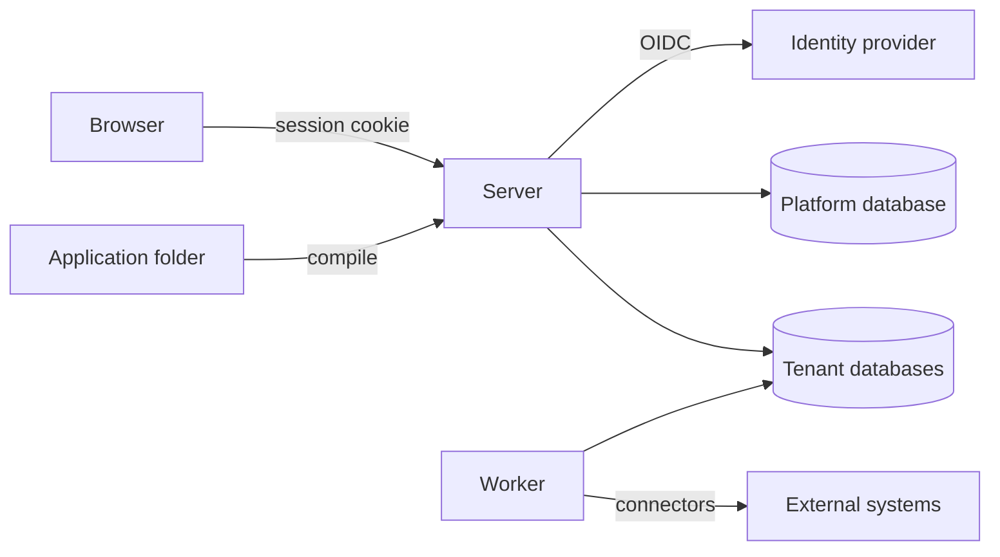

# Axis architecture

This is the target structure. Sections marked *(planned for Mx)* describe work
that has not been built yet, as defined in
[delivery.md](delivery.md#keeping-the-docs-current). Decisions referenced as
Dn are in [decisions.md](decisions.md). Detailed behaviour is in
[reference/](reference/).

## Overview



- **Axis.Server** serves the SPA and hosts the authoring and runtime APIs.
  It is the BFF: the OIDC client and the cookie session. The record API, the
  data source endpoint, the process start endpoint, the task API and the site
  endpoints require a session.
- **Axis.Worker** executes durable work. It serves health endpoints on its own
  address *(planned for M7)*, see [health checks](#health-checks-planned-for-m7).
  It runs work items, and through them
  the `decision`, `task`, `operation` and `end` steps of process instances.
  Operation steps include `updateRecord`, `callConnector` calls with their
  retries and reconciliation, and package operations. `raiseEvent` steps raise
  events. Wait for event, timer and sub-process steps come later. It
  delivers raised events to async event triggers, see
  [events and triggers](reference/processes.md#events-and-triggers). It also
  runs the backfill of pending computed fields *(planned for M7)*, see
  [recomputing computed fields](reference/storage.md#recomputing-computed-fields).
  It runs the occurrences of schedule triggers and their fan-out over the records
  of the trigger's data source, see [schedules](reference/processes.md#schedules).
  It loads the installed extension packages at startup, as the server does.
  It runs the package operations that process steps call, see
  [extension packages](reference/extension-packages.md).
  It loads the same modules as the server.
- **Platform database** stores installation-level data: the tenant directory
  and platform settings *(tenant directory planned for M9; tenants come from
  server configuration until then)*.
- **Tenant databases** hold everything else for one tenant: releases, system
  tables, process state, audit and the generated entity tables (D10).

## Repository layout

```text
src/
  Axis.Server/            ASP.NET Core host: API, BFF, SPA hosting
  Axis.Worker/            background host
  Axis.Scenarios/         console host that runs an application's test scenarios
  Axis.Core/              shared primitives: ids, results, clock, tenant context
  Axis.Configuration/     resource model, file loader, JSON Schemas, compiler, diagnostics, releases, extension package catalog
  Axis.Expressions/       expression parser, type checker, interpreter, SQL translation (M2)
  Axis.Data/              entity storage mapping, schema planning, record commands, data sources
  Axis.Processes/         work items, decision, task, operation and end steps, task API, the record command, connector calls, package operations, events, triggers and schedules, inbound endpoint starts
  Axis.Policy/            policy evaluation: entity, data source and process grants, record filters, field sets
  Axis.Presentation/      site/page/widget metadata served to the SPA
  Axis.Tenancy/           tenant resolution, connection factory
  Axis.Extensions/        contracts for extension packages: operation interface, operation context
web/                      React + TypeScript SPA (Vite), Ant Design, ProComponents
tests/
  Axis.<Module>.Tests/    unit tests per module (Axis.Server.Tests, Axis.Configuration.Tests, Axis.Data.Tests, Axis.Expressions.Tests, Axis.Tenancy.Tests)
  Axis.Integration.Tests/ PostgreSQL (Testcontainers) and API integration tests
  Axis.PurchasingStub/    purchasing system stub for tests, scripts/dev.sh and Docker Compose
  packages/               test-only extension package, built as three versions; covers the capability limits
  e2e/                    Playwright journeys against the running server
    fixtures/e2e-app/     generic test application the E2E server activates
    fixtures/release-app/ application a spec activates during the run, to test releases
samples/
  apps/purchase-requests/ the first sample application, as configuration only
  keycloak/               the development Keycloak realm with the sample's users
  postgres/               init-roles.sql, which creates the axis_schema and axis_runtime database roles
  packages/               the sample extension package payment-references and its unit tests
```

Projects are created when the first issue needs them. The solution holds
`Axis.Server`, `Axis.Core` (only the tenant context so far),
`Axis.Configuration`, `Axis.Data`, `Axis.Expressions` (the parser, type
checker, interpreter and SQL translation), `Axis.Extensions` (the contracts
for extension packages), `Axis.Policy` (the evaluation of entity, data source and process grants, record filters and field sets),
`Axis.Presentation` (the platform site, its texts and the
shapes of application site metadata), `Axis.Processes` (work items, the
`decision`, `task`, `operation` and `end` steps, the task API, the record command, connector calls, package operations, events, triggers and schedules, and inbound endpoint starts), `Axis.Scenarios` (the console host that runs an application's test scenarios), `Axis.Tenancy`, `Axis.Worker`, the test projects, the sample extension package
`PaymentReferences` with its `PaymentReferences.Tests`, and `web/`.

## Module rules

- **Ownership.** Each module owns its tables and its public contracts. Other
  modules use only those contracts and never read another module's tables
  directly.
- **Dependency direction.** Dependencies point inward:
  - Hosts depend on modules.
  - Modules depend on `Axis.Core` and on other modules' contracts.
  - Nothing depends on a host.
- **Shared transactions.** A module that takes part in a step transaction
  receives the shared connection and transaction through a unit-of-work
  contract. Writes through EF Core and through Npgsql commit together.
- **Persistence boundary.** Engine logic does not depend on ASP.NET Core or on
  persistence details. It depends on small interfaces with infrastructure
  implementations (ports and adapters).
- **Commands and queries.** Commands enforce state transitions. Queries return
  authorized projections. Both use the same tenant database (no separate read
  store).

## Configuration pipeline

Moved to [reference/configuration.md](reference/configuration.md).

## Storage

Moved to [reference/storage.md](reference/storage.md).

## Record API

Moved to [reference/record-api.md](reference/record-api.md).

## Tenancy (D10)

- **Resolution.** `TenantContext` is resolved from the request host. For
  background work it is set from the work item's tenant ID.
- **Connections.** A connection factory returns connections only for the
  current tenant. Without a tenant context, data access fails.
- **Scoping.** Cache keys, file storage paths, job records and log scopes all
  include the tenant.
- **Tenant source.** Until M9, tenants come from server configuration.

### Tenant configuration

The `Tenants` section of the server configuration is keyed by tenant id:

```json
"Tenants": {
  "default": { "Hosts": [ "localhost" ], "ConnectionString": "Host=...;Username=axis_runtime", "SchemaConnectionString": "Host=...;Username=axis_schema" }
}
```

Environment variables override it in the usual form, such as
`Tenants__default__ConnectionString` or `Tenants__default__Hosts__0`.

Each tenant also gets `SchemaConnectionString`, or
`Tenants__default__SchemaConnectionString` as an environment variable.
`ConnectionString` is for the runtime database role, and
`SchemaConnectionString` is for the schema database role. The server reads
both, and only startup activation uses `SchemaConnectionString`. The worker
never reads it and starts with only `ConnectionString`. This is a breaking
setting change: every installation must add the setting, and there is no
fallback to one connection string. `appsettings.Development.json`,
Docker Compose, `scripts/dev.sh` and the E2E server pass `axis_schema` in
`SchemaConnectionString` and `axis_runtime` in the other settings. See [database roles](reference/storage.md#database-roles) and
[D31](decisions.md#d31-separate-database-roles--agreed).
`appsettings.Development.json` maps `localhost` to tenant `default` on the
compose database; the E2E server maps `127.0.0.1` to a tenant on the E2E
database. The `Platform` connection string is separate and still serves the
readiness check.

Startup fails with an `InvalidOperationException` naming every problem when:

- no tenant is configured;
- a tenant id contains anything other than lowercase letters, digits and
  hyphens;
- a tenant has no hosts, or a host entry that is blank or only whitespace;
- a tenant has no connection string, or one that is only whitespace;
- the same host is listed under two tenants, compared ignoring letter case;
- in the server, a tenant has no `SchemaConnectionString`, or one that is only
  whitespace. This applies even when no application folder is activated at
  startup;
- in the server, both connection strings name the same user;
- in the server and the worker, the runtime database role
  is a superuser, owns the `axis` or `entities` schema, or may create objects
  in either;
- a binding has a missing `Kind` or one other than `url` or `secret`, a blank
  `Value`, or is a `url` binding whose value is not an absolute `http` or
  `https` URL. The message names the tenant and the binding, never the value;
- outside Development, the configuration source that wins for a `secret`
  binding's `Value` is a file, such as `appsettings.json`. Environment
  variables, command-line arguments, mounted secret files and in-memory
  sources are allowed. The message names the tenant, the binding and the file,
  never the value.

A tenant also holds its deployment bindings under `Bindings`, keyed by name
and matched ignoring letter case. A release names a binding and never holds
its value. The server and the worker both read this section, so both must hold
the same bindings. `IDeploymentBindings` resolves a binding for the tenant of
the current request or work item only. Its `Resolve` returns a `url` binding,
and its `ResolveSecret` returns a `secret` binding as a `SecretValue`. A
`SecretValue` shows `[secret]` as text, as JSON and in logs. Its `Reveal`
returns the plain value at the moment of a call, and it is never read from
JSON. Without a tenant context, for a name the tenant lacks, or for a binding
of the other kind, both throw an `InvalidOperationException` that names the
binding and no value. So `Resolve` never hands out a plain secret. A secret's
`Value` comes from the environment, such as
`Tenants__default__Bindings__PurchasingSystemToken__Value`. See
[connectors and deployment bindings](reference/configuration.md#connectors-and-deployment-bindings)
and [D25](decisions.md#d25-connectors-deployment-bindings-and-secrets--agreed).

```json
"Bindings": {
  "PurchasingSystemUrl": { "Kind": "url", "Value": "https://purchasing.example.test/api" },
  "PurchasingSystemToken": { "Kind": "secret", "Value": "<from environment>" }
}
```

### Request resolution

- **Host matching.** Middleware in `Axis.Server` runs before static files and
  endpoints. It matches `Request.Host.Host` against the configured hosts,
  ignoring letter case. The port is ignored, so `A.Example.TEST:8443` matches
  `a.example.test`.
- **Unknown host.** The response is `404` problem details
  (`application/problem+json`) titled "No tenant is configured for this
  host." It names neither the requested host nor any configured tenant or
  host. This covers API and SPA paths alike.
- **Health exemption.** Paths under `/health` are not resolved, so
  `/health/live` and `/health/ready` answer for any host.
- **Log scope.** While a resolved request runs, the logging scope carries
  `TenantId` with the tenant id.

### Tenant connections

- `ITenantConnectionFactory` opens connections to the current tenant's
  database only. Without a tenant context it throws
  `InvalidOperationException`.
- There is one `NpgsqlDataSource` per tenant. It is created on first use and
  disposed with the host.
- The current tenant is held per asynchronous flow (`AsyncLocal`), so
  concurrent requests never see each other's tenant.
- In the server, a request scope holds one tenant connection, opened on first
  use and disposed with the scope. The module contexts and raw commands share
  it.

## Authentication and authorization

- **Authentication (D9, D23).**
  - The server is the OIDC confidential client.
  - The browser gets a secure, HttpOnly, SameSite cookie session.
  - API writes are protected against CSRF by a required header.
  - Tests and local development use Keycloak in a container.
  - See [Sign-in and the session](#sign-in-and-the-session).
  - Other systems call inbound endpoints with a bearer token instead of the
    session. See [Machine callers](#machine-callers).
- **Authorization (D12, D24).**
  - The record API, the data source endpoint and the process start endpoint
    call the policy module with the entity, data source or process and the
    action. The task API calls it for the fields a task shows. The site
    endpoints call it to shape navigation and page metadata. `GET /api/me`,
    `GET /api/site`, `GET /api/texts/{locale}` and the `/api/auth` endpoints
    carry no application content and call no policy. Worker steps run as `system`,
    outside policies.
  - Record filters from policies limit every record list and single-record
    check of the record API, data source queries and the subject record of a
    process start.
  - Field policies leave out fields from record API results, data source
    rows, task forms and page metadata, and reject record API writes to
    protected fields.
  - See [Authorization](#authorization).

### Sign-in and the session

It follows
[D23](decisions.md#d23-sign-in-through-oidc-and-the-bff-session--agreed).
Sign-in, the session, `GET /api/me` and sign-in needed are in place.

- **Flow.** Sign-in uses the OIDC authorization code flow with PKCE. The
  server is the confidential client: it exchanges the code for tokens, reads
  the claims from the ID token and keeps no token after that (D9). The
  identity provider returns the code in the query string. Pushed
  authorization requests stay off until FAPI 2.0 work (D9).
  - The server registers one OIDC client per tenant. All of them share the
    callback path, and each one ignores a callback that arrives on another
    tenant's host.
- **Tenant settings.** Each tenant in the [`Tenants` section](#tenant-configuration)
  has an `Oidc` block. `Claims` names the claims that give the user id, the
  display name and the roles. Each claim name is optional, and the defaults
  are `sub`, `name` and `roles`. The optional `EndpointAudience` is for
  [machine callers](#machine-callers).

  ```json
  "default": {
    "Hosts": [ "localhost" ],
    "ConnectionString": "Host=...",
    "Oidc": {
      "Authority": "http://localhost:8080/realms/axis",
      "ClientId": "axis",
      "ClientSecret": "...",
      "Claims": { "UserId": "sub", "DisplayName": "name", "Roles": "roles" }
    }
  }
  ```

- **Startup checks.** The server's startup fails, naming every problem as
  for the tenant configuration, when a tenant has no `Oidc` block, or when
  its `Authority`, `ClientId` or `ClientSecret` is missing or blank. Only the
  server reads and checks the block. The worker reads the same `Tenants`
  section but signs nobody in, so it ignores `Oidc`.
- **Secret.** The client secret comes from the environment, such as
  `Tenants__default__Oidc__ClientSecret`. It is never in a committed file,
  except the development fixtures, which are never valid outside
  `Development` and tests. `appsettings.Development.json` and the E2E server
  use the development realm's secret.
- **Endpoints.**
  - `GET /api/auth/sign-in?returnUrl=` redirects to the tenant's identity
    provider. `returnUrl` must start with a single `/`. A value that does
    not, or that starts with `//` or `/\`, is a `400` problem details
    response. A missing `returnUrl` means `/`.
  - `GET /api/auth/callback` is where the identity provider returns. It
    creates the session and redirects to `returnUrl`. A callback that fails
    creates no session. For now it answers a `500` problem details response,
    for example when the person cancels at the identity provider.
  - `POST /api/auth/sign-out` ends the session and returns `200` with
    `{ "signOutUrl" }`. The SPA then sends the browser to that URL, and the
    identity provider returns it to `/`. The SPA calls sign-out with `fetch`
    so it can send the CSRF header, and a `fetch` call cannot follow a
    redirect to the identity provider as a page. The shell header's
    [account button](reference/frontend.md) offers sign-in and
    sign-out.
- **Session.** One HttpOnly, Secure, SameSite=Lax cookie, `Axis.Session`.
  - It holds the user id, the display name, the roles and the tenant id.
  - It holds no access, refresh or ID token, and no token reaches the
    browser.
  - It ends 8 hours after sign-in, or after 1 hour without requests,
    whichever comes first. Every request with a session renews the cookie,
    so the hour counts from the last request.
  - In `Development` and `Testing`, which run over plain http, the session
    cookie and the OIDC helper cookies are Secure only on https requests.
- **Tenant binding.** A session whose tenant id differs from the tenant
  [resolved from the host](#request-resolution) counts as no session. So a
  cookie taken to another tenant's host signs nobody in there.
- **Roles.** The roles come from the roles claim at sign-in and are kept in
  the session. A role change at the identity provider applies at the next
  sign-in.
- **Current user.** `GET /api/me` keeps its shape,
  `{ "id", "displayName", "roles" }`, and reads the session. Without a
  session it is a `401`, as today. Record writes, process starts and the
  task API read the current user the same way, and their audit records store
  the user's id and display name.
- **Sign-in needed.** Without a session, these answer a `401` problem
  details response:
  - every route under `/api/apps/{app}/`: records, record history, data
    source rows, process start and tasks. The session is checked before any
    `404`, so a caller without a session cannot learn which applications or
    records exist;
  - `GET /api/sites`, `GET /api/sites/{path}`,
    `GET /api/sites/{path}/texts/{locale}` and
    `GET /api/sites/{path}/pages/{page}`. Site texts belong to an
    application, so they count as application content. The session is checked
    before any `404`, so a caller without a session cannot learn which sites
    or pages exist;
  - `GET /api/me`.

  Inbound endpoints under `/api/apps/{app}/endpoints/` are the exception.
  They take a bearer token and no session, see
  [Machine callers](#machine-callers).

  These stay open, because the shell needs them before anyone signs in:
  `GET /api/site`, `GET /api/texts/{locale}`, `GET /api/auth/sign-in`,
  `GET /api/auth/callback`, every path under `/health` and the SPA's static
  files. `POST /api/auth/sign-out` needs the CSRF header but no
  session.
- **CSRF.** Every `POST`, `PUT`, `PATCH` and `DELETE` under `/api` must
  carry `X-Axis-Csrf: 1`, otherwise `403`. The server checks the header
  right after it resolves the tenant and before authentication, so a refused
  write does no work and does not renew the session cookie. On the record
  API, the data source endpoint, the process start endpoint and the task
  API, the session check follows it. `POST /api/auth/sign-out` needs no
  session, so no session check follows it. The SPA sends every `/api`
  call through one wrapper around `fetch`, which adds the header to its
  writes. See the record API's
  [CSRF header rule](reference/record-api.md#create-update-and-delete).
  Paths under `/api/apps/{app}/endpoints/` are exempt from the header,
  because they take a bearer token and no session cookie. See
  [Machine callers](#machine-callers).
- **Tests.** Tests of sign-in itself start the development realm in Keycloak
  through Testcontainers, and drive its login page. Tests of the session
  lifetime create the session through a test-only hook and use a test clock.
  Tests of [machine callers](#machine-callers) get client credentials tokens
  from the same container, and expire them with a test clock.
  Integration tests of other endpoints sign in through a test authentication
  scheme that only test hosts register. A request names its user in a
  header, and the scheme builds the same principal as a session of that user.
  The E2E sign-in journey drives the Keycloak login page. For the other E2E
  journeys, a Playwright setup step signs each realm user in on the login page
  once and saves the browser session. Journeys that act as a user load or swap
  those saved sessions.
- **Keycloak realm.** Docker Compose, `scripts/dev.sh` and the E2E run start
  Keycloak with an imported development realm, `axis`. This part is in place:
  the realm is `samples/keycloak/axis-realm.json`, and one shared
  Testcontainers container serves the whole integration run. Under `scripts/dev.sh` and in
  the E2E run, the server signs people in through it. Under Docker Compose
  it does not yet, because the server in its container cannot reach Keycloak
  at the address the browser uses. So under Compose the site endpoints, the
  record API and the data source endpoint answer `401`, and an application
  page starts a sign-in that cannot complete.
  - It holds the purchase request users with fixed ids: `anna` and `lan`
    the employees, `binh` and `chau` the department managers, and `dung` the
    finance reviewer. Seed data and E2E journeys already name these ids.
  - Every user has the same development-only password.
  - The roles are client roles of the confidential client `axis`. A
    client-role mapper writes them to the `roles` claim, so the claim holds
    only the sample roles.
  - The confidential client `purchasing-system` stands in for the
    purchasing system as a [machine caller](#machine-callers). Its service
    account gets tokens through the client credentials grant.

### Machine callers

It follows [D27](decisions.md#d27-inbound-endpoints--agreed). The token
checks, the tenant binding, the endpoint-only acceptance, the CSRF exemption
and the development realm's client are built. The `endpoint` resource and its
compile checks are built too, and so are the endpoint call with its `output`
and `wait`, its `Idempotency-Key`, and the status location. Other systems call [inbound endpoints](reference/record-api.md#inbound-endpoints)
with a bearer token. This sits next to the browser session: the session
stays the only way in for people, and a bearer token is the only way in for
systems.

- **Client credentials.** A caller is a system, not a browser. It gets an
  OAuth 2.0 access token from the tenant's `Oidc` authority through the
  client credentials grant, and sends it as `Authorization: Bearer <token>`.
- **Tenant setting.** The expected audience is a new tenant setting,
  `Oidc:EndpointAudience`. In the development tenant its value is
  `axis-endpoints`:

  ```json
  "Oidc": {
    "Authority": "http://localhost:8080/realms/axis",
    "EndpointAudience": "axis-endpoints"
  }
  ```

  The setting is optional. A tenant without it accepts no bearer token, so
  every endpoint call there is a `401`. The server's
  [startup checks](#sign-in-and-the-session) do not change. The worker
  ignores it, as it ignores the rest of `Oidc`.
- **Token checks.** The server checks each token against the tenant
  [resolved from the host](#request-resolution). Any failure is a `401`
  with `WWW-Authenticate: Bearer`, which never says which check failed.
  - The signature, with the keys the authority publishes (its JWKS).
  - The issuer, which must equal the tenant's `Authority`. So another
    tenant's token is a `401`.
  - The audience, which must contain the tenant's `Oidc:EndpointAudience`.
  - The expiry.
- **Roles.** The caller's roles come from the configured roles claim
  (`Claims:Roles`), matched against the declared roles as for users.
- **Caller id.** The caller's id comes from the configured user id claim
  (`Claims:UserId`, default `sub`). It is the audit actor and the new
  record's creator.
- **Display name.** The audit display name comes from the configured display
  name claim. When the token has none, it is the token's client id (`azp`).
  Keycloak service-account tokens have no `name` claim, and a bare id would
  be hard to read in a record's history.
- **Endpoint routes only.** The server accepts a bearer token only on
  `POST /api/apps/{app}/endpoints/{name}` and its status location. Everywhere
  else a bearer token is ignored, so it never reaches the record API, the
  data source endpoint or the task API. The request's default
  authentication is the bearer token on paths under
  `/api/apps/{app}/endpoints/`, and the session everywhere else.
- **Clock.** The expiry is checked against the server's clock service, with
  the usual 5 minutes of clock skew, so tests can replace the clock.
- **No session.** On endpoint routes the session cookie is ignored and not
  renewed, so the CSRF header does not apply. A browser cannot attach a bearer token on its
  own, so a cross-site page cannot call an endpoint for a signed-in user.
- **Not bound to the sender.** A leaked token works until it expires.
  Sender-constrained tokens (DPoP) stay a later FAPI 2.0 step under D9.
- **Keycloak.** The development realm gets what the purchase request sample
  needs:
  - a confidential client `purchasing-system` with a service account, for
    the client credentials grant;
  - the password grant on the `purchasing-system` client, so tests can get a
    realm user's token with the endpoint audience;
  - the `axis` client role `purchasing-system`, held by that service account;
  - a roles mapper on the `purchasing-system` client that writes the `axis`
    client roles to the `roles` claim;
  - an audience mapper on the `purchasing-system` client that adds
    `axis-endpoints` to the token's audience;
  - the service account user with the fixed id `purchasing-system`, which is
    the token's `sub` and so the caller id.

  The client secret is `purchasing-system-development-secret`, for
  development only. `appsettings.Development.json` and the E2E server set
  `Oidc:EndpointAudience`. The Compose settings do not, so endpoint calls
  under Compose are a `401`.

### Authorization

The `role` and `policy` resources and their compile checks are built. For
the record API and the data source endpoint, so are the session `401`, the
matching of roles, grants by action and the `403` without a grant. The record
API also enforces record filters and field lists: reads, writes and their
failures as described below. The data source endpoint adds the root entity's
read filters to its SQL and checks every projected field. A process start
checks the session, the `start` grant and read access to the subject record.
The task API keeps the assignee check and leaves out the fields the user may
not read. Navigation and page metadata follow the user's grants, and page
metadata leaves out the fields the user may not read. Everything in this
section is built. It follows
[D24](decisions.md#d24-roles-and-policies--agreed) and
[D12](decisions.md#d12-authorization-is-server-side-and-default-deny--agreed).
The `role` and `policy` resource files are described in
[configuration](reference/configuration.md#roles-and-policies).

- **Roles.** A user's roles are the roles claim values kept in the
  [session](#sign-in-and-the-session). A value matches a declared `role` of
  the application by its exact name. A value that names no declared role is
  ignored. A user matches a policy when they hold any of its roles.
- **Grants.** A policy holds grants. Each grant gives actions on one target:
  `read`, `create`, `update` and `delete` on an entity, `read` on a data
  source, or `start` on a process. *(Planned for M7.)* A process also takes
  `retry`, `cancel` and `resolve`, each checked on its own, for the
  [operator commands](reference/processes.md#operator-commands). An entity grant may also have a record
  `filter` and a `fields` list. A user's grants are the grants of every
  policy they match.
- **Default-deny.**
  - A request without a session is a `401`.
  - A signed-in user with no grant for the action on the resource gets a
    `403`.
  - A record outside every read filter does not exist for the user, so it is
    a `404`, as for an unknown record.
  - A policy that cannot be evaluated denies.
- **Reads.** A record is readable when it matches the filter of at least one
  of the user's `read` grants on its entity. A grant without a `filter`
  matches every record. Record lists and data sources add the read filters
  to their SQL. A single record is checked in SQL too, with one statement
  per filtered grant, so reads and writes give the same answer and a filter
  that fails denies through its own grant only. The user id is a parameter,
  never part of the SQL text. A read filter that reads a pending computed
  field fails closed with a `409` *(planned for M7)*.
- **Writes.**
  - A create needs the new record to match the filter of a `create` grant.
  - An update needs the stored record to be readable, otherwise `404`. It
    then needs the stored record to match an `update` filter, otherwise
    `403`. The new record must match an `update` filter too, otherwise
    `403`.
  - A delete needs the stored record to be readable, otherwise `404`, and to
    match a `delete` filter, otherwise `403`.
  - The new record is the record as it will be stored: the stored values
    with the body on top, after the creator, sequence and computed fields
    are set. So a user cannot move a record out of their reach.
- **Fields on reads.** The user may read the union of the `fields` of their
  `read` grants on the entity. A `read` grant without `fields` covers every
  field. The readable fields belong to the entity, not to the record, so
  they never depend on which grant matched a record. Other fields are left
  out of records, data source rows, history details, task forms and page
  metadata. A record's `id` and `version` are always shown.
- **Fields on writes.** A create may write the union of the `fields` of the
  user's `create` grants on the entity, and an update the union of their
  `update` grants. Writing any other field is a `403` keyed at the field's
  path, such as `/values/decisionComments`.
- **Child entities.** Grants name only entities that are not child
  entities. Child rows are read and written through their owner's grants. An
  owner's `fields` entry for a `child-collection` field covers its rows as a
  whole. A grant on a child entity is a compile error.
- **Labels and lookups.** The label of a referenced record shows when the
  user may read the target entity's display field. The target's record
  filters do not hide it. Lookups list target records through the record
  API, so through the user's read filters.
- **Data sources.** A data source needs a `read` grant on it and a `read`
  grant on its root entity. The root entity's read filters are added to the
  data source's own filter in SQL. A data source that projects or aggregates
  a field the user may not read is a `403` as a whole. For a path through
  `reference` fields, every field along the path must be readable. See
  [data sources](reference/data-sources.md#authorization).
- **Processes and tasks.** A process start needs a `start` grant on the
  process and read access to the subject record. *(Planned for M7.)* An
  operator retry, cancel or resolve needs the matching grant and the same
  read access. The task assignee check
  stays, and it is enough to list, read and complete a task. A role assignee
  counts only when the active release declares the role. The task form
  leaves out fields the user may not read, and the subject label uses the
  display field of the task's release. See
  [processes](reference/processes.md#task-api).
- **System work.** The worker, seed data and `updateRecord` steps run as
  `system`. Policies do not check them.
- **Failures.** A filter that fails at run time adds no records through its
  grant. The server logs the policy name and the grant's index, never a
  record value. A single record is checked one grant at a time, so another
  grant can still match it. In a list, PostgreSQL cannot fail one branch of
  an `or`, so the whole query fails with a `400` and returns no rows.
- **Module.** `Axis.Policy` holds the evaluation of the compiled policies of
  each release. Every endpoint and engine command calls it with a resource
  and an action. It answers allow or deny, the read filters to add, and the
  readable and writable field sets. Today it answers allow or deny for an
  entity, a data source or a process start, and the record filters and the
  field set of an entity and an action. The record API, the data source
  endpoint and the process start endpoint call it, and apply the record
  filters it answers. The record command in `Axis.Processes` applies the
  record filters and field sets for record API writes. The record API, the
  data source endpoint and the task API apply the field sets. The site endpoints call it to leave unreadable
  pages out of navigation, to answer `403` for them, and to list a widget's
  readable fields, allowed actions and writable fields in page metadata.
- **Only the server decides.** Page metadata and navigation follow the
  policies, but they only shape the UI. The server checks every request.

#### Combining grants

The grants of all the user's policies combine with OR. A record is readable
when any `read` grant's filter is `true` for it. A filter that is `false`,
`null` or fails adds no records through its grant. So a mistake in one
policy can never widen access.

Take the purchase request policies in
[configuration](reference/configuration.md#roles-and-policies), and a user
who holds both `employee` and `finance-reviewer`. The user's read filters on
`PurchaseRequest` are `requester == currentUser()` and
`status in ('submitted', 'approved', 'returned', 'rejected')`:

| Request | `requester == currentUser()` | `status in ('submitted', 'approved', 'returned', 'rejected')` | Result |
| --- | --- | --- | --- |
| Their own draft | `true` | `false` | Readable |
| Someone else's submitted request | `false` | `true` | Readable |
| Someone else's draft | `false` | `false` | `404` |

The `false` filters add nothing. Someone else's draft matches neither
filter, so it does not exist for them.

Equality is [null-safe](reference/expressions.md#null-semantics), so a
department manager's filter `department.manager == currentUser()` is
`false`, not `null`, for a request whose department has no manager. That
grant adds nothing for the request.

A `null` filter adds nothing either. Suppose a policy granted `read` with the
filter `submittedAt >= dateTime('2026-01-01T00:00:00Z')`. A draft has no
`submittedAt`, so the filter is `null` for it, and that grant gives no access
to the draft. Only another grant can make it readable.

## Process engine (D11)

- **Release pinning.** New work starts on the active
  release, and running work keeps its steps, tasks, forms, texts and package
  versions until it ends. Roles and policies use the active release, see
  [releases and running work](reference/processes.md#releases-and-running-work)
  and [D29](decisions.md#d29-release-pinning-and-text-resources--agreed).
- **State.** Instances and step occurrences are rows in the tenant database.
  There is no in-memory state that matters after a crash.
- **Step transactions.** A step transition loads the instance at its current
  revision, executes, and in one transaction writes:
  - business writes
  - the new instance state and revision
  - the step history
  - audit records
  - the next work item
  - staged connector calls and their work items
  - event occurrences, their delivery work items and sync trigger starts

  A revision mismatch aborts the transaction.
- **Workers.** Workers claim ready work with `FOR UPDATE SKIP LOCKED` and a
  lease. Commits check the claim token (fencing). Claims and fencing are
  built for work items.
- **External operations.** These run outside the transaction, using the
  operation identity as their idempotency key. The result is recorded by a
  following transaction. A `callConnector` step stages its call in its
  transaction, and the worker sends it and records its result in a
  following transaction. An attempt that is safe to retry is retried under
  the step's retry policy, with the same identity. An unknown outcome is
  reconciled through the operation's lookup. See
  [connector calls](reference/processes.md#connector-calls). A package
  operation step is staged and run the same way, see
  [package operations](reference/processes.md#package-operations).
- **History.** Every attempt, input, output, decision and error is recorded
  for inspection.

The step transactions, the revision check and the history are built for
`decision`, `task`, `operation` and `end` steps, for the staging and the call
of `callConnector` steps, for `raiseEvent` steps with their sync trigger
starts, and for package operation steps, see
[Running a step](reference/processes.md#running-a-step).
The process resource, the start endpoint, the instance and task states, the
task API, the worker settings and the tables are in
[reference/processes.md](reference/processes.md).

## Health checks *(planned for M7)*

This section is *(planned for M7)*, as [D37](decisions.md#d37-health-checks-for-the-server-and-the-worker--agreed)
says. Today the server answers `/health/live` and `/health/ready`, and the
ready answer lists its checks. The worker has no health endpoint.

**The answer.** Each endpoint answers JSON of the form
`{ "status": "Healthy" | "Degraded" | "Unhealthy" }` and nothing else.
`/health` needs no session, so the answer names no tenant, database or error.
M7 removes the `checks` map that today's answer holds. Healthy and Degraded
answer `200`, so a degraded host still passes a readiness probe. Unhealthy
answers `503`.

**Server `/health/live`.** It runs no checks. It is Healthy while the process
answers requests, with status `200`. It is never Degraded or Unhealthy.

**Server `/health/ready`.**

| Status | HTTP | When |
| --- | --- | --- |
| Healthy | `200` | The platform database answers, startup activation has finished for every tenant, and every tenant database answers. |
| Degraded | `200` | The platform database answers and activation has finished, but at least one tenant database does not answer. |
| Unhealthy | `503` | The platform database does not answer, or startup activation has not finished for every tenant. |

- One tenant database that is down makes the server Degraded and not
  Unhealthy, so one tenant cannot take the others offline, see
  [tenancy](#tenancy-d10). Requests for that tenant fail and the others work.
- The tenant is named in the logs and in a metric labelled with the tenant id,
  never in the answer.
- Today the server does not listen until startup activation has finished, see
  [startup activation](reference/configuration.md#startup-activation). So a
  probe gets no answer in that time. The activation rule matters once the
  server listens earlier.

**Worker.** The worker serves only `/health/live` and `/health/ready`, on the
address `Health:Urls`. The default is `http://127.0.0.1:5208`, so nothing
outside the host reaches it until someone changes the setting. See
[worker settings](reference/processes.md#worker-settings). The worker is never
Degraded. A tenant database that stops answering after the worker saw it
migrated is only logged.

The loop counts as stalled when it has not polled within twice
`Worker:LeaseDuration`, one minute by default. A poll interval would be too
short, because one work item can run for up to a lease.

| Endpoint | Status | HTTP | When |
| --- | --- | --- | --- |
| `/health/live` | Healthy | `200` | The loop has polled within twice `Worker:LeaseDuration`. |
| `/health/live` | Unhealthy | `503` | The loop has not polled within that time, so an orchestrator restarts the worker. |
| `/health/ready` | Healthy | `200` | Every tenant database has its processes migrations, and the loop has polled within twice `Worker:LeaseDuration`. |
| `/health/ready` | Unhealthy | `503` | A tenant database lacks its processes migrations, or the loop has not polled within that time. |

**Docker Compose.** The worker gets a health check on `/health/ready`. It runs
inside the container, and Compose does not publish the worker's health port.

## Frontend

Moved to [reference/frontend.md](reference/frontend.md).

## Testing

| Level | Tooling | Scope |
| --- | --- | --- |
| Unit | xUnit | Compiler, expression engine, policy evaluation, pure logic |
| Integration | xUnit + Testcontainers PostgreSQL and Keycloak | Storage, transactions, concurrency, tenancy isolation, engine recovery, the development realm |
| Frontend unit | Vitest + Testing Library | Shared components and metadata rendering |
| End to end | Playwright | Real server + real database + SPA, user journeys and denied access |
| Scenario | Axis.Scenarios + Testcontainers PostgreSQL | Configuration-level tests of an application. Record actions, process starts, task completions and the `expect` steps run, with `now` fixing the time. Stubs answer the calls to connectors and packages. Event deliveries and schedule triggers are *(planned for M7)* |

Every acceptance criterion maps to at least one of these. The exact commands
are fixed in M0 and listed in [AGENTS.md](../AGENTS.md).

`scripts/integration.sh` runs the scenarios of every application under
`samples/apps/` from the integration tests, on their Testcontainers PostgreSQL. See
[test scenarios](reference/configuration.md#test-scenarios).

The integration tests share one Keycloak container with the development realm
per run. It starts the first time a test needs it, so a run with no such test
starts none. It is removed when the run ends. A test class never starts its own
Keycloak. A test that changes realm state must not use the shared container.

The integration tests also share one PostgreSQL 18 container per run. It starts
the first time a test needs it, so a run with no such test starts none, and it is
removed when the run ends. Each test class works in its own new database on that
server, and every database a fixture creates has a name unique in the run. A
fixture never starts its own container. Tenant isolation tests still use one
tenant database per tenant. Tests that read `pg_stat_activity` must filter on
`current_database()`, so they do not see or end other classes' sessions.

Some doc facts are checked by machine. `scripts/lint.sh` checks every relative
Markdown link and `#anchor` in the repository. Unit tests in
`Axis.Configuration.Tests` compare the diagnostic code table and the resource
kinds in the [configuration pipeline](reference/configuration.md#configuration-pipeline) with
`DiagnosticCodes`, `ResourceKinds` and the schema files. They find them by
heading or table header, so the sections may move within `docs/`.

The E2E server starts with two applications listed in `ActivateOnStartup` (see
[Startup activation](reference/configuration.md#startup-activation)), so Playwright journeys run against
real metadata and records:

- the generic test application in `tests/e2e/fixtures/e2e-app`, for the
  platform journeys;
- the purchase request sample in `samples/apps/purchase-requests`, for the
  purchase request skeleton journeys.

A spec can also activate another folder during the run, to test releases. The
helper `tests/e2e/activate.ts` starts the built server once more on a spare
port, with the same settings as the E2E server and that folder in
`ActivateOnStartup`. It waits until `/health/ready` answers, then stops that
server. The E2E server reads the active release on each request, so it serves
the new release at once. The helper throws an error with the server output when
the folder does not activate. Only the spec that needs it uses
`tests/e2e/fixtures/release-app`, so the other specs see no change.

The E2E run also starts the worker against the same database, with a 5 second
lease. Its output goes to `artifacts/logs/e2e-worker.log`. A spec can restart
the worker: it writes the restart file that `scripts/e2e.sh` names, then stops
the worker process, and the script starts a new one. A worker that stops with
no restart request fails the run.

The E2E run also starts the purchasing system stub from the build output, and
fails if it does not answer. Specs find it at `AXIS_E2E_PURCHASING_URL`. Its
output goes to `artifacts/logs/e2e-purchasing.log`.

The E2E server and worker run in the `Development` environment, because only
Development lets a connector call an `http` URL. Their `PurchasingSystemUrl`
and `PurchasingSystemToken` bindings point at the stub, so an approved
purchase request creates its purchase order there.

### Purchasing system stub

`tests/Axis.PurchasingStub` stands in for the external purchasing system that
the purchase request sample's connector calls. It is a test fixture, not
platform code, and references nothing under `src/`. The E2E run,
`scripts/dev.sh` and Docker Compose start it. Its orders live in memory only.

- `POST /purchase-orders` with an `Idempotency-Key` header and a body with
  `requestNumber`, `supplierCode` and `amount` creates an order. It answers
  `201` with an `orderNumber` such as `PO-2026-0001`. A repeat with the same
  key answers `200` with the same order and stores nothing new. A create
  without the key, `requestNumber` or `amount` is a `400`.
- `GET /purchase-orders/by-key/{idempotencyKey}` answers `200` with the
  `orderNumber`, or `404` when the key is unknown.
- `GET /purchase-orders` lists every stored order in creation order.
- `POST /test/drop-next` drops the response of the next create.
  `POST /test/drop/{idempotencyKey}` drops the response of the first create
  with that key. A dropped create stores the order, then closes the connection
  without answering. Each drop happens once, so the retry gets the stored order
  back, as in the [lost response](reference/processes.md#lost-response) flow.
  `drop-next` affects the whole stub, so specs that run in parallel should drop
  by key or by request number.
- `POST /test/drop-request/{requestNumber}` drops the response of the first
  create for that `requestNumber`, such as `PR-2026-00042`. A spec knows the
  request number as soon as it creates the request, but not the idempotency
  key, which only the worker knows. Specs that run in parallel can use it,
  since each request has its own number.
- `POST /test/hold-request/{requestNumber}` holds back the response of the
  first create for that `requestNumber`. The held create stores its order
  first, then answers only when
  `POST /test/release-request/{requestNumber}` is called or the caller hangs
  up. Tests use it to stop or overtake a worker while its call is still
  running.
- Each drop and each hold happens once. The three test endpoints answer `204`.
- `GET /health` answers `200`.

The stub ignores the `Authorization` header.
