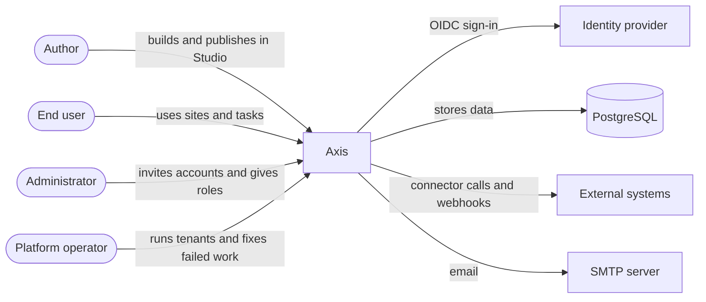
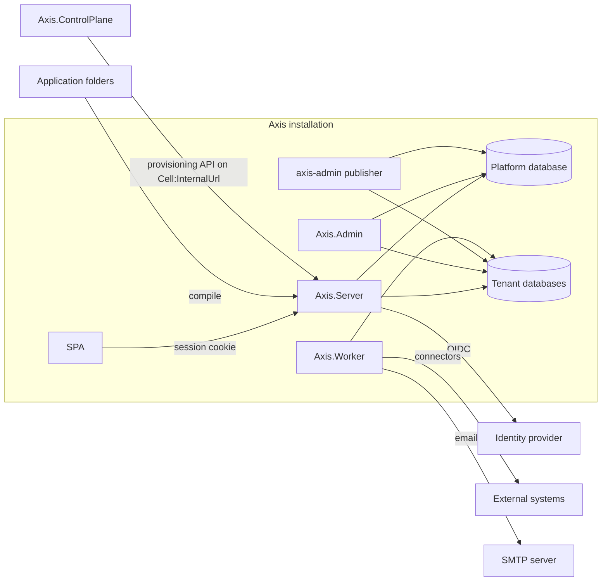
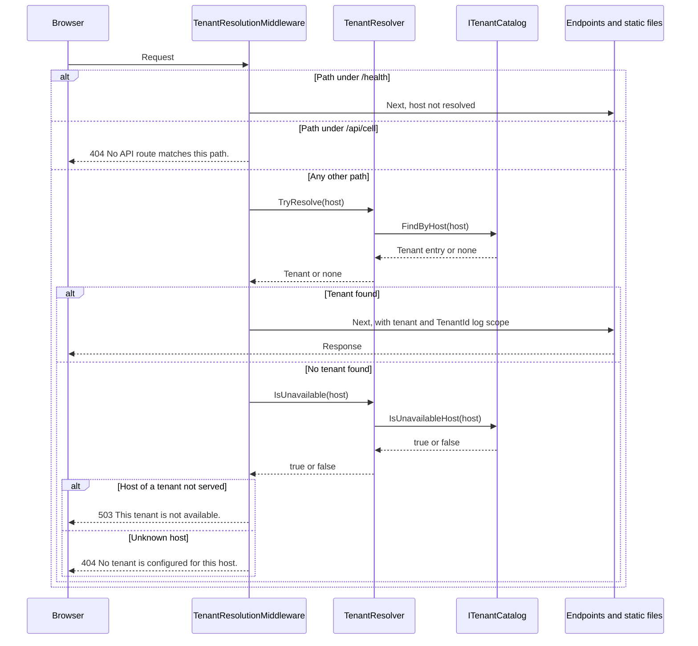

# Axis architecture

This page shows how the parts of Axis fit together, in arc42's order: context and scope, building blocks, runtime view, deployment view and crosscutting concepts. Goals and constraints are in [product brief](product-brief.md), decisions in [decisions](decisions.md), quality goals in [knowledge](domain/knowledge.md), risks in [threat model](reference/threat-model.md) and the vocabulary in [concepts](domain/concepts.md). Testing is in [testing](testing.md). The detailed behaviour of each part is in [reference/](reference/). Work that is agreed but not built yet is marked as [writing the docs](writing-docs.md#planned-work) says.

## Context and scope

Four kinds of people use Axis, and it works with a few outside systems. The diagram shows each one and what flows between it and Axis.



## Building blocks

Axis runs as a few hosts over one platform database and one database per tenant. The diagram shows
them inside one installation, with the control plane, the identity provider and the outside systems
around it.



- **Axis.Server** serves the SPA and hosts the runtime and authoring APIs. It is the BFF: the OIDC
  client and the cookie session. The record API, the data source endpoint, the process start
  endpoint, the task API and the site endpoints require a session. It also hosts Studio's
  [authoring API](reference/authoring.md), which works on the application folders that
  `Studio:Folders` lists and needs a session and the author role. Validating, publishing and rolling
  back store a publish request in the tenant database over the runtime role, so the server never
  activates a release in its own process, see [D47](decisions/d47-publishing-from-studio.md).
- **Axis.Worker** runs durable work: the steps of process instances, connector and package calls,
  task escalations and deadlines, email, event delivery to async triggers, schedule triggers and
  their fan-out, and the backfill of pending computed fields. The work is described in
  [process execution](reference/process-execution.md), [process flow](reference/process-flow.md),
  [events and triggers](reference/process-events.md) and
  [recomputing computed fields](reference/migrations.md#recomputing-computed-fields). It loads the
  same modules and installed [extension packages](reference/extension-packages.md) as the server, and
  serves its own [health checks](#health-checks).
- **Axis.PackageHost** _(planned for M21)_. It runs package operations in package runners, outside
  the worker, in its own `package-host` container. The worker sends each attempt to a runner, and
  loads package code itself only in Development. See
  [package runners](reference/extension-packages.md#package-runners) and
  [D90](decisions/d90-extension-packages-run-out-of-process.md).
- **Axis.Admin** is the console host that the platform operator runs. It creates tenants, migrates
  tenant databases, activates releases, and backs up and restores tenants. It is the only host that
  writes the [tenant directory](#tenant-directory), holds an admin connection to the database server,
  and holds a tenant's schema database role under `Tenancy:Source=directory`. See
  [administration](reference/administration.md),
  [D43](decisions/d43-tenant-provisioning-and-migrations-across-tenant-databases.md) and
  [D45](decisions/d45-tenant-backup-and-restore.md).
- **The publisher**, `axis-admin publisher`, is a long-running command of `Axis.Admin`. It reads the
  tenants as the server does, connects to each tenant database with that tenant's schema role, and
  runs the publish requests that Studio stores. It has no HTTP endpoint, and the server holds no
  tenant schema connection. The production installs, `scripts/dev.sh`, Docker Compose and the E2E
  script each start one. See [publisher](reference/administration.md#publisher).
- **The platform database** holds installation-level data: the
  [tenant directory](#tenant-directory) in its `platform` schema, and platform settings.
- **A tenant database** holds everything else of one tenant: releases, system tables, process
  state, audit and the generated entity tables (D10).

The [repository layout](repository-layout.md#repository-layout) and the
[module rules](repository-layout.md#module-rules) are in their own doc.

### Storage

Physical names, column types, database roles, schema planning and audit are in
[storage](reference/storage.md).

### Record API

The record routes, values, paging and errors are in [record API](reference/record-api.md).

### Frontend

The SPA, sites, pages and widgets are in [frontend](reference/frontend.md). Ant Design is a detail
of the SPA. It never shows in configuration, page metadata, theme tokens or the custom widget API, see
[D58](decisions/d58-ant-design-is-a-detail-of-the-spa-without-procomponents.md).

## Runtime view

This part follows the two flows Axis runs: publishing a release, and running a process.

### Configuration pipeline

How an application folder is loaded, checked, compiled into a release and activated is in
[configuration](reference/configuration.md).

### Process engine (D11)

The process engine keeps all process state in the tenant database and moves an instance on one
step transaction at a time, so a crash loses nothing that was committed. The process resource, the
start endpoint, the states, the task API, the worker settings and the tables are in
[processes](reference/processes.md) and [running a step](reference/process-execution.md#running-a-step).

- **Release pinning.** New work starts on the active release, and running work keeps its steps,
  tasks, forms, texts and package versions until it ends. Roles and policies use the active release,
  see [releases and running work](reference/processes.md#releases-and-running-work) and
  [D29](decisions/d29-release-pinning-and-text-resources.md).
- **State.** Instances and step occurrences are rows in the tenant database. No in-memory state
  matters after a crash.
- **Step transactions.** A step transition loads the instance at its current revision, executes, and
  in one transaction writes:
  - business writes
  - the new instance state and revision
  - the step history
  - audit records
  - the next work item
  - staged connector calls and their work items
  - event occurrences, their delivery work items and sync trigger starts

  A revision mismatch aborts the transaction.

- **Workers.** Workers claim ready work items and publish requests with `FOR UPDATE SKIP LOCKED` and
  a lease. Commits check the claim token (fencing).
- **External operations.** These run outside the transaction, with the operation identity as their
  idempotency key, and a following transaction records the result. A `callConnector` step stages its
  call in its transaction, and the worker sends it and records its result in a following
  transaction. An attempt that is safe to retry is retried under the step's retry policy, with the
  same identity, and an unknown outcome is reconciled through the operation's lookup. See
  [connector calls](reference/process-execution.md#connector-calls). A package operation step is
  staged and run the same way, see
  [package operations](reference/process-execution.md#package-operations).
- **History.** Every attempt, input, output, decision and error is recorded for inspection.

## Deployment view

This part shows what each production image runs and where it is installed.

### Installation

Axis ships as production images, as
[D44](decisions/d44-packaging-for-on-premises-and-cloud-installation.md) agrees.

- `axis-server` and `axis-worker` run the hosts. They hold no sample and no development setting.
- `axis-admin` runs `Axis.Admin` and the publisher, `axis-admin publisher`, and holds the
  PostgreSQL 18 client tools.
- `deploy/compose/` and `deploy/helm/axis/` install them on one machine and on Kubernetes.

The steps, every setting and the upgrade order are in the
[installation guide](reference/installation.md).

## Crosscutting concepts

These concerns cut across the building blocks: tenancy, sign-in and access, telemetry and health checks.

### Tenancy (D10)

Every request and every piece of work runs for exactly one tenant, and nothing reaches another
tenant's data.

- **Resolution.** `TenantContext` is resolved from the request host, see
  [request resolution](#request-resolution). For background work it is set from the work item's
  tenant id.
- **Connections.** A connection factory returns connections only for the current tenant. Without a
  tenant context, data access fails, see [tenant connections](#tenant-connections).
- **Scoping.** Cache keys, file storage paths, job records and log scopes all include the tenant.
- **Tenant source.** The setting `Tenancy:Source` chooses where the tenants come from: the server
  configuration, which is the default, or the [tenant directory](#tenant-directory).

#### Tenant configuration

Under `Tenancy:Source=configuration` the tenants are the `Tenants` section of the host
configuration, keyed by tenant id:

```json
"Tenants": {
  "default": { "Hosts": [ "localhost" ], "ConnectionString": "Host=...;Username=axis_runtime", "SchemaConnectionString": "Host=...;Username=axis_schema" }
}
```

Environment variables override it in the usual form, such as `Tenants__default__ConnectionString`
or `Tenants__default__Hosts__0`.

`ConnectionString` is for the tenant's runtime database role, and `SchemaConnectionString` for its
schema database role. Every tenant needs both in the server, which uses the schema role only for
startup activation, and there is no fallback to one connection string. The worker never uses
`SchemaConnectionString` and starts with only `ConnectionString`. Which step uses which role is in
[database roles](reference/storage.md#database-roles), and the reasons in
[D31](decisions/d31-separate-database-roles.md). Under `Tenancy:Source=directory` there is no
`SchemaConnectionString`: the server and the worker hold only runtime roles for tenant databases.
The server's `ConnectionStrings:PlatformSchema` serves the platform migrations and the quotas write of
the provisioning API, see [tenancy settings](reference/host-settings.md#tenancy-settings).

The development settings, Docker Compose, `scripts/dev.sh` and the E2E server pass `axis_schema` in
`SchemaConnectionString` and `ConnectionStrings:PlatformSchema`, and `axis_runtime` in the other
settings. `appsettings.Development.json` maps `localhost` to the tenant `default` on the Compose
database, and `preview.localhost` to its preview tenant `default-preview` on the `axis_preview`
database. The E2E server maps `127.0.0.1` to a tenant on the E2E database and `localhost` to its
preview tenant, and the E2E run maps `127.0.0.2` to the journey tenant on a server of its own, see
[the E2E stack](testing.md#the-e2e-stack). The `Platform` connection string is separate, and the readiness
check uses it.

Startup fails with an `InvalidOperationException` that names every problem when:

- no tenant is configured;
- a tenant id contains anything other than lowercase letters, digits and hyphens;
- a tenant has no hosts, or a host entry that is blank or only whitespace;
- a tenant has no connection string, or one that is only whitespace;
- the same host is listed under two tenants, compared ignoring letter case;
- in the server, a tenant has no `SchemaConnectionString`, or one that is only whitespace, even when
  no application folder is activated at startup;
- in the server, both connection strings name the same user;
- in the server and the worker, the runtime database role is a superuser, owns the `axis` or
  `entities` schema, may create objects in either, or is a member of a role that is or may;
- a binding fails the startup check or the secret source check of
  [deployment bindings](reference/integration-resources.md#deployment-bindings). The message names the
  tenant and the binding, never the value;
- the preview tenant rules of [preview tenants](reference/host-settings.md#preview-tenants) are
  broken: `PreviewOf` names a tenant that is not configured or is itself a preview tenant, two
  tenants name the same main tenant, or a preview tenant has its own `Oidc` block.

A tenant holds its deployment bindings under `Bindings`, keyed by name and matched ignoring letter
case. A release names a binding and never holds its value, and the server and the worker must hold
the same bindings. `IDeploymentBindings` resolves a binding only for the tenant of the current
request or work item: `Resolve` returns a `url` binding, and `ResolveSecret` returns a `secret`
binding as a `SecretValue`, which shows `[secret]` as text, as JSON and in logs, gives its plain value
only through `Reveal` at the moment of a call, and is never read from JSON. Without a tenant context,
for a name the tenant lacks, or for a binding of the other kind, both throw an
`InvalidOperationException` that names the binding and no value, so `Resolve` never hands out a plain
secret. The kinds, where values live and the checks are in
[deployment bindings](reference/integration-resources.md#deployment-bindings), and the reasons in
[D25](decisions/d25-connectors-deployment-bindings-and-secrets.md).

#### Tenant directory

The tenant directory is the list of tenants in the `platform` schema of the platform database, with
each tenant's status, hosts, database settings, OIDC settings and bindings, as
[D42](decisions/d42-tenant-directory-in-the-platform-database.md) agrees.
[`Axis.Admin`](reference/administration.md) writes it, and the server and the worker read it under
`Tenancy:Source=directory`. The server creates the `platform` tables at start under both tenant
sources. The settings are in [tenancy settings](reference/host-settings.md#tenancy-settings), and the
tables in [platform database](reference/storage.md#platform-database).

- **Two sources, one contract.** `Tenancy:Source` is `configuration`, the default, or `directory`.
  Both answer through one tenant catalog contract, so request resolution, tenant connections,
  deployment bindings and sign-in do not know the source. Under `directory` both hosts ignore a
  `Tenants` section and log a warning when one is present, and a non-empty `ActivateOnStartup` stops
  the server's start.
- **Read only.** The hosts read the directory over `ConnectionStrings:Platform`, a role that may read
  the `platform` schema, and the server may also insert its data protection keys. The worker never
  reads `ConnectionStrings:PlatformSchema`.
- **Served tenants.** The hosts use the `active` tenants for host matching, tenant connections,
  deployment bindings and sign-in. The worker runs each tenant's work on the tenant's own database,
  with its decrypted runtime password.
- **Secrets in memory.** A password, the client secret and a `secret` binding stay encrypted in
  memory, and are decrypted only when a connection opens, the sign-in client is set up or a binding is
  resolved. The binding check runs on each read, and a failure names the tenant and the binding,
  never the value.
- **Refresh.** Both hosts read the directory again every `Tenancy:RefreshInterval`, 30 seconds by
  default, without a restart. A changed host, database setting or OIDC setting applies at the next
  refresh, and a changed database setting gets a new connection pool. A tenant added at a refresh gets
  its OIDC client and its endpoint caller scheme, and a tenant that is no longer served loses both.
  The worker runs the refresh in its poll: it pauses its loops and waits for the work items already
  running.
- **Schema versions.** The worker also reads the schema version of every tenant again at each poll
  round, and claims no work of a tenant whose version is not its own.
- **Empty directory.** An empty directory starts, and every host answers `404` until a tenant is added
  and a refresh serves it.
- **Health exemption.** Paths under `/health` stay exempt from resolution.

What a host answers for a tenant under the directory:

| Case                                            | Answer                                                                                                                                                                                                                                                                                                                                                                                                                                                |
| ----------------------------------------------- | ----------------------------------------------------------------------------------------------------------------------------------------------------------------------------------------------------------------------------------------------------------------------------------------------------------------------------------------------------------------------------------------------------------------------------------------------------- |
| An `active` tenant                              | Served after the next refresh, once the runtime database role check passes. Its OIDC client and its endpoint caller scheme are registered then.                                                                                                                                                                                                                                                                                                       |
| A `suspended` or `provisioning` tenant          | `503` problem details (`application/problem+json`) titled "This tenant is not available.", naming no tenant and no host. The worker claims none of its new work, and work already claimed finishes.                                                                                                                                                                                                                                                  |
| A tenant whose schema version is not the host's | `503`, like a suspended tenant, from the first refresh that reads the other version. The server logs one warning when a tenant joins this state. The worker claims none of its work, new or old, and starts again with no restart once `Axis.Admin migrate` has brought the tenant to its version. The schema version is the newest EF Core migration that [`migrate`](reference/administration.md#migrate) applied. The server registers the tenant's sign-in client when a refresh serves it. |
| A removed or unknown host                       | `404`.                                                                                                                                                                                                                                                                                                                                                                                                                                                |
| A refresh that fails                            | The last good directory stays in use, and one error is logged for each run of failed refreshes. Readiness is Degraded until a refresh works, see [health checks](#health-checks). A tenant suspended during the outage keeps running until then.                                                                                                                                                                                                      |
| The first load fails                            | The server stops its start with an error that names `ConnectionStrings:Platform` and holds no password. The worker logs the failure once, retries every `Worker:PollInterval` and is not ready until a read works. The worker also stops at start when `ConnectionStrings:Platform` is missing or `Tenancy:RefreshInterval` is invalid.                                                                                                                 |

- **New tenants.** A tenant that first appears at a refresh is served only after the runtime
  database role check passes, see [database roles](reference/storage.md#database-roles). Until then
  it answers `503`, like a suspended tenant, and the check runs again at each refresh. The worker
  skips such a tenant, logs an error and runs the check again at each refresh, and a failed check
  does not stop it. The same holds for a tenant that becomes `active` again, and for a served tenant
  whose database host, port, name, runtime user or runtime password changes: it answers `503` until
  the check passes on the new settings, then the server drops its old connection pool and the next
  request opens one with the new settings. The check runs only when the directory changes, so
  privileges granted inside the database with no directory change are caught only at a restart.
- **Missing sign-in settings.** A tenant whose `Oidc` authority, client id or client secret is blank
  at a refresh is withheld in the same way: it answers `503`, the server logs the missing setting, and
  the other tenants keep working.
- **No provisioning in the server.** `Axis.Admin` creates, migrates, grants and activates the
  database of a tenant, and the server does none of it, see
  [administration](reference/administration.md).

#### Preview tenants

A preview tenant belongs to one main tenant, and an author tries an application there before
publishing it to the main tenant, as [D48](decisions/d48-preview-tenants.md) agrees. It works under
both tenant sources. Its settings are in
[preview tenants](reference/host-settings.md#preview-tenants).

- **One main tenant, one preview.** A preview tenant belongs to one main tenant, a main tenant has at
  most one preview tenant, and a preview tenant has no preview of its own.
- **A tenant like any other.** A preview tenant has its own database, database roles, hosts and
  bindings, and its data never mixes with the main tenant's. Hosts resolve it like any tenant's, and a
  session is bound to the tenant it signed in on, see
  [tenant binding](reference/security.md#sign-in-and-the-session).
- **Where it is set.** Under `configuration`, the tenant setting `PreviewOf` names the main tenant.
  Under `directory`, the entry names it in `platform.tenants.preview_of`, and the operator creates it
  with [`tenant create --preview-of`](reference/administration.md#tenant-create). The entry stores no
  sign-in settings, and the catalog copies the main tenant's at each refresh.
- **Sign-in.** A preview tenant uses its main tenant's authority, client id, client secret and claim
  names. It uses neither `Oidc:EndpointAudience` nor `Oidc:ServiceAudience`, so it accepts no
  machine-caller or service account token. The operator registers the preview host's redirect
  address at the identity provider. A session there reads its main tenant's given roles, see
  [preview tenants](reference/identity-provider.md#preview-tenants).
- **Bindings.** A preview tenant's bindings are its own and empty by default. A missing binding is a
  warning at activation there, not an error, see
  [deployment bindings](reference/integration-resources.md#deployment-bindings).
- **Status.** Each tenant keeps its own status, so suspending a main tenant does not suspend its
  preview tenant.
- **Publishing.** Studio on the main tenant's host stores a preview request in the main tenant's
  database, and the publisher runs it against the preview tenant. The server opens no connection to
  another tenant's database, except that a preview session reads its main tenant's given roles. See
  [preview](reference/authoring.md#preview).

#### Request resolution

The server finds the tenant of each request from its host, before static files and endpoints run.
The diagram shows the order of these checks for a request on a tenant host. The list below says the
same in words.



- **Host matching.** Middleware in `Axis.Server` matches `Request.Host.Host` against the configured
  hosts, ignoring letter case and the port, so `A.Example.TEST:8443` matches `a.example.test`.
- **Behind a proxy.** From a proxy named in the
  [forwarded headers settings](reference/host-settings.md#forwarded-headers), the host matched is the
  forwarded host. From any other address it is the request's own `Host`.
- **Unknown host.** The response is `404` problem details (`application/problem+json`) titled "No
  tenant is configured for this host." It names neither the requested host nor any configured tenant
  or host. This covers API and SPA paths alike.
- **Health exemption.** Paths under `/health` are not resolved, so `/health/live` and
  `/health/ready` answer for any host.
- **Provisioning API.** The `/api/cell` branch above applies on a tenant host. See
  [provisioning API](reference/tenant-lifecycle.md) for where the API is served.
- **Tenant not available.** Under `Tenancy:Source=directory`, a host of a tenant that is not served
  answers `503`, as the [tenant directory](#tenant-directory) table says.
- **Log scope.** While a resolved request runs, the logging scope carries `TenantId` with the tenant
  id.

#### Tenant connections

A tenant's database is reached only through the current tenant.

- `ITenantConnectionFactory` opens connections to the current tenant's database only. Without a
  tenant context it throws `InvalidOperationException`.
- There is one `NpgsqlDataSource` per tenant, created on first use and disposed with the host.
- **Through PgBouncer** _(planned for M31)_. In a [cell](reference/cells.md#connections) the hosts
  reach the tenant databases through PgBouncer.
- The current tenant is held per asynchronous flow (`AsyncLocal`), so concurrent requests never see
  each other's tenant.
- In the server, a request scope holds one tenant connection, opened on first use and disposed with
  the scope. The module contexts and raw commands share it.

### Authentication and authorization

The server signs people in, accepts tokens from other systems, and checks every access on the
server against the application's policies. The detail is in [security](reference/security.md).

- **Authentication (D9, D23).**
  - The server is the OIDC confidential client, and the browser gets a secure, HttpOnly, SameSite
    cookie session. API writes are protected against CSRF by a required header. See
    [sign-in and the session](reference/security.md#sign-in-and-the-session).
  - The session state is in the tenant database, so sign-out revokes it at once (D84).
  - Other systems call inbound endpoints with a bearer token instead of the session, see
    [machine callers](reference/security.md#machine-callers).
  - Service accounts call the record API, data source rows, process start, process inspection and
    the operator commands with a bearer token (D86), see
    [service accounts](reference/security.md#service-accounts).
  - A tenant can turn on the FAPI 2.0 profile (D83), see
    [FAPI 2.0 profile](reference/fapi2-profile.md).
  - Tests and local development use Keycloak in a container.
- **Hardening (D82, D84, D85).**
  - The server sets security headers on every response and rate limits the routes a caller can
    repeat, see [security headers](reference/headers-and-rate-limits.md#security-headers) and
    [rate limits](reference/headers-and-rate-limits.md#rate-limits).
  - Every route needs a signed-in user or a valid caller token unless it is listed as open (D137),
    see [authorization](reference/security.md#authorization).
  - Axis is checked against ASVS 5.0 Level 2, tracked in [ASVS](reference/asvs.md), with
    `.github/CODEOWNERS` and a threat model (D106) among its
    [other evidence](reference/asvs.md#other-evidence).
  - **The final ASVS sign-off** _(planned for M32)_.
  - Performance objectives and the load test are in [performance](reference/performance.md).
- **Authorization (D12, D24).**
  - The record API, the data source endpoint and the process start endpoint call the policy module
    with the entity, data source or process and the action. The task API calls it for the fields a
    task shows, and the site endpoints call it to shape navigation and page metadata.
    `GET /api/me`, `GET /api/site`, `GET /api/texts/{locale}` and the `/api/auth` endpoints carry no
    application content and call no policy. Worker steps run as `system`, outside policies.
  - The [authoring API](reference/authoring.md) checks `Studio:AuthorRole`, an installation-level
    role outside application policies, and calls no policy. An author can change every policy of an
    application, so a policy cannot guard authoring. See
    [Studio settings](reference/host-settings.md#studio-settings).
  - Record filters from policies limit every record list and single-record check of the record API,
    data source queries and the subject record of a process start.
  - Field policies leave out fields from record API results, data source rows, task forms and page
    metadata, and reject record API writes to protected fields.
  - See [authorization](reference/security.md#authorization).
- **Details.** Sign-in, machine callers, authorization and the
  [development users](reference/security.md#development-users) are in
  [security](reference/security.md).

### Telemetry

Correlated logs, metrics and traces, the OTLP export and what telemetry never holds are in
[telemetry](reference/telemetry.md).

### Health checks

The `/health/live` and `/health/ready` answers of the server and the worker are in
[health checks](reference/health-checks.md).
