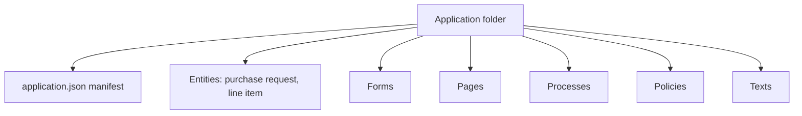
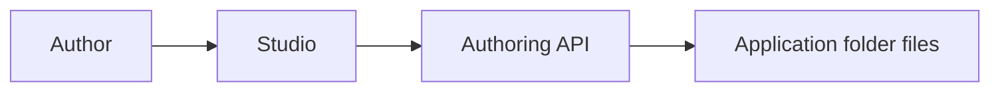
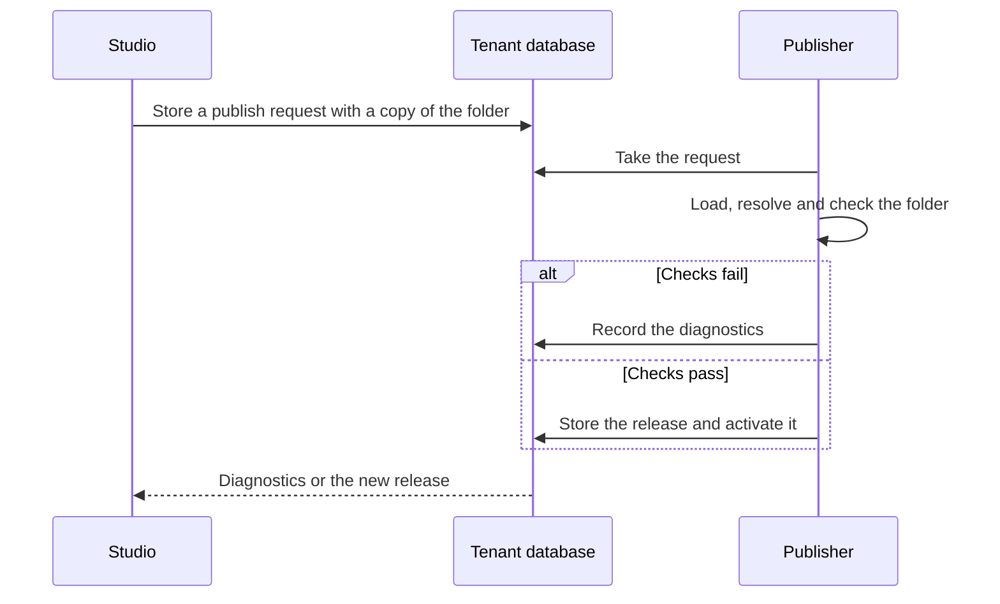
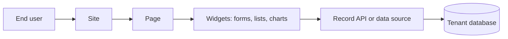
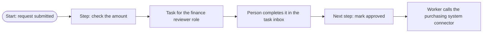
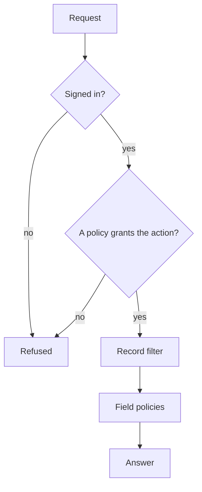
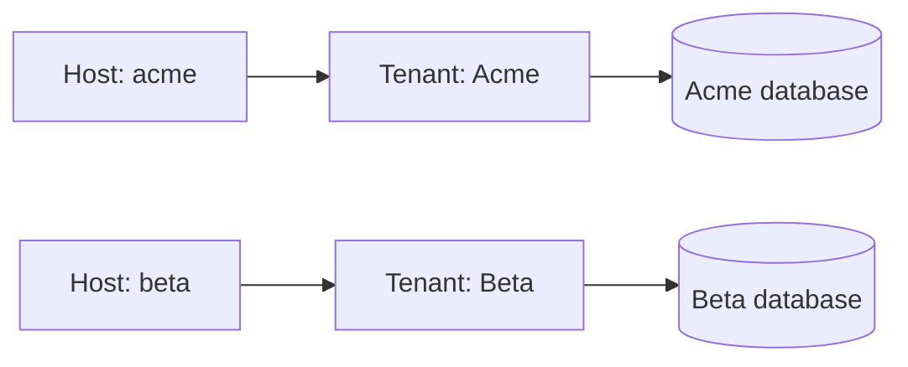
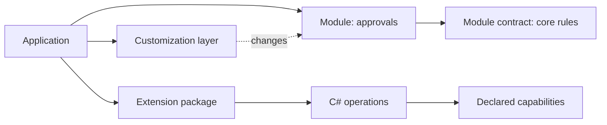

# How Axis works

This page walks through Axis once, from an application's configuration to the people who use it.
It is for a newcomer who wants the whole picture before the detail. Each part says what it does and
why, gives a small example, shows its own diagram and links the reference page that holds the
detail.

## An application is configuration

An Axis application is a folder of configuration files, not code. Each file is a resource that
describes one thing the application has. Because the application is configuration, a business can
change it without writing code, and Axis can check every change before it runs.

The purchase-requests sample is one such folder, under `samples/apps/purchase-requests`. It has an
`application.json` manifest that names the application. It has an entity file for each kind of
record, such as the purchase request, and a form, a page, a process, a policy and a text file for
each of the things the application shows or does.

The diagram shows the folder and its main kinds of resource. The folder holds the same things as
the words above: a manifest and one file for each resource. An entity is a kind of record, such as a
purchase request with its number and title.

The detail is in [packaging and lifecycle](domain/concepts.md#packaging-and-lifecycle) and
[resource files](reference/resource-files.md). [D5](decisions/d5-configuration-is-authored-as-files-first.md)
chose configuration as files first.

## Studio

Studio is Axis's editor, which runs in the browser. An author uses it to build an application
without writing the resource files by hand. It reads and writes the application folder through the
authoring API, so a change made in Studio ends as the same files a person could edit by hand.

For example, an author who adds a field to the purchase request in Studio writes that field into the
purchase request's resource file.

The author uses Studio, Studio calls the authoring API, and the API writes the folder's files. Studio
writes the same files a person could write by hand, so it can save a mistake. The check before
publishing reports each problem it finds, and a folder with an error gets no release.

The detail is in [Studio](reference/studio.md) and [the authoring API](reference/authoring.md).
[D5](decisions/d5-configuration-is-authored-as-files-first.md) says the visual editor writes the
same resources as hand-written files.

## Checking and publishing a release

Before people use an application, Axis checks the whole folder and freezes it into a release. A
release is a fixed copy of the application. Checking comes first, so a mistake shows up before
anyone meets it, and freezing means people never use a half-edited version.

For example, if a process has a step that can never finish, the check reports a diagnostic with a
code and the place in the folder where the problem is. The author fixes the file and publishes
again.

Studio does not activate a release itself. It stores a publish request, and a separate publisher runs
it. A release is pinned: work that starts on a release keeps that release until the work ends, and
new work uses the active release.

The detail is in [the configuration pipeline](reference/configuration.md),
[publishing in the authoring API](reference/authoring.md#publishing) and
[publishing in Studio](reference/studio.md#publishing). The choices are
[D47](decisions/d47-publishing-from-studio.md) and
[D29](decisions/d29-release-pinning-and-text-resources.md).

## Using the application's site

Each application has a site, where the people who use it work. A site is made of pages, and a page
is made of widgets, such as a form, a list or a chart. The widgets read and write records through
the record API or a data source, and the records are stored in the tenant's database.

For example, a requester opens a list widget on a page, which asks the record API for the purchase
requests. The requester then opens one request in a form widget and fills it in.

The site shows pages, the pages hold widgets, and the widgets call the server. The server answers
from the tenant's own database, so the screen never talks to the database directly.

The detail is in the [frontend](reference/frontend.md) and the [record API](reference/record-api.md).

## A process and its tasks

A process is the set of steps that work goes through, such as a purchase request that needs
approval. Some steps are tasks for a person, who sees them in a task inbox. Other steps are done by
Axis itself, such as calling another system. Axis keeps the state of each process in the database,
so nothing is lost on a crash and nothing is done twice.

For example, in the purchase-requests sample a request above the finance threshold waits for a
finance reviewer. The reviewer approves it in the task inbox, and the process then creates the
purchase order in the purchasing system.

A step either runs in the process or waits as a task for a role. When a person completes the task,
the process moves on to the next step, and the worker makes any call to another system.

The detail is in [processes](reference/processes.md), the [task API](reference/task-api.md), the
[task inbox widget](reference/task-inbox-widget.md) and the
[process engine](architecture.md#process-engine-d11).
[D11](decisions/d11-durable-process-engine.md) chose a durable process engine.

## Security

Security in Axis is closed until a policy opens it. A person must sign in first, and then the server
checks each read, write and action against the policies of the active release. If no policy grants
the action, the server refuses it. The screen only shapes what a person sees. The server makes the
decision.

For example, a person who sends an edit that no policy allows is refused, even though the screen
never offered the button.

Every request passes the same checks in order. Each "no" ends in a refusal, and only a request that
passes all of them gets an answer. Sign-in uses OpenID Connect through a server-side part of Axis, so
the browser holds only a session cookie and never a token.

The detail is in [authorization](reference/security.md#authorization) and
[policies](reference/roles-and-policies.md#policies). The choices are
[D9](decisions/d9-authentication-oidc-through-a-bff-ready-for-fapi-20.md) for sign-in and
[D12](decisions/d12-authorization-is-server-side-and-default-deny.md) for authorization.

## Tenants

A tenant is one customer's own copy of Axis, with its own database and its own hosts. Tenants never
share records. Axis finds the tenant of each request from the host name, so one set of code serves
every tenant without mixing their data.

For example, two companies each use Axis at their own address. Each address leads to its own tenant,
and each tenant's records sit in its own database.

A main tenant can have one preview tenant, where a release is tried before the main tenant gets it.
Publishing to the main tenant does not need a preview first.

The detail is in [tenancy](architecture.md#tenancy-d10) and
[request resolution](architecture.md#request-resolution).
[D10](decisions/d10-tenant-aware-from-day-one-full-tenancy-later.md) gives each tenant its own
database, and [D48](decisions/d48-preview-tenants.md) defines preview tenants.

## Modules and extension packages

Some parts of an application are shared by many applications, and Axis keeps them. A module, such as
approvals, is a reusable piece of configuration. An application changes a module through a
customization layer, which records only the differences. A module contract keeps the module's core
rules in place on every change.

When configuration cannot express what a business needs, a developer adds an extension package. An
extension package is C# code with operations that a process can call. Each operation declares the
capabilities it needs, so it gets only what it declares.

For example, an application uses the approvals module and adds one extra check on its requests. The
check lives in a layer in the application's own folder, and the approvals rules stay in place.

The application uses a module and changes it through a layer. The module contract guards the core
rules. An extension package adds code that the application calls through its processes.

The detail is in [modules and templates](reference/modules-and-templates.md#modules),
[customization layers](reference/customization-layers.md),
[module contracts](reference/module-contracts.md) and
[extension packages](reference/extension-packages.md).
[D102](decisions/d102-built-in-modules-open-to-change-and-bound-by-a-contract.md) sets the rules for
modules, and [D7](decisions/d7-custom-code-lives-in-extension-packages.md) puts custom code in
extension packages.

## Where to go next

The [context and scope](architecture.md#context-and-scope) and
[building blocks](architecture.md#building-blocks) sections of the architecture page draw the
platform as a whole, with the people and systems around it and the hosts and databases inside it.
The [concepts](domain/concepts.md) page defines every term used here, and the
[knowledge](domain/knowledge.md) page says why the design rules exist.
