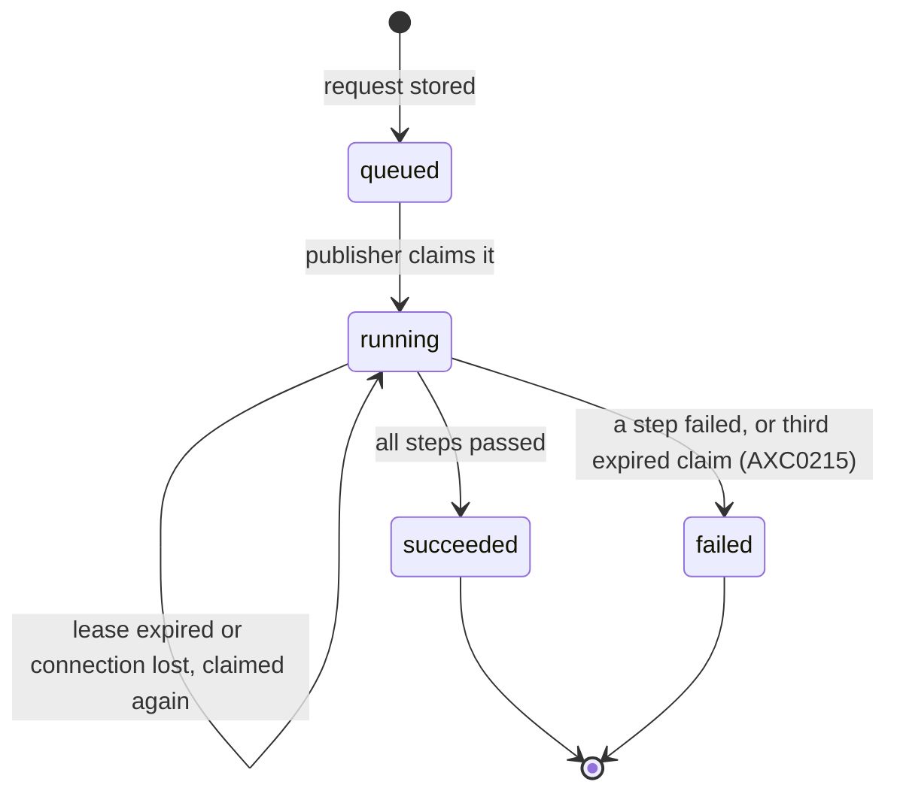

# Publishing in the authoring API

This page gives the routes of the [authoring API](authoring.md) that validate, publish, preview, test and
activate an application, build one of its packages, list its releases and record its audit. The other routes are in the
[authoring API](authoring.md) page.

## Publishing

An author validates, publishes, previews and tests an application from Studio, and activates any
release of its history. The server holds no tenant schema connection and never activates in its own
process: it stores a **publish request** in the tenant database, and a separate
[publisher](publisher.md#publisher) runs it with the tenant's schema role. The tables are in
[publish requests and release history](publish-request-storage.md#publish-requests-and-release-history).

A request runs for the tenant of the author's session, so Studio on a tenant's host publishes to that
tenant only.

| Route                                                        | Response                                                                                                                                                                                                                      |
| ------------------------------------------------------------ | ----------------------------------------------------------------------------------------------------------------------------------------------------------------------------------------------------------------------------- |
| `POST /api/studio/apps/{application}/validate`               | `202` with the request and a `Location` header for `.../requests/{id}`. It needs the author role                                                                                                                              |
| `POST /api/studio/apps/{application}/publish`                | `202` with the request and a `Location` header. The body is `application/json` with an optional `label` and an optional `note`. It needs the author role and the publisher role                                               |
| `POST /api/studio/apps/{application}/preview`                | `202` with the request and a `Location` header. It needs the author role only, and answers `409` when the tenant has no preview tenant, see [Preview](#preview)                                                               |
| `POST /api/studio/apps/{application}/test`                   | `202` with the request and a `Location` header. The body is optional `application/json`, `{ "scenarios": ["<name>", ...] }`, and none or an empty list means every scenario, or `{ "package": "<id>" }` to test one package. The scenario test needs the author role only, see [Test](#test) |
| `POST /api/studio/apps/{application}/build`                  | `202` with the request and a `Location` header. The body is `{ "package": "<id>" }`. It needs the author role, the developer role and the tenant's application packages switch, see [Build](#build)                           |
| `GET /api/studio/apps/{application}/requests/{id}`           | `200` with the request, its status, its diagnostics and, for `test`, its scenario outcomes or its package's tests and, for `build` and a package `test`, its output                                                                                                       |
| `GET /api/studio/apps/{application}/releases`                | `200` with the activation history, newest first, and which release is active, see [Release history](#release-history)                                                                                                         |
| `POST /api/studio/apps/{application}/releases/{id}/activate` | `202` with the request and a `Location` header. It needs the author role and the publisher role, see [Activating a release](#activating-a-release)                                                                            |

`validate`, `preview` and `activate` take no body, and a body that is sent is ignored. A `publish`
without a body stores no label and no note, and a `test` without a body runs every scenario. A body
that is sent to either must be `application/json`, or the answer is `415`. `{id}` of a request is its
UUID, and `{id}` of a release is the release id from the history. The other refusals are those of the
rest of the API, see [Order of checks](authoring.md#order-of-checks) and [Responses](authoring-responses.md).

### The request

A request is shown as
`{ id, application, kind, target, status, label, note, requestedBy, requestedByName, requestedAt, startedAt, finishedAt, releaseId, diagnostics, scenarios, package, packageTests, output }`.

| Field             | Meaning                                                                                                                                                                                                                                                    |
| ----------------- | ---------------------------------------------------------------------------------------------------------------------------------------------------------------------------------------------------------------------------------------------------------- |
| `id`              | The request id, a UUID                                                                                                                                                                                                                                     |
| `application`     | The application `name`                                                                                                                                                                                                                                     |
| `kind`            | `validate`, `publish`, `activate`, `test`, `build` or `accept`                                                                                                                                                                                             |
| `target`          | `tenant` or `preview`. `preview` marks a request that runs on the session tenant's preview tenant, see [Preview](#preview). Only the preview route writes `preview`, and the request status route reports the stored value                                 |
| `status`          | `queued`, `running`, `succeeded` or `failed`, see [Lifecycle](#lifecycle)                                                                                                                                                                                  |
| `label`           | The optional label of a `publish`, up to 100 characters, or null                                                                                                                                                                                           |
| `note`            | The optional note of a `publish`, up to 2000 characters, or null                                                                                                                                                                                           |
| `requestedBy`     | The requesting user's id                                                                                                                                                                                                                                   |
| `requestedByName` | The requesting user's display name from their [user profile](notifications.md#user-profiles), else the name stored with the request, else null                                                                                                             |
| `requestedAt`     | When the request was stored                                                                                                                                                                                                                                |
| `startedAt`       | When a publisher first started it, or null while `queued`                                                                                                                                                                                                  |
| `finishedAt`      | When it reached `succeeded` or `failed`, or null before                                                                                                                                                                                                    |
| `releaseId`       | The release a `publish` activated or an `activate` named, or null. A `validate`, a `test` and a `build` have none                                                                                                                                          |
| `diagnostics`     | The diagnostics, in the form of [Diagnostics](authoring.md#diagnostics). Empty until the request ends. A `succeeded` request can hold warnings. An `accept`'s `AXC0377` adds `changedBy` and `changedAt`, see [accepting](authoring-requests.md#accepting) |
| `scenarios`       | The scenario outcomes, see below. For a scenario `test`, empty until the request ends. For a `publish`, a `validate` or an `accept`, null until the request ends and when no scenario ran. Null for an `activate` and for a package `test`, as no scenario runs |
| `package`         | The package a `build` builds or a package `test` tests. Null for every other request                                                                                                                                                                       |
| `packageTests`    | For a package `test`, the outcome of each test, `{ name, outcome, message, durationMs }` and for a failed test `file`, `line` and `column`, empty until the request ends. Null for every other request                                                    |
| `output`          | For a `build` or a package `test`, the lines the package host wrote, as a list of strings, empty until the request ends. Null for every other request                                                                                                      |

`scenarios` has one item for each scenario that ran, in file order: for a `test`, the application's
scenarios, and for a `publish`, a `validate` and an `accept`, the stored results of their
[contract scenarios](module-contracts.md#contract-scenarios). An `accept` lists its contract scenarios
first and then the application's own scenarios. An item is
`{ name, resourceId, file, outcome, durationMs, step, path, message }`:

- `outcome` is `passed` or `failed`, and `durationMs` is the time the scenario took.
- `step` is the 0-based index of the failing step, `path` is `/steps/<index>`, in the same form as the
  paths of [Diagnostics](authoring.md#diagnostics), and `message` is the failure message, each null when the
  scenario passed.
- `resourceId` and `file` name the scenario resource, so Studio can open it at `path`.
- A contract scenario that a relax entry skipped is an item in the form
  `{ name, file, outcome: "skipped", point }`, where `point` is the relaxed point it covers.

What each kind does:

- **A snapshot.** `validate`, `publish`, `preview` and `test` store the folder as it is when the
  request is made (a `test` of the MCP server's `run_scenarios` or `test_package`, the draft, see
  [Test](#test)): every `*.json` file and every file under `packages/` that Studio can reach, with its
  `version`, as for [Versions](authoring.md#versions). A file that is not a valid
  resource is kept, so the request fails with the diagnostic that the diagnostics route shows. The
  snapshot is read under the write lock, so it never holds a write half done, and a later edit in
  Studio does not change a queued request: the release is exactly what the author sent.
- **A folder with errors.** A `publish` of a folder with compile errors is still accepted with `202`,
  and the request then ends `failed` with those diagnostics. So there is one path for diagnostics, and
  the snapshot shows what the author sent.
- **`validate`.** The publisher first runs the contract scenarios of the pinned modules. It then runs
  every activation check against the tenant inside a transaction that it rolls back, and returns the
  codes of [startup activation](host-settings.md#startup-activation), including the checks that the
  in-memory diagnostics skip: bindings, name and site path conflicts, and storage changes. It stores no
  release and changes nothing, and ends `succeeded` when there is no error.
- **`publish`.** The publisher first runs the contract scenarios, as for `validate`. A failing one ends
  the request `failed` with `AXC0342`, and nothing is stored or activated. Then it compiles the
  snapshot against the tenant, stores the release, activates it and seeds, with the same steps as
  [`axis-admin activate`](administration.md#activate). A `seed` failure happens after activation has
  committed, so the request ends `failed` with `releaseId` set, and the release stays active.
- **`test`.** The publisher runs the scenarios, see [Test](#test).
- **`build`.** The publisher builds one package, see [Build](#build).
- **`accept`**. The publisher applies a person's draft to the application's folder, see
  [accepting a draft](revisions-and-drafts.md#accepting-a-draft). It runs the contract scenarios, then
  the steps of a `validate`, then the application's own test scenarios on the applied files, and a
  failing one ends the request `failed`. A resource or a package file that changed on `main` since the draft
  used it ends the request `failed` with one `AXC0377` for each such resource or file. An author's `accept` comes from the [accept route](authoring-requests.md#routes).
- **Order.** For one tenant and application the publisher runs `publish`, `validate`, `activate` and
  `accept` requests one at a time, oldest first, so when two publishes are queued, the newer one ends
  up live. A `test` and a `build` share a queue of their own.

### Preview

`POST .../preview` tries an application on the session tenant's
[preview tenant](../architecture.md#preview-tenants) before it goes live. The request has the kind
`publish` and the target `preview`.

- **Who may.** The author role is enough. It needs no publisher role, because nothing goes live for
  real users.
- **Where it is stored and where it runs.** The request is stored in the session tenant's database,
  so Studio polls `GET .../requests/{id}` on the main host as for any request. The publisher runs it
  against the preview tenant's database, see [the publisher](publisher.md#publisher).
- **History.** The activation goes in the preview tenant's own release history, with the request id,
  and the preview's release number is its own. `GET .../releases` on the main host shows only the main
  tenant's history.
- **Audit.** A preview writes no audit record, like `validate`. The preview's history records who
  published it.
- **A preview that is not served.** A request stays `queued` while the preview tenant is not served.
  If the main tenant loses its preview tenant after the request was stored, the request ends `failed`
  with `AXC0216`.
- **Not required.** Publishing to the main tenant does not need a preview first.
- **Data.** A preview starts with the application's seed data. Records created in it stay until the
  operator recreates the preview tenant, and Studio cannot reset it.
- **Bindings.** A preview has its own bindings, empty by default. A missing binding is a warning at
  activation, and the call fails at run time, see [preview tenants](host-settings.md#preview-tenants).

### Test

`POST .../test` stores a request to run the application's [test scenarios](test-scenarios.md) from
Studio. The request has the kind `test` and the target `tenant`. Studio's Run tests and Run controls
send it, and its Test results list shows the outcome, see [Studio](studio.md).

- **Who may.** The author role is enough, because a test changes no tenant. It costs database time,
  so the limits below apply. A test whose body names a `package` needs the developer role and the tenant's
  application packages switch too, and answers `403` and stores nothing without them, see
  [Order of checks](authoring.md#order-of-checks). It checks no quota.
- **The body.** The optional `scenarios` list names the scenarios to run, by their `name`. With no
  body, no list or an empty list, every scenario runs, a pinned module's after the application's own,
  as `<module id>/<name>`. An unknown name is accepted with `202`, and the request then ends `failed`
  with `AXC0218`, as for a folder with errors. A [contract scenario](module-contracts.md#contract-scenarios)
  that covers a relaxed point of its module does not run. Its `skipped` item comes first, see [the request](#the-request).
  The body may name `package` instead, a string, see A package's tests below. A body with both keys, or a `package` that is
  not a string, answers `400`, and a package with no file in the working folder answers `404`.
- **Where it runs.** The server stores the request with a snapshot, taken as for `validate`, or of
  the person's [draft](revisions-and-drafts.md#drafts) for the MCP server's `run_scenarios` and `test_package`. The
  publisher runs it with `Scenarios:ServerConnectionString`, in a new database for each scenario, see
  [the publisher](publisher.md#publisher), and touches the tenant database only for the
  request's status and outcomes. Without the setting, the request ends `failed` with `AXC0217`, which
  names it, and a snapshot that does not compile ends it `failed` with the compile diagnostics. In
  these cases, and for an unknown name, no scenario runs.
- **The outcome.** The request ends `failed` when any scenario fails. Scenario failures go only in
  `scenarios`, one item for each scenario that ran, and the other failures, `AXC0217` to `AXC0220`
  and compile diagnostics, go in `diagnostics`. A scenario that fails has the failing `step`, its
  `path` and its `message`. Selecting it in Studio opens the scenario at that step, as a diagnostic
  opens a resource. A module's scenario opens nothing.
- **Limits.** The scenarios of a request run one after another, and the work item limit of a
  [test scenario](test-scenarios.md) applies to each. A request stops after 10 minutes: the scenario
  that runs fails, its database is dropped and the request ends `failed` with `AXC0219`. A stop of the
  publisher (`SIGTERM`) does the same at once, with `AXC0220`. The scenarios that finished keep their
  outcomes, and the one that was cut is stored as `failed` with no `step` and no `path`.
- **Order.** At most one `test` or `build` request per application runs at a time, oldest first. Their queue is
  separate from `validate`, `publish` and `activate`, so a `test` never waits behind a `publish`.
- **A package's tests.** A `test` whose request names a `package` tests that one application package, see
  [an application's packages](package-runners.md#an-applications-packages). The publisher compiles
  nothing and runs no scenario. It sends the package's files from the snapshot to `application-package-host`
  as a `test` and stores each test's outcome in `package_tests` and the lines the host wrote in `output`, so it needs no
  scenario server. The request answers `scenarios` as null. It ends `succeeded` when every test passed and `failed` otherwise. A refused build is `AXC0149` at the problem's
  file, a host that gives no answer within 5 minutes is one `AXC0152` at the manifest, and the setting off is
  one `AXC0148` at the manifest, with nothing sent. A stop ends it with `AXC0220`. In each case `package_tests`
  is empty. `output` then holds the lines of the refused build, and is empty for no answer, the setting off and a stop.
- **Audit.** A `test` writes no audit record.
- **A request that runs again.** A request claimed again after a lost lease runs every scenario again.

### Build

`POST .../build` stores a request to build one application package of the working folder without a publish, see
[an application's packages](package-runners.md#an-applications-packages). The request has the kind `build`, the
target `tenant` and the `package` it builds, see [the authoring API](studio-packages.md#the-authoring-api).

- **Who may.** The author role, the developer role and the tenant's application packages switch. Without
  one of them the route answers `403` and stores nothing, see [Order of checks](authoring.md#order-of-checks).
  A build changes no tenant, so no storage quota or package run time applies.
- **The body.** `{ "package": "<id>" }` with a string and nothing else, or the answer is `400`. A body that is not
  `application/json` answers `415`, and a package with no file in the working folder answers `404`.
- **Where it runs.** The server stores the request with a snapshot of the working folder, taken as for `test`. The
  publisher sends only the named package's files to `application-package-host` as a `build`. It stores no
  release, writes no audit record and activates nothing. It touches the tenant database only for the request's
  status, diagnostics and `output`.
- **The outcome.** The request ends `succeeded` when the host built the package and `failed` when the host
  refused it. Each problem the host refused is an `AXC0149` [diagnostic](authoring.md#diagnostics) at
  `packages/<id>/<file>`, with its `line` and `column` when the host gave them. `output` holds the lines the
  host wrote, for a refused build too. A host that gives no answer within 5 minutes is one `AXC0152` at the
  manifest, and the setting off is one `AXC0148` at the manifest, with nothing sent. A stop of the publisher
  ends it with `AXC0220`. In each of these cases `output` is empty.
- **Order.** A `build` shares the queue of `test`: at most one `test` or `build` request per application runs
  at a time, oldest first, so a `build` never waits behind a `publish`.

### Lifecycle

A request moves through four statuses, and only the publisher changes them: the server only inserts
requests and reads them.

- **Lease.** The publisher claims a request with a lease and renews the lease while the request runs,
  so a long recompute is not claimed twice. A request whose publisher died is claimed again after its
  lease ran out, and one whose publisher lost its tenant database connection in the next round. It
  stays `running`.
- **Three claims.** A request that has been claimed three times, and whose lease runs out again, ends
  `failed` with `AXC0215` in place of a fourth claim, so a request that crashes the publisher cannot
  block the queue for good.
- **Time limit.** A `test` that runs past 10 minutes ends `failed` with `AXC0219`, and so can the
  contract scenarios of a `publish` or `validate`, and the test scenarios of an `accept`. A stop of the publisher ends a `test` or a `build` with
  `AXC0220`, see [Test](#test) and [Build](#build).
- **Final.** `succeeded` and `failed` are final, and Studio polls `GET .../requests/{id}` until the
  status is one of them.
- **Running again.** A request that runs again does no harm, because activating the same content hash
  twice changes nothing, see [Release history](#release-history).

### Release history

`GET .../releases` answers the application's activations in this tenant, newest first, as
`{ active: { releaseId, number, contentHash }, folderContentHash, changes, partChanges, items: [{ releaseId, number, contentHash, activatedAt, actor, actorName, label, note, requestId, offStandard, relaxed: [{ module, point, reason, moduleTitle, part, entityTitles, titles }] }] }`.
The publisher writes the rows of a `publish` and an `activate` request. The route takes no list parameters
and ignores `page`, `pageSize`, `sort`, `search` and `filter`, because the band, Publishing and the
[release page](studio-workspace.md#release-page) read the whole history from it. The Releases table pages the
[release list](#release-list) instead.

- **`active`** is the application's active release in this tenant, or null when there is none.
- **`folderContentHash`** is the content hash that the folder would compile to now, so Studio can show
  that the live release and the folder differ. It is null when the folder has errors.
- **`changes`** are the files that differ from the active release as canonical JSON, sorted by path,
  `[{ path, change, kind, name, titles, locale }]`, with `change` being `added`, `changed` or
  `removed`. A removed file has the other fields from the active release and its texts, and `titles`
  is null without a label text key. Files are read one by one, without scenarios and modules' copies.
  `changes` is null with no active release.
- **`partChanges`** are the modules and packages whose pinned version differs between the folder and
  the active release, as `[{ type, id, label, change, version, previousVersion }]`, modules first and
  each group by id. `type` is `module` or `package`, and `change` is `added`, `removed`, `upgraded` or
  `downgraded`. The parts are compared as the [release route](studio-workspace.md#release-route)
  compares two releases. The folder's pins are the versions its compile picks, even when the folder
  has errors, and a label comes from the installed module or package of that version, else the id.
  `partChanges` is null with no active release. The Studio [Overview](studio-workspace.md#overview)
  reads `changes` and `partChanges`.
- **Items.** Each item is one activation: a startup, an `axis-admin activate`, a publish or an `activate`.
  `actor` is a user id, `startup` or `operator`, and a row that a migration added for a release that
  was live before the history existed has the actor `unknown`. `actorName` is the actor's name from
  their [user profile](notifications.md#user-profiles), else the name stored with the activation, else
  null. `requestId` is null for a startup and for an `axis-admin activate`.
- **Relaxed points.** `relaxed` lists the relax entries of the release's application in manifest
  order, read from the `application.json` stored with that release, and `offStandard` is true when it
  is not empty, see [off-standard releases](module-contracts.md#off-standard-releases).
- **Words for relaxed points.** `moduleTitle` is the module's label, `part` is `transition`, `initial`,
  `deletable`, `validation`, `effect` or `ceiling`, and `entityTitles` and `titles` are the labels of the
  entity and of the point by locale. They are read from the module files that the release stores, so a
  release keeps the words it was published with. A part without a label shows its name in each locale of
  the module's texts, or in `en` when the module has none. `moduleTitle` is the module's id when its label
  is blank. `titles` is null for `ceiling/others`, which reads "Other roles". Every word is null when the
  release has no copy of the module. `part` and `titles` are also null when the module's contract lacks
  the point.
- **Numbers.** A release gets its `number` the first time it is activated in the tenant: 1, 2, 3… per
  application. Activating it again keeps the number, so the same content can have different numbers in
  two tenants.
- **No copies.** Activating the release that is already active adds no row and keeps the number, so
  that every restart under `scripts/dev.sh` does not fill the history with copies.

### Release list

`GET .../release-list` answers `200` with
`{ items: [{ releaseId, number, label, note, publishedAt, actor, actorName, live, offStandard, relaxed }], page, pageSize, totalCount }`:
one page of the application's releases, the highest `number` first unless `sort` says otherwise. Each release
appears once, with the `label`, `note`, `publishedAt`, `actor` and `actorName` of its first activation, the earliest
`activatedAt`, and the server's order of the [history](#release-history) when two tie. `live` is true on the active
release, and `offStandard` and `relaxed` are those of the release, as in the history. A folder that has never been
activated lists no releases.

The route takes the record API's `page`, `pageSize`, `sort`, `search` and `filter`, as
[paging and sorting](record-api.md#paging-and-sorting) defines them. The columns are `number`, which is a number,
`label`, `publishedBy` and `note`, which are text, and `publishedAt`, which is a date.

- **`sort`.** One column, `-` first for descending order. A `sort` on `publishedAt` orders by the full time.
  Rows that tie keep the highest-number-first order. A missing value comes last ascending and first descending.
- **`search`.** Keeps the releases whose `label`, `publishedBy` or `note` contains the text, ignoring letter case.
- **`filter`.** The same groups and operators as the record API. A condition on `publishedAt` takes a day,
  `YYYY-MM-DD`, and compares the day of the first activation in UTC. `publishedBy` is the name that `actorName`
  holds, so a release that a startup or an operator activated has none, and `empty` matches it.
- **`totalCount`.** How many releases match, before the page is cut. A page past the end is `200` with empty
  `items` and the real `totalCount`.

`live` and `offStandard` are fields of each row only, so a sort or a filter on them is refused. A `page`,
`pageSize`, `sort`, `search` or `filter` that is invalid, including a `sort` or a `filter` on a column the list does
not hold, is `400` with a problem whose `errors` name the parameter, as the record API does. The route checks the
session (`401`), the author role (`403`) and the application (`404`) first, and never compiles the folder. It reads
every activation of the application for each request and pages them in memory, as the
[shared list query](shared-widgets.md#which-widget) does for [revisions](authoring-revisions.md#list).

### Activating a release

An `activate` request makes a release from the history live again, back to an older release or
forward to a newer one. The publisher activates it as it is, without compiling it again: it rebuilds
the release's model from its stored files, never from the folder, and stores no new release.

- **The activation.** It records an activation with the request's actor, which is the requesting
  user, and the request id, with no label and no note.
- **Running instances.** Instances that are already pinned to another release keep running on it,
  and new starts use the activated release.
- **Seeds.** Activating a stored release runs the `seed` step of the release as well, so its schedule
  triggers and seed records are the ones of the release that is live. Records that the release that
  was live created stay in place, and seeds with `sync` take the values of the activated release.
- **The folder.** Activating a stored release does not change the folder. Studio shows when the
  active release does not match the folder, with `folderContentHash`.
- **The active release.** Activating the release that is already active succeeds and adds no row.

Activating a stored release is refused, and the request ends `failed`, in the cases of
[refusals to activate a stored release](publish-request-storage.md#refusals-to-activate-a-stored-release), and with
every other refusal of activation. A refused activation changes nothing: the active release and the
history stay as they were.

### Audit

Each `publish` and `activate` writes an [audit record](audit-records-and-sequence-counters.md#audit-records-and-sequence-counters)
with the actor, the application, the release and the request, when it succeeds and when it fails. A
`validate`, a `preview` and a `test` write none.
