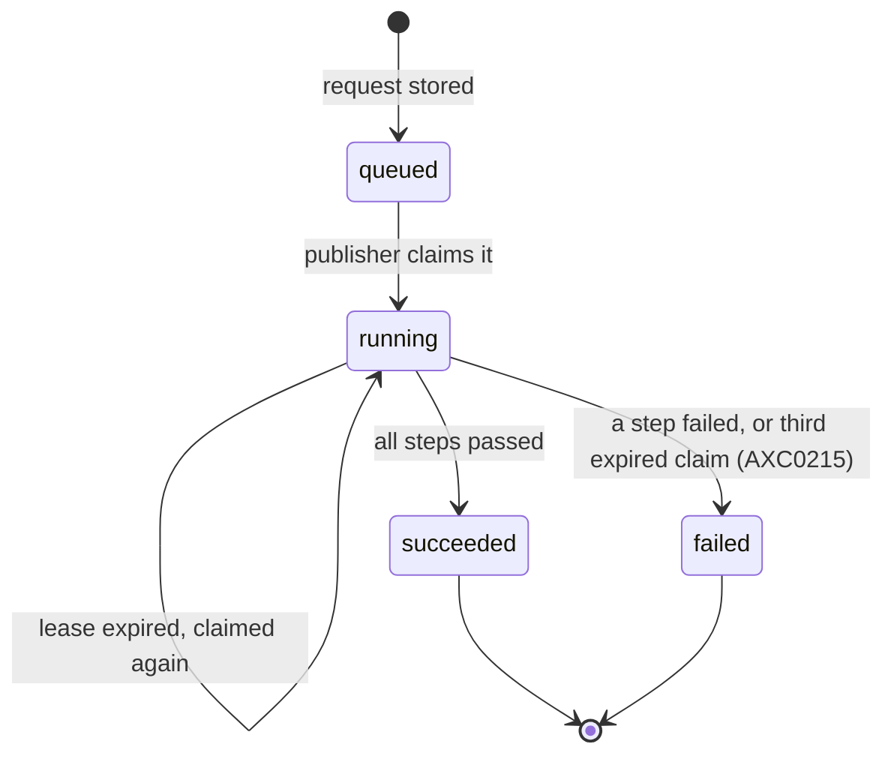

# Authoring API

Detailed reference for the authoring API that Studio uses: settings, routes,
versions, the order of checks, answers, writes and diagnostics. The conventions
of [architecture.md](../architecture.md) apply: sections marked
*(planned for Mx)* are not built yet, and Dn refers to
[decisions.md](../decisions.md).

The authoring API edits the resource files of an
application folder on the server's disk. They are the same files that are kept
in git. The application list, resource list, read, patch, create, delete, diagnostics
and references routes are built. It is
agreed in
[D38](../decisions.md#d38-studio-edits-application-folders-through-an-authoring-api--agreed).
Its edit routes never activate a release. Under `scripts/dev.sh`, a saved file
restarts the server, which activates the folder, as a hand edit does today.
*(planned for M10)* A write will take a lock in the platform database. Reads
and diagnostics touch no database. Going live from Studio is
[Publishing](#publishing) *(planned for M10)*. It asks for an activation: the
server stores a publish request in the tenant database, and a separate
[publisher](administration.md#publisher) runs it. The server never activates in
its own process, and
[D47](../decisions.md#d47-publishing-from-studio--agreed) agrees this.

## Settings

Two server settings decide who may use the API and which
folders it may edit. A third, `Studio:PublisherRole`, decides who may go live. See [Studio](configuration.md#studio) for their defaults.

- `Studio:Folders` lists the application folders. With no folder, the API
  has nothing to edit, and every route answers `403`. `studio: false` on
  `GET /api/me` says the same.
- `Studio:AuthorRole` names the roles claim value that may use the API. With
  no value, nobody may. Application policies play no part.
- `Studio:PublisherRole` *(planned for M10)* names the roles claim value that
  may publish and roll back, on top of the author role. With no value, nobody
  may publish or roll back. `validate`, the request status and the release
  history need the author role only.

## Routes

`{application}` is the `name` of the application's manifest,
such as `PurchaseRequests`, matched ignoring letter case. The server reads the
manifest of each listed folder on every request, in list order, and the first
match wins. A resource is addressed by its `id`, which is permanent and unique
in the application. File names and names can change.

| Method and path | Response |
| --- | --- |
| `GET /api/studio/apps` | `200` with `{ "items": [{ "name" }] }`, one item for each application in `Studio:Folders`, in list order. A folder without a readable manifest `name` is left out, and a name repeated ignoring letter case appears once, as the first folder wins in the routes below |
| `GET /api/studio/apps/{application}/resources` | `200` with `{ "items": [...] }`, one item for every resource of the folder, sorted by `file`. Each item has `id`, `kind`, `name`, `file`, `version` and `usedBy`, see [References](#references) |
| `GET /api/studio/apps/{application}/resources/{id}` | `200` with `{ id, kind, name, file, version, content }` and an `ETag` header |
| `POST /api/studio/apps/{application}/resources` | `201` with the new resource's `{ id, kind, name, file, version, diagnostics }`, a `Location` header and an `ETag` header. The body is the full resource as `application/json` |
| `PATCH /api/studio/apps/{application}/resources/{id}` | `200` with `{ version, diagnostics }` and an `ETag` header. The body is `application/json-patch+json`, as RFC 6902 describes |
| `DELETE /api/studio/apps/{application}/resources/{id}` | `200` with `{ diagnostics }` |
| `GET /api/studio/apps/{application}/resources/{id}/references` | `200` with `{ uses, usedBy }`, see [References](#references) |
| `GET /api/studio/apps/{application}/texts/{key}/references` | `200` with `{ usedBy }`, see [References](#references) |
| `GET /api/studio/apps/{application}/diagnostics` | `200` with `{ "diagnostics": [...] }`, the folder's diagnostics. A folder with errors still answers `200` |

`file` is the path of the resource's file relative to the application folder,
written with `/`. `id` is in the hyphenated 8-4-4-4-12 hex form, in either
letter case, and the answers write it in lower case. A file is a resource only
when it is a JSON object with a UUID `id` and a string `kind`. Other files are
left out of the list and cannot be read. When two files share an `id`, the
first in path order is the resource. `usedBy` is the number of entries in the
resource's `usedBy` list, see [References](#references).

## Versions

The `version` of a resource is the SHA-256 of its file's
bytes, in lower-case hex.

- A read sends it as a strong `ETag`, in quotes.
- A patch sends it back in `If-Match`, as the quoted `ETag` or as the bare
  hex. `*`, a weak tag and a list of versions count as stale. A delete
  does the same.
- When the file no longer has that version, the answer is `409` and nothing
  is written. The client reads the resource again and retries. One lock
  covers the check and the write of every write, so two patches that carry the
  same version cannot both succeed, and neither can two deletes. Today the
  lock is in the server process.
- *(planned for M10)* The lock moves to a PostgreSQL advisory lock in the
  platform database, so it holds across server replicas that share the folder.
  It is keyed by the folder. A create checks that its `id` is unused anywhere
  in the folder, so a lock per file would let two creates with the same `id`
  both succeed. The server takes it over `ConnectionStrings:Platform`, for the
  check and the write. It needs no grant. A write that cannot take the lock
  answers `503` and writes nothing. Every replica must mount the folder at the
  same path. See [D49](../decisions.md#d49-several-server-replicas-behind-a-tls-proxy--agreed).
- A patch or a delete without `If-Match` is `428`.
- A create sends the new version as an `ETag`, so the client can patch next
  without reading the resource again.

## Order of checks

Like the [record API](record-api.md#errors), a request is
checked in this order, and the first failure is the response. Checks 1 to 3,
5 and 6 are built. Checks 7 to 10 are built for a patch, a create and a
delete. Checks 4, 6 for a request or a release, and 8 for a publish body are
*(planned for M10)*:

1. The CSRF header `X-Axis-Csrf: 1` on a `POST`, `PATCH` or `DELETE`, `403`.
2. The session, `401`. A session from another tenant counts as no session.
3. The author role, `403`. It needs `Studio:AuthorRole` to be set and held in
   the session's roles, and `Studio:Folders` to be non-empty. This holds for
   every route.
4. The publisher role, `403`, on `publish` and `rollback` only. It needs
   `Studio:PublisherRole` to be set and held in the session's roles. It comes
   right after the author role and before the application is looked up.
5. An unknown application, `404`. It is an application that is not in
   `Studio:Folders`.
6. An unknown resource or text key, `404`. An unknown request id is `404`, and
   so is a release that is not in this tenant's history for the application.
   A request or a release of another application or tenant counts as unknown.
7. A patch or a delete without `If-Match`, `428`.
8. A bad body, `400`. That is a body that is not JSON, a patch that is not
   valid RFC 6902, a patch that does not apply, a patch that changes `id` or
   `kind`, a create without a valid `id`, with an unknown `kind` or with a
   `name` or `locale` that does not form a safe file name, or a create or a
   delete of the `application.json` manifest. The kind `application` counts as
   unknown here. For `publish`, it is also a body that is not a JSON object, a
   key other than `label` and `note`, a value that is not a string, a `label`
   of more than 100 characters or a `note` of more than 2000.
9. A stale version, `409`.
10. A create whose `id` or whose target file already exists, `409`.

The session comes before the role, and the roles before the application. So a
caller without the roles cannot find out which applications, resources,
requests or releases exist.

## Responses

Every error is problem details
(`application/problem+json`). The titles are fixed and never contain text
from the request. The rows for List applications, List resources, Read, Create, Patch, Delete, Diagnostics,
Resource references and Text key references are built. The rows for Validate, Publish, Request status,
Release history and Rollback are *(planned for M10)*.

| Route | `401` | `403` | `404` | `409` |
| --- | --- | --- | --- | --- |
| List applications | No session | No author role, or no `Studio:Folders` | Not used | Not used |
| List resources | No session | No author role, or no `Studio:Folders` | Unknown application | Not used |
| Read | No session | No author role, or no `Studio:Folders` | Unknown application or resource | Not used |
| Create | No session | No author role, no `Studio:Folders`, or no CSRF header | Unknown application | The `id` or the target file already exists |
| Patch | No session | No author role, no `Studio:Folders`, or no CSRF header | Unknown application or resource | Stale `If-Match` version |
| Delete | No session | No author role, no `Studio:Folders`, or no CSRF header | Unknown application or resource | Stale `If-Match` version |
| Resource references | No session | No author role, or no `Studio:Folders` | Unknown application or resource | Not used |
| Text key references | No session | No author role, or no `Studio:Folders` | Unknown application, or a key that no text resource defines and no label uses | Not used |
| Diagnostics | No session | No author role, or no `Studio:Folders` | Unknown application | Not used |
| Validate *(planned for M10)* | No session | No author role, no `Studio:Folders`, or no CSRF header | Unknown application | Not used |
| Publish *(planned for M10)* | No session | No author role, no publisher role, no `Studio:Folders`, or no CSRF header | Unknown application | Not used |
| Request status *(planned for M10)* | No session | No author role, or no `Studio:Folders` | Unknown application or request | Not used |
| Release history *(planned for M10)* | No session | No author role, or no `Studio:Folders` | Unknown application | Not used |
| Rollback *(planned for M10)* | No session | No author role, no publisher role, no `Studio:Folders`, or no CSRF header | Unknown application, or a release not in the tenant's history | Not used |

`400` is a bad body, and `428` a missing `If-Match`, as
[Order of checks](#order-of-checks) says. `400` also answers a bad `publish`
body *(planned for M10)*. A successful `validate`, `publish` or `rollback`
answers `202`, see [Publishing](#publishing). `415` answers a body of the wrong
content type, just before the body is read. A create needs `application/json`
and a patch needs `application/json-patch+json`.

## References

The two references routes answer where a resource or a text key is used. They read the [reference index](configuration.md#reference-index)
that every compile builds, as
[D39](../decisions.md#d39-reference-index-and-where-a-resource-is-used--agreed)
agrees.

- **Resource route.** `GET .../resources/{id}/references` answers
  `{ uses, usedBy }`. `uses` lists what the resource refers to. `usedBy` lists
  what refers to it.
- **Text key route.** `GET .../texts/{key}/references` answers `{ usedBy }`:
  the labels that use the key and the `text` resources that define it. A key
  that a label uses but no locale defines still answers with its uses, so an
  author who opens a missing key from an `AXC0028` diagnostic sees where it is
  used. `{key}` is matched ordinally, as keys are compared. A key that contains
  `/` cannot be addressed, because the route does not decode `%2F`.
- **Entry.** Each entry is `{ relation, file, path, node }`.
  - `relation` is the name of the relation, such as `task form`.
  - `file` and `path` are always in the resource that holds the reference. So
    for `usedBy` they point into the other resource, and for `uses` into this
    one. An entry opens its resource at that path.
  - `node` is the other end: `{ type: "resource", id, kind, name, file }`,
    `{ type: "text", key }`, `{ type: "package", id }` or
    `{ type: "module", id }`. In `usedBy`, it names the resource that holds
    the reference.
- **Order.** Entries are sorted by the using file, then by path, both with
  ordinal string comparison. So `/steps/10` sorts before `/steps/2`.
- **Compiled in memory.** The folder is compiled in memory, as for
  [diagnostics](#diagnostics), and no database is touched. A folder with errors
  still answers with the edges that resolved.
- **The list's `usedBy`.** The resource list gives each resource's `usedBy`
  count, so Studio can warn before a delete. The warning never blocks the
  delete. The next compile reports what broke.

## Writes

Writes are built for patches, creates and deletes.

- **Atomic.** A write goes to a hidden temporary file in the same folder and
  is then renamed over the target. A reader never sees half a file. A delete removes
  the file and leaves its kind folder, even when it is empty.
- **Format.** The file is written as JSON with 2-space indents, LF line ends
  and a final newline. The order of keys is kept, so a patch of one value
  changes one line in git.
- **New files.** A new file goes in the kind's plural folder, as in
  `samples/apps/purchase-requests`: `entity` in `entities`, `dataSource` in
  `data-sources`, `policy` in `policies`, and so on. The file name is the
  kebab-case `name`, such as `entities/purchase-request.json`. A `text`
  resource is named after its locale in lower case, such as `texts/en.json`
  and `texts/pt-br.json`. A patch that changes `name` keeps the file name. A
  missing kind folder is created.
  - **Kind folders.** `entity` in `entities`, `site` in `sites`, `page` in
    `pages`, `text` in `texts`, `seed` in `seeds`, `dataSource` in
    `data-sources`, `rule` in `rules`, `sequence` in `sequences`, `process` in
    `processes`, `form` in `forms`, `role` in `roles`, `policy` in `policies`,
    `connector` in `connectors`, `event` in `events`, `endpoint` in
    `endpoints`, `trigger` in `triggers`, `migration` in `migrations` and
    `scenario` in `scenarios`. The `kind` is matched with its letter case.
  - **Name pattern.** A create's `name` must be `^[A-Za-z][A-Za-z0-9]*$`
    with at most 60 characters, which is the pattern of every kind's schema
    except `role`. A role's `name` must be `^[a-z][a-z0-9-]*$` with at most 60
    characters, as its schema says. Letters, digits and hyphens cannot form a
    path, so `../x` is `400`. A text's
    `locale` must match the text schema's pattern, `^[A-Za-z]{2,3}(-[A-Za-z0-9]{2,8})*$`,
    with at most 60 characters.
  - **Kebab-case.** A hyphen goes before a capital that follows a lower-case
    letter or a digit, or before the last capital of an acronym that a
    lower-case letter follows. Then everything is lower-cased. So
    `PurchaseRequestList` is `purchase-request-list`, and `HTTPCall` is
    `http-call`. A role's file name is its name as it is, such as
    `roles/department-manager.json`.
  - **Checked fields.** A create checks only `id`, `kind`, `name` and, for a
    text, `locale`. Any other schema problem is saved and shows up as a
    diagnostic.
  - **No overwrite.** A create whose `id` is in use, or whose target file
    exists, is `409`. A create never replaces a file, even when another
    process writes the folder.
- **The manifest.** `application.json` at the folder root can be patched. It
  cannot be created or deleted, because
  `AXC0009` (see the diagnostic codes in [configuration.md](configuration.md)) requires it there.
- **Paths.** A path is resolved and must stay under the application folder,
  so `..` and links cannot leave it. Only `*.json` files are read or written.
- **Patches.** A patch may not change `id` or `kind`, and a change of letter case
  alone counts as a change. Every other change is
  allowed, including one that breaks the resource. The new content is written
  and the diagnostics report the breakage.
- **Never an activation.** A write never compiles against a database, never
  stores a release and never activates one. Only a [publish request](#publishing)
  *(planned for M10)* leads to an activation, and the
  [publisher](administration.md#publisher) runs it, never the server.

## Diagnostics

A patch, a create and a delete answer with the folder's diagnostics, and
`GET /api/studio/apps/{application}/diagnostics` returns them on demand. All
are built. A diagnostic never blocks a save. A delete that breaks references is
saved, and the diagnostics list the broken references.

- The folder is compiled in memory against the extension packages installed
  under `Extensions:Path` and the modules installed under `Modules:Path`, see
  [extension packages](configuration.md#extension-packages) and
  [modules](configuration.md#modules). No database is touched.
- The codes, severities and fields are those of
  [startup activation](configuration.md#startup-activation). Each diagnostic
  is `{ code, severity, message, file, path, resourceId }`. `severity` is
  `error` or `warning`. `resourceId` is the lower-case id of the resource,
  or `null` when the problem concerns a whole file or the whole folder.
- The compile diagnostics are returned, and the problems of a broken extension
  package are not, because they belong to the server's install and not to the
  folder. The checks that activation runs against a tenant are not part of it
  either: bindings, name and site path conflicts, and storage changes. They
  need a tenant database or the tenant's settings.
- A folder with an error is not activated. Under `scripts/dev.sh`, the
  restart after a saved file then stops the server, as a broken hand edit
  does today.

## Publishing

*(Planned for M10.)* An author validates, publishes and rolls back an
application from Studio. The server never activates in its own process and
holds no tenant schema connection. It stores a **publish request** in the
tenant database, and a separate [publisher](administration.md#publisher) runs
it with the tenant's schema role. See
[D47](../decisions.md#d47-publishing-from-studio--agreed), and
[publish requests and release history](storage.md#publish-requests-and-release-history)
for the tables.

A request runs for the tenant of the author's session. Studio on a tenant's
host publishes to that tenant only.

| Method and path | Response |
| --- | --- |
| `POST /api/studio/apps/{application}/validate` | `202` with the request and a `Location` header for `.../requests/{id}`. It needs the author role |
| `POST /api/studio/apps/{application}/publish` | `202` with the request and a `Location` header. The body is `application/json` with an optional `label` and an optional `note`. It needs the author role and the publisher role |
| `GET /api/studio/apps/{application}/requests/{id}` | `200` with the request, its status and its diagnostics |
| `GET /api/studio/apps/{application}/releases` | `200` with the activation history, newest first, and which release is active |
| `POST /api/studio/apps/{application}/releases/{id}/rollback` | `202` with the request and a `Location` header. It takes no body. It needs the author role and the publisher role |

`validate` and `rollback` take no body, and a body that is sent is ignored.
`{id}` of a request is its UUID. `{id}` of a release is the release id from
the history. The answers for `401`, `403`, `404` and the CSRF header are those
of the rest of the API, see [Order of checks](#order-of-checks) and
[Responses](#responses).

### The request

A request is shown as `{ id, application, kind, status, label, note, requestedBy, requestedAt, startedAt, finishedAt, releaseId, diagnostics }`.

| Field | Meaning |
| --- | --- |
| `id` | The request id, a UUID |
| `application` | The application `name` |
| `kind` | `validate`, `publish` or `rollback` |
| `status` | `queued`, `running`, `succeeded` or `failed` |
| `label` | The optional label of a `publish`, up to 100 characters, or null |
| `note` | The optional note of a `publish`, up to 2000 characters, or null |
| `requestedBy` | The requesting user's id |
| `requestedAt` | When the request was stored |
| `startedAt` | When a publisher first started it, or null while `queued` |
| `finishedAt` | When it reached `succeeded` or `failed`, or null before |
| `releaseId` | The release a `publish` activated or a `rollback` named, or null. A `validate` has none |
| `diagnostics` | The diagnostics, in the form of [Diagnostics](#diagnostics). Empty until the request ends. A `succeeded` request can hold warnings |

- **A snapshot.** `validate` and `publish` store the folder as it is when the
  request is made: every resource file with its `version`, as for
  [Versions](#versions). A later edit in Studio does not change a queued
  request, so the release is exactly what the author sent.
- **A folder with errors.** A `publish` of a folder with compile errors is
  still accepted with `202`. The request then ends `failed` with those
  diagnostics. There is one path for diagnostics, and the snapshot shows what
  the author sent.
- **`validate`.** The publisher runs every activation check against the
  tenant inside a transaction that it rolls back. It returns the codes of
  [startup activation](configuration.md#startup-activation), including the
  checks that the in-memory diagnostics skip: bindings, name and site path
  conflicts, and storage changes. It stores no release and changes nothing.
  It ends `succeeded` when there is no error.
- **`publish`.** The publisher compiles the snapshot against the tenant,
  stores the release and activates it, then seeds, with the same steps as
  [`axis-admin activate`](administration.md#activate). A `seed` failure
  happens after activation has committed, so the request ends `failed` with
  `releaseId` set, and the release stays active and stays in the history.
- **Order.** For one tenant and application the publisher runs requests one at
  a time, oldest first. When two publishes are queued, the newer one ends up
  live.

### Lifecycle

- Only the publisher changes `status`. The server only inserts requests and
  reads them.
- The publisher claims a request with a lease, and renews the lease while the
  request runs, so a long recompute is not claimed twice. A request whose
  publisher died is claimed again after its lease ran out. It stays `running`.
- A request that has been claimed three times, and whose lease runs out again,
  ends `failed` with `AXC0215` in place of a fourth claim. A request that
  crashes the publisher cannot block the queue for good.
- `succeeded` and `failed` are final. Studio polls
  `GET .../requests/{id}` until the status is one of them.
- A request that runs again does no harm. Activating the same content hash
  twice changes nothing, see [Release history](#release-history).

### Release history

`GET .../releases` answers
`{ active: { releaseId, number, contentHash }, folderContentHash, items: [{ releaseId, number, contentHash, activatedAt, actor, actorName, label, note, requestId }] }`,
newest first.

- `active` is the application's active release in this tenant, or null when
  there is none.
- `folderContentHash` is the content hash that the folder would compile to now,
  so Studio can show that the live release and the folder differ. It is null
  when the folder has errors.
- Each item is one activation: a startup, an `axis-admin activate`, a publish or
  a rollback. `actor` is a user id, `startup` or `operator`. A row that a
  migration added for a release that was live before the history existed has
  the actor `unknown`. `actorName` is the
  user's display name, or null. `requestId` is null for a startup and for an
  `axis-admin activate`.
- A release gets its `number` the first time it is activated in the tenant:
  1, 2, 3… per application. Activating it again keeps the number, so the same
  content can have different numbers in two tenants.
- Activating the release that is already active adds no row and keeps the
  number. Otherwise every restart under `scripts/dev.sh` would fill the history
  with copies.
- `GET /api/me` gains a boolean `studioPublisher`, true when the user holds
  both the author role and the publisher role and `Studio:Folders` is not
  empty. Studio uses it to hide the publish and rollback buttons.

### Rollback

A `rollback` request names a release from the history. The publisher activates
the stored release as it is, **without compiling it again**. It records an
activation with the rollback's actor.

It is refused, and the request ends `failed`, in these cases:

| Case | Code |
| --- | --- |
| A migration that was applied after that release is missing from it, see [applied migrations](storage.md#applied-migrations) | `AXC0174` |
| An extension package version that the release pins is no longer installed | `AXC0146` |

These are the codes that activation already gives for the same causes. A refused
rollback changes nothing: the active release and the history stay as they were.
Rolling back to the release that is already active succeeds and adds no row.

A rollback does not change the folder. Studio shows when the active release
does not match the folder, with `folderContentHash`.

### Audit

Each `publish` and `rollback` writes an
[audit record](storage.md#audit-records-and-sequence-counters) with the actor,
the application, the release and the request, when it succeeds and when it
fails. A `validate` writes none.
