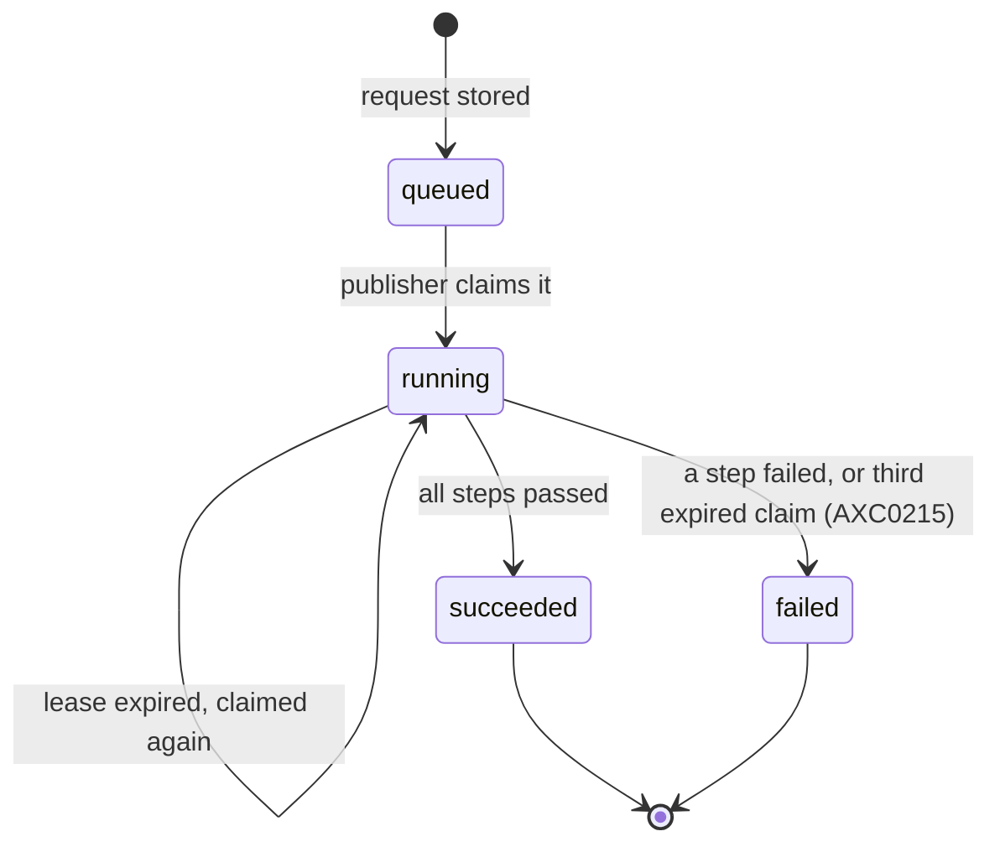

# Authoring API

Detailed reference for the authoring API that Studio uses: settings, routes,
versions, the order of checks, answers, writes and diagnostics. The conventions
of [architecture.md](../architecture.md) apply: sections marked
*(planned for Mx)* are not built yet, and Dn refers to
[decisions.md](../decisions.md).

The authoring API edits the resource files of an
application folder on the server's disk. They are the same files that are kept
in git. The application list, application create, resource list, read, patch, create, delete, changes, text write, diagnostics,
references, names, policy matrix, module resource, expression check and draft page metadata routes are built. It is
agreed in
[D38](../decisions/d38-studio-edits-application-folders-through-an-authoring-api.md).
Its edit routes never activate a release. Under `scripts/dev.sh`, a saved file
restarts the server, which activates the folder, as a hand edit does today.
A write takes a lock in the platform database, see [Versions](#versions). Reads
and diagnostics touch no database. Going live from Studio is
[Publishing](#publishing). `validate`, `publish`, `preview`, `rollback` and the release history are built. It asks for an activation: the
server stores a publish request in the tenant database, and a separate
[publisher](administration.md#publisher) runs it. The server never activates in
its own process, and
[D47](../decisions/d47-publishing-from-studio.md) agrees this.
The `changes` route writes several files in one call, see [Changes](#changes).

The [names](#names) route feeds Studio's reference pickers, the
[text write](#text-writes) route helps its label texts and the
[expression check](#expression-check) route helps its expression editor. All
three are built, and agreed in
[D52](../decisions/d52-reference-pickers-label-texts-and-the-expression-editor.md).

## Settings

Two server settings decide who may use the API and which
folders it may edit. A third, `Studio:PublisherRole`, decides who may go live. See [Studio](host-settings.md#studio-settings) for their defaults.

- `Studio:Folders` lists the application folders. With no folder, the API
  has nothing to edit, and every route answers `403`. `studio: false` on
  `GET /api/me` says the same.
- `Studio:ApplicationsPath` names the folder where Studio creates new
  applications. With no value, Studio cannot create an
  application. See [Creating an application](#creating-an-application).
- `Studio:AuthorRole` names the roles claim value that may use the API. With
  no value, nobody may. Application policies play no part.
- `Studio:PublisherRole` names the roles claim value that
  may publish and roll back, on top of the author role. With no value, nobody
  may publish or roll back. `validate`, the request status and the release
  history need the author role only. A `preview` needs the author role only
  too, see [Preview](#preview).
- `Studio:Tests` turns on `studioTest` on `GET /api/me`, which shows the test
  controls in Studio. It is off by default. A `test` request needs the author
  role only, see [Test](#test).

## Routes

`{application}` is the `name` of the application's manifest,
such as `PurchaseRequests`, matched ignoring letter case. The server reads the
manifest of each listed folder on every request, in list order, and the first
match wins. A resource is addressed by its `id`, which is permanent and unique
in the application. File names and names can change.

| Method and path | Response |
| --- | --- |
| `GET /api/studio/apps` | `200` with `{ "items": [{ "name" }] }`, one item for each application in `Studio:Folders`, in list order. A folder without a readable manifest `name` is left out, and a name repeated ignoring letter case appears once, as the first folder wins in the routes below. After the `Studio:Folders` entries come the direct subfolders of `Studio:ApplicationsPath` that hold an `application.json`, sorted by folder name ordinally, and the same first-match rule by name applies. A folder whose name starts with `.`, and a link, is skipped |
| `POST /api/studio/apps` | `201` with `{ name, diagnostics }` and a `Location: /api/studio/apps/{name}/resources` header. The body is `{ "name": "...", "template": "<template id>" }` as `application/json`, and `template` is optional. See [Creating an application](#creating-an-application) |
| `GET /api/studio/templates` | `200` with `{ "items": [{ id, version, title: { en, vi }, description: { en, vi }, diagnostics }] }`, one item for the newest installed version of each application template, sorted by `id`. See [application templates](modules-and-templates.md#application-templates) |
| `GET /api/studio/apps/{application}/resources` | `200` with `{ "items": [...] }`, one item for every resource of the folder, sorted by `file`. Each item has `id`, `kind`, `name`, `file`, `version` and `usedBy`, see [References](#references) |
| `GET /api/studio/apps/{application}/resources/{id}` | `200` with `{ id, kind, name, file, version, content }` and an `ETag` header |
| `GET /api/studio/apps/{application}/modules/{module}/resources/{id}` | `200` with `{ id, kind, name, file, version, content }` for one file of the module version that the application pins, other than `module.json`. The pinned version is the highest installed version in the application's range. `file` is `modules/<id>/<path>`, and there is no `ETag`, because the file cannot be patched |
| `POST /api/studio/apps/{application}/resources` | `201` with the new resource's `{ id, kind, name, file, version, diagnostics }`, a `Location` header and an `ETag` header. The body is the full resource as `application/json` |
| `PATCH /api/studio/apps/{application}/resources/{id}` | `200` with `{ version, diagnostics }` and an `ETag` header. The body is `application/json-patch+json`, as RFC 6902 describes |
| `POST /api/studio/apps/{application}/changes` | `200` with `{ items: [{ id, version }], diagnostics }`. The body is `application/json`, see [Changes](#changes) |
| `DELETE /api/studio/apps/{application}/resources/{id}` | `200` with `{ diagnostics }` |
| `GET /api/studio/apps/{application}/resources/{id}/references` | `200` with `{ uses, usedBy }`, see [References](#references) |
| `GET /api/studio/apps/{application}/texts/{key}/references` | `200` with `{ usedBy }`, see [References](#references) |
| `GET /api/studio/apps/{application}/diagnostics` | `200` with `{ "diagnostics": [...] }`, the folder's diagnostics. A folder with errors still answers `200` |
| `GET /api/studio/apps/{application}/names` | `200` with the names the application defines, see [Names](#names) |
| `GET /api/studio/apps/{application}/policy-matrix` | `200` with what each role may do on each target, see [Policy matrix](#policy-matrix) |
| `PUT /api/studio/apps/{application}/texts/{key}` | `200` with `{ resources: [{ id, locale, version }], diagnostics }`. The body is `application/json`, `{ texts: { <locale>: <text> } }`, see [Text writes](#text-writes) |
| `POST /api/studio/apps/{application}/expressions/check` | `200` with `{ type, diagnostics }`. The body is `application/json`, `{ resourceId, path, expression }`, see [Expression check](#expression-check) |
| `POST /api/studio/apps/{application}/resources/{id}/page-metadata` | `200` with `{ page, diagnostics }`, or `{ widget, diagnostics }` for a form. The body is the full draft page or form as `application/json`, see [Draft page metadata](#draft-page-metadata) |

`file` is the path of the resource's file relative to the application folder,
written with `/`. `id` is in the hyphenated 8-4-4-4-12 hex form, in either
letter case, and the answers write it in lower case. A file is a resource only
when it is a JSON object with a UUID `id` and a string `kind`. Other files are
left out of the list and cannot be read. When two files share an `id`, the
first in path order is the resource. `usedBy` is the number of entries in the
resource's `usedBy` list, see [References](#references).

## Versions

The `version` of a resource is the SHA-256 of its file's
bytes, in lower-case hex.

- A read sends it as a strong `ETag`, in quotes.
- A patch sends it back in `If-Match`, as the quoted `ETag` or as the bare
  hex. `*`, a weak tag and a list of versions count as stale. A delete
  does the same.
- When the file no longer has that version, the answer is `409` and nothing
  is written. The client reads the resource again and retries. One lock
  covers the check and the write of every write, so two patches that carry the
  same version cannot both succeed, and neither can two deletes.
- The lock is a PostgreSQL advisory lock in the platform database, so it
  holds across server replicas that share the folder. It is keyed by the
  folder. A create checks that its `id` is unused anywhere in the folder, so a
  lock per file would let two creates with the same `id` both succeed. Writes
  to two files of one folder wait for each other. Writes to different folders
  do not. The server takes it over `ConnectionStrings:Platform`, for the
  check and the write, and releases it when the write ends, whether it
  succeeded or was refused. It needs no grant.
- A write waits up to 10 seconds for the lock. When the wait times out, or the
  platform database cannot be reached, the answer is `503` and nothing is
  written. The snapshot of `validate` and `publish` is read under the same
  lock, so those routes answer `503` too, and store no request.
- A patch or a delete that finds its resource gone once it holds the lock
  answers `409`, not `404`. Another write removed it after the request was
  checked, so the version the client holds is stale.
- Every replica must mount the folder at the same path, because the lock is
  keyed by the full path. See [D49](../decisions/d49-several-server-replicas-behind-a-tls-proxy.md).
- A patch or a delete without `If-Match` is `428`.
- A create sends the new version as an `ETag`, so the client can patch next
  without reading the resource again.

## Order of checks

Like the [record API](record-api.md#errors), a request is
checked in this order, and the first failure is the response. Checks 1 to 6
and 8 to 10 are built for every route that is built, and so is check 5a. Check 7 is built for a patch and a delete.
Check 6 is built for a request and for a release:

1. The CSRF header `X-Axis-Csrf: 1` on a `POST`, `PATCH` or `DELETE`, `403`.
2. The session, `401`. A session from another tenant counts as no session.
3. The author role, `403`. It needs `Studio:AuthorRole` to be set and held in
   the session's roles, and `Studio:Folders` to be non-empty. This holds for
   every route. A set `Studio:ApplicationsPath` also turns the API
   on, so the check needs a non-empty `Studio:Folders` or a set
   `Studio:ApplicationsPath`.
4. The publisher role, `403`, on `publish` and `rollback` only. It needs
   `Studio:PublisherRole` to be set and held in the session's roles. It comes
   right after the author role and before the application is looked up.
5. An unknown application, `404`. It is an application that is not in
   `Studio:Folders`.
6. An unknown resource or text key, `404`. An unknown request id is `404`, and
   so is a release that is not in this tenant's history for the application.
   A request or a release of another application or tenant counts as unknown.
7. A patch or a delete without `If-Match`, `428`.
8. A bad body, `400`. That is a body that is not JSON, a patch that is not
   valid RFC 6902, a patch that does not apply, a patch that changes `id` or
   `kind`, a create without a valid `id`, with an unknown `kind` or with a
   `name` or `locale` that does not form a safe file name, or a create or a
   delete of the `application.json` manifest. The kind `application` counts as
   unknown here. For `publish`, it is also a body that is not a JSON object, a
   key other than `label` and `note`, a value that is not a string, a `label`
   of more than 100 characters or a `note` of more than 2000.
9. A stale version, `409`.
10. A create whose `id` or whose target file already exists, `409`.

The names route, the module resource route, the text write and the expression check are built.
The four routes use these checks. None of them has
check 6 or a later numbered check, except where a line says so:

- **Names.** Checks 2, 3 and 5. It is a `GET`, so there is no CSRF check and no body.
- **Module resource.** Checks 2, 3 and 5. It is a `GET`, so there is no CSRF check and no body. Then `404` for a
  module that the application does not pin, and then `404` for a resource that the pinned module version has no file for.
- **Text write.** Checks 1, 2, 3 and 5, then `415` for a body that is not
  `application/json`, then `400` for a bad body, then `503` when the
  [write lock](#versions) cannot be taken. Under the lock, it answers `400` when a
  text resource was created or deleted since the body was checked, and `409` when
  a text resource has a `texts` that is not an object. There is no `404` for an
  unknown key, because a `PUT` creates the key.
- **Expression check.** Checks 1, 2, 3 and 5, then `415`, then `400` for a bad
  body: a body that is not a JSON object, a `resourceId` that is not a UUID, a
  `path` that is not a JSON Pointer or an `expression` that is not a string.
  Then `404` for an unknown `resourceId`, which comes after the body because
  the id is in it. Then `400` for a `path` that holds no expression place. It
  takes no lock, so it has no `503`.
- **Draft page metadata.** Checks 1, 2, 3, 5 and 6, then
  `404` for a resource that is neither a page nor a form, then `415`, then `400` for a body
  that is not a JSON object or whose `id` or `kind` differs from the saved
  file. It takes no lock, so it has no `503`.

The `changes` route uses checks 1 to 3 and 5. It then checks every change, and the first failure
refuses the whole call. The checks that need only the body come first, because the body says which change
is a patch. They run in this order:

1. `415` for a body that is not `application/json`.
2. `400` for the shape of the list: a body that is not a JSON object with only `changes`, a list that is
   empty or longer than 20 changes, or a change that is not exactly `{ create }` or
   `{ patch, id, version }`. A change with both or neither of `create` and `patch`, a delete, and a key
   other than `create`, `patch`, `id` and `version` all fail here.
3. `404` (check 6) when a patch names an unknown `id`.
4. `428` (check 7) when a patch change has no `version`.
5. `400` (check 8) for the content: a `version` that is not a string, a patch that is not valid RFC 6902,
   a create that has no valid `id`, `kind` or file name, the same `id` twice, or two creates that give the
   same file.
6. `503` when the [write lock](#versions) cannot be taken.
7. Under the lock, each change in list order, with the order of its single route. A patch is checked for a
   resource that is gone, a patch that does not apply, a patch that changes `id` or `kind`, then the stale
   version (check 9). A create is checked for an `id` that exists, then a target file that exists
   (check 10). The first failure decides the answer.

A write that cannot take the [write lock](#versions) answers `503`. It comes after the `400` for a body that
cannot be read, a patch that is not valid RFC 6902 and a create that has no valid `id`, `kind` or file name. It comes
before the checks that need the folder under the lock: a patch that does not apply, a patch that changes `id` or
`kind`, the stale version, and the existing `id` or file of a create. A `validate`, `publish` or `preview` answers `503` the
same way, before it stores a request.

A check 5a sits between checks 5 and 6, on `validate`, `publish` and `preview`. A `rollback` takes no body, and it has no check 5a, because it names a release of the history. A folder whose manifest has no UUID `id` answers `409`,
because the request needs the application id for the publisher's queue. It comes after the unknown application `404` and, for a
`publish`, before the body is read.

A check 5b sits between checks 5 and 5a, on `preview` only.
When the session's tenant has no served preview tenant, the answer is `409`. It comes
after the unknown application `404`, so a caller cannot learn from it which
applications exist. A preview tenant that is suspended is not served, so it counts as none.

The session comes before the role, and the roles before the application. So a
caller without the roles cannot find out which applications, resources,
requests or releases exist.

## Responses

Every error is problem details
(`application/problem+json`). The titles are fixed and never contain text
from the request. The rows for List applications, List resources, Read, Module resource, Create, Patch, Delete, Changes, Diagnostics, Names,
Text write, Expression check, Draft page metadata, Resource references, Text key references, Release history, Validate, Publish, Preview, Rollback and Request status are built.

| Route | `401` | `403` | `404` | `409` |
| --- | --- | --- | --- | --- |
| List applications | No session | No author role, or no `Studio:Folders` | Not used | Not used |
| List resources | No session | No author role, or no `Studio:Folders` | Unknown application | Not used |
| Read | No session | No author role, or no `Studio:Folders` | Unknown application or resource | Not used |
| Module resource | No session | No author role, or no `Studio:Folders` | Unknown application, module or resource | Not used |
| Create | No session | No author role, no `Studio:Folders`, or no CSRF header | Unknown application | The `id` or the target file already exists |
| Patch | No session | No author role, no `Studio:Folders`, or no CSRF header | Unknown application or resource | Stale `If-Match` version |
| Delete | No session | No author role, no `Studio:Folders`, or no CSRF header | Unknown application or resource | Stale `If-Match` version |
| Resource references | No session | No author role, or no `Studio:Folders` | Unknown application or resource | Not used |
| Text key references | No session | No author role, or no `Studio:Folders` | Unknown application, or a key that no text resource defines and no label uses | Not used |
| Changes | No session | No author role, no `Studio:Folders`, or no CSRF header | Unknown application, or a patch that names an unknown resource | Any stale version, a patched resource that is gone, or a create whose `id` or target file already exists |
| Diagnostics | No session | No author role, or no `Studio:Folders` | Unknown application | Not used |
| Names | No session | No author role, or no `Studio:Folders` | Unknown application | Not used |
| Text write | No session | No author role, no `Studio:Folders`, or no CSRF header | Unknown application | A text resource whose `texts` is not an object |
| Expression check | No session | No author role, no `Studio:Folders`, or no CSRF header | Unknown application, or an unknown `resourceId` | Not used |
| Draft page metadata | No session | No author role, no `Studio:Folders`, or no CSRF header | Unknown application, or a resource that is neither a page nor a form | Not used |
| Validate | No session | No author role, no `Studio:Folders`, or no CSRF header | Unknown application | The manifest has no UUID `id` |
| Publish | No session | No author role, no publisher role, no `Studio:Folders`, or no CSRF header | Unknown application | The manifest has no UUID `id` |
| Request status | No session | No author role, or no `Studio:Folders` | Unknown application or request | Not used |
| Release history | No session | No author role, or no `Studio:Folders` | Unknown application | Not used |
| Preview | No session | No author role, no `Studio:Folders`, or no CSRF header | Unknown application | This tenant has no served preview tenant, or the manifest has no UUID `id` |
| Rollback | No session | No author role, no publisher role, no `Studio:Folders`, or no CSRF header | Unknown application, or a release not in the tenant's history | Not used |
| Create application | No session | No author role, no CSRF header, or no `Studio:ApplicationsPath` | Unknown template | The name or the folder already exists |
| List templates | No session | No author role, or Studio is off | Not used | Not used |

The `409` of Validate and Publish is problem details titled "The application
manifest has no valid id." The `403` for a missing publisher role is titled "You do not hold the publisher role."
The `409` of Preview for a tenant without a served preview tenant is problem details titled "This tenant has no preview
tenant." It names no tenant. A manifest without a UUID `id` answers the title of Validate and Publish. `400` is a bad body, and `428`
a missing `If-Match`, as [Order of checks](#order-of-checks) says. `400` also answers a bad `publish`
body, titled "The body is not a valid publish request." A successful `validate`, `publish` or `rollback`
answers `202`, see [Publishing](#publishing). `415` answers a body of the wrong
content type, just before the body is read. A create needs `application/json`
and a patch needs `application/json-patch+json`. An expression check needs `application/json`. It answers
`400` for a bad body or a path with no expression place. A text write also needs `application/json`. It answers
`400` for a bad body, `409`, titled "A text resource has no texts object.", for a text resource whose
`texts` is not an object, and `503` when it cannot take the write lock.

## References

The two references routes answer where a resource or a text key is used. They read the [reference index](configuration.md#reference-index)
that every compile builds, as
[D39](../decisions/d39-reference-index-and-where-a-resource-is-used.md)
agrees.

- **Resource route.** `GET .../resources/{id}/references` answers
  `{ uses, usedBy }`. `uses` lists what the resource refers to. `usedBy` lists
  what refers to it.
- **Text key route.** `GET .../texts/{key}/references` answers `{ usedBy }`:
  the labels that use the key and the `text` resources that define it. A key
  that a label uses but no locale defines still answers with its uses, so an
  author who opens a missing key from an `AXC0028` diagnostic sees where it is
  used. `{key}` is matched ordinally, as keys are compared. A key that contains
  `/` cannot be addressed, because the route does not decode `%2F`.
- **Entry.** Each entry is `{ relation, file, path, node }`.
  - `relation` is the name of the relation, such as `task form`.
  - `file` and `path` are always in the resource that holds the reference. So
    for `usedBy` they point into the other resource, and for `uses` into this
    one. An entry opens its resource at that path.
  - `node` is the other end: `{ type: "resource", id, kind, name, file }`,
    `{ type: "text", key }`, `{ type: "package", id }` or
    `{ type: "module", id }`. In `usedBy`, it names the resource that holds
    the reference.
- **Order.** Entries are sorted by the using file, then by path, both with
  ordinal string comparison. So `/steps/10` sorts before `/steps/2`.
- **Compiled in memory.** The folder is compiled in memory, as for
  [diagnostics](#diagnostics), and no database is touched. A folder with errors
  still answers with the edges that resolved.
- **The list's `usedBy`.** The resource list gives each resource's `usedBy`
  count, so Studio can warn before a delete. The warning never blocks the
  delete. The next compile reports what broke.

## Names

`GET .../names` answers every name the application
defines. Studio loads them with the application for its [expression completion](studio.md)
and its [reference pickers](studio.md), and again after a save, a delete and a reconnect.
[D52](../decisions/d52-reference-pickers-label-texts-and-the-expression-editor.md)
agrees it. The answer is:

```
{ locales: ["en", "vi"],
  entities: [{ id, name, module, fields: [{ name, type, target, values }] }],
  dataSources: [{ id, name, module, parameters: [{ name, type }], columns: [{ name, type }], groupBy }],
  processes: [{ id, name, steps: [{ name, type, outcomes: [...] }] }],
  rules: [{ id, name, module, parameters: [{ name, type }], resultType }],
  connectors: [{ id, name, operations: [{ name }] }],
  events: [{ id, name, fields: [{ name, type }] }],
  roles, sequences, forms: [{ id, name }],
  pages: [{ id, name, parameters: [{ name, type, required }] }],
  texts: [{ key, texts: { <locale>: <text> }, usedBy }] }
```

- **`name`.** It is written as a reference writes it. A module entity is
  `<module id>/<name>`, and a module rule is `<module id>:<name>`. `module` is
  the module id, or null for an entity or rule of the application.
- **Module names.** A module's events, sequences and forms are listed
  under their `<module id>/<name>` names too, but only entities, data sources
  and rules carry `module`. A module resource's `id` is the id written in its
  module file.
- **`columns`.** A plain data source lists its fields in order. A column's
  `type` is the type of the field at the end of its path, or null when the path
  does not resolve. A grouped data source lists its group fields in `groupBy`
  order, then its measures, as a grouped row holds them. See
  [data sources](data-sources.md#aggregates). A `count` measure is an `integer`.
  Any other measure has the type of the field it measures, even when that field
  is not a group field.
- **`groupBy`.** The group field list of a grouped data source. It is `[]` for
  one total row, and null for a plain data source. A group field that names no
  field is still listed as a column, with a null type.
- **Order.** Each list holds the module resources first, then the
  application's own in file path order. A step that is not a task has
  `outcomes: []`. Text keys are sorted ordinally.
- **Page `parameters`.** The parameters the page declares, in file order. `required` is false when the file leaves it out.
- **`locales`.** The locales of the folder's text resources.
- **`texts`.** Each key comes with its text in every locale, and `usedBy`, the
  number of `label text` edges in the [reference index](configuration.md#reference-index).
- **Compiled in memory.** The folder is compiled in memory, as for
  [diagnostics](#diagnostics), and no database is touched. A folder with errors
  still answers with what resolved. A file that was left out for its own errors is
  absent.
- **Size.** The answer holds every name and every text. At the typical
  application size it is a few hundred kilobytes.

## Policy matrix

`GET .../policy-matrix` answers what each role may do on each root entity,
data source, process and endpoint, and which grants give that access.
Studio's [policy matrix](studio.md) is built on it, and
[D54](../decisions/d54-the-entity-designer-and-the-policy-matrix.md)
agrees it. The answer is:

```
{ targets: [{ kind, id, name, module, actions: [...], entity }],
  roles: [{ id, name, accessPolicy: { name, id }, editable, readOnlyReason,
            cells: [{ kind, target, actions: [...], missingEntityRead,
                      grants: [{ policyId, policy, index, actions, filter, fields, shared }] }] }] }
```

- **Columns.** `targets` lists root entities first, with module entities
  before the application's own. Then it lists data sources, processes and
  endpoints. Child entities are left out. `kind` is `entity`, `dataSource`,
  `process` or `endpoint`. A name is written as in [Names](#names). `module` is
  the module id, or null. `entity` is a data source's root entity, and null for
  the other kinds. A column is identified by `kind` and `name`, not by `id`.
- **`actions`.** On a target, they are the actions it accepts, in the order
  [roles and policies](roles-and-policies.md) lists them. An
  entity takes `read`, `create`, `update` and `delete`. A data source takes
  `read`. A process takes `start`, `inspect`, `cancel`, `retry` and `resolve`.
  An endpoint takes `invoke`.
- **Rows and cells.** Each declared role is one row, in the order of the
  `roles` resources. Each row has one cell per column, in column order, empty
  ones included. A cell's `actions` are the role's actions there from all its
  policies, combined with OR as in
  [combining grants](security.md#combining-grants). An action that the
  column does not accept is left out. The grant still lists its actions as
  written.
- **Data source `read`.** A data source cell has `read` only when the role can
  also read the data source's root entity. When it has a `read` grant but not
  that entity read, `read` is left out and `missingEntityRead` names the root
  entity. It is null otherwise.
- **`grants`.** Each grant of a policy that names the role, with its `policyId`
  and `policy` name, its `index` in the policy, and its `actions`, `filter` and
  `fields` as written. `fields` is null for every field. Filters and field lists
  are not evaluated here.
- **`shared`.** A grant is shared unless it comes from the role's own
  `<Role>Access` policy and that policy names only that role.
- **`<Role>Access`.** `accessPolicy` is the PascalCase role name plus `Access`.
  It is found by name, ignoring letter case, and `id` is null when it does not
  exist. `editable` is true when it does not exist, or when its `roles` is
  exactly that one role. Otherwise `editable` is false and `readOnlyReason` is
  `accessPolicyShared`. Studio writes its own message for the code.
- **Compiled in memory.** The folder is compiled in memory, as for
  [diagnostics](#diagnostics), and no database is touched. A folder with errors
  still answers, from the files that loaded. A policy file left out for its own
  errors is absent, so its grants are missing.

## Text writes

`PUT .../texts/{key}` writes one text key in every locale
at once, so a key is never in one locale only. The body is
`{ texts: { <locale>: <text> } }`.

- **Every locale.** The body must hold exactly the locales of the folder's
  `text` resources, matched ignoring letter case. With duplicate locales
  (`AXC0026`), the first file in path order counts. A missing locale, an extra
  locale, a value that is not a string, or another top-level key is `400`. A
  value may be any string, as the text schema allows. The body is `400` too
  when a text resource was created or deleted between this check and the lock.
- **The key.** `{key}` is matched ordinally and cannot contain `/`, as in the
  [text key references](#references) route. A new key is added at the end of
  `texts`. An existing key keeps its position.
- **The lock.** The write takes the folder [write lock](#versions). Under it,
  the server reads each text file and writes every temporary file. Then it renames
  each one over its target. It changes only that key, and leaves the other
  keys as they are. A text resource with no `texts` object gets one. A `texts`
  that is not an object is `409`, and nothing is written.
- **No `If-Match`.** A text write takes no version, and the last write to a
  key wins. One version per file does not fit a write that spans files. Only
  that key can be lost.
- **Not atomic across files.** Each rename is atomic, but all of them are not. A
  crash between two renames can leave the key in some locales only. The next
  compile reports it as `AXC0027`.
- **Stale versions.** A text resource that Studio has open has a new version
  after the write, so its next save is `409`. The answer lists each text
  resource's new `version`, as `{ resources: [{ id, locale, version }] }`.
- **Answer.** `200` with the new versions and the folder's
  [diagnostics](#diagnostics). `503` answers when the lock cannot be taken, and
  nothing is written.

## Expression check

`POST .../expressions/check` checks one expression without saving it, so
Studio's expression editor can show errors as the author types. The body is
`{ resourceId, path, expression }`.

- **The place.** The server puts `expression` into a copy of the saved resource
  at `path` and compiles the folder in memory. The compile checks the
  expression where it stands, so the names in scope, the expected type, the
  [SQL subset](expressions.md#sql-subset) and the policy-filter rules are the
  compile's own, not a copy of them. The body carries no draft content. The
  `path` may point at a string, which the text replaces, or at a property the
  saved object lacks, which the text adds. So an optional expression that the
  author has just added is checked before the first save, such as a form field's
  `requiredWhen`. A place inside an object that the saved resource lacks is not
  found.
- **Where it works.** In every place the compile checks an expression: computed
  fields, validations, rules, data source filters, process conditions and
  values, policy filters, migration values, endpoint values, trigger
  conditions and form conditions.
- **No expression place.** A `path` that points at neither a string nor a
  missing property of an object in the saved resource is `400`. So is a place where the compile checks no expression
  because another problem in the resource skips the check, such as a process
  step whose subject entity is unknown. A save shows no problem at such a place
  either.
- **The rules.** The scope, types, limits and codes are those of
  [expression diagnostics](expressions.md#diagnostics). An expression of more than
  2,000 characters answers `AXC0036` as a diagnostic, not `400`.
- **The answer.** `{ type, diagnostics }`. `type` is the result type in the
  notation of [Types](expressions.md#types): `text`, `integer`, `decimal`,
  `boolean`, `date`, `date-time`, `enum`, `reference` or `null`. It is the
  expression's own type, so a text literal is `text` even where an enum is
  expected. `type` is null when there is a diagnostic, and when the compile
  cannot find the type yet. A migration value whose type check waits for
  activation is the second case.
- **Diagnostics.** There is at most one, because the compile stops at the first
  problem. It is `{ code, message, start, end }`. `start` and `end` are offsets
  into the expression text after JSON decoding, in UTF-16 code units, and `end`
  is exclusive.
- **The range.** The compile reports one character position, so the range is
  the token at that position: a name, a literal or an operator. A qualified
  call such as `departments:IsManager` is one range. A character that starts no
  token covers that one character, and text that is never closed runs to the
  end. `AXC0036` and `AXC0048` cover the whole expression. A limit that the
  compile reports at the place but outside the expression check, such as a rule
  cycle (`AXC0055`) or nesting that is too deep (`AXC0065`), is answered over the
  whole expression. A range is narrower than the faulty subexpression: for
  `a + 'x'` only the `+` is covered.
- **Nothing is written.** It compiles in memory, takes no lock and touches no
  database.
- **Speed.** It answers within 300 ms on a
  [typical application](../domain/knowledge.md#typical-application-size) of 643
  files. The compile stops once every check has run, so it builds no reference
  index, names, policy matrix, model or content hash. Nothing is cached, so the
  next check sees an edit on disk.

## Draft page metadata

`POST .../resources/{id}/page-metadata` answers the metadata
that an unsaved page would have, so the page designer's canvas can draw the
draft ([D65](../decisions/d65-a-visual-page-designer-on-a-canvas-drawn-by-the-sites-widgets.md)).
It also answers an unsaved form, see **A draft form**.
The `{id}` names the saved page.

- **The body.** The full draft page, as the file would hold it. Its `id` and
  `kind` must equal those of the saved file, or the answer is `400`.
- **The compile.** The server compiles the saved folder in memory with the
  draft in place of the saved file. It takes no lock, touches no database and
  reads no records, so nothing is written.
- **The answer.** `{ page, diagnostics }`. `page` has the shape of
  [`GET /api/sites/{path}/pages/{page}`](frontend.md), with every widget kept.
  Policies play no part, as in every authoring route. `access` lists every
  action the target accepts and every field a user may write. The record paths
  are as the compiled page has them, but the canvas answers the widgets' data
  calls from placeholder data.
- **A draft form.** A form body is the full draft form with the saved `id` and
  `kind`
  ([D66](../decisions/d66-a-visual-form-designer-for-form-resources.md)). The
  answer is `{ widget, diagnostics }`. `widget` has the shape of a `form`
  widget that names this form, see **Form metadata** in
  [frontend.md](frontend.md): `entity` with all its fields, `form`,
  `actions: []`, and an `access` that lists every action and writable field.
  Each section, field and step also carries `path`, such as `/sections/0`,
  `/sections/0/fields/1` and `/steps/0`. It has no expressions, and its
  diagnostics are those of the form. Any error in the compile, in the form
  or in another file, answers `widget: null`.
- **Widget paths.** Each widget also carries `path`, its JSON Pointer in the
  draft, such as `/widgets/0/columns/1/widgets/0`.
- **Diagnostics.** Only those whose `resourceId` is the page, shaped as in
  [Diagnostics](#diagnostics).
- **A draft with errors.** It still answers `200`. A widget that does not
  compile is `{ type, path, placeholder: true }`, and the rest of the page is
  drawn as usual. Only an error turns a widget into a placeholder: a warning
  leaves it drawn. A placeholder's `type` is the draft's `type`, or null when
  that is not a string. A container whose widgets all fail is one placeholder.
  A column or tab whose widgets all fail stays in its container, holding
  placeholders. A page that cannot be read at all answers `page: null` with
  its diagnostics. That is the case when a file other than the page has an
  error, when the page has an error outside its widgets (its name, title or
  parameters, or an empty `widgets` list) and when no top-level widget compiles.
  The `diagnostics` are those of the draft as sent, so they match what a save
  would show.
- **A denied caller.** A caller with no session gets `401`. A caller with no
  author role, no `Studio:Folders` or no CSRF header gets `403`, before any
  lookup, so the answer says nothing about which applications or resources
  exist. An unknown application, an unknown resource or a resource that is
  neither a page nor a form gets `404`.
- **Speed.** It answers within 500 ms on a typical application.

## Writes

Writes are built for patches, creates, deletes, changes and text writes.

- **Atomic.** A write goes to a hidden temporary file in the same folder and
  is then renamed over the target. A reader never sees half a file. A delete removes
  the file and leaves its kind folder, even when it is empty.
- **Format.** The file is written as JSON with 2-space indents, LF line ends
  and a final newline. The order of keys is kept, so a patch of one value
  changes one line in git.
- **New files.** A new file goes in the kind's plural folder, as in
  `samples/apps/purchase-requests`: `entity` in `entities`, `dataSource` in
  `data-sources`, `policy` in `policies`, and so on. The file name is the
  kebab-case `name`, such as `entities/purchase-request.json`. A `text`
  resource is named after its locale in lower case, such as `texts/en.json`
  and `texts/pt-br.json`. A patch that changes `name` keeps the file name. A
  missing kind folder is created.
  - **Kind folders.** `entity` in `entities`, `site` in `sites`, `page` in
    `pages`, `text` in `texts`, `seed` in `seeds`, `dataSource` in
    `data-sources`, `rule` in `rules`, `sequence` in `sequences`, `process` in
    `processes`, `form` in `forms`, `role` in `roles`, `policy` in `policies`,
    `connector` in `connectors`, `event` in `events`, `endpoint` in
    `endpoints`, `trigger` in `triggers`, `migration` in `migrations` and
    `scenario` in `scenarios`. The `kind` is matched with its letter case.
  - **Name pattern.** A create's `name` must be `^[A-Za-z][A-Za-z0-9]*$`
    with at most 60 characters, which is the pattern of every kind's schema
    except `role`. A role's `name` must be `^[a-z][a-z0-9-]*$` with at most 60
    characters, as its schema says. Letters, digits and hyphens cannot form a
    path, so `../x` is `400`. A text's
    `locale` must match the text schema's pattern, `^[A-Za-z]{2,3}(-[A-Za-z0-9]{2,8})*$`,
    with at most 60 characters.
  - **Kebab-case.** A hyphen goes before a capital that follows a lower-case
    letter or a digit, or before the last capital of an acronym that a
    lower-case letter follows. Then everything is lower-cased. So
    `PurchaseRequestList` is `purchase-request-list`, and `HTTPCall` is
    `http-call`. A role's file name is its name as it is, such as
    `roles/department-manager.json`.
  - **Checked fields.** A create checks only `id`, `kind`, `name` and, for a
    text, `locale`. Any other schema problem is saved and shows up as a
    diagnostic.
  - **No overwrite.** A create whose `id` is in use, or whose target file
    exists, is `409`. A create never replaces a file, even when another
    process writes the folder.
- **The manifest.** `application.json` at the folder root can be patched. It
  cannot be created or deleted, because
  `AXC0009` (see the diagnostic codes in [configuration.md](configuration.md)) requires it there.
- **Paths.** A path is resolved and must stay under the application folder,
  so `..` and links cannot leave it. Only `*.json` files are read or written.
- **Patches.** A patch may not change `id` or `kind`, and a change of letter case
  alone counts as a change. Every other change is
  allowed, including one that breaks the resource. The new content is written
  and the diagnostics report the breakage.
- **Never an activation.** A write never compiles against a database, never
  stores a release and never activates one. Only a [publish request](#publishing)
  leads to an activation, and the
  [publisher](administration.md#publisher) runs it, never the server.

## Creating an application

`POST /api/studio/apps` creates a new application folder in
`Studio:ApplicationsPath`, blank or from an installed
[application template](modules-and-templates.md#application-templates). It follows
[D51](../decisions/d51-creating-applications-and-resources-from-studio.md).
The body is `{ "name": "...", "template": "<template id>" }`, and `template` is
optional. Without it the application is blank.

This route has its own order of checks. The first failure is the response:

1. The CSRF header `X-Axis-Csrf: 1`, `403`.
2. The session, `401`.
3. The author role, `403`.
4. `Studio:ApplicationsPath` not set, `403`, titled "Studio cannot create
   applications here."
5. A body that is not `application/json`, `415`.
6. A bad body, `400`. That is:
   - a body that is not a JSON object, or has a key other than `name` and
     `template`;
   - a `name` that does not match `^[A-Za-z][A-Za-z0-9]*$` or is longer than 60
     characters;
   - a `name` whose [kebab-case](#writes) form is longer than 60 characters, or
     is a reserved site path: `api`, `health`, `assets` or `studio`;
   - a `template` that is not a string.
7. An unknown template, `404`. It is an `id` that no installed template has.
8. A write lock that cannot be taken, `503`. See [Versions](#versions).
9. A name already used, ignoring letter case, by an application of
   `Studio:Folders` or of `Studio:ApplicationsPath`, or a target folder that
   already exists, `409`.

- **Atomic.** The whole folder is written to a hidden temporary folder,
  `.<kebab>-<random>`, inside `Studio:ApplicationsPath`, and then renamed to
  the kebab-case name. A reader never sees half an application. The write lock
  is the folder write lock of [Versions](#versions), keyed by
  `Studio:ApplicationsPath`. A temporary folder starts with `.`, so the
  application list skips it.
- **Never an activation.** The route never compiles against a database, never
  stores a release and never activates one. The author publishes the new
  application, see [Publishing](#publishing). The diagnostics in the answer are
  the folder's, compiled in memory as for [Diagnostics](#diagnostics).
- **Blank.** Without a `template`, the folder holds the smallest application
  that compiles with no error. See
  [blank application](modules-and-templates.md#blank-application).
- **From a template.** With a `template`, the server uses the newest installed
  version, copies its files and changes the ids, the name and the site path. See
  [application templates](modules-and-templates.md#application-templates). The answer
  has the template's diagnostics, so a template that does not compile gives a
  copy that does not compile.
- **Listing templates.** `GET /api/studio/templates` checks the session, the
  author role and Studio as for every read route, in that order. It needs no
  CSRF header and does not need `Studio:ApplicationsPath`. It answers each
  template's title and description in both `en` and `vi`, and the SPA picks the
  locale.

## Changes

The entity designer saves an entity and its migration in
one call, so the two files never split. See
[D54](../decisions/d54-the-entity-designer-and-the-policy-matrix.md).

```json
{ "changes": [
  { "create": { "id": "…", "kind": "migration", … } },
  { "patch": [ { "op": "replace", … } ], "id": "…", "version": "<hex>" }
] }
```

- A call holds 1 to 20 changes. The body has no key but `changes`.
- Each change has exactly one of `create` or `patch`. A `create` is a full
  resource, as for [Writes](#writes). A `patch` is an RFC 6902 list and goes
  with the `id` it patches.
- There are no deletes. A key other than `create`, `patch`, `id` and
  `version` is `400`, and a `create` change takes only `create`.
- A patch change carries its `version`, the bare hex of [Versions](#versions).
  It has no `If-Match` header.
- The same `id` twice is `400`. That includes a create of an `id` that
  another change patches. Two creates that give the same file are `400` too.
- One lock covers the folder. Every change is checked against the folder
  first. Then the files are written in list order, each one atomic as in
  [Writes](#writes).
- The `items` of the answer follow the request order. Each holds the `id` and
  the new `version` of its file. `diagnostics` are the folder's diagnostics
  after the last write.
- A refused call writes nothing.
- A server that dies during the writes can leave the first files written. The
  next diagnostics show the mismatch, such as `AXC0015` or `AXC0171`.
- It never activates a release, as for the other writes.

## Diagnostics

A patch, a create, a delete and a text write answer with the folder's diagnostics, and
`GET /api/studio/apps/{application}/diagnostics` returns them on demand. All
are built. A diagnostic never blocks a save. A delete that breaks references is
saved, and the diagnostics list the broken references.

- The folder is compiled in memory against the extension packages installed
  under `Extensions:Path` and the modules installed under `Modules:Path`, see
  [extension packages](extension-packages.md#declaring-packages-in-an-application) and
  [modules](modules-and-templates.md#modules). No database is touched.
- The codes, severities and fields are those of
  [startup activation](host-settings.md#startup-activation). Each diagnostic
  is `{ code, severity, message, file, path, resourceId }`. `severity` is
  `error` or `warning`. `resourceId` is the lower-case id of the resource,
  or `null` when the problem concerns a whole file or the whole folder.
- The compile diagnostics are returned, and the problems of a broken extension
  package are not, because they belong to the server's install and not to the
  folder. The checks that activation runs against a tenant are not part of it
  either: bindings, name and site path conflicts, and storage changes. They
  need a tenant database or the tenant's settings.
- A folder with an error is not activated. Under `scripts/dev.sh`, the
  restart after a saved file then stops the server, as a broken hand edit
  does today.

## Publishing

An author validates, publishes and rolls back an
application from Studio, and previews it on the preview tenant. `validate`, `publish`, `preview`, `rollback` and the request status are built. `test` is built too, with its 10-minute limit and its stop on `SIGTERM`. The server never activates in its own process and
holds no tenant schema connection. It stores a **publish request** in the
tenant database, and a separate [publisher](administration.md#publisher) runs
it with the tenant's schema role. See
[D47](../decisions/d47-publishing-from-studio.md), and
[publish requests and release history](storage.md#publish-requests-and-release-history)
for the tables.

A request runs for the tenant of the author's session. Studio on a tenant's
host publishes to that tenant only.

| Method and path | Response |
| --- | --- |
| `POST /api/studio/apps/{application}/validate` | `202` with the request and a `Location` header for `.../requests/{id}`. It needs the author role |
| `POST /api/studio/apps/{application}/publish` | `202` with the request and a `Location` header. The body is `application/json` with an optional `label` and an optional `note`. It needs the author role and the publisher role |
| `POST /api/studio/apps/{application}/preview` | `202` with the request and a `Location` header. It takes no body. It needs the author role only. `409` when the tenant has no preview tenant, see [Preview](#preview) |
| `POST /api/studio/apps/{application}/test` | `202` with the request and a `Location` header. The body is optional `application/json`, `{ "scenarios": ["<name>", ...] }`. None or an empty list means every scenario. It needs the author role only, see [Test](#test) |
| `GET /api/studio/apps/{application}/requests/{id}` | `200` with the request, its status, its diagnostics and, for `test`, its scenario outcomes |
| `GET /api/studio/apps/{application}/releases` | `200` with the activation history, newest first, and which release is active |
| `POST /api/studio/apps/{application}/releases/{id}/rollback` | `202` with the request and a `Location` header. It takes no body. It needs the author role and the publisher role |

`validate`, `preview` and `rollback` take no body, and a body that is sent is
ignored. A `publish` without a body stores no label and no note. A body that is sent
must be `application/json` (`415` otherwise). A `test` without a body runs every
scenario, and a body that is sent must be `application/json` (`415` otherwise).
`{id}` of a request is its UUID. `{id}` of a release is the release id from
the history. The answers for `401`, `403`, `404` and the CSRF header are those
of the rest of the API, see [Order of checks](#order-of-checks) and
[Responses](#responses).

### The request

A request is shown as `{ id, application, kind, target, status, label, note, requestedBy, requestedAt, startedAt, finishedAt, releaseId, diagnostics, scenarios }`.

| Field | Meaning |
| --- | --- |
| `id` | The request id, a UUID |
| `application` | The application `name` |
| `kind` | `validate`, `publish`, `rollback` or `test` |
| `target` | `tenant` or `preview`. `preview` marks a request that runs on the session tenant's preview tenant, see [Preview](#preview). Only the preview route writes `preview`. The request status route reports the stored value |
| `status` | `queued`, `running`, `succeeded` or `failed` |
| `label` | The optional label of a `publish`, up to 100 characters, or null |
| `note` | The optional note of a `publish`, up to 2000 characters, or null |
| `requestedBy` | The requesting user's id |
| `requestedAt` | When the request was stored |
| `startedAt` | When a publisher first started it, or null while `queued` |
| `finishedAt` | When it reached `succeeded` or `failed`, or null before |
| `releaseId` | The release a `publish` activated or a `rollback` named, or null. A `validate` and a `test` have none |
| `diagnostics` | The diagnostics, in the form of [Diagnostics](#diagnostics). Empty until the request ends. A `succeeded` request can hold warnings |
| `scenarios` | Null for every kind but `test`. For `test`, an array with one item for each scenario that ran, in file order, in the form `{ name, resourceId, file, outcome, durationMs, step, path, message }`. `outcome` is `passed` or `failed`. `durationMs` is the time the scenario took. `step` is the 0-based index of the failing step, or null. `path` is `/steps/<index>`, in the same form as the paths of [Diagnostics](#diagnostics), or null. `message` is the failure message, or null. `resourceId` and `file` name the scenario resource, so Studio can open it at `path`. Empty until the request ends |

- **A snapshot.** `validate` and `publish` store the folder as it is when the
  request is made: every `*.json` file that Studio can reach, with its `version`, as for
  [Versions](#versions). A file that is not a valid resource is kept, so the request fails with the
  diagnostic that the diagnostics route shows. The snapshot is read under the write lock, so it never
  holds a write half done. A later edit in Studio does not change a queued
  request, so the release is exactly what the author sent.
- **A folder with errors.** A `publish` of a folder with compile errors is
  still accepted with `202`. The request then ends `failed` with those
  diagnostics. There is one path for diagnostics, and the snapshot shows what
  the author sent.
- **`validate`.** The publisher runs every activation check against the
  tenant inside a transaction that it rolls back. It returns the codes of
  [startup activation](host-settings.md#startup-activation), including the
  checks that the in-memory diagnostics skip: bindings, name and site path
  conflicts, and storage changes. It stores no release and changes nothing.
  It ends `succeeded` when there is no error.
- **`publish`.** The publisher compiles the snapshot against the tenant,
  stores the release and activates it, then seeds, with the same steps as
  [`axis-admin activate`](administration.md#activate). A `seed` failure
  happens after activation has committed, so the request ends `failed` with
  `releaseId` set, and the release stays active and stays in the history.
- **`test`.** The server stores the request with the snapshot, taken as for
  `validate`. The publisher runs the scenarios as the [publisher](administration.md#publisher)
  describes, and stores their outcomes in `scenarios`. The request ends
  `failed` when any scenario fails. Scenario failures go only in `scenarios`.
  Compile diagnostics, the missing `Scenarios:ServerConnectionString` setting
  (`AXC0217`), an unknown scenario name (`AXC0218`), the 10-minute limit
  (`AXC0219`) and a stop of the publisher (`AXC0220`) go in `diagnostics`. See [Test](#test).
- **Order.** For one tenant and application the publisher runs requests one at
  a time, oldest first. When two publishes are queued, the newer one ends up
  live. A `test` request has its own queue and does not wait behind them, see
  [Test](#test).

### Preview

`POST .../preview` tries an application on the session
tenant's [preview tenant](../architecture.md#preview-tenants) before it goes
live. [D48](../decisions/d48-preview-tenants.md) agrees the route. The
request has the kind `publish` and the target `preview`.

- **Who may.** The author role is enough. It needs no publisher role, because
  nothing goes live for real users.
- **Where it is stored and where it runs.** The request is stored in the
  session tenant's database, so Studio polls `GET .../requests/{id}` on the main
  host as for any request. The publisher runs it against the preview tenant's
  database, see [preview requests](administration.md#publisher).
- **History.** The activation goes in the preview tenant's own release history,
  with the request id. `GET .../releases` on the main host still shows only the
  main tenant's history. The preview's release number is its own.
- **Audit.** A preview writes no audit record, like `validate`. The preview's
  history records who published it.
- **A preview that is not served.** A request stays `queued` while the preview
  tenant is not served. If the main tenant loses its preview tenant after the
  request was stored, the request ends `failed` with `AXC0216`.
- **Not required.** Publishing to the main tenant does not need a preview first.
- **Data.** A preview starts with the application's seed data. Records created
  in it stay until the operator recreates the preview tenant. Studio cannot reset
  it.
- **Bindings.** A preview has its own bindings, empty by default. A missing
  binding is a warning at activation, and the call fails at run time. See
  [preview tenants](host-settings.md#preview-tenants).

### Test

`POST .../test` stores a request to run the application's
[test scenarios](test-scenarios.md) from Studio. The route and the
stored request are built, and so is the publisher's run, with its 10-minute limit
and its immediate stop on `SIGTERM`.
[D55](../decisions/d55-running-test-scenarios-from-studio.md) agrees
the route. The request has the kind `test` and the target `tenant`. Studio's
**Run tests** and **Run** controls send it, and its **Test results** list shows
the outcome, see [Studio](studio.md).

- **Who may.** The author role is enough. It needs no publisher role, because
  a test changes no tenant. It costs database time, so the limits below apply.
- **The body.** The optional `scenarios` list names the scenarios to run, by
  their `name`. With no body, no list or an empty list, every scenario runs.
  An unknown name is accepted with `202`, and the request then ends `failed`
  with `AXC0218`, as for a folder with errors.
- **Where it runs.** The publisher runs it with `Scenarios:ServerConnectionString`,
  in a new database for each scenario, see
  [publisher](administration.md#publisher). It touches the tenant database
  only to store the request's status and outcomes. Without the setting, the
  request ends `failed` with `AXC0217`, which names it. A scenario name that the
  application does not have ends it `failed` with `AXC0218`. A snapshot that does
  not compile ends it `failed` with the compile diagnostics. In all three cases no
  scenario runs.
- **The outcome.** `scenarios` holds one item for each scenario that ran. A
  scenario that fails has the failing `step`, its `path` and its `message`.
  Selecting it in Studio opens the scenario at that step, as a diagnostic opens
  a resource.
- **Limits.** The scenarios of a request run one after another. A request stops
  after 10 minutes: the scenario that runs fails, its database is dropped and
  the request ends `failed` with `AXC0219`. A stop of the publisher does the same
  at once, with `AXC0220`. The scenarios that finished keep their outcomes in
  `scenarios`, and the one that was cut is stored as `failed` with no `step` and no
  `path`. The work item limit of
  [D32](../decisions/d32-test-scenarios.md) applies to each scenario.
- **Order.** At most one `test` request per application runs at a time,
  oldest first. The queue is separate from the one of `validate`, `publish` and
  `rollback`, so a `test` does not wait behind a `publish`.
- **Audit.** A `test` writes no audit record.
- **A request that runs again.** A request that is claimed again after a lost
  lease runs every scenario again.

### Lifecycle



- Only the publisher changes `status`. The server only inserts requests and
  reads them.
- The publisher claims a request with a lease, and renews the lease while the
  request runs, so a long recompute is not claimed twice. A request whose
  publisher died is claimed again after its lease ran out. It stays `running`.
- A request that has been claimed three times, and whose lease runs out again,
  ends `failed` with `AXC0215` in place of a fourth claim. A request that
  crashes the publisher cannot block the queue for good.
- A `test` that runs past 10 minutes ends `failed` with `AXC0219`, and one that a
  stop of the publisher ends fails with `AXC0220`, see [Test](#test).
- `succeeded` and `failed` are final. Studio polls
  `GET .../requests/{id}` until the status is one of them.
- A request that runs again does no harm. Activating the same content hash
  twice changes nothing, see [Release history](#release-history).

### Release history

This route is built. The publisher writes the rows of a publish and a rollback.

`GET .../releases` answers
`{ active: { releaseId, number, contentHash }, folderContentHash, items: [{ releaseId, number, contentHash, activatedAt, actor, actorName, label, note, requestId }] }`,
newest first.

- `active` is the application's active release in this tenant, or null when
  there is none.
- `folderContentHash` is the content hash that the folder would compile to now,
  so Studio can show that the live release and the folder differ. It is null
  when the folder has errors.
- Each item is one activation: a startup, an `axis-admin activate`, a publish or
  a rollback. `actor` is a user id, `startup` or `operator`. A row that a
  migration added for a release that was live before the history existed has
  the actor `unknown`. `actorName` is the
  user's display name, or null. `requestId` is null for a startup and for an
  `axis-admin activate`.
- A release gets its `number` the first time it is activated in the tenant:
  1, 2, 3… per application. Activating it again keeps the number, so the same
  content can have different numbers in two tenants.
- Activating the release that is already active adds no row and keeps the
  number. Otherwise every restart under `scripts/dev.sh` would fill the history
  with copies.
- `GET /api/me` gains a boolean `studioPublisher`, true when the user holds
  both the author role and the publisher role and Studio is on. It is built. Studio uses it to hide Publish and the rollback button.
- `GET /api/me` gains a boolean `studioTest`, true when
  `studio` is true and `Studio:Tests` is true. Studio uses it to hide **Run
  tests** and the **Run** action of a scenario.
- `GET /api/me` gains a boolean `studioCreate`, true when `studio` is true and
  `Studio:ApplicationsPath` is set. It is built. Studio uses it to show **New
  application**.
- `GET /api/me` also gains `studioPreviewHost`, the first host of the served tenant
  whose `PreviewOf` is the session's tenant. It is `null` when the user may not
  use Studio, or when the tenant has no served preview tenant. It is built. Studio
  shows Preview only when it is set. It names a host and no port, so Studio takes
  the port and the protocol from its own page.

### Rollback

A `rollback` request names a release from the history. The publisher activates
the stored release as it is, **without compiling it again**. It rebuilds the
release's model from its stored files, never from the folder, and stores no new
release. It records an activation with the rollback's actor, which is the
requesting user, and the request id. The row has no label and no note. The
route takes no body. Instances that are already pinned to a newer release keep
running on it. New starts use the rolled-back release. A rollback runs the
`seed` step of the release as well, so its schedule triggers and seed records
are the ones of the release that is live.

It is refused, and the request ends `failed`, in these cases:

| Case | Code |
| --- | --- |
| A migration that was applied after that release is missing from it, see [applied migrations](migrations.md#applied-migrations) | `AXC0174` |
| An extension package version that the release pins is no longer installed | `AXC0146` |

These are the codes that activation already gives for the same causes. A
rollback also gets every other refusal of activation, because those checks
protect stored data. For example, rolling back past a release that added a
field is refused with `AXC0015`, because the column has no field in the older
release. So a rollback is possible only across releases that did not change the
storage. Records that the newer release created stay in place, and seeds with
`sync` go back to the values of the older release. A refused
rollback changes nothing: the active release and the history stay as they were.
Rolling back to the release that is already active succeeds and adds no row.

A rollback does not change the folder. Studio shows when the active release
does not match the folder, with `folderContentHash`.

### Audit

Each `publish` and `rollback` writes an
[audit record](storage.md#audit-records-and-sequence-counters) with the actor,
the application, the release and the request, when it succeeds and when it
fails. A `validate` writes none.
