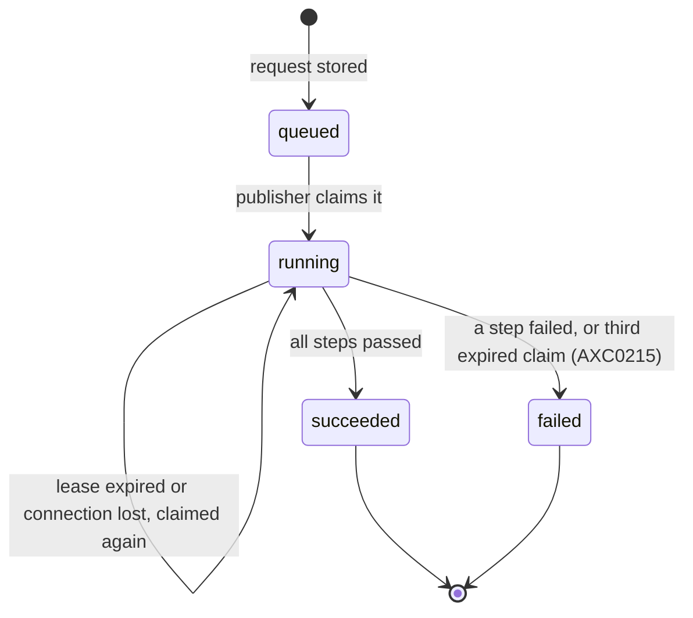

# Authoring API

The authoring API is how Studio, and any other client, reads and edits an application. It edits the
resource files of an application folder on the server's disk, the same files that are kept in git,
and it never activates a release: going live is a [publish request](#publishing), which the server
stores and a separate [publisher](administration.md#publisher) runs, so the server never activates
in its own process. This page gives the API's settings, routes, versions, order of checks, answers,
writes and diagnostics, and the publishing routes. The page and form metadata routes are in
[draft page metadata](draft-page-metadata.md), and the routes that save a module resource are in
[module resource saves](module-resource-saves.md).

A write takes a lock in the platform database, see [Versions](#versions). Reads and diagnostics touch
no database, except the [release](#release-history) and [resource activity](studio-resource-form.md#resource-activity) routes,
which read the releases. Some routes exist to help Studio's editors: [names](#names) feeds the reference pickers
and the expression completion, [text writes](#text-writes) the label texts, and the
[expression check](#expression-check) the expression editor.

## Settings

Five server settings decide whether Studio is on, who may author and who may publish, and whether
Studio shows its test controls. Their defaults, environment variables and behaviour in a cell are in
[Studio settings](host-settings.md#studio-settings).

| Setting                   | What it decides in the API                                                                                                               | With no value                                                   |
| ------------------------- | ---------------------------------------------------------------------------------------------------------------------------------------- | --------------------------------------------------------------- |
| `Studio:Folders`          | The application folders that Studio edits                                                                                                | Studio edits only the applications of `Studio:ApplicationsPath` |
| `Studio:ApplicationsPath` | The folder where Studio [creates applications](authoring-applications.md#creating-an-application), whose application subfolders Studio also lists                 | Studio cannot create an application                             |
| `Studio:AuthorRole`       | The roles claim value that may use the API. Application policies play no part, because an author edits them                              | Nobody may author                                               |
| `Studio:PublisherRole`    | The roles claim value that may `publish`, `activate` and change [application settings](#application-settings), on top of the author role | Nobody may publish or activate a release                        |
| `Studio:Tests`            | Whether Studio shows its test controls                                                                                                   | Off                                                             |

Studio is on when `Studio:Folders` is not empty or `Studio:ApplicationsPath` is set. When it is off,
there is nothing to edit and every route answers `403`. Everything other than `publish`, `activate`
and changing an [application setting](#application-settings) needs the author role only: `validate`, [`preview`](#preview), [`test`](#test), the request
status and the release history among them.

`GET /api/me` tells the SPA what the session may do in Studio, so that it shows only the controls
that work:

| Field               | Value                                                                                                                         | Studio uses it to                                               |
| ------------------- | ----------------------------------------------------------------------------------------------------------------------------- | --------------------------------------------------------------- |
| `studio`            | True when Studio is on and the user holds the author role                                                                     | Show Studio                                                     |
| `studioPublisher`   | True when `studio` is true and the user also holds the publisher role                                                         | Show Publish…, Activate… and the auto-accept switch as editable |
| `studioCreate`      | True when `studio` is true and `Studio:ApplicationsPath` is set                                                               | Show New application…                                           |
| `studioTest`        | True when `studio` is true and `Studio:Tests` is true                                                                         | Show Run tests and a scenario's Run                             |
| `studioPreviewHost` | The first host of the served tenant whose `PreviewOf` is the session's tenant, else `null`, and `null` when `studio` is false | Show Preview, only when it is set                               |

`studioPreviewHost` names a host and no port, so Studio takes the port and the protocol from its own
page.

## Routes

Every route names an application by `{application}`, the `name` in its manifest, such as
`PurchaseRequests`, matched ignoring letter case. The server reads the manifest of each folder that
Studio lists on every request, in list order, and the first match wins. A resource is addressed by its
`id`, which is permanent and unique in the application, because file names and names can change.

| Route                                                                               | Response                                                                                                                                                                                                                                                                                                                                                                                                                                                                                                                                                        |
| ----------------------------------------------------------------------------------- | --------------------------------------------------------------------------------------------------------------------------------------------------------------------------------------------------------------------------------------------------------------------------------------------------------------------------------------------------------------------------------------------------------------------------------------------------------------------------------------------------------------------------------------------------------------- |
| `GET /api/studio/apps`                                                              | `200` with `{ "items": [{ "name", "titles", "descriptions" }] }`, see [the application list](#the-application-list)                                                                                                                                                                                                                                                                                                                                                                                                                                             |
| `POST /api/studio/apps`                                                             | `201` with `{ name, diagnostics }` and a `Location: /api/studio/apps/{name}/resources` header. The body is `{ "name": "...", "template": "<template id>" }` as `application/json`, and `template` is optional. See [Creating an application](authoring-applications.md#creating-an-application)                                                                                                                                                                                                                                                                                          |
| `GET /api/studio/templates`                                                         | `200` with `{ "items": [{ id, version, builtIn, title: { en, vi }, description: { en, vi }, diagnostics }] }`, one item for the newest installed version of each application template, built-in templates first, then the others, each group sorted by `id`. Each title and description comes in both `en` and `vi`, and the SPA picks the locale. The route checks the session, the author role and Studio, as every read route does, and does not need `Studio:ApplicationsPath`. See [application templates](modules-and-templates.md#application-templates) |
| `GET /api/studio/apps/{application}/resources`                                      | `200` with `{ "items": [...] }`, one item for every resource of the folder, sorted by `file`, each with `id`, `kind`, `name`, `file`, `version`, `usedBy`, `titles` and `locale`. `titles` is the resource's label text by locale: the `label` of an entity, role, identity provider or the manifest, or the `title` of a page or site, read from the text resources. A locale whose text resource has no text for the key is left out, and `titles` is empty for any other kind. `locale` is the locale of a text resource, else `null`                        |
| `GET /api/studio/apps/{application}/resource-activity`                              | `200` with `{ items }` _(planned for M31)_, see [Resource activity](studio-resource-form.md#resource-activity) |
| `GET /api/studio/apps/{application}/resources/{id}`                                 | `200` with `{ id, kind, name, file, version, content }` and an `ETag` header                                                                                                                                                                                                                                                                                                                                                                                                                                                                                    |
| `GET /api/studio/apps/{application}/modules/{module}/resources/{id}`                | `200` with `{ id, kind, name, file, version, content, layer, marks, removed }`, see [module resources](#module-resources)                                                                                                                                                                                                                                                                                                                                                                                                                                       |
| `PUT /api/studio/apps/{application}/modules/{module}/resources/{id}`                | `200` with `{ file, version, diagnostics }`, and an `ETag` header when the save writes a layer. The body is the edited module resource whole, as `application/json`, with `If-Match` of the layer's version or `If-None-Match: *` when the resource has no layer. See [module resource saves](module-resource-saves.md)                                                                                                                                                                                                                                         |
| `POST /api/studio/apps/{application}/modules/{module}/resources/{id}/reset`         | `200` with `{ file, version, diagnostics }`, and an `ETag` header when a layer is left. The body is `{ list, key }` as `application/json`, with `If-Match` of the layer's version. It puts one element of the module back. See [element reset](module-resource-saves.md#element-reset)                                                                                                                                                                                                                                                                          |
| `POST /api/studio/apps/{application}/resources`                                     | `201` with the new resource's `{ id, kind, name, file, version, diagnostics }`, a `Location` header and an `ETag` header. The body is the full resource as `application/json`                                                                                                                                                                                                                                                                                                                                                                                   |
| `PATCH /api/studio/apps/{application}/resources/{id}`                               | `200` with `{ version, diagnostics }` and an `ETag` header. The body is `application/json-patch+json`, as RFC 6902 describes                                                                                                                                                                                                                                                                                                                                                                                                                                    |
| `POST /api/studio/apps/{application}/changes`                                       | `200` with `{ items: [{ id, version }], diagnostics }`. The body is `application/json`, see [Changes](#changes)                                                                                                                                                                                                                                                                                                                                                                                                                                                 |
| `DELETE /api/studio/apps/{application}/resources/{id}`                              | `200` with `{ diagnostics }`                                                                                                                                                                                                                                                                                                                                                                                                                                                                                                                                    |
| `GET /api/studio/apps/{application}/revisions`                                      | `200` with `{ "items": [...] }`, the folder's revisions, newest first, see [revisions](authoring-revisions.md)                                                                                                                                                                                                                                                                                                                                                                                                                                                  |
| `GET /api/studio/apps/{application}/revisions/{revision}`                           | `200` with `{ revision, resources }`, one revision with the files it changed, see [revisions](authoring-revisions.md)                                                                                                                                                                                                                                                                                                                                                                                                                                           |
| `POST /api/studio/apps/{application}/revisions/{revision}/undo`                     | `200` with `{ id, diagnostics }`, see [revisions](authoring-revisions.md)                                                                                                                                                                                                                                                                                                                                                                                                                                                                                       |
| `GET /api/studio/apps/{application}/drafts/{draft}/diff`                            | `200` with `{ start, tip, resources, cursor }`, one page of a draft's diff, see [the draft diff](authoring-revisions.md#draft-diff)                                                                                                                                                                                                                                                                                                                                                                                                                             |
| `GET /api/studio/apps/{application}/resources/{id}/references`                      | `200` with `{ uses, usedBy }`, see [References](#references)                                                                                                                                                                                                                                                                                                                                                                                                                                                                                                    |
| `GET /api/studio/apps/{application}/texts/{key}/references`                         | `200` with `{ usedBy }`, see [References](#references)                                                                                                                                                                                                                                                                                                                                                                                                                                                                                                          |
| `GET /api/studio/apps/{application}/diagnostics`                                    | `200` with `{ "diagnostics": [...] }`, the folder's diagnostics. A folder with errors still answers `200`                                                                                                                                                                                                                                                                                                                                                                                                                                                       |
| `GET /api/studio/apps/{application}/names`                                          | `200` with the names the application defines, see [Names](#names)                                                                                                                                                                                                                                                                                                                                                                                                                                                                                               |
| `GET /api/studio/apps/{application}/policy-matrix`                                  | `200` with what each role may do on each target, see [Policy matrix](authoring-policy-matrix.md)                                                                                                                                                                                                                                                                                                                                                                                                                                                                |
| `GET /api/studio/apps/{application}/settings`                                       | `200` with `{ autoAccept }`, see [Application settings](#application-settings)                                                                                                                                                                                                                                                                                                                                                                                                                                                                                  |
| `PUT /api/studio/apps/{application}/settings`                                       | `200` with `{ autoAccept }`. The body is `{ "autoAccept": true }` or `false` as `application/json`. It needs the publisher role, see [Application settings](#application-settings)                                                                                                                                                                                                                                                                                                                                                                              |
| `PUT /api/studio/apps/{application}/texts/{key}`                                    | `200` with `{ resources: [{ id, locale, version }], diagnostics }`. The body is `application/json`, `{ texts: { <locale>: <text> } }`, see [Text writes](#text-writes)                                                                                                                                                                                                                                                                                                                                                                                          |
| `POST /api/studio/apps/{application}/expressions/check`                             | `200` with `{ type, diagnostics }`. The body is `application/json`, `{ resourceId, path, expression }`, see [Expression check](#expression-check)                                                                                                                                                                                                                                                                                                                                                                                                               |
| `POST /api/studio/apps/{application}/expressions/scope`                             | `200` with `{ type, fields, functions }` _(planned for M31)_, see [Expression scope](#expression-scope) |
| `POST /api/studio/apps/{application}/resources/{id}/page-metadata`                  | `200` with `{ page, diagnostics }`, or `{ widget, diagnostics }` for a form. The body is the full draft page or form as `application/json`, see [draft page metadata](draft-page-metadata.md)                                                                                                                                                                                                                                                                                                                                                                   |
| `GET /api/studio/apps/{application}/modules/{module}/resources/{id}/page-metadata`  | `200` with `{ page, diagnostics }` for a page of the module version that the application pins, see [a module page](draft-page-metadata.md#a-module-page)                                                                                                                                                                                                                                                                                                                                                                                                        |
| `POST /api/studio/apps/{application}/modules/{module}/resources/{id}/page-metadata` | `200` with `{ widget, diagnostics }` for a draft form of the module version that the application pins. The body is the whole edited form as `application/json`, see [a module form draft](draft-page-metadata.md#a-module-form-draft)                                                                                                                                                                                                                                                                                                                           |
| `GET /api/studio/catalog`                                                           | `200` with `{ modules, packages, timeZones }`, see [Studio API](studio-resource-form.md#studio-api)                                                                                                                                                                                                                                                                                                                                                                                                                                                             |
| `GET /api/studio/bindings`                                                          | `200` with the names of the tenant's bindings by kind, see [Studio API](studio-resource-form.md#studio-api)                                                                                                                                                                                                                                                                                                                                                                                                                                                     |
| `GET /api/studio/apps/{application}/relaxed`                                        | `200` with `{ items }`, the folder's relax entries, see [Studio API](studio-resource-form.md#studio-api)                                                                                                                                                                                                                                                                                                                                                                                                                                                        |
| `GET /api/studio/apps/{application}/releases/{number}`                              | `200` with one release for its page, see [release route](studio-workspace.md#release-route)                                                                                                                                                                                                                                                                                                                                                                                                                                                                     |

The publishing routes are in [Publishing](#publishing).

### Files and ids

`file` is the path of the resource's file relative to the application folder, written with `/`. `id`
is in the hyphenated 8-4-4-4-12 hex form, in either letter case, and the answers write it in lower
case. A file is a resource only when it is a JSON object with a UUID `id` and a string `kind`, and
other files are left out of the list and cannot be read. When two files share an `id`, the first in
path order is the resource. `usedBy` is the number of entries in the resource's `usedBy` list, see
[References](#references).

### Descriptions

_(planned for M31)_

`GET .../resources` also answers `descriptions` with each item: the resource's
[`description`](resource-files.md#resource-file-shape) text by locale, read as `titles` is, and empty when
it has none.

### The application list

`GET /api/studio/apps` lists the applications Studio may edit, for the
[list of applications](studio-workspace.md#applications). It lists the folders of `Studio:Folders`
in their order, then the direct subfolders of `Studio:ApplicationsPath` that hold an
`application.json`, sorted by folder name ordinally. A folder whose name starts with `.` is skipped,
and so is a link.

- **Names.** A folder without a readable manifest `name` is left out. A name repeated ignoring letter
  case appears once, because the first folder wins in every route.
- **Titles.** `titles` and `descriptions` are always present and keyed by locale: the manifest's
  `label` and `description` text keys looked up in each text resource. A locale whose text resource
  lacks the key is left out, so both are empty when nothing resolves.
- **No compile.** The folder is read as JSON and not compiled, so a folder that does not compile still
  gives what it can.

### Module resources

`GET .../modules/{module}/resources/{id}` reads one file of the module version that the application
pins, other than `module.json`, with the application's
[customization layer](customization-layers.md) applied. The pinned version is the highest installed
version in the application's range.

- **`file` and `version`.** `file` is `modules/<id>/<path>`, and `version` is the hash of the module
  file. There is no `ETag`, because the file cannot be patched: a change to it is saved by the
  [module resource save](module-resource-saves.md).
- **`content`** has the layer applied when the file `customizations/<module>/<name>.json` exists.
- **`layer`** is `{ id, file, version }`, with the SHA-256 of the layer file as `version`, or `null`
  when the resource has no layer.
- **`marks`** are `{ path, mark }`, a JSON Pointer into `content` with `added` or `changed`, the added
  ones first.
- **`removed`** are `{ list, key, content }`, a module element that the layer removed: the pointer of
  its list, its key and the module's element.
- **Without a layer**, `marks` and `removed` are empty. A module scenario is answered as the module
  wrote it, with `layer: null`.

## Versions

Every write checks that the client edits the file it last read, so that no write overwrites another.
The `version` of a resource is the SHA-256 of its file's bytes, in lower-case hex.

- **ETag.** A read sends the version as a strong `ETag`, in quotes. A create sends the new version as
  an `ETag`, so the client can patch next without reading the resource again.
- **If-Match.** A patch and a delete send the version back in `If-Match`, as the quoted `ETag` or as
  the bare hex. `*`, a weak tag and a list of versions count as stale. A patch or a delete without
  `If-Match` is `428`.
- **Stale.** When the file no longer has that version, the answer is `409` and nothing is written. The
  client reads the resource again and retries. A patch or a delete that finds its resource gone once
  it holds the lock also answers `409`, not `404`, because another write removed it after the request
  was checked, so the version the client holds is stale.
- **One lock.** One lock covers the check and the write of every write, so two patches that carry the
  same version cannot both succeed, and neither can two deletes. It is a PostgreSQL advisory lock in
  the platform database, taken over `ConnectionStrings:Platform` for the check and the write and
  released when the write ends, whether it succeeded or was refused. It needs no grant.
- **Keyed by the folder.** The lock is keyed by the folder's full path, so it holds across server
  replicas that share the folder, and every replica must mount the folder at the same path. A create
  checks that its `id` is unused anywhere in the folder, which a lock per file could not ensure. So
  writes to two files of one folder wait for each other, and writes to different folders do not.
- **Waiting.** A write waits up to 10 seconds for the lock. When the wait times out, or the platform
  database cannot be reached, the answer is `503` and nothing is written. The snapshot of `validate`,
  `publish`, `preview` and `test` is read under the same lock, so those routes answer `503` too, and
  store no request.

## Order of checks

A request is checked in a fixed order, as in the [record API](record-api.md#errors), and the first
failure is the response. The session comes before the role, and the roles before the application, so
a caller without the roles cannot find out which applications, resources, requests or releases exist.

1. The CSRF header `X-Axis-Csrf: 1` on a `POST`, `PUT`, `PATCH` or `DELETE`, `403`.
   A write in a [read-only tenant](subscriptions.md#the-read-only-tenant) is refused next, before the session.
2. The session, `401`. A session from another tenant counts as no session.
3. The author role, `403`. It needs Studio to be on and `Studio:AuthorRole` to be set and held in
   the session's roles, see [Settings](#settings).
4. The publisher role, `403`, on `publish`, `activate` and the settings `PUT` only. It needs
   `Studio:PublisherRole` to be set and held in the session's roles.
5. An unknown application, `404`: one that Studio does not list, see
   [the application list](#the-application-list).
6. On `preview` only, a session's tenant with no served preview tenant, `409`. A preview tenant that is
   suspended is not served, so it counts as none. The check comes after the unknown application, so a
   caller cannot learn from it which applications exist.
7. On `validate`, `publish`, `preview` and the settings `PUT`, a manifest with no UUID `id`, `409`,
   because the request needs the application id for the publisher's queue, and the setting is kept by
   it. On `publish` and the settings `PUT` it comes before the body is read.
   An `activate` has no such check, because it names a release of the history.
8. An unknown resource, text key, request or release, `404`. A release that is not in this tenant's
   history for the application is unknown, and so is a request or a release of another application
   or tenant.
9. A patch or a delete without `If-Match`, `428`.
10. A body of the wrong content type, `415`. A create needs `application/json`, and a patch
    `application/json-patch+json`.
11. A bad body, `400`. That is a body that is not JSON, a patch that is not valid RFC 6902, a create
    without a valid `id`, with an unknown `kind` or with a `name` or `locale` that does not form a safe
    file name, or a create or a delete of the `application.json` manifest. The kind `application`
    counts as unknown here. For `publish`, it is also a body that is not a JSON object, a key other
    than `label` and `note`, a value that is not a string, a `label` of more than 100 characters or a
    `note` of more than 2000.
12. A [write lock](#versions) that cannot be taken, `503`. A `validate`, `publish`, `preview` or `test`
    answers it the same way, before it stores a request.
13. Under the lock, the checks that need the folder: a patched or deleted resource that is gone,
    `409`; a patch that does not apply or that changes `id` or `kind`, `400`; a stale version, `409`;
    and a create whose `id` or target file already exists, `409`.

In a cell, the routes that write, publish included, are also refused with the storage quota's `403`
when the tenant is over it, before the body is read, see [refusals](tenant-quotas.md#refusals). The
publishing routes count in the Publishing rate limit, see
[rate limits](headers-and-rate-limits.md#rate-limits).

### Routes with their own order

Some routes use only some of these checks, then their own. None has check 6 or a later check of the
list above, except where it says so.

- **Names and policy matrix.** Checks 2, 3 and 5. They are `GET` routes, so there is no CSRF check and
  no body.
- **Module resource.** Checks 2, 3 and 5, then `404` for a module that the application does not pin,
  then `404` for a resource that the pinned module version has no file for.
- **Module resource save and reset.** Checks 1, 2, 3 and 5, then those of
  [module resource saves](module-resource-saves.md#order-of-checks) and of
  [element reset](module-resource-saves.md#element-reset).
- **Text write.** Checks 1, 2, 3 and 5, then `415` for a body that is not `application/json`, `400`
  for a bad body, and `503` when the write lock cannot be taken. Under the lock it answers `400` when
  a text resource was created or deleted since the body was checked, and `409` when a text resource
  has a `texts` that is not an object. There is no `404` for an unknown key, because a `PUT` creates
  the key.
- **Expression check.** Checks 1, 2, 3 and 5, then `415`, then `400` for a bad body: one that is not a
  JSON object, a `resourceId` that is not a UUID, a `path` that is not a JSON Pointer or an
  `expression` that is not a string. Then `404` for an unknown `resourceId`, which comes after the body
  because the id is in it, then `400` for a `path` that holds no expression place. It takes no lock,
  so it has no `503`.
- **Application settings.** Checks 1, 2, 3 and 5 on `GET`, plus 4 and 7 on `PUT`, then `415`, then `400`,
  see [Application settings](#application-settings). A `GET` is a read, so it has no CSRF check.
- **Page metadata.** Checks 1, 2, 3, 5 and 8, then those of
  [draft page metadata](draft-page-metadata.md#order-of-checks).
- **Creating an application.** Its own list, see [Creating an application](authoring-applications.md#creating-an-application).
- **Changes.** Checks 1, 2, 3 and 5, then the list in [Changes](#changes).
- **Revisions.** Its own list, see [revisions in the authoring API](authoring-revisions.md#order-of-checks).

## Responses

Every error is problem details (`application/problem+json`). The titles are fixed and never contain
text from the request.

Every route answers `401` with no session and `403` with no author role or with Studio off, and every
`POST`, `PUT`, `PATCH` and `DELETE` also answers `403` with no CSRF header. `publish`, `activate` and
the settings `PUT` also answer `403` with no publisher role, titled "You do not hold the publisher role.", and creating
an application answers `403` with no `Studio:ApplicationsPath`. Listing the applications and the
templates answers no `404` and no `409`. The other routes differ:

| Route                                       | `404`                                                                                       | `409`                                                                                                    |
| ------------------------------------------- | ------------------------------------------------------------------------------------------- | -------------------------------------------------------------------------------------------------------- |
| Create application                          | Unknown template                                                                            | The name or the folder already exists                                                                    |
| List resources                              | Unknown application                                                                         | Not used                                                                                                 |
| Read                                        | Unknown application or resource                                                             | Not used                                                                                                 |
| Create                                      | Unknown application                                                                         | The `id` or the target file already exists                                                               |
| Patch                                       | Unknown application or resource                                                             | Stale `If-Match` version                                                                                 |
| Delete                                      | Unknown application or resource                                                             | Stale `If-Match` version                                                                                 |
| Changes                                     | Unknown application, or a patch that names an unknown resource                              | Any stale version, a patched resource that is gone, or a create whose `id` or target file already exists |
| Module resource                             | Unknown application, module or resource                                                     | Not used                                                                                                 |
| List revisions, Revision diff               | Unknown application, or for a diff a revision                                               | Not used                                                                                                 |
| Undo                                        | Unknown application or revision                                                             | The start of history, or a later revision changed the same files                                         |
| Module resource save, Module resource reset | Unknown application, module or resource, or for a reset a list or key that names no element | A stale `If-Match` version, `If-None-Match` over an existing layer, or a reset with no layer             |
| Resource references                         | Unknown application or resource                                                             | Not used                                                                                                 |
| Text key references                         | Unknown application, or a key that no text resource defines and no label uses               | Not used                                                                                                 |
| Diagnostics                                 | Unknown application                                                                         | Not used                                                                                                 |
| Names                                       | Unknown application                                                                         | Not used                                                                                                 |
| Policy matrix                               | Unknown application                                                                         | Not used                                                                                                 |
| Text write                                  | Unknown application                                                                         | A text resource whose `texts` is not an object                                                           |
| Expression check                            | Unknown application, or an unknown `resourceId`                                             | Not used                                                                                                 |
| Draft page metadata                         | Unknown application, or a resource that is neither a page nor a form                        | Not used                                                                                                 |
| Module page metadata                        | Unknown application, module or resource, or a resource that is not a page                   | Not used                                                                                                 |
| Module form metadata                        | Unknown application, module or resource, or a resource that is not a form                   | Not used                                                                                                 |
| Settings read                               | Unknown application                                                                         | Not used                                                                                                 |
| Settings change                             | Unknown application                                                                         | The manifest has no UUID `id`                                                                            |
| Validate                                    | Unknown application                                                                         | The manifest has no UUID `id`                                                                            |
| Publish                                     | Unknown application                                                                         | The manifest has no UUID `id`                                                                            |
| Preview                                     | Unknown application                                                                         | This tenant has no served preview tenant, or the manifest has no UUID `id`                               |
| Activate                                    | Unknown application, or a release not in the tenant's history                               | Not used                                                                                                 |
| Request status                              | Unknown application or request                                                              | Not used                                                                                                 |
| Release history                             | Unknown application                                                                         | Not used                                                                                                 |

Some answers have titles of their own:

| Answer                                                | Title                                                   |
| ----------------------------------------------------- | ------------------------------------------------------- |
| `409`, a manifest with no UUID `id`                   | "The application manifest has no valid id."             |
| `409`, a tenant with no served preview tenant         | "This tenant has no preview tenant." It names no tenant |
| `400`, a bad `publish` body                           | "The body is not a valid publish request."              |
| `400`, a bad settings body                            | "The body must be an object with a boolean autoAccept." |
| `409`, a text resource whose `texts` is not an object | "A text resource has no texts object."                  |
| `403`, no `Studio:ApplicationsPath` on a create       | "Studio cannot create applications here."               |

`400` is a bad body, `415` a body of the wrong content type, `428` a missing `If-Match` and `503` a
write lock that cannot be taken, as [Order of checks](#order-of-checks) says. A successful `validate`,
`publish`, `preview`, `test` or `activate` answers `202`, see [Publishing](#publishing).

## Application settings

`GET` and `PUT .../settings` read and change the settings of an application that Studio keeps in the
tenant database and not in a resource file. Today there is one, [auto-accept](ai-authoring-in-studio.md#auto-accept).

- **Body.** A `PUT` takes `{ "autoAccept": true }` or `false` as `application/json`. Any other body is
  `400`, and so is a body with another key.
- **Answer.** `200` with `{ "autoAccept": <value> }`, on a `GET` and on a `PUT`. A `GET` answers `false`
  for an application that has never had it changed, and for a folder whose manifest has no UUID `id`.
- **Who.** Any author reads it. Changing it needs the publisher role, so an author without it gets
  `403` and nothing is written.
- **Only a session.** The routes serve a browser session only. A bearer token is never a session, so
  it gets `401`.
- **Not in the files.** No write to the application's resources changes the setting, whatever the file
  holds. A `PATCH` that adds `autoAccept` to the manifest leaves the answer as it was.
- **Kept and audited.** The setting is kept by the manifest's `id`, and each real change is audited, see
  [system tables](storage.md#system-tables) and
  [audit actions](storage.md#audit-actions). A `PUT` that sets the value it already has writes nothing.

## References

The two references routes answer where a resource or a text key is used, so an author sees what a
change or a delete would touch. They read the [reference index](configuration.md#reference-index)
that every compile builds.

- **Resource route.** `GET .../resources/{id}/references` answers `{ uses, usedBy }`. `uses` lists
  what the resource refers to, and `usedBy` lists what refers to it.
- **Text key route.** `GET .../texts/{key}/references` answers `{ usedBy }`: the labels that use the
  key and the `text` resources that define it. A key that a label uses but no locale defines still
  answers with its uses, so an author who opens a missing key from an `AXC0028` diagnostic sees where
  it is used. `{key}` is matched ordinally, as keys are compared. A key that contains `/` cannot be
  addressed, because the route does not decode `%2F`.
- **Entry.** Each entry is `{ relation, file, path, node }`. `relation` is the name of the relation,
  such as `task form`. `file` and `path` are always in the resource that holds the reference, so for
  `usedBy` they point into the other resource and for `uses` into this one, and an entry opens its
  resource at that path. `node` is the other end: `{ type: "resource", id, kind, name, file }`,
  `{ type: "text", key }`, `{ type: "package", id }` or `{ type: "module", id }`. In `usedBy`, it names
  the resource that holds the reference.
- **Order.** Entries are sorted by the using file, then by path, both with ordinal string comparison,
  so `/steps/10` sorts before `/steps/2`.
- **Compiled in memory.** The folder is compiled in memory, as for [diagnostics](#diagnostics), and no
  database is touched. A folder with errors still answers with the edges that resolved.
- **The list's `usedBy`.** The resource list gives each resource's `usedBy` count, so Studio can warn
  before a delete. The warning never blocks the delete, and the next compile reports what broke.

## Names

`GET .../names` answers every name the application defines. Studio loads them with the application for
its [expression completion](studio.md#expression-editor) and its [reference pickers](studio.md), and
again after a save, a delete and a reconnect. The answer is:

```
{ locales: ["en", "vi"],
  entities: [{ id, name, module, fields: [{ name, type, target, values }] }],
  dataSources: [{ id, name, module, parameters: [{ name, type }], columns: [{ name, type }], groupBy }],
  processes: [{ id, name, module, entity, parameters: [{ name, type }], steps: [{ name, type, outcomes: [...] }] }],
  rules: [{ id, name, module, parameters: [{ name, type }], resultType }],
  connectors: [{ id, name, operations: [{ name }] }], roles: [{ id, name }],
  events: [{ id, name, module, entity, fields: [{ name, type }] }],
  sequences, forms, seeds, triggers, scenarios, textResources: [{ id, name, module }],
  pages: [{ id, name, module, parameters: [{ name, type, required }] }],
  policies: [{ id, name, module }], contracts: [{ id, name, module }],
  texts: [{ key, texts: { <locale>: <text> }, usedBy }] }
```

- **`name`** is written as a reference writes it. A module entity, data source, process, page or
  policy is `<module id>/<name>`, and a module rule is `<module id>:<name>`. `module` is the module id,
  or null for the application's own.
- **Module names.** Events, sequences, forms, seeds and triggers of a module are listed under
  `<module id>/<name>` too. Every list carries `module` except `roles`, `connectors` and `texts`.
  Contracts are module-only, so each of `contracts` is `<module id>/<name>` with its module id. A
  module resource's `id` is the id in its module file.
- **Module texts and scenarios.** A module's text files are in `textResources` and its scenarios in
  `scenarios`, each as `<module id>/<name>` with its module id, though the files keep the plain name.
  The application's own are listed with `module` null. `texts` is the list of text keys.
- **Event `entity`** is the entity the event is about, written as a process writes its `entity`. A
  module event that names its own module's entity without a slash is listed with the entity
  qualified, as `<module id>/<name>`. Studio's wait for event panel lists the events whose `entity` is
  the process's subject entity.
- **`columns`.** A plain data source lists its fields in order. A column's `type` is the type of the
  field at the end of its path, or null when the path does not resolve. A grouped data source lists
  its group fields in `groupBy` order, then its measures, as a grouped row holds them. A group field
  with a `bucket` is listed by its field name and has the type `date`, see
  [data sources](data-sources.md#aggregates). A `count` measure is an `integer`, and any other measure
  has the type of the field it measures, even when that field is not a group field.
- **`groupBy`** is the group field names of a grouped data source, in order, whether or not an entry
  has a `bucket`. It is `[]` for one total row, and null for a plain data source. A group field that
  names no field is still listed as a column, with a null type.
- **Process `entity`** is the subject entity of the process, or null for a process without a subject.
  **Process `parameters`** are the parameters of a process without a subject, in file order, and `[]`
  for a process with a subject. A step that is not a task has `outcomes: []`.
- **Page `parameters`** are the parameters the page declares, in file order. `required` is false when
  the file leaves it out.
- **`labelKey`** _(planned for M31)_. Each name that has a label or title in its format also has the text key
  of that label, `labelKey`, or null: an entity, a field, a process, a step, a data source, a rule, a
  connector, an event, a role, a page, a policy and the module resources. Columns, parameters and operations
  have none. A module's key resolves too, as `texts` holds the module texts merged into the application's.
- **`unique`** _(planned for M31)_. Each field of `entities` says whether it is unique, for a matched
  reference's [Find by](entity-designer.md#field-drawer).
- **`locales`** are the locales of the folder's text resources.
- **`texts`.** Each key comes with its text in every locale, and `usedBy`, the number of `label text`
  edges in the [reference index](configuration.md#reference-index).
- **Order.** Each list holds the module resources first, then the application's own in file path
  order. Module policies and module contracts come in pin order. Text keys are sorted ordinally.
- **Compiled in memory.** The folder is compiled in memory, as for [diagnostics](#diagnostics), and no
  database is touched. A folder with errors still answers with what resolved, and a file that was left
  out for its own errors is absent.
- **Size.** The answer holds every name and every text. At the typical application size it is a few
  hundred kilobytes.

## Text writes

`PUT .../texts/{key}` writes one text key in every locale at once, so a key is never in one locale
only. The body is `{ texts: { <locale>: <text> } }`.

- **Every locale.** The body must hold exactly the locales of the folder's `text` resources, matched
  ignoring letter case. With duplicate locales (`AXC0026`), the first file in path order counts. A
  missing locale, an extra locale, a value that is not a string, or another top-level key is `400`. A
  value may be any string, as the text schema allows. The body is `400` too when a text resource was
  created or deleted between this check and the lock.
- **The key.** `{key}` is matched ordinally and cannot contain `/`, as in the
  [text key references](#references) route. A new key is added at the end of `texts`, and an existing
  key keeps its position.
- **The lock.** The write takes the folder [write lock](#versions). Under it, the server reads each
  text file and writes every temporary file, then renames each one over its target. It changes only
  that key and leaves the other keys as they are. A text resource with no `texts` object gets one. A
  `texts` that is not an object is `409`, and nothing is written.
- **No `If-Match`.** A text write takes no version, and the last write to a key wins, because one
  version per file does not fit a write that spans files. Only that key can be lost.
- **Not atomic across files.** Each rename is atomic, but all of them together are not. A crash between
  two renames can leave the key in some locales only, and the next compile reports it as `AXC0027`.
- **Stale versions.** A text resource that Studio has open has a new version after the write, so its
  next save would be `409`. The answer therefore lists each text resource's new `version`, as
  `{ resources: [{ id, locale, version }] }`.
- **Answer.** `200` with the new versions and the folder's [diagnostics](#diagnostics), or `503` when
  the lock cannot be taken, and then nothing is written.

## Expression scope

_(planned for M31)_

`POST .../expressions/scope` answers what a place in a resource offers, so Studio's
[expression editor](studio.md#expression-editor) keeps no list of its own. The body is
`{ resourceId, path, draft }`, as for the [expression check](#expression-check). The answer is
`{ type, fields, functions }`:

- **`type`** is the type the place needs, or null when any will do.
- **`fields`** are the fields in scope at the place, each with its `name`, `labelKey` and `type`.
- **`functions`** are those allowed at the place, from the compiler's list of functions, each with its
  parameters, result, group, example and what it does, in the request's language.

## Expression check

`POST .../expressions/check` checks one expression without saving it, so Studio's expression editor
can show errors as the author types. The body is `{ resourceId, path, expression }`.

- **The place.** The server puts `expression` into a copy of the saved resource at `path` and compiles
  the folder in memory. The compile checks the expression where it stands, so the names in scope, the
  expected type, the [SQL subset](expressions.md#sql-subset) and the policy-filter rules are the
  compile's own, not a copy of them. The body carries no draft content. The `path` may point at a
  string, which the text replaces, or at a property the saved object lacks, which the text adds, so an
  optional expression that the author has just added, such as a form field's `requiredWhen`, is
  checked before the first save. A place inside an object that the saved resource lacks is not found.
- **The draft** _(planned for M31)_. The body may also carry `draft`, the resource as the author has it, which
  the server uses in place of the saved one, so a validation not yet saved gets an answer rather than a
  `400`.
- **Where it works.** In every place the compile checks an expression: computed fields, validations,
  rules, data source filters, process conditions and values, policy filters, migration values,
  endpoint values, trigger conditions and form conditions.
- **No expression place.** A `path` that points at neither a string nor a missing property of an
  object in the saved resource is `400`. So is a place where the compile checks no expression because
  another problem in the resource skips the check, such as a process step whose subject entity is
  unknown. A save shows no problem at such a place either.
- **The rules.** The scope, types, limits and codes are those of
  [expression diagnostics](expressions.md#diagnostics). An expression of more than 2,000 characters
  answers `AXC0036` as a diagnostic, not `400`.
- **The answer.** `{ type, diagnostics }`. `type` is the result type in the notation of
  [Types](expressions.md#types): `text`, `integer`, `decimal`, `boolean`, `date`, `date-time`, `enum`,
  `reference` or `null`. It is the expression's own type, so a text literal is `text` even where an
  enum is expected. `type` is null when there is a diagnostic, and when the compile cannot find the
  type yet, as for a migration value whose type check waits for activation.
- **Diagnostics.** There is at most one, because the compile stops at the first problem. It is
  `{ code, message, start, end }`. `start` and `end` are offsets into the expression text after JSON
  decoding, in UTF-16 code units, and `end` is exclusive.
- **The range.** The compile reports one character position, so the range is the token at that
  position: a name, a literal or an operator. A qualified call such as `organization:IsDelegating` is
  one range. A character that starts no token covers that one character, and text that is never closed
  runs to the end. `AXC0036` and `AXC0048` cover the whole expression. A limit that the compile reports
  at the place but outside the expression check, such as a rule cycle (`AXC0055`) or nesting that is
  too deep (`AXC0065`), is answered over the whole expression. A range can be narrower than the faulty
  subexpression: for `a + 'x'` only the `+` is covered.
- **Nothing is written.** It compiles in memory, takes no lock and touches no database.
- **Speed.** It answers within 300 ms on a
  [typical application](../domain/knowledge.md#typical-application-size). The compile stops once every
  check has run, so it builds no reference index, names, policy matrix, model or content hash. Nothing
  is cached, so the next check sees an edit on disk.

## Writes

Every route that writes a file follows the same rules: patches, creates, deletes, changes, text writes
and module resource saves.

- **Atomic.** A write goes to a hidden temporary file in the same folder and is then renamed over the
  target, so a reader never sees half a file. A delete removes the file and leaves its kind folder,
  even when it is empty.
- **Format.** The file is written as JSON with 2-space indents, LF line ends and a final newline. The
  order of keys is kept, so a patch of one value changes one line in git.
- **The manifest.** `application.json` at the folder root can be patched. It cannot be created or
  deleted, because `AXC0009` (see the [diagnostic codes](diagnostic-codes.md)) requires it there.
- **Paths.** A path is resolved and must stay under the application folder, so `..` and links cannot
  leave it. Only `*.json` files are read or written.
- **Patches.** A patch may not change `id` or `kind`, and a change of letter case alone counts as a
  change. Every other change is allowed, including one that breaks the resource: the new content is
  written and the diagnostics report the breakage.
- **Never an activation.** A write never compiles against a database, never stores a release and never
  activates one. Only a [publish request](#publishing) leads to an activation, which the
  [publisher](administration.md#publisher) runs.

### New files

A create writes a new file whose path comes from the resource, so no request can name a path outside
the folder.

- **Kind folders.** A new file goes in the kind's plural folder, as in
  `samples/apps/purchase-requests`, and a missing kind folder is created. The table after this list
  gives the folder of each kind. The `kind` is matched with its letter case.
- **File names.** The file name is the kebab-case `name`, such as `entities/purchase-request.json`. A
  role's file name is its name as it is, such as `roles/department-manager.json`. A `text` resource is
  named after its locale in lower case, such as `texts/en.json` and `texts/pt-br.json`. A patch that
  changes `name` keeps the file name.
- **Kebab-case.** A hyphen goes before a capital that follows a lower-case letter or a digit, or before
  the last capital of an acronym that a lower-case letter follows. Then everything is lower-cased. So
  `PurchaseRequestList` is `purchase-request-list`, and `HTTPCall` is `http-call`.
- **Name pattern.** A create's `name` must be `^[A-Za-z][A-Za-z0-9]*$` with at most 60 characters,
  which is the pattern of every kind's schema except `role`. A role's `name` must be
  `^[a-z][a-z0-9-]*$` with at most 60 characters, as its schema says. Letters, digits and hyphens
  cannot form a path, so `../x` is `400`. A text's `locale` must match the text schema's pattern,
  `^[A-Za-z]{2,3}(-[A-Za-z0-9]{2,8})*$`, with at most 60 characters.
- **Checked fields.** A create checks only `id`, `kind`, `name` and, for a text, `locale`. Any other
  schema problem is saved and shows up as a diagnostic.
- **No overwrite.** A create whose `id` is in use, or whose target file exists, is `409`. A create
  never replaces a file, even when another process writes the folder.

| Kind               | Folder               |
| ------------------ | -------------------- |
| `entity`           | `entities`           |
| `site`             | `sites`              |
| `page`             | `pages`              |
| `text`             | `texts`              |
| `seed`             | `seeds`              |
| `dataSource`       | `data-sources`       |
| `rule`             | `rules`              |
| `sequence`         | `sequences`          |
| `process`          | `processes`          |
| `form`             | `forms`              |
| `role`             | `roles`              |
| `policy`           | `policies`           |
| `connector`        | `connectors`         |
| `event`            | `events`             |
| `endpoint`         | `endpoints`          |
| `trigger`          | `triggers`           |
| `webhook`          | `webhooks`           |
| `migration`        | `migrations`         |
| `scenario`         | `scenarios`          |
| `identityProvider` | `identity-providers` |

## Changes

`POST .../changes` writes several files in one call, so that files that belong together never split:
the [entity designer](entity-designer.md) saves an entity and its migration this way.

```json
{ "changes": [
  { "create": { "id": "…", "kind": "migration", … } },
  { "patch": [ { "op": "replace", … } ], "id": "…", "version": "<hex>" }
] }
```

- **The list.** A call holds 1 to 20 changes, and the body has no key but `changes`. Each change has
  exactly one of `create` or `patch`. A `create` is a full resource, as for [new files](#new-files),
  and takes no other key. A `patch` is an RFC 6902 list and goes with the `id` it patches and its
  `version`, the bare hex of [Versions](#versions), with no `If-Match` header. There are no deletes.
- **No repeats.** The same `id` twice is `400`, a create of an `id` that another change patches
  included. Two creates that give the same file are `400` too.
- **One lock.** One lock covers the folder. Every change is checked against the folder first, then the
  files are written in list order, each one atomic as in [Writes](#writes). A refused call writes
  nothing.
- **Answer.** The `items` follow the request order, each with the `id` and the new `version` of its
  file. `diagnostics` are the folder's diagnostics after the last write.
- **A crash.** A server that dies during the writes can leave the first files written. The next
  diagnostics show the mismatch, such as `AXC0015` or `AXC0171`.

After checks 1, 2, 3 and 5 of [Order of checks](#order-of-checks), the route checks every change, and
the first failure refuses the whole call. The checks that need only the body come first, because the
body says which change is a patch:

1. `415` for a body that is not `application/json`.
2. `400` for the shape of the list: a body that is not a JSON object with only `changes`, a list that
   is empty or longer than 20 changes, or a change that is not exactly `{ create }` or
   `{ patch, id, version }`. A change with both or neither of `create` and `patch`, a delete, and a key
   other than `create`, `patch`, `id` and `version` all fail here.
3. `404` when a patch names an unknown `id`.
4. `428` when a patch change has no `version`.
5. `400` for the content: a `version` that is not a string, a patch that is not valid RFC 6902, a
   create that has no valid `id`, `kind` or file name, the same `id` twice, or two creates that give
   the same file.
6. `503` when the [write lock](#versions) cannot be taken.
7. Under the lock, each change in list order, with the order of its single route. A patch is checked
   for a resource that is gone, a patch that does not apply, a patch that changes `id` or `kind`, then
   the stale version. A create is checked for an `id` that exists, then a target file that exists.

## Diagnostics

A patch, a create, a delete and a text write answer with the folder's diagnostics, and
`GET .../diagnostics` returns them on demand. A diagnostic never blocks a save: a delete that breaks
references is saved, and the diagnostics list the broken references.

- **Compiled in memory.** The folder is compiled in memory against the extension packages installed
  under `Extensions:Path` and the modules installed under `Modules:Path`, see
  [extension packages](extension-packages.md#declaring-packages-in-an-application) and
  [modules](modules-and-templates.md#modules). No database is touched.
- **Shape.** The codes, severities and fields are those of
  [startup activation](host-settings.md#startup-activation). Each diagnostic is
  `{ code, severity, message, file, path, resourceId }`. `severity` is `error` or `warning`.
  `resourceId` is the lower-case id of the resource, or `null` when the problem concerns a whole file
  or the whole folder.
- **What is left out.** The problems of a broken extension package are not returned, because they
  belong to the server's install and not to the folder. Nor are the checks that activation runs
  against a tenant: bindings, name and site path conflicts, and storage changes, which need a tenant
  database or the tenant's settings. [`validate`](#the-request) runs those.
- **Under `scripts/dev.sh`.** A saved file restarts the server, which activates the folder, as a hand
  edit does. A folder with an error is not activated, so the restart then stops the server.

## Publishing

An author validates, publishes, previews and tests an application from Studio, and activates any
release of its history. The server holds no tenant schema connection and never activates in its own
process: it stores a **publish request** in the tenant database, and a separate
[publisher](administration.md#publisher) runs it with the tenant's schema role. The tables are in
[publish requests and release history](publish-request-storage.md#publish-requests-and-release-history).

A request runs for the tenant of the author's session, so Studio on a tenant's host publishes to that
tenant only.

| Route                                                        | Response                                                                                                                                                                                                                      |
| ------------------------------------------------------------ | ----------------------------------------------------------------------------------------------------------------------------------------------------------------------------------------------------------------------------- |
| `POST /api/studio/apps/{application}/validate`               | `202` with the request and a `Location` header for `.../requests/{id}`. It needs the author role                                                                                                                              |
| `POST /api/studio/apps/{application}/publish`                | `202` with the request and a `Location` header. The body is `application/json` with an optional `label` and an optional `note`. It needs the author role and the publisher role                                               |
| `POST /api/studio/apps/{application}/preview`                | `202` with the request and a `Location` header. It needs the author role only, and answers `409` when the tenant has no preview tenant, see [Preview](#preview)                                                               |
| `POST /api/studio/apps/{application}/test`                   | `202` with the request and a `Location` header. The body is optional `application/json`, `{ "scenarios": ["<name>", ...] }`, and none or an empty list means every scenario. It needs the author role only, see [Test](#test) |
| `GET /api/studio/apps/{application}/requests/{id}`           | `200` with the request, its status, its diagnostics and, for `test`, its scenario outcomes                                                                                                                                    |
| `GET /api/studio/apps/{application}/releases`                | `200` with the activation history, newest first, and which release is active, see [Release history](#release-history)                                                                                                         |
| `POST /api/studio/apps/{application}/releases/{id}/activate` | `202` with the request and a `Location` header. It needs the author role and the publisher role, see [Activating a release](#activating-a-release)                                                                            |

`validate`, `preview` and `activate` take no body, and a body that is sent is ignored. A `publish`
without a body stores no label and no note, and a `test` without a body runs every scenario. A body
that is sent to either must be `application/json`, or the answer is `415`. `{id}` of a request is its
UUID, and `{id}` of a release is the release id from the history. The other refusals are those of the
rest of the API, see [Order of checks](#order-of-checks) and [Responses](#responses).

### The request

A request is shown as
`{ id, application, kind, target, status, label, note, requestedBy, requestedByName, requestedAt, startedAt, finishedAt, releaseId, diagnostics, scenarios }`.

| Field             | Meaning                                                                                                                                                                                                                    |
| ----------------- | -------------------------------------------------------------------------------------------------------------------------------------------------------------------------------------------------------------------------- |
| `id`              | The request id, a UUID                                                                                                                                                                                                     |
| `application`     | The application `name`                                                                                                                                                                                                     |
| `kind`            | `validate`, `publish`, `activate` or `test`                                                                                                                                                                                |
| `target`          | `tenant` or `preview`. `preview` marks a request that runs on the session tenant's preview tenant, see [Preview](#preview). Only the preview route writes `preview`, and the request status route reports the stored value |
| `status`          | `queued`, `running`, `succeeded` or `failed`, see [Lifecycle](#lifecycle)                                                                                                                                                  |
| `label`           | The optional label of a `publish`, up to 100 characters, or null                                                                                                                                                           |
| `note`            | The optional note of a `publish`, up to 2000 characters, or null                                                                                                                                                           |
| `requestedBy`     | The requesting user's id                                                                                                                                                                                                   |
| `requestedByName` | The requesting user's display name from their [user profile](notifications.md#user-profiles), else the name stored with the request, else null                                                                             |
| `requestedAt`     | When the request was stored                                                                                                                                                                                                |
| `startedAt`       | When a publisher first started it, or null while `queued`                                                                                                                                                                  |
| `finishedAt`      | When it reached `succeeded` or `failed`, or null before                                                                                                                                                                    |
| `releaseId`       | The release a `publish` activated or an `activate` named, or null. A `validate` and a `test` have none                                                                                                                     |
| `diagnostics`     | The diagnostics, in the form of [Diagnostics](#diagnostics). Empty until the request ends. A `succeeded` request can hold warnings                                                                                         |
| `scenarios`       | The scenario outcomes, see below. For a `test`, empty until the request ends. For a `publish` or a `validate`, null until the request ends and when no contract scenario ran. Null for a `rollback`                        |

`scenarios` has one item for each scenario that ran, in file order: for a `test`, the application's
scenarios, and for a `publish` and a `validate`, the stored results of their
[contract scenarios](module-contracts.md#contract-scenarios). An item is
`{ name, resourceId, file, outcome, durationMs, step, path, message }`:

- `outcome` is `passed` or `failed`, and `durationMs` is the time the scenario took.
- `step` is the 0-based index of the failing step, `path` is `/steps/<index>`, in the same form as the
  paths of [Diagnostics](#diagnostics), and `message` is the failure message, each null when the
  scenario passed.
- `resourceId` and `file` name the scenario resource, so Studio can open it at `path`.
- A contract scenario that a relax entry skipped is an item in the form
  `{ name, file, outcome: "skipped", point }`, where `point` is the relaxed point it covers.

What each kind does:

- **A snapshot.** `validate`, `publish`, `preview` and `test` store the folder as it is when the
  request is made: every `*.json` file that Studio can reach, with its `version`, as for
  [Versions](#versions). A file that is not a valid resource is kept, so the request fails with the
  diagnostic that the diagnostics route shows. The snapshot is read under the write lock, so it never
  holds a write half done, and a later edit in Studio does not change a queued request: the release is
  exactly what the author sent.
- **A folder with errors.** A `publish` of a folder with compile errors is still accepted with `202`,
  and the request then ends `failed` with those diagnostics. So there is one path for diagnostics, and
  the snapshot shows what the author sent.
- **`validate`.** The publisher first runs the contract scenarios of the pinned modules. It then runs
  every activation check against the tenant inside a transaction that it rolls back, and returns the
  codes of [startup activation](host-settings.md#startup-activation), including the checks that the
  in-memory diagnostics skip: bindings, name and site path conflicts, and storage changes. It stores no
  release and changes nothing, and ends `succeeded` when there is no error.
- **`publish`.** The publisher first runs the contract scenarios, as for `validate`. A failing one ends
  the request `failed` with `AXC0342`, and nothing is stored or activated. Then it compiles the
  snapshot against the tenant, stores the release, activates it and seeds, with the same steps as
  [`axis-admin activate`](administration.md#activate). A `seed` failure happens after activation has
  committed, so the request ends `failed` with `releaseId` set, and the release stays active.
- **`test`.** The publisher runs the scenarios, see [Test](#test).
- **`accept`** _(planned for M35)_. The publisher applies a draft of an authoring request to the
  working folder, see [accepting a draft](revisions-and-drafts.md#accepting-a-draft).
- **Order.** For one tenant and application the publisher runs requests one at a time, oldest first,
  so when two publishes are queued, the newer one ends up live. A `test` has a queue of its own.

### Preview

`POST .../preview` tries an application on the session tenant's
[preview tenant](../architecture.md#preview-tenants) before it goes live. The request has the kind
`publish` and the target `preview`.

- **Who may.** The author role is enough. It needs no publisher role, because nothing goes live for
  real users.
- **Where it is stored and where it runs.** The request is stored in the session tenant's database,
  so Studio polls `GET .../requests/{id}` on the main host as for any request. The publisher runs it
  against the preview tenant's database, see [the publisher](administration.md#publisher).
- **History.** The activation goes in the preview tenant's own release history, with the request id,
  and the preview's release number is its own. `GET .../releases` on the main host shows only the main
  tenant's history.
- **Audit.** A preview writes no audit record, like `validate`. The preview's history records who
  published it.
- **A preview that is not served.** A request stays `queued` while the preview tenant is not served.
  If the main tenant loses its preview tenant after the request was stored, the request ends `failed`
  with `AXC0216`.
- **Not required.** Publishing to the main tenant does not need a preview first.
- **Data.** A preview starts with the application's seed data. Records created in it stay until the
  operator recreates the preview tenant, and Studio cannot reset it.
- **Bindings.** A preview has its own bindings, empty by default. A missing binding is a warning at
  activation, and the call fails at run time, see [preview tenants](host-settings.md#preview-tenants).

### Test

`POST .../test` stores a request to run the application's [test scenarios](test-scenarios.md) from
Studio. The request has the kind `test` and the target `tenant`. Studio's Run tests and Run controls
send it, and its Test results list shows the outcome, see [Studio](studio.md).

- **Who may.** The author role is enough. It needs no publisher role, because a test changes no
  tenant. It costs database time, so the limits below apply.
- **The body.** The optional `scenarios` list names the scenarios to run, by their `name`. With no
  body, no list or an empty list, every scenario runs, a pinned module's after the application's own,
  as `<module id>/<name>`. An unknown name is accepted with `202`, and the request then ends `failed`
  with `AXC0218`, as for a folder with errors.
- **Where it runs.** The server stores the request with a snapshot, taken as for `validate`. The
  publisher runs it with `Scenarios:ServerConnectionString`, in a new database for each scenario, see
  [the publisher](administration.md#publisher), and touches the tenant database only to store the
  request's status and outcomes. Without the setting, the request ends `failed` with `AXC0217`, which
  names it, and a snapshot that does not compile ends it `failed` with the compile diagnostics. In
  these cases, and for an unknown name, no scenario runs.
- **The outcome.** The request ends `failed` when any scenario fails. Scenario failures go only in
  `scenarios`, one item for each scenario that ran, and the other failures, `AXC0217` to `AXC0220`
  and compile diagnostics, go in `diagnostics`. A scenario that fails has the failing `step`, its
  `path` and its `message`. Selecting it in Studio opens the scenario at that step, as a diagnostic
  opens a resource. A module's scenario opens nothing.
- **Limits.** The scenarios of a request run one after another, and the work item limit of a
  [test scenario](test-scenarios.md) applies to each. A request stops after 10 minutes: the scenario
  that runs fails, its database is dropped and the request ends `failed` with `AXC0219`. A stop of the
  publisher (`SIGTERM`) does the same at once, with `AXC0220`. The scenarios that finished keep their
  outcomes, and the one that was cut is stored as `failed` with no `step` and no `path`.
- **Order.** At most one `test` request per application runs at a time, oldest first. Its queue is
  separate from the one of `validate`, `publish` and `activate`, so a `test` does not wait behind a
  `publish`.
- **Audit.** A `test` writes no audit record.
- **A request that runs again.** A request that is claimed again after a lost lease runs every
  scenario again.

### Lifecycle

A request moves through four statuses, and only the publisher changes them: the server only inserts
requests and reads them.



- **Lease.** The publisher claims a request with a lease and renews the lease while the request runs,
  so a long recompute is not claimed twice. A request whose publisher died is claimed again after its
  lease ran out, and one whose publisher lost its tenant database connection in the next round. It
  stays `running`.
- **Three claims.** A request that has been claimed three times, and whose lease runs out again, ends
  `failed` with `AXC0215` in place of a fourth claim, so a request that crashes the publisher cannot
  block the queue for good.
- **Time limit.** A `test` that runs past 10 minutes ends `failed` with `AXC0219`, and so can the
  contract scenarios of a `publish` or `validate`. A stop of the publisher ends a `test` with
  `AXC0220`, see [Test](#test).
- **Final.** `succeeded` and `failed` are final, and Studio polls `GET .../requests/{id}` until the
  status is one of them.
- **Running again.** A request that runs again does no harm, because activating the same content hash
  twice changes nothing, see [Release history](#release-history).

### Release history

`GET .../releases` answers the application's activations in this tenant, newest first, as
`{ active: { releaseId, number, contentHash }, folderContentHash, changes, items: [{ releaseId, number, contentHash, activatedAt, actor, actorName, label, note, requestId, offStandard, relaxed: [{ module, point, reason, moduleTitle, part, entityTitles, titles }] }] }`.
The publisher writes the rows of a `publish` and an `activate` request.

- **`active`** is the application's active release in this tenant, or null when there is none.
- **`folderContentHash`** is the content hash that the folder would compile to now, so Studio can show
  that the live release and the folder differ. It is null when the folder has errors.
- **`changes`** are the files that differ from the active release as canonical JSON, sorted by path,
  `[{ path, change, kind, name, titles, locale }]`, with `change` being `added`, `changed` or
  `removed`. A removed file has the other fields from the active release and its texts, and `titles`
  is null without a label text key. Files are read one by one, without scenarios and modules' copies.
  `changes` is null with no active release.
- **Items.** Each item is one activation: a startup, an `axis-admin activate`, a publish or an `activate`.
  `actor` is a user id, `startup` or `operator`, and a row that a migration added for a release that
  was live before the history existed has the actor `unknown`. `actorName` is the actor's name from
  their [user profile](notifications.md#user-profiles), else the name stored with the activation, else
  null. `requestId` is null for a startup and for an `axis-admin activate`.
- **Relaxed points.** `relaxed` lists the relax entries of the release's application in manifest
  order, read from the `application.json` stored with that release, and `offStandard` is true when it
  is not empty, see [off-standard releases](module-contracts.md#off-standard-releases).
- **Words for relaxed points.** `moduleTitle` is the module's label, `part` is `transition`, `initial`,
  `deletable`, `validation`, `effect` or `ceiling`, and `entityTitles` and `titles` are the labels of the
  entity and of the point by locale. They are read from the module files that the release stores, so a
  release keeps the words it was published with. A part without a label shows its name in each locale of
  the module's texts, or in `en` when the module has none. `moduleTitle` is the module's id when its label
  is blank. `titles` is null for `ceiling/others`, which reads "Other roles". Every word is null when the
  release has no copy of the module. `part` and `titles` are also null when the module's contract lacks
  the point.
- **Numbers.** A release gets its `number` the first time it is activated in the tenant: 1, 2, 3… per
  application. Activating it again keeps the number, so the same content can have different numbers in
  two tenants.
- **No copies.** Activating the release that is already active adds no row and keeps the number, so
  that every restart under `scripts/dev.sh` does not fill the history with copies.

### Activating a release

An `activate` request makes a release from the history live again, back to an older release or
forward to a newer one. The publisher activates it as it is, without compiling it again: it rebuilds
the release's model from its stored files, never from the folder, and stores no new release.

- **The activation.** It records an activation with the request's actor, which is the requesting
  user, and the request id, with no label and no note.
- **Running instances.** Instances that are already pinned to another release keep running on it,
  and new starts use the activated release.
- **Seeds.** Activating a stored release runs the `seed` step of the release as well, so its schedule
  triggers and seed records are the ones of the release that is live. Records that the release that
  was live created stay in place, and seeds with `sync` take the values of the activated release.
- **The folder.** Activating a stored release does not change the folder. Studio shows when the
  active release does not match the folder, with `folderContentHash`.
- **The active release.** Activating the release that is already active succeeds and adds no row.

Activating a stored release is refused, and the request ends `failed`, in the cases of
[refusals to activate a stored release](publish-request-storage.md#refusals-to-activate-a-stored-release), and with
every other refusal of activation. A refused activation changes nothing: the active release and the
history stay as they were.

### Audit

Each `publish` and `activate` writes an [audit record](storage.md#audit-records-and-sequence-counters)
with the actor, the application, the release and the request, when it succeeds and when it fails. A
`validate`, a `preview` and a `test` write none.
