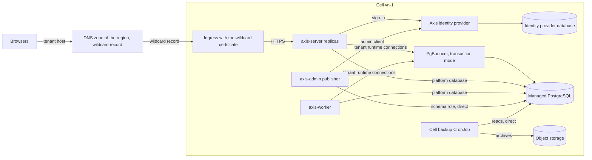

# Cells

A cell is an installation of Axis that Axis runs as a SaaS for many tenants. This page covers the
regions and cells, the hosts of a cell's tenants and their certificates, how a cell reaches up to
1,000 tenant databases, and how many tenants a cell holds. The choice of cells and the reasons for
it are in [D118](../decisions/d118-axis-saas-in-cells-with-sign-up-quotas-and-billing.md) and
[D123](../decisions/d123-how-an-axis-saas-cell-keeps-tenants-apart-measured-and-recoverable.md).

A cell is the same software as a self-hosted installation, and a host runs as a cell when `Cell:Id`
is set, see [cell settings](host-settings.md#cell-settings). A cell adds the per-tenant
[Studio folders](host-settings.md#studio-settings), [quotas and usage](tenant-quotas.md),
[fair work in the worker](worker-scheduling.md), the [provisioning API](tenant-lifecycle.md), the
[cell console](cell-console.md) and [daily backups](tenant-backup-and-restore.md#backups-in-a-cell).

## Regions and cells

A region is where customer data is kept, and a cell is one installation in a region. Every tenant
lives in exactly one cell.

- **Region.** A region is named by a short code such as `vn`, and the first region is `vn`. Every
  part of a cell, its backups and its object storage included, runs in the cell's region, so a
  tenant's data never leaves its region. Another region, such as `sg`, opens when its first customer
  needs it, with no change to the platform.
- **What a region needs.** Its cloud provider offers managed Kubernetes, managed PostgreSQL,
  S3-compatible object storage, and backups kept in a second data centre in the same country.
- **Cell.** A cell is one full installation in one region: the server replicas, the worker, the
  publisher, the managed PostgreSQL with PgBouncer, Axis's identity provider and object storage. Its
  id is the region and a number, such as `vn-1`.
- **What a cell shares.** The tenants of a cell share its CPU, memory, database server, identity
  provider and mail domain. They share no database, realm, file, key, backup or Studio folder.
- **One failure, one cell.** A restart or a failure of a cell touches only its tenants. A second cell
  in a region is a second installation, which shares nothing with the first but the region's DNS
  zone.
- **A dedicated cell.** A customer that needs its own resources gets a cell with only its tenants,
  which is opened as any new cell is.
- **No moves.** Axis does not move a tenant between cells or between regions.

The diagram shows one cell and the connections that the Helm chart configures. The DNS zone, the
ingress, cert-manager and the object storage come from the cluster and the cloud provider, not from
the chart. The chart renders the workloads, the wildcard certificate when `cell.certificate.enabled`
is set, and the backup CronJob only when `backup.bucket` is set, see
[installation](installation.md#in-the-cloud).

## Hosts and certificates

Each tenant gets a subdomain of its region's domain, and may add a host of its own once it proves
that it controls the host.

- **Tenant subdomain.** Each region has a domain for its tenants, `Cell:TenantDomain`, such as
  `vn.example.com`, and a new tenant gets the host `<tenant id>.<tenant domain>`. The DNS zone has a
  wildcard record `*.<tenant domain>` that points at the cell's ingress. A second cell in the region
  gets its tenants' records one by one instead of the wildcard.
- **A record for each tenant** _(planned for M33)_. Each tenant's subdomain has a `CNAME` record of
  its own, which the control plane writes, and the zone has no wildcard record, see
  [routing a host](region-directory.md#routing-a-host).
- **Wildcard certificate.** The cell's ingress serves one certificate for `*.<tenant domain>`.
  cert-manager gets and renews it over ACME with the DNS-01 challenge, because a wildcard needs DNS
  validation. The DNS provider's token is a Kubernetes Secret of the cell, never a setting. The chart
  renders the Issuer and the Certificate from its `cell.certificate` values, see
  [installation](installation.md#settings-and-secrets).
- **A host of the tenant's own.** The operator, through the
  [provisioning API](tenant-lifecycle.md#hosts), adds a host such as `approvals.acme.vn`, in these
  steps.
  1. The cell answers with a verification token. The customer adds the DNS record
     `_axis-verify.<host>` of type `TXT` with that token, and a `CNAME` of the host to the tenant's
     subdomain.
  2. The [publisher](administration.md#publisher) looks the record up every
     `Cell:HostCheckInterval`, 10 minutes by default, for 7 days. When it matches, the host is
     `verified`. After 7 days without a match the request expires.
  3. Before it marks the request `verified`, the publisher creates a cert-manager `Certificate` for
     the host with the HTTP-01 challenge and adds the host to the tenant, which keeps the realm's
     redirect addresses in step as `tenant host add` does. It creates the `Certificate` through the
     Kubernetes API with its own service account, names it after the host, and uses the Issuer
     `<release>-tenant-hosts` that the chart renders for the HTTP-01 challenge. A `Certificate` that
     exists counts as done, and a cell without `cell.certificate.enabled` writes none.
  4. **Route** _(planned for M31)_. The cell's ingress gets a route for the verified host, so the
     tenant is served on it.
  5. A host that is not verified is never served: the ingress has no route for it, and the server
     answers `404` for it, as for any unknown host.

  A host that a deleted tenant used is held back for 90 days, see
  [deleting a tenant](tenant-lifecycle.md#deleting-a-tenant).
- **A host added by a tenant administrator** _(planned for M33)_. A tenant administrator adds a host
  of the tenant's own in the same steps.
- **Routing.** Inside the cell, a request is resolved as on any installation, see
  [request resolution](../architecture.md#request-resolution).
- **The region directory** _(planned for M33)_. The [region directory](region-directory.md) sends a
  sign-up and a host to its cell.

## Connections

A cell holds up to 1,000 tenant databases on one managed PostgreSQL server. A pool for each tenant in
each server replica and in the worker would need far more connections than PostgreSQL allows, so the
cell puts PgBouncer in front of it.

- **PgBouncer in transaction mode.** The server and the worker reach tenant databases with the
  runtime role through PgBouncer, which lends a server connection for one transaction and takes it
  back at the commit.
- **Pool sizes.** These are the starting values, which the
  [cell load test](performance.md#cell-load-test) confirms or changes:

  | Where | Values |
  | --- | --- |
  | PgBouncer, for each database and role | `default_pool_size` 3, `max_db_connections` 10, `max_client_conn` 10,000 |
  | Npgsql, for each tenant | `Maximum Pool Size` 5, `Minimum Pool Size` 0, `Connection Idle Lifetime` 60 seconds and `Max Auto Prepare` 0, so an idle tenant holds no connection |
  | PostgreSQL | `max_connections` at the managed service's size, with 40 kept for direct connections |

  The Npgsql values are the defaults of the [`Data:TenantPool*` settings](host-settings.md#data-settings),
  which win over the connection string's keywords.
- **What transaction mode allows.** A transaction may take `pg_advisory_xact_lock` and use
  `SET LOCAL`, which end with it, and Axis's run-time locks are of that kind. Nothing on a pooled
  connection may rely on state that outlives a transaction: a session advisory lock, a plain `SET`, a
  prepared statement kept by name, `LISTEN` or a temporary table. Npgsql's automatic preparation is
  off on pooled connections. A guard test fails on such a statement in `src`, outside the listed
  files that use direct connections.
- **Direct connections.** These connect to PostgreSQL directly, not through PgBouncer:
  - `Axis.Admin` and the publisher, with the schema role, because activation and provisioning take
    session advisory locks and change tables;
  - the worker's one `LISTEN` connection on the platform database, see
    [waking a tenant](worker-scheduling.md#waking-a-tenant);
  - the platform database connections of the server and the worker, which are few.
- **Tested.** The integration tests run the record API and a worker process, a task step then an
  operation step, through PgBouncer in transaction mode with the same pool sizes, for the runtime
  role only. They also check that the schema role cannot connect through it.
- **Settings.** The server and the worker send every tenant's runtime connection to
  `Cell:RuntimeDatabaseHost` and `Cell:RuntimeDatabasePort`, PgBouncer's address, see
  [cell settings](host-settings.md#cell-settings). The tenant directory row and the platform
  connection strings keep PostgreSQL's address for everything else. TLS with a full certificate check
  holds on both legs, as [TLS](installation.md#tls) asks. The Helm chart's `cell.pgbouncer` deploys
  PgBouncer and sets both settings, see [installation](installation.md#in-the-cloud).

## Cell size

A cell is built to hold 1,000 tenants with their realms, and the number it is allowed to hold is the
one a load test measures.

- **The measured number is the cap.** The [cell load test](performance.md#cell-load-test) measures
  how many tenants a cell holds. That number caps the cell, and a new cell opens at 80% of it. If the
  identity provider holds fewer than 1,000 realms, the cap is the number it holds, and each tenant
  still keeps its own realm.
- **Counting.** Every tenant in the directory counts, suspended ones and those waiting to be deleted
  included. Preview tenants count too, because they hold a database. A `create` job that is `queued`
  or `running` and has no directory row yet counts as well, so queued creates cannot pass the cap
  together.
- **The cap.** `Cell:TenantCap` holds the measured cap, and the provisioning API refuses a new tenant
  past it with `409` problem details titled "This cell is full.". The
  [cell console](cell-console.md#views) shows the count against the cap.
