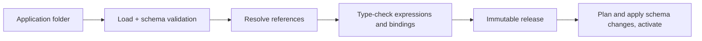
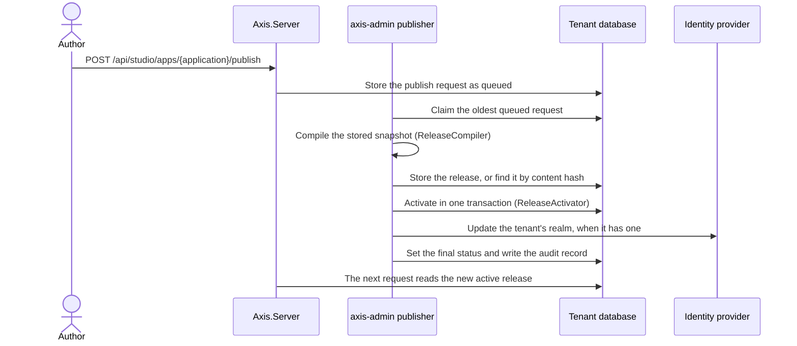

# Configuration pipeline

The configuration pipeline turns an application folder into an immutable release and makes that
release active. This page describes its five steps, the checks each step runs with the diagnostic
code that each problem gets, and the reference index that the compile builds on the way. The
resources it reads are described on their own pages:

- [Resource files](resource-files.md): the file shape, the schema keywords, entity field types,
  entity logic and sequences.
- [Roles and policies](roles-and-policies.md), [integration resources](integration-resources.md),
  [identity providers](identity-provider.md#identity-provider-resource),
  [modules and templates](modules-and-templates.md), [module contracts](module-contracts.md),
  [customization layers](customization-layers.md), [extension packages](extension-packages.md) and
  [test scenarios](test-scenarios.md): the other resource kinds.
- [Host settings](host-settings.md): startup activation and the server settings.

1. **Load.** Every `*.json` file in the folder and its subfolders is one resource. Each is validated
   against the JSON Schema for its `kind` (`application`, `entity`, `site`, `page`, `text`, `seed`,
   `dataSource`, `rule`, `sequence`, `process`, `form`, `role`, `policy`, `connector`,
   `identityProvider`, `event`, `endpoint`, `trigger`, `webhook`, `migration`, `layer`, `scenario` or
   `contract`). See [Load](#load).
2. **Resolve.** Every reference must resolve inside the application or its declared modules. The
   same pass builds the [compiled model](#the-compiled-model) and the
   [reference index](#reference-index). See [Resolve](#resolve).
3. **Check.** The expressions of entity logic and of rules are type-checked. See [Check](#check).
4. **Release.** The compiled application is stored as an immutable release with a content hash. See
   [Release](#release).
5. **Activate.** The tenant's tables are brought in line with the release, and the release becomes
   active for new work. See [Activate](#activate).

The compile reports every problem it finds, not only the first, as the
[diagnostics](#diagnostics) say.

Studio does not run this pipeline itself. It stores a [publish request](authoring.md#publishing) in the
tenant database, and the [publisher](administration.md#publisher) claims it. The publisher compiles the
stored snapshot, stores the release or finds it by content hash, and activates it in one transaction.
It then updates the tenant's realm, sets the request's final status and writes the audit record. The
server reads the new active release from the next request. The diagram leaves out the contract
scenarios and the seed and index steps.

## Load

The Load step reads the folder's files and checks each one on its own, before any reference between
them is resolved.

- **Kinds in their place.** Only a module holds a `contract`, see
  [module contracts](module-contracts.md#the-contract-resource), so a `contract` in an application
  folder is `AXC0320` and is not loaded. Only an application holds a `layer`, see
  [customization layers](customization-layers.md#the-layer-resource), so a module file of that kind
  is refused as `AXC0202`.
- **The manifest** is the single `application` resource, stored as `application.json` at the folder
  root. An `application` resource in any other file is not used as the manifest.
- **Unique ids and names.** Resource ids are unique across the application, compared as UUIDs.
  Names are unique per kind, ignoring letter case.
- **Stored releases.** The same checks run on a release's stored resources when the server rebuilds
  its model.

## Resolve

The Resolve step checks every reference between resources and every rule that spans more than one
property, kind by kind as the sections below say. A check that names another resource never reports
a name whose file is in the folder with the right kind and a string `name` but was not loaded
because of its own errors, such as a schema violation: only that file's own diagnostics are
reported.

### Entities

The entity model is built here. Each field's `type` becomes a typed field type, and every
type-specific property is checked against the field type and against what storage accepts, as
[entity field types and constraints](resource-files.md#entity-field-types-and-constraints) say.
Field names are unique within their entity, ignoring letter case. The `target` of a reference or
child collection field must name a loaded entity, ignoring letter case, and an entity may reference
itself.

### Texts

Each `text` resource holds the texts of one locale, and each release carries its own texts, so a
newer release can remove a key that older running work still shows.

- **One file per locale.** Two text resources for the same locale, ignoring letter case, are
  `AXC0026` at `/locale` of the later file in path order.
- **The same keys in every locale.** A key that one locale has and another lacks is `AXC0027` at
  `/texts` of the file that lacks it, once per key, naming the first locale in path order that has
  it. A file already reported as a duplicate locale is left out of this check. Keys are compared
  ordinally.
- **Modules.** The texts of a pinned module are checked the same way, within that module, see
  [modules](modules-and-templates.md#modules).

### Labels

The text key of the application label or description, an entity label, a field label, an enum value
label (`valueLabels`) or the `label` of an
[identity provider](identity-provider.md#identity-provider-resource) must be in some locale,
otherwise it is `AXC0028` at that label's `/textKey`. This applies also when the application has no
text resource. Unused keys are allowed. The sections below add the labels of the other kinds to this
`AXC0028` check.

### Display field

An entity's `displayField` must name one of its own required `text` fields, ignoring letter case,
otherwise it is `AXC0029` at `/displayField`. Every entity that is the `target` of a reference,
including a reference to itself, must have a `displayField`, otherwise the reference is `AXC0030` at
`/fields/{i}/target`. That is not reported when the target is already `AXC0012` or `AXC0040`.

### Child collections

A `child-collection` field's `target` is a child entity, owned by that field. The limits below exist
for the reasons in [entity logic](resource-files.md#entity-logic).

- **Target.** A `child-collection` field without `target` is `AXC0014` at the field, and a `target`
  that names no loaded entity is `AXC0012` at `/fields/{i}/target`.
- **One owner.** The owner is the first such field in path order of the entity files, then in field
  order. A later field with the same target is `AXC0039` at its `/fields/{i}/target`, naming the
  owner.
- **No reference to a child.** A `reference` or `references` field whose target is a child entity
  is `AXC0040` at `/fields/{i}/target`.
- **No nesting.** A `child-collection` or `references` field on a child entity is `AXC0041` at its
  `/fields/{i}/type`, so an entity whose child collection names itself is `AXC0041`. A `reference`
  field on a child entity is allowed.

### Sites

A site belongs to one application, and its `path` and locales are checked here.

- **Path.** A site's `path` is lower-case letters, digits and hyphens, starting with a letter. A
  path reserved by the platform (`api`, `health`, `assets`, `studio`, `account`, `users` and
  `licences`), or one that an earlier site of the application already uses in path order, is
  `AXC0024` at `/path`. A reserved path is not also checked for duplicates. `assets` is reserved
  because the SPA serves its files under `/assets/`.
- **Locales.** The `default` and `fallback` locales must be in `available`, and every available
  locale needs a `text` resource, ignoring letter case, otherwise it is `AXC0025`.
- **Navigation.** A navigation entry must name a loaded page (`AXC0023`). Its optional `icon` must be
  a name from Axis's list of [navigation icons](shell.md#navigation-icons), otherwise it is
  `AXC0004` at `/navigation/{i}/icon`.
- **Labels.** Site titles and descriptions and navigation labels join the `AXC0028` check.

### Pages and widgets

Each widget of a page is checked by its type. Entity, page, data source, form and process names
resolve ignoring letter case. Page titles and action labels join the `AXC0028` check.

- **Table.** A `table` widget names exactly one of `entity` and `dataSource`, otherwise it is
  `AXC0060` at `/widgets/{i}`. A table has no link to a form page: it opens and creates records
  through [`navigate` actions](#navigate-and-row-actions), and a `formPage` property is a schema
  violation (`AXC0004`). Its `priorities` map a column name to `high` or `low`: any other value, or
  `priorities` on another widget, is `AXC0004`. A key must name a column the table shows, ignoring
  letter case, and name it once, otherwise it is `AXC0060` at `/widgets/{i}/priorities/{key}`. Child
  collections, `references` fields and unknown names are not shown columns. For a grouped data
  source the columns are its `groupBy` fields and its measures.
- **Form.** A `form` widget names exactly one of `form` and `entity`, otherwise it is `AXC0060` at
  `/widgets/{i}`. A form widget that names a form is over the form's entity.
- **Names.** A widget's `entity` must name a loaded entity (`AXC0021`). A `dataSource` must name a
  loaded data source (`AXC0059`), and it may be `<module id>/<name>` to name a data source of a
  [module](modules-and-templates.md#modules). A `dataSource` on a widget other than a `table`,
  `kpi` or `chart` is `AXC0060` at `/widgets/{i}/dataSource`. A `form` is allowed only on a `form`
  or `detail` widget (`AXC0060` at `/widgets/{i}/form`), and must name a loaded form (`AXC0077`).
- **Data source parameters.** Each required parameter of a table's data source must be bound to a
  required page parameter with `parameters`, as [widget parameters](#widget-parameters) say,
  otherwise it is `AXC0060` at `/widgets/{i}/dataSource`.
- **Task inbox.** A `taskInbox` widget names none of `entity`, `dataSource` and `form` (`AXC0060` at
  that property).
- **Process inspector.** A `processInspector` widget needs a `process` that names a loaded process,
  otherwise it is `AXC0192` at `/widgets/{i}/process`. It names none of `entity`, `dataSource` and
  `form` (`AXC0060` at that property). The page schema requires `process` on a `processInspector`
  and does not allow it on any other widget (`AXC0004`).
- **KPI.** A `kpi` widget needs a `dataSource` that names a loaded data source (`AXC0059`) with an
  `aggregate` whose `groupBy` is empty (`AXC0237`), a `measure` of that aggregate, and a `label`. An
  optional `comparison` has a `measure` and a `label`. A measure that the aggregate does not declare
  is `AXC0238` at `/widgets/{i}/measure` or `/widgets/{i}/comparison/measure`. A `kpi` names no
  `entity`, `form` or `actions` (`AXC0060` at that property). It may bind page parameters with
  `parameters`, as a table does, and a data source parameter that it leaves unbound must be optional
  (`AXC0060` at `/widgets/{i}/dataSource`). Its optional `navigate` is checked as any `navigate`
  action is, with page parameters as the only names in its expressions. The page schema requires
  `measure` and `label` on a `kpi` and does not allow them, or `comparison` and `navigate`, on any
  other widget (`AXC0004`).
- **Chart.** A `chart` widget needs a `dataSource` that names a loaded data source (`AXC0059`) with
  an `aggregate` that has exactly one `groupBy` field (`AXC0240` at `/widgets/{i}/dataSource`), a
  `kind` of `bar`, `line` or `pie`, a `category` that is that field (`AXC0240` at
  `/widgets/{i}/category`), a `title` and a list of `measures`, each with a `name` and a `label`. A
  measure that the aggregate does not declare, or that is not a number, is `AXC0241` at
  `/widgets/{i}/measures/{j}/name`, and a `pie` with more than one measure is `AXC0241` at
  `/widgets/{i}/measures`. A `chart` names no `entity`, `form` or `actions` (`AXC0060` at that
  property). It may bind page parameters with `parameters`, as a table does, and a data source
  parameter that it leaves unbound must be optional (`AXC0060` at `/widgets/{i}/dataSource`). The
  page schema requires `dataSource`, `kind`, `category`, `measures` and `title` on a `chart` and does
  not allow `kind`, `category` and `measures` on any other widget (`AXC0004`).
- **Detail.** A `detail` widget names exactly one of `form` and `entity` (`AXC0060`) and no
  `dataSource`, `rowActions`, `toolbarActions` or `parameters` (`AXC0060` at that property). Its
  `record` must name a required `reference` parameter of the page whose `target` is the widget's
  entity, ignoring letter case, otherwise it is `AXC0239` at `/widgets/{i}/record`. The page schema
  requires `record` on a `detail` and does not allow it on any other widget (`AXC0004`).
- **Actions.** `actions` are allowed only on a `form` or `detail` widget (`AXC0060` at
  `/widgets/{i}/actions`). An action's `process` must name a loaded process (`AXC0087`) over the
  entity of the form's records (`AXC0088`), both at `/widgets/{i}/actions/{j}/process`.

### Widget trees

A page's `widgets` form a tree, and the checks above apply to every widget at any depth. A problem
is reported at the widget's own pointer, such as `/widgets/0/columns/1/widgets/0/entity`.

- **Depth.** The widget lists nest at most 4 levels deep, and the page's own list is level 1,
  otherwise the container that would hold a list on level 5 is `AXC0221`.
- **Columns.** The `width` of the columns of one `columns` widget add up to 12, otherwise it is
  `AXC0222` at `/widgets/{i}/columns`.
- **One of each.** A second `table` is `AXC0223`, and a second `form`, `taskInbox` or
  `processInspector` is `AXC0224`, both at the second widget.
- **Labels.** A tab label and a section title join the `AXC0028` check.
- **Shape.** The page schema requires `columns` on a `columns` widget, `tabs` on a `tabs` widget,
  and `title` with `widgets` on a `section` widget. It does not allow them on any other widget, and
  no container may name an `entity`, `dataSource`, `form`, `actions`, `rowActions`,
  `toolbarActions`, `parameters` or `priorities` (`AXC0004`).

### Page parameters

A page's `parameters` are checked in file order, at `/parameters/{i}`.

- **Names.** A name that an earlier parameter already uses, or one of `page`, `pageSize`, `sort` and
  `search`, ignoring letter case, is `AXC0231` at `/name`. So is a name that an unbound parameter of
  the page's table data source also has, ignoring letter case, because both live in the URL query.
- **Types.** The type is checked by the entity field rules, as a data source parameter is. An
  unknown type is `AXC0004`, a missing `values` or `target` is `AXC0014`, an unknown `reference`
  target is `AXC0012` at `/target`, a child entity target is `AXC0040` and a target without a display
  field is `AXC0030`. A `reference` parameter's `target` is a `field target` edge in the
  [reference index](#reference-index).
- **Form pages.** A page that holds a `form` widget declares no parameters, otherwise it is
  `AXC0236` at `/parameters`.

### Widget parameters

A widget's `parameters` bind the parameters of its data source to page parameters, as
[widget binding](data-sources.md#widget-binding) describes. Each entry is checked at
`/widgets/{i}/parameters/{key}`, and a problem is `AXC0060`: an unknown data source parameter or
page parameter, a repeated key, types that differ, or a required data source parameter bound to an
optional page parameter. A required data source parameter of a table that is not bound is `AXC0060`
at `/widgets/{i}/dataSource`. `parameters` on any widget that is not a table, chart or kpi over a
data source is `AXC0060` at `/widgets/{i}/parameters`.

### Navigate and row actions

`navigate` actions in a form widget's `actions` and in a table's `rowActions` and `toolbarActions`
are checked at the action's pointer, and so are a table's other row actions.

- **Target page.** A target `page` that no loaded page has is `AXC0232` at `/page`. Each target is a
  `navigate page` edge in the reference index.
- **Parameters.** A parameter that the target page does not declare, or one given twice ignoring
  letter case, is `AXC0233` at `/parameters/{name}`. A required parameter of the target that the
  action leaves out is `AXC0234` at the action.
- **Values.** Each parameter value is an expression, checked against the target parameter's type. A
  parse error, an unknown name or a wrong type is reported with the expression's own code at
  `/parameters/{name}`.
- **Names in scope.** On a form, a detail or a table over an entity, the expression sees the
  record's fields plus `id`. On a table over a data source it sees the projected columns plus `id`.
  `id` is a reference to the root entity. In `toolbarActions` it sees no names, because a toolbar
  has no row. It has no rules or aggregates. On a form, a detail and a table over an entity it
  resolves paths such as `department.name` of up to 3 hops (`AXC0046` for an unknown field,
  `AXC0058` for 4 hops), but never from `id`. On a table over a data source it resolves bare names
  only.
- **Record.** A `navigate` action may also set `record`, an expression for the id of the record that
  a form page opens. It is checked like a parameter value, against the same names, and its type
  must be a reference to the entity of the target's form widget. A form widget over a `form` has
  that form's entity. `record` on a target that holds no form widget, or whose form is over another
  entity, is `AXC0235` at `/record`. A parse error or an unknown name keeps the expression's own
  code.
- **Where actions sit.** `rowActions` on a table over a grouped data source, and `rowActions` or
  `toolbarActions` on a `form`, `taskInbox` or `processInspector` widget, are `AXC0060` at that
  property. `rowActions` accepts `navigate`, `startProcess` and `delete` entries, and
  `toolbarActions` accepts `navigate` entries only (`AXC0004` for another type).
- **Start process.** A row `startProcess` is checked like a form's: a label text key, a loaded
  process (`AXC0087`) over the table's root entity (`AXC0088`), both at
  `/widgets/{i}/rowActions/{j}/process`.
- **Visible when.** A row action may have `visibleWhen`, a boolean expression over the row, which
  sees the same names as a `navigate` parameter. A parse error, an unknown name or a wrong type is
  reported with the expression's own code, for example `AXC0048` for a result that is not boolean,
  at `/widgets/{i}/rowActions/{j}/visibleWhen`. The schema refuses `visibleWhen` in
  `toolbarActions`, on a form's `actions` and on a kpi's `navigate` (`AXC0004`). The compiler does
  not refuse a well-typed condition that the SPA cannot work out, see [frontend](frontend.md).

### Forms

A [form](form-widget.md) lays out the fields of one entity, and its entity, fields and conditions are
checked here.

- **Entity.** A form's `entity` must name a loaded entity, ignoring letter case, otherwise it is
  `AXC0074` at `/entity`, and its fields are not checked.
- **Fields.** Each section `field` must name a field of that entity, ignoring letter case, otherwise
  it is `AXC0075` at `/sections/{i}/fields/{j}/field`. A field that an earlier entry of the form
  already lists, in any section and ignoring letter case, is `AXC0076` at the later entry's `field`,
  naming the first one.
- **Labels.** Each section title joins the `AXC0028` check, at `/sections/{i}/title/textKey`.
- **Conditions and steps.** The conditions and wizard steps are checked as
  [form conditions](form-conditions.md#compile-checks) says.

### Seeds

A seed's `entity` must name a loaded entity, `Entity` or `module/Entity`, ignoring letter case,
otherwise it is `AXC0032` at `/entity`. Seed record ids are unique across every seed file of the
application, compared as UUIDs: a record whose id an earlier record already uses, in the same file
or an earlier file in path order, is `AXC0034` at `/records/{i}/id`, naming the file of the first
one. Seed record ids are not compared with resource ids. Seed values are not checked at compile
time, because the startup step checks them before it inserts any record, see
[startup activation](host-settings.md#startup-activation).

### Sequences

A field's [`sequence`](resource-files.md#sequences) must name a loaded `sequence` resource, ignoring
letter case, otherwise it is `AXC0066` at `/fields/{i}/sequence`. A `sequence` is `AXC0013` at
`/fields/{i}/sequence` when the field is not `text`, is `required`, has an `expression`, or belongs
to a child entity. The field gets one diagnostic, for the first of these reasons in that order, and a
field that is not `text` gets no `AXC0066`.

### Data sources

A data source's entity, projected paths, sort, aggregate, parameters and filters are checked here,
as its [compile checks](data-sources.md#compile-checks) say.

### Roles

A [role](roles-and-policies.md)'s `label` joins the `AXC0028` check, at `/label/textKey`. The roles
that a process task names are checked with the [process](processes.md#compile-checks).

### Processes

A process's subject, step names, transitions, reach and cycles, conditions, step shapes and task
properties are checked here, as its [compile checks](processes.md#compile-checks) say. The checks of
each other step type and operation are on its own page, which that section links.

### Policies

A [policy](roles-and-policies.md) grants its roles actions on targets, and its roles, grants, fields
and filters are checked here.

- **Roles.** Each `roles` entry must name a declared role, compared exactly, otherwise it is
  `AXC0090` at `/roles/{i}`.
- **Grant shape.** A grant without exactly one of `entity`, `dataSource`, `process` and `endpoint` is
  `AXC0091` at `/grants/{i}`, and nothing else of it is checked. An action that its target's kind
  does not take is `AXC0091` at `/grants/{i}/actions/{j}`. A `filter` or `fields` on a
  `dataSource`, `process` or `endpoint` grant is `AXC0091` at `/grants/{i}/filter` or
  `/grants/{i}/fields`.
- **Export and import.** An `export` without a `read`, or an `import` without a `create`, on the same
  target in the same policy is `AXC0265` at `/grants/{i}/actions/{j}`.
- **Target.** A target that names no loaded entity, data source, process or endpoint, ignoring letter
  case, is `AXC0092` at `/grants/{i}/entity`, `/grants/{i}/dataSource`, `/grants/{i}/process` or
  `/grants/{i}/endpoint`. A grant on a child entity is `AXC0093` at `/grants/{i}/entity`, naming the
  owner, and its `fields` and `filter` are then not checked.
- **Fields.** A `fields` entry that names no field of the entity, ignoring letter case, is `AXC0094`
  at `/grants/{i}/fields/{j}`.
- **Filter.** The `filter` is parsed, type-checked as a boolean over the entity's fields, paths
  through `reference` fields, the named rules and [`currentUser()`](expressions.md#current-user), and
  translated to SQL. Its first problem is reported at `/grants/{i}/filter` with its
  [expression diagnostic](expressions.md#diagnostics) code, and anything outside the SQL subset, such
  as an aggregate other than `any` and `count`, or `lower`, is `AXC0053`.

### Connectors

A [connector](integration-resources.md#connector-resource)'s timeout, operations and fields are
checked here. Its deployment bindings are checked at [activation](#activate), not here.

- **Timeout.** A `timeout` that is not a positive ISO 8601 duration of at most `PT2M`, in the form a
  task's `dueIn` takes, is `AXC0099` at `/timeout`.
- **Names.** A later operation whose name an earlier operation of the connector already uses,
  ignoring letter case, is `AXC0096` at `/operations/{i}/name`. So is a later input, output or nested
  field whose name an earlier field of the same list already uses, ignoring letter case, at
  `.../name`.
- **Path.** A `path` with an unbalanced `{` or `}`, or a placeholder that is not `{idempotencyKey}`
  and names no `path` input, ignoring letter case, is `AXC0097` at `/operations/{i}/path`.
- **Inputs.** A `path` input that is not in the path, is not `required` or is named
  `idempotencyKey`, a `body` input on a `GET`, and an `object` or `list` input outside the body, are
  `AXC0312` at `/operations/{i}/input/{j}`. An `object` or `list` in a level-4 one is `AXC0317`.
- **Lookup.** A `lookup` is `AXC0098` at `/operations/{i}/lookup` when it names no operation of the
  connector, ignoring letter case, or names its own operation. It is also `AXC0098` when the
  operation it names is not a `GET`, has no `{idempotencyKey}` in its path, has inputs, or has other
  outputs than the operation it serves. Outputs are the same when they have the same names, ignoring
  letter case and order, with the same type, `required` and `source`.
- **Source.** A `source` that is no JSON Pointer is `AXC0311` at `/operations/{i}/output/{j}/source`.
- **Shape.** A `source` on an input, an unknown `in`, `fields` on a scalar, an `object` or `list`
  without `fields` or as an output, an `in` on a nested field, and an `auth` of the wrong shape, are
  `AXC0004`.

### Events

An [event](integration-resources.md#event-resource)'s `entity` must name a loaded entity, ignoring
letter case, otherwise it is `AXC0110` at `/entity`. An `entity` that is a child entity is `AXC0111`
at `/entity`, naming the owner. A later field whose name an earlier field of the event already uses,
ignoring letter case, is `AXC0112` at `/fields/{i}/name`. A field of type `enum`, `reference` or
`child-collection` is `AXC0113` at `/fields/{i}/type`, and a type name that is not a field type is
`AXC0004`.

### Endpoints

An [endpoint](integration-resources.md#endpoint-resource) maps its input to a record and starts a
process, and its entity, process, input, values, output and wait are checked here.

- **Entity and process.** An endpoint's `entity` must name a loaded entity, ignoring letter case,
  otherwise it is `AXC0114` at `/entity`. An `entity` that is a child entity is `AXC0115` at
  `/entity`, naming the owner. Its `process` must name a loaded process, otherwise it is `AXC0116`
  at `/process`. A process whose subject entity is another entity is `AXC0117` at `/process`.
- **Input.** Each input field is checked as an entity field at `/input/{i}`, so a type property on
  the wrong type is `AXC0013`, a missing `target` or `values` is `AXC0014`, an unknown `target` is
  `AXC0012`, a `reference` to a child entity is `AXC0040`, and a `reference` to an entity without a
  `displayField` is `AXC0030`. A later input whose name an earlier input already uses, ignoring
  letter case, is `AXC0118` at `/input/{i}/name`. A `child-collection` input whose `target` is not a
  child entity is `AXC0119` at `/input/{i}/target`.
- **Values.** A `values` key that names no field of the entity, or a field that an earlier key
  already maps, ignoring letter case, is `AXC0120` at `/values/{key}`. A key that names a computed
  field, or a field with a `sequence` or `creator`, is `AXC0121` there. A `child-collection` field
  whose value is not the name of a `child-collection` input with the same target is `AXC0122` there.
  Any other value is parsed and type-checked against the field's type over the input fields only,
  and its first problem is reported at `/values/{key}` with its
  [expression diagnostic](expressions.md#diagnostics) code. A value is not matched against the input
  while an input field has a diagnostic.
- **Output and wait.** An `output` entry that names no field of the entity is `AXC0123` at
  `/output/{i}`. A `wait` that is not a valid ISO 8601 duration, is zero, or is above `PT30S` is
  `AXC0124` at `/wait`.
- **Unknown entity.** When the entity is unknown, `values` and `output` are not checked.

### Triggers

A [trigger](integration-resources.md#trigger-resource) starts a process on an event, a data change or
a schedule, and each type has its own checks.

- **Event trigger.** A trigger's `process` must name a loaded process, ignoring letter case,
  otherwise it is `AXC0129` at `/process`. Its `event` must name a loaded event, ignoring letter
  case, otherwise it is `AXC0130` at `/event`. An event about another entity than the process's
  subject entity is `AXC0131` at `/event`, naming both entities, which is not checked when either
  entity is unknown. `when` is parsed and type-checked as a boolean over the event's payload fields
  only. It calls no rules, follows no reference paths and uses no aggregates, but built-in functions
  such as `now()` are allowed. Its first problem is reported at `/when` with its
  [expression diagnostic](expressions.md#diagnostics) code. `when` is not checked when the event is
  unknown.
- **Data change trigger.** A data change trigger's `entity` must name a loaded entity, ignoring
  letter case, otherwise it is `AXC0143` at `/entity`. An entity that is not the process's subject
  entity is `AXC0144` at `/entity`, naming both entities, which is not checked when the process is
  unknown. A name in `fields` that names no field of the entity, or names a computed field, is
  `AXC0145` at `/fields/{i}`. `when` is parsed and type-checked as a boolean over the watched
  record, with the scope of a process condition: its fields, `id`, rules, reference paths and
  aggregates. Its first problem is reported at `/when`. `fields` and `when` are not checked when the
  entity is unknown. Data change triggers fire on every committed write through the record command,
  see [starts from triggers](process-events.md#starts-from-triggers).
- **Schedule trigger.** A schedule trigger's `schedule` must be a valid 5-field cron, otherwise it is
  `AXC0160` at `/schedule`. Its `timeZone` must be an IANA id, written with its exact letter case,
  otherwise it is `AXC0161` at `/timeZone`. Its `dataSource` must name a loaded data source, ignoring
  letter case, otherwise it is `AXC0162` at `/dataSource`. A grouped data source is `AXC0163`, a data
  source over another entity than the process's subject entity is `AXC0164` and one whose `filter`
  calls `currentUser()` is `AXC0363`, all at `/dataSource`. The entity match is not checked when
  either entity is unknown. The [schedule trigger](integration-resources.md#events-and-triggers)
  section lists its rules.
- **Schedule parameters.** Each `parameters` key must name a parameter of the data source, ignoring
  letter case, and no parameter may be named twice, otherwise the key is `AXC0165` at
  `/parameters/{key}`. A value that is not a literal of the parameter's type is `AXC0166` at
  `/parameters/{key}`. Each parameter that no key gives is `AXC0167` at `/parameters`, once for each
  parameter, even when `parameters` is left out. The parameters are not checked when the data source
  is unknown.
- **Scheduled job.** A schedule trigger without a `dataSource` is a scheduled job. Its process must
  have no subject, otherwise it is `AXC0249` at `/process`, and the parameter checks then read the
  process's parameters, where a `null` is `AXC0166`. They are not checked when the process is unknown
  or has a subject.
- **Shape.** A `type` other than `event`, `dataChange` or `schedule`, a `mode` other than `async` or
  `sync`, a `when` or `mode` on a schedule trigger, a property that belongs to another trigger type,
  an empty or repeated `on`, and an empty or repeated `fields` are `AXC0004`.

### Migrations

A [migration](resource-files.md#migrations)'s `entity` must name a loaded entity, otherwise
it is `AXC0170` at `/entity`. Its changes are checked against the entity with the undo-and-replay
rules of [the migration resource](resource-files.md#migrations): `AXC0171` to `AXC0173`, and
each `fill` and `convert` value at `/changes/{i}/value`. A `renameField` without `to`, or a change
with a property that belongs to another change type, is `AXC0004`.

### Scenarios

A [scenario](test-scenarios.md) is checked against the application, and every problem is reported in
one pass. Entities, fields, processes, steps, outcomes, connectors and operations are matched ignoring
letter case. Roles, user ids and record aliases are matched exactly. A scenario error is an error
like any other, so a folder with one does not compile or activate.

- **Users and roles.** A role in `users`, an `assignee.role` or a `recipient.role` that names no
  declared role is `AXC0180` at `/users/{user}/{j}`, `/steps/{i}/assignee/role` or
  `/steps/{i}/recipient/role`. An `as`, an `assignee.user` or a `recipient.user` that names no user
  of the scenario is `AXC0181` at `/steps/{i}/as`, `/steps/{i}/assignee/user` or
  `/steps/{i}/recipient/user`.
- **Records.** A `createRecord` `entity` that names no loaded entity, or names a child entity, is
  `AXC0182` at `/steps/{i}/entity`.
- **Values.** A key in `values` that names no field of the record's entity is `AXC0183` at
  `/steps/{i}/values/{key}`. The path continues into a child collection as `{key}/{n}/{key}`. A value
  that does not fit its field's type is `AXC0189` at the same path. A reference or references item
  is a UUID or the alias of an earlier step's record of the target entity. An enum value is one of
  the field's values. A child collection is an array of objects. `null` fits every type, and
  computed and read-only fields are not refused, as a scenario may test that the record API refuses
  one.
- **Processes.** A `process` of `startProcess` or `expectInstance` that names no loaded process, or
  a process over another entity than the record's, is `AXC0184` at `/steps/{i}/process`. A `step` of
  `expectInstance` that names no step of that process is `AXC0185` at `/steps/{i}/step`.
- **Tasks.** A `step` of `completeTask` or `expectTask` must name a `task` step of a process over the
  record's entity, otherwise it is `AXC0185` at `/steps/{i}/step`. An `outcome` of `completeTask`
  must be an outcome of such a task step, otherwise it is `AXC0186` at `/steps/{i}/outcome`.
- **Aliases.** A `record` that no earlier step saved is `AXC0187` at `/steps/{i}/record`. A `save`
  that an earlier step already used is `AXC0188` at `/steps/{i}/save`. A step with an unknown alias
  or entity is not checked further.
- **Stubs.** A connector stub that names no loaded connector is `AXC0190` at
  `/stubs/{i}/connector/name`, and one that names an operation the connector lacks is `AXC0190` at
  `/stubs/{i}/connector/operation`. A package stub whose package is not one of the application's
  packages, or whose operation is not in the pinned manifest, is `AXC0190` at
  `/stubs/{i}/operation`. A package that is listed but could not be pinned is not reported again. An
  `output` key that names no output field of the operation is `AXC0191` at
  `/stubs/{i}/output/{key}`. The types of the output values are not checked.
- **Time.** An `advanceTime` step whose `by` is not a positive duration in the form of a task's
  `dueIn` is `AXC0193` at `/steps/{i}/by`. An `advanceTime` step in a scenario without `now` is
  `AXC0194` at `/steps/{i}`.
- **Shape.** A malformed file, such as an unknown step `type`, a missing or forbidden step property,
  `save` together with `expect`, `expect` on an expectation step, or a `now` that is not a real date
  and time, such as `2026-02-30T09:00:00Z`, is `AXC0004`. So is an `expectNotification` step with an
  unknown `channel`, a missing `recipient` or one that does not hold exactly one of `user`, `role`
  and `email`, or with `as`, and a `recipient` or `channel` on any other step.
- **Module scenarios.** A pinned module's scenarios are checked in its file: a role that is not a
  role slot is `AXC0335`, an `entity` or `process` with `/` is `AXC0208`, and a `contract.covers`
  point that the module lacks is `AXC0339`. An application's own scenario with `contract` is
  `AXC0340`. See [modules](modules-and-templates.md#processes-pages-policies-and-dependencies).

### The compiled model

The Resolve step produces the compiled model that the server runs, and no model is produced while
any error remains. Each list below is in path order unless it says otherwise.

- **Texts and entities.** The text resources, each entity's display field, and each field's
  sequence with its id, name and format.
- **Sites and pages,** with their entity, data source and page references resolved.
- **Seeds,** with their entity resolved.
- **Data sources,** with their entity, projected fields and parameter targets resolved and their
  filter checked.
- **Processes,** with their entity resolved, each transition resolved to the declared name of its
  step, and their conditions checked.
- **Policies,** with each grant's target resolved and its filter checked.
- **Connectors,** with their timeout, operations, typed input and output fields, and each lookup
  resolved to the declared name of its operation.
- **Identity providers,** with their bindings, their claims with the defaults filled in, and their
  roles mapping.
- **Events,** with their entity resolved and their typed fields.
- **Endpoints,** with their entity, process and input targets resolved, their typed input fields,
  their mapped fields in the entity's order with each expression checked, and their output and wait.
- **Triggers,** with their event and process resolved and their `when` checked. A schedule trigger
  holds its parsed cron, its time zone, its data source reference and its parameter values, typed and
  keyed by the declared parameter names.
- **Migrations,** in ordinal order of their file path, each with its entity name as written and its
  changes in file order. A change's `value` stays expression text.

## Check

The Check step type-checks the expressions of entity logic and of rules. A validation or a computed
field with an error produces no model. [Data source](data-sources.md#compile-checks) filters are
checked in the [Resolve](#data-sources) step, with the data sources.

- **Validations.** Each entity's [validations](resource-files.md#entity-logic) are parsed and
  type-checked against the entity's own fields and its child collections, which only
  [aggregates](expressions.md#aggregates) accept, and must be boolean. A problem in the expression
  is reported with its [expression diagnostic](expressions.md#diagnostics) code at
  `/validations/{i}/expression`. A `field` that names no field of the entity, ignoring letter case,
  is `AXC0052` at `/validations/{i}/field`, and the `message` joins the `AXC0028` check.
- **Computed fields.** The expression of each [computed field](resource-files.md#entity-logic) is
  parsed and type-checked against the entity's fields that are not computed and its child
  collections, and must give the field's type. A call to `now()`, `today()` or `toDate` in it,
  including inside an aggregate's item expression, is `AXC0086`. A problem in it is reported the same
  way at `/fields/{i}/expression`.

### Rules

Each [rule](resource-files.md#rules)'s expression is parsed and type-checked against
its own parameters, and must give its `resultType`. A problem in it is reported at `/expression` of
the rule file.

- **Calls.** A validation, a data source filter, a process condition or a policy filter may call a
  rule, but only outside an aggregate's item expression. Each call is checked for the rule's name,
  its argument count and each argument's type, with the codes that a function call gets (`AXC0050`,
  `AXC0051`, `AXC0047`). In a computed field or an item expression, a rule call is `AXC0050`.
- **Cycles.** Rules that call each other in a cycle, such as A → B → A, are `AXC0055` once per
  cycle, at `/expression` of the rule where the cycle starts, naming every rule in it.
- **Depth.** A rule whose calls nest more than 8 deep, counting itself, is `AXC0065` once, at
  `/expression` of the lowest rule past the limit, naming the rules in the chain. A cycle never also
  gives `AXC0065`. Rules are walked in path order.
- **Names.** A parameter name that an earlier parameter of the same rule already uses, ignoring
  letter case, is `AXC0056` at `/parameters/{i}/name`. A rule name that is a built-in
  [function](expressions.md#functions) name, ignoring letter case, is `AXC0057` at `/name`.
- **Errors stay local.** A rule whose own expression has an error, or that is in a cycle, is still
  known by its parameters and result type, so a call to it gets no further diagnostic.

## Release

The Release step stores the compiled application as a release, which is immutable.

- **Content hash.** Every resource file is canonicalized as in RFC 8785 (JCS): no whitespace, object
  properties sorted by UTF-16 code units, minimal string escaping, numbers written as ECMAScript
  does. The hash is SHA-256 over every resource in ordinal order of its relative path (`/`
  separators), each contributing `path`, a newline, its canonical JSON and a newline, encoded as
  UTF-8. It is written as lowercase hex. Formatting-only changes (whitespace, key order, line
  endings) keep the hash, and a changed value, or an added, removed or renamed file, changes it.
- **Pinned packages in the hash.** After the resources come the pinned
  [extension packages](extension-packages.md#declaring-packages-in-an-application), in ordinal order
  of their id, each contributing `/packages/<id>`, a newline, the pinned version and a newline. A
  resource path never starts with `/`, so a pin cannot be confused with a file. An application
  without pins has the hash of its resources alone. So installing a newer version in range gives the
  same folder a new hash and a new release, and the old release keeps its pin.
- **Modules and scenarios in the hash.** Module files are hashed as ordinary resource paths under
  `modules/<id>/`, see [modules](modules-and-templates.md#modules).
  [Scenario](test-scenarios.md) files under `scenarios/` are left out of the release and its content
  hash, so adding or editing a scenario keeps the hash and the release.
- **Identity.** A release is unique per application `id` and content hash. Compiling an unchanged
  folder returns the stored release instead of storing a second one, also when two compiles run at
  the same time.
- **Content.** A release stores the canonical content of every resource with its relative path, the
  files of every module it pins under `modules/<id>/`, and the exact version of every package it
  pins, so it can be read back without the folder. Reading it back resolves each range against the
  release's own pins only, never against the packages installed at that time.
- **Errors.** A folder with any error diagnostic produces no release, and compile returns the
  diagnostics only.

## Activate

The Activate step brings the tenant's tables in line with the release and then makes the release
active, so new work runs on it. The current tenant schema is compared with the entity definitions of
the release.

- **Migrations.** Pending [migrations](migrations.md#migrations) run first: a `renameField`,
  `dropField`, `dropEntity`, `fill` or `convert` is applied once per tenant. A `convert` that fails
  for a stored row is `AXC0177`. A `renameField`, `dropField`, `dropEntity` or `convert` is refused
  with `AXC0178` while a running or waiting process instance is pinned to another release that uses
  the changed column. A `fill` makes a field that was `null` in some rows `NOT NULL` when the release
  requires it.
- **Additive changes.** Then additive changes are planned and applied, and other incompatible
  changes are rejected with a diagnostic, see [schema planning](storage.md#schema-planning). The
  release becomes active for new work only after that has completed successfully.
- **Active release.** Each application `id` has at most one active release, stored with the manifest
  `name` as written. The name is unique across the active applications, ignoring letter case. Names
  are ASCII (`AXC0004`), so the database's `lower(name)` matches. An application may change its name:
  its active release then holds the new name, and the old one is free for another application.
- **Site paths.** A site path is active for at most one application `id` in the tenant. The active
  release stores the paths of its sites. A site whose path another application's active release
  holds gets `AXC0031` at `/path` of its site file. Activation checks the paths before provisioning,
  and a unique index on the path enforces the rule when the active release is set. Site paths are
  lower-case (`AXC0004`), so the plain index already ignores letter case.

### Order

Activation runs these steps in order, and each check that fails returns its diagnostics and changes
nothing:

1. It checks that no other application `id` is active under the manifest name, or returns `AXC0020`.
2. It checks each site path, and returns one `AXC0031` for every site whose path another application
   holds.
3. It checks the deployment bindings of every connector, and of every package operation that a
   process step uses, against the tenant's, and the bindings of every identity provider (`oidc`:
   `issuer` as `url`, `clientId`, `clientSecret` and `clientKey` as `secret`; `saml`: `metadata` as
   `url`). It returns one `AXC0100` for every binding that the tenant lacks or holds with another
   kind, and outside Development one `AXC0101` for every base URL binding or package `url` binding
   that is not `https`.
4. It reads the identity providers of the tenant's other active releases and of its platform sign-in,
   and returns `AXC0291` for a provider that would make one person two users, see
   [users](identity-provider.md#users).
5. It provisions the entity tables, see [storage](storage.md#storage). When provisioning returns
   diagnostics, they are returned and the active release is untouched.
6. It sets the release active, in one upsert per application `id`, so two activations of the same
   application never conflict and the last one wins. When another application took the name after
   the check, the upsert is refused and activation returns the same `AXC0020`. When another
   application took a site path after the check, the unique index refuses it and activation returns
   one `AXC0031` for that path. A refused name or site path at the upsert rolls back the migrations
   and provisioning too.

### After activation

The rules below keep activation atomic and say how the server serves the active release.

- **Transactions.** The schema lock, the migration history check, the migrations, provisioning, the
  active release and its `axis.active_sites` rows are written in one transaction. Holding the lock
  from the history check to the commit keeps another activation from committing a rename or drop in
  between, which would let an older release become active against tables it does not match. The
  active release store and the data context must therefore share one tenant connection, or the store
  throws before anything commits. Activation must run outside an explicit transaction.
- **Failure.** Nothing stays applied after a failed activation: not the migrations, the new tables
  and columns, nor their provisioning records. The previous release stays active. An activation that
  loses the name or a site path to a concurrent one leaves nothing behind either.
- **Re-activation.** Activating the active release again provisions nothing, keeps its site paths
  and changes only its activation time. A release that renames a site path frees the old path for
  another application.
- **Serving.** The server rebuilds the `ApplicationModel` from the release's stored resources
  through `IActiveReleaseStore` and caches it per tenant and release id. A stored release that does
  not compile clean, or compiles to another content hash, is an error and is never served. The active
  row is read on every request, so a new activation is served by the next request. A name outside the
  manifest name rule (an ASCII letter, then ASCII letters or digits, at most 60 characters) resolves
  to nothing without a query, so Unicode case folding such as the Kelvin sign never aliases an
  application name.

## Diagnostics

Every problem that the pipeline finds is a diagnostic with a file, a JSON Pointer path and a code.
Their shape and the table of every code are in [diagnostic codes](diagnostic-codes.md).

## Reference index

Every compile collects each reference it resolves into a reference index. Studio reads it through
the [authoring API](authoring.md#references) to show where a resource is used and what it uses.

- **Built by the compile.** The index is built in memory, in the same pass as the
  [Resolve](#resolve) step. It is not stored in the release and costs nothing at run time.
- **Nodes.** A node is a resource, with its `id`, `kind`, `name` and `file`, a text key, an
  [extension package](extension-packages.md#declaring-packages-in-an-application) by its id, or a
  module by its id.
- **Edges.** An edge runs from a resource and a JSON Pointer path in it to a node, with a relation.
  The path is the one that the compile diagnostics use.
- **Not an edge.** An unresolved reference is a diagnostic, not an edge. So is a name whose file was
  not loaded because of its own errors. A resource with errors keeps the edges that did resolve.
- **Fields are not nodes.** A reference to a field, such as a form section `field` or an
  `updateRecord` key, gives no edge of its own, because the resource's edge to the entity covers it.
  The same holds for connector operations.
- **Rule calls are the only edges inside expressions.** A reference path in a filter or a condition
  gives no edge.
- **Cost.** The index adds at most 30% of the compile time, or 300 ms when that is more. A where-used
  answer for an application of typical size returns within 10 seconds.

| Relation | From | Path | To |
| --- | --- | --- | --- |
| `label text` | Any kind with a label, title or message | `…/textKey` | Text key |
| `text entry` | Text | `/texts/{key}` | Text key |
| `package` | Application | `/packages/{i}` | Extension package |
| `module` | Application | `/modules/{i}` | Module |
| `field target` | Entity, data source, page, endpoint | `/fields/{i}/target`, `/parameters/{i}/target`, and `/input/{i}/target` of an endpoint | Entity |
| `field sequence` | Entity | `/fields/{i}/sequence` | Sequence |
| `rule call` | Entity, form, data source, rule, process, policy, trigger | The path of the expression that makes the call, such as `/validations/{i}/expression`, `/fields/{i}/default`, `/filter`, `/expression`, `/startCondition/expression`, `/steps/{i}/set/{field}`, `/grants/{i}/filter` or `/when` | Rule |
| `navigation page` | Site | `/navigation/{i}/page` | Page |
| `widget entity` | Page | `/widgets/{i}/entity` | Entity |
| `widget data source` | Page | `/widgets/{i}/dataSource` | Data source |
| `widget form` | Page | `/widgets/{i}/form` | Form |
| `navigate page` | Page | `/widgets/{i}/rowActions/{j}/page`, `/widgets/{i}/toolbarActions/{j}/page`, `/widgets/{i}/actions/{j}/page` | Page |
| `navigate page` | Process | `/steps/{i}/open/page` | Page |
| `widget process` | Page | `/widgets/{i}/process` | Process |
| `action process` | Page | `/widgets/{i}/actions/{j}/process`, `/widgets/{i}/rowActions/{j}/process` | Process |
| `form entity` | Form | `/entity` | Entity |
| `seed entity` | Seed | `/entity` | Entity |
| `data source entity` | Data source | `/entity` | Entity |
| `field path` | Data source | `/fields/{i}/path` | Entity, one edge for each `reference` field the path passes through or ends at |
| `process entity` | Process | `/entity` | Entity |
| `task form` | Process | `/steps/{i}/form` | Form |
| `task role` | Process | `/steps/{i}/assignee/role` | Role |
| `connector call` | Process | `/steps/{i}/connector/name` | Connector |
| `package operation` | Process | `/steps/{i}/operation` | Extension package |
| `raised event` | Process | `/steps/{i}/event` | Event |
| `awaited event` | Process | `/steps/{i}/event` | Event |
| `created entity` | Process | `/steps/{i}/entity` | Entity |
| `policy role` | Policy | `/roles/{i}` | Role |
| `grant` | Policy | `/grants/{i}/entity`, `/grants/{i}/dataSource`, `/grants/{i}/process`, `/grants/{i}/endpoint` | Entity, data source, process, endpoint |
| `event entity` | Event | `/entity` | Entity |
| `endpoint entity` | Endpoint | `/entity` | Entity |
| `endpoint process` | Endpoint | `/process` | Process |
| `endpoint event` | Endpoint | `/event/name` | Event |
| `trigger process` | Trigger | `/process` | Process |
| `trigger event` | Trigger | `/event` | Event |
| `trigger entity` | Trigger | `/entity` | Entity |
| `trigger data source` | Trigger | `/dataSource` | Data source |
| `webhook event` | Webhook | `/event` | Event |
| `migration entity` | Migration | `/entity` | Entity |
| `scenario entity` | Scenario | `/steps/{i}/entity` | Entity |
| `scenario process` | Scenario | `/steps/{i}/process` | Process |
| `scenario role` | Scenario | `/users/{user}/{j}`, `/steps/{i}/assignee/role` | Role |
| `stub connector` | Scenario | `/stubs/{i}/connector/name` | Connector |
| `stub package` | Scenario | `/stubs/{i}/operation` | Extension package |

- **Label paths.** A `label text` edge sits at the `/textKey` of each label that the `AXC0028` check
  covers: the application label and description, entity and field labels, enum value labels, the
  site title and description, navigation labels, page titles, action labels, form section titles,
  role labels, identity provider labels, data source parameter labels, task and outcome labels, the
  `startCondition` message and validation messages.
- **Direct calls only.** A `rule call` edge goes from the expression that calls a rule to that rule.
  A rule that calls another rule gives its own `rule call` edge, at its `/expression`, so the caller
  does not get an edge to the rules that the called rule reaches.
- **No rule call edge.** A computed field, an aggregate's item expression, an event trigger's `when`
  and an endpoint's `values` cannot call rules, so they give no `rule call` edge. A call to a module
  rule, written `<module id>:<name>`, gives no edge either.
- **Text entries.** Each `text` resource adds a `text entry` edge for every key it holds. So a key's
  edges list the locales that define it and the labels that use it. A key that one locale lacks is
  the drift that `AXC0027` reports.
- **Modules.** An application's `modules` entry gives a `module` edge at `/modules/{i}`, see
  [modules](modules-and-templates.md#modules). A reference to a module resource, written
  `<module id>/<name>`, gives the same edge as a reference to the application's own resource, to the
  module's resource.
