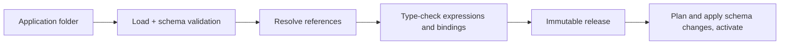

# Configuration pipeline

Detailed reference for the configuration pipeline, its diagnostic codes and the
reference index. The resources it reads are described elsewhere:

- [resource-files.md](resource-files.md): the file shape, schema keywords,
  entity field types, entity logic and sequences.
- [roles-and-policies.md](roles-and-policies.md),
  [integration-resources.md](integration-resources.md),
  [modules-and-templates.md](modules-and-templates.md),
  [extension-packages.md](extension-packages.md) and
  [test-scenarios.md](test-scenarios.md): the other resource kinds.
- [host-settings.md](host-settings.md): startup activation and the server
  settings.

The conventions of [architecture.md](../architecture.md) apply: sections marked
*(planned for Mx)* are not built yet, and Dn refers to
[decisions.md](../decisions.md).

1. **Load.** Every `*.json` file in the folder and its subfolders is one
   resource. Each is validated against the JSON Schema for its `kind`
   (`application`, `entity`, `site`, `page`, `text`, `seed`, `dataSource`,
   `rule`, `sequence`, `process`, `form`, `role`, `policy`, `connector`, `event`, `endpoint`, `trigger`, `migration` or `scenario`). The manifest is the
   single `application` resource, stored as `application.json` at the
   folder root; an `application` resource in any other file is not used as
   the manifest. Resource IDs are unique across the application, compared as
   UUIDs. Names are unique per kind, ignoring letter case. The same checks
   run on a release's stored resources when the server rebuilds its model.
2. **Resolve.** Every reference must resolve inside the application or its
   declared modules. The entity model is built here: each field's `type`
   becomes a typed field type, every type-specific property is checked against
   the field type and against what storage accepts (see
   [Entity field types and constraints](resource-files.md#entity-field-types-and-constraints)),
   field names must be unique within their entity ignoring letter case, and the
   `target` of a reference or child collection field must name a loaded
   entity, ignoring letter case. An entity may reference itself. A `target` naming an entity whose file is
   in the folder, has kind `entity` and a string `name`, but was not loaded
   because of its own errors (such as a schema violation) is not reported
   again; only that file's own diagnostics are.
   - **Texts.** Each `text` resource holds the texts of one locale. Two text
     resources for the same locale, ignoring letter case, are `AXC0026` at
     `/locale` of the later file in path order. Every locale must have the
     same keys: a key that one locale has and another lacks is `AXC0027` at
     `/texts` of the file that lacks it, once per key, naming the first
     locale in path order that has it. A file already reported as a duplicate
     locale is left out of this check. Keys are compared ordinally. The texts
     of a pinned module are checked the same way, within that module; see
     [Modules](modules-and-templates.md#modules).
     Each release carries its own texts, so a newer release can remove a key
     that older running work still shows.
   - **Labels.** The text key of the application label, an entity label, a
     field label or an enum value label (`valueLabels`) must be in some locale, otherwise it is `AXC0028` at that
     label's `/textKey`. This applies also when the application has no text
     resource. Unused keys are allowed.
   - **Display field.** An entity's `displayField` must name one of its own
     required `text` fields, ignoring letter case, otherwise it is `AXC0029`
     at `/displayField`. Every entity that is the `target` of a reference,
     including a reference to itself, must have a `displayField`, otherwise
     the reference is `AXC0030` at `/fields/{i}/target`. It is not reported
     when the target is already `AXC0012` or `AXC0040`, or names an entity
     file that was not loaded.
   - **Child collections.** A `child-collection` field without `target` is
     `AXC0014` at the field, and a `target` that names no loaded entity is
     `AXC0012` at `/fields/{i}/target`. The entity it names is a child
     entity, owned by that field. The owner is the first such field in path
     order of the entity files, then in field order. A later field with the
     same target is `AXC0039` at its `/fields/{i}/target`, naming the owner.
     A `reference` whose target is a child entity is `AXC0040` at
     `/fields/{i}/target`. A `reference` or `child-collection` field on a
     child entity is `AXC0041` at its `/fields/{i}/type`, so an entity whose
     child collection names itself is `AXC0041`. See
     [Entity logic](resource-files.md#entity-logic) for why these limits exist.
   - **Sites and pages.** A site belongs to one application. Its `path` is
     lower-case letters, digits and hyphens, starting with a letter. A path
     reserved by the platform (`api`, `health`, `assets`, `studio`), or one that an
     earlier site of the application already uses in path order, is
     `AXC0024` at `/path`. A reserved path is not also checked for
     duplicates. The `default` and `fallback` locales must be in
     `available`, and every available locale needs a `text` resource,
     ignoring letter case, otherwise it is `AXC0025`. A `table` widget names
     exactly one of `entity` and `dataSource`, and a `form` widget exactly
     one of `form` and `entity`, otherwise it is `AXC0060` at
     `/widgets/{i}`. A widget's `entity` must name a loaded entity
     (`AXC0021`). A `dataSource` is allowed only on a `table` widget, and
     each required parameter of its data source must be bound to a required
     page parameter with `parameters`, otherwise it is `AXC0060` at
     `/widgets/{i}/dataSource`. It must name a loaded data source
     (`AXC0059`). It may be `<module id>/<name>`, to name a data source of a
     [module](modules-and-templates.md#modules). A `form` is allowed only on a `form` or `detail` widget (`AXC0060` at
     `/widgets/{i}/form`), and must name a loaded form (`AXC0077`). A `form` widget
     that names a form is over the form's entity. A table has no link to a form
     page: it opens and creates records through `navigate` actions, and the
     property `formPage` of earlier formats is a schema violation (`AXC0004`).
     A `taskInbox` widget names none of
     `entity`, `dataSource` and `form` (`AXC0060` at that property). A `processInspector` widget
     needs a `process` that names a loaded process, otherwise it is `AXC0192`
     at `/widgets/{i}/process`. It names none of `entity`, `dataSource` and
     `form` (`AXC0060` at that property).
     The page schema requires `process` on a `processInspector` and does not
     allow it on any other widget (`AXC0004`).
     A `kpi` widget needs a `dataSource` that names a loaded data source
     (`AXC0059`) with an `aggregate` whose `groupBy` is empty (`AXC0237`), a
     `measure` of that aggregate, and a `label`. An optional `comparison` has a
     `measure` and a `label`. A measure that the aggregate does not declare is
     `AXC0238` at `/widgets/{i}/measure` or `/widgets/{i}/comparison/measure`.
     A `kpi` names no `entity`, `form` or `actions` (`AXC0060` at that
     property). It may bind page parameters with `parameters`, as a table does,
     and a data source parameter that it leaves unbound must be optional
     (`AXC0060` at `/widgets/{i}/dataSource`). Its optional
     `navigate` is checked as any `navigate` action is, with page parameters
     as the only names in its expressions. The page schema requires `measure` and
     `label` on a `kpi` and does not allow them, or `comparison` and
     `navigate`, on any other widget (`AXC0004`).
     A `chart` widget needs a `dataSource` that names a loaded data source
     (`AXC0059`) with an `aggregate` that has exactly one `groupBy` field
     (`AXC0240` at `/widgets/{i}/dataSource`), a `kind` of `bar`, `line` or
     `pie`, a `category` that is that field (`AXC0240` at
     `/widgets/{i}/category`), a `title` and a list of `measures`, each with a
     `name` and a `label`. A measure that the aggregate does not declare, or
     that is not a number, is `AXC0241` at `/widgets/{i}/measures/{j}/name`,
     and a `pie` with more than one measure is `AXC0241` at
     `/widgets/{i}/measures`. A `chart` names no `entity`, `form` or
     `actions` (`AXC0060` at that property). It may bind page parameters with
     `parameters`, as a table does, and a data source parameter that it leaves
     unbound must be optional (`AXC0060` at `/widgets/{i}/dataSource`). The page
     schema requires `dataSource`, `kind`, `category`, `measures` and `title`
     on a `chart` and does not allow `kind`, `category` and `measures` on any
     other widget (`AXC0004`).
     A `detail` widget names exactly one of `form` and `entity` (`AXC0060`) and
     no `dataSource`, `rowActions`, `toolbarActions` or `parameters`
     (`AXC0060` at that property). Its `record` must name a required `reference`
     parameter of the page whose `target` is the widget's entity, ignoring
     letter case, otherwise it is `AXC0239` at `/widgets/{i}/record`. The page
     schema requires `record` on a `detail` and does not allow it on any other
     widget (`AXC0004`).
     `actions` are allowed only on a `form` or `detail` widget
     (`AXC0060` at `/widgets/{i}/actions`). An action's `process` must name a
     loaded process (`AXC0087`) over the entity of the form's records
     (`AXC0088`), both at `/widgets/{i}/actions/{j}/process`. A `startProcess`
     entry in a table's `rowActions` is checked the same way against the table's
     root entity, at `/widgets/{i}/rowActions/{j}/process`. A navigation entry
     must name a loaded page (`AXC0023`). Entity, page, data source, form and process names
     resolve ignoring letter case, and a name whose file was not loaded
     because of its own errors is not reported again. Site titles, navigation labels, page titles and action labels join the
     `AXC0028` check.
     A page's `widgets` form a tree, see
     [D61](../decisions/d61-widget-trees-in-columns-tabs-and-sections-and-pages-at-phone-width.md).
     The checks above apply to every widget at any depth, and a problem is
     reported at the widget's own pointer, such as
     `/widgets/0/columns/1/widgets/0/entity`. The widget lists nest at most 4
     levels deep, and the page's own list is level 1, otherwise the container
     that would hold a list on level 5 is `AXC0221`. The `width` of the
     columns of one `columns` widget add up to 12, otherwise it is `AXC0222` at
     `/widgets/{i}/columns`. A second `table` is `AXC0223`, and a second
     `form`, `taskInbox` or `processInspector` is `AXC0224`, both at the second
     widget. A tab label and a section title join the `AXC0028` check. The
     page schema requires `columns` on a `columns` widget, `tabs` on a `tabs`
     widget, and `title` with `widgets` on a `section` widget. It does not allow them on
     any other widget, and no container may name an `entity`, `dataSource`,
     `form`, `actions`, `rowActions`, `toolbarActions` or `parameters` (`AXC0004`).

     A page's `parameters` ([D63](../decisions/d63-navigate-actions-and-page-parameters.md))
     are checked in file order, at `/parameters/{i}`:
     - a name that an earlier parameter already uses, or one of `page`,
       `pageSize` and `sort`, ignoring letter case, is `AXC0231` at `/name`,
     - a name that an unbound parameter of the page's table data source also
       has, ignoring letter case, is `AXC0231` at `/name`, because both live in
       the URL query,
     - the type is checked by the entity field rules, as a data source
       parameter is. An unknown type is `AXC0004`, a missing `values` or
       `target` is `AXC0014`, an unknown `reference` target is `AXC0012` at
       `/target`, a child entity target is `AXC0040` and a target without a
       display field is `AXC0030`. A `reference` parameter's `target` is a
       `field target` edge in the reference index,
     - a page that holds a `form` widget declares no parameters. Otherwise it
       is `AXC0236` at `/parameters`.

     A table's `parameters`
     ([D63](../decisions/d63-navigate-actions-and-page-parameters.md)) bind
     data source parameters to page parameters. Each entry is checked at
     `/widgets/{i}/parameters/{key}`, and a problem is `AXC0060`: an unknown
     data source parameter or page parameter, a repeated key, types that
     differ, or a required data source parameter bound to an optional page
     parameter. A required data source parameter that is not bound is
     `AXC0060` at `/widgets/{i}/dataSource`. `parameters` on any widget that is
     not a table over a data source is `AXC0060` at `/widgets/{i}/parameters`.
     See [data sources](data-sources.md#widget-binding).

     `navigate` actions
     ([D63](../decisions/d63-navigate-actions-and-page-parameters.md)) in a
     form widget's `actions` and a table's `rowActions` and `toolbarActions`
     are checked at the action's pointer. The page does not read its parameters
     yet:
     - a target `page` that no loaded page has is `AXC0232` at `/page`. A page
       that failed to load is not reported again,
     - a parameter the target page does not declare, or one given twice
       ignoring letter case, is `AXC0233` at `/parameters/{name}`,
     - a required parameter of the target that the action leaves out is
       `AXC0234` at the action,
     - each parameter value is an expression, checked against the target
       parameter's type. A parse error, an unknown name or a wrong type is
       reported with the expression's own code at `/parameters/{name}`,
     - on a form, a detail, or a table over an entity, the expression sees the
       record's fields plus `id`. On a table over a data source it sees the
       projected columns plus `id`. `id` is a reference to the root entity. In
       `toolbarActions` it sees no names, because a toolbar has no row. It has
       no rules or aggregates. On a form, a detail and a table over an entity
       it resolves paths such as `department.name` of up to 3 hops (`AXC0046`
       for an unknown field, `AXC0058` for 4 hops), but never from `id`. On a
       table over a data source it resolves bare names only,
     - `rowActions` on a table over a grouped data source, and `rowActions` or
       `toolbarActions` on a `form`, `taskInbox` or `processInspector` widget,
       are `AXC0060` at that property. `rowActions` accepts `navigate` and
       `startProcess` entries, and `toolbarActions` accepts `navigate` entries
       only (`AXC0004` for another type). A row `startProcess` is checked like
       a form's: a label text key, a loaded process (`AXC0087`) over the
       table's root entity (`AXC0088`), both at `/widgets/{i}/rowActions/{j}/process`,
     - a row action, `navigate` or `startProcess`, may have `visibleWhen`, a
       boolean expression over the row. It sees the same names as a `navigate`
       parameter. A parse error, an unknown name or a wrong type is reported
       with the expression's own code, for example `AXC0048` for a result that
       is not boolean, at `/widgets/{i}/rowActions/{j}/visibleWhen`. The
       schema refuses `visibleWhen` in `toolbarActions`, on a form's `actions`
       and on a kpi's `navigate` (`AXC0004`). The compiler does not refuse a
       well-typed condition that the SPA cannot work out, see
       [frontend.md](frontend.md),
     - each target is a `navigate page` edge in the reference index.

     A `navigate` action may also set `record`, an expression for the id of
     the record a form page opens. It is checked like a parameter value, against
     the same names, and its type must be a reference to the entity of the
     target's form widget. A form widget over a `form` has that form's entity.
     `record` on a target that holds no form widget, or whose form is over
     another entity, is `AXC0235` at `/record`. A parse error or an unknown
     name keeps the expression's own code.
   - **Forms.** A [form](frontend.md)'s `entity` must name a loaded
     entity, ignoring letter case, otherwise it is `AXC0074` at `/entity`,
     and its fields are not checked. A name whose entity file was not loaded
     because of its own errors is not reported again. Each section `field`
     must name a field of that entity, ignoring letter case, otherwise it is
     `AXC0075` at `/sections/{i}/fields/{j}/field`. A field that an earlier
     entry of the form already lists, in any section and ignoring letter
     case, is `AXC0076` at the later entry's `field`, naming the first one.
     Each section title joins the `AXC0028` check, at
     `/sections/{i}/title/textKey`. The conditions and steps have their own
     checks, see
     [Form conditions and steps](resource-files.md#form-conditions-and-steps):
     each condition is a boolean expression over the entity, and it reads only
     listed fields (`AXC0225`). `visibleWhen` is not allowed on a required
     field (`AXC0226`). A section name is used once (`AXC0227`). A step names
     a known section (`AXC0228`) that is in no other step (`AXC0229`), and
     when there are steps, every section has a name and is in one step
     (`AXC0230`).
   - **Seeds.** A seed's `entity` must name a loaded entity, ignoring letter
     case, otherwise it is `AXC0032` at `/entity`. A name whose entity file
     was not loaded because of its own errors is not reported again. Seed
     record ids are unique across every seed file of the application,
     compared as UUIDs: a record whose id an earlier record already uses, in
     the same file or an earlier file in path order, is `AXC0034` at
     `/records/{i}/id`, naming the file of the first one. Seed record ids are
     not compared with resource ids. Seed values are not checked at compile
     time; the startup step checks them before it inserts any record (see
     [Startup activation](host-settings.md#startup-activation)).
   - **Sequences.** A field's [`sequence`](resource-files.md#sequences) must name a loaded
     `sequence` resource, ignoring letter case, otherwise it is `AXC0066` at
     `/fields/{i}/sequence`. A name whose sequence file was not loaded
     because of its own errors, such as a bad `format`, is not reported
     again. A `sequence` is `AXC0013` at `/fields/{i}/sequence` when the
     field is not `text`, is `required`, has an `expression`, or belongs to
     a child entity. The field gets one diagnostic, for the first of these
     reasons in that order. A field that is not `text` gets no `AXC0066`.
   - **Data sources.** A data source's `entity` must name a loaded entity,
     ignoring letter case, otherwise it is `AXC0042` at `/entity`, and its
     fields and sort are not checked further. A name whose entity file was
     not loaded because of its own errors is not reported again. An
     `entity` that is a child entity is `AXC0064` at `/entity`, naming the
     owner. Each `path` must name a field of that entity, or go through
     `reference` fields with at most 3 hops, each name ignoring letter case,
     otherwise it is `AXC0043` at `/fields/{i}/path`. A path through a field that is not a
     `reference`, to an unknown field or with more than 3 hops is `AXC0043`,
     with a message that says which. A path ending at a `child-collection`
     field is `AXC0043` too, because that field has no column. A path that
     reaches an entity whose file was not loaded is not reported again. Projected names compare
     exactly: a name that an earlier entry of `fields` already uses is
     `AXC0044` at `/fields/{i}/name`. The `sort`, without its leading `-`,
     must exactly match a projected name whose path does not end at a `reference`,
     otherwise it is `AXC0045` at `/sort`. A sort naming an entry whose path
     is already `AXC0043` is not reported again. An `aggregate` groups by
     projected names, compared exactly: a `groupBy` entry that names no
     projected field is `AXC0061` at `/aggregate/groupBy/{i}`. A measure name
     that is a group field or repeats an earlier measure, compared exactly,
     is `AXC0062` at `/aggregate/measures/{i}/name`. A `count` with a `field`,
     or a `sum`, `min` or `max` without one, is `AXC0063` at
     `/aggregate/measures/{i}`. A measure `field` that names no projected
     field, or whose type the function does not take, is `AXC0063` at
     `/aggregate/measures/{i}/field`. A measure field whose path is already
     `AXC0043` is not reported again. When the data source is grouped, the
     `sort` must exactly match a group field that is not a `reference`, or a
     measure, otherwise it is `AXC0045`. A parameter name that is
     also a field of the entity, is `page`, `pageSize` or `sort`, or repeats
     an earlier parameter, all ignoring letter case, is `AXC0054` at
     `/parameters/{i}/name`. A parameter's type properties are checked as an
     entity field's, with the same codes (`AXC0012`, `AXC0013`, `AXC0014`,
     `AXC0030`, `AXC0040`) at `/parameters/{i}/...`, and its label joins the
     `AXC0028` check. The `filter` is parsed, type-checked as a boolean over
     the entity's fields, the parameters, paths through `reference`
     fields and the named rules, and translated to SQL. Its first problem is
     reported at `/filter` with its
     [expression diagnostic](expressions.md#diagnostics) code, and anything
     outside the SQL subset is `AXC0053`, including an aggregate over a
     child collection. An enum parameter with a value the compared enum field
     lacks is `AXC0047`, and so is a `.` after a field that is not a
     `reference` or after a parameter. A path with more than 3 hops is
     `AXC0058`. The filter of a data source
     whose entity is unknown, or that has a parameter with a diagnostic, is
     not checked. See
     [data sources](data-sources.md#compile-checks).
   - **Roles.** A [role](roles-and-policies.md)'s `label` joins the `AXC0028`
     check, at `/label/textKey`. A process task's `assignee.role` must name a
     declared role, compared exactly, otherwise it is `AXC0089`. See
     Processes below.
   - **Processes.** A [process](processes.md#resource-shape)'s `entity` must
     name a loaded entity, ignoring letter case, otherwise it is `AXC0067` at
     `/entity`, and its conditions are not checked. A name whose entity file
     was not loaded because of its own errors is not reported again. An
     `entity` that is a child entity is `AXC0068` at `/entity`, naming the
     owner. Step names are unique ignoring letter case: a later step with a
     name already used is `AXC0069` at `/steps/{i}/name`, naming the first
     step. `start`, each branch `next`, each `otherwise`, each operation
     `next` and each task outcome `next` must name a step, ignoring letter
     case, otherwise it is `AXC0070` at that property. A
     transition goes to the first step with its name. A step that cannot be
     reached from `start` is `AXC0071` at `/steps/{i}`. It is not checked
     when `start` is unknown. A step with no path to an `end` step is
     `AXC0072` at `/steps/{i}`. A step with a transition to an unknown step
     is not also `AXC0072`. A transition that closes a cycle with no waiting
     step is `AXC0073` at that transition, naming the steps in the cycle. The
     transitions out of a `task` step are not followed, so a loop through a
     task is allowed. The steps are walked in
     file order, with the branches, then `otherwise`, then `next`, then the
     outcomes. A step whose name is
     already `AXC0069` is left out of `AXC0071`, `AXC0072` and `AXC0073`. The
     `startCondition` expression and each decision `when` are parsed and
     type-checked as a boolean over the entity's fields, computed ones
     included, its child collections, which only aggregates accept, the
     named rules, and paths through `reference` fields of at most 3 hops. A
     problem is reported at `/startCondition/expression` or
     `/steps/{i}/branches/{j}/when` with its
     [expression diagnostic](expressions.md#diagnostics) code. The
     `startCondition` message joins the `AXC0028` check. An operation step
     whose `operation` is not `updateRecord`, `callConnector`,
     `raiseEvent` or a package operation written `<package>/<operation>`,
     matched exactly, is `AXC0078` at `/steps/{i}/operation`, and its other
     properties are not checked. Each key of an
     `updateRecord` `set` must name a field of the entity, ignoring letter
     case, that no earlier key of the step names, otherwise it is `AXC0079`.
     A computed field, a sequence field or a child collection is `AXC0080`.
     Each `set` expression is parsed and type-checked against its field's
     type, with the same scope as a `when`. Each of these is reported at
     `/steps/{i}/set/{field}`. A `callConnector` step's `connector` `name`
     that names no loaded [connector](integration-resources.md#connectors-and-deployment-bindings),
     ignoring letter case, is `AXC0102` at `/steps/{i}/connector/name`. A
     name whose connector file was not loaded because of its own errors is
     not reported again. An `operation` that names no operation of that
     connector, ignoring letter case, is `AXC0103` at
     `/steps/{i}/connector/operation`. With either, the step's `input` and
     `output` are not checked. An `input` key that names no input of the
     operation, ignoring letter case, or an input an earlier key already
     names, is `AXC0104`. Each `input` expression is parsed and type-checked
     against its input's type, with the same scope as a `when`. Each of these
     is reported at `/steps/{i}/input/{key}`. A required input that no key
     names is `AXC0105` at `/steps/{i}/input`. An `output` key that names no
     output of the operation, or an output an earlier key already names, is
     `AXC0106`. An `output` value that names no field of the entity,
     ignoring letter case, or a field an earlier output already writes, is
     `AXC0107`. A computed field, a sequence field, a child collection, or a
     field whose type does not fit the output's is `AXC0108`. An output fits
     a field of the same type, and an `integer` output also fits a `decimal`
     field. Each of these is reported at `/steps/{i}/output/{key}`. A retry
     `backoff` that is not a positive whole-number duration is `AXC0109` at
     `/steps/{i}/retry/backoff`. A package operation step
     whose package the application does not list in `packages` is `AXC0150`
     at `/steps/{i}/operation`, unless it was listed and failed pinning
     (`AXC0139` to `AXC0142`) or `application.json` was not loaded. An
     operation the pinned version's manifest does not offer, ignoring letter
     case, is `AXC0151` at the same path. With either, the step's `input` and
     `output` are not checked. Otherwise they and the `retry` are checked as
     for a `callConnector` step (`AXC0104` to `AXC0109`), against the
     manifest's fields. A `raiseEvent` step's `event` that names no
     loaded [event](integration-resources.md#event-resource), ignoring letter case, is `AXC0125` at
     `/steps/{i}/event`. A name whose event file was not loaded because of
     its own errors is not reported again. An event about another entity
     than the process's is `AXC0126` at `/steps/{i}/event`. It is not
     checked when either entity is unknown. With an unknown event, the
     step's `fields` are not checked. A `fields` key that names no payload
     field of the event, ignoring letter case, or a field an earlier key
     already names, is `AXC0127`. Each `fields` expression is parsed and
     type-checked against its payload field's type, with the same scope as a
     `when`. Each of these is reported at `/steps/{i}/fields/{key}`. A
     payload field that no key names is `AXC0128` at `/steps/{i}/fields`. A
     task step's `assignee` without exactly one of `user` and `role` is
     `AXC0081` at `/steps/{i}/assignee`. A `role` that names no declared
     [role](roles-and-policies.md), compared exactly, is `AXC0089` at
     `/steps/{i}/assignee/role`. A name whose role file was not loaded
     because of its own errors is not reported again. A `user`
     expression is parsed and type-checked as `text`, with the same scope
     as a `when`, and a problem is reported at `/steps/{i}/assignee/user`.
     A task's `form` that names no loaded form, ignoring letter case, is
     `AXC0082` at `/steps/{i}/form`. A
     name whose form file was not loaded because of its own errors is not
     reported again. A form over another entity than the process's is
     `AXC0083` at `/steps/{i}/form`. It is not checked when either entity is
     unknown. A `dueIn` that is not a positive whole-number duration is
     `AXC0084` at `/steps/{i}/dueIn`. A later outcome with a name already
     used in the step, ignoring letter case, is `AXC0085` at
     `/steps/{i}/outcomes/{j}/name`. The task `label` and each outcome
     `label` join the `AXC0028` check. A decision with no branches, an
     operation without `operation` or `next`, an `updateRecord` step without
     `set` or with `connector`, `input`, `output` or `retry`, a
     `callConnector` step without `connector` or `input` or with `set`, a
     `raiseEvent` step without `event` or `fields` or with `set`,
     `connector`, `input`, `output` or `retry`, a package operation step
     without `input` or with `set`, `connector`, `event` or `fields`, an
     `event` or `fields` on any other step, a retry `attempts` outside 1 to 10, a task without
     `label`, `assignee`, `form` or an outcome, and an `end` step with
     `branches`, `otherwise` or any other property, are `AXC0004`. See
     [processes](processes.md#compile-checks).
   - **Policies.** Each `roles` entry of a [policy](roles-and-policies.md) must
     name a declared role, compared exactly, otherwise it is `AXC0090` at
     `/roles/{i}`. A grant without exactly one of `entity`, `dataSource`,
     `process` and `endpoint` is `AXC0091` at `/grants/{i}`, and nothing else
     of it is checked. An action its target's kind does not take is `AXC0091`
     at `/grants/{i}/actions/{j}`, and a `filter` or `fields` on a
     `dataSource`, `process` or `endpoint` grant is `AXC0091` at
     `/grants/{i}/filter` or `/grants/{i}/fields`. A target that names no
     loaded entity, data source, process or endpoint, ignoring letter case, is
     `AXC0092` at `/grants/{i}/entity`, `/grants/{i}/dataSource`,
     `/grants/{i}/process` or `/grants/{i}/endpoint`. A grant on a child
     entity is `AXC0093` at `/grants/{i}/entity`, naming the owner. Its
     `fields` and `filter` are then not checked. A `fields` entry that names
     no field of the entity, ignoring letter case, is `AXC0094` at
     `/grants/{i}/fields/{j}`. The `filter` is parsed, type-checked as a
     boolean over the entity's fields, paths through `reference` fields, the
     named rules and [`currentUser()`](expressions.md#current-user), and
     translated to SQL. Its first problem is reported at
     `/grants/{i}/filter` with its
     [expression diagnostic](expressions.md#diagnostics) code, and anything
     outside the SQL subset, such as an aggregate or `lower`, is `AXC0053`.
     A name whose role, entity, data source, process or endpoint file was not
     loaded because of its own errors is not reported again.
   - **Connectors.** A [connector](integration-resources.md#connector-resource)'s `timeout` that is not
     a positive ISO 8601 duration of at most `PT2M`, in the form a task's
     `dueIn` takes, is `AXC0099` at `/timeout`. A later operation whose name
     an earlier operation of the connector already uses, ignoring letter case,
     is `AXC0096` at `/operations/{i}/name`. So is a later input or output
     field whose name an earlier field of the same list already uses, ignoring
     letter case, at `/operations/{i}/input/{j}/name` or
     `/operations/{i}/output/{j}/name`. A `path` with an unbalanced `{` or
     `}`, or a placeholder other than `{idempotencyKey}`, matched exactly, is
     `AXC0097` at `/operations/{i}/path`. A placeholder is refused even when it
     matches an input name, because inputs go in the JSON body. A `lookup` is
     `AXC0098` at `/operations/{i}/lookup` when it names no operation of the
     connector, ignoring letter case, or names its own operation. It is also
     `AXC0098` when the operation it names is not a `GET`, has no
     `{idempotencyKey}` in its path, or has other outputs than the operation
     it serves. Outputs are the same when they have the same names, ignoring
     letter case and order, with the same type and `required`. The message
     says which. A `GET` with `input` fields, and an `auth` without the
     properties its `type` needs or with others, are `AXC0004`. Bindings are
     checked at activation, not here.
   - **Events.** An [event](integration-resources.md#event-resource)'s `entity` must name a loaded
     entity, ignoring letter case, otherwise it is `AXC0110` at `/entity`. It
     is not reported when the name is an entity file that was not loaded
     because of its own errors. An `entity` that is a child entity is
     `AXC0111` at `/entity`, naming the owner. A later field whose name an
     earlier field of the event already uses, ignoring letter case, is
     `AXC0112` at `/fields/{i}/name`. A field of type `enum`, `reference` or
     `child-collection` is `AXC0113` at `/fields/{i}/type`. A type name that
     is not a field type is `AXC0004`.
   - **Endpoints.** An [endpoint](integration-resources.md#endpoint-resource)'s `entity` must name a
     loaded entity, ignoring letter case, otherwise it is `AXC0114` at
     `/entity`. An `entity` that is a child entity is `AXC0115` at `/entity`,
     naming the owner. Its `process` must name a loaded process, otherwise it
     is `AXC0116` at `/process`. A process whose subject entity is another
     entity is `AXC0117` at `/process`. Each input field is checked as an
     entity field at `/input/{i}`, so a type property on the wrong type is
     `AXC0013`, a missing `target` or `values` is `AXC0014`, an unknown
     `target` is `AXC0012`, a `reference` to a child entity is `AXC0040`, and
     a `reference` to an entity without a `displayField` is `AXC0030`. A
     later input whose name an earlier input already uses, ignoring letter
     case, is `AXC0118` at `/input/{i}/name`. A `child-collection` input whose
     `target` is not a child entity is `AXC0119` at `/input/{i}/target`. A
     `values` key that names no field of the entity, or a field that an
     earlier key already maps, ignoring letter case, is `AXC0120` at
     `/values/{key}`. A key that names a computed field, or a field with a
     `sequence` or `creator`, is `AXC0121` there. A `child-collection` field
     whose value is not the name of a `child-collection` input with the same
     target is `AXC0122` there. Any other value is parsed and type-checked
     against the field's type over the input fields only, and its first
     problem is reported at `/values/{key}` with its
     [expression diagnostic](expressions.md#diagnostics) code. A value is not
     matched against the input while an input field has a diagnostic. An
     `output` entry that names no field of the entity is `AXC0123` at
     `/output/{i}`. A `wait` that is not a valid ISO 8601 duration, is zero,
     or is above `PT30S` is `AXC0124` at `/wait`. When the entity is unknown,
     `values` and `output` are not checked. A name whose entity or process
     file was not loaded because of its own errors is not reported again.
   - **Triggers.** A [trigger](integration-resources.md#trigger-resource)'s `process` must name a
     loaded process, ignoring letter case, otherwise it is `AXC0129` at
     `/process`. Its `event` must name a loaded event, ignoring letter case,
     otherwise it is `AXC0130` at `/event`. An event about another entity than
     the process's subject entity is `AXC0131` at `/event`, naming both
     entities. It is not checked when either entity is unknown. `when` is
     parsed and type-checked as a boolean over the event's payload fields
     only. It calls no rules, follows no reference paths and uses no
     aggregates, but built-in functions such as `now()` are allowed. Its
     first problem is reported at `/when` with its
     [expression diagnostic](expressions.md#diagnostics) code. `when` is not
     checked when the event is unknown. A name whose process or event file was
     not loaded because of its own errors is not reported again.

     A data change trigger's `entity` must name a loaded entity, ignoring
     letter case, otherwise it is `AXC0143` at `/entity`. An entity that is not
     the process's subject entity is `AXC0144` at `/entity`, naming both
     entities. It is not checked when the process is unknown. A name in
     `fields` that names no field of the entity, or names a computed field,
     is `AXC0145` at `/fields/{i}`. `when` is parsed and type-checked as a
     boolean over the watched record, with the scope of a process condition:
     its fields, `id`, rules, reference paths and aggregates. Its first problem is
     reported at `/when`. `fields` and `when` are not checked when the entity
     is unknown. Data change triggers fire on every committed write through the
     record command, see [Starts from triggers](process-events.md#starts-from-triggers).

     A schedule trigger's `schedule` must be a valid 5-field cron, otherwise
     it is `AXC0160` at `/schedule`. Its `timeZone` must be an IANA id,
     written with its exact letter case, otherwise it is `AXC0161` at
     `/timeZone`. Its `dataSource` must name a loaded data source, ignoring
     letter case, otherwise it is `AXC0162` at `/dataSource`. A grouped data
     source is `AXC0163` and a data source over another entity than the
     process's subject entity is `AXC0164`, both at `/dataSource`. The
     second is not checked when either entity is unknown. Each `parameters`
     key must name a parameter of the data source, ignoring letter case, and
     no parameter may be named twice, otherwise the key is `AXC0165` at
     `/parameters/{key}`. A value that is not a literal of the parameter's
     type is `AXC0166` at `/parameters/{key}`. Each parameter that no key
     gives is `AXC0167` at `/parameters`, once for each parameter, even when
     `parameters` is left out. The parameters are not checked when the data
     source is unknown. A name whose data source file was not loaded because
     of its own errors is not reported again. The
     [schedule trigger](integration-resources.md#events-and-triggers) section lists the rules.

     A `type` other than `event`, `dataChange` or `schedule`, a `mode` other
     than `async` or `sync`, a `when` or `mode` on a schedule trigger, a
     property that belongs to another trigger type, an empty or repeated
     `on`, and an empty or repeated `fields` are `AXC0004`.

   - **Migrations.** A [migration](resource-files.md#resource-file-shape)'s `entity` must name a
     loaded entity, otherwise it is `AXC0170` at `/entity`. Its changes are
     checked against the entity with the undo-and-replay rules in
     [the migration section](resource-files.md#resource-file-shape): `AXC0171` to `AXC0173`,
     and each `fill` and `convert` value at `/changes/{i}/value`. A
     `renameField` without `to`, or a change with a property that belongs to
     another change type, is `AXC0004`.

   - **Scenarios.** A [scenario](test-scenarios.md) is checked against the
     application, and every problem is reported in one pass. A name whose file
     was not loaded because of its own errors is not reported again. Entities,
     fields, processes, steps, outcomes, connectors and operations are matched
     ignoring letter case. Roles, user ids and record aliases are matched
     exactly.
     - A role in `users`, or an `assignee.role`, that names no declared role is
       `AXC0180` at `/users/{user}/{j}` or `/steps/{i}/assignee/role`. An `as`
       or an `assignee.user` that names no user of the scenario is `AXC0181` at
       `/steps/{i}/as` or `/steps/{i}/assignee/user`.
     - A `createRecord` `entity` that names no loaded entity, or names a child
       entity, is `AXC0182` at `/steps/{i}/entity`.
     - A key in `values` that names no field of the record's entity is
       `AXC0183` at `/steps/{i}/values/{key}`. The path continues into a child
       collection as `{key}/{n}/{key}`. A value that does not fit its field's
       type is `AXC0189` at the same path. A reference must be a UUID and an
       enum value must be one of the field's values. A child collection must be
       an array of objects. `null` fits every type, and computed and read-only
       fields are not refused, because a scenario may test that the record API
       refuses a value.
     - A `process` of `startProcess` or `expectInstance` that names no loaded
       process, or a process over another entity than the record's, is
       `AXC0184` at `/steps/{i}/process`. A `step` of `expectInstance` that
       names no step of that process is `AXC0185` at `/steps/{i}/step`.
     - A `step` of `completeTask` or `expectTask` must name a `task` step of a
       process over the record's entity, otherwise it is `AXC0185` at
       `/steps/{i}/step`. An `outcome` of `completeTask` must be an outcome of
       such a task step, otherwise it is `AXC0186` at `/steps/{i}/outcome`.
     - A `record` that no earlier step saved is `AXC0187` at
       `/steps/{i}/record`. A `save` that an earlier step already used is
       `AXC0188` at `/steps/{i}/save`. A step with an unknown alias or entity
       is not checked further.
     - A connector stub that names no loaded connector is `AXC0190` at
       `/stubs/{i}/connector/name`, and one that names an operation the
       connector lacks is `AXC0190` at `/stubs/{i}/connector/operation`. A
       package stub whose package is not one of the application's packages, or
       whose operation is not in the pinned manifest, is `AXC0190` at
       `/stubs/{i}/operation`. A package that is listed but could not be pinned
       is not reported again. An `output` key that names no output field of the
       operation is `AXC0191` at `/stubs/{i}/output/{key}`. The types of the
       output values are not checked.
     - A malformed file, such as an unknown step `type`, a missing or forbidden
       step property, `save` together with `expect`, `expect` on an
       expectation step, or a `now` that is not a real date and time, such as
       `2026-02-30T09:00:00Z`, is `AXC0004`.
     - An `advanceTime` step whose `by` is not a positive
       duration in the form of a task's `dueIn` is `AXC0193` at
       `/steps/{i}/by`. An `advanceTime` step in a scenario without `now` is
       `AXC0194` at `/steps/{i}`.
     - A scenario error is an error like any other, so a folder with one does
       not compile or activate.

   The model holds the text resources, each entity's display field, each
   field's sequence with its id, name and format, the
   sites and pages with their entity, data source and page references
   resolved, the
   seeds in path order with their entity resolved, and the data sources in
   path order with their entity, projected fields and parameter targets
   resolved and their filter checked. It also holds the processes in path
   order, with their entity resolved, each transition resolved to the
   declared name of its step and their conditions checked, the
   policies in path order, with each grant's target resolved and its filter
   checked, and the connectors in path order, with their timeout, operations,
   typed input and output fields, and each lookup resolved to the declared
   name of its operation, and the events in path order, with their entity
   resolved, and their typed fields. It also holds the endpoints in path
   order, with their entity, process and input targets resolved, their
   typed input fields, their mapped fields in the entity's order with each
   expression checked, and their output and wait. It also holds the triggers
   in path order, with their event and process resolved and their `when`
   checked. A schedule trigger holds its parsed cron, its time zone, its
   data source reference and its parameter values, typed and keyed by the
   declared parameter names. It also holds the migrations in ordinal order of
   their file path, each with its entity name as written and its changes in
   file order. A change's `value` stays expression text. No model is produced
   while any error remains.

   The same pass builds the [reference index](#reference-index).
3. **Check.** Each entity's [validations](resource-files.md#entity-logic) are parsed and
   type-checked against the entity's own fields and its child collections,
   which only [aggregates](expressions.md#aggregates) accept, and must be
   boolean. A
   problem in the expression is reported with its
   [expression diagnostic](expressions.md#diagnostics) code at
   `/validations/{i}/expression`. The expression of each
   [computed field](resource-files.md#entity-logic) is parsed and type-checked against the
   entity's fields that are not computed and its child collections, and
   must give the field's type. A call to `now()`, `today()` or `toDate` in it, including inside an
   aggregate's item expression, is `AXC0086`.
   A problem in it is reported the same way at `/fields/{i}/expression`. A `field` that names no field of the
   entity, ignoring letter case, is `AXC0052` at `/validations/{i}/field`,
   and the `message` joins the `AXC0028` check. A validation with an error
   produces no model. [Data source](data-sources.md#compile-checks) filters
   are checked in the Resolve step, with the data sources. Form bindings and
   operation inputs join this step as they are built.
   - **Rules.** Each [rule](resource-files.md#resource-file-shape)'s expression is parsed and
     type-checked against its own parameters, and must give its
     `resultType`. A problem in it is reported at `/expression` of the rule
     file. A validation, a data source filter, a process condition or a
     policy filter may call a rule, and each call is checked for the
     rule's name, its argument count and each argument's type, with the
     codes a function call gets (`AXC0050`, `AXC0051`, `AXC0047`). Rules
     that call each other in a cycle, such as A → B → A, are `AXC0055`
     once per cycle, at `/expression` of the rule where the cycle starts,
     naming every rule in it. A rule whose calls nest more than 8 deep, counting
     itself, is `AXC0065` once, at `/expression` of the lowest rule past the
     limit, naming the rules in the chain. A cycle never also gives
     `AXC0065`. Rules are walked in path order. A parameter
     name that an earlier parameter of the same rule already uses, ignoring
     letter case, is `AXC0056` at `/parameters/{i}/name`. A rule name that
     is a built-in [function](expressions.md#functions) name, ignoring letter
     case, is `AXC0057` at `/name`. A rule whose own expression has an
     error, or that is in a cycle, is still known by its parameters and
     result type, so a call to it gets no further diagnostic. Validations,
     data source filters, process conditions and policy filters can call
     rules, but only
     outside an aggregate's item expression. In a computed field or an item
     expression, a rule call is still `AXC0050`.
4. **Release.** The compiled application is stored as a release with a
   content hash. It is immutable.
   - **Content hash.** Every resource file is canonicalized as in RFC 8785
     (JCS): no whitespace, object properties sorted by UTF-16 code units,
     minimal string escaping, numbers written as ECMAScript does. The hash is
     SHA-256 over every resource in ordinal order of its relative path (`/`
     separators), each contributing `path`, a newline, its canonical JSON and
     a newline, encoded as UTF-8. It is written as lowercase hex.
     Formatting-only changes (whitespace, key order, line endings) keep the
     hash; a changed value, or an added, removed or renamed file changes it.
     After the resources come the pinned
     [extension packages](extension-packages.md#declaring-packages-in-an-application), in ordinal order of their id,
     each contributing `/packages/<id>`, a newline, the pinned version and a
     newline. A resource path never starts with `/`, so a pin cannot be
     confused with a file. An application without pins has the hash of its
     resources alone. So installing a newer version in range gives the same
     folder a new hash and a new release, and the old release keeps its pin.
     Module files are hashed as ordinary resource paths under
     `modules/<id>/`, see [Modules](modules-and-templates.md#modules).
     [Scenario](test-scenarios.md) files under `scenarios/` are left out of the
     release and its content hash. So adding or editing a scenario keeps the
     hash and the release.
   - **Identity.** A release is unique per application `id` and content hash.
     Compiling an unchanged folder returns the stored release instead of
     storing a second one, also when two compiles run at the same time.
   - **Content.** A release stores the canonical content of every resource
     with its relative path, the files of every module it pins under
     `modules/<id>/`, and the exact version of every package it pins,
     so it can be read back without the folder. Reading it back resolves each
     range against the release's own pins only, never against the packages
     installed now.
   - **Errors.** A folder with any error diagnostic produces no release;
     compile returns the diagnostics only.
5. **Activate.** The current tenant schema is compared with the entity
   definitions of the release. Pending [migrations](migrations.md#migrations)
   run first: a `renameField`, `dropField`, `dropEntity`, `fill` or `convert` is
   applied once per tenant. A `convert` that fails for a stored row is `AXC0177`.
   A `renameField`, `dropField`, `dropEntity` or `convert` is refused with `AXC0178`
   while a running or waiting process instance is pinned to another release that
   uses the changed column.
   A `fill` makes a field that was `null` in some rows
   `NOT NULL` when the release requires it. Then additive changes are planned and applied.
   Other incompatible changes stay rejected with a diagnostic. See
   [Schema planning](storage.md#schema-planning). The release becomes active
   for new work only after that has completed successfully.
   - **Active release.** Each application `id` has at most one active
     release, stored with the manifest `name` as written. The name is unique
     across the active applications, ignoring letter case; names are ASCII
     (`AXC0004`), so the database's `lower(name)` matches. An application
     may change its name: its active release then holds the new name and the
     old one is free for another application.
   - **Site paths.** A site path is active for at most one application `id`
     in the tenant. The active release stores the paths of its sites. A site
     whose path another application's active release holds gets `AXC0031` at
     `/path` of its site file. Activation checks the paths before
     provisioning, and a unique index on the path enforces the rule when the
     active release is set. Site paths are lower-case (`AXC0004`), so the
     plain index already ignores letter case.
   - **Order.** Activation first checks that no other application `id` is
     active under the manifest name; if one is, it returns `AXC0020` and
     changes nothing. It then checks each site path; it returns one `AXC0031`
     for every site whose path another application holds, and changes
     nothing. It then checks the deployment bindings of every connector, and
     of every package operation that a process step uses, against the tenant's.
     It returns one `AXC0100` for every binding the tenant lacks or holds with
     another kind, and outside Development one `AXC0101` for every base URL
     binding or package `url` binding that is not `https`, and changes
     nothing. It then provisions the entity tables (see
     [Storage](storage.md#storage)); when provisioning returns diagnostics, they are
     returned and the active release is untouched. Only then is the release
     set active, in one upsert per application `id`, so two activations of
     the same application never conflict and the last one wins. When another
     application took the name after the check, the upsert is refused and
     activation returns the same `AXC0020`. When another application took a
     site path after the check, the unique index refuses it and activation
     returns one `AXC0031` for that path. A refused name or site path at the
     upsert rolls back the migrations and provisioning too.
   - **Transactions.** The schema lock, the migration history check, the
     migrations, provisioning, the active release and its `axis.active_sites`
     rows are written in one transaction. Holding the lock from the history
     check to the commit keeps another activation from committing a rename
     or drop in between, which would let an older release become active
     against tables it does not match. The active release store and the data
     context must therefore share one tenant connection, or the store throws
     before anything commits. Activation must run outside an explicit
     transaction.
   - **Failure.** Nothing stays applied after a failed activation: not the
     migrations, the new tables and columns, nor their provisioning records.
     The previous release stays active. An activation that loses the name or
     a site path to a concurrent one leaves nothing behind either.
   - **Re-activation.** Activating the active release again provisions
     nothing, keeps its site paths and changes only its activation time. A
     release that renames a site path frees the old path for another
     application.
   - **Serving.** The server rebuilds the `ApplicationModel` from the
     release's stored resources through `IActiveReleaseStore` and caches it
     per tenant and release id. A stored release that no longer compiles
     clean, or compiles to another content hash, is an error, never served.
     The active row is read on every request, so a new activation is served
     by the next request. A name outside the manifest name rule (an ASCII
     letter, then ASCII letters or digits, at most 60 characters) resolves to
     nothing without a query, so Unicode case folding such as the Kelvin sign
     never aliases an application name.

## Diagnostics

The diagnostics and the table of every code are in [diagnostic-codes.md](diagnostic-codes.md).

## Reference index

Every compile collects each reference it resolves into a reference index, as
[D39](../decisions/d39-reference-index-and-where-a-resource-is-used.md)
agrees. Studio reads it through the [authoring API](authoring.md#references)
to show where a resource is used and what it uses.

- **Built by the compile.** The index is built in memory, in the same pass as
  the [Resolve step](#configuration-pipeline). It is not stored in the release
  and costs nothing at run time. A later feature that needs it at run time
  builds it again from the release.
- **Nodes.** A node is one of:
  - a resource, with its `id`, `kind`, `name` and `file`
  - a text key
  - an [extension package](extension-packages.md#declaring-packages-in-an-application), by its id
  - a module, by its id
- **Edges.** An edge runs from a resource and a JSON Pointer path in it to a
  node, with a relation. The path is the one the compile diagnostics use.
- **Not an edge.** An unresolved reference is a diagnostic, not an edge. So is
  a name whose file was not loaded because of its own errors. A resource with
  errors keeps the edges that did resolve.
- **Fields are not nodes.** A reference to a field, such as a form section
  `field` or an `updateRecord` key, gives no edge of its own. The resource's
  edge to the entity covers it. The same holds for connector operations.
- **Rule calls are the only edges inside expressions.** A reference path in a
  filter or a condition gives no edge.
- **Cost.** The index adds at most 30% of the compile time, or 300 ms when that
  is more. A where-used answer for an application of typical size returns
  within 10 seconds.

| Relation | From | Path | To |
| --- | --- | --- | --- |
| `label text` | Any kind with a label, title or message | `…/textKey` | Text key |
| `text entry` | Text | `/texts/{key}` | Text key |
| `package` | Application | `/packages/{i}` | Extension package |
| `module` | Application | `/modules/{i}` | Module |
| `field target` | Entity, data source, page | `/fields/{i}/target`, `/parameters/{i}/target` | Entity |
| `field target` | Endpoint | `/input/{i}/target` | Entity |
| `field sequence` | Entity | `/fields/{i}/sequence` | Sequence |
| `rule call` | Entity, data source, rule, process, policy | `/validations/{i}/expression`, `/filter`, `/expression`, `/startCondition/expression`, `/steps/{i}/branches/{j}/when`, `/steps/{i}/set/{field}`, `/steps/{i}/input/{key}`, `/steps/{i}/fields/{key}`, `/steps/{i}/assignee/user`, `/grants/{i}/filter` | Rule |
| `rule call` | Trigger | `/when` of a data change trigger | Rule |
| `navigation page` | Site | `/navigation/{i}/page` | Page |
| `widget entity` | Page | `/widgets/{i}/entity` | Entity |
| `widget data source` | Page | `/widgets/{i}/dataSource` | Data source |
| `widget form` | Page | `/widgets/{i}/form` | Form |
| `navigate page` | Page | `/widgets/{i}/rowActions/{j}/page`, `/widgets/{i}/toolbarActions/{j}/page`, `/widgets/{i}/actions/{j}/page` | Page |
| `widget process` | Page | `/widgets/{i}/process` | Process |
| `action process` | Page | `/widgets/{i}/actions/{j}/process`, `/widgets/{i}/rowActions/{j}/process` | Process |
| `form entity` | Form | `/entity` | Entity |
| `seed entity` | Seed | `/entity` | Entity |
| `data source entity` | Data source | `/entity` | Entity |
| `field path` | Data source | `/fields/{i}/path` | Entity, one edge for each `reference` field the path passes through or ends at |
| `process entity` | Process | `/entity` | Entity |
| `task form` | Process | `/steps/{i}/form` | Form |
| `task role` | Process | `/steps/{i}/assignee/role` | Role |
| `connector call` | Process | `/steps/{i}/connector/name` | Connector |
| `package operation` | Process | `/steps/{i}/operation` | Extension package |
| `raised event` | Process | `/steps/{i}/event` | Event |
| `policy role` | Policy | `/roles/{i}` | Role |
| `grant` | Policy | `/grants/{i}/entity`, `/grants/{i}/dataSource`, `/grants/{i}/process`, `/grants/{i}/endpoint` | Entity, data source, process, endpoint |
| `event entity` | Event | `/entity` | Entity |
| `endpoint entity` | Endpoint | `/entity` | Entity |
| `endpoint process` | Endpoint | `/process` | Process |
| `trigger process` | Trigger | `/process` | Process |
| `trigger event` | Trigger | `/event` | Event |
| `trigger entity` | Trigger | `/entity` | Entity |
| `trigger data source` | Trigger | `/dataSource` | Data source |
| `migration entity` | Migration | `/entity` | Entity |
| `scenario entity` | Scenario | `/steps/{i}/entity` | Entity |
| `scenario process` | Scenario | `/steps/{i}/process` | Process |
| `scenario role` | Scenario | `/users/{user}/{j}`, `/steps/{i}/assignee/role` | Role |
| `stub connector` | Scenario | `/stubs/{i}/connector/name` | Connector |
| `stub package` | Scenario | `/stubs/{i}/operation` | Extension package |

- **Label paths.** A `label text` edge sits at the `/textKey` of each label the
  `AXC0028` check covers: the application label, entity and
  field labels, enum value labels, the site title, navigation labels, page titles, action labels,
  form section titles, role labels, data source parameter labels, task and
  outcome labels, the `startCondition` message and validation messages.
- **Direct calls only.** A `rule call` edge goes from the expression that
  calls a rule to that rule. A rule that calls another rule gives its own
  `rule call` edge, at its `/expression`. So the caller does not get an edge
  to the rules that the called rule reaches. A call to a module rule, written
  `<module id>:<name>`, gives no edge until the modules issue indexes module
  resources.
- **Rule call paths.** A computed field, an aggregate's item expression, an
  event trigger's `when` and an endpoint's `values` cannot call rules, so they
  give no `rule call` edge.
- **Text entries.** Each `text` resource adds a `text entry` edge for every key
  it holds. So a key's edges list the locales that define it and the labels
  that use it. A key that one locale lacks is the drift `AXC0027` reports.
- **Modules.** An application's `modules` entry gives a `module` edge at
  `/modules/{i}`. See [Modules](modules-and-templates.md#modules). How a reference to a module
  resource, written `<module id>/<name>`, appears in the index is left to the
  issue that builds modules.
