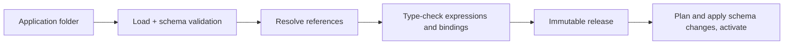

# Configuration pipeline

Detailed reference for the configuration pipeline, startup activation,
resource file shapes, entity field types and the diagnostic codes. The
conventions of [architecture.md](../architecture.md) apply: sections marked
*(planned for Mx)* are not built yet, and Dn refers to
[decisions.md](../decisions.md).



1. **Load.** Every `*.json` file in the folder and its subfolders is one
   resource. Each is validated against the JSON Schema for its `kind`
   (`application`, `entity`, `site`, `page`, `text`, `seed`, `dataSource`,
   `rule`, `sequence`, `process`, `form`, `role`, `policy`, `connector`, `event`, `endpoint`, `trigger`, `migration` or `scenario`). The manifest is the
   single `application` resource, stored as `application.json` at the
   folder root; an `application` resource in any other file is not used as
   the manifest. Resource IDs are unique across the application, compared as
   UUIDs. Names are unique per kind, ignoring letter case. The same checks
   run on a release's stored resources when the server rebuilds its model.
2. **Resolve.** Every reference must resolve inside the application or its
   declared modules. The entity model is built here: each field's `type`
   becomes a typed field type, every type-specific property is checked against
   the field type and against what storage accepts (see
   [Entity field types and constraints](#entity-field-types-and-constraints)),
   field names must be unique within their entity ignoring letter case, and the
   `target` of a reference or child collection field must name a loaded
   entity, ignoring letter case. An entity may reference itself. A `target` naming an entity whose file is
   in the folder, has kind `entity` and a string `name`, but was not loaded
   because of its own errors (such as a schema violation) is not reported
   again; only that file's own diagnostics are.
   - **Texts.** Each `text` resource holds the texts of one locale. Two text
     resources for the same locale, ignoring letter case, are `AXC0026` at
     `/locale` of the later file in path order. Every locale must have the
     same keys: a key that one locale has and another lacks is `AXC0027` at
     `/texts` of the file that lacks it, once per key, naming the first
     locale in path order that has it. A file already reported as a duplicate
     locale is left out of this check. Keys are compared ordinally. The texts
     of a pinned module are checked the same way, within that module; see
     [Modules](#modules).
     Each release carries its own texts, so a newer release can remove a key
     that older running work still shows.
   - **Labels.** The text key of the application label, an entity label or a
     field label must be in some locale, otherwise it is `AXC0028` at that
     label's `/textKey`. This applies also when the application has no text
     resource. Unused keys are allowed.
   - **Display field.** An entity's `displayField` must name one of its own
     required `text` fields, ignoring letter case, otherwise it is `AXC0029`
     at `/displayField`. Every entity that is the `target` of a reference,
     including a reference to itself, must have a `displayField`, otherwise
     the reference is `AXC0030` at `/fields/{i}/target`. It is not reported
     when the target is already `AXC0012` or `AXC0040`, or names an entity
     file that was not loaded.
   - **Child collections.** A `child-collection` field without `target` is
     `AXC0014` at the field, and a `target` that names no loaded entity is
     `AXC0012` at `/fields/{i}/target`. The entity it names is a child
     entity, owned by that field. The owner is the first such field in path
     order of the entity files, then in field order. A later field with the
     same target is `AXC0039` at its `/fields/{i}/target`, naming the owner.
     A `reference` whose target is a child entity is `AXC0040` at
     `/fields/{i}/target`. A `reference` or `child-collection` field on a
     child entity is `AXC0041` at its `/fields/{i}/type`, so an entity whose
     child collection names itself is `AXC0041`. See
     [Entity logic](#entity-logic) for why these limits exist.
   - **Sites and pages.** A site belongs to one application. Its `path` is
     lower-case letters, digits and hyphens, starting with a letter. A path
     reserved by the platform (`api`, `health`, `assets`, `studio`), or one that an
     earlier site of the application already uses in path order, is
     `AXC0024` at `/path`. A reserved path is not also checked for
     duplicates. The `default` and `fallback` locales must be in
     `available`, and every available locale needs a `text` resource,
     ignoring letter case, otherwise it is `AXC0025`. A `table` widget names
     exactly one of `entity` and `dataSource`, and a `form` widget exactly
     one of `form` and `entity`, otherwise it is `AXC0060` at
     `/widgets/{i}`. A widget's `entity` must name a loaded entity
     (`AXC0021`). A `dataSource` is allowed only on a `table` widget, and
     its data source must have no required parameter (`AXC0060` at
     `/widgets/{i}/dataSource`). It must name a loaded data source
     (`AXC0059`). It may be `<module id>/<name>`, to name a data source of a
     [module](#modules). A `form` is allowed only on a `form` widget (`AXC0060` at
     `/widgets/{i}/form`), and must name a loaded form (`AXC0077`). A
     `formPage` is allowed only on a `table` widget and must
     name a page whose widget is a `form` over the same entity, or over the
     root entity of the table's data source (`AXC0022`). A `form` widget
     that names a form is over the form's entity. A `formPage` is not
     allowed when the table's data source has an `aggregate`, because a group
     is not a record (`AXC0022`). A `taskInbox` widget names none of
     `entity`, `dataSource` and `form` (`AXC0060` at that property), and no
     `formPage` (`AXC0022`). A `processInspector` widget
     needs a `process` that names a loaded process, otherwise it is `AXC0192`
     at `/widgets/{i}/process`. It names none of `entity`, `dataSource` and
     `form` (`AXC0060` at that property), and no `formPage` (`AXC0022`).
     The page schema requires `process` on a `processInspector` and does not
     allow it on any other widget (`AXC0004`).
     `actions` are allowed only on a `form` widget
     (`AXC0060` at `/widgets/{i}/actions`). An action's `process` must name a
     loaded process (`AXC0087`) over the entity of the form's records
     (`AXC0088`), both at `/widgets/{i}/actions/{j}/process`. A navigation entry
     must name a loaded page (`AXC0023`). Entity, page, data source, form and process names
     resolve ignoring letter case, and a name whose file was not loaded
     because of its own errors is not reported again. Site titles, navigation labels, page titles and action labels join the
     `AXC0028` check.
   - **Forms.** A [form](frontend.md)'s `entity` must name a loaded
     entity, ignoring letter case, otherwise it is `AXC0074` at `/entity`,
     and its fields are not checked. A name whose entity file was not loaded
     because of its own errors is not reported again. Each section `field`
     must name a field of that entity, ignoring letter case, otherwise it is
     `AXC0075` at `/sections/{i}/fields/{j}/field`. A field that an earlier
     entry of the form already lists, in any section and ignoring letter
     case, is `AXC0076` at the later entry's `field`, naming the first one.
     Each section title joins the `AXC0028` check, at
     `/sections/{i}/title/textKey`.
   - **Seeds.** A seed's `entity` must name a loaded entity, ignoring letter
     case, otherwise it is `AXC0032` at `/entity`. A name whose entity file
     was not loaded because of its own errors is not reported again. Seed
     record ids are unique across every seed file of the application,
     compared as UUIDs: a record whose id an earlier record already uses, in
     the same file or an earlier file in path order, is `AXC0034` at
     `/records/{i}/id`, naming the file of the first one. Seed record ids are
     not compared with resource ids. Seed values are not checked at compile
     time; the startup step checks them before it inserts any record (see
     [Startup activation](#startup-activation)).
   - **Sequences.** A field's [`sequence`](#sequences) must name a loaded
     `sequence` resource, ignoring letter case, otherwise it is `AXC0066` at
     `/fields/{i}/sequence`. A name whose sequence file was not loaded
     because of its own errors, such as a bad `format`, is not reported
     again. A `sequence` is `AXC0013` at `/fields/{i}/sequence` when the
     field is not `text`, is `required`, has an `expression`, or belongs to
     a child entity. The field gets one diagnostic, for the first of these
     reasons in that order. A field that is not `text` gets no `AXC0066`.
   - **Data sources.** A data source's `entity` must name a loaded entity,
     ignoring letter case, otherwise it is `AXC0042` at `/entity`, and its
     fields and sort are not checked further. A name whose entity file was
     not loaded because of its own errors is not reported again. An
     `entity` that is a child entity is `AXC0064` at `/entity`, naming the
     owner. Each `path` must name a field of that entity, or go through
     `reference` fields with at most 3 hops, each name ignoring letter case,
     otherwise it is `AXC0043` at `/fields/{i}/path`. A path through a field that is not a
     `reference`, to an unknown field or with more than 3 hops is `AXC0043`,
     with a message that says which. A path ending at a `child-collection`
     field is `AXC0043` too, because that field has no column. A path that
     reaches an entity whose file was not loaded is not reported again. Projected names compare
     exactly: a name that an earlier entry of `fields` already uses is
     `AXC0044` at `/fields/{i}/name`. The `sort`, without its leading `-`,
     must exactly match a projected name whose path does not end at a `reference`,
     otherwise it is `AXC0045` at `/sort`. A sort naming an entry whose path
     is already `AXC0043` is not reported again. An `aggregate` groups by
     projected names, compared exactly: a `groupBy` entry that names no
     projected field is `AXC0061` at `/aggregate/groupBy/{i}`. A measure name
     that is a group field or repeats an earlier measure, compared exactly,
     is `AXC0062` at `/aggregate/measures/{i}/name`. A `count` with a `field`,
     or a `sum`, `min` or `max` without one, is `AXC0063` at
     `/aggregate/measures/{i}`. A measure `field` that names no projected
     field, or whose type the function does not take, is `AXC0063` at
     `/aggregate/measures/{i}/field`. A measure field whose path is already
     `AXC0043` is not reported again. When the data source is grouped, the
     `sort` must exactly match a group field that is not a `reference`, or a
     measure, otherwise it is `AXC0045`. A parameter name that is
     also a field of the entity, is `page`, `pageSize` or `sort`, or repeats
     an earlier parameter, all ignoring letter case, is `AXC0054` at
     `/parameters/{i}/name`. A parameter's type properties are checked as an
     entity field's, with the same codes (`AXC0012`, `AXC0013`, `AXC0014`,
     `AXC0030`, `AXC0040`) at `/parameters/{i}/...`, and its label joins the
     `AXC0028` check. The `filter` is parsed, type-checked as a boolean over
     the entity's fields, the parameters, paths through `reference`
     fields and the named rules, and translated to SQL. Its first problem is
     reported at `/filter` with its
     [expression diagnostic](expressions.md#diagnostics) code, and anything
     outside the SQL subset is `AXC0053`, including an aggregate over a
     child collection. An enum parameter with a value the compared enum field
     lacks is `AXC0047`, and so is a `.` after a field that is not a
     `reference` or after a parameter. A path with more than 3 hops is
     `AXC0058`. The filter of a data source
     whose entity is unknown, or that has a parameter with a diagnostic, is
     not checked. See
     [data sources](data-sources.md#compile-checks).
   - **Roles.** A [role](#roles-and-policies)'s `label` joins the `AXC0028`
     check, at `/label/textKey`. A process task's `assignee.role` must name a
     declared role, compared exactly, otherwise it is `AXC0089`. See
     Processes below.
   - **Processes.** A [process](processes.md#resource-shape)'s `entity` must
     name a loaded entity, ignoring letter case, otherwise it is `AXC0067` at
     `/entity`, and its conditions are not checked. A name whose entity file
     was not loaded because of its own errors is not reported again. An
     `entity` that is a child entity is `AXC0068` at `/entity`, naming the
     owner. Step names are unique ignoring letter case: a later step with a
     name already used is `AXC0069` at `/steps/{i}/name`, naming the first
     step. `start`, each branch `next`, each `otherwise`, each operation
     `next` and each task outcome `next` must name a step, ignoring letter
     case, otherwise it is `AXC0070` at that property. A
     transition goes to the first step with its name. A step that cannot be
     reached from `start` is `AXC0071` at `/steps/{i}`. It is not checked
     when `start` is unknown. A step with no path to an `end` step is
     `AXC0072` at `/steps/{i}`. A step with a transition to an unknown step
     is not also `AXC0072`. A transition that closes a cycle is `AXC0073` at
     that transition, naming the steps in the cycle. The steps are walked in
     file order, with the branches, then `otherwise`, then `next`, then the
     outcomes. A step whose name is
     already `AXC0069` is left out of `AXC0071`, `AXC0072` and `AXC0073`. The
     `startCondition` expression and each decision `when` are parsed and
     type-checked as a boolean over the entity's fields, computed ones
     included, its child collections, which only aggregates accept, the
     named rules, and paths through `reference` fields of at most 3 hops. A
     problem is reported at `/startCondition/expression` or
     `/steps/{i}/branches/{j}/when` with its
     [expression diagnostic](expressions.md#diagnostics) code. The
     `startCondition` message joins the `AXC0028` check. An operation step
     whose `operation` is not `updateRecord`, `callConnector`,
     `raiseEvent` or a package operation written `<package>/<operation>`,
     matched exactly, is `AXC0078` at `/steps/{i}/operation`, and its other
     properties are not checked. Each key of an
     `updateRecord` `set` must name a field of the entity, ignoring letter
     case, that no earlier key of the step names, otherwise it is `AXC0079`.
     A computed field, a sequence field or a child collection is `AXC0080`.
     Each `set` expression is parsed and type-checked against its field's
     type, with the same scope as a `when`. Each of these is reported at
     `/steps/{i}/set/{field}`. A `callConnector` step's `connector` `name`
     that names no loaded [connector](#connectors-and-deployment-bindings),
     ignoring letter case, is `AXC0102` at `/steps/{i}/connector/name`. A
     name whose connector file was not loaded because of its own errors is
     not reported again. An `operation` that names no operation of that
     connector, ignoring letter case, is `AXC0103` at
     `/steps/{i}/connector/operation`. With either, the step's `input` and
     `output` are not checked. An `input` key that names no input of the
     operation, ignoring letter case, or an input an earlier key already
     names, is `AXC0104`. Each `input` expression is parsed and type-checked
     against its input's type, with the same scope as a `when`. Each of these
     is reported at `/steps/{i}/input/{key}`. A required input that no key
     names is `AXC0105` at `/steps/{i}/input`. An `output` key that names no
     output of the operation, or an output an earlier key already names, is
     `AXC0106`. An `output` value that names no field of the entity,
     ignoring letter case, or a field an earlier output already writes, is
     `AXC0107`. A computed field, a sequence field, a child collection, or a
     field whose type does not fit the output's is `AXC0108`. An output fits
     a field of the same type, and an `integer` output also fits a `decimal`
     field. Each of these is reported at `/steps/{i}/output/{key}`. A retry
     `backoff` that is not a positive whole-number duration is `AXC0109` at
     `/steps/{i}/retry/backoff`. A package operation step
     whose package the application does not list in `packages` is `AXC0150`
     at `/steps/{i}/operation`, unless it was listed and failed pinning
     (`AXC0139` to `AXC0142`) or `application.json` was not loaded. An
     operation the pinned version's manifest does not offer, ignoring letter
     case, is `AXC0151` at the same path. With either, the step's `input` and
     `output` are not checked. Otherwise they and the `retry` are checked as
     for a `callConnector` step (`AXC0104` to `AXC0109`), against the
     manifest's fields. A `raiseEvent` step's `event` that names no
     loaded [event](#event-resource), ignoring letter case, is `AXC0125` at
     `/steps/{i}/event`. A name whose event file was not loaded because of
     its own errors is not reported again. An event about another entity
     than the process's is `AXC0126` at `/steps/{i}/event`. It is not
     checked when either entity is unknown. With an unknown event, the
     step's `fields` are not checked. A `fields` key that names no payload
     field of the event, ignoring letter case, or a field an earlier key
     already names, is `AXC0127`. Each `fields` expression is parsed and
     type-checked against its payload field's type, with the same scope as a
     `when`. Each of these is reported at `/steps/{i}/fields/{key}`. A
     payload field that no key names is `AXC0128` at `/steps/{i}/fields`. A
     task step's `assignee` without exactly one of `user` and `role` is
     `AXC0081` at `/steps/{i}/assignee`. A `role` that names no declared
     [role](#roles-and-policies), compared exactly, is `AXC0089` at
     `/steps/{i}/assignee/role`. A name whose role file was not loaded
     because of its own errors is not reported again. A `user`
     expression is parsed and type-checked as `text`, with the same scope
     as a `when`, and a problem is reported at `/steps/{i}/assignee/user`.
     A task's `form` that names no loaded form, ignoring letter case, is
     `AXC0082` at `/steps/{i}/form`. A
     name whose form file was not loaded because of its own errors is not
     reported again. A form over another entity than the process's is
     `AXC0083` at `/steps/{i}/form`. It is not checked when either entity is
     unknown. A `dueIn` that is not a positive whole-number duration is
     `AXC0084` at `/steps/{i}/dueIn`. A later outcome with a name already
     used in the step, ignoring letter case, is `AXC0085` at
     `/steps/{i}/outcomes/{j}/name`. The task `label` and each outcome
     `label` join the `AXC0028` check. A decision with no branches, an
     operation without `operation` or `next`, an `updateRecord` step without
     `set` or with `connector`, `input`, `output` or `retry`, a
     `callConnector` step without `connector` or `input` or with `set`, a
     `raiseEvent` step without `event` or `fields` or with `set`,
     `connector`, `input`, `output` or `retry`, a package operation step
     without `input` or with `set`, `connector`, `event` or `fields`, an
     `event` or `fields` on any other step, a retry `attempts` outside 1 to 10, a task without
     `label`, `assignee`, `form` or an outcome, and an `end` step with
     `branches`, `otherwise` or any other property, are `AXC0004`. See
     [processes](processes.md#compile-checks).
   - **Policies.** Each `roles` entry of a [policy](#roles-and-policies) must
     name a declared role, compared exactly, otherwise it is `AXC0090` at
     `/roles/{i}`. A grant without exactly one of `entity`, `dataSource`,
     `process` and `endpoint` is `AXC0091` at `/grants/{i}`, and nothing else
     of it is checked. An action its target's kind does not take is `AXC0091`
     at `/grants/{i}/actions/{j}`, and a `filter` or `fields` on a
     `dataSource`, `process` or `endpoint` grant is `AXC0091` at
     `/grants/{i}/filter` or `/grants/{i}/fields`. A target that names no
     loaded entity, data source, process or endpoint, ignoring letter case, is
     `AXC0092` at `/grants/{i}/entity`, `/grants/{i}/dataSource`,
     `/grants/{i}/process` or `/grants/{i}/endpoint`. A grant on a child
     entity is `AXC0093` at `/grants/{i}/entity`, naming the owner. Its
     `fields` and `filter` are then not checked. A `fields` entry that names
     no field of the entity, ignoring letter case, is `AXC0094` at
     `/grants/{i}/fields/{j}`. The `filter` is parsed, type-checked as a
     boolean over the entity's fields, paths through `reference` fields, the
     named rules and [`currentUser()`](expressions.md#current-user), and
     translated to SQL. Its first problem is reported at
     `/grants/{i}/filter` with its
     [expression diagnostic](expressions.md#diagnostics) code, and anything
     outside the SQL subset, such as an aggregate or `lower`, is `AXC0053`.
     A name whose role, entity, data source, process or endpoint file was not
     loaded because of its own errors is not reported again.
   - **Connectors.** A [connector](#connector-resource)'s `timeout` that is not
     a positive ISO 8601 duration of at most `PT2M`, in the form a task's
     `dueIn` takes, is `AXC0099` at `/timeout`. A later operation whose name
     an earlier operation of the connector already uses, ignoring letter case,
     is `AXC0096` at `/operations/{i}/name`. So is a later input or output
     field whose name an earlier field of the same list already uses, ignoring
     letter case, at `/operations/{i}/input/{j}/name` or
     `/operations/{i}/output/{j}/name`. A `path` with an unbalanced `{` or
     `}`, or a placeholder other than `{idempotencyKey}`, matched exactly, is
     `AXC0097` at `/operations/{i}/path`. A placeholder is refused even when it
     matches an input name, because inputs go in the JSON body. A `lookup` is
     `AXC0098` at `/operations/{i}/lookup` when it names no operation of the
     connector, ignoring letter case, or names its own operation. It is also
     `AXC0098` when the operation it names is not a `GET`, has no
     `{idempotencyKey}` in its path, or has other outputs than the operation
     it serves. Outputs are the same when they have the same names, ignoring
     letter case and order, with the same type and `required`. The message
     says which. A `GET` with `input` fields, and an `auth` without the
     properties its `type` needs or with others, are `AXC0004`. Bindings are
     checked at activation, not here.
   - **Events.** An [event](#event-resource)'s `entity` must name a loaded
     entity, ignoring letter case, otherwise it is `AXC0110` at `/entity`. It
     is not reported when the name is an entity file that was not loaded
     because of its own errors. An `entity` that is a child entity is
     `AXC0111` at `/entity`, naming the owner. A later field whose name an
     earlier field of the event already uses, ignoring letter case, is
     `AXC0112` at `/fields/{i}/name`. A field of type `enum`, `reference` or
     `child-collection` is `AXC0113` at `/fields/{i}/type`. A type name that
     is not a field type is `AXC0004`.
   - **Endpoints.** An [endpoint](#endpoint-resource)'s `entity` must name a
     loaded entity, ignoring letter case, otherwise it is `AXC0114` at
     `/entity`. An `entity` that is a child entity is `AXC0115` at `/entity`,
     naming the owner. Its `process` must name a loaded process, otherwise it
     is `AXC0116` at `/process`. A process whose subject entity is another
     entity is `AXC0117` at `/process`. Each input field is checked as an
     entity field at `/input/{i}`, so a type property on the wrong type is
     `AXC0013`, a missing `target` or `values` is `AXC0014`, an unknown
     `target` is `AXC0012`, a `reference` to a child entity is `AXC0040`, and
     a `reference` to an entity without a `displayField` is `AXC0030`. A
     later input whose name an earlier input already uses, ignoring letter
     case, is `AXC0118` at `/input/{i}/name`. A `child-collection` input whose
     `target` is not a child entity is `AXC0119` at `/input/{i}/target`. A
     `values` key that names no field of the entity, or a field that an
     earlier key already maps, ignoring letter case, is `AXC0120` at
     `/values/{key}`. A key that names a computed field, or a field with a
     `sequence` or `creator`, is `AXC0121` there. A `child-collection` field
     whose value is not the name of a `child-collection` input with the same
     target is `AXC0122` there. Any other value is parsed and type-checked
     against the field's type over the input fields only, and its first
     problem is reported at `/values/{key}` with its
     [expression diagnostic](expressions.md#diagnostics) code. A value is not
     matched against the input while an input field has a diagnostic. An
     `output` entry that names no field of the entity is `AXC0123` at
     `/output/{i}`. A `wait` that is not a valid ISO 8601 duration, is zero,
     or is above `PT30S` is `AXC0124` at `/wait`. When the entity is unknown,
     `values` and `output` are not checked. A name whose entity or process
     file was not loaded because of its own errors is not reported again.
   - **Triggers.** A [trigger](#trigger-resource)'s `process` must name a
     loaded process, ignoring letter case, otherwise it is `AXC0129` at
     `/process`. Its `event` must name a loaded event, ignoring letter case,
     otherwise it is `AXC0130` at `/event`. An event about another entity than
     the process's subject entity is `AXC0131` at `/event`, naming both
     entities. It is not checked when either entity is unknown. `when` is
     parsed and type-checked as a boolean over the event's payload fields
     only. It calls no rules, follows no reference paths and uses no
     aggregates, but built-in functions such as `now()` are allowed. Its
     first problem is reported at `/when` with its
     [expression diagnostic](expressions.md#diagnostics) code. `when` is not
     checked when the event is unknown. A name whose process or event file was
     not loaded because of its own errors is not reported again.

     A data change trigger's `entity` must name a loaded entity, ignoring
     letter case, otherwise it is `AXC0143` at `/entity`. An entity that is not
     the process's subject entity is `AXC0144` at `/entity`, naming both
     entities. It is not checked when the process is unknown. A name in
     `fields` that names no field of the entity, or names a computed field,
     is `AXC0145` at `/fields/{i}`. `when` is parsed and type-checked as a
     boolean over the watched record, with the scope of a process condition:
     its fields, rules, reference paths and aggregates. Its first problem is
     reported at `/when`. `fields` and `when` are not checked when the entity
     is unknown. Data change triggers fire on every committed write through the
     record command, see [Starts from triggers](processes.md#starts-from-triggers).

     A schedule trigger's `schedule` must be a valid 5-field cron, otherwise
     it is `AXC0160` at `/schedule`. Its `timeZone` must be an IANA id,
     written with its exact letter case, otherwise it is `AXC0161` at
     `/timeZone`. Its `dataSource` must name a loaded data source, ignoring
     letter case, otherwise it is `AXC0162` at `/dataSource`. A grouped data
     source is `AXC0163` and a data source over another entity than the
     process's subject entity is `AXC0164`, both at `/dataSource`. The
     second is not checked when either entity is unknown. Each `parameters`
     key must name a parameter of the data source, ignoring letter case, and
     no parameter may be named twice, otherwise the key is `AXC0165` at
     `/parameters/{key}`. A value that is not a literal of the parameter's
     type is `AXC0166` at `/parameters/{key}`. Each parameter that no key
     gives is `AXC0167` at `/parameters`, once for each parameter, even when
     `parameters` is left out. The parameters are not checked when the data
     source is unknown. A name whose data source file was not loaded because
     of its own errors is not reported again. The
     [schedule trigger](#events-and-triggers) section lists the rules.

     A `type` other than `event`, `dataChange` or `schedule`, a `mode` other
     than `async` or `sync`, a `when` or `mode` on a schedule trigger, a
     property that belongs to another trigger type, an empty or repeated
     `on`, and an empty or repeated `fields` are `AXC0004`.

   - **Migrations.** A [migration](#resource-file-shape)'s `entity` must name a
     loaded entity, otherwise it is `AXC0170` at `/entity`. Its changes are
     checked against the entity with the undo-and-replay rules in
     [the migration section](#resource-file-shape): `AXC0171` to `AXC0173`,
     and each `fill` and `convert` value at `/changes/{i}/value`. A
     `renameField` without `to`, or a change with a property that belongs to
     another change type, is `AXC0004`.

   - **Scenarios.** A [scenario](#test-scenarios) is checked against the
     application, and every problem is reported in one pass. A name whose file
     was not loaded because of its own errors is not reported again. Entities,
     fields, processes, steps, outcomes, connectors and operations are matched
     ignoring letter case. Roles, user ids and record aliases are matched
     exactly.
     - A role in `users`, or an `assignee.role`, that names no declared role is
       `AXC0180` at `/users/{user}/{j}` or `/steps/{i}/assignee/role`. An `as`
       or an `assignee.user` that names no user of the scenario is `AXC0181` at
       `/steps/{i}/as` or `/steps/{i}/assignee/user`.
     - A `createRecord` `entity` that names no loaded entity, or names a child
       entity, is `AXC0182` at `/steps/{i}/entity`.
     - A key in `values` that names no field of the record's entity is
       `AXC0183` at `/steps/{i}/values/{key}`. The path continues into a child
       collection as `{key}/{n}/{key}`. A value that does not fit its field's
       type is `AXC0189` at the same path. A reference must be a UUID and an
       enum value must be one of the field's values. A child collection must be
       an array of objects. `null` fits every type, and computed and read-only
       fields are not refused, because a scenario may test that the record API
       refuses a value.
     - A `process` of `startProcess` or `expectInstance` that names no loaded
       process, or a process over another entity than the record's, is
       `AXC0184` at `/steps/{i}/process`. A `step` of `expectInstance` that
       names no step of that process is `AXC0185` at `/steps/{i}/step`.
     - A `step` of `completeTask` or `expectTask` must name a `task` step of a
       process over the record's entity, otherwise it is `AXC0185` at
       `/steps/{i}/step`. An `outcome` of `completeTask` must be an outcome of
       such a task step, otherwise it is `AXC0186` at `/steps/{i}/outcome`.
     - A `record` that no earlier step saved is `AXC0187` at
       `/steps/{i}/record`. A `save` that an earlier step already used is
       `AXC0188` at `/steps/{i}/save`. A step with an unknown alias or entity
       is not checked further.
     - A connector stub that names no loaded connector is `AXC0190` at
       `/stubs/{i}/connector/name`, and one that names an operation the
       connector lacks is `AXC0190` at `/stubs/{i}/connector/operation`. A
       package stub whose package is not one of the application's packages, or
       whose operation is not in the pinned manifest, is `AXC0190` at
       `/stubs/{i}/operation`. A package that is listed but could not be pinned
       is not reported again. An `output` key that names no output field of the
       operation is `AXC0191` at `/stubs/{i}/output/{key}`. The types of the
       output values are not checked.
     - A malformed file, such as an unknown step `type`, a missing or forbidden
       step property, `save` together with `expect`, `expect` on an
       expectation step, or a `now` that is not a real date and time, such as
       `2026-02-30T09:00:00Z`, is `AXC0004`.
     - An `advanceTime` step whose `by` is not a positive
       duration in the form of a task's `dueIn` is `AXC0193` at
       `/steps/{i}/by`. An `advanceTime` step in a scenario without `now` is
       `AXC0194` at `/steps/{i}`.
     - A scenario error is an error like any other, so a folder with one does
       not compile or activate.

   The model holds the text resources, each entity's display field, each
   field's sequence with its id, name and format, the
   sites and pages with their entity, data source and page references
   resolved, the
   seeds in path order with their entity resolved, and the data sources in
   path order with their entity, projected fields and parameter targets
   resolved and their filter checked. It also holds the processes in path
   order, with their entity resolved, each transition resolved to the
   declared name of its step and their conditions checked, the
   policies in path order, with each grant's target resolved and its filter
   checked, and the connectors in path order, with their timeout, operations,
   typed input and output fields, and each lookup resolved to the declared
   name of its operation, and the events in path order, with their entity
   resolved, and their typed fields. It also holds the endpoints in path
   order, with their entity, process and input targets resolved, their
   typed input fields, their mapped fields in the entity's order with each
   expression checked, and their output and wait. It also holds the triggers
   in path order, with their event and process resolved and their `when`
   checked. A schedule trigger holds its parsed cron, its time zone, its
   data source reference and its parameter values, typed and keyed by the
   declared parameter names. It also holds the migrations in ordinal order of
   their file path, each with its entity name as written and its changes in
   file order. A change's `value` stays expression text. No model is produced
   while any error remains.

   The same pass builds the [reference index](#reference-index).
3. **Check.** Each entity's [validations](#entity-logic) are parsed and
   type-checked against the entity's own fields and its child collections,
   which only [aggregates](expressions.md#aggregates) accept, and must be
   boolean. A
   problem in the expression is reported with its
   [expression diagnostic](expressions.md#diagnostics) code at
   `/validations/{i}/expression`. The expression of each
   [computed field](#entity-logic) is parsed and type-checked against the
   entity's fields that are not computed and its child collections, and
   must give the field's type. A call to `now()` in it, including inside an
   aggregate's item expression, is `AXC0086`.
   A problem in it is reported the same way at `/fields/{i}/expression`. A `field` that names no field of the
   entity, ignoring letter case, is `AXC0052` at `/validations/{i}/field`,
   and the `message` joins the `AXC0028` check. A validation with an error
   produces no model. [Data source](data-sources.md#compile-checks) filters
   are checked in the Resolve step, with the data sources. Form bindings and
   operation inputs join this step as they are built.
   - **Rules.** Each [rule](#resource-file-shape)'s expression is parsed and
     type-checked against its own parameters, and must give its
     `resultType`. A problem in it is reported at `/expression` of the rule
     file. A validation, a data source filter, a process condition or a
     policy filter may call a rule, and each call is checked for the
     rule's name, its argument count and each argument's type, with the
     codes a function call gets (`AXC0050`, `AXC0051`, `AXC0047`). Rules
     that call each other in a cycle, such as A → B → A, are `AXC0055`
     once per cycle, at `/expression` of the rule where the cycle starts,
     naming every rule in it. A rule whose calls nest more than 8 deep, counting
     itself, is `AXC0065` once, at `/expression` of the lowest rule past the
     limit, naming the rules in the chain. A cycle never also gives
     `AXC0065`. Rules are walked in path order. A parameter
     name that an earlier parameter of the same rule already uses, ignoring
     letter case, is `AXC0056` at `/parameters/{i}/name`. A rule name that
     is a built-in [function](expressions.md#functions) name, ignoring letter
     case, is `AXC0057` at `/name`. A rule whose own expression has an
     error, or that is in a cycle, is still known by its parameters and
     result type, so a call to it gets no further diagnostic. Validations,
     data source filters, process conditions and policy filters can call
     rules, but only
     outside an aggregate's item expression. In a computed field or an item
     expression, a rule call is still `AXC0050`.
4. **Release.** The compiled application is stored as a release with a
   content hash. It is immutable.
   - **Content hash.** Every resource file is canonicalized as in RFC 8785
     (JCS): no whitespace, object properties sorted by UTF-16 code units,
     minimal string escaping, numbers written as ECMAScript does. The hash is
     SHA-256 over every resource in ordinal order of its relative path (`/`
     separators), each contributing `path`, a newline, its canonical JSON and
     a newline, encoded as UTF-8. It is written as lowercase hex.
     Formatting-only changes (whitespace, key order, line endings) keep the
     hash; a changed value, or an added, removed or renamed file changes it.
     After the resources come the pinned
     [extension packages](#extension-packages), in ordinal order of their id,
     each contributing `/packages/<id>`, a newline, the pinned version and a
     newline. A resource path never starts with `/`, so a pin cannot be
     confused with a file. An application without pins has the hash of its
     resources alone. So installing a newer version in range gives the same
     folder a new hash and a new release, and the old release keeps its pin.
     Module files are hashed as ordinary resource paths under
     `modules/<id>/`, see [Modules](#modules).
     [Scenario](#test-scenarios) files under `scenarios/` are left out of the
     release and its content hash. So adding or editing a scenario keeps the
     hash and the release.
   - **Identity.** A release is unique per application `id` and content hash.
     Compiling an unchanged folder returns the stored release instead of
     storing a second one, also when two compiles run at the same time.
   - **Content.** A release stores the canonical content of every resource
     with its relative path, the files of every module it pins under
     `modules/<id>/`, and the exact version of every package it pins,
     so it can be read back without the folder. Reading it back resolves each
     range against the release's own pins only, never against the packages
     installed now.
   - **Errors.** A folder with any error diagnostic produces no release;
     compile returns the diagnostics only.
5. **Activate.** The current tenant schema is compared with the entity
   definitions of the release. Pending [migrations](storage.md#migrations)
   run first: a `renameField`, `dropField`, `dropEntity`, `fill` or `convert` is
   applied once per tenant. A `convert` that fails for a stored row is `AXC0177`.
   A `renameField`, `dropField`, `dropEntity` or `convert` is refused with `AXC0178`
   while a running or waiting process instance is pinned to another release that
   uses the changed column.
   A `fill` makes a field that was `null` in some rows
   `NOT NULL` when the release requires it. Then additive changes are planned and applied.
   Other incompatible changes stay rejected with a diagnostic. See
   [Schema planning](storage.md#schema-planning). The release becomes active
   for new work only after that has completed successfully.
   - **Active release.** Each application `id` has at most one active
     release, stored with the manifest `name` as written. The name is unique
     across the active applications, ignoring letter case; names are ASCII
     (`AXC0004`), so the database's `lower(name)` matches. An application
     may change its name: its active release then holds the new name and the
     old one is free for another application.
   - **Site paths.** A site path is active for at most one application `id`
     in the tenant. The active release stores the paths of its sites. A site
     whose path another application's active release holds gets `AXC0031` at
     `/path` of its site file. Activation checks the paths before
     provisioning, and a unique index on the path enforces the rule when the
     active release is set. Site paths are lower-case (`AXC0004`), so the
     plain index already ignores letter case.
   - **Order.** Activation first checks that no other application `id` is
     active under the manifest name; if one is, it returns `AXC0020` and
     changes nothing. It then checks each site path; it returns one `AXC0031`
     for every site whose path another application holds, and changes
     nothing. It then checks the deployment bindings of every connector, and
     of every package operation that a process step uses, against the tenant's.
     It returns one `AXC0100` for every binding the tenant lacks or holds with
     another kind, and outside Development one `AXC0101` for every base URL
     binding or package `url` binding that is not `https`, and changes
     nothing. It then provisions the entity tables (see
     [Storage](storage.md#storage)); when provisioning returns diagnostics, they are
     returned and the active release is untouched. Only then is the release
     set active, in one upsert per application `id`, so two activations of
     the same application never conflict and the last one wins. When another
     application took the name after the check, the upsert is refused and
     activation returns the same `AXC0020`. When another application took a
     site path after the check, the unique index refuses it and activation
     returns one `AXC0031` for that path. A refused name or site path at the
     upsert rolls back the migrations and provisioning too.
   - **Transactions.** The schema lock, the migration history check, the
     migrations, provisioning, the active release and its `axis.active_sites`
     rows are written in one transaction. Holding the lock from the history
     check to the commit keeps another activation from committing a rename
     or drop in between, which would let an older release become active
     against tables it does not match. The active release store and the data
     context must therefore share one tenant connection, or the store throws
     before anything commits. Activation must run outside an explicit
     transaction.
   - **Failure.** Nothing stays applied after a failed activation: not the
     migrations, the new tables and columns, nor their provisioning records.
     The previous release stays active. An activation that loses the name or
     a site path to a concurrent one leaves nothing behind either.
   - **Re-activation.** Activating the active release again provisions
     nothing, keeps its site paths and changes only its activation time. A
     release that renames a site path frees the old path for another
     application.
   - **Serving.** The server rebuilds the `ApplicationModel` from the
     release's stored resources through `IActiveReleaseStore` and caches it
     per tenant and release id. A stored release that no longer compiles
     clean, or compiles to another content hash, is an error, never served.
     The active row is read on every request, so a new activation is served
     by the next request. A name outside the manifest name rule (an ASCII
     letter, then ASCII letters or digits, at most 60 characters) resolves to
     nothing without a query, so Unicode case folding such as the Kelvin sign
     never aliases an application name.

Diagnostics always carry `file`, `resourceId` (when the file has a readable
ID), `path`, `code` and a message. `file` is relative to the application
folder and uses `/` separators, or is empty when the diagnostic concerns the
whole application folder. `path` is a JSON Pointer (RFC 6901) into that file,
such as `/fields/0/type`, or empty when the problem concerns the whole file or
the whole folder. Messages never contain absolute paths or exception text,
because they are shown to application authors. Codes have the form `AXCnnnn`
and never change meaning. Compile reports all diagnostics, not just the first,
sorted by file and then path.

| Code | Meaning |
| --- | --- |
| `AXC0001` | The file is not valid JSON. |
| `AXC0002` | The resource has no `kind`, or `kind` is not a string. |
| `AXC0003` | The `kind` is not a known resource kind. |
| `AXC0004` | The resource does not match the JSON Schema for its kind. |
| `AXC0005` | Another resource already uses this `id`. |
| `AXC0006` | Another resource of the same kind already uses this `name`. |
| `AXC0007` | The folder has no `application` manifest. |
| `AXC0008` | The folder has more than one `application` manifest. |
| `AXC0009` | An `application` resource is not `application.json` at the folder root, or the root `application.json` has another kind. |
| `AXC0010` | The file could not be read, for example because access is denied. |
| `AXC0011` | Another field of the same entity already uses this `name`, ignoring letter case. |
| `AXC0012` | A reference or child collection field's `target` names no loaded entity. Not reported when the target names an entity file in the folder that was not loaded because of its own errors. |
| `AXC0013` | A field property does not fit the field's type, or its value is outside what storage accepts. This includes `required` on a computed field, and an `expression` on a `reference` or `child-collection` field. A `sequence` on a field that is not `text`, is `required`, has an `expression` or belongs to a child entity is reported once, at `/fields/{i}/sequence`. |
| `AXC0014` | A field lacks a property its type needs: `target` on a reference or child collection, `values` on an enum. |
| `AXC0015` | An entity table has a column whose field was removed and that no pending `renameField` or `dropField` migration covers. Reported at `/fields` of the entity file. |
| `AXC0016` | A field changed in a way its existing column cannot follow, such as a new type, a shorter `maxLength` or a removed enum value. |
| `AXC0017` | An entity provisioned for the application is missing from it and no pending `dropEntity` migration covers it. Reported at `application.json` with an empty path. |
| `AXC0018` | The entity's `id` is already provisioned for another application. Reported at `/id` of the entity file. |
| `AXC0019` | The application folder could not be listed: it does not exist, it cannot be opened, or one of its subfolders cannot be opened. Reported with an empty `file` and `path`, as the only diagnostic; nothing in the folder is loaded. |
| `AXC0020` | The application's `name` is active for another application `id`, ignoring letter case. Reported at `/name` of `application.json`, as the only diagnostic; nothing is provisioned or activated. |
| `AXC0021` | A widget's `entity` names no loaded entity. Reported at `/widgets/{i}/entity`. |
| `AXC0022` | A widget's `formPage` is set on a `form`, `taskInbox` or `processInspector` widget, names no loaded page, or names a page whose widget is not a `form` over the same entity, or over the root entity of the widget's data source, or is set on a table whose data source has an `aggregate`. A `form` widget that names a form is over the form's entity. Reported at `/widgets/{i}/formPage`. |
| `AXC0023` | A navigation entry names no loaded page. Reported at `/navigation/{i}/page`. |
| `AXC0024` | A site path is reserved by the platform, or another site of the application already uses it. Reported at `/path` of the later file. |
| `AXC0025` | A site's default or fallback locale is not in `available`, or an available locale has no `text` resource. Reported at that locale. |
| `AXC0026` | Another `text` resource already holds this locale, ignoring letter case. Reported at `/locale` of the later file. |
| `AXC0027` | A text key that another locale has is missing from this locale. Reported at `/texts`, naming the key and a locale that has it. |
| `AXC0028` | No locale has the text key of this label. Reported at the label's `/textKey`. |
| `AXC0029` | The entity's `displayField` names no required `text` field of the entity. Reported at `/displayField`. |
| `AXC0030` | A reference field's target entity has no `displayField`. Reported at `/fields/{i}/target`. |
| `AXC0031` | A site path is active for another application. Reported at `/path` of the site file; nothing is provisioned or activated. |
| `AXC0032` | A seed's `entity` names no loaded entity. Reported at `/entity`. |
| `AXC0033` | A seed value is one the record API would reject, or the seed record could not be inserted or updated, for example because a reference names no record. Reported by the startup step at `/records/{i}/values/<field>` of the seed file, or at `/records/{i}` when the stored schema does not match the active model. |
| `AXC0034` | An earlier seed record of the application already uses this record id. Reported at `/records/{i}/id` of the later record, naming the file of the first one. |
| `AXC0035` | An expression has a syntax error: an unknown character, a bad token or literal, or text the grammar does not allow. Reported at the JSON Pointer of the expression string, with the character position in the message. See [expression diagnostics](expressions.md#diagnostics). |
| `AXC0036` | An expression is longer than 2,000 characters. Reported at the JSON Pointer of the expression string. |
| `AXC0037` | An expression nests deeper than 32 levels. Reported at the JSON Pointer of the expression string, with the character position in the message. |
| `AXC0038` | An expression has more than 500 syntax nodes. Reported at the JSON Pointer of the expression string, with the character position in the message. |
| `AXC0039` | The child entity is already owned by another `child-collection` field. Reported at `/fields/{i}/target` of the later field, naming the owner. |
| `AXC0040` | A reference field's target is a child entity. Reported at `/fields/{i}/target`, naming the owner. |
| `AXC0041` | A child entity has a `reference` or `child-collection` field. Reported at `/fields/{i}/type` of that field, naming the owner. |
| `AXC0042` | A data source's `entity` names no loaded entity. Reported at `/entity`. Not reported when the name is an entity file that was not loaded because of its own errors. |
| `AXC0043` | A data source field's `path` names no field of the data source's entity or of a reference's target, goes through a field that is not a `reference`, takes more than 3 hops, or ends at a `child-collection` field, which has no column. The message says which. Reported at `/fields/{i}/path`. |
| `AXC0044` | An earlier field of the same data source already uses this `name`, compared exactly. Reported at `/fields/{i}/name` of the later field. |
| `AXC0045` | A data source's `sort` names no projected field, or names a projected field whose path ends at a `reference`. For a grouped data source, it names no group field or measure, or names a group field whose path ends at a `reference`. Reported at `/sort`. |
| `AXC0046` | An expression names a field that is not in its scope, including an unknown field after a `.`. Outside a data source filter and a process condition, every `.` path is reported this way. Reported at the JSON Pointer of the expression string, with the character position in the message. See [expression diagnostics](expressions.md#diagnostics). |
| `AXC0047` | An expression gives an operator, function or rule operands of types it does not accept, such as `'a' < 'b'`, `quantity and true`, `length(1)` or `IsPositive('a')`. This includes a `date('…')` or `dateTime('…')` text that is not a valid date or date-time, such as `date('2026-13-45')`, in every use. It also includes a child collection used anywhere but as the first argument of an aggregate, such as `lineItems == null`, and an aggregate over a field that is not a child collection, such as `sum(title, amount)`. In a data source filter or a process condition it also includes a `.` after a field that is not a `reference`, such as `name.x`. In a data source filter it also includes a `.` after a parameter. Reported at the JSON Pointer of the expression string, with the character position of the operator or the call in the message. |
| `AXC0048` | An expression's type does not fit the type its use needs, such as an integer where a validation needs a boolean. Reported at the JSON Pointer of the expression string. The message names both types. |
| `AXC0049` | A text literal compared with an enum is not one of the field's `values`. Reported at the JSON Pointer of the expression string, with the character position of the literal in the message. |
| `AXC0050` | An expression calls a function or rule that does not exist, such as `foo(1)`. Reported at the JSON Pointer of the expression string, with the character position of the call in the message. |
| `AXC0051` | An expression calls a function or rule with the wrong number of arguments, such as `round(1.5)`, `sum(lineItems)` or `IsPositive()`. Reported at the JSON Pointer of the expression string, with the character position of the call in the message. The message names the expected count. The SQL check of a migration value that is not type-checked reports it too, such as `abs()`. |
| `AXC0052` | A validation's `field` names no field of the entity. Reported at `/validations/{i}/field`. |
| `AXC0053` | A data source filter uses something outside the SQL subset, such as `/`, `lower(name)`, an aggregate such as `count(lines)`, or a call to a rule whose expression uses `lower`. So does a filter whose rule calls inline to more than 2,000 syntax nodes. Reported at `/filter`, with the character position of the operator or the call in the message. A message about a rule call names the rule the filter calls. A migration's `fill` or `convert` value uses something outside the SQL subset in the same way, such as `upper(title)`, and is reported at `/changes/{i}/value`. See [SQL subset](expressions.md#sql-subset). |
| `AXC0054` | A data source parameter's `name` is also a field of the data source's entity, is `page`, `pageSize` or `sort`, or is already used by an earlier parameter of the same data source, all ignoring letter case. Reported at `/parameters/{i}/name`. |
| `AXC0055` | Rules call each other in a cycle, such as A → B → A. Reported once per cycle, at `/expression` of the rule where the cycle starts in path order. The message names every rule in the cycle. |
| `AXC0056` | An earlier parameter of the same rule already uses this `name`, ignoring letter case. Reported at `/parameters/{i}/name` of the later parameter. |
| `AXC0057` | A rule's `name` is the name of a built-in function, ignoring letter case, such as `round`. Reported at `/name`. |
| `AXC0058` | A path in a data source filter or a process condition takes more than 3 hops, such as `a.b.c.d.name`. Reported at the JSON Pointer of the expression string, such as `/filter` or `/steps/0/branches/0/when`, with the character position of the `.` that goes past the limit in the message. See [expression diagnostics](expressions.md#diagnostics). |
| `AXC0059` | A widget's `dataSource` names no loaded data source. Reported at `/widgets/{i}/dataSource`. Not reported when the name is a data source file that was not loaded because of its own errors. |
| `AXC0060` | A `table` widget names both `entity` and `dataSource`, or neither, or a `form` widget names both `form` and `entity`, or neither. Reported at `/widgets/{i}`. Or a `form` widget names a `dataSource`, or a table's data source has a required parameter, which the table has no input for. Those are reported at `/widgets/{i}/dataSource`, and the message names the parameter. Or a `table` widget names a `form`, reported at `/widgets/{i}/form`. Or a `taskInbox` or `processInspector` widget names an `entity`, `dataSource` or `form`, reported at that property. Or a `table`, `taskInbox` or `processInspector` widget has `actions`, reported at `/widgets/{i}/actions`. |
| `AXC0061` | A data source's `aggregate.groupBy` entry names no projected field, compared exactly. Reported at `/aggregate/groupBy/{i}`. |
| `AXC0062` | A data source measure's `name` is also a group field, or is already used by an earlier measure, compared exactly. Reported at `/aggregate/measures/{i}/name` of the later measure. |
| `AXC0063` | A data source measure is invalid. A `count` with a `field`, or a `sum`, `min` or `max` without one, is reported at `/aggregate/measures/{i}`. A `field` that names no projected field, or whose type the function does not take, is reported at `/aggregate/measures/{i}/field`. `sum` takes an integer or a decimal. `min` and `max` take an integer, a decimal, a date or a date-time. |
| `AXC0064` | A data source's `entity` is a child entity. Reported at `/entity`, naming the owner. |
| `AXC0065` | Rule calls nest more than 8 deep, such as R1 → R2 → … → R9. Reported once, at `/expression` of the lowest rule past the limit, not at the rules or validations that call it. The message names the rules in the chain in call order. A rule in a cycle, or that calls into one, gets only `AXC0055`. See [cost bounds](expressions.md#cost-bounds). |
| `AXC0066` | A field's `sequence` names no loaded sequence, ignoring letter case. Reported at `/fields/{i}/sequence`. Not reported when the name is a sequence file that was not loaded because of its own errors, or when the field is not `text`. |
| `AXC0067` | A process's `entity` names no loaded entity. Reported at `/entity`. Not reported when the name is an entity file that was not loaded because of its own errors. |
| `AXC0068` | A process's `entity` is a child entity. Reported at `/entity`, naming the owner. |
| `AXC0069` | An earlier step of the same process already uses this `name`, ignoring letter case. Reported at `/steps/{i}/name` of the later step, naming the first one. The later step is left out of `AXC0071`, `AXC0072` and `AXC0073`. |
| `AXC0070` | A process's `start`, a branch `next`, an `otherwise`, an operation's `next` or a task outcome's `next` names no step of the process, ignoring letter case. Reported at that property, such as `/start`, `/steps/{i}/branches/{j}/next`, `/steps/{i}/next` or `/steps/{i}/outcomes/{j}/next`. |
| `AXC0071` | A process step cannot be reached from `start`. Reported at `/steps/{i}`. Not checked when `start` names no step. |
| `AXC0072` | A process step has no path to an `end` step. Reported at `/steps/{i}`. Not reported for a step with a transition to an unknown step, which is already `AXC0070`. |
| `AXC0073` | Process steps form a cycle, such as a → b → a. Reported at the transition that closes the cycle, walking the steps in file order and each step's transitions in order: the branches, then `otherwise`, then `next`, then the outcomes. The message names the steps in the cycle. See [Limits in M3](processes.md#limits-in-m3). |
| `AXC0074` | A form's `entity` names no loaded entity. Reported at `/entity`. Not reported when the name is an entity file that was not loaded because of its own errors. |
| `AXC0075` | A form section's `field` names no field of the form's entity, ignoring letter case. Reported at `/sections/{i}/fields/{j}/field`. |
| `AXC0076` | An earlier entry of the same form already lists this field, in any section and ignoring letter case. Reported at `/sections/{i}/fields/{j}/field` of the later entry, naming the first one. |
| `AXC0077` | A `form` widget's `form` names no loaded form. Reported at `/widgets/{i}/form`. Not reported when the name is a form file that was not loaded because of its own errors. |
| `AXC0078` | A process operation step's `operation` is not `updateRecord`, `callConnector`, `raiseEvent` or a package operation written `<package>/<operation>`, matched exactly. Reported at `/steps/{i}/operation`. Its other properties are then not checked. |
| `AXC0079` | A key of an `updateRecord` `set` names no field of the subject entity, or a field an earlier key of the step already sets, ignoring letter case. Reported at `/steps/{i}/set/{field}`. |
| `AXC0080` | A key of an `updateRecord` `set` names a computed field, a sequence field or a child collection, which a process cannot set. Reported at `/steps/{i}/set/{field}`. |
| `AXC0081` | A process task step's `assignee` has both or neither of `user` and `role`. Reported at `/steps/{i}/assignee`. |
| `AXC0082` | A process task step's `form` names no loaded form, ignoring letter case. Reported at `/steps/{i}/form`. Not reported when the name is a form file that was not loaded because of its own errors. |
| `AXC0083` | A process task step's `form` is over another entity than the process's subject entity. Reported at `/steps/{i}/form`, naming both entities. Not checked when either entity is unknown. |
| `AXC0084` | A process task step's `dueIn` is not a positive ISO 8601 duration in the accepted form: whole-number weeks (`W`), or days (`D`) with an optional `T` part of hours (`H`), minutes (`M`) and seconds (`S`), such as `P2W`, `P3D`, `PT4H` or `P1DT12H`. Years and months are `AXC0084` until calendar durations come with the [time zone rule](../decisions.md#d22-current-time-and-time-zones--agreed), because they have no fixed length. Reported at `/steps/{i}/dueIn`. |
| `AXC0085` | An earlier outcome of the same task step already uses this `name`, ignoring letter case. Reported at `/steps/{i}/outcomes/{j}/name` of the later outcome, naming the first one. |
| `AXC0086` | A computed field calls `now()`, also inside an aggregate's item expression, such as `count(lines, dueAt < now())`. A stored value cannot depend on the current time. Reported at `/fields/{i}/expression`, with the character position of the call in the message. See [expression diagnostics](expressions.md#diagnostics). |
| `AXC0087` | A `form` widget action's `process` names no loaded process. Reported at `/widgets/{i}/actions/{j}/process`. Not reported when the name is a process file that was not loaded because of its own errors. |
| `AXC0088` | A `form` widget action's `process` is over another entity than the form's records. Reported at `/widgets/{i}/actions/{j}/process`, naming both entities. Not checked when the form's entity is unknown. |
| `AXC0089` | A process task step's `assignee.role` names no declared role, compared exactly. Reported at `/steps/{i}/assignee/role`. Not reported when the name is a role file that was not loaded because of its own errors. |
| `AXC0090` | A policy's `roles` entry names no declared role, compared exactly. Reported at `/roles/{i}`. Not reported when the name is a role file that was not loaded because of its own errors. |
| `AXC0091` | A policy grant is badly shaped. It has no target or more than one of `entity`, `dataSource`, `process` and `endpoint`, reported at `/grants/{i}`. It has an action its target's kind does not take, reported at `/grants/{i}/actions/{j}`: an entity takes `read`, `create`, `update` and `delete`, a data source `read`, a process `start`, `inspect`, `cancel`, `retry` and `resolve`, and an endpoint `invoke`. Or a `dataSource`, `process` or `endpoint` grant has a `filter` or `fields`, reported at `/grants/{i}/filter` or `/grants/{i}/fields`. The message names the target and the allowed actions. |
| `AXC0092` | A policy grant's `entity`, `dataSource`, `process` or `endpoint` names no loaded resource of that kind, ignoring letter case. Reported at `/grants/{i}/entity`, `/grants/{i}/dataSource`, `/grants/{i}/process` or `/grants/{i}/endpoint`. Not reported when the name is a file that was not loaded because of its own errors. |
| `AXC0093` | A policy grant's `entity` is a child entity. Reported at `/grants/{i}/entity`, naming the owner. Child rows are read and written through their owner's grants. |
| `AXC0094` | A policy grant's `fields` entry names no field of the grant's entity, ignoring letter case. Reported at `/grants/{i}/fields/{j}`. |
| `AXC0095` | An expression that is not a policy filter calls `currentUser()`, such as a validation, a computed field, a data source filter, a process condition or a rule body. A rule argument inside a policy filter may call it. Reported at that expression's path, with the character position of the call in the message. See [expression diagnostics](expressions.md#diagnostics). |
| `AXC0096` | An earlier operation of the same connector already uses this `name`, or an earlier field of the same operation's `input` or `output` already uses this field `name`, ignoring letter case. Reported at `/operations/{i}/name`, `/operations/{i}/input/{j}/name` or `/operations/{i}/output/{j}/name` of the later one. |
| `AXC0097` | A connector operation's `path` has an unbalanced `{` or `}`, or a placeholder other than `{idempotencyKey}`, such as `{orderId}`. Reported at `/operations/{i}/path`. |
| `AXC0098` | A connector operation's `lookup` names no operation of the connector, ignoring letter case, or names its own operation. Or the operation it names is not a `GET`, has no `{idempotencyKey}` in its `path`, or has other outputs than the operation it serves. The message says which. Reported at `/operations/{i}/lookup`. |
| `AXC0099` | A connector's `timeout` is not a positive ISO 8601 duration of at most `PT2M`, in the form a task's `dueIn` takes, such as `PT30S`. Reported at `/timeout`. |
| `AXC0100` | The tenant a release is activated for lacks a binding a connector names, or holds it with another kind. `baseUrl` needs a `url` binding, and `auth` needs a `secret` binding. Reported by activation at `/baseUrl/binding`, `/auth/token/binding` or `/auth/value/binding` of the connector file. The same applies to the `capabilities` of a package operation that a process step uses: `urls` need `url` bindings and `secrets` need `secret` bindings, reported at `/steps/{i}/operation` of the process file. The message names the tenant and the binding, never its value. Nothing is provisioned or activated. |
| `AXC0101` | Outside Development, a connector's `baseUrl` binding is not an `https` URL. Reported by activation at `/baseUrl/binding` of the connector file. The same applies to a `url` binding in the `capabilities` of a package operation that a process step uses, reported at `/steps/{i}/operation` of the process file. The message names the tenant and the binding, never its value. Nothing is provisioned or activated. |
| `AXC0102` | A process `callConnector` step's `connector` `name` names no loaded connector, ignoring letter case. Reported at `/steps/{i}/connector/name`. Not reported when the name is a connector file that was not loaded because of its own errors. Its `input` and `output` are then not checked. |
| `AXC0103` | A process `callConnector` step's `connector` `operation` names no operation of its connector, ignoring letter case. Reported at `/steps/{i}/connector/operation`. Its `input` and `output` are then not checked. |
| `AXC0104` | A key of a `callConnector` step's `input` names no input of the operation, or an input an earlier key of the step already names, ignoring letter case. Reported at `/steps/{i}/input/{key}`. |
| `AXC0105` | A required input of the operation a `callConnector` step calls has no key in the step's `input`. Reported at `/steps/{i}/input`, once for each missing input. |
| `AXC0106` | A key of a `callConnector` step's `output` names no output of the operation, or an output an earlier key of the step already names, ignoring letter case. Reported at `/steps/{i}/output/{key}`. |
| `AXC0107` | A value of a `callConnector` step's `output` names no field of the subject entity, or a field an earlier output of the step already writes, ignoring letter case. Reported at `/steps/{i}/output/{key}`. |
| `AXC0108` | A value of a `callConnector` step's `output` names a computed field, a sequence field or a child collection, or a field whose type does not fit the output's. An output fits a field of the same type, and an `integer` output also fits a `decimal` field. Reported at `/steps/{i}/output/{key}`. |
| `AXC0109` | A `callConnector` step's retry `backoff` is not a positive ISO 8601 duration in the form `dueIn` accepts, such as `PT30S` or `P1D`. Reported at `/steps/{i}/retry/backoff`. |
| `AXC0110` | An event's `entity` names no loaded entity. Reported at `/entity`. Not reported when the name is an entity file that was not loaded because of its own errors. |
| `AXC0111` | An event's `entity` is a child entity. Reported at `/entity`, naming the owner. |
| `AXC0112` | An earlier field of the same event already uses this field `name`, ignoring letter case. Reported at `/fields/{i}/name` of the later one, naming the first. |
| `AXC0113` | An event field's `type` is `enum`, `reference` or `child-collection`. An event field is `text`, `integer`, `decimal`, `boolean`, `date` or `date-time`. Reported at `/fields/{i}/type`. |
| `AXC0114` | An endpoint's `entity` names no loaded entity. Reported at `/entity`. Not reported when the name is an entity file that was not loaded because of its own errors. |
| `AXC0115` | An endpoint's `entity` is a child entity. Reported at `/entity`, naming the owner. |
| `AXC0116` | An endpoint's `process` names no loaded process. Reported at `/process`. Not reported when the name is a process file that was not loaded because of its own errors. |
| `AXC0117` | An endpoint's `process` is over another entity than the endpoint's `entity`. Reported at `/process`, naming both entities. |
| `AXC0118` | An earlier input field of the same endpoint already uses this `name`, ignoring letter case. Reported at `/input/{i}/name` of the later one, naming the first. |
| `AXC0119` | A `child-collection` input field's `target` is not a child entity. Reported at `/input/{i}/target`. |
| `AXC0120` | An endpoint's `values` key names no field of the entity, or a field that an earlier key already maps, ignoring letter case. Reported at `/values/{key}`. |
| `AXC0121` | An endpoint's `values` key names a computed field, or a field with a `sequence` or `creator`, which the server sets. Reported at `/values/{key}`. |
| `AXC0122` | An endpoint maps a `child-collection` field to something other than the name of a `child-collection` input with the same target. Reported at `/values/{key}`. |
| `AXC0123` | An endpoint's `output` entry names no field of the entity, ignoring letter case. Reported at `/output/{i}`. |
| `AXC0124` | An endpoint's `wait` is not a valid ISO 8601 duration, is zero, or is above `PT30S`. Reported at `/wait`. |
| `AXC0125` | A `raiseEvent` step's `event` names no loaded event, ignoring letter case. Reported at `/steps/{i}/event`. Not reported when the name is an event file that was not loaded because of its own errors. |
| `AXC0126` | A `raiseEvent` step's `event` is about another entity than the process's. Reported at `/steps/{i}/event`, naming both entities. Not checked when either entity is unknown. |
| `AXC0127` | A key of a `raiseEvent` step's `fields` names no payload field of the event, or a field an earlier key of the step already names, ignoring letter case. Reported at `/steps/{i}/fields/{key}`. |
| `AXC0128` | A payload field of the event that no key of a `raiseEvent` step's `fields` names. Reported at `/steps/{i}/fields`, once for each missing field. |
| `AXC0129` | A trigger's `process` names no loaded process, ignoring letter case. Reported at `/process`. Not reported when the name is a process file that was not loaded because of its own errors. |
| `AXC0130` | A trigger's `event` names no loaded event, ignoring letter case. Reported at `/event`. Not reported when the name is an event file that was not loaded because of its own errors. |
| `AXC0131` | A trigger's `event` is about another entity than the process's subject entity. Reported at `/event`, naming both entities. Not checked when either entity is unknown. |
| `AXC0132` | An extension package manifest, `axis-package.json`, is missing, cannot be read, is not valid JSON or does not match its schema. Reported at startup by the host, at the failing JSON Pointer. |
| `AXC0133` | An extension package's folder names differ from its manifest's `id` or `version`. Reported at startup by the host, at `/id` or `/version`. |
| `AXC0134` | An extension package's `assembly` file is missing or cannot be loaded. Reported at startup by the host, at `/assembly`. |
| `AXC0135` | An extension package assembly's informational version, without build metadata after a `+`, differs from the manifest's `version`. Reported at startup by the host, at `/version`. |
| `AXC0136` | An extension package operation's `type` is not a class in the package assembly that implements `IOperation`, is not abstract and has a public parameterless constructor. Reported at startup by the host, at `/operations/{i}/type`. |
| `AXC0137` | An extension package operation name, or a field name in one operation's `input` or `output`, is already used, ignoring letter case. Reported at startup by the host, at the `name` of the later one. |
| `AXC0138` | An extension package operation's `timeout` is not a positive ISO 8601 duration of at most `PT2M`. Reported at startup by the host, at `/operations/{i}/timeout`. |
| `AXC0139` | An application's `packages` entry names a package id with no installed version. Reported in `application.json` at `/packages/{i}/id`. |
| `AXC0140` | An application's `packages` entry has a `version` range that is not an exact version `X.Y.Z`, `^X.Y.Z` or `~X.Y.Z`, with no leading zeros. Reported in `application.json` at `/packages/{i}/version`. |
| `AXC0141` | No installed version of a package is in its `packages` entry's `version` range. Reported in `application.json` at `/packages/{i}/version`, listing the installed versions. Not checked when the package is unknown or the range is invalid. |
| `AXC0142` | A package id appears in more than one `packages` entry. Reported in `application.json` at `/packages/{i}/id` of each later entry, which is not checked further. |
| `AXC0143` | A data change trigger's `entity` names no loaded entity. Reported in the trigger at `/entity`. |
| `AXC0144` | A data change trigger's `entity` is not the process's subject entity. Reported in the trigger at `/entity`. |
| `AXC0145` | A name in a data change trigger's `fields` names no field of the entity, or names a computed field. Reported in the trigger at `/fields/{i}`. |
| `AXC0146` | A release that is active, or has a running or waiting process instance, pins an extension package version that is not installed. Reported at the start of the server and the worker, in that release's stored `application.json` at `/packages/{i}/version`. It names the tenant, application, release, package id and version, and stops the start. A [rollback](authoring.md#rollback) of a release that pins a version that is not installed gets the same code and is refused. |
| `AXC0150` | A process package operation step's `operation` names a package that the application does not list in `packages`, matched exactly. Not reported for a listed package that failed pinning (`AXC0139` to `AXC0142`), or when `application.json` was not loaded. Reported at `/steps/{i}/operation`. |
| `AXC0151` | A process package operation step's `operation` names no operation in the manifest of the pinned version, matched ignoring letter case. Reported at `/steps/{i}/operation`. Its `input` and `output` are then not checked. |
| `AXC0160` | A schedule trigger's `schedule` is not a valid 5-field cron. Reported at `/schedule`. |
| `AXC0161` | A schedule trigger's `timeZone` is not an IANA time zone id known to the machine, or is written in another letter case. Reported at `/timeZone`. |
| `AXC0162` | A schedule trigger's `dataSource` names no loaded data source, matched ignoring letter case. Reported at `/dataSource`. |
| `AXC0163` | A schedule trigger's `dataSource` names a grouped data source. Reported at `/dataSource`. |
| `AXC0164` | A schedule trigger's `dataSource` is over another entity than the process's subject entity. Reported at `/dataSource`. |
| `AXC0165` | A key in a schedule trigger's `parameters` names no parameter of the data source, or repeats a parameter that an earlier key gives, ignoring letter case. Reported at `/parameters/{key}`. |
| `AXC0166` | A value in a schedule trigger's `parameters` is not a literal of its parameter's type, or is `null` for a required parameter. Reported at `/parameters/{key}`. |
| `AXC0167` | A schedule trigger does not give a parameter of its data source. Reported at `/parameters`, once for each missing parameter. |
| `AXC0170` | A migration's `entity` names no loaded entity, matched ignoring letter case. Not reported when the entity's file failed to load, or when a migration of that entity name holds `dropEntity`. Reported at `/entity`. |
| `AXC0171` | A `renameField`'s `from`, or a `dropField`'s or `convert`'s `field`, names no field of the entity as it is at that change. Reported at `/changes/{i}/from` or `/changes/{i}/field`. |
| `AXC0172` | A `renameField`'s `to` is already a field of the entity at that change. Reported at `/changes/{i}/to`. |
| `AXC0173` | A `fill`'s or `convert`'s `field` is not a field of the entity in the release. A child-collection field does not count. Reported at `/changes/{i}/field`. |
| `AXC0174` | An applied migration's file has changed since it was applied, or it is missing from the release. A changed file is reported at that file, and a missing one at `application.json`. Both have an empty path and the migration `id` as `resourceId`. Nothing is applied. A [rollback](authoring.md#rollback) to a release that lacks a migration applied after it gets the same code and is refused. |
| `AXC0176` | A pending `fill` leaves a `null` in some row, because its value is `null` for that row. Reported at `/changes/{i}/value` of the migration file, with the number of rows in the message. Nothing is applied. |
| `AXC0177` | A pending `convert` fails for a stored row, such as text that does not parse as the new type, a value that is too long, a required field left empty or a duplicate in a unique field. Also reported when an enum `convert` leaves a value that the field does not list. Reported at `/changes/{i}/value` of the migration file, with a fixed message and, for a database error, its PostgreSQL error code. Nothing is applied. |
| `AXC0178` | A pending `renameField`, `dropField`, `dropEntity` or `convert` changes a column that another release of the application uses, and `running` or `waiting` process instances are pinned to that release. One per migration and release, with the release id and the number of open instances in the message. Reported at the migration file with an empty path and the migration `id` as `resourceId`. Nothing is applied. Activate the release again once those instances end. |
| `AXC0180` | A role in a scenario's `users`, or an `assignee.role` of an `expectTask` step, names no declared role. Roles are matched exactly. Not reported when the role's file failed to load. Reported at `/users/{user}/{j}` or `/steps/{i}/assignee/role`. |
| `AXC0181` | A step's `as`, or an `assignee.user` of an `expectTask` step, names no user of the scenario. Reported at `/steps/{i}/as` or `/steps/{i}/assignee/user`. |
| `AXC0182` | A `createRecord` step's `entity` names no loaded entity, or names a child entity. Not reported when the entity's file failed to load. Reported at `/steps/{i}/entity`. |
| `AXC0183` | A key in a step's `values`, or in an item of a child collection, names no field of the entity. Reported at `/steps/{i}/values/{key}`. |
| `AXC0184` | A `startProcess` or `expectInstance` step's `process` names no loaded process, or a process over another entity than the record's. Not reported when the process's file failed to load. Reported at `/steps/{i}/process`. |
| `AXC0185` | An `expectInstance` step's `step` names no step of its process, or a `completeTask` or `expectTask` step's `step` names no task step of a process over the record's entity. Reported at `/steps/{i}/step`. |
| `AXC0186` | A `completeTask` step's `outcome` names no outcome of the task step. Reported at `/steps/{i}/outcome`. |
| `AXC0187` | A step's `record` is not saved by an earlier step. Reported at `/steps/{i}/record`. |
| `AXC0188` | A `createRecord` step's `save` is already used by an earlier step. Reported at `/steps/{i}/save`. |
| `AXC0189` | A value in a step's `values` does not fit its field's type: not a valid text, number, boolean, date, reference or listed enum value, or a child collection that is not an array of objects. Reported at `/steps/{i}/values/{key}`. |
| `AXC0190` | A stub names no loaded connector, no operation of the connector, no package of the application, or no operation of the pinned package. Reported at `/stubs/{i}/connector/name`, `/stubs/{i}/connector/operation` or `/stubs/{i}/operation`. |
| `AXC0191` | A key in a stub's `output` names no output field of the operation. Reported at `/stubs/{i}/output/{key}`. |
| `AXC0192` | A `processInspector` widget's `process` names no loaded process, ignoring letter case. Not reported when the process's file failed to load. Reported at `/widgets/{i}/process`. |
| `AXC0193` | An `advanceTime` step's `by` is not a positive duration in the form of a task's `dueIn`. Reported at `/steps/{i}/by`. |
| `AXC0194` | An `advanceTime` step in a scenario without `now`. Reported at `/steps/{i}`. |
| `AXC0200` | `module.json` is missing, unreadable, not JSON or fails its schema, or another file of the module version cannot be read. Reported at host start, at the failing pointer. A copy of a module in a stored release without a valid `modules/<id>/module.json` is reported the same way, when the release is rebuilt. |
| `AXC0201` | The folder names differ from the manifest `id` or `version`. Reported at host start, at `/id` or `/version`. In a stored release, the folder `modules/<id>/` differing from the manifest `id` is reported the same way. |
| `AXC0202` | A module file has a kind that a module may not hold, or no kind. Reported at compile, at `/kind` of `modules/<id>/<relative path>`. |
| `AXC0203` | A `modules` entry names a module with no installed version. Reported in `application.json` at `/modules/{i}/id`. |
| `AXC0204` | A `modules` entry has a version range in no valid form. Reported at `/modules/{i}/version`. |
| `AXC0205` | No installed version meets the range. The message lists the installed versions. Reported at `/modules/{i}/version`. |
| `AXC0206` | A module id appears twice in `modules`. Reported at `/modules/{i}/id` of each later entry. |
| `AXC0207` | A field's `target` or `sequence`, a data source's or form's `entity`, a widget's or policy grant's `dataSource`, or a qualified rule call `<module id>:<name>(…)` names a module that `modules` does not declare. Reported at `/fields/{i}/target`, `/fields/{i}/sequence`, `/entity`, `/widgets/{i}/dataSource`, `/grants/{i}/dataSource` or the expression's pointer. A reference under a declared module that could not be pinned is not reported again. |
| `AXC0208` | A field's `target` or `sequence` in a module entity, the `entity` of a module event, data source or form, or the `target` of a module data source parameter, contains `/`. Reported at that property in `modules/<id>/…`. |
| `AXC0209` | A module text key lacks the `<id>.` prefix. Reported at `/texts/{key}` of the module text. |
| `AXC0210` | An application locale has no text from a declared module. The message names the locale. Reported in `application.json` at `/modules/{i}`. |
| `AXC0211` | An application text key starts with the `<id>.` prefix of a declared module. Reported at `/texts/{key}`. |
| `AXC0212` | An application file sits under `modules/`, which releases reserve. Reported at that file, with an empty path. |
| `AXC0213` | The pinned version drops a module entity, drops one of its fields or changes a field's `type`, compared with the active release. The message names the module and both versions, and `none` when the module is removed. Reported at activation, at `/fields/{i}/type` of the module entity file in the release for a type change and at `/fields` for a dropped field. A dropped entity, or a removed module, is reported at the entity file of the active release, with an empty path. |
| `AXC0214` | A `migration`'s `entity` names a module entity, that is, it contains `/`. Reported at compile, at `/entity`. |
| `AXC0215` | The publisher stopped three times while running a publish or validate request. Reported on the request, with an empty file and path, see [lifecycle](authoring.md#lifecycle). |
| `AXC0216` | The main tenant has no preview tenant when a preview request runs, see [preview](authoring.md#preview). Reported on the request, with an empty file and path. |

## Startup activation

The server can compile and activate application folders when it starts, so a
development or E2E server serves a real application without a separate step.

- **Setting.** `ActivateOnStartup` is an array of application folders, such
  as `"ActivateOnStartup": ["../../samples/apps/purchase-requests"]` or the
  environment variable `ActivateOnStartup__0=/path/to/folder`. Relative paths
  are resolved against the server content root. When the setting is absent or
  empty the step does not run. That is the default, and so the Production
  behaviour.
- **Order.** Tenants are processed in ordinal order of their id. For each
  tenant, the step applies the configuration, data and processes migrations
  to the tenant database, then compiles each listed folder against that database and
  activates the release, in the listed order. The same folders apply to
  every tenant.
- **Tenant source.** `ActivateOnStartup` is for
  `Tenancy:Source=configuration` only. Under `directory` a non-empty setting
  stops the start with a message that names `ActivateOnStartup`, and releases are activated with
  [`Axis.Admin activate`](administration.md#activate). The server runs no
  tenant migrations under `directory` either, see
  [tenancy settings](#tenancy-settings).
- **Packages.** Each folder compiles against the extension packages
  installed under `Extensions:Path`, see
  [Extension packages](#extension-packages). When a newer version in a range
  was installed since the last start, the folder compiles to a new release
  pinned to it, and that release is activated.
- **Modules.** Each folder compiles against the modules installed under
  `Modules:Path`, see [Modules](#modules). When a newer version in a range
  was installed since the last start, the folder compiles to a new release
  that pins it and holds its files, and that release is activated.
- **Release history.** Each activation adds a row with the actor `startup` to
  the [release history](storage.md#release-history), unless the release is
  already the active one. A restart that finds the same release adds nothing.
- **Before listening.** The step runs before any hosted service starts, so
  the server accepts no request until every tenant is done.
- **Failures.** Any compile or activation diagnostic that is an error, or any
  exception, stops the start and the process exits. Each diagnostic is logged
  with its code, file and path, together with the folder and tenant. A warning,
  such as a missing binding on a [preview tenant](#preview-tenants), is logged
  and does not stop the start. An error after provisioning
  committed is logged with the folder and tenant too. The previously active
  release stays active, and the first failing tenant stops the whole start,
  so no server runs with some tenants on old releases and others on new ones.
- **Recompute limit** *(built)*. `Activation:InlineRecomputeLimit`
  is the most affected rows of one entity that activation recomputes in its
  own transaction when a release changes stored computed fields, or when a
  migration `fill` or `convert` changes the rows they read. It defaults to
  10,000. The environment variable is `Activation__InlineRecomputeLimit`.
  Above the limit, the entity becomes pending and the worker recomputes the
  rows in batches. See
  [Recomputing computed fields](storage.md#recomputing-computed-fields).
- **Seeding.** After a folder is activated in a tenant, the step inserts
  every seed record whose id the entity table does not hold yet, so
  restarts never duplicate seeds. Only the id decides: a seed record that was
  deleted is inserted again on the next start. What happens to a record
  that already exists depends on the seed's `sync` setting:
  - Without `sync`, existing records are left alone, including records
    edited through the UI.
  - With `sync`, a record whose declared values differ from the stored ones
    is updated by the record update command, and its version grows by one.
    PostgreSQL compares the typed values, so `1.5` equals a stored `1.50`.
    A record that is identical is not written, and its version stays the
    same. Fields the seed does not declare keep their stored values, and a
    record removed from the seed file stays in the table. A `null` value
    clears the stored field. Only declared values are compared, so a
    computed value alone never causes a write.

  Each record goes through the record input parser as a create body, so the
  record API's rules apply, and a synced seed still needs every required
  field. Every record is parsed before any write, and every invalid value is
  `AXC0033` at `/records/{i}/values/<field>`, as is a value for a
  [computed field](#entity-logic) or a [sequence](#sequences) field. An
  inserted seed record gets the sequence's next number, like any other
  create, and a synced update keeps the number. Seed records are not run
  through the entity's [validations](#entity-logic) yet. Then all inserts and updates of
  the folder run in one transaction, seed files in path order and records in
  file order, so a reference value must name an existing record or one
  inserted earlier in the same run. Each write computes the record's
  computed fields, an update from the stored record with the declared
  values on top. A value that cannot be computed is `AXC0033` at
  `/records/{i}/values/<field>`, and the transaction is rolled back. The first record that storage refuses,
  for a missing reference, a duplicate unique value or a schema conflict, is
  reported as `AXC0033`, and the transaction is rolled back. Any `AXC0033`
  stops the start like any other diagnostic, and the release stays active.
  The step logs how many seed records it inserted and updated.
- **Database roles.** Migrations, compiling, storing and
  activating use `SchemaConnectionString`. Schedule trigger state and seeding
  use `ConnectionString`. See
  [database roles](storage.md#database-roles) for the table of steps.
- **Restarts.** Restarting with unchanged folders is safe. An unchanged
  folder, with the same package versions installed, returns its stored release, and activating the active release again
  only updates its activation time. After a failure, the next start
  activates again safely because provisioning is additive. A failed activation
  with a pending migration leaves nothing applied, so the next start runs the
  migrations again.

## Studio

Studio edits application folders through the
[authoring API](authoring.md), as
[D38](../decisions.md#d38-studio-edits-application-folders-through-an-authoring-api--agreed)
agrees. Three server settings control it. They are built, and the authoring
API reads them. The third, `Studio:PublisherRole`, controls publishing, see
[D47](../decisions.md#d47-publishing-from-studio--agreed). A fourth,
`Studio:Tests`, controls the test controls, see
[D55](../decisions.md#d55-running-test-scenarios-from-studio--agreed).
The Studio page lists the resources with a search, edits them in a form
and a JSON view, and shows the diagnostics.

- **`Studio:Folders`.** An array of application folders that Studio may edit,
  such as `"Studio": { "Folders": ["../../samples/apps/purchase-requests"] }`
  or the environment variable `Studio__Folders__0=/path/to/folder`. Relative
  paths are resolved against the server content root. It is empty by default,
  so Production has no Studio. The Development settings list the purchase
  request sample. A folder entry that is empty is ignored.
- **`Studio:ApplicationsPath`** _(planned for M11)_. The folder where Studio
  creates new applications, such as `artifacts/studio-apps`. The environment
  variable is `Studio__ApplicationsPath`. It has no default, and relative paths
  are resolved against the server content root. With no value, Studio cannot
  create an application. A folder that does not exist is created at start, and
  the server stops if it cannot create it. Under several replicas it sits on
  the shared Studio volume, such as `/studio/apps`, see
  [D49](../decisions.md#d49-several-server-replicas-behind-a-tls-proxy--agreed).
  Development, Compose and E2E use `artifacts/studio-apps`. Studio is on when
  `Studio:Folders` is not empty or this setting is set. See
  [creating an application](authoring.md#creating-an-application) and
  [D51](../decisions.md#d51-creating-applications-and-resources-from-studio--agreed).
- **`Studio:AuthorRole`.** A roles claim value, such as `author`. The
  environment variable is `Studio__AuthorRole`. Only a signed-in user whose
  roles claim holds the value may use Studio. It has no default, and with no
  value nobody may author. The Development settings set it to `author`.
  Application policies play no part, because an author edits them.
- **`Studio:PublisherRole`**. A roles claim value, such as
  `publisher`. The environment variable is `Studio__PublisherRole`. `publish`
  needs it on top of the author role, and `validate` needs the author role
  only. `rollback` needs it too. It has no default, and
  with no value nobody may publish or roll back. A blank value counts as no
  value. The Development settings set it to `publisher`, and the
  development realm gives `hoa` that role. It plays no part in application
  policies, as `Studio:AuthorRole` does not.
- **`Studio:Tests`**. A boolean. The environment variable
  is `Studio__Tests`. `true` makes `GET /api/me` answer `studioTest: true` for an
  author, which shows **Run tests** in Studio. It is `false` by default. Turn it
  on together with the publisher's `Scenarios:ServerConnectionString`, because
  the server cannot see the publisher's settings. It grants no right. A `test`
  request needs the author role only, and the publisher runs it, see
  [test](authoring.md#test).
- **Where Studio reads and writes.** Studio's edit routes read and write only
  `*.json` files inside the listed folders. A write takes an advisory lock in
  the platform database, over `ConnectionStrings:Platform`, keyed by the
  folder. It holds across server replicas, so every replica must mount the
  folder at the same path. The [installation guide](installation.md) shows the
  Compose and Helm mounts. A write waits up to 10 seconds for the lock. A write
  that cannot take it answers `503` and writes nothing. A read and the
  diagnostics touch no database. See [authoring API](authoring.md#versions) and
  [D49](../decisions.md#d49-several-server-replicas-behind-a-tls-proxy--agreed).
  The `validate` and `publish` routes store a request in the database of the
  tenant that owns the host, over the runtime role, see
  [publish requests](storage.md#publish-requests-and-release-history).
- **Activation.** Studio's edit routes never activate a release. Under
  `scripts/dev.sh`, a saved file restarts the server, which activates the
  folder, see [Startup activation](#startup-activation). Elsewhere a folder is
  committed and deployed as today. Studio asks for an
  activation through a publish request, and the
  [publisher](administration.md#publisher) runs it. The server never activates
  in its own process.
- **Current user.** `GET /api/me` answers `studio: true` when `Studio:Folders`
  is not empty and the user holds the author role. From M11 it also answers
  `studio: true` when `Studio:ApplicationsPath` is set, and answers
  `studioCreate: true` when the user may use Studio and the setting is set
  _(planned for M11)_. It also answers
  `studioPublisher: true` when `Studio:Folders` is not
  empty and the user holds both the author role and the publisher role. It
  also answers `studioPreviewHost`, the first host of the tenant's served
  preview tenant, or null when the user cannot use Studio or the tenant has none.
  It also answers `studioTest`, true when `studio` is true and
  `Studio:Tests` is true.

## Reference index

Every compile collects each reference it resolves into a reference index, as
[D39](../decisions.md#d39-reference-index-and-where-a-resource-is-used--agreed)
agrees. Studio reads it through the [authoring API](authoring.md#references)
to show where a resource is used and what it uses.

- **Built by the compile.** The index is built in memory, in the same pass as
  the [Resolve step](#configuration-pipeline). It is not stored in the release
  and costs nothing at run time. A later feature that needs it at run time
  builds it again from the release.
- **Nodes.** A node is one of:
  - a resource, with its `id`, `kind`, `name` and `file`
  - a text key
  - an [extension package](#extension-packages), by its id
  - a module, by its id
- **Edges.** An edge runs from a resource and a JSON Pointer path in it to a
  node, with a relation. The path is the one the compile diagnostics use.
- **Not an edge.** An unresolved reference is a diagnostic, not an edge. So is
  a name whose file was not loaded because of its own errors. A resource with
  errors keeps the edges that did resolve.
- **Fields are not nodes.** A reference to a field, such as a form section
  `field` or an `updateRecord` key, gives no edge of its own. The resource's
  edge to the entity covers it. The same holds for connector operations.
- **Rule calls are the only edges inside expressions.** A reference path in a
  filter or a condition gives no edge.
- **Cost.** The index adds at most 30% of the compile time, or 300 ms when that
  is more. A where-used answer for an application of typical size returns
  within 10 seconds.

| Relation | From | Path | To |
| --- | --- | --- | --- |
| `label text` | Any kind with a label, title or message | `…/textKey` | Text key |
| `text entry` | Text | `/texts/{key}` | Text key |
| `package` | Application | `/packages/{i}` | Extension package |
| `module` | Application | `/modules/{i}` | Module |
| `field target` | Entity, data source | `/fields/{i}/target`, `/parameters/{i}/target` | Entity |
| `field target` | Endpoint | `/input/{i}/target` | Entity |
| `field sequence` | Entity | `/fields/{i}/sequence` | Sequence |
| `rule call` | Entity, data source, rule, process, policy | `/validations/{i}/expression`, `/filter`, `/expression`, `/startCondition/expression`, `/steps/{i}/branches/{j}/when`, `/steps/{i}/set/{field}`, `/steps/{i}/input/{key}`, `/steps/{i}/fields/{key}`, `/steps/{i}/assignee/user`, `/grants/{i}/filter` | Rule |
| `rule call` | Trigger | `/when` of a data change trigger | Rule |
| `navigation page` | Site | `/navigation/{i}/page` | Page |
| `widget entity` | Page | `/widgets/{i}/entity` | Entity |
| `widget data source` | Page | `/widgets/{i}/dataSource` | Data source |
| `widget form` | Page | `/widgets/{i}/form` | Form |
| `widget form page` | Page | `/widgets/{i}/formPage` | Page |
| `widget process` | Page | `/widgets/{i}/process` | Process |
| `action process` | Page | `/widgets/{i}/actions/{j}/process` | Process |
| `form entity` | Form | `/entity` | Entity |
| `seed entity` | Seed | `/entity` | Entity |
| `data source entity` | Data source | `/entity` | Entity |
| `field path` | Data source | `/fields/{i}/path` | Entity, one edge for each `reference` field the path passes through or ends at |
| `process entity` | Process | `/entity` | Entity |
| `task form` | Process | `/steps/{i}/form` | Form |
| `task role` | Process | `/steps/{i}/assignee/role` | Role |
| `connector call` | Process | `/steps/{i}/connector/name` | Connector |
| `package operation` | Process | `/steps/{i}/operation` | Extension package |
| `raised event` | Process | `/steps/{i}/event` | Event |
| `policy role` | Policy | `/roles/{i}` | Role |
| `grant` | Policy | `/grants/{i}/entity`, `/grants/{i}/dataSource`, `/grants/{i}/process`, `/grants/{i}/endpoint` | Entity, data source, process, endpoint |
| `event entity` | Event | `/entity` | Entity |
| `endpoint entity` | Endpoint | `/entity` | Entity |
| `endpoint process` | Endpoint | `/process` | Process |
| `trigger process` | Trigger | `/process` | Process |
| `trigger event` | Trigger | `/event` | Event |
| `trigger entity` | Trigger | `/entity` | Entity |
| `trigger data source` | Trigger | `/dataSource` | Data source |
| `migration entity` | Migration | `/entity` | Entity |
| `scenario entity` | Scenario | `/steps/{i}/entity` | Entity |
| `scenario process` | Scenario | `/steps/{i}/process` | Process |
| `scenario role` | Scenario | `/users/{user}/{j}`, `/steps/{i}/assignee/role` | Role |
| `stub connector` | Scenario | `/stubs/{i}/connector/name` | Connector |
| `stub package` | Scenario | `/stubs/{i}/operation` | Extension package |

- **Label paths.** A `label text` edge sits at the `/textKey` of each label the
  `AXC0028` check covers: the application label, entity and
  field labels, the site title, navigation labels, page titles, action labels,
  form section titles, role labels, data source parameter labels, task and
  outcome labels, the `startCondition` message and validation messages.
- **Direct calls only.** A `rule call` edge goes from the expression that
  calls a rule to that rule. A rule that calls another rule gives its own
  `rule call` edge, at its `/expression`. So the caller does not get an edge
  to the rules that the called rule reaches. A call to a module rule, written
  `<module id>:<name>`, gives no edge until the modules issue indexes module
  resources.
- **Rule call paths.** A computed field, an aggregate's item expression, an
  event trigger's `when` and an endpoint's `values` cannot call rules, so they
  give no `rule call` edge.
- **Text entries.** Each `text` resource adds a `text entry` edge for every key
  it holds. So a key's edges list the locales that define it and the labels
  that use it. A key that one locale lacks is the drift `AXC0027` reports.
- **Modules.** An application's `modules` entry gives a `module` edge at
  `/modules/{i}`. See [Modules](#modules). How a reference to a module
  resource, written `<module id>/<name>`, appears in the index is left to the
  issue that builds modules.

## Schema keywords

Two custom keywords in the resource schemas tell [Studio](frontend.md#studio)
where to show a picker and where to show the expression editor, as
[D52](../decisions.md#d52-reference-pickers-label-texts-and-the-expression-editor--agreed)
agrees. The schemas stay the single source of what the form shows.

- **Kind form.** `"x-axis-reference": "<kind>"` marks a property that holds
  the name of a resource. The kind is one of `entity`, `dataSource`, `process`,
  `role`, `rule`, `connector`, `event`, `sequence`, `form`, `page` or `text`.
  The kind `text` marks a `textKey`.
- **Part form.** `"x-axis-reference": { "part": "<part>", "of": "<pointer>" }`
  marks a property that holds a part of another resource.
  - `part` is `field` or `step`. The schemas mark no other part yet.
  - `of` is a JSON Pointer from the resource root, or a Relative JSON Pointer
    `N/<pointer>`, to the property that names the resource the part belongs
    to. A relative pointer goes up `N` segments from the marked property.
- **Examples.** A form field's `field` is `{ "part": "field", "of": "/entity" }`,
  because the form's `entity` names the entity whose fields it lists. A grant's
  `fields` item is `{ "part": "field", "of": "2/entity" }`, because the entity
  sits two levels above the item. A process step's `next` is
  `{ "part": "step", "of": "/name" }`, because the process's `name` names the
  process whose steps it lists.
- *(Planned.)* **Set keys.** The keys of a process `updateRecord` step's `set`
  map are fields of the process's `/entity` in the same way.
- **Exempt relations.** Text entries, packages, modules, rule calls and field
  paths name no single property, so they have no mark. Stub packages and
  package operations name a package, and a grant's `endpoint` has no kind, so
  they have none either. Two entity marks, a data source parameter's `target`
  and an endpoint input's `target`, have no edge in the reference index yet.
  They offer entities, and the schema test checks them apart from the index.
- A test keeps the marks and the [reference index](#reference-index) in step:
  each indexed relation has a mark or is listed as exempt.
- *(Planned for M11.)* **Expressions.** `"x-axis-expression": true` marks a
  string property that holds an [expression](expressions.md). The form then
  shows the expression editor there.
- **Annotations only.** JsonSchema.Net ignores unknown keywords when it
  validates, so `x-axis-reference` does not change what a resource may hold,
  and no resource file changes. The [reference index](#reference-index) stays
  the list of reference paths.

## Tenancy settings

See
[D42](../decisions.md#d42-tenant-directory-in-the-platform-database--agreed)
and [tenant directory](../architecture.md#tenant-directory). The server
reads `Tenancy:Source`, `ConnectionStrings:Platform`,
`ConnectionStrings:PlatformSchema` and `Platform:SecretKey`. Under both
sources the server applies the platform migrations at start and limits the
role of `ConnectionStrings:Platform` to reading the `platform` schema. Under
`directory` it then reads the directory over that role, then again every `Tenancy:RefreshInterval`,
without a restart. It ignores a `Tenants` section and logs a warning at start. If
the first read fails, the start stops with an error that names
`ConnectionStrings:Platform`. If a later read fails, it keeps serving the last
good read, logs one error for each run of failed reads and reports Degraded
readiness until a read works. Under `directory` the worker needs
`ConnectionStrings:Platform` and `Platform:SecretKey`, reads its `active` tenants
over that connection, and also ignores a `Tenants` section with a warning.
It never reads `ConnectionStrings:PlatformSchema`. If its first read fails, it
retries every `Worker:PollInterval` and is not ready until a read works. Then it
reads the directory again every `Tenancy:RefreshInterval`. It keeps the last good
read when a refresh fails, and `/health/ready` is Degraded until a refresh works.

| Setting | Default | Meaning |
| --- | --- | --- |
| `Tenancy:Source` | `configuration` | `configuration` reads the `Tenants` section. `directory` reads the tenants from the platform database and ignores a `Tenants` section, with a warning at start. |
| `Tenancy:RefreshInterval` | `00:00:30` | How often the server and the worker read the tenant directory again. It must be positive. Only `directory` reads it, and a value that is zero, negative or unreadable stops the start of the server and of the worker, naming the setting. |
| `Platform:SecretKey` | none | The installation key for the encrypted secrets. It is 32 bytes in base64 and is needed by the server under both sources, and by the worker and `Axis.Admin` under `directory`. A missing or invalid key stops the start. The server also uses it under both sources, to encrypt the data protection keys, and a stored key that does not decrypt stops the start. |
| `ConnectionStrings:Platform` | none | A role that may only read the `platform` schema, and insert rows into `platform.data_protection_keys`. Both hosts need it under `directory`. |
| `ConnectionStrings:PlatformSchema` | none | The role that owns the `platform` schema. The server reads it only at start, for the platform migrations, under both sources. `Axis.Admin` reads it to write the tenant directory, see [administration](administration.md). The worker never reads it. |

As environment variables they are `Tenancy__Source`,
`Tenancy__RefreshInterval`, `Platform__SecretKey`,
`ConnectionStrings__Platform` and `ConnectionStrings__PlatformSchema`.

- **Secret key source.** `Platform:SecretKey` comes from the environment or a
  mounted secret file. Only in Development may a committed file hold it.
- **Default source.** Development, `scripts/dev.sh`, Docker Compose and the
  tests keep `Tenancy:Source=configuration`.
- **Where secrets live.** Under `directory`, the encrypted values are in the
  platform database, see
  [platform database](storage.md#platform-database).
- **No tenant schema connection.** Under `directory`, a tenant has no
  `SchemaConnectionString`. The server and the worker hold only the runtime
  database role of each tenant. `Axis.Admin` migrates and activates tenant
  databases, see [database roles](storage.md#database-roles).
- **Values.** `Tenancy:Source` matches exactly, in lower case. A blank value
  counts as unset. Any other value stops the start of the server and of the worker,
  naming the setting.
- **Platform schema.** The server applies the platform migrations at
  start over `ConnectionStrings:PlatformSchema`. So "no schema connection"
  under `directory` means no tenant schema connection. Under both sources the
  server refuses a missing or blank `ConnectionStrings:PlatformSchema`, a
  missing or invalid `Platform:SecretKey`, and a `ConnectionStrings:Platform`
  that names no user or the same user as `ConnectionStrings:PlatformSchema`.
  Under `configuration` the platform migrations run as the first hosted
  service, before startup activation. Right after them, the server decrypts the
  stored data protection keys, and a key that does not decrypt stops the start
  with an error that names `Platform:SecretKey`.
  A platform database that cannot be reached at start stops the server. The
  development settings, Docker Compose, `scripts/dev.sh` and the E2E server
  give the server `ConnectionStrings:PlatformSchema` on the `axis_schema` role
  and a committed development `Platform:SecretKey`. The worker gets neither.
  The server keeps its data protection keys in the platform table, encrypted
  with the key. See [D49](../decisions.md#d49-several-server-replicas-behind-a-tls-proxy--agreed).
- **`ActivateOnStartup`.** It must be empty under `directory`, see
  [startup activation](#startup-activation).

### Preview tenants

A tenant can be the preview tenant of another tenant, as
[D48](../decisions.md#d48-preview-tenants--agreed) agrees. See
[preview tenants](../architecture.md#preview-tenants) for how the hosts treat
it. Under `Tenancy:Source=configuration`, the tenant setting
`Tenants:{id}:PreviewOf` names the main tenant. As an environment variable it is
`Tenants__<id>__PreviewOf`. A blank value counts as unset. Under `directory`,
the operator sets it with
[`tenant create --preview-of`](administration.md#tenant-create).

```json
"Tenants": {
  "default": { "Hosts": [ "localhost" ], "ConnectionString": "...", "SchemaConnectionString": "...", "Oidc": { "...": "..." } },
  "default-preview": { "PreviewOf": "default", "Hosts": [ "preview.localhost" ], "ConnectionString": "...", "SchemaConnectionString": "..." }
}
```

- **Its own settings.** A preview tenant has its own `Hosts`,
  `ConnectionString`, `SchemaConnectionString` and `Bindings`, as any tenant
  does. Its database is never the main tenant's.
- **Sign-in.** A preview tenant has no `Oidc` block. It copies its main
  tenant's `Authority`, `ClientId`, `ClientSecret` and `Claims`. It does not copy
  `EndpointAudience`, so the preview accepts no machine-caller token. A
  preview tenant with its own `Oidc` block stops the start.
- **Bindings.** The bindings are empty unless the tenant sets some. A preview
  never takes its main tenant's bindings, so it never calls a real system by
  accident. See [deployment bindings](#deployment-bindings).
- **Rules.** A tenant has at most one preview tenant, and a preview tenant has
  none. `PreviewOf` that names an unknown tenant or a preview tenant, and two
  tenants that name the same main tenant, stop the start. See
  [tenant configuration](../architecture.md#tenant-configuration).
- **Development.** `appsettings.Development.json` of the server and of the
  worker, Docker Compose and the E2E script configure one preview tenant,
  `default-preview`, with `PreviewOf: default`. It has its own database
  `axis_preview` and its own database roles, `axis_preview_schema` and
  `axis_preview_runtime`, see [database roles](storage.md#database-roles). It has
  no `Oidc` block and no bindings, so the purchase request sample logs `AXC0100`
  warnings on it. Its host is `preview.localhost`, and `localhost` under the E2E
  script, where `default` is on `127.0.0.1`. The worker gets only the runtime
  connection string. The development Keycloak realm accepts the preview hosts as
  redirect and sign-out addresses. An existing Compose volume has no
  `axis_preview` database and needs `docker compose down -v` once.

## Forwarded headers

Behind a reverse proxy that ends TLS, the server sees plain
HTTP. These two server settings name the proxies whose forwarded headers it
trusts. See [D49](../decisions.md#d49-several-server-replicas-behind-a-tls-proxy--agreed).

| Setting | Default | Meaning |
| --- | --- | --- |
| `ForwardedHeaders:KnownProxies` | empty | An array of IP addresses of the proxies. |
| `ForwardedHeaders:KnownNetworks` | empty | An array of CIDR ranges of the proxies, such as `10.0.0.0/8`. |

As environment variables they are `ForwardedHeaders__KnownProxies__0` and
`ForwardedHeaders__KnownNetworks__0`. Use `__1`, `__2` and so on for more
entries.

- **The headers read.** `X-Forwarded-For`, `X-Forwarded-Proto` and
  `X-Forwarded-Host`, and only on a request that comes from a listed address or
  network.
- **No setting, no header.** With both settings empty, the default, the server
  reads no forwarded header. Loopback is not trusted either. A proxy on the
  same machine must be named. The settings also govern ASP.NET's
  `ASPNETCORE_FORWARDEDHEADERS_ENABLED` switch. With both empty, no forwarded
  header is read even when that switch is on.
- **No client address, no header.** A request that has no client address, such
  as one on a Unix socket, reads no forwarded header, because the address
  cannot be checked against the list.
- **One hop.** The server reads one proxy, the nearest one. A client cannot
  set the scheme or the host through a chain of proxies.
- **No prefix.** The server never reads `X-Forwarded-Prefix`.
- **What uses the result.** Tenant resolution by host, the `Secure` flag of the
  session cookie and the OIDC callback and sign-out addresses use the scheme
  and host that result. See
  [sign-in and the session](../architecture.md#sign-in-and-the-session).
- **An unreadable entry stops the start.** An entry that is not an IP address
  or a CIDR range stops the server at start and names the setting.
- **The worker reads neither setting.** It serves no forwarded request.

## Admin settings

See
[D43](../decisions.md#d43-tenant-provisioning-and-migrations-across-tenant-databases--agreed)
and [administration](administration.md). `Axis.Admin` reads `Admin:ConnectionString`
for `tenant create` and `tenant restore`. `migrate`, `tenant suspend`, `tenant resume`, `tenant list` and `tenant backup` do not read it.

| Setting | Default | Meaning |
| --- | --- | --- |
| `Admin:ConnectionString` | none | A database role with `CREATEDB` and `CREATEROLE` on the database server that holds the tenant databases. `Axis.Admin` needs it for `tenant create` and `tenant restore`. |

As an environment variable it is `Admin__ConnectionString`.

- **Not a superuser.** `Axis.Admin` refuses a superuser role and exits with
  code 2. The role only needs the right to create databases and roles.
- **Only the admin host reads it.** The server and the worker never read
  `Admin:ConnectionString`.
- **Not the directory writer.** `Axis.Admin` writes the tenant directory over
  `ConnectionStrings:PlatformSchema`, not over this setting.

## Telemetry export

The server and the worker export traces, logs and metrics with OpenTelemetry,
see [Telemetry](../architecture.md#telemetry). They read the standard
variables:

| Variable | Meaning |
| --- | --- |
| `OTEL_EXPORTER_OTLP_ENDPOINT` | The OTLP endpoint for all signals. With no endpoint, nothing is exported |
| `OTEL_EXPORTER_OTLP_TRACES_ENDPOINT` | The endpoint for traces only |
| `OTEL_EXPORTER_OTLP_METRICS_ENDPOINT` | The endpoint for metrics only |
| `OTEL_EXPORTER_OTLP_LOGS_ENDPOINT` | The endpoint for logs only |
| `OTEL_EXPORTER_OTLP_PROTOCOL` | The OTLP protocol |
| `OTEL_EXPORTER_OTLP_HEADERS` | Headers sent with every export |
| `OTEL_SERVICE_NAME` | The service name. It defaults to `axis-server` or `axis-worker` |
| `OTEL_RESOURCE_ATTRIBUTES` | More resource attributes |

With no endpoint, nothing is exported and logs still go to the console. The
headers may carry a collector token, so they come from the environment and
never from a committed file. Docker Compose and `scripts/dev.sh` set no
endpoint and start no collector.

## Resource file shape

```json
{
  "id": "4b6f0c1e-6a0e-4c47-9a53-0f5f8f8b1a01",
  "kind": "entity",
  "name": "PurchaseRequest",
  "formatVersion": 1,
  "label": { "textKey": "purchaseRequest.label" },
  "displayField": "title",
  "fields": [
    { "name": "title", "type": "text", "required": true, "maxLength": 200 },
    { "name": "department", "type": "reference", "target": "Department", "required": true },
    { "name": "total", "type": "decimal", "precision": 18, "scale": 2 }
  ]
}
```

- `id` is permanent.
- `name` is the stable technical name used in references and storage. It
  starts with a letter, contains only ASCII letters and digits, and is at most
  60 characters long (`AXC0004`). The same rule applies to field names.
- Labels always come from text resources.
- `displayField` names the required `text` field that gives a record its
  name, for example in lookups. An entity that is the target of a reference
  must have one.

A `text` resource holds the texts of one locale, as a map from text key to
text:

```json
{
  "id": "8c3a6b4d-5e6f-4a7b-8c9d-0e1f2a3b4c04",
  "kind": "text",
  "name": "TextsEn",
  "formatVersion": 1,
  "locale": "en",
  "texts": {
    "purchaseRequest.label": "Purchase request"
  }
}
```

- `locale` is a language tag such as `en`, `vi` or `pt-BR`: two or three
  letters, then any number of `-` parts of two to eight letters or digits
  (`AXC0004`). Locales are compared ignoring letter case.
- Each locale has one `text` resource, and every locale has the same keys.
- Texts are never shared across applications.

A `site` is an entry point of the application. A `page` is a route in a
site, and its widgets are its content:

```json
{
  "id": "c5e8d2a1-7b3f-4c9e-9d1a-2f3b4c5d6e06",
  "kind": "site",
  "name": "Purchasing",
  "formatVersion": 1,
  "path": "purchasing",
  "title": { "textKey": "purchasing.title" },
  "locales": { "default": "en", "fallback": "en", "available": ["en", "vi"] },
  "navigation": [{ "page": "PurchaseRequests", "label": { "textKey": "purchasing.nav.requests" } }]
}
```

```json
{
  "id": "d6f9e3b2-8c4a-4d0f-8e2b-3a4c5d6e7f07",
  "kind": "page",
  "name": "PurchaseRequests",
  "formatVersion": 1,
  "title": { "textKey": "pages.requests.title" },
  "widgets": [{ "type": "table", "entity": "PurchaseRequest", "formPage": "PurchaseRequestForm" }]
}
```

- A page holds exactly one widget. The widget `type` is `table` or
  `form`. A `form` names a `form` resource, which lays out the fields of
  one entity in sections (see [frontend.md](frontend.md)), or an `entity`, as
  shorthand for all its fields in one section. A `table` names an `entity`, as
  shorthand for all records of that entity, or a `dataSource`.
- A `table` widget may name a `formPage`: the page with the `form` widget
  that opens one of its records.
- A `form` widget may list `actions`. Each is
  `{ "type": "startProcess", "process": "PurchaseRequestApproval", "label": { "textKey": "purchaseRequest.submit" } }`,
  a button that starts the process for the form's record. See
  [frontend.md](frontend.md).
- The page has no entity or template of its own, so more widgets and a
  layout can be added later without a format change.
- A `table` widget may name a `dataSource` instead of an `entity`, such as
  `{ "type": "table", "dataSource": "PurchaseRequestList", "formPage": "PurchaseRequestForm" }`.
  Its columns are the data source's projected fields. See
  [widget binding](data-sources.md#widget-binding).

A `seed` holds records with fixed ids for one entity:

```json
{
  "id": "e7a0f4c3-9d5b-4e1f-8f3c-4b5d6e7f8a08",
  "kind": "seed",
  "name": "Departments",
  "formatVersion": 1,
  "entity": "Department",
  "sync": true,
  "records": [
    { "id": "0b9e8d7c-6a5f-4e3d-9c2b-1a0f9e8d7c6b", "values": { "name": "Finance" } }
  ]
}
```

- Each record's `id` is the record id, fixed so that the startup step
  inserts the record once. It is unique across every seed file of the
  application (`AXC0034`).
- `sync` is optional and defaults to `false`. When `true`, the startup step
  keeps existing records in step with the file. It writes only the fields
  the seed declares and never deletes a record (see
  [Startup activation](#startup-activation)).
- `values` has the shape of the `values` of a record API create body (see
  [Request bodies and values](record-api.md#request-bodies-and-values)).
- Seed files are inserted in path order, so a seed whose records reference
  another seed's records sorts after it.

A `rule` resource holds a named expression with typed parameters and a
result type. A validation, a data source filter or a process condition can
call it (see
[Expression language](expressions.md#names-and-references)). Calls from
computed fields come later:

```json
{
  "id": "8e16aa07-44d2-435b-8260-557ea9f3c1b2",
  "kind": "rule",
  "name": "IsPositive",
  "formatVersion": 1,
  "parameters": [{ "name": "value", "type": "integer" }],
  "resultType": "boolean",
  "expression": "value > 0"
}
```

- `parameters` is a list of `name` and `type`, and may be empty. Parameter
  and result types are `text`, `integer`, `decimal`, `boolean`, `date` and
  `date-time`. Any other type, `enum` included, is `AXC0004`. An `enum`
  parameter would need its own `values` to be compared with an enum field,
  so it comes later. A parameter is never a record.
- Parameter names are unique within the rule, ignoring letter case
  (`AXC0056`). A rule name may not be a built-in function name (`AXC0057`).
- A rule is called by name, ignoring letter case, such as `IsPositive(quantity)`.
  An integer argument fits a `decimal` parameter, and `null` fits any
  parameter.
- The `expression` must give the `resultType`, and sees only its parameters.
  It may call other rules, but not in a cycle (`AXC0055`) or more than 8 deep
  (`AXC0065`).
- The server runs the rule's expression when it evaluates the calling
  validation. Every argument is evaluated, even when one is `null`, and the
  rule's steps count against the caller's
  [step budget](expressions.md#cost-bounds).
- A data source filter's SQL inlines the rule's expression in place of the
  call, instead of running it. The expression must then be in the
  [SQL subset](expressions.md#sql-subset).

A `migration` resource changes one entity's storage before additive provisioning.
The resource, its compile checks and the once-per-tenant apply of `renameField`,
`dropField`, `dropEntity`, `fill` and `convert` at activation are built. See
[D30](../decisions.md#d30-schema-migrations--agreed) and
[migrations](storage.md#migrations) for activation and old-release work.

```json
{
  "id": "7b3096e8-c14a-48f2-9a56-30bbd774e102",
  "kind": "migration",
  "name": "RenameDecisionComments",
  "formatVersion": 1,
  "entity": "PurchaseRequest",
  "changes": [
    { "type": "renameField", "from": "decisionComments", "to": "reviewComments" },
    { "type": "fill", "field": "priority", "value": "'normal'" }
  ]
}
```

The entity file in the same release renames `decisionComments` to
`reviewComments` and adds this required field:

```json
{ "name": "priority", "type": "enum", "values": ["low", "normal", "high"], "required": true }
```

- `id` is permanent. `kind` is `migration`, `name` names the migration and
  `formatVersion` is `1`. `entity` names the entity it changes. It cannot name a
  module entity such as `departments/Department`, which is `AXC0214`.
- `changes` is ordered. Each change has a `type` and the properties below.

  | Type | Properties | Effect |
  | --- | --- | --- |
  | `renameField` | `from`, `to` | Rename the column, keeping its values. |
  | `dropField` | `field` | Drop the column and its values. |
  | `dropEntity` | None | Drop the entity table, its child tables and provisioning records. |
  | `fill` | `field`, `value` | Fill every null with an expression over the record. |
  | `convert` | `field`, `value` | Convert stored values to the field's new type, or map removed enum values to kept ones. |

- Each migration has its own file. Files run in ordinal order of their
  relative path, such as `migrations/0001-rename-decision-comments.json`.
  Changes within a file run in list order.
- Migration files are part of the release and its content hash. Applied
  files must stay unchanged in later releases. Migrations run forward only.
- A `fill` or `convert` value must translate to the
  [SQL subset](expressions.md#sql-subset). An expression outside that subset
  is a compile diagnostic. The value is an expression, never raw SQL.
- A release holds only the entity as it is after its migrations. The compiler
  undoes the changes of all migrations of one entity, last change first, to
  rebuild the entity as it was before them. It then replays them forward in
  path order, so what an earlier migration leaves behind is what a later one
  starts from. A `from` or `field` that the entity lacks at that point is
  `AXC0171`, and a `to` that is already a field is `AXC0172`. A `fill` or
  `convert` `field` that the entity lacks in the release is `AXC0173`. A child
  collection is not a field for these checks. A migration of an entity that
  no loaded entity names is `AXC0170`, unless a migration of that name drops
  the entity. Changes after a `dropEntity` are not checked against fields.
  These checks only find contradictions inside the release. A name that never
  existed in the stored table is found when migrations are applied.
- A `fill` or `convert` value sees the record's own fields only. It cannot
  call rules, follow reference paths or use aggregates. `now()` is allowed and
  `currentUser()` is not.
- A value is type-checked against its field's type, and the problem is
  reported at `/changes/{i}/value` with its usual code, such as `AXC0048`. It
  is not type-checked when the type at that point is unknown: a later change
  drops or converts the field, the value comes after a `dropEntity`, or a
  `convert` reads its own field. The stored type is known only when the
  migration is applied. Every value is still parsed and checked against the
  SQL subset, so `upper(title)` is `AXC0053` in a `fill` and in a `convert`.
  A value that is not type-checked can name an unknown field or call
  `currentUser()` without a compile diagnostic.

## Sequences

A `sequence` resource hands out business numbers, such as `PR-2026-00042`
(D21). The compiler checks sequences and the fields that name them. The
record create fills a field that names a sequence with the next number.

```json
{
  "id": "5d2f8a61-3c4b-4e7d-9a0f-6b1c2d3e4f09",
  "kind": "sequence",
  "name": "PurchaseRequestNumber",
  "formatVersion": 1,
  "format": "PR-{yyyy}-{n:5}"
}
```

- **Tokens.** `{yyyy}` is the four-digit UTC year of the create's transaction
  time. The local year waits for
  the [time zone rule](../decisions.md#d22-current-time-and-time-zones--agreed). `{n}` is the number, and
  `{n:k}` is the number zero-padded to `k` digits, with `k` from 1 to 18.
  Every other character is literal.
- **One number.** The format holds exactly one `{n}` or `{n:k}` token. It
  may hold `{yyyy}`, even more than once, and no other braces. Any other
  format is `AXC0004` at `/format`.
- **Yearly restart.** The counter restarts each UTC year, but only when the
  format holds `{yyyy}`. Without a year, a restart would hand out the same
  number twice. Application time zones wait for the
  [time zone rule](../decisions.md#d22-current-time-and-time-zones--agreed).

An entity `text` field names the sequence in its `sequence` property:

```json
{
  "id": "0ec02f4a-bf31-4409-8eb9-bfb9c39b6756",
  "kind": "entity",
  "name": "PurchaseRequest",
  "formatVersion": 1,
  "label": { "textKey": "purchaseRequest.label" },
  "displayField": "title",
  "fields": [
    { "name": "number", "type": "text", "maxLength": 20, "unique": true, "sequence": "PurchaseRequestNumber" },
    { "name": "title", "type": "text", "required": true, "maxLength": 200 }
  ]
}
```

- `sequence` names a loaded `sequence` resource, ignoring letter case.
- The field gets its number on create, in the create's transaction, and
  clients cannot write it. See
  [the record API](record-api.md#create-update-and-delete) and
  [storage](storage.md#audit-records-and-sequence-counters).
- A field with `sequence` cannot be `required` or have an `expression`,
  because the server always assigns its value. A child entity's field cannot
  have a `sequence` either. Each of these is `AXC0013`.

## Connectors and deployment bindings

This section follows
[D25](../decisions.md#d25-connectors-deployment-bindings-and-secrets--agreed).
The `Bindings` block, its startup checks, resolving a binding at run time,
the secret value that hides itself from text, JSON and logs, the `connector`
resource with its [compile checks](#configuration-pipeline) and the activation
check are built. So are the bindings that a package operation declares, which
activation checks and the operation context hands out, see
[Capabilities](extension-packages.md#capabilities). Calling a connector and using secrets in its calls are built
too, and so are retries and reconciliation. A `connector` resource
describes an external system that a process can call. Its URL and its secret
are deployment bindings, so a release holds only their names. How a process calls a connector, retries and
reconciles is in [Connector calls](processes.md#connector-calls).

### Deployment bindings

- **Binding.** A named setting that a release refers to by name and never
  holds as a value. M5 has two kinds: `url` and `secret`.
- **No binding resource.** No resource kind declares bindings. A connector
  names one as `{ "binding": "<name>" }`. Where the name is used decides its
  kind: `baseUrl` needs a `url` binding, and `auth` needs a `secret` binding.
  A package operation names them in the `capabilities` of its manifest:
  `urls` need `url` bindings and `secrets` need `secret` bindings.
- **Where values live.** Under `Tenancy:Source=configuration`, each tenant holds its values in
  `Tenants:{id}:Bindings:{name}` of the host configuration. Each binding has a `Kind`, `url` or `secret`, and a
  `Value`. The server and the worker must both hold them. Under
  `Tenancy:Source=directory`, the server reads the values from the
  [tenant directory](../architecture.md#tenant-directory) instead, and `secret`
  values are stored encrypted and decrypted when resolved. Under `directory`
  the worker reads them from the directory too.
- **Secrets from the environment.** A secret's value is set with an
  environment variable, such as
  `Tenants__default__Bindings__PurchasingSystemToken__Value`. A command-line
  argument or a mounted secret file works too. Only in Development may a
  committed `appsettings` file hold one.
- **Secret source check.** Outside Development, startup fails when the
  source that wins for a secret's `Value` is a configuration file, such as
  `appsettings.json`. The message names the tenant, the binding and the file,
  never the value. A file may still hold a placeholder that an environment
  variable overrides, as in the example below.
- **Never shown.** A secret's value never appears in a release, step
  history, audit record, log or problem details.
- **Resolving a secret.** A `secret` binding resolves to a secret value. Its
  text, its JSON and anything logged with it show `[secret]`, never the value
  or a part of it. Code reads the plain value only by asking for it at the
  moment of a call. A secret is never read back from JSON. Asking for a
  `secret` binding as a plain binding fails with a message that names the
  binding.
- **Activation check.** Activating a release for a tenant fails when a
  binding the release uses is missing for that tenant, or is of the wrong
  kind (`AXC0100`). The release uses the bindings of its connectors, and the
  `capabilities` of each package operation that a process step uses. The
  binding diagnostic names the tenant and the binding.
  Activation checks bindings before it provisions anything, and reports every
  bad binding at once. Startup activation passes in each tenant's bindings,
  so a bad binding stops the start. A tenant is checked only when a release
  is activated for it. Under `directory` the bindings come from the tenant's
  directory entry. On a
  [preview tenant](#preview-tenants), a binding that is missing is `AXC0100`
  with severity warning, not an error. Startup activation logs the warning. Activation goes on, and a call that needs
  the binding fails at run time, where the inspector shows it. A binding of the
  wrong kind (`AXC0100`) and an `http` URL outside Development (`AXC0101`) stay
  errors.
- **Startup check.** A binding whose `Kind` is missing or is not `url` or
  `secret`, whose `Value` is blank, or a `url` binding whose value is not an
  absolute `http` or `https` URL, fails startup like the other
  [tenant checks](../architecture.md#tenant-configuration). The message names
  the tenant and the binding, never the value. Under `directory` the same
  check runs when the directory is read, and a `secret` binding must hold a
  stored value, which is not decrypted. If it fails, the server stops its
  start and the worker stays not ready.
- **Resolved at run time.** The worker reads a binding each time it makes a
  call, so changing a secret needs no new release.
- **HTTPS.** A `url` binding may use `http` only in Development. Elsewhere it
  must be `https`. Activation checks each connector's base URL binding and
  each `url` binding that a package operation step declares (`AXC0101`). The
  call checks it again: a worker outside Development never sends a call to an
  `http` URL, and fails the call instead. A package call is retried instead,
  and the operation does not run.

The purchasing system's bindings for tenant `default` look like this:

```json
"Tenants": {
  "default": {
    "Hosts": [ "localhost" ],
    "ConnectionString": "Host=...",
    "Bindings": {
      "PurchasingSystemUrl": { "Kind": "url", "Value": "https://purchasing.example.test/api" },
      "PurchasingSystemToken": { "Kind": "secret", "Value": "<from environment>" }
    }
  }
}
```

### Connector resource

The purchase request sample holds the purchasing system connector in
`connectors/purchasing-system.json`:

```json
{
  "id": "409bc638-0aec-4084-ada2-e3baed50057d",
  "kind": "connector",
  "name": "PurchasingSystem",
  "formatVersion": 1,
  "baseUrl": { "binding": "PurchasingSystemUrl" },
  "auth": { "type": "bearer", "token": { "binding": "PurchasingSystemToken" } },
  "timeout": "PT30S",
  "idempotency": "Idempotency-Key",
  "operations": [
    {
      "name": "createPurchaseOrder",
      "method": "POST",
      "path": "/purchase-orders",
      "input": [
        { "name": "requestNumber", "type": "text", "required": true },
        { "name": "supplierCode", "type": "text" },
        { "name": "amount", "type": "decimal", "required": true }
      ],
      "output": [{ "name": "orderNumber", "type": "text", "required": true }],
      "lookup": "findPurchaseOrder"
    },
    {
      "name": "findPurchaseOrder",
      "method": "GET",
      "path": "/purchase-orders/by-key/{idempotencyKey}",
      "input": [],
      "output": [{ "name": "orderNumber", "type": "text", "required": true }]
    }
  ]
}
```

- `baseUrl` names a `url` binding. An operation's `path` is added to it.
- `auth` is optional. Its `type` is one of these:
  - `none`, the same as no `auth`;
  - `bearer`, with `token`, a `secret` binding sent as
    `Authorization: Bearer <value>`;
  - `header`, with `name`, the header name, and `value`, a `secret` binding.
- `timeout` is an ISO 8601 duration. It defaults to `PT30S` and is at most
  `PT2M`.
- `idempotency` names the request header that carries the idempotency key.
  It is absent when the system does not support one.
- `operations` lists the named operations.
  - `method` is `GET`, `POST`, `PUT`, `PATCH` or `DELETE`.
  - `path` is a path template. `{idempotencyKey}` is the only placeholder.
    Other placeholders come later.
  - `input` fields are sent as a JSON body. A `GET` sends no body, so a `GET`
    with `input` fields is a schema error.
  - `output` fields are read from the JSON response.
  - Input and output field types are the
    [rule parameter types](#resource-file-shape): `text`, `integer`,
    `decimal`, `boolean`, `date` and `date-time`.
- `lookup` is optional and set per operation. It names another operation of
  the same connector that finds an earlier call by its idempotency key.
  - The lookup is a `GET` whose `path` holds `{idempotencyKey}`.
  - It has no inputs, and the same outputs as the operation it serves.
  - A `200` means found, and its body gives the output. A `404` means not
    found. Anything else is a failed lookup.
- The worker never follows a redirect. A `3xx` response fails the call, so
  the secret never goes to another host.

The sample's `PurchaseRequest` entity has a `purchaseOrderNumber` `text`
field, which the call writes. No policy lets a user update it, so the request
form shows it read-only. The sample activates only for a tenant that holds the
`PurchasingSystemUrl` and `PurchasingSystemToken` bindings. The entity also
has a `paymentReference` `text` field, which the sample extension package
writes after the purchase order is created, so the form shows it read-only too.
Development,
Docker Compose, `scripts/dev.sh` and the E2E run point them at the
[purchasing system stub](../architecture.md#purchasing-system-stub).

## Events and triggers

This section follows
[D26](../decisions.md#d26-events-and-triggers--agreed). The `event` resource
and its [compile checks](#configuration-pipeline) are built: an event file
loads, is checked and is part of the release. A
[raise event step](processes.md#raise-event-step) raises it. The event
`trigger` resource and its compile checks are built too: an event trigger file
loads, is checked and is part of the release. The worker delivers each raised event to the
`async` event triggers of the active release, see
[Event delivery](processes.md#event-delivery). A `raiseEvent` step starts the processes of the
`sync` event triggers in its own transaction, see
[Raise event step](processes.md#raise-event-step). Data change triggers start their
processes in the transaction of a record API create or update, of an inbound endpoint's
create, of a task form save, of an `updateRecord` step, of a connector output and of a package
operation output, see [Starts from triggers](processes.md#starts-from-triggers). The schedule
`trigger` resource and its compile checks are built: a schedule trigger file loads, is checked
and is part of the release. The worker runs schedule triggers, see
[Schedules](processes.md#schedules).
An `event` resource names something that happened to one record. A
`trigger` resource starts a process for one record when something happens:
an event is raised, a record is created or updated, or a schedule is due. How
a trigger starts a process, and when it skips the start, is in
[Events and triggers](processes.md#events-and-triggers).

The examples use the E2E fixture application in `tests/e2e/fixtures/e2e-app`,
with its `Note` entity, its `NoteRows` data source and its `NoteReview` and
`NoteClose` processes. The fixture files do not change until the build issues
add events and triggers.

### Event resource

An event about a note that was closed, in `events/note-closed.json`:

```json
{
  "id": "f86ca48b-4afc-4060-9e40-c423522ea71d",
  "kind": "event",
  "name": "NoteClosed",
  "formatVersion": 1,
  "entity": "Note",
  "fields": [
    { "name": "priority", "type": "integer" },
    { "name": "amount", "type": "decimal" }
  ]
}
```

- `entity` names the entity the event is about. It is not a child entity.
  Each occurrence names one record of it. In a [module](#modules) event, it
  names an entity of the same module without `/`, and the compiler qualifies it
  as `<module id>/<name>`.
- `fields` lists the typed payload fields. Their types are the
  [rule parameter types](#resource-file-shape): `text`, `integer`, `decimal`,
  `boolean`, `date` and `date-time`.
- `fields` is required, but the list may be empty.
- Field names are unique within the event, ignoring letter case.
- An unknown entity is `AXC0110`, a child entity `AXC0111`, a repeated field
  name `AXC0112` and an `enum`, `reference` or `child-collection` field
  `AXC0113`. A type name that is not a field type is `AXC0004`.
- A [raise event step](processes.md#raise-event-step) raises the event for its
  subject record. Events raised by the platform itself come later.

### Trigger resource

Every trigger file has `"kind": "trigger"`. Its trigger kind goes in `type`:
`event`, `dataChange` or `schedule`. `kind` stays the resource kind, as with
steps, fields and widgets, see [processes](processes.md#resource-shape).
Every trigger names the `process` it starts, and each start is for one record
of the process's subject entity.

**Event trigger.** It starts `NoteReview` for each closed note of priority 3
or more, in `triggers/review-closed-notes.json`:

```json
{
  "id": "e348a793-af68-42ce-83b5-336a9b10c7f6",
  "kind": "trigger",
  "name": "ReviewClosedNotes",
  "formatVersion": 1,
  "type": "event",
  "event": "NoteClosed",
  "when": "priority >= 3",
  "mode": "async",
  "process": "NoteReview"
}
```

- `event` names the event. Its entity is the process's subject entity, and
  the start is for the record the occurrence names.
- `when` is optional. It is a boolean expression over the payload fields.
- `mode` is `async` or `sync`, and defaults to `async`.
  - `async`: the worker delivers the occurrence later, and starts the process
    at most once per occurrence and trigger.
  - `sync`: the start commits in the transaction of the step that raised the
    event, so both commit or neither does.

**Data change trigger.** It starts `NoteReview` when a note is created, or
when its `amount` changes, and the amount is 1000 or more, in
`triggers/review-large-notes.json`:

```json
{
  "id": "3cefd292-6c4c-4061-83e6-673993c51421",
  "kind": "trigger",
  "name": "ReviewLargeNotes",
  "formatVersion": 1,
  "type": "dataChange",
  "entity": "Note",
  "on": ["create", "update"],
  "fields": ["amount"],
  "when": "amount >= 1000",
  "process": "NoteReview"
}
```

- `entity` names the entity whose records are watched. It is the process's
  subject entity.
- `on` is a non-empty, unique list of `create` and `update`. `delete` comes later,
  because a deleted record cannot be a subject.
- `fields` is optional. If present, it is a non-empty, unique list. On an
  update, the trigger fires only when one of the named fields changed. A
  create always passes it.
- `when` is optional. It is a boolean expression over the new record, with
  the same scope as a process's `when`.
- It fires on every committed write through the record command: the record
  API, an inbound endpoint's create, a task form save, an `updateRecord` step,
  a connector output and a package operation output.

**Schedule trigger.** It starts `NoteClose` every night at 02:00 in Ho Chi
Minh City, for each note the `NoteRows` data source returns, in
`triggers/close-notes-nightly.json`:

```json
{
  "id": "26dfa49f-47d1-495d-b021-dabb0d9cbda8",
  "kind": "trigger",
  "name": "CloseNotesNightly",
  "formatVersion": 1,
  "type": "schedule",
  "schedule": "0 2 * * *",
  "timeZone": "Asia/Ho_Chi_Minh",
  "dataSource": "NoteRows",
  "parameters": {},
  "process": "NoteClose"
}
```

- `schedule` is a standard 5-field cron expression: minute, hour, day of the
  month, month and day of the week. Each field is a comma list of `*`,
  numbers, ranges such as `1-5` and steps such as `*/15` or `10-30/5`. A step
  follows `*` or a range, not a single number. The ranges are 0–59, 0–23,
  1–31, 1–12 and 0–7. Day of week 0 and 7 are both Sunday. Month and day names
  such as `JAN` or `MON` are not accepted. When both the day of month and the
  day of week are restricted, a day matches if either one matches, as in
  crontab. A field that starts with `*` counts as unrestricted. A cron that
  never matches a date is invalid: that is the case only when no allowed
  month has an allowed day of month. February counts as 29 days, so
  `0 0 29 2 *` is valid and runs in leap years.
- `timeZone` is required. It is an IANA time zone id, such as
  `Asia/Ho_Chi_Minh`. It does not settle the application time zone rule of
  [D22](../decisions.md#d22-current-time-and-time-zones--agreed).
- `dataSource` names a [data source](data-sources.md) that is not grouped.
  Its root entity is the process's subject entity. Each occurrence starts the
  process for every row it returns, in record id order. The data source's
  `pageSize` and `sort` do not apply.
- `parameters` maps the data source's declared parameters to literal values.
  It may be left out when there are none. A value uses the record API's JSON
  forms: a number for `integer` and `decimal`, `true` or `false` for
  `boolean`, and a string for the other types, which follow the
  [data source parameter](data-sources.md) forms. `null` means the parameter
  is not given, and is allowed for an optional parameter only. Every declared
  parameter needs a key. Keys match the declared names ignoring letter case,
  and the release holds the declared names.

The compiler reports these as compile errors. The event trigger checks are
built, with the codes in the [pipeline](#configuration-pipeline): an unknown
`process` is `AXC0129`, an unknown `event` is `AXC0130`, an event about
another entity than the process's subject is `AXC0131`, and a `when` problem
has its expression code at `/when`. The data change trigger checks are built
too: an unknown `entity` is `AXC0143`, an `entity` that is not the process's
subject is `AXC0144`, an unknown or computed name in `fields` is `AXC0145`,
and a `when` problem has its expression code at `/when`. Data change
triggers compile and are part of the release. They fire on every
committed write through the record command. The schedule trigger checks are built too: an invalid `schedule` is
`AXC0160`, an unknown `timeZone` is `AXC0161`, an unknown `dataSource` is
`AXC0162`, a grouped one is `AXC0163`, one over another entity is `AXC0164`,
an unknown or repeated `parameters` key is `AXC0165`, a wrongly typed value
is `AXC0166` and a missing parameter is `AXC0167`. Schedule triggers compile
and are part of the release, and the platform computes the next occurrence of
a schedule in its time zone. On a daylight saving change a local time that
does not exist runs at the next valid time, and a repeated local time runs
once, at the first. The worker runs schedule triggers, see
[Schedules](processes.md#schedules). The schema accepts only `"type": "event"`, `"type": "dataChange"`
and `"type": "schedule"`, so any other `type`, any other `mode`, a `when` or
`mode` on a schedule trigger and the properties of other types are `AXC0004`.

- The `process` exists.
- The subject entity matches. The event's entity, the `entity`, or the data
  source's root entity is the process's subject entity.
- The `event` exists.
- An event trigger's `when` sees only the payload fields and gives a boolean.
- A data change trigger's `when` has the scope of a process expression over
  the new record, and gives a boolean.
- `on` is non-empty and holds only `create` and `update`.
- Each name in `fields` names a field of the entity that is not computed.
- `mode` is `async` or `sync`.
- `schedule` is a valid cron expression.
- `timeZone` is a known IANA time zone id.
- The `dataSource` exists and is not grouped.
- Each `parameters` key names a declared parameter of the data source, with
  a literal value of its type.
- Each `type` has only its own properties.

## Inbound endpoints

This section follows
[D27](../decisions.md#d27-inbound-endpoints--agreed). The `endpoint` resource,
its compile checks, the call with its `output` and `wait`, its idempotency, and the
status location are built. An `endpoint` resource lets another system create
a record and start a process on it in one call. The call, its responses and its errors are in
[Inbound endpoints](record-api.md#inbound-endpoints). How a machine caller
signs in is in [Machine callers](../architecture.md#machine-callers).

### Endpoint resource

The resource and its compile checks are built. The purchase request sample
holds an endpoint that
lets the purchasing system submit a purchase request, in
`endpoints/submit-purchase-request.json`:

```json
{
  "id": "bc241668-fe85-45a4-b7cf-d36da8d56b71",
  "kind": "endpoint",
  "name": "SubmitPurchaseRequest",
  "formatVersion": 1,
  "entity": "PurchaseRequest",
  "process": "PurchaseRequestApproval",
  "input": [
    { "name": "title", "type": "text", "required": true, "maxLength": 200 },
    { "name": "department", "type": "reference", "target": "Department", "required": true },
    { "name": "supplier", "type": "reference", "target": "Supplier" },
    { "name": "currency", "type": "enum", "values": ["VND", "USD", "EUR"] },
    { "name": "lineItems", "type": "child-collection", "target": "LineItem" }
  ],
  "values": {
    "title": "title",
    "department": "department",
    "supplier": "supplier",
    "currency": "currency",
    "lineItems": "lineItems",
    "status": "'draft'"
  }
}
```

The new request is a `draft` with line items, so it passes the process's
`startCondition`. The process's `submit` step then moves it to `submitted`.
The request's `requester` is its [creator](#record-creator) field, so it gets
the caller's id.

- **Entity and process.** `entity` names the entity of the record the call
  creates. It is not a child entity. `process` names the process the call
  starts on that record, and its subject entity is `entity`.
- **Input.** `input` lists the typed input fields of the call's body.
  - Their types are the
    [entity field types](#entity-field-types-and-constraints), including
    `reference` and `child-collection`, with the same constraints, such as
    `required`, `maxLength`, `values` and `target`.
  - `expression`, `sequence` and `creator` are not allowed on an input field.
  - Names are unique within the endpoint, ignoring letter case.
- **Values.** `values` maps subject fields to expressions over the input.
  - Each key names a writable field of `entity`: not computed, and with no
    `sequence` or `creator`.
  - Each value is an [expression](expressions.md) that sees only the input
    fields, and gives the field's type. A literal is a valid expression, such
    as `"'draft'"`.
  - A `child-collection` field takes a `child-collection` input with the same
    target, by its name. The input's rows become the record's rows.
  - Fields that `values` leaves out are `null`, as in a record API create.
- **Output.** `output` is optional. It lists field names of `entity` that a
  `201` returns when the instance completes within `wait`.
- **Wait.** `wait` is an ISO 8601 duration, more than zero and at most
  `PT30S`. It is how long the call waits for the instance to complete.
- **Together.** `output` and `wait` are declared together, or neither is.

An endpoint without `output` answers `201` as soon as the record and the
instance are stored. The approval process always waits for a manager, so
`SubmitPurchaseRequest` declares no output.

An endpoint whose process finishes without a human task can return output.
The E2E fixture application in `tests/e2e/fixtures/e2e-app` has a `Note`
entity and a `NoteClose` process that closes a note. An endpoint that creates
a note, closes it and returns its status, in
`endpoints/import-closed-note.json`:

```json
{
  "id": "83244ba2-b26f-4348-aa7a-0e39eb992fd3",
  "kind": "endpoint",
  "name": "ImportClosedNote",
  "formatVersion": 1,
  "entity": "Note",
  "process": "NoteClose",
  "input": [
    { "name": "title", "type": "text", "required": true, "maxLength": 200 },
    { "name": "code", "type": "text", "maxLength": 50 },
    { "name": "amount", "type": "decimal", "precision": 18, "scale": 2 }
  ],
  "values": {
    "title": "title",
    "code": "code",
    "amount": "amount",
    "status": "'open'"
  },
  "output": ["code", "status"],
  "wait": "PT10S"
}
```

When the worker runs the `close` step within 10 seconds, the call answers
`201` with `code` and `status`. Otherwise it answers `202` with a status
location. The purchase request sample holds `SubmitPurchaseRequest`. The E2E
fixture application does not hold `ImportClosedNote`.

A [data change trigger](#trigger-resource) on `create` of the same entity
that starts the same process would start it inside the endpoint's record
create. The endpoint's own start would then find the instance running, and
every call would answer `409`. This is a configuration mistake. The compiler
does not prevent it.

The compiler reports these as compile errors, all in one pass. The
[Resolve step](#configuration-pipeline) gives the details.

- The `entity` exists and is not a child entity: `AXC0114` and `AXC0115`.
- The `process` exists, and its subject entity is `entity`: `AXC0116` and
  `AXC0117`.
- An input field's type is an entity field type, with only that type's
  properties. A property on the wrong type is `AXC0013`, and a missing
  `target` or `values` is `AXC0014`. The schema refuses `label`, `unique`,
  `expression`, `sequence` and `creator` on an input field, as `AXC0004`.
- Input names are unique, ignoring letter case: `AXC0118`.
- A `reference` or `child-collection` input names an existing `target`
  (`AXC0012`). A `reference` target is not a child entity (`AXC0040`). A
  `child-collection` target is a child entity (`AXC0119`).
- Each `values` key names a field of `entity`, once (`AXC0120`). The field is
  not computed, and has no `sequence` or `creator` (`AXC0121`).
- Each `values` expression sees only the input fields, and gives the field's
  type. It cannot call rules or aggregates, or follow a path. An `enum`
  input fits an `enum` field when all its values are the field's values. A
  `reference` input fits a `reference` field with the same target. A
  problem gets its [expression diagnostic](expressions.md#diagnostics) code,
  such as `AXC0048`.
- A `child-collection` field is mapped to a `child-collection` input with the
  same target, by its name: `AXC0122`.
- Each `output` entry names a field of `entity`: `AXC0123`.
- `output` and `wait` are declared together. The schema checks this, so
  breaking it is `AXC0004`.
- `wait` is a valid ISO 8601 duration, more than zero and at most `PT30S`:
  `AXC0124`. So `PT0S` is `AXC0124`.

## Extension packages

This section follows
[D28](../decisions.md#d28-extension-packages--agreed). An application
declares the [extension packages](extension-packages.md) it uses in its
manifest, `application.json`. Each entry names a package id and a version
range:

```json
{
  "id": "219102bc-864f-42ed-874a-c19eaee0d1ba",
  "kind": "application",
  "name": "PurchaseRequests",
  "formatVersion": 1,
  "packages": [{ "id": "purchasing-tools", "version": "^1.0.0" }]
}
```

`purchasing-tools` is an illustrative package. The purchase request sample
declares the real sample package the same way, with
`{ "id": "payment-references", "version": "^1.0.0" }`. Without that package
installed, the sample does not compile: `AXC0139` at `/packages/0/id` names it.

- `packages` is optional. Each entry has an `id`, lower-case letters, digits
  and `-`, starting with a letter, and a `version`. The schema checks this
  shape, so breaking it is `AXC0004`. Each package id appears at most once:
  `AXC0142`.
- `version` is a version range in one of three forms. Versions are plain
  `major.minor.patch` without leading zeros, and pre-release versions come
  later. Any other form is `AXC0140`.
  - `1.0.0` is that exact version.
  - `^1.0.0` is any version from `1.0.0` with the same major version, so
    `1.4.2` but not `2.0.0`. `^0.2.0` also means the same major version, so
    `0.9.0` but not `1.0.0`.
  - `~1.0.0` is any version from `1.0.0` with the same minor version, so
    `1.0.3` but not `1.1.0`.
- **Pinning.** Compilation picks the highest installed version in each range
  and pins that exact version in the release, as step 4, **Release**, of the
  pipeline describes. The server compiles against the packages installed
  under `Extensions:Path`. A process step is
  checked against the pinned version's manifest.
- **Diagnostics.** A package id with no installed version is `AXC0139`. A
  range that no installed version meets is `AXC0141`, and its message lists
  the installed versions. Both are compile errors in `application.json`.
  Compilation sees only the versions that loaded at host startup. A manifest
  that does not match its package is reported at startup, as `AXC0132` to
  `AXC0138`, see [Loading](extension-packages.md#loading).
  At the start of the server and the worker, every active release and every
  release with a running or waiting instance is rebuilt. A pinned version
  that is not installed is `AXC0146` and stops the start. The diagnostic names
  the tenant, application, release and package version. See
  [Versions and pinning](extension-packages.md#versions-and-pinning) and
  [D29](../decisions.md#d29-release-pinning-and-text-resources--agreed).
- An application uses only the packages it declares, even though every
  tenant sees the same installed packages. Installation is in
  [Installation](extension-packages.md#installation).
- How a process calls a package operation is in
  [Package operations](processes.md#package-operations).

## Modules

This section follows
[D40](../decisions.md#d40-reusable-modules--agreed). The manifest,
installation, declaring, pinning and the diagnostics `AXC0200` to `AXC0214`
are built. A pinned module's files are stored in the release and
checked as JSON, for an allowed kind and against the schema of their kind. A
pinned module's entities, sequences, seeds, events, data sources and forms join the application
model, each with an id derived from the application `id` and the name
`<module id>/<name>`. A field's `target` and `sequence`, a data source's and a
form's `entity` and a policy grant's `entity` can name them. A field's
`target` also covers data source parameters and endpoint inputs. A process
`entity`, a raise event step's `event` and an event trigger's `event` can name
a module entity or event. A table widget's `dataSource` and a policy grant's
`dataSource` can name a module data source. A pinned module's texts join the application's texts
of the same locale, so its labels resolve. A pinned module's rules are checked
with the rule checks, inside their module, and application expressions call them,
see [References](#modules). Activation provisions the module's entities as the
application's own tables, startup seeding applies the module's seeds, the record
API serves module entities, and the data source endpoint serves module data sources.
A module is a
versioned folder of resources that applications reuse. An application declares
the modules it uses in `application.json`, with a version range for each:

```json
{
  "id": "219102bc-864f-42ed-874a-c19eaee0d1ba",
  "kind": "application",
  "name": "PurchaseRequests",
  "formatVersion": 1,
  "modules": [{ "id": "departments", "version": "^1.0.0" }]
}
```

The module's manifest is `module.json` at the root of its folder:

```json
{
  "kind": "module",
  "id": "departments",
  "version": "1.0.0",
  "label": "Departments"
}
```

`departments` is the sample module, `samples/modules/departments`. It holds a
`Department` entity with a code, a name and a manager, a `Departments` data source,
an `IsManager(manager, user)` rule and an `IsDepartmentCode(code)` rule, three seed
departments and `en` and `vi` texts. The `Department` entity has a validation that
calls `IsDepartmentCode`, so a department code must be in capital letters.
`scripts/build.sh`, `scripts/dev.sh` and the E2E run install it under
`artifacts/modules/departments/1.0.0/`, and the Compose images hold it in
`/modules`. The server and the worker read it through `Modules:Path`.

- **Manifest.** `module.json` has `kind: module`, an `id` (lower-case letters,
  digits and `-`, starting with a letter), a SemVer `version`, a `label` and an
  optional `packages`. `packages` has the same shape as in `application.json`,
  see [Extension packages](#extension-packages). A module has no dependencies
  on other modules.
- **Kinds a module may hold.** `entity`, `dataSource`, `rule`, `sequence`,
  `form`, `event`, `text` and `seed`. Processes, pages, roles and policies are
  not allowed.
- **Installation.** Modules are installed per installation under
  `Modules:Path/<id>/<version>/`. The server, the worker and the scenario runner
  read them. The scenario runner gets a `--modules` option for the folder.
  Without the setting no module is installed. A setting that names a missing
  folder stops the host. A module version with a bad manifest, or with folder
  names that differ from its manifest, is left out and logged as a warning at
  start, and the other versions still load.
- **Declaring.** `modules` is optional. Each entry has an `id` and a `version`.
  A range has the same forms as for packages: `1.0.0`, `^1.0.0` or `~1.0.0`.
- **Pinning.** Compilation picks the highest installed version in each range.
  It copies that version's files into the release as `modules/<id>/…`, so the
  content hash covers them. The pinned version is the one in the copied
  `modules/<id>/module.json`. There is no extra release table. A release keeps
  working when the version is later removed from the installation, because the
  release holds the files. A newer installed version in range gives a new
  release at the next activation, as for packages.
- **References.** An application resource names a module resource as
  `<module id>/<name>`, for example `departments/Department`. A module resource
  names only resources of its own module, written without a `/`. The compiler
  builds both rules for a field's `target` and `sequence` and for a data
  source's and a form's `entity`, and for a data source parameter's `target`. A
  module event's `entity` follows the same rule, and an application process
  `entity`, raise event step `event` and event trigger `event` can name module
  resources. A table widget's `dataSource` and a policy grant's `dataSource` can
  name a module data source. A name under a module that `modules` does not
  declare is `AXC0207`, reported at `/entity` for a data source or a form, and at
  `/widgets/{i}/dataSource` or `/grants/{i}/dataSource` for a widget or a grant.
  A step or trigger that names an event under an undeclared module keeps its
  unknown-event code. A module field whose `target` or `sequence` contains `/`,
  a module event, data source or form whose `entity` does, or a module data
  source parameter whose `target` does, is `AXC0208`.
  An unknown name inside a declared module keeps its existing code, such as
  `AXC0012`, `AXC0042`, `AXC0066` or `AXC0074`. A policy grant `entity` can
  name a module entity. One that names an undeclared module keeps the policy's
  unknown-entity code, `AXC0092`. A module rule calls only rules of its own
  module, by plain name, such as `isActive(x)`. The rule checks, `AXC0055`,
  `AXC0056`, `AXC0057` and `AXC0065`, and the type check of its expression
  apply to it and are reported in the module file. A call to an application
  rule, or to a rule of another module, is `AXC0050` at `/expression` of the
  module file. The compiler keeps each module rule as `<module id>/<name>`.
  An application expression calls it as `<module id>:<name>(…)`, such as
  `departments:IsManager(x)`, with no spaces around the `:`. A rule, a
  validation, a data source filter, a process condition and a policy filter can
  call it. The interpreter runs its body, and a filter's SQL inlines it with the
  module rules it calls. The rule name ignores letter case and the module id
  must match exactly. A module that `modules` does not declare is `AXC0207` at
  the expression's pointer. A rule the declared module lacks is `AXC0050`. A
  call chain that passes from an application rule into module rules counts
  toward the 8-deep limit, `AXC0065`. See
  [qualified rule calls](expressions.md#names-and-references). A module
  entity's validations call rules of their own module by plain name, as a
  module rule does. A call to an application rule, or a qualified call, even
  with the module's own id, is `AXC0050` at `/validations/{i}/expression` of the
  module file. The record API runs the module rule's body in each application
  that declares the module. These calls add no rule-call edge to the reference
  index, and the 8-deep limit counts the rule chain only. A module data source
  filter sees no rules. Module entities come before the application's own entities
  in the model, in the order of `modules` and then by path. The record API
  writes a module entity's name as two path segments, `{module id}/{entity
  name}`, for example
  `/api/apps/{app}/entities/departments/Department/records`. See the
  [record API routes](record-api.md#routes). The data source endpoint writes a
  module data source's name the same way, `{module id}/{data source name}`, for
  example `/api/apps/{app}/data-sources/departments/Departments/rows`. See
  [the data source endpoint](data-sources.md#endpoint).
- **A copy per application.** Entities, sequences, seeds, events, data sources and forms of a module belong
  to the application that uses it. The id of each module resource inside an
  application is a UUID v5 of the application `id` and the id written in the
  module file, so two applications in one tenant get separate tables and
  counters, and the id does not change with the module version. The compiler
  builds the derived id into the model. A diagnostic in a module file keeps the
  id written in that file. See
  [the physical names in storage](storage.md). A module upgrade must be
  additive for its entities: `AXC0213`. Activation compares each module copy in
  the release with the copy in the application's active release. It matches
  entities by the id written in the module file and fields by name, ignoring
  letter case. Dropping an entity, dropping a field and changing a field's
  `type` are refused. Other field properties are not compared there. Removing a
  declared module from an application whose active release uses it counts as
  dropping each of its entities. Nothing is applied when activation is
  refused. Modules ship no migrations, and a `migration` cannot name a
  module entity: `AXC0214`. So an application cannot stop using a module once
  its tables exist.
- **Texts.** A module's text keys start with `<module id>.`, or `AXC0209` is
  reported. A module ships one `text` resource per locale. Its texts join the
  application's texts of the same locale, ignoring letter case, so labels in
  module resources resolve. Each locale of the application needs the module's
  text for that locale, or `AXC0210` is reported. A module text in a locale the
  application does not have is ignored, without a diagnostic. `AXC0026` and
  `AXC0027` check each module's texts against each other, apart from the
  application's texts. A module key joins the `AXC0028` check only in the
  locales the application has. An application text key may not start with the
  `<id>.` prefix of a declared module, or `AXC0211` is reported.
- **Seeds.** The startup seeding step applies a module's seeds for each
  application that uses the module, into that application's table. Each
  application keeps the record ids written in the module file, so its own
  seeds can reference a module seed record by that id.
- **Diagnostics.** A diagnostic in a module file has `file` set to
  `modules/<id>/<relative path>` and `resourceId` set to the id declared in the
  file.

| Built code | Meaning |
| --- | --- |
| `AXC0200` | `module.json` is missing, unreadable, not JSON or fails its schema, or another file of the module version cannot be read. Reported at host start, at the failing pointer. A copy of a module in a stored release without a valid `modules/<id>/module.json` is reported the same way, when the release is rebuilt. |
| `AXC0201` | The folder names differ from the manifest `id` or `version`. Reported at host start, at `/id` or `/version`. In a stored release, the folder `modules/<id>/` differing from the manifest `id` is reported the same way. |
| `AXC0202` | A module file has a kind that a module may not hold, or no kind. Reported at compile, at `/kind` of `modules/<id>/<relative path>`. |
| `AXC0203` | A `modules` entry names a module with no installed version. Reported in `application.json` at `/modules/{i}/id`. |
| `AXC0204` | A `modules` entry has a version range in no valid form. Reported at `/modules/{i}/version`. |
| `AXC0205` | No installed version meets the range. The message lists the installed versions. Reported at `/modules/{i}/version`. |
| `AXC0206` | A module id appears twice in `modules`. Reported at `/modules/{i}/id` of each later entry. |
| `AXC0207` | A field's `target` or `sequence`, a data source's or form's `entity`, a widget's or policy grant's `dataSource`, or a qualified rule call `<module id>:<name>(…)` names a module that `modules` does not declare. Reported at `/fields/{i}/target`, `/fields/{i}/sequence`, `/entity`, `/widgets/{i}/dataSource`, `/grants/{i}/dataSource` or the expression's pointer. A reference under a declared module that could not be pinned is not reported again. |
| `AXC0208` | A field's `target` or `sequence` in a module entity, the `entity` of a module event, data source or form, or the `target` of a module data source parameter, contains `/`. Reported at that property in `modules/<id>/…`. |
| `AXC0209` | A module text key lacks the `<id>.` prefix. Reported at `/texts/{key}` of the module text. |
| `AXC0210` | An application locale has no text from a declared module. The message names the locale. Reported in `application.json` at `/modules/{i}`. |
| `AXC0211` | An application text key starts with the `<id>.` prefix of a declared module. Reported at `/texts/{key}`. |
| `AXC0212` | An application file sits under `modules/`, which releases reserve. Reported at that file, with an empty path. |
| `AXC0213` | The pinned version drops a module entity, drops one of its fields or changes a field's `type`, compared with the active release. The message names the module and both versions, and `none` when the module is removed. Reported at activation, at `/fields/{i}/type` of the module entity file in the release for a type change and at `/fields` for a dropped field. A dropped entity, or a removed module, is reported at the entity file of the active release, with an empty path. |
| `AXC0214` | A `migration`'s `entity` names a module entity, that is, it contains `/`. Reported at compile, at `/entity`. |

## Application templates

This section follows
[D51](../decisions.md#d51-creating-applications-and-resources-from-studio--agreed).
The manifest, the one-site rule, installation and listing are built. The copy and
the sample are _(planned for M11)_.
An application template is an application folder with a `template.json`
manifest. Studio creates a new application by copying an installed template, see
[creating an application](authoring.md#creating-an-application).

The manifest is `template.json` at the root of the folder:

```json
{
  "kind": "applicationTemplate",
  "id": "request-approval",
  "version": "1.0.0",
  "title": { "en": "Request approval", "vi": "Phê duyệt yêu cầu" },
  "description": {
    "en": "A request form, a list and a two-step approval.",
    "vi": "Một biểu mẫu yêu cầu, một danh sách và phê duyệt hai bước."
  }
}
```

- **Manifest.** `template.json` has `kind: applicationTemplate`, an `id`
  (lower-case letters, digits and `-`, starting with a letter), a SemVer
  `version`, a `title` and a `description`. The title and the description each
  have an `en` and a `vi` text.
- **One site.** A template holds exactly one site. The site path of a copy
  follows the new name, and that rule is only clear for a single site.
- **Installation.** Templates are installed per installation under
  `Templates:Path/<id>/<version>/`. The environment variable is
  `Templates__Path`, and relative paths are resolved against the server content
  root. The server reads them. Without the setting no
  template is installed. A setting that names a missing folder stops the
  server. A template version with a bad manifest, with folder names that differ
  from its manifest, or without exactly one site is left out and logged as a
  warning at start, and the other versions still load. The warning names the
  version's folder, as `request-approval/1.0.0`, and has no `AXC` code.
- **Listing.** `GET /api/studio/templates` lists the newest version of each
  template, with the diagnostics of compiling it in memory. A template that does
  not compile is still listed.
- **Copy** _(planned for M11)_. A copy takes every `*.json` file of the template except
  `template.json`, in the same folders.
  - The top-level `id` of each resource becomes a new UUID. Seed record ids stay,
    because they are row ids in the new application's own tables and cannot
    clash.
  - The manifest gets the new `name`, and the site's `path` becomes the
    kebab-case name.
  - References are by name, so they still resolve.
  - The copy has the template's diagnostics. `template.json` is not copied,
    because template metadata does not belong in an application.
- **Sample** _(planned for M11)_. `samples/templates/request-approval` is the sample template. It
  holds one entity with a sequence number, a form page, a table page, a two-step
  approval process, two roles and their policies, texts in `en` and `vi`, and one
  test scenario. `scripts/build.sh` installs it into `artifacts/templates`. The
  production images hold no template, and the Compose image holds the samples in
  `/templates`.

### Blank application

A blank application is the smallest folder that compiles with no error. A site
needs at least one navigation entry that names a page, so a blank application
also holds one `Home` page with a `taskInbox` widget. That page names no entity,
form or data source. For the name `PurchaseRequests`, it holds:

- `application.json`: a new UUID `id`, `kind: application`, the `name` and
  `formatVersion: 1`.
- `sites/<kebab-name>.json`: the site, with the `name` of the application, the
  `path` set to the kebab-case name, the title key `site.title`, the locales
  `{ "default": "en", "fallback": "en", "available": ["en"] }` and one navigation
  entry to `Home` with the label key `nav.home`.
- `pages/home.json`: the page `Home` with the title key `pages.home.title` and
  `widgets` of one `taskInbox`.
- `texts/en.json`: the `en` text resource, with three keys: `site.title`, which
  equals the application `name`, `pages.home.title` and `nav.home`.

Every resource gets a new UUID `id`. The site JSON is:

```json
{
  "id": "0f6c1c1e-3f43-4a52-8f27-0b2b6a6a3d11",
  "kind": "site",
  "name": "PurchaseRequests",
  "formatVersion": 1,
  "path": "purchase-requests",
  "title": { "textKey": "site.title" },
  "locales": { "default": "en", "fallback": "en", "available": ["en"] },
  "navigation": [{ "page": "Home", "label": { "textKey": "nav.home" } }]
}
```

A `name` whose kebab-case form is longer than 60 characters, or is a reserved
site path (`api`, `health`, `assets`, `studio`), is refused with `400`, so a
blank application cannot fail with `AXC0024` or a schema error.

## Roles and policies

This section follows
[D24](../decisions.md#d24-roles-and-policies--agreed), and
[Authorization](../architecture.md#authorization) describes how the server
applies it. The `role` and `policy` resources, the check of task assignees
and the policy checks are built. So are matching the roles claim and
enforcing every grant. That covers entity grants with filters and fields on
the record API, data source grants with root read filters and field checks,
and process `start` grants. The `endpoint` grant with its `invoke` action and
its compile checks are built too, and the endpoint call enforces it. So is the
`inspect` action on a `process` grant, which the process instance list
and the instance detail enforce, see [Process inspection](processes.md#process-inspection). Each
compile check below is a compile error.

A `role` resource declares a role that users can hold:

```json
{
  "id": "f373f3ea-4e4d-4842-9791-4daf7be47f0a",
  "kind": "role",
  "name": "employee",
  "formatVersion": 1,
  "label": { "textKey": "role.employee" }
}
```

```json
{
  "id": "6fedaeb5-8afd-4fed-9aad-af8dc6b60f58",
  "kind": "role",
  "name": "department-manager",
  "formatVersion": 1,
  "label": { "textKey": "role.departmentManager" }
}
```

```json
{
  "id": "83e56e02-92d0-46d4-a67d-78f6e76468a4",
  "kind": "role",
  "name": "finance-reviewer",
  "formatVersion": 1,
  "label": { "textKey": "role.financeReviewer" }
}
```

- **Name.** A role name is lower-case letters, digits and hyphens. It starts
  with a letter and is at most 60 characters long. Roles claim values and
  task assignees already use names such as `finance-reviewer`, which the
  usual resource name rule refuses. With one lower-case form, letter case
  never matters.
- **Claim values.** A role matches a roles claim value exactly. A claim value
  that names no declared role is ignored.
- **Label.** The `label` is required. Its text key joins the `AXC0028`
  check.
- **Schema.** A name in another form, or a missing `label`, is `AXC0004`.
  Two roles with the same name are `AXC0006`.

A `policy` resource gives roles grants. The record API and the data source
endpoint enforce entity and data source grants. Both enforce the filter and
fields rules below: the data source endpoint adds the root entity's read
filters to its query and refuses a data source that shows a field the user
may not read. The purchase request sample uses the four policies below.
Employees reach their own requests, department managers the requests of
their department, and finance reviewers the submitted requests and their
outcomes. Operators inspect the approvals and change nothing:

```json
{
  "id": "2eeb31d5-47d9-4fb9-bd84-eb7ffdc11f12",
  "kind": "policy",
  "name": "EmployeeAccess",
  "formatVersion": 1,
  "roles": ["employee"],
  "grants": [
    { "entity": "PurchaseRequest", "actions": ["read"], "filter": "requester == currentUser()" },
    {
      "entity": "PurchaseRequest",
      "actions": ["create", "update"],
      "filter": "requester == currentUser() and status in ('draft', 'returned')",
      "fields": ["title", "department", "supplier", "currency", "lineItems", "status"]
    },
    { "entity": "Department", "actions": ["read"] },
    { "entity": "Supplier", "actions": ["read"] },
    { "dataSource": "PurchaseRequestList", "actions": ["read"] },
    { "process": "PurchaseRequestApproval", "actions": ["start"] }
  ]
}
```

```json
{
  "id": "7d9f722e-7406-4a39-87d5-e99293353a05",
  "kind": "policy",
  "name": "DepartmentManagerAccess",
  "formatVersion": 1,
  "roles": ["department-manager"],
  "grants": [
    { "entity": "PurchaseRequest", "actions": ["read"], "filter": "department.manager == currentUser()" },
    { "entity": "Department", "actions": ["read"] },
    { "entity": "Supplier", "actions": ["read"] },
    { "dataSource": "PurchaseRequestList", "actions": ["read"] },
    { "dataSource": "RequestsByDepartment", "actions": ["read"] }
  ]
}
```

```json
{
  "id": "d9788ec8-1186-488d-8c83-cbc9e5441d11",
  "kind": "policy",
  "name": "FinanceReviewerAccess",
  "formatVersion": 1,
  "roles": ["finance-reviewer"],
  "grants": [
    { "entity": "PurchaseRequest", "actions": ["read"], "filter": "status in ('submitted', 'approved', 'returned', 'rejected')" },
    { "entity": "Department", "actions": ["read"] },
    { "entity": "Supplier", "actions": ["read"] },
    { "dataSource": "PurchaseRequestList", "actions": ["read"] },
    { "dataSource": "RequestsByDepartment", "actions": ["read"] },
    { "process": "PurchaseRequestApproval", "actions": ["inspect", "cancel", "retry", "resolve"] }
  ]
}
```

```json
{
  "id": "ad149043-1f24-4e7d-a9b8-1ba518f8e010",
  "kind": "policy",
  "name": "OperatorAccess",
  "formatVersion": 1,
  "roles": ["operator"],
  "grants": [
    { "entity": "PurchaseRequest", "actions": ["read"] },
    { "entity": "Department", "actions": ["read"] },
    { "entity": "Supplier", "actions": ["read"] },
    { "process": "PurchaseRequestApproval", "actions": ["inspect"] }
  ]
}
```

- **Roles.** `roles` lists one or more declared roles. A user who holds any
  of them gets every grant of the policy.
- **Grants.** `grants` lists one or more grants. Each has exactly one target,
  `entity`, `dataSource`, `process` or `endpoint`, and one or more `actions`:
  - an `entity` takes `read`, `create`, `update` and `delete`;
  - a `dataSource` takes `read`;
  - a `process` takes `start`, `inspect`, `cancel`, `retry` and `resolve`;
  - an `endpoint` takes `invoke`.
- **Filter.** An entity grant may have a `filter`, a boolean
  [expression](expressions.md#names-and-references) over the record. It sees
  the entity's fields, paths through `reference` fields of up to 3 hops, the
  named rules and [`currentUser()`](expressions.md#current-user). Without it,
  the grant covers every record. On `read`, `update` and
  `delete` the stored record must match it. On `create` and `update` the new
  record must match it too. The employee's write grant above keeps a request
  at `draft` or `returned`, so a new request is saved with one of those
  statuses, and the process moves it on.
- **Fields.** An entity grant may have `fields`, a list of field names of the
  entity. Without it, the grant covers every field. A `child-collection`
  field covers its rows as a whole. A user reads the union of the `fields`
  of their `read` grants, creates those of their `create` grants and updates
  those of their `update` grants. A delete removes the whole record, so
  `fields` on a `delete` grant limits nothing.
- **Combining.** The grants of all the user's policies combine with OR. A
  filter that is `false`, `null` or fails gives nothing through its grant.
  See [Combining grants](../architecture.md#combining-grants).

The `cancel` action of a `process` grant lets a user cancel that process's
instances, see [Cancel](processes.md#cancel). The `retry` action lets a user
retry its failed instances, see [Retry](processes.md#retry). The `resolve`
action lets a user settle an unknown connector call, see
[Resolve](processes.md#resolve). That covers a connector call and a package call.
Each is checked on its own, and none implies another. `start` implies none of
them. A grant takes no `filter` or `fields`, as for `start`. The finance
reviewer policy above lets its reviewers inspect, cancel, retry and resolve an approval. An operator role
that holds all three has:

```json
{ "process": "PurchaseRequestApproval", "actions": ["retry", "cancel", "resolve"] }
```

A policy also grants inbound [endpoints](#endpoint-resource). The target is
`endpoint`, and its only action is `invoke`. An `endpoint` grant takes no
`filter` or `fields`. The grant, its compile checks and its enforcement are
built. Holding it is enough to call the endpoint: the record create and the
process start inside the call need no `entity` or `process` grant of the
caller. The purchase request sample gives the purchasing system this policy, in
`policies/purchasing-system-access.json`:

```json
{
  "id": "1a742db5-543d-4e8d-8c66-61bf42a1b93b",
  "kind": "policy",
  "name": "PurchasingSystemAccess",
  "formatVersion": 1,
  "roles": ["purchasing-system"],
  "grants": [{ "endpoint": "SubmitPurchaseRequest", "actions": ["invoke"] }]
}
```

Its role, in `roles/purchasing-system.json`:

```json
{
  "id": "ae4c47b6-4ece-4666-ae0a-4e7b6731bf7d",
  "kind": "role",
  "name": "purchasing-system",
  "formatVersion": 1,
  "label": { "textKey": "role.purchasingSystem" }
}
```

The caller holds the role through the roles claim of its token, as a user
does. See [Machine callers](../architecture.md#machine-callers). The sample
holds this policy and role with its `SubmitPurchaseRequest` endpoint.

Compile checks, each a compile error:

- A process task's `assignee.role` that names no declared role, compared
  exactly, is `AXC0089`.
- A policy `roles` entry that names no declared role, compared exactly, is
  `AXC0090`.
- A grant without exactly one of `entity`, `dataSource`, `process` and
  `endpoint` is `AXC0091`.
- A target that names no loaded entity, data source, process or endpoint,
  ignoring letter case, is `AXC0092`.
- An action that the target's kind does not take, such as `start` on an
  entity or `read` on an endpoint, is `AXC0091`. So is `inspect` on anything
  but a process.
- A grant on a child entity is `AXC0093`. Child rows are read and written
  through their owner's grants.
- A `filter` or `fields` on a `dataSource`, `process` or `endpoint` grant is
  `AXC0091`.
- A `fields` entry that names no field of the entity, ignoring letter case,
  is `AXC0094`.
- A `filter` that is not boolean is `AXC0048`, and one that uses something
  outside the [SQL subset](expressions.md#sql-subset), such as an aggregate
  or `lower`, is `AXC0053`. It gets the other
  [expression diagnostics](expressions.md#diagnostics) too.
- `currentUser()` anywhere but a policy filter is `AXC0095`.

The schema checks the shape of each property: `roles` and `grants` are
non-empty lists, each action is one of `read`, `create`, `update`, `delete`,
`start`, `invoke`, `inspect`, `cancel`, `retry` and `resolve`, and a grant has no other properties. A problem there is
`AXC0004`.

### Record creator

A `text` field can declare `"creator": true`. On create it gets the signed-in
user's id, and policies use it, for example `requester == currentUser()`:

```json
{
  "id": "d9ccbf89-5004-4d52-8885-2ee377b7caa5",
  "kind": "entity",
  "name": "PurchaseRequest",
  "formatVersion": 1,
  "label": { "textKey": "purchaseRequest.label" },
  "displayField": "title",
  "fields": [
    { "name": "title", "type": "text", "required": true, "maxLength": 200 },
    { "name": "requester", "type": "text", "maxLength": 100, "creator": true }
  ]
}
```

- **Value.** A create through the record API sets it to the user id from the
  session, in the create's transaction. A create by the system or by seed
  data leaves it `null`.
- **Not writable.** Clients cannot write it, as for a
  [sequence](#sequences) field. A body that sets it on create or update, even
  to `null`, is a `400` at its pointer with the message "Cannot be set.". A
  seed value for it is `AXC0033`.
- **Allowed fields.** `creator` is allowed only on a `text` field. It cannot
  be combined with `required: true`, `expression` or `sequence`, and a child
  entity's field cannot have it. Each is `AXC0013` at `/fields/{i}/creator`.

### Sensitive fields

A field can declare `"sensitive": true`. Its value never
appears in [process inspection](processes.md#values-and-masking), for any
user:

```json
{
  "id": "6b0f3c1e-8a52-4d7b-9e14-0c5a7d2f9b36",
  "kind": "entity",
  "name": "Supplier",
  "formatVersion": 1,
  "label": { "textKey": "supplier.label" },
  "displayField": "name",
  "fields": [
    { "name": "name", "type": "text", "required": true, "maxLength": 200 },
    { "name": "bankAccount", "type": "text", "maxLength": 34, "sensitive": true }
  ]
}
```

- **Effect.** A call input that reads or writes the field is hidden in
  inspection, as [Values and masking](processes.md#values-and-masking) says.
  The record API ignores the flag and still shows the field to users whose
  grants cover it.
- **Default.** `sensitive` defaults to `false`. It changes no table, so adding
  or removing it needs no migration.
- **Allowed fields.** `sensitive` is allowed on every type except
  `child-collection`, and on the fields of a child entity. On a
  `child-collection` field it is `AXC0013` at `/fields/{i}/sensitive`. A value
  that is not a boolean is `AXC0004`. Even `"sensitive": false` on a
  `child-collection` field is `AXC0013`, as `required` and `unique` are. A
  `child-collection` field in a call mapping counts as sensitive when any field
  of its child entity is sensitive.
- **Two releases.** A field counts as sensitive when the release an instance is
  pinned to or the active release marks it.

## Entity field types and constraints

A field property is allowed only on the types that have an entry for it below.
Properties are optional unless marked *needed*. A property on another type is
`AXC0013`; a missing *needed* property is `AXC0014`.
Value ranges follow what PostgreSQL accepts, so an invalid value fails at
compile time rather than when the table is created; a value outside the range
is `AXC0013`.

| Type | `required` | `unique` | `maxLength` | `precision` | `scale` | `target` | `values` | `expression` | `sequence` | `creator` | `sensitive` |
| --- | --- | --- | --- | --- | --- | --- | --- | --- | --- | --- | --- |
| `text` | yes | yes | 1..10485760 | | | | | yes | yes | yes | yes |
| `integer` | yes | yes | | | | | | yes | | | yes |
| `decimal` | yes | yes | | 1..1000 | 0..`precision`, only with `precision` | | | yes | | | yes |
| `boolean` | yes | yes | | | | | | yes | | | yes |
| `date` | yes | yes | | | | | | yes | | | yes |
| `date-time` | yes | yes | | | | | | yes | | | yes |
| `enum` | yes | yes | | | | | needed | yes | | | yes |
| `reference` | yes | yes | | | | needed | | | | | yes |
| `child-collection` | | | | | | needed | | | | | |
- `required` and `unique` default to `false`.
- `maxLength` is capped at 10485760, the largest `varchar` length.
- `values` is a non-empty list of distinct strings; the JSON Schema checks
  this (`AXC0004`).
- `target` names an entity in the same application, ignoring letter case.
- `child-collection` owns the rows of the entity that `target` names. It
  allows no other type-specific property. It has no `required`, because a
  missing collection means no rows, and no `unique`. Setting either, even to
  `false`, is `AXC0013`.
- `expression` makes the field a computed field. `required` on a computed
  field is `AXC0013` at `/fields/{i}/required`, and an `expression` on a
  `reference` or `child-collection` field is `AXC0013` at
  `/fields/{i}/expression`. See [Entity logic](#entity-logic).
- `sequence` names a [sequence](#sequences), ignoring letter case. It cannot
  be combined with `required: true` or `expression`, and a child entity's
  field cannot have it. Each is `AXC0013` at `/fields/{i}/sequence`.
- `creator` is allowed only on a `text` field. It cannot be combined with
  `required: true`, `expression` or `sequence`, and a child entity's field
  cannot have it. Each is `AXC0013` at `/fields/{i}/creator`. See
  [Record creator](#record-creator).
- `sensitive` is allowed on every type except
  `child-collection`. It defaults to `false`. On a `child-collection` field it
  is `AXC0013` at `/fields/{i}/sensitive`. See
  [Sensitive fields](#sensitive-fields).

## Entity logic

This section adds validations, computed fields and child collections to an
entity (D17). Child collection fields, their child tables, validations and
computed fields are built, including
[aggregates](expressions.md#aggregates) over child rows.
Expressions use the syntax of the [expression language](expressions.md), and
diagnostic codes come with the issues that build each check. A validation
can call a named [rule](#resource-file-shape), such as `IsPositive(quantity)`
below. Both examples below compile, given that rule. A module entity's
validation calls the rules of its own module, see [modules](#modules).

```json
{
  "id": "0ec02f4a-bf31-4409-8eb9-bfb9c39b6756",
  "kind": "entity",
  "name": "PurchaseRequest",
  "formatVersion": 1,
  "label": { "textKey": "purchaseRequest.label" },
  "displayField": "title",
  "fields": [
    { "name": "title", "type": "text", "required": true, "maxLength": 200 },
    { "name": "lineItems", "type": "child-collection", "target": "LineItem" },
    {
      "name": "total",
      "type": "decimal",
      "precision": 18,
      "scale": 2,
      "expression": "sum(lineItems, amount)"
    }
  ],
  "validations": [
    {
      "expression": "count(lineItems) >= 1",
      "message": { "textKey": "purchaseRequest.needsLineItem" },
      "field": "lineItems"
    }
  ]
}
```

```json
{
  "id": "b6c15e88-82e5-43e7-a589-c48ba8a56bc3",
  "kind": "entity",
  "name": "LineItem",
  "formatVersion": 1,
  "label": { "textKey": "lineItem.label" },
  "fields": [
    { "name": "description", "type": "text", "maxLength": 200 },
    { "name": "quantity", "type": "integer" },
    { "name": "unitPrice", "type": "decimal", "precision": 18, "scale": 2 },
    {
      "name": "amount",
      "type": "decimal",
      "precision": 18,
      "scale": 2,
      "expression": "quantity * unitPrice"
    }
  ],
  "validations": [
    {
      "expression": "IsPositive(quantity)",
      "message": { "textKey": "lineItem.quantityPositive" },
      "field": "quantity"
    }
  ]
}
```

- **Validations.** `validations` is a list on the entity. Each entry has:
  - `expression`, which must be boolean.
  - `message`, a label that is checked like other labels (`AXC0028`). Its text
    key is the message of a failure.
  - `field`, which names a field of the same entity.

  The expression reads the entity's own fields by name, and can call named
  rules. It can also aggregate over the entity's child collections, such as
  `count(lineItems) >= 1`. An aggregate reads the rows as they will be
  stored, so `count(lineItems) >= 1` refuses a create without rows and an
  update that removes the last row. The server runs the
  validations on create and update, on the record as it will be stored and
  after computed fields are calculated. A validation fails when its condition
  is `false` or `null`, or stops with a run-time error. The validations of a
  child entity run on each row the body sends. See
  [the record API](record-api.md#child-rows-computed-fields-and-validations).
- **Computed fields.** A field with an `expression` is a computed field.
  - The expression type must match the field's type, under the
    [result type rule](expressions.md#types).
  - The type must be a scalar type. A `reference` or a `child-collection`
    cannot be computed.
  - `required` is not allowed. `unique`, `maxLength`, `precision`, `scale` and
    `values` keep their usual meaning, because they describe the column that
    stores the value.
  - It reads only the record's own fields and its child rows, never a
    reference path. It reads the entity's own fields that are not computed.
    Naming a computed field, itself included, is `AXC0046`.
  - It cannot call `now()`, because its stored value would go stale. A call,
    also inside an aggregate's item expression, is `AXC0086`.
  - It reads child rows only through an
    [aggregate](expressions.md#aggregates), such as `sum(lineItems, amount)`.
    Inside the item expression, names are the child row's fields, computed
    ones included, and nothing else.
  - The rows of a child collection are computed before the owner, so the
    owner's aggregates read the rows' computed values. An update that leaves
    a collection out aggregates its stored rows.
  - Clients cannot write it. A body that sets it, even to `null`, is a `400`
    at its pointer with the message "Cannot be set.". A run-time error is a
    `400` at its pointer with "Could not be computed.". A value that does not
    fit the column gets the message a body value would get. See
    [the record API](record-api.md#child-rows-computed-fields-and-validations)
    and
    [Child tables and computed columns](storage.md#child-tables-and-computed-columns).
- **Child collections.** The field type `child-collection` needs a `target`
  that names the child entity. Its rows are read and written only through the
  owner record, as
  [the record API](record-api.md#child-rows-computed-fields-and-validations)
  describes.
- **M2 limits on a child entity.** These are limits of M2, not permanent
  rules. Real line items often point to a product, so a later milestone is
  expected to lift the last one. A child entity:
  - is owned by exactly one `child-collection` field (`AXC0039`);
  - is never the `target` of a `reference` (`AXC0040`);
  - is never the `entity` of a data source (`AXC0064`) or of a process
    (`AXC0068`);
  - has no record routes of its own;
  - has no `reference` or `child-collection` fields (`AXC0041`).

## Test scenarios

A `scenario` resource is a configuration-level test. See
[D32](../decisions.md#d32-test-scenarios--agreed). Scenario files live under
`scenarios/`, one file per scenario. They compile with the application but stay
out of the release and its content hash. A file is a scenario because its `kind`
is `scenario`, wherever it is in the folder. The resource kind and its compile
checks exist. The runner runs record actions, process starts and task
completions, with or without `expect`, and the `expectRecord`, `expectInstance`
and `expectTask` steps. It sets `now`. It answers connector and package calls
from `stubs`. Studio runs scenarios through the publisher, see
[D55](../decisions.md#d55-running-test-scenarios-from-studio--agreed)
_(planned for M11)_. The runner is a library that runs a scenario from a folder
or from files held in memory, such as a snapshot, and the `Axis.Scenarios`
command is one caller of it.

This scenario submits a purchase request above the finance threshold. The
manager approves it, the finance reviewer takes the finance decision and the
request ends `approved`:

```json
{
  "id": "ee1ac8c8-74c5-4105-867a-1090a15746a7",
  "kind": "scenario",
  "name": "FinanceApprovalAboveThreshold",
  "formatVersion": 1,
  "now": "2026-10-01T09:00:00Z",
  "users": {
    "anna": ["employee"],
    "binh": ["department-manager"],
    "lan": ["finance-reviewer"]
  },
  "stubs": [
    {
      "connector": { "name": "PurchasingSystem", "operation": "createPurchaseOrder" },
      "output": { "orderNumber": "PO-1001" }
    },
    {
      "operation": "payment-references/creditorReference",
      "output": { "creditorReference": "RF18PR0001" }
    }
  ],
  "steps": [
    {
      "type": "createRecord",
      "entity": "PurchaseRequest",
      "as": "anna",
      "save": "request",
      "values": {
        "title": "Laptops",
        "department": "15d5bba1-eaf1-431b-9001-e1e3ade50979",
        "supplier": "06e1abca-17bb-4a84-a05d-508f7428a7e5",
        "currency": "USD",
        "status": "draft",
        "lineItems": [{ "description": "Laptop", "quantity": 3, "unitPrice": 5000 }]
      }
    },
    { "type": "startProcess", "process": "PurchaseRequestApproval", "record": "request", "as": "anna" },
    { "type": "expectTask", "record": "request", "step": "managerApproval", "assignee": { "user": "binh" } },
    { "type": "completeTask", "record": "request", "step": "managerApproval", "outcome": "approve", "as": "binh" },
    {
      "type": "expectInstance",
      "process": "PurchaseRequestApproval",
      "record": "request",
      "state": "waiting",
      "step": "financeApproval"
    },
    { "type": "expectTask", "record": "request", "step": "financeApproval", "assignee": { "role": "finance-reviewer" } },
    { "type": "completeTask", "record": "request", "step": "financeApproval", "outcome": "approve", "as": "lan" },
    {
      "type": "expectInstance",
      "process": "PurchaseRequestApproval",
      "record": "request",
      "state": "completed"
    },
    {
      "type": "expectRecord",
      "record": "request",
      "values": { "status": "approved", "purchaseOrderNumber": "PO-1001", "paymentReference": "RF18PR0001" }
    }
  ]
}
```

- `users` maps a user id to its role names. Each role must be a declared
  [`role`](#roles-and-policies). No identity provider takes part. The runner
  gives each step the user's id and roles, as a session would.
- `now` is a date-time with an offset. It fixes the time that expressions,
  filters, sequence numbers and task due dates read, for the whole scenario.
  Timestamps that PostgreSQL writes, such as `created_at`, keep the real clock.
- `stubs` hold one answer per connector operation or package operation. A stub
  names a `connector` with its `operation`, or a package operation written
  `<package>/<operation>`. It gives either an `output` or `"outcome": "failed"`,
  never both. A connector stub matches the connector and the operation ignoring
  letter case. A package stub matches the package id exactly and the operation
  ignoring letter case. One stub answers every call of its operation with the
  same output.
  - `output` is the answer of a successful call. The call writes it to the
    subject fields and the process moves on, as a real call would.
  - `"outcome": "failed"` makes the call fail at once with no retry. The
    instance ends `failed`, which `expectInstance` can check.
  - A call that is reached and has no stub fails the scenario at that action.
    The failure names the process step and the operation.
  - The compile step checks that a stub names an operation and its outputs. It
    does not check the output's value types. A connector output that does not
    fit leaves the call `unknown` or retried. A package output that does not fit
    fails the instance.
  - No real system or package code runs. The scenario tenant has placeholder
    deployment bindings for every connector and package binding the application
    names, never a real URL or secret.

Every step has a `type`. These are the step kinds:

| Step | Properties | What it does |
| --- | --- | --- |
| `createRecord` | `entity`, `values`, `as`, optional `save`, `expect` | Creates a record through the record command. `save` gives it an alias for later steps. |
| `updateRecord` | `record`, `values`, `as`, `expect` | Updates the saved record through the record command. |
| `deleteRecord` | `record`, `as`, `expect` | Deletes the saved record through the record command. |
| `startProcess` | `process`, `record`, `as`, `expect` | Starts the process on the saved record. |
| `completeTask` | `record`, `step`, `outcome`, optional `values`, `as`, `expect` | Completes the task of that step with the outcome. |
| `expectRecord` | `record`, `values` | Asserts that the saved record holds these values. |
| `expectInstance` | `process`, `record`, `state`, optional `step` | Asserts the state of the process instance on the record, and the step it waits at. |
| `expectTask` | `record`, `step`, `assignee` or `state` | Asserts who the task is assigned to, or its state. |
| `advanceTime` | `by` | Moves the scenario's `now` forward by `by`, then runs the work items that are due. |

- `createRecord`, `updateRecord`, `deleteRecord`, `startProcess` and
  `completeTask` are the actions. The record actions go through the record
  command, as the record API does. `startProcess` and `completeTask` apply the
  checks of the process start and task endpoints without the HTTP layer.
- Only actions may declare `expect`. With no `expect`, an action must succeed.
  An unmet expectation fails the scenario:
  - `"denied"` means 403. A grant, a field grant or a record filter refused
    the action. For `startProcess` it is a missing start grant. For
    `completeTask` it is a user who is not the task's assignee.
  - `"notFound"` means 404. The record is outside every read filter, or it does
    not exist, for example after a `deleteRecord` step. For `completeTask` it is
    also a step with no task yet.
  - `"conflict"` means 409, for a unique value, a referenced record, a stale
    version, a process that is already running for the record or a task that is
    already completed.
  - `{ "invalid": "lineItems/0/quantity" }` means a 400 validation problem with
    an error at that path under `/values/`. Other errors may come with it. For
    `completeTask`, a value for a field the task form does not make editable is
    such an error, for example `{ "invalid": "amount" }`.
- A step that has `expect` may not use `save`, because a failed action creates
  no record.
- The runner supplies the record's current `version` on updates and task
  completions, so no step names one.
- `completeTask` and `expectTask` use the newest task of that step for the
  record. A returned request can create the same task again.
- `assignee` is `{ "user": … }` or `{ "role": … }`. `state` uses the instance
  and task states in [processes](processes.md#instance-states) and
  [task states](processes.md#task-states).
- Every reference to an entity, field, process, step, outcome, role, user or
  alias is checked at compile. See the **Scenarios** bullet of the
  [Resolve step](#configuration-pipeline) for the checks and their codes.

`advanceTime`:

- `by` has the form of a task's `dueIn`: weeks, such as `P2W`, or days with an
  optional time part, such as `P1D`, `PT2H` or `P1DT12H`. It must be positive.
  Years and months are refused, because they have no fixed length.
- It needs `now`. The runner sets the new time on every connection of the
  scenario, including the work item runner's. Every later step reads it.
- The runner then runs every due work item (`process.step`, `connector.call`,
  `package.call`, `event.deliver`, `trigger.schedule` and `trigger.fanOut`) until
  none is due.
  If more than 1,000 items run in one step, the scenario fails at that step.
- A schedule that missed several occurrences runs only the latest one, once, as
  a worker does after an outage. See [schedules](processes.md#schedules). To
  fire a daily schedule three times, advance one day three times.
- Scenario activation writes the schedule state of each schedule trigger, so
  the first occurrence is computed from the scenario's `now`, not the real
  clock.
- Schedule triggers run only in an `advanceTime` step. A scenario stays
  repeatable, because no schedule fires on the real clock.
- `advanceTime` is not an action. It takes no `as` and no `expect`.
- Time never goes back. No step sets an earlier time.

This example uses a daily schedule trigger. The purchase request sample does
not hold this trigger. The trigger submits the drafts at 18:00 in Ho Chi Minh
City:

```json
{
  "id": "5c0f6b0e-3a7d-4f0e-9a52-6d2b8f3e7c41",
  "kind": "trigger",
  "name": "SubmitDraftsDaily",
  "formatVersion": 1,
  "type": "schedule",
  "schedule": "0 18 * * *",
  "timeZone": "Asia/Ho_Chi_Minh",
  "dataSource": "PurchaseRequestList",
  "parameters": { "statusFilter": "draft" },
  "process": "PurchaseRequestApproval"
}
```

The scenario starts at 16:00 local time. Nothing has started yet. After it
advances three hours, the schedule has fired and the manager has a task:

```json
{
  "id": "0b7d9a52-1c64-4e8f-8d3a-92f1c5a6e7b3",
  "kind": "scenario",
  "name": "DailySubmitStartsApproval",
  "formatVersion": 1,
  "now": "2026-10-01T09:00:00Z",
  "users": {
    "anna": ["employee"],
    "binh": ["department-manager"]
  },
  "steps": [
    {
      "type": "createRecord",
      "entity": "PurchaseRequest",
      "as": "anna",
      "save": "request",
      "values": {
        "title": "Laptops",
        "department": "15d5bba1-eaf1-431b-9001-e1e3ade50979",
        "supplier": "06e1abca-17bb-4a84-a05d-508f7428a7e5",
        "currency": "USD",
        "status": "draft",
        "lineItems": [{ "description": "Laptop", "quantity": 3, "unitPrice": 5000 }]
      }
    },
    { "type": "completeTask", "record": "request", "step": "managerApproval", "outcome": "approve", "as": "binh", "expect": "notFound" },
    { "type": "advanceTime", "by": "PT3H" },
    { "type": "expectTask", "record": "request", "step": "managerApproval", "assignee": { "user": "binh" } }
  ]
}
```

To run the scenarios of an application folder, see
[D32](../decisions.md#d32-test-scenarios--agreed):

```sh
dotnet run --project src/Axis.Scenarios -- <folder> --server <connection string> [--extensions <folder>] [--modules <folder>] [--results <folder>]
```

The runner runs the scenarios one at a time. Each gets a new
`axis_scenario_<uuid>` database, which the runner drops when the scenario ends,
whether it passed or failed. The `--server` login must be allowed to create
databases. A scenario runs as the tenant `scenario`, with no deployment
real bindings. The runner API reads the manifests of the extension packages it is
given and runs none of their code. `--extensions` names the folder of installed
packages, which plays the role of `Extensions:Path`. The command compiles the
application against them. It prints the problems it finds with a package and carries
on. Without the option no package is installed, so an application that declares a
package does not compile. `--modules` names the folder of installed modules,
which plays the role of `Modules:Path`, and works the same way for modules. A
missing folder is a setup error. A user's display name is their id.

`scripts/integration.sh` runs the scenarios of every application under
`samples/apps/` from the integration tests, on their Testcontainers PostgreSQL.

What runs now:

- `createRecord`, `updateRecord` and `deleteRecord`, with or without `expect`.
  With no `expect`, any outcome other than success fails the scenario. With
  `expect`, any other outcome fails it. The failure names the expectation and the
  actual outcome as the record command reports it, followed by any field errors,
  for example `Step 2 (createRecord): expected denied but the outcome was Written`
  or `Step 1 (createRecord): expected invalid at '/values/quantity' but the outcome
  was Invalid: /values/title Required.`. A taken unique value is reported as
  `Conflict (UniqueValue)`.
- `expectRecord`. Numbers compare by value, so 5000 equals 5000.00. Date-times
  compare as instants. A child collection must have as many rows as expected, and
  each expected row is compared on the fields it names.

- `startProcess` and `completeTask`, with or without `expect`. They apply the
  same checks as the API: the start grant, the read access to the record, the
  start condition and a running instance for `startProcess`, and the assignee,
  the task state and the task form for `completeTask`. `completeTask` writes its
  `values` under the task form rules, as the task API does. Only an editable
  field the user may read can be set. The values are written as a record update,
  then the data change triggers start. A start whose condition is not true fails
  the scenario with `ConditionFailed`, and no `expect` matches it.
- `expectInstance` and `expectTask`. They read the newest instance or task of
  the record. A failure names both values, for example
  `Step 4 (expectTask): task 'managerApproval' expected assignee user 'binh' but was user 'dung'`
  or `instance of process 'PurchaseRequestApproval' expected state completed but
  was waiting at step 'managerApproval'`. `step` on `expectInstance` is compared
  ignoring letter case.
- **Process steps.** After each action, the runner runs the `process.step` work
  items of the scenario's tenant in-process, until none is due. So the process
  reaches its next wait: an open task, or its end. If one action makes more than
  1,000 items run, of any kind, the scenario fails at that step.
- **Connector and package calls.** The same loop runs the `connector.call` and
  `package.call` items. They are the real handlers, so output mapping, resume,
  history, audit records and data change triggers behave as they do on a worker.
  Only the HTTP request of a connector call and the package operation are replaced
  by the scenario's `stubs`. See `stubs` above.
- **Event deliveries.** The same loop runs the `event.deliver` items with the real
  handler. So an `async` event trigger starts its process, and that process runs
  to its next wait before the next step. See
  [event delivery](processes.md#event-delivery).
- **The current time.** With `now` set, the runner gives every connection of the
  scenario the PostgreSQL setting `axis.now`. The transaction time reads it
  instead of PostgreSQL `now()`. So `now()` in expressions, in policy and data
  source filters, task due dates, step history times and the year of a sequence
  number all use it. Timestamps that PostgreSQL writes itself, such as
  `created_at`, keep the real clock.
- **Schedule triggers.** They run only through [`advanceTime`](#test-scenarios),
  as described above. After an action the `trigger.schedule` and `trigger.fanOut`
  items stay queued and do not fail the scenario.

A failure names the step and what differed, for example
`Step 3 (expectRecord): field 'quantity' expected 3 but was 4`. The runner stops
a scenario at its first failing step.

It writes `scenarios-<application name>.xml`, a JUnit file with one test case per
scenario, to `artifacts/test-results/`, or to the folder of `--results`. The exit
code is:

- `0` when every scenario passed.
- `1` when a scenario failed.
- `2` when the arguments are wrong or the folder does not compile. The runner
  prints the problems and writes no JUnit file.
- `130` when the run was cancelled.
