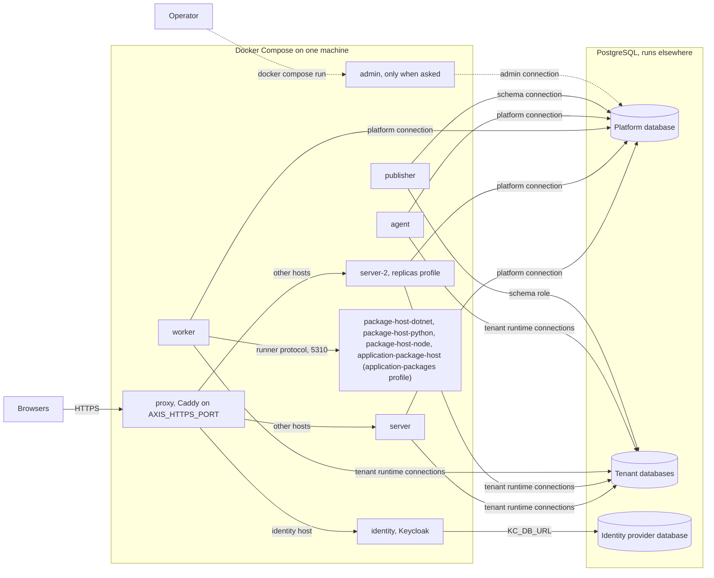

# Installation on premises

This page installs Axis on one machine with Docker Compose, from the example in `deploy/compose/`. It
belongs with [installation](installation.md), which lists the images, settings and secrets, and the TLS
rules. In this page, "database role" always means the PostgreSQL role.

## On premises

This section installs Axis on one machine with Docker Compose, from the example in `deploy/compose/`.
PostgreSQL runs elsewhere, and Axis's identity provider runs beside the server with its own database
on that PostgreSQL server.

The example's `compose.yaml` has the server, the worker, the agent host, the publisher, the identity provider,
the TLS proxy, the C#, the Python and the Node.js package host and the admin host, and `docker compose up` starts all of them but the admin host. A second server replica sits
under the `replicas` profile, see [TLS proxy and a second replica](#tls-proxy-and-a-second-replica), and the application package host under the `application-packages` profile.
The file holds no password, client secret or key.

Every service that reads `Platform__SecretKey` also mounts the key file `KeyService__KeyFile` and sets `KeyService__Kind=file`, because a host outside Development and Testing does not start without a key service, and it refuses a plain key. `Platform__SecretKey` holds a wrapped key, see [the secret files](#the-secret-files).

- **The server, the worker and the agent host** run the production images with a read-only root file system. The
  identity provider cannot, because Keycloak rebuilds itself at start and writes into its image.
- **The admin host** runs only when asked, through `docker compose run --rm admin`.
- **The publisher** runs the `axis-admin` image with the command `publisher`. It gets the
  `ConnectionStrings__PlatformSchema`, `Platform__SecretKey` and `KeyService__KeyFile` files and not
  `Admin__ConnectionString`, and it publishes no port. Its `stop_grace_period` is six minutes, longer
  than the five-minute lease, so a stop lets the running request finish. It sits on the default network and on the internal network `runners`,
  and sets `Extensions__Runners__Application` to `application-package-host:5310`, so a publish can build the packages of an application, see [an application's packages](package-runners.md#an-applications-packages).
- **The agent host** runs the `axis-agent` image. It mounts the `ConnectionStrings__Platform`, `Platform__SecretKey` and
  `KeyService__KeyFile` files and no folder, and it publishes only its health port on `127.0.0.1`. The example gives it no
  `Ai:DefaultBinding`, so AI authoring is off. To turn it on, see [the installation key](#the-secret-files) for the host key file.
- **The package hosts** are `package-host-dotnet`, `package-host-python` and `package-host-node`. They run the `axis-package-host-dotnet`, `axis-package-host-python` and `axis-package-host-node`
  images with the command `host`, and run the C#, the `python` and the `node` package operations of the worker, see [package runners](package-runners.md#package-runners).
  Each has a read-only root file system apart from a `/tmp` tmpfs, no environment, secret or published port, and `/extensions` read-only and
  nothing else. Its limits are 1 CPU and 1g of memory. `AXIS_PACKAGE_HOST_CPUS` and `AXIS_PACKAGE_HOST_MEMORY` change those of the C# host, `AXIS_PACKAGE_HOST_PYTHON_CPUS` and `AXIS_PACKAGE_HOST_PYTHON_MEMORY` those of the Python host, and `AXIS_PACKAGE_HOST_NODE_CPUS` and `AXIS_PACKAGE_HOST_NODE_MEMORY` those of the Node.js host.
  A host sits only on the internal network `runners`, which no other service but the worker, the publisher and the other package hosts share, so only they reach its port 5310, which
  does not authenticate a connection, and it reaches nothing outside that network. The worker sets `Extensions__Runners__Dotnet` to
  `package-host-dotnet:5310`, `Extensions__Runners__Python` to `package-host-python:5310` and `Extensions__Runners__Node` to `package-host-node:5310`.
- **The application package host** is `application-package-host`, behind the `application-packages` profile. `docker compose --profile application-packages up -d application-package-host` starts it and `docker compose up` does not.
  It runs the `axis-package-host-node` image under the `runsc` runtime, which is gVisor, and runs the code of [an application's packages](package-runners.md#an-applications-packages).
  gVisor installed and registered with Docker as `runsc` is a prerequisite of that profile only, and `scripts/setup.sh` does it on Linux, see [development](../development.md#setup).
  It has the rules of a package host for its root, environment, secret, port, mount and network, and its own limits, 1 CPU and 1g, which `AXIS_APPLICATION_PACKAGE_HOST_CPUS` and
  `AXIS_APPLICATION_PACKAGE_HOST_MEMORY` change. The worker and the publisher set `Extensions__Runners__Application` to `application-package-host:5310` and ask it only when `Extensions__ApplicationPackages` is `true`.
- **The images.** Set `AXIS_VERSION` to the tag of the seven images. `AXIS_IMAGE_PREFIX` adds a
  registry prefix. The comment at the top of `compose.yaml` lists every variable.

The diagram shows the services of the example and the PostgreSQL server that they connect to. The
bullets above name the services, and [TLS proxy and a second replica](#tls-proxy-and-a-second-replica)
says how the proxy routes requests. The example has no PgBouncer.



### Database roles

Before the first start, create these database roles and the platform database on the PostgreSQL
server. [Database roles](storage.md#database-roles) says what each may do.

```sql
CREATE ROLE axis_platform_schema LOGIN PASSWORD '<password>';
CREATE ROLE axis_platform LOGIN PASSWORD '<password>';
CREATE ROLE axis_admin LOGIN PASSWORD '<password>' CREATEDB CREATEROLE;
CREATE DATABASE axis_platform OWNER axis_platform_schema;
CREATE ROLE axis_identity LOGIN PASSWORD '<password>';
CREATE DATABASE axis_identity OWNER axis_identity;
CREATE ROLE axis_identity_reader LOGIN PASSWORD '<password>';
```

| Database role | Used for |
| --- | --- |
| `axis_platform_schema` | `ConnectionStrings:PlatformSchema`. It owns the `platform` schema. |
| `axis_platform` | `ConnectionStrings:Platform`. The server gives it read access to the `platform` schema, insert on `platform.data_protection_keys`, write access to the three usage tables `platform.tenant_usage`, `platform.tenant_usage_latest` and `platform.tenant_token_usage`, to `platform.tenant_leases` and to `platform.operator_sessions`, insert on `platform.jobs`, and insert and update on `platform.tenant_daily_counters`. It has no access to `platform.audit_records`. |
| `axis_admin` | `Admin:ConnectionString`. It has `CREATEDB` and `CREATEROLE` and is not a superuser. |
| `axis_identity` | The identity provider's own database, `axis_identity`. It owns that database and nothing else. |
| `axis_identity_reader` | `IdentityProvider:DatabaseConnectionString`. It reads Keycloak's `credential` table and nothing else, so `tenant backup` can write `realm.json`. |

Keycloak creates its tables at its first start, so give `axis_identity_reader` its right after that,
once, connected to `axis_identity`:

```sql
GRANT USAGE ON SCHEMA public TO axis_identity_reader;
GRANT SELECT ON credential TO axis_identity_reader;
```

A later Keycloak upgrade that recreates the `credential` table drops the grant. Then the `realm` step of
`tenant backup` fails until you grant it again.

The names are examples. Create the tenant database roles through `tenant create`, not by hand.
`tenant create` also creates each tenant's realm in
[Axis's identity provider](identity-provider.md#keeping-the-realm-in-step). The identity provider
starts with the admin client `axis-admin` in its `master` realm, whose secret is the
`IdentityProvider__AdminClientSecret` file that the admin host reads too, so you write that secret
once.

### The scenario role

To let Studio run test scenarios, create one more role. It has `CREATEDB`, is not a superuser and owns
no tenant database. It owns no database at all, so its connection string names the `postgres`
database.

```sql
CREATE ROLE axis_scenario LOGIN PASSWORD '<password>' CREATEDB;
```

1. Put its connection string in the secret file `Scenarios__ServerConnectionString`.
2. Add `deploy/compose/compose.scenarios.yaml` to the Compose files, as
   `docker compose -f compose.yaml -f compose.scenarios.yaml ...` or with
   `COMPOSE_FILE=compose.yaml:compose.scenarios.yaml`.

That file mounts the secret in the publisher only and sets `Studio__Tests=true` on both servers, so
one cannot be on without the other. Without it, the publisher gets no scenario secret and Studio shows
no test controls. `compose.yaml` does not declare the secret itself, because Compose fails to start a
service whose secret file is missing, and that would force every operator to create it.

Point the role at a PostgreSQL server that holds no tenant data. If it shares the server with tenant
databases, run `REVOKE CONNECT ON DATABASE <tenant database> FROM PUBLIC` for each one, because
PostgreSQL lets every role connect by default. The scenario role can then connect to a tenant
database but read nothing in it. The publisher drops each scenario database after use. After a crash,
drop the `axis_scenario_*` databases that the role owns, see [publisher](publisher.md#publisher).

### The secret files

Compose reads one file per secret from `AXIS_SECRETS_DIR`, which defaults to `./secrets` next to
`compose.yaml`. Each file is named after its setting, and its content is the value.

| File | Mounted in |
| --- | --- |
| `ConnectionStrings__Platform` | server, worker, agent, publisher |
| `ConnectionStrings__PlatformSchema` | server, admin, publisher |
| `Platform__SecretKey` | server, worker, agent, admin, publisher |
| `KeyService__KeyFile` | server, worker, agent, admin, publisher |
| `Admin__ConnectionString` | admin |
| `IdentityProvider__AdminClientSecret` | admin, identity |
| `IdentityProvider__DatabaseConnectionString` | admin |
| `KC_DB_URL` | identity |
| `KC_DB_USERNAME` | identity |
| `KC_DB_PASSWORD` | identity |
| `Scenarios__ServerConnectionString` *(optional, only with `compose.scenarios.yaml`)* | publisher |

- **Writing them.** Write each file with `printf '%s'`, so it has no trailing newline. Make the folder
  and the files readable by UID 1654, the user the images run as, and the files that the identity
  provider reads readable by UID 1000, the user of the Keycloak image.
- **The installation key and the key file.** `KeyService__KeyFile` holds the key of the key service, 32 random bytes in
  base64. `Platform__SecretKey` holds the installation key wrapped with it. Compose mounts the key file at
  `/run/key-service/key`, outside `/run/secrets`, and sets `KeyService__KeyFile=/run/key-service/key`, because every host
  reads a file in `/run/secrets` as a setting and would take the key's text for the path. Make the key file once, keep
  a copy outside the installation, and wrap a new installation key with `platform key wrap` from the admin image. The
  plain key goes through standard input and is never written to a file:

  ```bash
  openssl rand -base64 32 | tr -d '\n' > secrets/KeyService__KeyFile
  openssl rand -base64 32 | docker run --rm -i --read-only \
    -e KeyService__Kind=file -e KeyService__KeyFile=/run/key-service/key \
    -v "$PWD/secrets/KeyService__KeyFile:/run/key-service/key:ro" \
    "${AXIS_IMAGE_PREFIX:-}axis-admin:$AXIS_VERSION" platform key wrap --purpose installation-key \
    | tr -d '\n' > secrets/Platform__SecretKey
  ```

  A host that reads a key that is not wrapped, or that was wrapped with another key file, stops at start and names
  `Platform__SecretKey`. For AI authoring, make the agent host's key as an EC P-256 private key in PEM form, wrap it with
  `--purpose agent-host-key`, and mount the output in your own override file as the file that `Ai__HostKeyFile` names.
  Make it readable by UID 1654 like the other files. See [the key policy](keys-and-data-protection.md#key-policy).
- **The connection strings.** Each sets `SSL Mode=VerifyFull`, and `Root Certificate` when your
  PostgreSQL certificate comes from a private authority, because the hosts refuse anything weaker, see
  [TLS](installation.md#tls). They name the database server as the hosts reach it, which is a name in the PostgreSQL
  certificate. The admin host records the host and port of `Admin__ConnectionString` as the tenant
  database server, so the server and the worker must reach it there too.
- **The identity provider's read-only role.** `IdentityProvider__DatabaseConnectionString` names the
  database `axis_identity` and the role `axis_identity_reader`, with `SSL Mode=VerifyFull`. The admin
  host reads it only for `tenant backup`. You can write the file before Keycloak's first start and run
  the grant of [the database roles](#database-roles) after it.
- **Keycloak's database settings.** The three `KC_DB_*` files hold a JDBC URL such as
  `jdbc:postgresql://db.example.com:5432/axis_identity?sslmode=verify-full&sslrootcert=/db-ca/root.crt`,
  the user name and the password. Without `sslrootcert`, the PostgreSQL JDBC driver reads
  `~/.postgresql/root.crt`, which does not exist, and Keycloak does not start. For a PostgreSQL
  certificate from a public authority, use `sslfactory=org.postgresql.ssl.DefaultJavaSSLFactory`
  instead of `sslrootcert`. Keycloak has no `_FILE` variables, so a small entrypoint script turns each
  file into the variable of the same name.

### The identity provider

The identity provider needs these before the first start. It runs the Keycloak image that development
and the tests pin, and the operator upgrades it with Axis.

- **`AXIS_IDENTITY_HOST`.** The one public host name of the identity provider, such as
  `id.example.com`, which is required. The proxy sends requests for this host to the identity provider
  and every other host to the servers. The containers reach the same name through a network alias of
  the proxy, so a browser and the server use one address. Each realm's authority is
  `https://<AXIS_IDENTITY_HOST>/realms/<tenant>`.
- **The certificate.** Put `tls.crt` and `tls.key` in `AXIS_IDENTITY_TLS_DIR`, which defaults to
  `./identity-tls`. The certificate is issued for the name `identity` by the authority of
  `server-ca.crt`, which the proxy trusts. Compose mounts the folder read-only at `/identity-tls` on
  the identity provider and on no other service. Both files must be readable by UID 1000. Keycloak
  listens on HTTPS only, on port 8443, and publishes no port. The proxy certificate must also cover
  `AXIS_IDENTITY_HOST`.
- **The database authority.** Put `root.crt`, the authority certificate of your PostgreSQL server, in
  `AXIS_IDENTITY_DB_CA_DIR`, which defaults to `./db-ca`. Compose mounts the folder read-only at
  `/db-ca` on the identity provider and on no other service, and `sslrootcert=/db-ca/root.crt` in
  `KC_DB_URL` names the file. It must be readable by UID 1000. It is a public certificate, not a
  secret.
- **The theme.** Build the Axis theme from the release's source with
  `npm run build:keycloak-theme --prefix web`, and set `AXIS_IDENTITY_THEME_DIR` to the output folder,
  `artifacts/keycloak-theme`. Compose mounts it read-only at `/opt/keycloak/themes`, so sign-in pages
  show the Axis theme. A release does not carry the built theme.
- **The breached-password list.** Compose mounts `deploy/keycloak/password-blacklists` read-only at
  `/opt/keycloak/data/password-blacklists`, and realms made by `tenant create` check new passwords
  against it. Set `AXIS_PASSWORD_BLACKLISTS_DIR` to use another folder.
- **The admin console.** Keycloak's admin console and admin API answer on the public identity host,
  and Keycloak authentication protects them. Limit them by network in front of the proxy if you need
  to.

### Folders

Put extension packages in `AXIS_EXTENSIONS_DIR` and modules in `AXIS_MODULES_DIR`, which Compose
mounts read-only at `/extensions` and `/modules`. Put the application folders for `activate` in
`AXIS_APPS_DIR`, which Compose mounts at `/apps` in the admin container only.

### The order

Install in this order:

1. Put the secret files in place.
2. Run `docker compose run --rm admin migrate`. On a first install it has nothing to migrate and exits
   with code 0.
3. Start the identity provider and the proxy with `docker compose up -d identity proxy`, and wait until
   `https://<AXIS_IDENTITY_HOST>/realms/master/.well-known/openid-configuration` answers `200`. Then
   start the server, the worker, the agent host and the three package hosts with
   `docker compose up -d server worker agent package-host-dotnet package-host-python package-host-node`, and
   wait until `/health/ready` answers `200` on the server and the worker, because the server creates the `platform` tables at start
   and `tenant create` needs them. Then start the publisher with `docker compose up -d publisher`. It
   exits with code 1 until the server has created those tables, so start it only after
   `/health/ready`.
4. Create a tenant with `docker compose run --rm admin tenant create <id> --host <host>`. The command
   creates the tenant's realm in the identity provider and sets the redirect addresses of the `axis`
   client from the hosts you give it. The compose file points the admin host at
   `https://<AXIS_IDENTITY_HOST>/` and sets the admin client id `axis-admin`, so you set no shell
   variable, and the admin client secret is the `IdentityProvider__AdminClientSecret` file, so it is
   in no command line. Every `admin` run needs that file and the `IdentityProvider__DatabaseConnectionString`
   file, because Compose refuses to start a service whose secret file is missing.
5. Activate an application with `docker compose run --rm admin activate /apps/<folder>`. The
   activation copies the redirect addresses and mappers of the `axis` client to the client of each
   site, and it does not copy later changes until the next activation.

The hosts serve a tenant after their next refresh, which `Tenancy__RefreshInterval` sets, 30 seconds
by default.

- **The OIDC authority must be `https`.** The server runs in `Production`, which refuses an identity provider
  over plain `http`, so `tenant create` refuses a plain `http` `IdentityProvider__Url` there too.
- **A private certificate authority.** When the proxy's certificate comes from your own authority, add
  its certificate to the trust store of the server, of the admin host and of the publisher, because
  they reach the identity host through the proxy. Do not replace the store: pointing `SSL_CERT_FILE` at
  one file makes the server trust only that file.
- **Ports.** The server listens on `127.0.0.1:8080` of the host, the second replica on
  `127.0.0.1:8081`, the worker's health endpoints on `127.0.0.1:5208` and the agent host's on
  `127.0.0.1:5209`. `AXIS_WORKER_HEALTH_PORT` and `AXIS_AGENT_HEALTH_PORT` change the last two. Both
  servers serve HTTPS only, on container port 8443. The health endpoints stay plain HTTP, because they
  carry no application traffic. The proxy is the only service published beyond the machine, on port 443. To
  use a reverse proxy of your own instead, put it on the same machine in front of the server, make it
  connect over HTTPS and check the server certificate, and let it reach the identity provider too. See
  [forwarded headers](several-server-replicas.md).
- **Probes.** The images hold no `curl`, so the example has no container health check. Probe
  `/health/ready` from the host, for example
  `curl --cacert <ca> --resolve servers:8080:127.0.0.1 https://servers:8080/health/ready`.
- **The server certificate.** Put `tls.crt` and `tls.key` in `AXIS_SERVER_TLS_DIR`, which defaults to
  `./server-tls`. The certificate is issued for the name `servers`, the network alias of both
  replicas. Compose mounts the folder read-only at `/server-tls` on both servers and on no other
  service, so only the servers hold the private key. Both files must be readable by UID 1654, the user
  of the image. A server does not start without them.
- **The purchase request sample** needs a purchasing system binding, which `tenant binding set` sets,
  see [deployment bindings](tenant-setting-commands.md#deployment-bindings). This guide activates the
  leave request sample.

### TLS proxy and a second replica

The `proxy` service, which `docker compose up` starts, is a pinned Caddy proxy that ends TLS. It
accepts only the versions and ciphers that [TLS](installation.md#tls) states, and it is the only way to reach the
identity provider. It routes by host: requests for `AXIS_IDENTITY_HOST` go to `identity` on port 8443
over TLS, and every other host goes to the servers. The `replicas` profile starts `server-2`,
configured like `server`.

- **The certificate.** Put `tls.crt` and `tls.key` in `AXIS_TLS_DIR`, which defaults to `./tls`.
  Compose mounts the folder read-only at `/certs`, so no compose file holds a certificate or a key. The
  files must be readable by the proxy. The certificate must cover every tenant host and
  `AXIS_IDENTITY_HOST`, see [TLS](installation.md#tls). Put `server-ca.crt` in the same folder: the certificate of the
  authority that issued the server and identity certificates. The proxy trusts that one certificate
  for the servers and the identity provider, and no other.
- **The ports.** The proxy publishes `AXIS_HTTPS_PORT`, 443 by default. `server-2` publishes
  `127.0.0.1:${AXIS_SERVER_2_PORT}`, 8081 by default, for health probes.
- **The replicas.** Both servers answer to the network alias `servers`. The proxy looks that name up
  again every five seconds, so a restarted replica rejoins on its own. A request to a replica that is
  down is retried on the other one. The proxy connects to port 8443 over TLS and checks that the
  certificate is for the name `servers` and comes from the authority in `server-ca.crt`.
- **The forwarded headers.** The Compose network has a fixed subnet, `AXIS_NETWORK_SUBNET`,
  172.31.250.0/24 by default. The proxy has a fixed address in it, `AXIS_PROXY_ADDRESS`, 172.31.250.10
  by default. Both servers get it as `ForwardedHeaders__KnownProxies__0`, so they trust forwarded
  headers from that address only. The proxy replaces any `X-Forwarded-For`, `X-Forwarded-Proto` and
  `X-Forwarded-Host` that a client sends. Behind it, sign-in returns to
  `https://<tenant host>/api/auth/callback` and the session cookie is `Secure`.
- **The runners network.** The `runners` network is `internal`: it has no route out. Only the worker, the publisher and the four package hosts
  join it, and the worker and the publisher also stay on the default network. It has no fixed subnet.
- **The address range.** Docker hands out addresses without a fixed one only from
  `AXIS_NETWORK_IP_RANGE`, 172.31.250.128/25 by default, so a short-lived `admin` container cannot take
  the proxy's address. If the default subnet overlaps a network of the machine, `docker compose up`
  fails: set `AXIS_NETWORK_SUBNET`, `AXIS_NETWORK_IP_RANGE` and `AXIS_PROXY_ADDRESS`. Compose does not
  change an existing network in place, so run `docker compose down` before a start that changes them.
- **The start order.** Start `server` first and wait for `/health/ready`. Then run
  `docker compose --profile replicas up -d server-2` and wait for its `/health/ready`. The proxy is
  already running.
- **Studio.** Studio is off until you turn it on. Both servers mount `AXIS_STUDIO_DIR`, `./studio` by
  default, read-write at `/studio`, and so does the publisher, at the same path, because the write lock is
  keyed by the folder path. No other service mounts it. To turn Studio on, set
  `Studio__Folders__0=/studio/<folder>` in the shell, where `<folder>` is an application folder inside
  `AXIS_STUDIO_DIR`. Set `Studio__AuthorRole` and `Studio__PublisherRole` too, because without them
  nobody may author or publish. All three pass through from the shell to both servers. More folders
  need an override file that adds `Studio__Folders__1` and so on. Create the folder before the first
  start, because Docker creates a missing one owned by root. It must be writable by UID 1654, the user
  of the image, and it must be the same folder for every replica. See
  [Studio settings](host-settings.md#studio-settings).

### Tests of the example

Two kinds of test keep the example as this section describes it.

- **The smoke test.** `scripts/onprem.test.mjs`, which `scripts/smoke.sh` runs, builds the seven
  production images and installs the example in the order above, against a test PostgreSQL over TLS
  and the example's own identity provider, with a certificate authority that it makes for the run. Its
  additions, such as the scenario role and the modules from `artifacts/modules`, sit in an override
  file in a temporary folder, so `deploy/compose/compose.yaml` stays as an operator uses it. It creates
  two tenants, activates the leave request sample for both and checks that each serves on its own host
  and signs in through its own realm, that every Axis connection uses TLS, that a suspended tenant
  answers `503` while the other serves, that the installed publisher runs a publish request of each
  tenant to `succeeded`, that a session works on both replicas and survives a restart, that the
  proxy's TLS versions and ciphers are the ones of [TLS](installation.md#tls), and that a Studio save on one replica
  is read on the other and a stale save there answers `409`. It checks each running package host, the C#, the Python and the Node.js one: its root refuses a write
  and `/tmp` takes one, its limits are set, its environment is the one of its image, it reaches the worker but not the
  proxy, PostgreSQL or an outside address, and the worker reaches it on 5310. It builds the sample packages `payment-references` and `payment-terms` with the
  `build` command of the C# and the Node.js package host images and mounts the result as `AXIS_EXTENSIONS_DIR`, read-only in the worker and the package hosts. It
  sets the deployment bindings of the purchase request sample for tenant one, every url binding over https, and activates the sample there, so that tenant one
  serves `leave` and `purchasing` and tenant two serves `leave`. It runs no `test` request against the installed images. It then runs the approval journey of the purchase request sample on tenant one. The purchasing system stub serves https only, with a certificate of the test authority, which the worker trusts, and the bindings point at it. The requester submits a request below the finance threshold, and the requester's completion of the manager's task answers `403`. The department's manager approves it. The request then holds the purchase order number that the stub also holds, and the payment reference and the payment due date, which the test checks against values it computes itself. `docker compose top` shows a runner of `payment-references` in the C# package host and one of `payment-terms` in the Node.js package host, and the worker's `/proc/1/maps` names `Axis.Worker.dll` and no file under `/extensions`, so the worker holds no package code. It also builds the test package `test-package` 1.0.0 with the `build` command of the C# package host image, sets its `TestUrl` and `TestToken` bindings for tenant one and activates the fixture application `tests/smoke/package-probe-app` there, see [smoke test fixtures](../testing.md#smoke-test-fixtures). The fixture's operator starts its process, whose one step runs the package's `probe` operation in the `ownOtherHost` mode. The package's own HTTP client sends its request to `localhost`, which the worker's egress proxy refuses, so the instance ends `failed`. The failed step's error in the instance detail names the operation and the package and not the host, and the requester, who lacks the fixture's `operator` role, gets `403` from the same route.
- **The static checks.** Other tests read the rendered configuration and check the rules of this
  section: that nothing under `deploy/compose/` holds a secret, that every secret comes only from
  `secrets:` files, that each service mounts only the secrets, certificates and folders listed here,
  that the scenario secret and `Studio__Tests` appear only with `compose.scenarios.yaml`, that every
  published port of both servers is on `127.0.0.1`, that each package host has a read-only root, its limits, no environment,
  secret or port, and only the packages, read-only, and sits only on the internal `runners` network with the worker, the publisher and the other package hosts, that the worker mounts the same packages folder read-only, and that the Caddyfile and the Kestrel settings
  match [what the Compose example sets](installation.md#tls).
