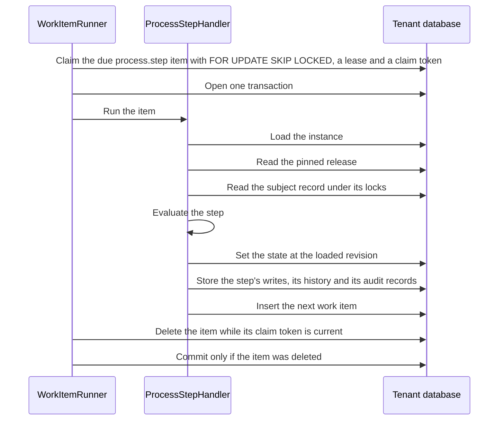

# Process execution

This page describes how the worker runs processes: the transaction of each step, the paths of a
process, and the worker's settings and metrics. The connector calls and package operations that a
step stages are in [connector and package calls](connector-and-package-calls.md). The process
resource is in [Processes](processes.md), and the steps that wait, loop or start other instances are
in [process flow](process-flow.md).

## Execution

The worker host, `Axis.Worker`, runs the steps of every process instance, and the server runs none.
Each step runs in one transaction, so a step either happens whole or leaves no trace, and a crash
never leaves an instance half moved.

- **Tenant.** Each work item carries its tenant id, and the worker sets the tenant context from it.
- **One transaction per step.** A step commits these together: business writes, the new instance
  state and revision, the step history, audit records and the next work item. A revision mismatch
  aborts the transaction.
- **Revision.** An instance's revision is a counter that starts at 1 and goes up each time the
  instance changes. A step changes the instance only at the revision it loaded.
- **Claims.** A worker claims ready work with `FOR UPDATE SKIP LOCKED`. It sets a lease and a claim
  token on the work item, and the step's commit checks that the token is still the worker's. When a
  lease expires, another worker can claim the item.
- **Failure.** A failing step rolls back. A following transaction records the error in the history
  and sets the instance to `failed`. No step is retried. A `callConnector` step retries its call
  under its retry policy, see [Connector calls](connector-and-package-calls.md#connector-calls), and so does a package operation
  step, see [Package operations](connector-and-package-calls.md#package-operations). An operator can retry a `failed` instance, see
  [Retry](process-operator-commands.md#retry).
- **Error paths.** _(planned for M38)_ A step that names an error path for its kind of failure takes
  it instead of failing its path, see [Paths](#paths).
- **Work item errors.** When a work item's handler throws, its writes roll back. A following
  transaction, still checked against the claim token, deletes the item and calls the handler's
  failure callback with the error, and the item is not retried. A worker that crashes or stops before
  it commits calls no failure callback, and its item is claimed again after the lease expires.
- **Calls outside a transaction.** A `connector.call` item runs with no transaction open while its
  request is in flight, and a `package.call` item runs with none open while its operation runs. Each
  opens its own short transactions, before and after the call, and each checks the claim token. See
  [Staging and the call](connector-and-package-calls.md#staging-and-the-call).
- **Restarts.** An instance that waits on a task has no work item, so it needs no running worker. One
  that waits on a connector call has the call's `connector.call` item, one that waits on a package
  call its `package.call` item, and one that waits on a timer, or on a `waitEvent` step with a
  `timeout`, its `process.timer` item. One that waits on a call to a customer-hosted package has a
  `package.call` item only while a runner's lease runs or a retry waits, and otherwise needs no worker. A task decision is accepted while no worker runs: it queues the
  next step's work item, and the next worker to start runs that step. A step that a worker never
  committed leaves no trace, and the worker that claims it after the lease runs it once.
- **History.** Every step occurrence records its input, its output, the decision taken and any error.

### Running a step

Every step runs from a work item that a worker claims. This section describes the `process.step` item,
which runs a step, and the `process.timer` item, which resumes a waiting instance. The other kinds of
work item that processes queue are described with their step:

| Work item            | What it does                                                                            | Described in                                                                                                       |
| -------------------- | --------------------------------------------------------------------------------------- | ------------------------------------------------------------------------------------------------------------------ |
| `process.step`       | Runs the current step of its instance                                                   | This section                                                                                                       |
| `process.timer`      | Resumes an instance that waits on a `timer` step, or on a `waitEvent` step at its `timeout` | This section, [Timer step](process-flow.md#timer-step) and [Wait for event step](process-flow.md#wait-for-event-step) |
| `connector.call`     | Sends the call that a `callConnector` step staged                                       | [Staging and the call](connector-and-package-calls.md#staging-and-the-call)                                                                      |
| `package.call`       | Runs the operation that a package operation step staged, and ends a runner's lease      | [Staging a package call](connector-and-package-calls.md#staging-a-package-call)                                                                  |
| `process.resume`     | Resumes the parent of a `subProcess` step when its child completes                      | [Sub-process step](process-flow.md#sub-process-step)                                                               |
| `event.deliver`      | Delivers an event to its `async` triggers and wakes the `waitEvent` steps that wait for it | [Event delivery](process-events.md#event-delivery)                                                                 |
| `notification.email` | Sends one email that a `notify` step staged, or a person's digest                       | [Email](notifications.md#email)                                                                                    |
| `task.deadline`      | Expires the task of a task step that has a `deadline`                                   | [Task deadlines](task-deadlines.md#escalations-and-deadline)                                                       |
| `task.escalate`      | Runs one of the `escalations` of a task step                                            | [Task deadlines](task-deadlines.md#escalations-and-deadline)                                                       |

A `subProcess` step starts its child and waits. A `raiseEvent` step stores its event, see
[Raise event step](process-events.md#raise-event-step), and a `notify` step stores its in-app
notification and stages its emails, see [Notify operation](notifications.md#notify-operation).

Each `process.step` item runs the current step of its instance in one transaction:

1. It loads the instance. An instance that is missing or not `running` is skipped, and the item is
   deleted with no other write.
2. It reads the release the instance is pinned to, so an instance keeps the step graph it started
   with after a new release is activated.
3. It reads the subject record, under the locks that [Locks and computed fields](#locks-and-computed-fields)
   describes, and evaluates the step as the table below says.
4. It sets the new state and step, with the next revision, only if the instance is still `running` at
   the revision it loaded. Otherwise another transaction changed the instance first: the step then
   writes nothing else, and its work item is deleted, so it never runs again.
5. It stores what the step writes, see [What a step stores](#what-a-step-stores).
6. It writes the step's history row and its audit records, all with the actor `system`, as the table
   below says.
7. It inserts the next work item, as the table below says.

The diagram shows the steps of the list above, with the claim and the commit that the runner makes around them.

| Step                  | Evaluates on the record                                                                                                                                                                                                                                                                                                                            | Instance afterwards                                                     | Audit records                                                                                                                                                                                                 | Next work item                                                                                                     |
| --------------------- | -------------------------------------------------------------------------------------------------------------------------------------------------------------------------------------------------------------------------------------------------------------------------------------------------------------------------------------------------- | ----------------------------------------------------------------------- | ------------------------------------------------------------------------------------------------------------------------------------------------------------------------------------------------------------- | ------------------------------------------------------------------------------------------------------------------ |
| Decision              | Its branches in order, taking the first `when` that is true. A `when` that gives `null` counts as false. When no branch is true, it takes `otherwise`                                                                                                                                                                                              | `running` on the next step                                              | `process.stepCompleted` with details `{ "step", "next" }`                                                                                                                                                     | The next step's                                                                                                    |
| `updateRecord`        | Each `set` expression                                                                                                                                                                                                                                                                                                                              | `running` on its `next` step                                            | `record.updated` for the subject record, with the instance id and details `{ "version", "fields" }` as the [record API](record-audit.md#audit-records-and-history) writes them, then `process.stepCompleted` | The next step's                                                                                                    |
| `createRecord`        | Each `set` expression, on the record or, in a process without a subject, on its parameters. A value that fails at run time fails the step                                                                                                                                                                                                         | `running` on its `next` step                                            | `record.created` for the new record, with the instance id and details `{ "version" }`, then `process.stepCompleted`                                                                                          | The next step's                                                                                                    |
| `callConnector`       | Each `input` expression. A required input that gives `null` fails the step                                                                                                                                                                                                                                                                         | `waiting` on the step                                                   | `connector.callStaged` with details `{ "step", "connector", "operation", "operationId" }`                                                                                                                     | A `connector.call` item for its call                                                                               |
| Package operation     | Each `input` expression. A required input that gives `null` fails the step                                                                                                                                                                                                                                                                         | `waiting` on the step                                                   | `operation.staged` with details `{ "step", "package", "version", "operation", "operationId" }`                                                                                                                | A `package.call` item for its call                                                                                 |
| `raiseEvent`          | Each `fields` expression. A payload field that gives `null` is stored as `null`                                                                                                                                                                                                                                                                    | `running` on its `next` step                                            | `process.stepCompleted`                                                                                                                                                                                       | The next step's                                                                                                    |
| `notify`              | Its `user` recipients, its `values` and the parameters of its `open` page, even when `channels` has only `email`, and its `email` recipients when `channels` has `email`. A `user` or `email` that gives `null` or blank text has no recipient, and a run-time error in any of them fails the step. A process without a subject may notify | `running` on its `next` step                                            | `process.stepCompleted`                                                                                                                                                                                       | The next step's                                                                                                    |
| Task                  | Its assignee. A `user` expression gives the user id, and one that gives `null`, blank text or a run-time error fails the step. A `role` is the role name                                                                                                                                                                                          | `waiting` on the task step                                              | `task.created` with details `{ "step", "taskId" }`                                                                                                                                                            | None, because the instance waits for the task                                                                      |
| `timer`               | With a `wait`, nothing: the time is that of the step's transaction plus `wait`. With an `until`, the `until`, and one that gives `null` or a run-time error fails the step                                                                                                                                                                         | `waiting` on the step                                                   | None while it waits, because no audit action fits waiting for a time. Its resume writes `process.stepCompleted`                                                                                               | A `process.timer` item due at the time of the timer, with the `revision` the step left                             |
| `waitEvent`           | Looks for the earliest unused occurrence of its event about the record, raised at or after the instance's creation, whose `when` is true. A `when` that is false or fails at run time is no match. With a match, it records the use in `axis.process_event_matches`                                                                                | `running` on its `next` step with a match, otherwise `waiting` on the step | `process.stepCompleted` with details `{ "step", "next" }` with a match, and none while it waits                                                                                                              | The next step's with a match. While it waits with a `timeout`, a `process.timer` item due at the step's time plus `after` |
| End                   | Nothing                                                                                                                                                                                                                                                                                                                                            | `completed`, with its `ended_at` time                                   | `process.completed` with details `{ "step" }`                                                                                                                                                                 | None                                                                                                               |

`process.stepCompleted` has the details `{ "step", "next" }` wherever it is written. `now()` in any of
these expressions, a task's `assignee.user` included, gives the start time of the step's transaction.
That is the same instant the history row stores as `started_at`, and a validation that the
operation's write runs sees it too.

#### Locks and computed fields

A step locks only what its write needs, so that a user's write of the same record waits as little as
possible.

- **Row lock.** An `updateRecord` operation first locks the subject record's row, so it reads the
  latest stored version, and a user's write of the same record waits until the step's transaction
  ends. A `callConnector`, `raiseEvent`, `createRecord` or `notify` step only reads the record, so it
  takes no lock on it.
- **Event lock.** A `waitEvent` step takes an advisory lock keyed on the subject record before it
  reads the record, and holds it until the transaction ends. It does not lock the record's row.
- **Start lock.** An `updateRecord`, `raiseEvent` or `createRecord` step first takes the
  application's start lock shared, since it can start an instance. A `createRecord` step takes it in
  a process without a subject too.
- **Pending fields.** Every read of the subject record computes a
  [pending field](migrations.md#recomputing-computed-fields) with the active release and does not
  store the result. That covers decisions, `set` expressions, connector and package inputs,
  `raiseEvent` fields, `notify` recipients and values, and task assignees, and a run-time error reads
  `null`. An instance pinned to an older release reads the same way, but a computed value replaces
  the stored one only when the field has the same name and type in both releases.
- **Writing a pending field.** An `updateRecord` step evaluates its `set` expressions on the computed
  values and writes from the stored record. An `updateRecord` write under a release that is out of
  date for the entity marks the field pending again, see
  [Recomputing computed fields](migrations.md#recomputing-computed-fields).

#### What a step stores

After the instance's new state, step 5 stores what the step adds or writes:

- **Task.** A task step inserts its task into `axis.process_tasks` as `open`. Its `due_at` is the
  transaction time, `now()`, plus `dueIn`, added as a fixed length of time, or null without `dueIn`. A
  task step with `escalations` also queues one `task.escalate` work item for each, due at the
  transaction time plus its `after`, and one with a `deadline` queues one `task.deadline` work item
  after them, due at the transaction time plus the deadline's `after`. See
  [task deadlines](task-deadlines.md#escalations-and-deadline).
- **Connector call.** A `callConnector` step inserts its call into `axis.connector_calls` as
  `pending`, see [Staging and the call](connector-and-package-calls.md#staging-and-the-call).
- **Package call.** A package operation step inserts its call into `axis.package_calls` as `pending`,
  see [Staging a package call](connector-and-package-calls.md#staging-a-package-call).
- **Event.** A `raiseEvent` step inserts its occurrence into `axis.events`, see
  [Raise event step](process-events.md#raise-event-step).
- **In-app notification.** A `notify` step with the `inApp` channel inserts one row into
  `axis.notifications` for each distinct `user` and `role` recipient, all with one new notification
  id, see [In-app notifications](notifications.md#in-app-notifications). It inserts none when it has
  no recipient.
- **Emails.** A `notify` step with the `email` channel stages one email for each address, in the same
  transaction: a row in `axis.email_outbox` and a queued `notification.email` work item that names it,
  or, for a person's daily digest, a row that shares the person's one item. The addresses are those of
  the `user` recipients' profiles and the `email` recipients, each once. A `user` with no profile or no
  email gets none, and is logged with the step and the user id. See [Email](notifications.md#email).
- **Record update.** An `updateRecord` operation writes the values the way a record update does. Each
  value must fit its field, and a `null` for a required field is refused. Computed fields are
  recomputed, validations run, and the record's version goes up by one. A refused write is an error,
  keyed and worded as in [child rows](record-child-rows-and-validations.md#child-rows-computed-fields-and-validations).
- **Record create.** A `createRecord` operation creates its record in the step's transaction, as
  `system`, the way a record create does after its grant check: it applies the defaults of the fields
  `set` leaves out, sets each creator field to `system`, computes the computed fields, runs the
  validations and gives each sequence field its number. A `null` for a required field, and a required
  field with no value and no default, are refused with `Required.`. A refused create is an error that
  fails the step and leaves no record, no sequence number taken and no audit record. The history
  output is `{ "next", "recordId" }`. See [Create record operation](process-flow.md#create-record-operation).

#### Resuming from a timer

Each `process.timer` work item resumes one instance in one transaction. It loads the instance and
resumes it only while it is `waiting` on a `timer` step, or on a `waitEvent` step with a `timeout`, at
the item's `revision`. The instance then becomes `running` on the timer's `next`, or on the `waitEvent`
step's `timeout.next`, with the next revision. The item writes the history row `{ "next" }`, or
`{ "next", "timeout": true }` for a timeout, the audit record `process.stepCompleted` with details
`{ "step", "next" }`, and the work item of the next step. An item whose instance moved on, was
cancelled or is missing is deleted with no other write. A `process.timer` item that throws is rolled
back, and a following transaction sets the waiting instance to `failed`, writes a history row with the
error and the audit record `process.failed`, as for a step.

#### When a step fails

Any exception in the step, such as a `when` that divides by zero, a missing subject record, a record
write that a validation refuses or a task assignee that gives no user, rolls all of it back. So the
record keeps its values and version, and no task, connector call, package call, event occurrence or
notification is stored. A following transaction then sets the instance to `failed` with its
`ended_at` time and the next revision, writes a history row with the error, and writes the audit
record `process.failed` with details `{ "step" }` and the actor `system`. It does nothing when the
instance has changed since the step loaded it. No step is retried.

The error in the history row is never the exception message, because a message can hold a value. It
is one of these:

- the exception type, such as `System.DivideByZeroException`;
- a fixed text that names the step, the part and the kind of expression error, such as
  `The when of branch 0 of the step 'check' failed: DivisionByZero.`;
- for a refused write, each field pointer and message key, such as
  `The record update was rejected: /values/amount: request.amountNegative`. A
  [module contract](module-contracts.md#when-a-write-is-refused)'s refusal ends with its named point:
  `(named point Request/transitions/submit)`.

See [Step errors](process-inspection.md#step-errors-in-inspection). The failure is also logged at
Warning level with the step name, the instance id and the same fixed text as the history row. A failed
work item is logged with its exception type only.

**Error path.** _(planned for M38)_ A step with an `onError` entry for its kind of failure does not fail
its path in this transaction. It takes the error path, see [Paths](#paths).

## Paths

_(planned for M38)_

An instance is at one step, or at several when a [block](process-blocks.md) starts paths. A path is one
line of steps that runs on its own. A process without blocks has one path, and every rule above holds
for it as written. This section says what changes when paths run at once.

- **Root path.** The instance is its own root path. Its `step`, `revision` and state are that path's,
  and `axis.process_paths` holds a row only for a path that a block starts, see
  [Paths](process-tables.md#paths).
- **Starting paths.** The transaction of a `parallel` step inserts one path row for each branch that
  runs, and queues a `process.step` item for each. The path that reached the block waits on the block
  step, as a parent waits on a [sub-process](process-flow.md#sub-process-step), so the instance is
  `waiting` while its root path waits, and a second start for the same record stays blocked. Each path
  has its own state, see [path states](process-states.md#path-states).
- **Own position, revision and history.** Each path keeps its own `step`, `revision` and state. A step
  history row, a work item, a task and a call each name their path, so inspection and the worker tell
  the paths apart. A step of a path that a block started writes that path's row and never the
  instance's, so two paths never fight over one revision.
- **First resume.** A resume counts only at the path's revision. The second of two concurrent resumes
  of a path, such as a task completion and a deadline, finds the revision moved and writes nothing
  else, as step 4 of [Running a step](#running-a-step) says for an instance.
- **One transaction per step.** A step commits its business writes, its path's state and revision, its
  history, its audit records and the next work item together. The path's state and revision take the
  place of the instance's in the list of [Running a step](#running-a-step). A `process.step` item names
  its path, and it is skipped when that path is missing or not `running`.
- **Going on.** The transaction that ends a path checks the rule of the block it belongs to. When the
  rule holds, it resumes the path that waits on the block, on the block's `next`, with the next
  revision. A path that ends does not start a path outside its block.
- **Cancelling.** The transaction that finds the rule holding also cancels the paths of the block that
  still run. Each live sibling path and its descendants become `cancelled`, their open tasks become
  `closed`, their `pending` calls become `cancelled`, their work items are deleted, and one history row
  with the output `{ "state": "cancelled", "block" }` is written for each cancelled path. A call that
  is `sending` or `unknown` settles on its call row and in the audit as it does for a cancelled
  instance, but it writes no output and moves no path. Lock order follows
  [Cancel](process-operator-commands.md#cancel): the open tasks, then the instance, then the paths, parents
  before children. A path that ends locks the same way, so two paths that end at once queue and exactly
  one of them sees the rule hold.
- **Passes.** A `repeat` step's transaction reads its items once and inserts one path row for each item
  of a `forEach` or each pass of `times`, and one pass at a time for `while` and `until`. In order, the
  first pass runs, and the end of a pass starts the next one after the repeat's checks of `stopWhen`,
  `while`, `until` and `maxPasses`. With `waitBetween`, the transaction that ends a pass queues a
  `process.timer` item for the path that waits on the repeat, and its resume starts the next pass. With
  `atOnce`, the first `atOnce` passes start together, the others wait for their turn, and each pass that
  ends starts the next waiting one. When the repeat ends, the transaction cancels the passes still
  running, as under Cancelling.
- **Gathering.** A pass that ends without a skip stores the value of `gather` in the `gathered` column
  of its path row. When the repeat ends, its transaction writes the values to the variable in the order
  of the passes, so the list follows the items, see [variables](processes.md#variables).
- **Calls.** A call is known by its step, its path and its pass. Its row has `path_id` and `pass`, and
  the unique index is on instance, path, step and `staged_revision`, which is the path's revision. So a
  step that runs on every pass of a repeat, or on each of two branches, stages one call for each.
- **Error path.** A step that still fails takes the `onError` entry that names its kind of failure:
  `call` for a failed call, `record` for a refused write, `expression` for an expression that failed,
  `limit` for a reached limit and otherwise `any`. The step's failure transaction, or the outcome
  transaction of a failed call, sets the path `running` on the entry's `next`, writes the history row
  with the error and the output `{ "error", "next" }`, writes the audit record `process.errorPathTaken`
  with details `{ "step", "error", "next" }` and the actor `system`, and queues the next step. A call
  left `unknown` takes no error path, because it has not failed. The transaction is the one that would
  otherwise fail the path.
- **No error path.** A path whose step names no entry for its kind becomes `failed`. Its block then
  cancels the paths that still run, as under Cancelling, and takes its own `onError` for the same kind
  of failure. When the block has none, the path that waits on the block fails in turn. The root path
  fails the instance, as [When a step fails](#when-a-step-fails) says.
- **Limits.** Four limits keep an instance bounded, as [limits](process-blocks.md#limits) say. A limit
  at run time fails the step that would pass it with the error kind `limit`, so an `onError` entry can
  take it, and each has its [worker setting](#worker-settings):
  - `Worker:MaxPathsAtOnce` bounds the paths that an instance runs at once, across all its blocks.
  - `Worker:MaxRepeatItems` bounds the items of a `forEach` and the `times` of a repeat.
  - `Worker:MaxRepeatPasses` bounds the passes of one repeat.
  - Depth has no worker setting. It is a compile check, `AXC0379` in
    [compile checks](process-blocks.md#compile-checks), because the publisher cannot read a worker's
    settings.

## Worker settings

The worker's settings say which tenants it polls, how it claims and runs their work items and how long
it keeps in-app notifications. This section also covers when the worker starts claiming a tenant's
work and the clean-up it runs for each tenant.

**Which tenants.** Under `Tenancy:Source=configuration`, the worker polls every tenant database in the
`Tenants` section of its configuration, see [Tenant configuration](../architecture.md#tenant-configuration).
Under `directory`, it reads its tenants from the [tenant directory](../architecture.md#tenant-directory)
instead, over `ConnectionStrings:Platform`, and reads the directory again every
`Tenancy:RefreshInterval` without a restart, as that section describes for both hosts. What the worker
adds under `directory`:

- **Start.** It needs `ConnectionStrings:Platform` and `Platform:SecretKey` and stops at start
  without them, and it stops at start when `Tenancy:RefreshInterval` is invalid. It ignores a `Tenants`
  section and never uses `ConnectionStrings:PlatformSchema`. If the first read of the directory fails,
  it logs the failure once, retries every `Worker:PollInterval` and is not ready until a read works.
- **Wake-ups.** It listens on `axis_work` over one direct platform connection and connects again when
  it drops, see [waking a tenant](worker-scheduling.md#waking-a-tenant).
- **Refresh.** The refresh runs in the poll. It pauses the loops and waits for the items already
  running, not for a tenant's backlog, so no connection pool is dropped while an item runs. A tenant
  that is `suspended`, `provisioning` or removed gets no new work item claimed after the next refresh,
  and work already claimed finishes. A tenant added as `active` is polled after the next refresh, once
  its runtime database role check passes. Until then the worker skips it, logs an error and runs the
  check again at each refresh. A tenant whose database settings change goes through the check again
  and gets a new connection pool.
- **Failed refresh.** If a refresh fails, the worker keeps the last good read and logs an error, and
  `/health/ready` answers `200` with status `Degraded` until a refresh works.

**Migrations.** The worker never migrates a tenant database, so it can start before the server. Under
`Tenancy:Source=configuration` the server migrates the tenant databases. Before the worker claims work
for a tenant, it checks that the processes migrations are applied to the tenant database. Until they
are, it skips the tenant and logs once that it is waiting, and once they are, it logs that the tenant
is ready for work and starts claiming. Under `directory`,
[`Axis.Admin migrate`](administration.md#migrate) migrates the tenant databases, and the server does
not. The worker reads the recorded schema version of every tenant at each poll round, and claims none
of the work of a tenant whose schema version is not its own, until `migrate` has brought the tenant to
its version. It then runs the work without a restart. A tenant that waits for its schema version logs
once and does not make the worker not ready.

**Clean-up.** Once a tenant is ready, the worker runs these clean-ups for it, each with its own timer
and by its own clock:

| Clean-up      | What it deletes                                                                                                                                         | When                                                         |
| ------------- | ------------------------------------------------------------------------------------------------------------------------------------------------------- | ------------------------------------------------------------ |
| Sessions      | The expired rows of `axis.sessions`, see [sign-in and the session](security.md#sign-in-and-the-session)                                                  | When the tenant becomes ready, then at most every 5 minutes  |
| Files         | `deleted` files, and `pending` files uploaded more than 24 hours ago, see [storage and clean-up](file-fields.md#storage-and-clean-up)                   | When the tenant becomes ready, then at most every 5 minutes  |
| Import files  | The files of imports uploaded more than 24 hours ago, keeping the imports, see [import](import-export.md#import)                                         | When the tenant becomes ready, then at most every 5 minutes  |
| Notifications | In-app notifications older than `Notifications:RetentionDays`, with their read rows in one transaction, see [in-app notifications](notifications.md#in-app-notifications) | When the tenant becomes ready, then every 24 hours           |
| Model messages | The `messages` of authoring request steps that finished over 30 days ago, keeping the steps, see [durable requests](authoring-requests.md#durable-requests) | When the tenant becomes ready, then every 24 hours           |

A database without the clean-up's table yet is skipped. Any other failure is logged as a warning and
does not hold back the tenant's work items.

| Setting                       | Default                 | Meaning                                                                                                                                                                                                                                                                                       |
| ----------------------------- | ----------------------- | --------------------------------------------------------------------------------------------------------------------------------------------------------------------------------------------------------------------------------------------------------------------------------------------- |
| `Worker:LeaseDuration`        | `00:00:30`              | How long a claim lasts before another worker can claim the item.                                                                                                                                                                                                                              |
| `Worker:PollInterval`         | `00:00:01`              | The wait between two polls of a tenant that has work, and the first wait of the back-off of an idle one, see [waking a tenant](worker-scheduling.md#waking-a-tenant). It must be positive.                                                                                                  |
| `Worker:IdlePollCeiling`      | `00:00:30`              | The longest wait between two polls of an idle tenant. It must be at least `Worker:PollInterval`, or the worker stops at start.                                                                                                                                                                |
| `Worker:MetricsInterval`      | `00:00:30`              | How often the worker reads each tenant database for the [due work item and pending computed field gauges](#worker-metrics). It must be positive.                                                                                                                                              |
| `Worker:Concurrency`          | `4`                     | The loops that run work items at once, see [fair share](worker-scheduling.md#fair-share). It must be at least 1.                                                                                                                                                                              |
| `Worker:Quantum`              | `10`                    | The work items a tenant of weight 1 runs in one turn, see [fair share](worker-scheduling.md#fair-share). It must be at least 1.                                                                                                                                                               |
| `Worker:DeliveryAttempts`     | `5`                     | Failures of a delivery before it becomes a [dead letter](process-events.md#dead-letters). It must be at least 1.                                                                                                                                                                              |
| `Worker:StatementTimeout`     | `00:01:00`              | The `statement_timeout` of every transaction a work item runs. A statement past it fails the attempt, so the item is retried like any other failure of its kind, and a delivery counts it toward its dead letter. A value that is not a duration of at least one millisecond stops the start. |
| `Worker:MaxPathsAtOnce` _(planned for M38)_ | `100` | The paths one instance runs at once, across all its blocks, see [limits](#paths). It must be at least 1. |
| `Worker:MaxRepeatItems` _(planned for M38)_ | `1000` | The items of a `forEach` repeat, and the `times` of a repeat, see [limits](#paths). It must be at least 1. |
| `Worker:MaxRepeatPasses` _(planned for M38)_ | `1000` | The passes of one repeat, see [limits](#paths). It must be at least 1. |
| `Notifications:RetentionDays` | `90`                    | How many days the worker keeps [in-app notifications](notifications.md#in-app-notifications). A value that is not a whole number of at least 1 stops the worker at start.                                                                                                                    |
| `Health:Urls`                 | `http://127.0.0.1:5208` | The address of the worker's health endpoints, `/health/live` and `/health/ready`. It serves nothing else.                                                                                                                                                                                     |

As environment variables they are `Worker__LeaseDuration`, `Worker__PollInterval`,
`Worker__IdlePollCeiling`, `Worker__Concurrency`, `Worker__Quantum`, `Worker__MetricsInterval`,
`Worker__DeliveryAttempts`, `Worker__StatementTimeout`, `Notifications__RetentionDays` and
`Health__Urls`. What the health endpoints answer is in
[health checks](../architecture.md#health-checks).

**Limits.** _(planned for M38)_ As environment variables the three limits are `Worker__MaxPathsAtOnce`,
`Worker__MaxRepeatItems` and `Worker__MaxRepeatPasses`.

### Worker metrics

The worker emits these metrics, next to the standard ASP.NET Core, HttpClient and .NET runtime
metrics. Attributes name things and never hold values, see [Telemetry](../architecture.md#telemetry).

A metric is recorded in the transaction that writes the end or the attempt. So a transaction that
rolls back after its write, such as a `fenced` run, can count the same end or attempt again when the
item is retried. An ended instance whose release cannot be loaded is counted without
`axis.application` and `axis.process`, and a cancelled instance is not counted.

| Metric                           | Instrument | Unit            | Attributes                                                                                                                                                                                         |
| -------------------------------- | ---------- | --------------- | -------------------------------------------------------------------------------------------------------------------------------------------------------------------------------------------------- |
| `axis.work_items.due`            | gauge      | items           | `axis.tenant`, `axis.work_item.kind`                                                                                                                                                               |
| `axis.work_items.oldest_due_age` | gauge      | s               | `axis.tenant`, `axis.work_item.kind`. Stuck work shows here                                                                                                                                        |
| `axis.work_items.claim_delay`    | histogram  | s               | `axis.tenant`, `axis.work_item.kind`. The claim time minus the item's due time                                                                                                                     |
| `axis.work_items.duration`       | histogram  | s               | `axis.tenant`, `axis.work_item.kind`, `axis.outcome`: `completed`, `failed` or `fenced`                                                                                                            |
| `axis.process.instances.ended`   | counter    | `{instance}`    | `axis.tenant`, `axis.application`, `axis.process`, `axis.outcome`: the end state, `completed` or `failed`                                                                                          |
| `axis.calls.attempts`            | counter    | `{attempt}`     | `axis.tenant`, `axis.application`, `axis.connector` or `axis.package`, `axis.operation`, `axis.outcome`: the [call outcome](connector-and-package-calls.md#call-outcomes) class, `succeeded`, `retryable`, `failed` or `unknown` |
| `axis.queries.timeouts`          | counter    | `{query}`       | `axis.tenant`, `axis.application` when the route has one. An interactive read that ran past `Data:QueryTimeout`, or a write past `Data:WriteTimeout`, see [Errors](record-api.md#errors)           |
| `axis.dead_letters.created`      | counter    | `{dead_letter}` | `axis.tenant`, `axis.work_item.kind`. See [Dead letters](process-events.md#dead-letters)                                                                                                           |
| `axis.computed.pending_fields`   | gauge      | fields          | `axis.tenant`, `axis.application`. See [Recomputing computed fields](migrations.md#recomputing-computed-fields)                                                                                    |
| `axis.worker.active_tenants`     | gauge      | `{tenant}`      | None. The length of the active list, see [metrics](worker-scheduling.md#metrics)                                                                                                                   |
| `axis.worker.polls`              | counter    | `{poll}`        | `axis.poll.found`: `true` when the poll found work due, otherwise `false`. No tenant attribute                                                                                                     |

The gauges are read every `Worker:MetricsInterval` by a loop that is separate from the work loop, so a
hung item does not stop it and it does not slow the work. A metrics scrape never queries a tenant
database. An item counts as due once its `due_at` has passed, claimed or not, so a hung item keeps
aging. The age, the claim delay and the due time use the clock of the claim. The claim delay is
recorded once per claim, so an item that is claimed again after its lease expired records again, and
that delay includes the time the first worker held the item. Every kind the worker handles reports 0
when nothing is due, and so does every application with an active release when nothing is pending. A
kind with due items that the worker has no handler for reports its real count.
`axis.computed.pending_fields` adds up the pending field names of all pending entities of the
application. A tenant whose database cannot be read logs a warning and reports no data until a later
read succeeds.
