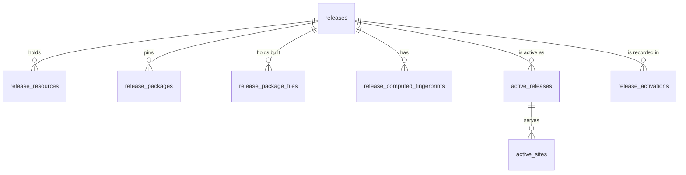
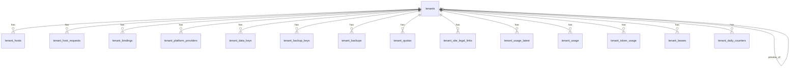

# Storage

This page says where Axis keeps its data: the system tables of each tenant database, the platform database
and the database roles. The entity tables and their schema planning are in
[entity tables and schema planning](entity-tables.md). The audit records and sequence counters are in
[audit records and sequence counters in storage](audit-records-and-sequence-counters.md). Migrations and the
recompute of stored computed fields are in [migrations](migrations.md), child tables in
[child collections in storage](child-tables-and-computed-columns.md), and publish requests and the release
history in [publish request storage](publish-request-storage.md).

## System tables

Each tenant database holds the system tables of Axis in its `axis` schema. Each module owns its
tables and manages them with its own EF Core context and migrations, and keeps its migration history
in a table of its own, `axis.__<module>_migrations`, so the contexts that share the schema do not
collide. The tables of the [platform database](#platform-database) are managed the same way, by EF
Core migrations shipped with Axis.

| Table                                  | Module               | One row is                                                                                                                                                                                                                                                                            |
| -------------------------------------- | -------------------- | ------------------------------------------------------------------------------------------------------------------------------------------------------------------------------------------------------------------------------------------------------------------------------------- |
| `axis.releases`                        | `Axis.Configuration` | A stored release                                                                                                                                                                                                                                                                      |
| `axis.release_resources`               | `Axis.Configuration` | A file of a release. A module's files keep their `modules/<id>/` path, see [modules](modules-and-templates.md#modules)                                                                                                                                                                |
| `axis.release_packages`                | `Axis.Configuration` | An extension package version that a release pins, as release id, package id and version, unique per release and package                                                                                                                                                               |
| `axis.release_package_files`           | `Axis.Configuration` | A built file of one of a release's own packages, keyed by release and path, see [versions and pinning](extension-packages.md#versions-and-pinning)                                                                                                                                    |
| `axis.active_releases`                 | `Axis.Configuration` | The active release of an application `id`, with the application's name, unique ignoring letter case                                                                                                                                                                                   |
| `axis.active_sites`                    | `Axis.Configuration` | A site path of an active release, as application `id` and path, unique on path                                                                                                                                                                                                        |
| `axis.release_computed_fingerprints`   | `Axis.Configuration` | The hash of an entity's computed definitions in a release, see [recomputing](migrations.md#recompute-tables)                                                                                                                                                                          |
| `axis.release_activations`             | `Axis.Configuration` | An activation, with its release number, see [release history](publish-request-storage.md#release-history)                                                                                                                                                                             |
| `axis.publish_requests`                | `Axis.Configuration` | A request that Studio stores and the publisher runs, see [publish requests](publish-request-storage.md#publish-requests)                                                                                                                                                              |
| `axis.application_settings`            | `Axis.Configuration` | A setting of an application that lives in no resource file, keyed by the manifest's `id`. Today that is [auto-accept](ai-authoring-in-studio.md#auto-accept). No row means the defaults                                                                                               |
| `axis.resource_writes`                 | `Axis.Configuration` | Who last wrote one file of an application folder in Studio, with the version the write left, keyed by the manifest's `id` and the file. A [resource activity](studio-resource-form.md#resource-activity) read uses it, and so does the [kind list](studio-resource-form.md#kind-list) |
| `axis.authoring_requests`              | `Axis.Configuration` | A request that an author sends and the agent host works on, see [authoring request storage](authoring-request-storage.md#authoring-requests)                                                                                                                                          |
| `axis.authoring_request_steps`         | `Axis.Configuration` | A step of an authoring request, in order                                                                                                                                                                                                                                              |
| `axis.provisioned_entities`            | `Axis.Data`          | A provisioned entity, with its application and table                                                                                                                                                                                                                                  |
| `axis.provisioned_enum_values`         | `Axis.Data`          | A recorded enum value                                                                                                                                                                                                                                                                 |
| `axis.sequence_counters`               | `Axis.Data`          | The last number of a sequence and period, see [sequence counters](audit-records-and-sequence-counters.md#sequence-counters)                                                                                                                                                                                                 |
| `axis.applied_migrations`              | `Axis.Data`          | A migration applied once in the tenant, see [applied migrations](migrations.md#applied-migrations)                                                                                                                                                                                    |
| `axis.computed_field_errors`           | `Axis.Data`          | A record and field whose computed expression failed, see [recomputing](migrations.md#recompute-tables)                                                                                                                                                                                |
| `axis.pending_computed_fields`         | `Axis.Data`          | An entity whose recompute the worker finishes in batches, see [recomputing](migrations.md#recompute-tables)                                                                                                                                                                           |
| `axis.record_imports`                  | `Axis.Data`          | An upload of a [record import](import-export.md#import), with its file until it is deleted, its format (`csv` or `xlsx`), its state and the errors of its dry run or commit                                                                                                           |
| `axis.audit_records`                   | `Axis.Data`          | An audited action, see [audit records](audit-records-and-sequence-counters.md#audit-records)                                                                                                                                                                                                                                |
| `axis.sessions`                        | `Axis.Data`          | A signed-in session                                                                                                                                                                                                                                                                   |
| `axis.mcp_clients`                     | `Axis.Data`          | An MCP client that called the MCP server, keyed by its client id, with its last use and the time its consent was revoked                                                                                                                                                              |
| `axis.mcp_consents`                    | `Axis.Data`          | A person's consent to an MCP client whose platform audit record is written, keyed by client and person                                                                                                                                                                                |
| `axis.given_roles`                     | `Axis.Data`          | A role that an administrator gave a person                                                                                                                                                                                                                                            |
| `axis.package_runners`                 | `Axis.Data`          | A customer-hosted runner of the tenant, with its name, client id, registered packages, last call time and revoke time, see [package runners](user-administration.md#package-runners)                                                                                                  |
| `axis.files`, `axis.file_contents`     | `Axis.Data`          | The details and the bytes of an uploaded file of a [file field](file-fields.md#storage-and-clean-up)                                                                                                                                                                                  |
| `axis.user_profiles`                   | `Axis.Data`          | A user who signed in, see [user profiles](notifications.md#user-profiles)                                                                                                                                                                                                             |
| `axis.table_views`                     | `Axis.Data`          | A view that a person saved for one table, see [table views and columns](frontend.md#table-views-and-columns)                                                                                                                                                                          |
| `axis.table_columns`                   | `Axis.Data`          | A person's columns of one table, see [table views and columns](frontend.md#table-views-and-columns)                                                                                                                                                                                   |
| `axis.notification_preferences`        | `Axis.Data`          | A person's choices for how each source of notices reaches them, see [notification preferences](notifications.md#notification-preferences)                                                                                                                                             |
| `axis.form_drafts` _(planned for M42)_ | `Axis.Data`          | A person's draft of a new record on one form, see [form drafts](record-form-state.md#form-drafts)                                                                                                                                                                                     |
| `axis.favourites` _(planned for M42)_  | `Axis.Data`          | A page or record that a person keeps as a favourite on a site, see [favourites and recent items](shell.md#favourites-and-recent-items)                                                                                                                                                 |
| `axis.recent_items` _(planned for M42)_ | `Axis.Data`         | A page and record that a person opened on a site, the latest 20 kept, see [favourites and recent items](shell.md#favourites-and-recent-items)                                                                                                                                          |
| `axis.process_*` and the others        | `Axis.Processes`     | Process instances, steps, tasks, staged calls, events, notifications, emails, webhook deliveries, receipts and work items, see [process tables](process-tables.md#tables)                                                                                                             |

The tables of `Axis.Processes` include `axis.process_instances`, `axis.process_step_history`,
`axis.process_tasks`, `axis.connector_calls`, `axis.package_calls`, `axis.process_call_attempts` (one
row per attempt and per lookup of a connector or package call), `axis.events` (one row per event
occurrence that a step raised), `axis.process_event_matches` (one row per use of an occurrence by a
`waitEvent` step), `axis.notifications` (one row per in-app notification and recipient),
`axis.notification_reads` (one row per notification and user who read it), `axis.email_outbox`,
`axis.webhook_deliveries` (one row per occurrence and webhook that a `raiseEvent` step staged),
`axis.process_start_receipts` (the stored response of each `Idempotency-Key` of a start),
`axis.endpoint_receipts` and `axis.process_work_items` (the work that workers claim and run). A row
of `axis.endpoint_receipts` holds the record and the instance of an endpoint call's
`Idempotency-Key`, the instance null for an endpoint without a `process`, with a hash of the input,
and is unique per application, endpoint, caller and key.

The diagram draws the release tables of the `axis` schema and the foreign keys between them, without
the `axis.` prefix. The other tables are left out, including `axis.publish_requests`, which has no
foreign key.

- **Releases are immutable.** A release, its resources and the built files of its own packages are
  only inserted together, and the configuration context's change tracking makes a save fail when a
  stored release, resource or built file is modified or deleted, or when a resource or built file is
  added to a stored release. Bulk operations
  (`ExecuteUpdate`, `ExecuteDelete`) and raw SQL bypass this guard, so the
  [release trigger](#database-roles) backs it. The guard still fails first, before any SQL runs.
- **The active release store.** Other modules read and set the active release and its site paths
  only through `IActiveReleaseStore`, and never use `axis.active_releases`, `axis.active_sites` or
  the configuration context directly. The caller supplies the tenant database connection.
- **Audit records.** Other modules append and read audit records only through the contract of
  `Axis.Data`. `AuditRecords.AppendAsync` takes the caller's open transaction, and
  `AuditRecords.ListForRecordAsync` reads one record's history. A process start and each process
  step write their audit records this way, inside their own transaction.
- **Sessions.** A row of `axis.sessions` holds `id_hash` (`bytea`, the primary key, the SHA-256 hash
  of the session id), `user_id`, `display_name`, `roles` (`text[]`), `signed_in_at`,
  `last_request_at`, `authenticated_at` (nullable, the ID token's `auth_time`), `site_path`
  (nullable, a site's own host), `identity_provider` (nullable, the provider's alias),
  `idp_session_id` (nullable, the ID token's `sid`) and `refresh_token` (`bytea`, nullable, the
  platform client's refresh token, encrypted in the sensitive value format and bound to the row). The
  server reads, writes and deletes rows, the worker deletes expired ones, and `tenant restore` empties
  the table. See
  [sign-in and the session](security.md#sign-in-and-the-session).
- **MCP clients.** A row of `axis.mcp_clients` holds `client_id` (`text`, the primary key, the
  `azp` claim of the client's tokens), `last_used_at` (`timestamptz`, nullable) and `revoked_at`
  (`timestamptz`, nullable, the time the client's consent was revoked). The MCP server reads the
  client's row on every `/mcp` call and writes `last_used_at` at most once a minute, from the
  database clock. See [sign-in](mcp-server.md#sign-in). The connected apps route also reads `last_used_at`, and the
  revoke route writes `revoked_at`, see [outside MCP clients](user-administration.md#outside-mcp-clients).
- **MCP consents.** A row of `axis.mcp_consents` holds `client_id` (`text`), `user_id` (`text`, the person's user id
  claim), `recorded_at` (`timestamptz`, from the database clock) and the primary key `(client_id, user_id)`. The MCP
  server reads the row on each `/mcp` call and writes it on the first call after a consent. See [audit](mcp-server.md#audit).
- **Package runners.** A row of `axis.package_runners` holds `id` (`uuid`, the primary key), `name`,
  `client_id` (`text`, unique, the client of the runner in the tenant's realm), `packages` (`jsonb`, an array of
  `{ "id", "version" }`, empty until a runner registers), `created_at` (`timestamptz`), `last_call_at`
  (`timestamptz`, nullable) and `revoked_at` (`timestamptz`, nullable). The secret is never stored. The routes write
  the row and `revoked_at`, see [package runners](user-administration.md#package-runners).
- **Given roles.** A row of `axis.given_roles` holds `id` (`uuid`, the primary key), `user_id`,
  `application_id` (null for a platform role) and `role` (for a platform role, its kind, such as
  `operator`), with a unique index on those three that counts nulls as equal. A session reads its
  person's rows at every request, see [roles](user-administration.md#roles).
- **Files.** A row of `axis.files` holds `id` (the primary key), `application_id`, `entity_id`,
  `field_path` (the field name, or `collection/field` for a field of a child entity),
  `owner_record_id` (null until the file is attached), `name`, `media_type`, `size`, `sha256`
  (`bytea`), `storage_kind` (`database`), `state` (`pending`, `attached` or `deleted`),
  `uploaded_by` and `uploaded_at`. A row of `axis.file_contents` holds the bytes (`content`,
  `bytea`) of the file with the same `file_id`, and is deleted with it. The server reads, inserts,
  updates and deletes their rows.
- **User profiles.** A row of `axis.user_profiles` holds the display name, email, locale and the
  first and last sign-in of a user. Each sign-in upserts it through `UserProfiles.UpsertAsync`.
- **Table views and columns.** A row of `axis.table_views` holds `id` (`uuid`, the primary key),
  `user_id`, `table_key`, `name`, `search`, `filter` and `sort` (`text`, nullable), `created_at` and `updated_at`
  (`timestamptz`), with a unique index on `user_id`, `table_key` and `lower(name)`. A row of `axis.table_columns`
  holds `user_id` and `table_key`, which together are the primary key, `columns` (`text[]`) and `updated_at`. The
  server reads and writes both through the routes of [table views and columns](frontend.md#table-views-and-columns).
- **Notification preferences.** A row of `axis.notification_preferences` holds `user_id` (`text`, the primary key),
  `sources` (`jsonb`, the four sources in the shape of the route's body), `digest_hour` (`smallint`), `time_zone`
  (`text`) and `updated_at` (`timestamptz`). The server reads and writes it through the routes of
  [notification preferences](notifications.md#notification-preferences).
- **Form drafts** _(planned for M42)_. A row of `axis.form_drafts` holds `id` (`uuid`, the primary key),
  `user_id`, `application_id`, `form_id` (the form resource's `id`), `entity_id`, `values` (`jsonb`, a sensitive
  value as ciphertext, see [sensitive field values](data-encryption.md#sensitive-field-values)) and `saved_at`
  (`timestamptz`), with a unique index on `user_id`, `application_id` and `form_id`. The server writes the row
  through the routes of [form drafts](record-form-state.md#form-drafts) and deletes it on a create that carries
  `?form=`. The worker deletes the rows whose `saved_at` is over 30 days old, by its own clock, when the tenant
  becomes ready and then every 24 hours. The runtime database role writes the table, so the grant step adds it
  to the list of `axis` tables that runtime writes, in [database roles](#database-roles), when M42 builds it.
- **Favourites and recent items** _(planned for M42)_. A row of `axis.favourites` holds `id` (`uuid`, the primary key),
  `user_id`, `application_id`, `site_path`, `page`, `record_id` (`uuid`, `null` for a page alone) and `created_at`
  (`timestamptz`). Favourites are unique on user, application, site, page and record, with nulls counted as equal. A row
  of `axis.recent_items` holds `user_id`, `application_id`, `site_path`, `page`, `record_id` (`uuid`) and `opened_at`
  (`timestamptz`), unique on the same key. The server keeps the latest 20 rows per person and site. The server reads
  and writes both through the routes of [favourites and recent items](shell.md#favourites-and-recent-items). The runtime
  database role writes both tables, so the grant step adds them to the list of `axis` tables that runtime writes, in
  [database roles](#database-roles), when M42 builds them.

## Platform database

The platform database holds the tenant directory that every host reads: the tenants, their hosts,
bindings and keys, and the provisioning jobs. `Axis.Admin` writes it, and the server and the worker
read it. The design is in [tenant directory](../architecture.md#tenant-directory).

- **Under both tenant sources.** The server creates the platform tables at start, sets the
  read-only grant, and keeps its data protection keys there.
- **Under the directory source.** Under `Tenancy:Source=directory` the server also reads the
  `active` tenants, their hosts and their bindings over `ConnectionStrings:Platform`, and the worker
  reads the same rows over the same role and creates no tables. Both read them again every
  `Tenancy:RefreshInterval`.
- **Secrets in memory.** The server and the worker keep each password, the client secret and each
  `secret` binding encrypted in memory, and decrypt one only when a connection opens, the sign-in
  client is set up or a binding is resolved. Neither reads any `schema_password`.
- **The platform schema.** Its EF Core migrations ship with Axis, with their history in
  `platform.__platform_migrations`. The server applies them at start over
  `ConnectionStrings:PlatformSchema` under both tenant sources. `Axis.Admin migrate` applies them too,
  before it migrates the tenants, so an upgrade that runs `migrate` first has every new platform
  table before the new server starts. `migrate` does not run the reader role's grants, which the
  server runs at its next start.
- **Read-only hosts.** The server reads the directory over `ConnectionStrings:Platform`, whose role
  has `USAGE` on the `platform` schema and `SELECT` on its tables, and nothing else. The server sets
  this in one transaction after the migrations, and revokes any wider right the role had there. The
  step holds an advisory lock until it ends, so servers that start together run it one after the
  other. It refuses a role that is the role of `ConnectionStrings:PlatformSchema`. It does not check
  whether the role is a superuser, owns the schema or inherits rights through membership. The role
  gets no right at all on `platform.audit_records`, and the same step revokes the right that the
  default privileges would give it there.
- **Write grants.** The reader role also gets `INSERT` on `platform.data_protection_keys`; `INSERT`,
  `UPDATE` and `DELETE` on the [usage](tenant-quotas.md#usage) tables, on `platform.tenant_leases`
  and on `platform.operator_sessions`; `INSERT` on `platform.jobs`, where the provisioning API queues
  its jobs, and on `platform.tenant_host_requests`; and `INSERT` and `UPDATE` on
  `platform.tenant_daily_counters` and on `platform.host_keys`, where the agent host publishes its
  public key and never deletes it; and on no other table. Key rotation happens while the server
  runs, so the server must add data protection keys, but it never updates or deletes one. The Studio
  write lock is a PostgreSQL advisory lock, which needs no grant, see
  [authoring API](authoring.md#versions).
- **Data protection keys at start.** The server decrypts every stored data protection key with
  `Platform:SecretKey`, and then with `Platform:PreviousSecretKey` when that is set. A key that
  decrypts with neither stops the start, and the error names the setting or settings it tried. A
  replica with another `Platform:SecretKey`, and no previous key that matches, fails this way.
- **The writers.** `Axis.Admin` writes the directory over `ConnectionStrings:PlatformSchema`, see
  [administration](administration.md). The server also writes
  `PUT /api/cell/tenants/{id}/quotas` over it, on an unpooled connection for that write alone, and
  uses it for nothing else but the platform migrations at start. `platform rekey`
  is the one writer that updates encrypted keys, over the schema role, see
  [installation key](tenant-setting-commands.md#installation-key).

Every table of the tenant directory refers to `platform.tenants` by tenant id, and a preview tenant refers
to its main tenant through `preview_of`. The tables without a foreign key are left out of the diagram:
`platform.jobs`, `platform.data_protection_keys`, `platform.operator_sessions`, `platform.deleted_tenants`,
`platform.restore_checks`, `platform.host_keys` and `platform.audit_records`.

The tables:

| Table                                | Columns                                                                                                                                                                                                                                                                                                                                                                                                                                                                                                                                                                                                                                                                                                                                                                                                                                                                                                                                                                                                                                                                                                                                                                                                                                                                                                                                                                                                                                                                                                                                                                                                                                                                                                                                                                                                                                                                                                                                                                                                 |
| ------------------------------------ | ------------------------------------------------------------------------------------------------------------------------------------------------------------------------------------------------------------------------------------------------------------------------------------------------------------------------------------------------------------------------------------------------------------------------------------------------------------------------------------------------------------------------------------------------------------------------------------------------------------------------------------------------------------------------------------------------------------------------------------------------------------------------------------------------------------------------------------------------------------------------------------------------------------------------------------------------------------------------------------------------------------------------------------------------------------------------------------------------------------------------------------------------------------------------------------------------------------------------------------------------------------------------------------------------------------------------------------------------------------------------------------------------------------------------------------------------------------------------------------------------------------------------------------------------------------------------------------------------------------------------------------------------------------------------------------------------------------------------------------------------------------------------------------------------------------------------------------------------------------------------------------------------------------------------------------------------------------------------------------------------------- |
| `platform.tenants`                   | The tenant `id`, `status` (`provisioning`, `active`, `suspended` or `readOnly`), `version`, the database host, port and name, the runtime and schema user names, the encrypted runtime and schema passwords, the OIDC authority, client id and encrypted client secret, the claim names, the endpoint audience, the service audience, the `schema_version`, and `preview_of`, the id of the main tenant of a preview tenant, which is unique and refers to `platform.tenants`. Also the sign-in profile (`standard` or `fapi2`); two encrypted client keys, the current and the previous one, each with its key id, where a previous key needs a current key; the encrypted secrets of the realm's activation client and users client; `model_key`, the tenant's own encrypted [model key](model-bindings.md#a-tenants-own-key), null when it has none; `platform_accounts`, whether the realm's accounts may sign in to the platform; the [legal links](tenant-setting-commands.md#legal-links) `privacy_url`, `terms_url` and `terms_version`, each null when not set, where the terms address and the version are set together; `ai_outside_clients`, the tenant setting `Ai:OutsideClients` (`all`, `allowList` or `none`, default `none`), and `ai_allowed_clients`, a `text[]` that holds `Ai:AllowedClients`, see [client registration](mcp-server.md#client-registration); `application_packages`, the tenant's [application packages](user-administration.md#application-packages) switch, a `boolean` that is false by default; `application`, a nullable `text`, the application the [create job](publisher.md#create-job) recorded for the tenant, which is the template id or the name of the blank application, null for a tenant that no create job made, see [the routes](tenant-lifecycle.md#routes); and `delete_after`, a nullable `timestamptz`, the time after which the purge removes the tenant, set while a [deletion](tenant-lifecycle.md#deleting-a-tenant) is scheduled      |
| `platform.tenant_hosts`              | The tenant id, the host and `site_path`, the lower case path of the site the host belongs to, or null. The host is unique on `lower(host)` across all tenants, and a non-null `site_path` is unique per tenant                                                                                                                                                                                                                                                                                                                                                                                                                                                                                                                                                                                                                                                                                                                                                                                                                                                                                                                                                                                                                                                                                                                                                                                                                                                                                                                                                                                                                                                                                                                                                                                                                                                                                                                                                                                          |
| `platform.tenant_bindings`           | The tenant id, the binding name, the `kind` and the value: a URL for a `url` binding, an encrypted value for a `secret` binding. The name is unique per tenant ignoring letter case                                                                                                                                                                                                                                                                                                                                                                                                                                                                                                                                                                                                                                                                                                                                                                                                                                                                                                                                                                                                                                                                                                                                                                                                                                                                                                                                                                                                                                                                                                                                                                                                                                                                                                                                                                                                                     |
| `platform.tenant_platform_providers` | The tenant id and the provider `name`, the primary key, the `type` (`oidc` or `saml`), the names of the issuer, client id, client secret, client key and metadata bindings, the claim names for the display name, email and locale, the roles claim and `role_values`, a `jsonb` object that maps a roles claim value to a platform role. It holds no secret. Rows go with their tenant                                                                                                                                                                                                                                                                                                                                                                                                                                                                                                                                                                                                                                                                                                                                                                                                                                                                                                                                                                                                                                                                                                                                                                                                                                                                                                                                                                                                                                                                                                                                                                                                                 |
| `platform.data_protection_keys`      | The key's `id`, its `friendly_name`, unique, and the encrypted key XML. The server only inserts rows and never updates or deletes one, `platform rekey` updates the encrypted XML, and every server replica reads them                                                                                                                                                                                                                                                                                                                                                                                                                                                                                                                                                                                                                                                                                                                                                                                                                                                                                                                                                                                                                                                                                                                                                                                                                                                                                                                                                                                                                                                                                                                                                                                                                                                                                                                                                                                  |
| `platform.tenant_data_keys`          | The tenant id, the `kind` (`data` or `lookup`), the `number` and the encrypted key, the primary key being the first three. The kind is checked, the number is at least 1, and a row goes with its tenant. `platform rekey` updates the encrypted key. See [data encryption](data-encryption.md#tenant-keys)                                                                                                                                                                                                                                                                                                                                                                                                                                                                                                                                                                                                                                                                                                                                                                                                                                                                                                                                                                                                                                                                                                                                                                                                                                                                                                                                                                                                                                                                                                                                                                                                                                                                                             |
| `platform.tenant_backup_keys`        | The tenant id, the primary key, and the tenant's backup key, wrapped by the cell's backup key. A cell's `tenant create` and `tenant restore` write a row, and `tenant backup` and `tenant restore` read it. A row goes with its tenant, and `platform rekey` does not touch it. See [backups in a cell](tenant-backup-and-restore.md#backups-in-a-cell)                                                                                                                                                                                                                                                                                                                                                                                                                                                                                                                                                                                                                                                                                                                                                                                                                                                                                                                                                                                                                                                                                                                                                                                                                                                                                                                                                                                                                                                                                                                                                                                                                                                 |
| `platform.tenant_backups`            | The tenant id, the primary key, and `last_success_at` (`timestamp with time zone`), when the last `cell backup` upload of the tenant succeeded. A tenant that never succeeded has no row, and a failed backup keeps the time it had. A row goes with its tenant. See [backups in a cell](tenant-backup-and-restore.md#backups-in-a-cell)                                                                                                                                                                                                                                                                                                                                                                                                                                                                                                                                                                                                                                                                                                                                                                                                                                                                                                                                                                                                                                                                                                                                                                                                                                                                                                                                                                                                                                                                                                                                                                                                                                                                |
| `platform.tenant_leases`             | The `lease_id`, the primary key, the tenant id, the `quota` key, the `holder` (the host and process) and `expires_at` (`timestamp with time zone`). One row is one piece of work that runs under a concurrency quota, see [work at once](tenant-quotas.md#work-at-once). A lease lasts 60 seconds and its holder renews it every 20. The reader role inserts, updates and deletes rows. A row goes with its tenant                                                                                                                                                                                                                                                                                                                                                                                                                                                                                                                                                                                                                                                                                                                                                                                                                                                                                                                                                                                                                                                                                                                                                                                                                                                                                                                                                                                                                                                                                                                                                                                      |
| `platform.operator_sessions`         | The `id_hash`, the primary key (`bytea`, the SHA-256 hash of the random session id that the operator's cookie holds), the operator's id (`operator_id`, the `sub` of the operator realm), `display_name`, the `roles` of the access token at sign-in (`text[]`), and `signed_in_at` and `last_request_at` (`timestamp with time zone`). One row is the session of a platform operator who signed in to the [cell console](cell-console.md#sign-in), and belongs to no tenant. The row never holds the session id or a token. The reader role inserts, updates and deletes rows. A new sign-in deletes the rows that are past the 15-minute idle limit or the 8-hour absolute limit                                                                                                                                                                                                                                                                                                                                                                                                                                                                                                                                                                                                                                                                                                                                                                                                                                                                                                                                                                                                                                                                                                                                                                                                                                                                                                                      |
| `platform.tenant_daily_counters`     | The tenant id, the UTC `day`, the `counter` name and the `value` (`bigint`, at least 0), the primary key being the first three. A cell's worker counts the emails it sends in the counter `emails`, see [emails a day](tenant-quotas.md#emails-a-day). A row goes with its tenant. The reader role inserts and updates rows and never deletes one                                                                                                                                                                                                                                                                                                                                                                                                                                                                                                                                                                                                                                                                                                                                                                                                                                                                                                                                                                                                                                                                                                                                                                                                                                                                                                                                                                                                                                                                                                                                                                                                                                                       |
| `platform.tenant_quotas`             | The tenant id and the `quota` key, the primary key together, the `value` (`bigint`, null means no limit) and `updated_at`. One row is one quota the tenant overrides, and a quota with no row takes the cell's default. The value is null or at least 0, and a row goes with its tenant. Hosts read the rows with the directory, see [tenant quotas](tenant-quotas.md#quotas). The provisioning API writes them over the schema role                                                                                                                                                                                                                                                                                                                                                                                                                                                                                                                                                                                                                                                                                                                                                                                                                                                                                                                                                                                                                                                                                                                                                                                                                                                                                                                                                                                                                                                                                                                                                                    |
| `platform.tenant_site_legal_links`   | The tenant id and the lower case `site_path`, the primary key together, and the `privacy_url` and `terms_url` of that site, of which at least one is set. A site does not need to exist, and a row goes with its tenant. See [legal links](tenant-setting-commands.md#legal-links)                                                                                                                                                                                                                                                                                                                                                                                                                                                                                                                                                                                                                                                                                                                                                                                                                                                                                                                                                                                                                                                                                                                                                                                                                                                                                                                                                                                                                                                                                                                                                                                                                                                                                                                      |
| `platform.jobs`                      | One provisioning job: the `id`, the `kind` (`suspend`, `resume`, `read-only`, `create`, `export`, `delete`, `cancel-deletion` or `purge`), the `tenant_id`, which has no foreign key so that a job outlives its tenant, the `state` (`queued`, `running`, `succeeded` or `failed`), the `steps` (`jsonb`, an array of `{ name, state, error }`), the `error`, the `input` (`jsonb`: a create's `{ application, administrator }`, where a blank tenant's input leaves out `application`, a purge's `{ actor }`, which the publisher writes when it queues the job, and null for the other kinds; the job read never returns it), the `idempotency_key`, the `request_hash` (`text`, the hex SHA-256), the `actor`, `created_at`, `started_at` and `finished_at`, and the lease: `claimed_by`, `lease_until`, `claims` and `waits` (the times the job waited for a tenant lease, which do not count as claims). The [publisher](publisher.md#publisher) claims and runs the jobs under the directory source, see [provisioning API](tenant-lifecycle.md#provisioning-api)                                                                                                                                                                                                                                                                                                                                                                                                                                                                                                                                                                                                                                                                                                                                                                                                                                                                                                                                 |
| `platform.tenant_host_requests`      | A request for a host of a tenant's own: the tenant id, the `host` (lower case) and `requested_at` (`timestamp with time zone`), the primary key together, the `token` (32 random bytes as base64url), the `state` (`pending`, `verified` or `expired`), `expires_at` (7 days after `requested_at`), `checked_at` (null until a DNS check runs) and the `actor`, the id of the operator or tenant administrator who asked. A pending request does not hold the host, only `platform.tenant_hosts` does, and a request that finds none pending inserts a new row. The reader role inserts rows and never updates or deletes one, and the [publisher](publisher.md#publisher) updates `state` and `checked_at` over the schema role. A row goes with its tenant. See [hosts](tenant-lifecycle.md#hosts)                                                                                                                                                                                                                                                                                                                                                                                                                                                                                                                                                                                                                                                                                                                                                                                                                                                                                                                                                                                                                                                                                                                                                                                                    |
| `platform.deleted_tenants`           | The tombstone of a purged tenant, a preview tenant's included: the tenant id, the primary key, `deleted_at` (`timestamp with time zone`), the `actor` that asked for the deletion and the `hosts` (`text[]`) the tenant had, with no other data. It has no foreign key, so a row outlives its tenant. See [deleting a tenant](tenant-lifecycle.md#deleting-a-tenant)                                                                                                                                                                                                                                                                                                                                                                                                                                                                                                                                                                                                                                                                                                                                                                                                                                                                                                                                                                                                                                                                                                                                                                                                                                                                                                                                                                                                                                                                                                                                                                                                                                    |
| `platform.restore_checks`            | One run of `cell restore-check` after its pick: the `id` (`uuid`), the primary key, `ran_at` (`timestamp with time zone`), the time the run started, the source `tenant_id`, which has no foreign key so that a row outlives its tenant, and `passed` (`boolean`). `ran_at` has an index. The command inserts a row over the schema role, and the provisioning API reads the newest. See [weekly restore check](tenant-backup-and-restore.md#weekly-restore-check)                                                                                                                                                                                                                                                                                                                                                                                                                                                                                                                                                                                                                                                                                                                                                                                                                                                                                                                                                                                                                                                                                                                                                                                                                                                                                                                                                                                                                                                                                                                                      |
| `platform.host_keys`                  | The `host`, the primary key, such as `agent` for the agent host, its `key_id` (the RFC 7638 thumbprint), its `public_key` (`bytea`, the 65 bytes of the uncompressed EC P-256 point, checked) and `published_at` (`timestamp with time zone`). It holds a public key only and has no foreign key. The agent host publishes its key at start under the directory source, and the server reads it for `GET /api/agent-host/key`. The reader role inserts and updates rows and never deletes one. See [keys and data protection](keys-and-data-protection.md#cryptographic-inventory) |
| `platform.tenant_usage`              | The tenant id and the UTC `day`, the primary key together, and the usage of that day. The reader role writes it. See [usage](tenant-quotas.md#usage)                                                                                                                                                                                                                                                                                                                                                                                                                                                                                                                                                                                                                                                                                                                                                                                                                                                                                                                                                                                                                                                                                                                                                                                                                                                                                                                                                                                                                                                                                                                                                                                                                                                                                                                                                                                                                                                    |
| `platform.tenant_token_usage`        | The tenant id, the UTC `day`, the binding, the model and `own_key`, the primary key together, and the input and output tokens of the model calls. The reader role writes it. See [usage](tenant-quotas.md#usage)                                                                                                                                                                                                                                                                                                                                                                                                                                                                                                                                                                                                                                                                                                                                                                                                                                                                                                                                                                                                                                                                                                                                                                                                                                                                                                                                                                                                                                                                                                                                                                                                                                                                                                                                                                                        |
| `platform.tenant_usage_latest`       | The tenant id, the primary key, and the newest storage sample and failed work counts of the tenant. The reader role writes it. See [usage](tenant-quotas.md#usage)                                                                                                                                                                                                                                                                                                                                                                                                                                                                                                                                                                                                                                                                                                                                                                                                                                                                                                                                                                                                                                                                                                                                                                                                                                                                                                                                                                                                                                                                                                                                                                                                                                                                                                                                                                                                                                      |
| `platform.audit_records`             | The `id`, `occurred_at`, `command`, the `tenant_id`, which can be empty and has no foreign key, `os_user`, `machine`, `changed` (`text[]`), the names of what changed, and `actor`, which can be empty and names the operator or machine caller of a job or a request. Triggers reject every update, delete and truncate with SQLSTATE `23001`. `Axis.Admin` and the server routes listed there write it, see [platform audit records](tenant-setting-commands.md#platform-audit-records)                                                                                                                                                                                                                                                                                                                                                                                                                                                                                                                                                                                                                                                                                                                                                                                                                                                                                                                                                                                                                                                                                                                                                                                                                                                                                                                                                                                                                                                                                                               |

- **Tenant version.** The tenant `version` grows on every change to the tenant, its hosts, its
  bindings or its platform providers.
- **Recycle bin period** _(planned for M41)_. `platform.tenants` also holds `recycle_bin_days`, an `integer` from 1
  to 365 that is 30 by default, the tenant's [recycle bin period](recycle-bin.md#the-period). Each change raises the
  tenant `version`, and writes a [platform audit record](tenant-setting-commands.md#platform-audit-records) in the same
  transaction, `tenant recycle-bin set`.
- **Schema version.** The `schema_version` is text: the id of the newest EF Core migration across
  the configuration, data and processes contexts that `Axis.Admin` applied to the tenant database,
  empty until the first migration. A host serves a tenant only when this value is the one the host
  was built for, see [administration](administration.md#migrate).

### Secrets in the platform database

The platform database stores each tenant secret encrypted with the installation key, and nowhere
else. The [cryptographic inventory](keys-and-data-protection.md#cryptographic-inventory) lists every
key.

| Secret                                                                                                                                                                      | Table                           | Field name                                                                                 |
| --------------------------------------------------------------------------------------------------------------------------------------------------------------------------- | ------------------------------- | ------------------------------------------------------------------------------------------ |
| The runtime and schema database passwords                                                                                                                                   | `platform.tenants`              | `runtime_password`, `schema_password`                                                      |
| The OIDC client secret, the realm's platform client for a tenant that `tenant create` made                                                                                  | `platform.tenants`              | `oidc_client_secret`                                                                       |
| The SMTP password of the tenant's own [mail settings](notifications.md#mail-settings)                                                                                       | `platform.tenants`              | `smtp_password`                                                                            |
| The tenant's own [model key](model-bindings.md#a-tenants-own-key), set through its [routes](user-administration.md#the-tenants-model-key)                                   | `platform.tenants`              | `model_key`                                                                                |
| The secrets of the realm's activation, users and agent clients, written by `tenant create`, see [keeping the realm in step](identity-provider.md#keeping-the-realm-in-step) | `platform.tenants`              | `realm_activation_client_secret`, `realm_users_client_secret`, `realm_agent_client_secret` |
| The client keys under the `fapi2` sign-in profile, see [FAPI 2.0 profile](fapi2-profile.md)                                                                                 | `platform.tenants`              | `oidc_client_key`, with the key id                                                         |
| The value of a `secret` binding                                                                                                                                             | `platform.tenant_bindings`      | `binding:` followed by the binding name in lower case                                      |
| A data protection key                                                                                                                                                       | `platform.data_protection_keys` | `data_protection_key:` followed by the key's `id`, with an empty tenant id                 |
| The data keys and lookup keys of a tenant                                                                                                                                   | `platform.tenant_data_keys`     |                                                                                            |

A tenant of a cell also has a backup key in `platform.tenant_backup_keys`, wrapped by the cell's key
(`Cell:BackupKeyFile`) and not by the installation key.

- **Encrypted format.** An encrypted value is a `bytea` that holds a 12-byte nonce, the ciphertext
  and a 16-byte tag. The cipher is AES-256-GCM with the installation key `Platform:SecretKey`, see
  [tenancy settings](host-settings.md#tenancy-settings).
- **Associated data.** The associated data is the UTF-8 bytes of the tenant id, one zero byte, and
  the UTF-8 bytes of the field name, so a value copied to another tenant or field does not decrypt.
  Every writer must use these exact bytes and names. A data protection key uses an empty tenant id,
  so its associated data starts with the zero byte, and since a tenant id is never empty a key and a
  tenant field cannot be swapped.
- **Decryption.** A value is decrypted only at the moment of use, as `SecretValue` does. No API,
  log, problem details or backup manifest holds a decrypted value.
- **Key rotation.** The installation key rotates without signing anyone out and without setting a
  secret again. The hosts accept the old key as `Platform:PreviousSecretKey`, and `platform rekey`
  re-encrypts every tenant secret and every data protection key with the new key, in one
  transaction. The format and the associated data do not change. See
  [installation key](tenant-setting-commands.md#installation-key).
- **Sealed secrets.** _(planned for M35)_ A secret that a person gives is stored as the sealed value,
  which the server cannot open. Its last four characters are kept apart for display, and the
  installation key does not encrypt it.
- **Removal.** _(planned for M35)_ Removing a sealed secret destroys its data key, so no copy, backup
  included, opens again.
- **The installation key at rest.** _(planned for M35)_ The cloud's or the customer's key service wraps
  it, see [key policy](keys-and-data-protection.md#key-policy).

## Database roles

Each tenant database is used by two PostgreSQL roles, so that the code that serves requests cannot
change the schema. "Database role" always means such a PostgreSQL role, never an application `role`
resource.

- **Two database roles per tenant.** The schema database role owns the `axis` and `entities`
  schemas. The runtime database role reads and writes data, and can change nothing about the schema.
- **Two settings.** `ConnectionString` is for the runtime database role, and
  `SchemaConnectionString` is for the schema database role. See
  [tenant configuration](../architecture.md#tenant-configuration). There is no fallback to one
  connection string.
- **A scenario role.** A third kind of database role runs [test scenarios](test-scenarios.md) for
  Studio. It has `CREATEDB`, is not a superuser and owns no tenant database. Only the publisher and
  `cell restore-check` hold it, through the setting `Scenarios:ServerConnectionString`. Each creates
  one database `axis_scenario_<uuid>` for each scenario, owns it and drops it after the scenario. The
  server and the worker hold no right to create databases, and no role that may. On a shared
  PostgreSQL server every role may connect to a database by default, so the scenario role can
  connect to a tenant database, though it can read nothing there. See
  [installation](installation-on-premises.md#on-premises) for how to limit that.
- **Development roles.** The integration tests create the roles `axis_schema` and `axis_runtime`,
  own each test database with `axis_schema`, run the server and the worker as `axis_runtime`, and run
  activation as `axis_schema`. Docker Compose, `scripts/dev.sh` and `scripts/e2e.sh` do the same:
  `samples/postgres/init-roles.sql` creates the roles and grants them nothing. It also creates the
  scenario role `axis_scenario`, the database `axis_preview` of the development
  [preview tenant](host-settings.md#preview-tenants), owned by its own schema role
  `axis_preview_schema`, and its runtime role `axis_preview_runtime`, all with the development
  password `axis`. The integration fixtures create `axis_scenario` too. PostgreSQL runs that file
  only on an empty volume, so an existing Compose volume needs `docker compose down -v`, which
  deletes the local data, before it has these roles, and a `test` request fails until then.

What each database role may do:

| Objects                                                                                                                                                                                                                                                                                                                                                                                                                                                                                                                                                                                                             | Schema database role                                             | Runtime database role                                             |
| ------------------------------------------------------------------------------------------------------------------------------------------------------------------------------------------------------------------------------------------------------------------------------------------------------------------------------------------------------------------------------------------------------------------------------------------------------------------------------------------------------------------------------------------------------------------------------------------------------------------- | ---------------------------------------------------------------- | ----------------------------------------------------------------- |
| `entities` tables                                                                                                                                                                                                                                                                                                                                                                                                                                                                                                                                                                                                   | Owns them                                                        | Read and write rows                                               |
| `axis` tables that runtime writes: `process_*`, `connector_calls`, `package_calls`, `events`, `notifications`, `notification_reads`, `email_outbox`, `webhook_deliveries`, the receipts, `trigger_schedules`, `trigger_starts`, `delivery_failures`, `dead_letters`, `audit_records`, `user_profiles`, `sequence_counters`, `computed_field_errors`, `pending_computed_fields`, `sessions`, `mcp_clients`, `mcp_consents`, `package_runners`, `given_roles`, `table_views`, `table_columns`, `notification_preferences`, `application_settings`, `resource_writes`, `record_imports`, `files`, `file_contents`, `authoring_requests`, `authoring_request_steps` | Owns them                                                        | Read and write rows                                               |
| Tables that activation writes: `active_releases`, `active_sites`, `provisioned_entities`, `provisioned_enum_values`, `applied_migrations`, `release_computed_fingerprints`, the `__*_migrations` tables                                                                                                                                                                                                                                                                                                                                                                                                             | Owns them                                                        | Read only                                                         |
| Release tables: `releases`, `release_resources`, `release_packages`, `release_package_files`                                                                                                                                                                                                                                                                                                                                                                                                                                                                                                                        | Insert and read. The trigger refuses update, delete and truncate | Read only                                                         |
| `publish_requests`                                                                                                                                                                                                                                                                                                                                                                                                                                                                                                                                                                                                  | Owns it. The publisher changes the status and the lease          | `SELECT` and `INSERT` only. It never updates or deletes a request |
| `release_activations`                                                                                                                                                                                                                                                                                                                                                                                                                                                                                                                                                                                               | Insert and read. The trigger refuses update, delete and truncate | Read only                                                         |
| Sequences in `axis` and `entities`                                                                                                                                                                                                                                                                                                                                                                                                                                                                                                                                                                                  | Owns them                                                        | `USAGE`, `SELECT`                                                 |
| Create, alter, drop                                                                                                                                                                                                                                                                                                                                                                                                                                                                                                                                                                                                 | Yes                                                              | No                                                                |

- **Default privileges.** The schema database role sets default privileges: a new table in
  `entities` gives the runtime database role `SELECT`, `INSERT`, `UPDATE` and `DELETE`, and a new
  table in `axis` gives it `SELECT` only. The grant step also clears the database-wide default
  privileges that older setups set, because a per-schema default cannot narrow them.
- **Explicit grants.** The grant step holds the list of `axis` tables that runtime writes. It grants
  row access on those and revokes `INSERT`, `UPDATE`, `DELETE` and `TRUNCATE` on every other `axis`
  table, so a database with wider grants is repaired, and a new system table is read-only until
  someone adds it to the list. The list has a second category, tables where runtime may only
  insert, whose one table is `publish_requests`: the step grants `SELECT` and `INSERT` and revokes
  `UPDATE`, `DELETE` and `TRUNCATE`, so the server cannot change the status of a request.
- **Role name.** The runtime database role is the user of `ConnectionString`. The name comes from
  configuration, so a migration cannot hold it. A grant step runs over the schema connection at
  every server start, both before and after the EF Core migrations: the first run sets the default
  privileges for the tables the migrations create, and the second grants the tables that now exist.
  The step refuses a runtime database role that is the schema database role. It holds an advisory
  lock until it ends, so servers that start together run their grant steps one after the other.
- **Release trigger.** A trigger refuses every `UPDATE`, `DELETE` and `TRUNCATE` on the four
  release tables, for every database role, with SQLSTATE `23001`, so a stored release cannot be
  deleted. An `Axis.Configuration` migration creates it. It backs the change-tracking guard of
  [immutable releases](#system-tables), which fails first. A superuser or the table owner can still
  disable the trigger: it guards against mistakes by Axis, not against a database administrator.
- **Start checks.** A missing or blank setting stops the start, naming the tenant and the setting.
  So does a `ConnectionString` that names no user, two settings that name the same user, and a
  runtime database role that is a superuser, owns the `axis` or `entities` schema, or may create
  objects in either.
  - A role that is a member of the role that owns a schema counts as its owner, because it can
    `SET ROLE` to the owner. The same goes for a member of a superuser role and for a member of any
    role with `CREATE` on either schema, whatever the `INHERIT` option of the membership.
  - The message names the tenant, the role and the first failed check, in the order superuser,
    owner, `CREATE`, with `axis` before `entities`. When the right comes through another role, it
    also names that role. It never holds the connection string or the password.
  - The server runs the role check after its grant step, so a fresh database with the right roles
    starts, and again in its start-time release check, which runs for every tenant even when no
    folder is activated. It skips the check for a tenant whose database it cannot reach, as the
    release check does. The worker runs it once for each tenant, when the tenant's database counts
    as migrated and before it claims any work of that tenant.
  - The worker validates `ConnectionString` and the runtime database role. The server runs all the
    other checks as well, `SchemaConnectionString` and that the two settings name different users
    among them, because the worker holds no `SchemaConnectionString`.
  - The checks do not cover `CREATE` on the database itself, ownership of single tables or
    `CREATEROLE`.

Which connection string each step uses:

| Step                                                                                                      | Connection string                  |
| --------------------------------------------------------------------------------------------------------- | ---------------------------------- |
| EF Core migrations of configuration, data and processes                                                   | `SchemaConnectionString`           |
| Compiling a folder and storing its release                                                                | `SchemaConnectionString`           |
| Activation: migrations, provisioning, active release, site paths                                          | `SchemaConnectionString`           |
| Grants for the runtime database role, before and after the migrations                                     | `SchemaConnectionString`           |
| Schedule trigger state                                                                                    | `ConnectionString`                 |
| Seed records                                                                                              | `ConnectionString`                 |
| Publish routes of the server: insert a request, read requests                                             | `ConnectionString`                 |
| Release history route of the server: read the release history                                             | `ConnectionString`                 |
| Publisher: claim and finish a request, compile, store, activate, write the history and the audit record   | `SchemaConnectionString`           |
| Publisher: seed records                                                                                   | `ConnectionString`                 |
| Publisher, `test` request, and `cell restore-check`: create, migrate, run and drop the scenario databases | `Scenarios:ServerConnectionString` |
| Publisher, `test` request: store the status and the outcomes                                              | `SchemaConnectionString`           |
| Start release check (`AXC0146`) and the runtime database role check, in the server and the worker         | `ConnectionString`                 |
| Server requests: record API, data sources, process starts, endpoints, tasks, sites                        | `ConnectionString`                 |
| Worker                                                                                                    | `ConnectionString` only            |

The server holds both connection strings for its whole life, opens the schema connection only during
startup activation, and closes it when each tenant is done. Under `Tenancy:Source=directory` it
holds no tenant schema connection, see [under the directory source](#under-the-directory-source).

The publisher, `axis-admin publisher`, runs every publish request, and the server runs none. Under
`Tenancy:Source=configuration` it uses each tenant's `SchemaConnectionString`, so it holds the schema
role. It waits until the server has migrated the tenant database, and seeds over
`ConnectionString`. The production installs, `scripts/dev.sh`, the root Compose file and the E2E
script each start one publisher, and the last three give it the `default-preview` tenant as well, so
it runs preview requests.

### Under the directory source

Under `Tenancy:Source=directory`, `tenant create` creates the two database roles of a tenant, its
database and the ownership, with no superuser, see [administration](administration.md). Each step
runs on one host with one database role:

| Step                                                                                                | Host                                         | Database role                      |
| --------------------------------------------------------------------------------------------------- | -------------------------------------------- | ---------------------------------- |
| Create the database and the two roles                                                               | `Axis.Admin`                                 | `Admin:ConnectionString`           |
| Directory writes                                                                                    | `Axis.Admin`                                 | `ConnectionStrings:PlatformSchema` |
| Platform migrations, at start, under both tenant sources                                            | Server                                       | `ConnectionStrings:PlatformSchema` |
| Platform migrations, before the tenants are migrated                                                | `Axis.Admin migrate`                         | `ConnectionStrings:PlatformSchema` |
| Platform audit records                                                                              | `Axis.Admin`, server (quotas)                | `ConnectionStrings:PlatformSchema` |
| Grants, EF Core migrations, compile, store and activate                                             | `Axis.Admin`                                 | The tenant's schema role           |
| Seeding and schedule trigger state                                                                  | `Axis.Admin`                                 | The tenant's runtime role          |
| Claim, run and finish a publish request: compile, store, activate, release history and audit record | `axis-admin publisher`                       | The tenant's schema role           |
| Seeding of a publish request                                                                        | `axis-admin publisher`                       | The tenant's runtime role          |
| Create, migrate, run and drop the scenario databases of a `test` request or a restore check         | `axis-admin publisher`, `cell restore-check` | `Scenarios:ServerConnectionString` |
| Store the status and the outcomes of a `test` request                                               | `axis-admin publisher`                       | The tenant's schema role           |
| Insert and read publish requests                                                                    | Server                                       | The tenant's runtime role          |
| Read the release history                                                                            | Server                                       | The tenant's runtime role          |
| Runtime role check                                                                                  | `Axis.Admin`, server and worker              | The tenant's runtime role          |
| Requests and work items                                                                             | Server and worker                            | The tenant's runtime role          |

- **No tenant schema connection.** The server holds no tenant schema connection, and runs no tenant
  migration and no grant step. The worker holds none either. When Studio publishes, the server only
  inserts a request over the runtime role, and `axis-admin publisher` runs it with the tenant's
  schema role. The server still holds `ConnectionStrings:PlatformSchema`, for the platform
  migrations at start and the quotas write of the provisioning API.
- **The publisher.** It reads the tenants from the directory as the server does and holds the schema
  role of every active tenant, which makes it the most valuable host to attack. Run it apart from
  the server and give it no inbound network. It has no HTTP endpoint, see
  [publisher](publisher.md#publisher).
- **Tenant schema version.** Each tenant database migrates on its own, with `Axis.Admin migrate`,
  which records the version in the directory. A host serves a tenant only when the tenant's schema
  version is the host's own, see [tenant directory](../architecture.md#tenant-directory).
