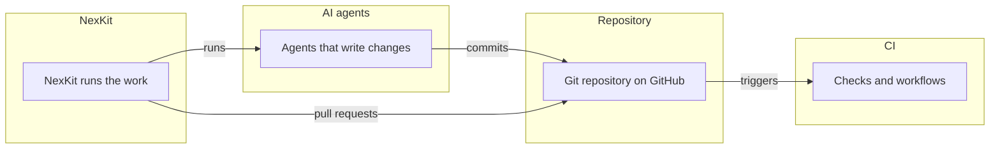
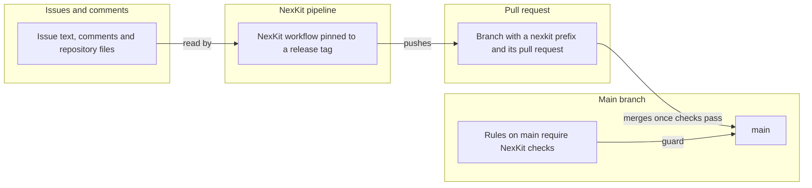
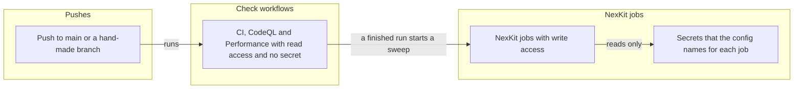
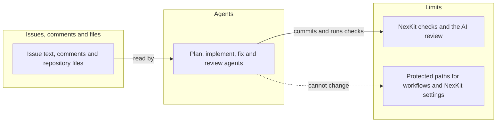

# Threat model: the way Axis is built

This page holds the threats to the way Axis is built, the **B** scope of the
[threat model](threat-model.md). How its rows are found, rated and checked is in
[threat model method](threat-model-method.md).

## The way Axis is built

The way Axis is built covers NexKit, CI, the AI agents that write to the repository, and the
repository itself. The overview shows how they connect, and each boundary below has its own table.

### NexKit and repository

NexKit turns an issue into a pull request, and the rules on `main` decide when it merges.

| Id | Threat | Boundary | Category | Rating | Status | Evidence |
| --- | --- | --- | --- | --- | --- | --- |
| B4 | A dependency, or a new version of one, brings in malicious code. | NexKit and repository | Tampering | High | **Mitigated** | [Dependency updates](../development.md#dependency-updates) pin the NuGet versions and the npm lock files, and take packages only from nuget.org and the npm registry. The CI, CodeQL, Performance and Load test workflows pin their GitHub Actions to commit hashes. NexKit's workflow pins its pipeline to the tag `v5.9.1`, not to a hash. `scripts/scan.sh` does not run in CI until the hand-made change of [D107](../decisions/d107-the-dependency-scan-runs-now-and-images-are-scanned-and-signed.md). |
| B8 | A change merges with no record of its issue, plan or review. | NexKit and repository | Repudiation | Low | **Mitigated** | Each change follows [the life of an issue](../delivery.md#the-life-of-an-issue), from plan through implementation and review to merge. |
| B9 | Runaway agent runs use up the runners or the usage limit. | NexKit and repository | Denial of service | Low | **Mitigated** | At most three issues run at once, with `max_parallel` at 3, and a second Claude subscription takes over at the usage limit, see [delivery decisions](../delivery.md#decisions). |

Spoofing does not apply to the pipeline's own steps, which act through the Actions token. The secrets the pipeline reads are rated in B6.

### CI and secrets

The three check workflows run with read access and no secret. NexKit's own jobs hold the write access and the secrets.

| Id | Threat | Boundary | Category | Rating | Status | Evidence |
| --- | --- | --- | --- | --- | --- | --- |
| B3 | A workflow token pushes to `main` without the checks. | CI and secrets | Elevation of privilege | High | **Mitigated** | CI, CodeQL and Performance run with `contents: read`, and the [rules on main](../delivery.md#decisions) require NexKit's checks. NexKit's Actions token cannot push a change to `.github/workflows/`, because there is no push token. |
| B6 | A secret, such as an agent's subscription token, leaks into a log or reaches a job that does not need it. | CI and secrets | Information disclosure | High | **Mitigated** | The CI, CodeQL, Performance and Load test workflows use no secret. `.github/workflows/nexkit.yml` says the NexKit pipeline passes each job only the secrets that `.nexkit/config.json` names for it. |

Spoofing does not apply to a workflow run, which signs in no one and acts through its own token. Denial of service on the runners is rated in B9.

### Agents

The agents read the issue and the repository and write commits. They cannot change the protected paths.

| Id | Threat | Boundary | Category | Rating | Status | Evidence |
| --- | --- | --- | --- | --- | --- | --- |
| B1 | An agent adds an exception to a security check, or loosens one, to turn a red check green, such as in `scripts/scan-accepted.json` or `scripts/check-docs.mjs`. | Agents | Tampering | High | **Mitigated** | The owner guards the security checks with `.github/CODEOWNERS`: a pull request that changes one of those files waits for the owner's review, see [delivery decisions](../delivery.md#decisions). |
| B2 | Text in an issue, a comment or a repository file steers an agent. This is prompt injection. | Agents | Tampering | High | **Mitigated** | The [delivery decisions](../delivery.md#decisions) limit what an agent can change: protected paths, no push token, and NexKit's checks and review on every pull request. These limit the damage. They do not stop the steering. |
| B5 | The AI review shares the writer's blind spots, because the same kind of model writes and reviews the code. | Agents | Tampering | Medium | **Accepted** | Accepted on 2026-10-29. The owner keeps NexKit's AI review as the only gate before a merge, with the checks and code owners of [D111](../decisions/d111-authentication-by-default-and-the-owner-guards-the-security-checks.md) around it. |
| B7 | An agent turns off or narrows a CI job or a CodeQL check. | Agents | Tampering | High | **Mitigated** | `.github/` and `.nexkit/` are protected paths, see [delivery decisions](../delivery.md#decisions). A change to them is a hand-made pull request, opened by the hourly driver or the local agent session. The owner reviews and merges each one. |

Spoofing does not apply to an agent, which acts through NexKit's own token. Denial of service on the runners is rated in B9.
