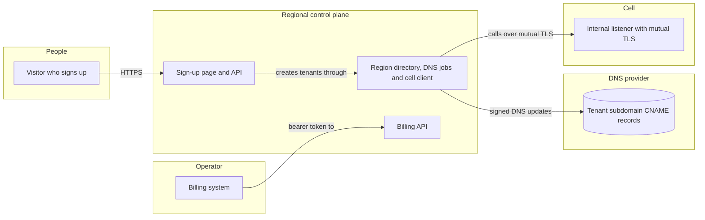
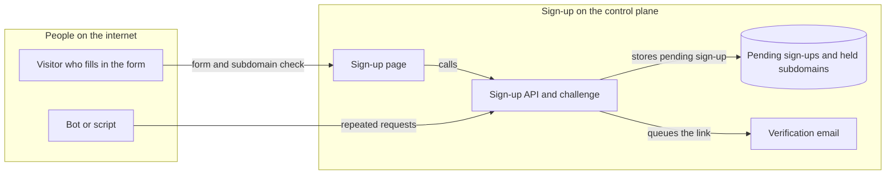
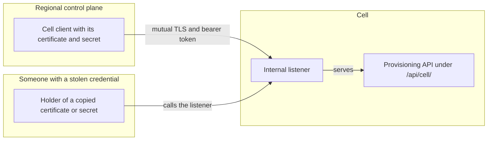
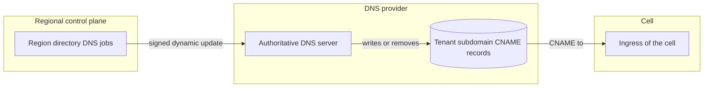
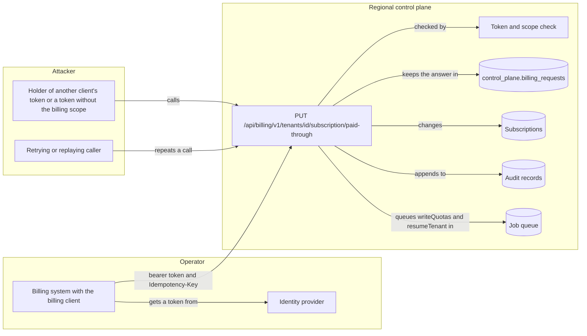

# Threat model: the control plane

_(planned for M33)_

This page holds the threats to the control plane, the **C** scope of the
[threat model](threat-model.md). The control plane runs sign-up, trials, subscriptions and plans for Axis SaaS,
apart from the cells. How its rows are found, rated and checked is in
[threat model method](threat-model-method.md).

## The control plane

The control plane has four trust boundaries. Each has its own diagram and table below: the sign-up
page and API, the calls to the cells, the directory's DNS writes, and the billing API.

### Sign-up page and API

The sign-up page and its API take requests from anyone on the internet, before anyone signs in.
The control plane serves the page and takes the form, see [sign-up](sign-up.md).

| Id | Threat | Boundary | Category | Rating | Status | Evidence |
| --- | --- | --- | --- | --- | --- | --- |
| C1 | Sign-up spam fills the cells with tenants that nobody uses. | Sign-up page and API | Denial of service | High | **Gap** | Closed by [#2460](https://github.com/phuongnse/axis/issues/2460), which adds proof of work and rate limits, and by [#2461](https://github.com/phuongnse/axis/issues/2461), which allows one trial per verified email and refuses disposable domains. |
| C3 | A sign-up answer for a verified email reveals whether that email has signed up. | Sign-up page and API | Information disclosure | Medium | **Mitigated** | The answer is `202` with a `{ resend }` token for every address. The token is encrypted, so it looks alike for a new address and one that already had a trial, and `POST /api/sign-up/resend` answers `202` for every token, good or not. An address that already verified a sign-up gets the trial-used email and nothing is stored. Each address gets at most three sign-up emails in 24 hours, and past that the answer is still `202`. `SignUpTests` shows each of these. |
| C4 | A replayed or leaked verification link creates a tenant for someone else. | Sign-up page and API | Spoofing | High | **Mitigated** | The link is single-use and works for 24 hours. Verification changes nothing, the first confirm sets `verified` in one conditional update and a second answers `409`, and both routes refuse an expired or unknown token. Only the SHA-256 of the token is stored. The token travels after `#` and in the request body, so no request line holds it. The confirm answers a random progress secret and stores only its SHA-256. `SignUpTests` shows each of these. |
| C5 | A forged or replayed proof of work passes the bot check. | Sign-up page and API | Tampering | Medium | **Mitigated** | The control plane signs each challenge with its own key and it expires after 10 minutes. `POST /api/sign-up` checks the solution before the limits and the form, and refuses a missing, malformed, wrong, expired or used one under `/altcha`. It stores each accepted solution in the database until it expires, so the solution works once across replicas, and a try without a good solution never uses up the address's limit. `SignUpTests` shows each of these. |
| C20 | Someone who guesses or copies a sign-up's id learns how far its trial is and its address. | Sign-up page and API | Information disclosure | Low | **Mitigated** | `GET /api/sign-up/{id}` answers only a caller that sends the progress secret in the `Sign-Up-Secret` header, and the control plane compares the SHA-256 of that secret with the stored hash in constant time. An unknown id, a malformed id, a pending sign-up, a missing secret and a wrong secret all get the same `404` with no body. The secret is in no request line. `SignUpTests` shows this. |

Open threats, which no issue closes yet, see [threat model method](threat-model-method.md#how-it-is-filled):

- C2 (Information disclosure, Medium): the subdomain check reveals which tenant subdomains exist.

Repudiation and elevation of privilege do not apply to the page itself. A new tenant's records and grants
are covered by P3 and P7 in the [product threat model](threat-model-product.md).

### Control plane to cells

The control plane reaches each cell only over the cell's internal listener, with mutual TLS. The
control plane's side of that call is in [reaching the cells](control-plane.md#reaching-the-cells).

| Id | Threat | Boundary | Category | Rating | Status | Evidence |
| --- | --- | --- | --- | --- | --- | --- |
| C6 | A stolen control plane client certificate or secret acts on every tenant of a cell. | Control plane to cells | Spoofing | Critical | **Gap** | [#2995](https://github.com/phuongnse/axis/issues/2995) adds the listener's check of the client certificate. The control plane's secrets reach it only as projected files, see `scripts/helm-controlplane.test.mjs`. |
| C7 | The control plane calls a cell without mutual TLS. | Control plane to cells | Information disclosure | High | **Mitigated** | `CellClientTests` (the client presents its certificate and a bearer token over https, a client without the certificate fails, a certificate of another authority is not trusted, and http is never called) and `ControlPlaneOptionsTests` (an http internal or token URL of a cell, and a listed cell without its client certificate, stop the start). |
| C8 | A cell's internal listener accepts a call without the control plane's certificate. | Control plane to cells | Spoofing | Critical | **Gap** | Closed by [#2995](https://github.com/phuongnse/axis/issues/2995), which requires a client certificate from the region's internal certificate authority on the internal listener. |

Repudiation does not need a row: each job writes a platform audit record with its actor, see
[provisioning API](tenant-lifecycle.md#provisioning-api).

### Region directory and DNS

The region directory's jobs write each tenant's subdomain record to its cell's ingress, through the DNS
provider's dynamic update interface. See [routing a host](region-directory.md#routing-a-host).

| Id | Threat | Boundary | Category | Rating | Status | Evidence |
| --- | --- | --- | --- | --- | --- | --- |
| C9 | A hijacked `CNAME` sends a tenant's traffic to another host. | Region directory and DNS | Tampering | High | **Mitigated** | `Rfc2136DnsRecordsTests` (the adapter signs its dynamic updates with TSIG, a server refuses an update signed with a wrong key, and an answer without a valid signature is a failure) and `CellPickerTests` (placing a tenant writes its record to its own cell's ingress). |
| C10 | A record left behind after a tenant's deletion lets someone take over the subdomain. | Region directory and DNS | Spoofing | High | **Mitigated** | `DirectoryCorrectionTests` (a tenant the correction drops gets an idempotent removal job, and a removal for a tenant that is back keeps its record) and `CellPickerTests` (a late write for a tenant that is gone writes nothing). |

Information disclosure and elevation of privilege do not apply to a `CNAME` record, which holds only a
name and a target.

### Billing API

The operator's billing system drives a tenant's commercial life through the billing API. The control plane
checks the billing client's token and scope on each call and keeps the answer of each call under its
idempotency key, see [signing in](billing-api.md#signing-in) and [idempotency](billing-api.md#idempotency).

| Id | Threat | Boundary | Category | Rating | Status | Evidence |
| --- | --- | --- | --- | --- | --- | --- |
| C21 | A token of another client, or without the billing scope, changes a subscription. | Billing API | Spoofing | Critical | **Mitigated** | `BillingApiTests` shows that a call with no token, another client's token, a wrong audience or a key of another signer answers `401`, a billing client's token without `axis-billing` answers `403`, and each leaves the subscription, the audit records and the jobs unchanged. `ControlPlaneOptionsTests` shows that without the billing settings every route answers `401`. |
| C22 | A retried call makes a change twice. | Billing API | Tampering | High | **Mitigated** | `BillingApiTests` shows that the same `Idempotency-Key` with the same body answers the first answer again and leaves one audit record and one `writeQuotas` job, five parallel retries act once, and the same key with another body answers `422`. |

Repudiation does not need a row: each change writes an audit record with the billing client as actor, see
[audit records](billing-api.md#audit-records).
