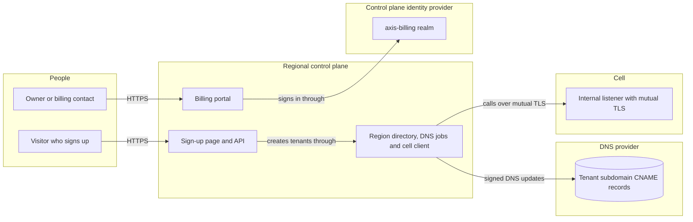
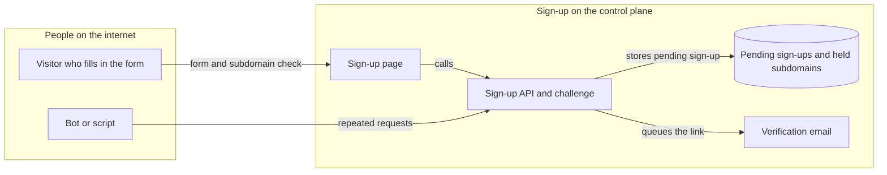
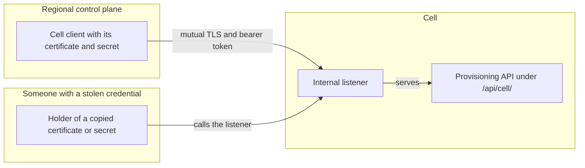
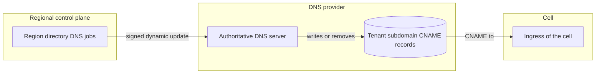
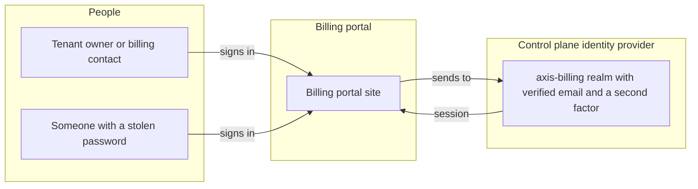

# Threat model: the control plane

_(planned for M33)_

This page holds the threats to the control plane, the **C** scope of the
[threat model](threat-model.md). The control plane runs sign-up, trials and billing for Axis SaaS,
apart from the cells. How its rows are found, rated and checked is in
[threat model method](threat-model-method.md).

## The control plane

The control plane has four trust boundaries. Each has its own diagram and table below: the sign-up
page and API, the calls to the cells, the directory's DNS writes and the billing portal's sign-in.

### Sign-up page and API

The sign-up page and its API take requests from anyone on the internet, before anyone signs in.
The page is planned for M33, see [sign-up](sign-up.md).

| Id | Threat | Boundary | Category | Rating | Status | Evidence |
| --- | --- | --- | --- | --- | --- | --- |
| C1 | Sign-up spam fills the cells with tenants that nobody uses. | Sign-up page and API | Denial of service | High | **Gap** | Closed by [#2460](https://github.com/phuongnse/axis/issues/2460), which adds proof of work and rate limits, and by [#2461](https://github.com/phuongnse/axis/issues/2461), which allows one trial per verified email and refuses disposable domains. |
| C4 | A replayed or leaked verification link creates a tenant for someone else. | Sign-up page and API | Spoofing | High | **Gap** | Closed by [#2459](https://github.com/phuongnse/axis/issues/2459), which makes the link single-use, checks it once within 24 hours and stores only a hash of its token. |
| C5 | A forged or replayed proof of work passes the bot check. | Sign-up page and API | Tampering | Medium | **Gap** | Closed by [#2460](https://github.com/phuongnse/axis/issues/2460), which signs each challenge, expires it after 10 minutes and accepts one solution once. |

Open threats, which no issue closes yet, see [threat model method](threat-model-method.md#how-it-is-filled):

- C2 (Information disclosure, Medium): the subdomain check reveals which tenant subdomains exist.
- C3 (Information disclosure, Medium): a sign-up answer for a verified email or a disposable domain reveals
  whether that email has signed up.

Repudiation and elevation of privilege do not apply to the page itself. A new tenant's records and grants
are covered by P3 and P7 in the [product threat model](threat-model-product.md).

### Control plane to cells

The control plane reaches each cell only over the cell's internal listener, with mutual TLS. The
control plane's side of that call is in [reaching the cells](control-plane.md#reaching-the-cells).

| Id | Threat | Boundary | Category | Rating | Status | Evidence |
| --- | --- | --- | --- | --- | --- | --- |
| C6 | A stolen control plane client certificate or secret acts on every tenant of a cell. | Control plane to cells | Spoofing | Critical | **Gap** | [#2995](https://github.com/phuongnse/axis/issues/2995) adds the listener's check of the client certificate. The control plane's secrets reach it only as projected files, see `scripts/helm-controlplane.test.mjs`. |
| C7 | The control plane calls a cell without mutual TLS. | Control plane to cells | Information disclosure | High | **Mitigated** | `CellClientTests` (the client presents its certificate and a bearer token over https, a client without the certificate fails, a certificate of another authority is not trusted, and http is never called) and `ControlPlaneOptionsTests` (an http internal or token URL of a cell, and a listed cell without its client certificate, stop the start). |
| C8 | A cell's internal listener accepts a call without the control plane's certificate. | Control plane to cells | Spoofing | Critical | **Gap** | Closed by [#2995](https://github.com/phuongnse/axis/issues/2995), which requires a client certificate from the region's internal certificate authority on the internal listener. |

Repudiation does not need a row: each job writes a platform audit record with its actor, see
[provisioning API](tenant-lifecycle.md#provisioning-api).

### Region directory and DNS

The region directory's jobs write each tenant's subdomain record to its cell's ingress, through the DNS
provider's dynamic update interface. See [routing a host](region-directory.md#routing-a-host).

| Id | Threat | Boundary | Category | Rating | Status | Evidence |
| --- | --- | --- | --- | --- | --- | --- |
| C9 | A hijacked `CNAME` sends a tenant's traffic to another host. | Region directory and DNS | Tampering | High | **Mitigated** | `Rfc2136DnsRecordsTests` (the adapter signs its dynamic updates with TSIG, a server refuses an update signed with a wrong key, and an answer without a valid signature is a failure) and `CellPickerTests` (placing a tenant writes its record to its own cell's ingress). |
| C10 | A record left behind after a tenant's deletion lets someone take over the subdomain. | Region directory and DNS | Spoofing | High | **Mitigated** | `DirectoryCorrectionTests` (a tenant the correction drops gets an idempotent removal job, and a removal for a tenant that is back keeps its record) and `CellPickerTests` (a late write for a tenant that is gone writes nothing). |

Information disclosure and elevation of privilege do not apply to a `CNAME` record, which holds only a
name and a target.

### Billing portal sign-in

The billing portal signs people in through the `axis-billing` realm of the control plane's identity
provider. Its accounts are apart from the operator and tenant realms, see [billing portal](billing-portal.md#accounts).

| Id | Threat | Boundary | Category | Rating | Status | Evidence |
| --- | --- | --- | --- | --- | --- | --- |
| C11 | Someone takes over a billing account and acts as a tenant's owner. | Billing portal sign-in | Spoofing | High | **Gap** | [#2463](https://github.com/phuongnse/axis/issues/2463) makes the account's email verified and offers a second factor at the first sign-in. |
