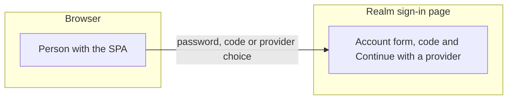
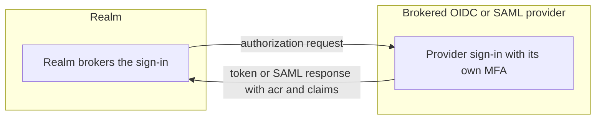
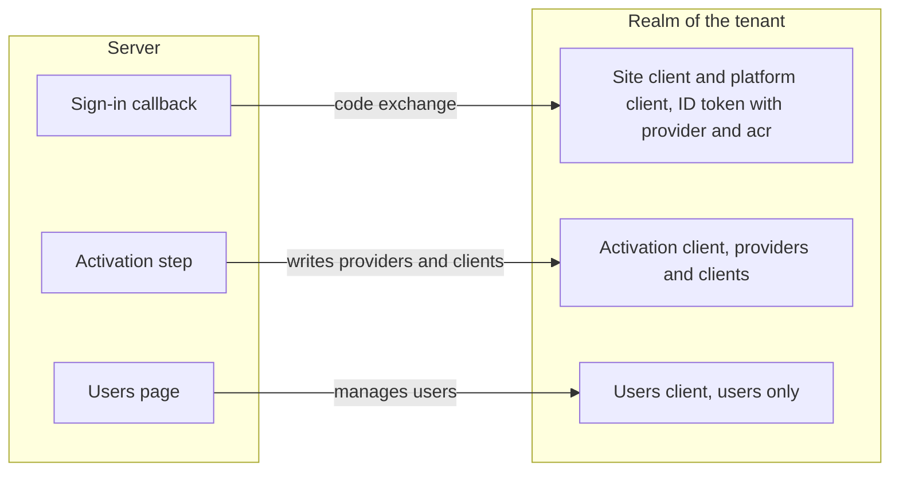
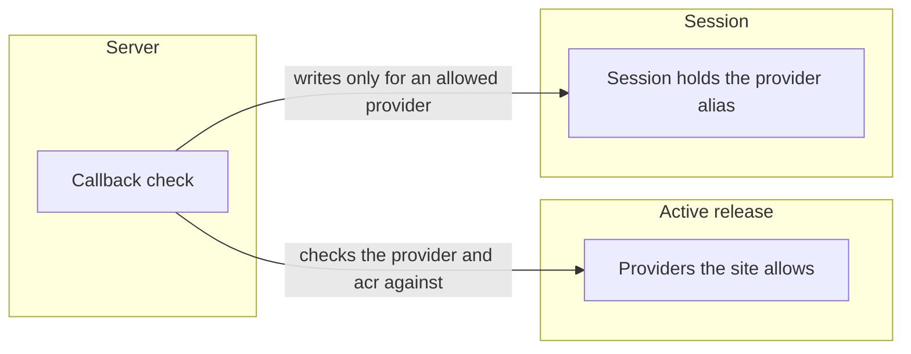
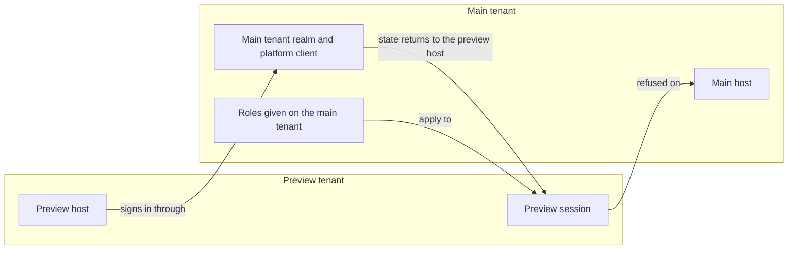
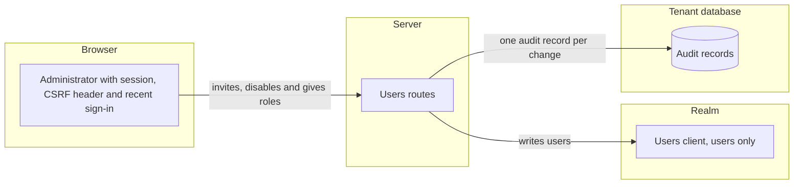
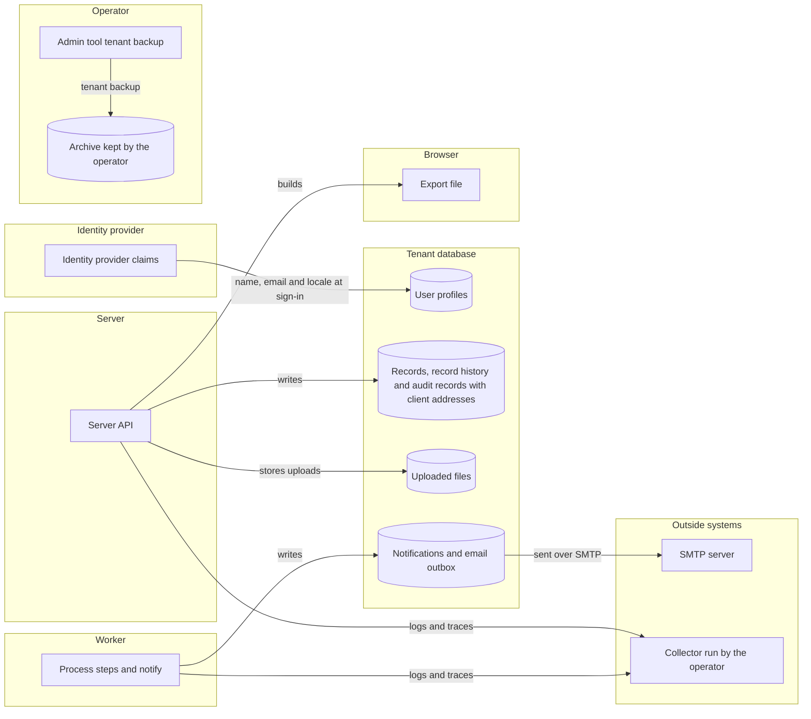

# Threat model: the identity provider and personal data

This page holds the threats to the identity provider and to personal data, part of the **P** scope of the
[threat model](threat-model.md). How its rows are found, rated and checked is in
[threat model method](threat-model-method.md).

## The identity provider and personal data

These are the product's boundaries with Axis's identity provider and with the personal data it holds. The overview is in
[the product](threat-model-product.md#the-product).

### Identity provider

Axis's identity provider is Keycloak, with one realm for each tenant, see [identity provider](identity-provider.md)
and [user administration](user-administration.md). It has six boundaries, each with its own diagram below.

**Browser and sign-in page**

**Realm and brokered provider**

**Server and realm**

**Site and its providers**

**Preview tenant and main realm**

**Administrator and users page**

| Id | Threat | Boundary | Category | Rating | Status | Evidence |
| --- | --- | --- | --- | --- | --- | --- |
| P74 | A password is guessed or reused. | Browser and sign-in page | Spoofing | High | **Delegated** | The identity provider: at least 12 and at most 128 characters, a list of breached passwords and a wait after repeated failures, see [accounts](user-administration.md#accounts). `TenantRealmAccountRulesTests` refuses a short or breached password in the realm. |
| P75 | A stolen password signs in without a second step. | Browser and sign-in page | Spoofing | High | **Delegated** | The identity provider: a code from an authenticator app at every account sign-in, see [accounts](user-administration.md#accounts). |
| P76 | An account is made without an invitation. | Browser and sign-in page | Elevation of privilege | Medium | **Delegated** | The identity provider: the realm allows no self-registration, see [accounts](user-administration.md#accounts). |
| P77 | The sign-in page shows whether an account exists or is locked. | Browser and sign-in page | Information disclosure | Low | **Delegated** | The identity provider: the sign-in page shows the same message in each case, see [accounts](user-administration.md#accounts). |
| P78 | A provider signs a person in at an `acr` below its list. | Realm and brokered provider | Spoofing | High | **Mitigated** | `SiteSignInTests` (a site callback whose upstream `acr` the provider does not accept is refused), `SignInRefusalsTests` (an `acr` the list does not accept is refused as `acrNotAccepted`). The realm does not forward `acr_values`, so the callback check is the control. |
| P79 | One person is split into two users, because a provider appears twice with other bindings or claims. | Realm and brokered provider | Spoofing | Medium | **Mitigated** | `RealmPlannerTests` (a provider that shares an issuer binding with another client is a conflict, and so is one with the same bindings and other claims), `AdminActivateRealmTests` (a conflicting second application fails activate with `AXC0291` and leaves the realm unchanged). |
| P80 | Two people are merged into one user by a shared email. | Realm and brokered provider | Spoofing | High | **Mitigated** | `RealmBrokeredUsersTests` (one person signed in through two providers with the same email becomes two users), `TenantRealmAccountRulesTests` (a second run keeps a first-login flow that denies access, switched off, and then creates a user, and the realm allows duplicate emails). |
| P81 | A person who signs in through a brokered provider skips its second step. | Realm and brokered provider | Spoofing | Medium | **Delegated** | The brokered provider's MFA policy. [D99](../decisions/d99-axis-ships-its-own-identity-provider.md) says a person who signs in through their organization follows that organization's MFA policy. |
| P82 | A brokered OIDC token is forged or changed. | Realm and brokered provider | Tampering | High | **Delegated** | The identity provider checks the token signature with the provider's published keys, because the realm sync turns on signature validation for OIDC providers. See [identity provider](identity-provider.md). |
| P83 | An ID token for one site's client is used on another site. | Server and realm | Spoofing | High | **Mitigated** | `SiteSignInTests` (an ID token for another site's client is refused and writes no session). |
| P84 | A users client changes providers or clients, or the activation client changes users. | Server and realm | Elevation of privilege | High | **Mitigated** | `TenantRealmTests` (the users client manages users only, and the activation client manages clients and not users). |
| P85 | A provider that no release names still signs people in. | Server and realm | Tampering | Medium | **Mitigated** | `AdminActivateRealmTests` (activating again without the provider removes it from the realm), `RealmSyncTests` (a second sync removes a site that is gone and its provider, and keeps the other clients). |
| P86 | Realm sync output shows the activation secret. | Server and realm | Information disclosure | Medium | **Mitigated** | `AdminActivateRealmTests` (a wrong activation secret fails with a line that names no secret). |
| P87 | A roles claim gives a role in an application that does not map it. | Server and realm | Elevation of privilege | High | **Mitigated** | `ApplicationRolesSignInTests` (a brokered person holds the mapped role in the application that maps it only), `SiteSignInTests` (a roles value the mapping does not list gives no role). |
| P88 | A sign-in goes through a provider the site does not allow, even when `kc_idp_hint` forces it. | Site and its providers | Spoofing | High | **Mitigated** | `SiteSignInTests` (a callback through a provider the site does not allow is refused, for OIDC and for SAML, even when `kc_idp_hint` forces it), `SignInRefusalsTests` (a provider the site does not allow is refused as `providerNotAllowed`). |
| P89 | A session through one provider opens a site that does not allow that provider. | Site and its providers | Elevation of privilege | Medium | **Mitigated** | `SiteSignInTests` (a session opens a second site that allows its provider, and a site that does not allow it asks to sign in again). |
| P90 | A provider that the platform sign-in does not accept opens Studio, the console or the users page. | Site and its providers | Elevation of privilege | High | **Mitigated** | `PlatformSignInTests` (a sign-in through a provider the platform does not accept is refused and writes no session), `PlatformSignInSitesTests` (a person signed in through a site's provider sees no tool). |
| P91 | A refused sign-in leaves no record. | Site and its providers | Repudiation | Low | **Mitigated** | `SiteSignInTests` (a refusal is recorded with the reason `providerNotAllowed`), `SignInTests` (a callback with another tenant's state is refused and recorded). |
| P92 | A preview tenant's sign-in, made through its main tenant's realm and client, is used on the main tenant. | Preview tenant and main realm | Spoofing | Medium | **Mitigated** | `SignInTests` (a callback with another tenant's state is refused and recorded), `PreviewTenantSignInTests` (a preview session gets 401 on the main host, the cookie case in P54). |
| P93 | A role removed on the main tenant keeps working on the preview. | Preview tenant and main realm | Elevation of privilege | Medium | **Mitigated** | `PreviewTenantPlatformSignInTests` (a role the main tenant's users page gives applies on the preview until it is removed, and a person without it is denied). |
| P94 | A stolen or unattended administrator session gives its own user a platform role, such as publisher. | Administrator and users page | Elevation of privilege | High | **Mitigated** | `UserCommandTests` (a platform role change with an old login answers 403 and changes and audits nothing), `UserInvitationTests` (a platform role at invite time needs a recent login). |
| P95 | An administrator gives themselves a role and denies it. | Administrator and users page | Repudiation | Medium | **Mitigated** | `UserCommandTests` (giving and removing a role each write one audit record), `UserInvitationTests` (an invitation with a role writes one record for the invitation and one for the role). |
| P96 | A non-administrator lists, invites or changes users. | Administrator and users page | Elevation of privilege | High | **Mitigated** | `UserListTests` (a person without the administrator role gets 403 and nobody signed in gets 401), `UserCommandTests` (a person without the administrator role gets 403 on the user routes), `UserInvitationTests` (an invitation without an administrator session is refused). |
| P97 | An invitation takes over an account, by a used email or by an old link after a resend. | Administrator and users page | Spoofing | Medium | **Mitigated** | `UserInvitationTests` (an invitation for a used email is refused, and a resent invitation ends the old link). |
| P98 | A disabled person keeps a session or signs in. | Administrator and users page | Elevation of privilege | High | **Mitigated** | `UserCommandTests` (disabling a person ends their sessions and refuses their sign-in). |
| P99 | An administrator locks the tenant out by disabling themselves or removing their own administrator role. | Administrator and users page | Denial of service | Medium | **Mitigated** | `UserCommandTests` (disabling oneself, and removing one's own administrator role, answer 409 and change nothing). |
| P110 | A sign-out ends another person's identity provider session, or a slow identity provider holds sign-out up. | Server and realm | Denial of service | Medium | **Mitigated** | `SignInTests` (sign-out ends only the `sid` stored with the caller's own session, on the CSRF-checked route, and falls back to the end-session address when the call fails). |
| P111 | Keycloak's account console is a second self-service surface, where a person changes their account outside Axis's account page. | Browser and sign-in page | Elevation of privilege | Low | **Mitigated** | `AdminTenantRealmTests` (`tenant create` turns off the `account-console` client and takes `manage-account` out of the default roles, and a rerun restores both after a hand change). |
| P112 | A person denies accepting the terms, or a new terms version is never shown. | Server and realm | Repudiation | Low | **Mitigated** | `AdminTenantLegalRealmTests` (`tenant legal set` turns the Terms and Conditions action on with `defaultAction`, and a new `--terms-version` adds it to every user while a change of the addresses alone adds it to no one). Keycloak records when each person accepted. |

An identity provider session's lifetime and CSRF are covered by P1, P2 and P8.

Open threats, which no issue closes, see [threat model method](threat-model-method.md#how-it-is-filled):

- (Spoofing, High) no test shows that the realm checks the signature of a SAML provider's response. The sync keeps
  what Keycloak's metadata import sets, which may leave the check off.
- (Elevation of privilege, Medium) the `/api/apps/{app}` data endpoints do not check the session's provider, see
  [sites and sign-in](identity-provider.md#sites-and-sign-in).

### Personal data

Axis holds personal data about the people who use it: user profiles with email addresses, records and
their history, audit records with client addresses, notifications, logs and traces, uploaded files,
exports and backups. LINDDUN finds the privacy threats to that data, see
[threat model method](threat-model-method.md#how-it-is-filled).

| Id | Threat | Boundary | Category | Rating | Status | Evidence |
| --- | --- | --- | --- | --- | --- | --- |
| P61 | A trace holds a person's user id, a field value or a bound address. | Personal data | Linking | Medium | **Mitigated** | `TraceCorrelationTests` (on the purchase request journey, no span holds a field value, a secret, a user id or a bound address). |
| P62 | A record's history shows a person's actions in another tenant. | Personal data | Linking | Low | **Mitigated** | `RecordHistoryTests` (a record's history holds only its own tenant's audit records). |
| P63 | The reassign picker shows other users' names to someone without the grant. | Personal data | Identifying | Medium | **Mitigated** | `TaskReassignTests` (the picker is 403 for anyone without the grant, and lists at most 20 profiles). |
| P109 | The user id field picker shows other users' names to someone who may not write the field. | Personal data | Identifying | Medium | **Mitigated** | `UserIdFieldTests` (the route is 403 for a user without a create or update grant that covers the field, 401 when not signed in, and answers only `id` and `displayName`). A user who may write the field can list the tenant's display names, which is intended. |
| P64 | A user learns that a record or file exists from the answer code. | Personal data | Detecting | Medium | **Mitigated** | `FileDownloadTests` (no read grant, or a read filter that excludes the record, gets 404), `RecordHistoryTests` (a deleted record's history is 404). |
| P65 | Other users see whether a person has read a notification. | Personal data | Detecting | Low | **Mitigated** | `NotificationEndpointTests` (marking notifications read lowers the unread count only for the caller). |
| P66 | A user reads personal fields without a grant. | Personal data | Data disclosure | High | **Mitigated** | `RecordFieldPolicyTests` (reads and writes hold only the fields the user may read, and a write to any other field is a 403). |
| P67 | An export holds rows or columns that the user may not read. | Personal data | Data disclosure | High | **Mitigated** | `ExportEndpointTests` (hidden rows and columns are absent, a user without the export grant gets 403 and nothing is audited, and each export is audited). |
| P68 | A profile's email reaches a log. | Personal data | Data disclosure | Medium | **Mitigated** | `SignInTests` (a profile that cannot be written logs a warning without the email). |
| P69 | A sensitive input shows in process inspection. | Personal data | Data disclosure | Medium | **Mitigated** | `ProcessInstanceSensitiveFieldTests` (the input that maps a sensitive field is hidden from a user who may read the field). |
| P70 | People do not know what Axis keeps about them. | Personal data | Unawareness | Medium | **Delegated** | The operator. Axis names no regulation, so the operator tells people what the application keeps, see [Restricted](keys-and-data-protection.md#restricted). |
| P71 | A person cannot correct their profile. | Personal data | Unawareness | Low | **Delegated** | The identity provider. Each sign-in rewrites the profile from its claims, see [user profiles](notifications.md#user-profiles). |
| P72 | Notifications are kept longer than needed. | Personal data | Non-compliance | Medium | **Mitigated** | `NotificationRetentionTests` (notifications over the retention days are deleted with their reads, and newer ones stay). |
| P73 | Logs, telemetry and backup archives are kept longer than needed. | Personal data | Non-compliance | Medium | **Delegated** | The operator keeps and removes them, see [log inventory](log-inventory.md#logs) and [Restricted](keys-and-data-protection.md#restricted). |
| P101 | Session audit records keep the full client address forever. | Personal data | Identifying | Medium | **Mitigated** | `ClientAddressTests` (IPv4 loses its last octet and IPv6 its last 80 bits) and `SignInTests` (sign-in, sign-out and refused sign-in records hold the shortened address). |
| P108 | A database login, a dump or a replica reads a sensitive field's value. | Personal data | Data disclosure | High | **Mitigated** | `RecordSensitiveValueTests` (the record API stores a sensitive value as ciphertext) and `LeaveRequestReasonStorageTests` (no runtime-readable column holds a submitted reason, and a backup keeps it as ciphertext). |
| P156 | A variable's value, set from a field the reader may not read or from a sensitive field, shows in inspection or the console, or is copied to history, audit records or logs. | Personal data | Data disclosure | Medium | **Mitigated** | _(planned for M38)_ The masking rule of variables, see [values and masking](process-inspection.md#values-and-masking). |

Non-repudiation does not apply as a privacy threat. The audit records exist so that a person cannot deny
a business action, see P3, P12 and P20. What they keep about a person is in the list below.

Open threats, which no issue closes, see [threat model method](threat-model-method.md#how-it-is-filled):

- (Identifying, Medium) an audit record whose `actor_name` holds the actor's display name keeps it forever. A new
  audit record stores no name.
- (Non-compliance, Medium) `axis.email_outbox` rows keep the address and the body forever.
- (Non-compliance, Medium) `axis.user_profiles` rows and old audit records cannot be removed for a person's
  removal request.
