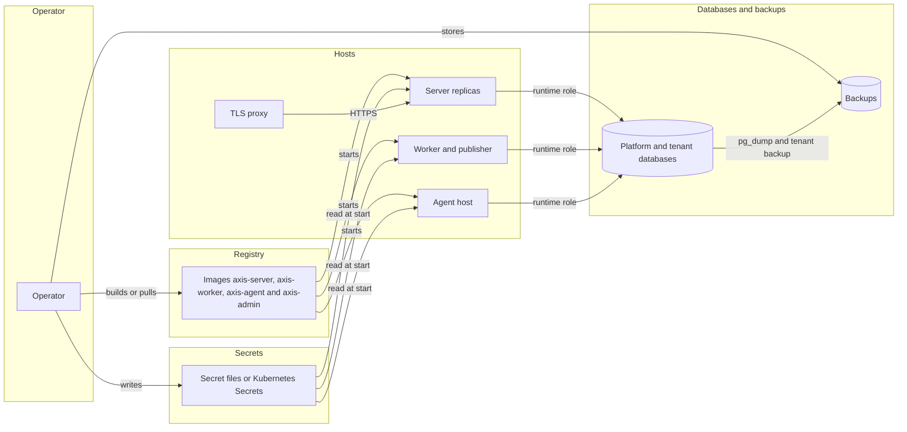
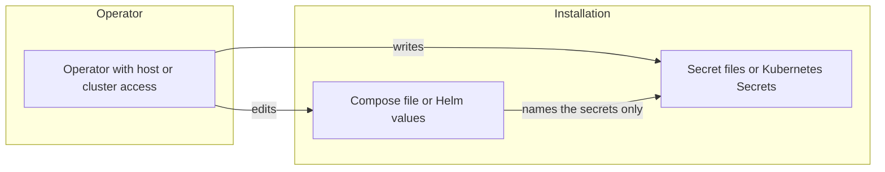
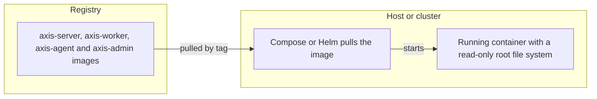
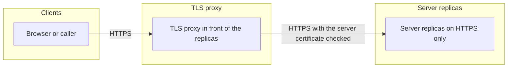
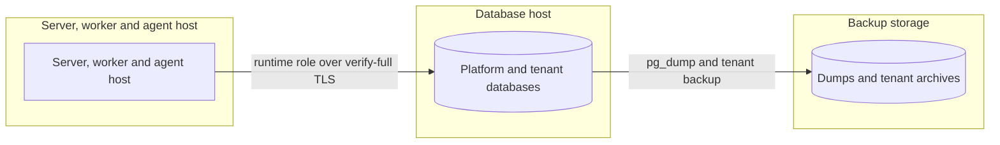
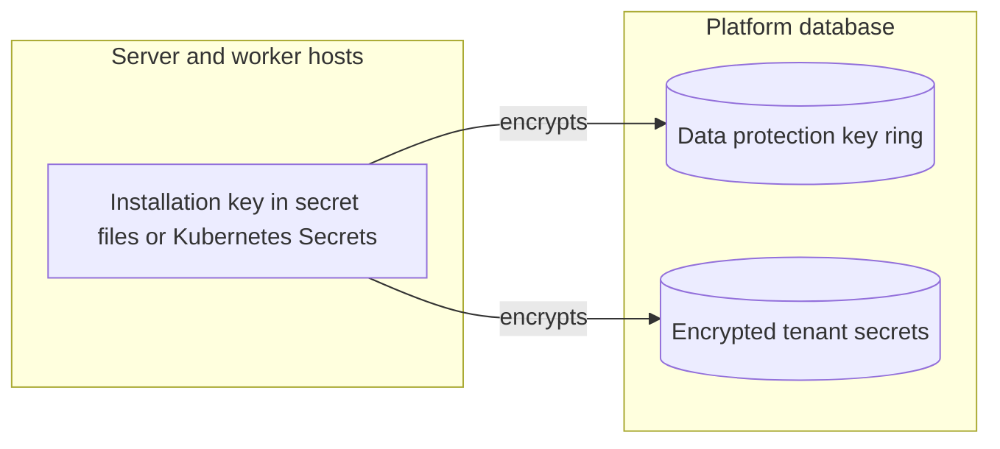
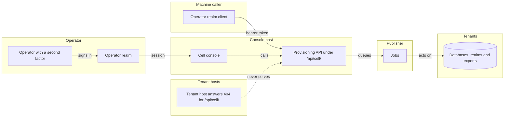

# Threat model: the installation

This page holds the threats to an installation of Axis, the **I** scope of the
[threat model](threat-model.md). How its rows are found, rated and checked is in
[threat model method](threat-model-method.md).

## The installation

The operator installs Axis from its images, with Docker Compose, the Helm chart or on premises. The
overview shows the parts of an install. Each part has its own table below.

### Operator and installation

The operator writes the secrets and the settings, then starts the hosts. Each row is a threat to that work.

| Id | Threat | Boundary | Category | Rating | Status | Evidence |
| --- | --- | --- | --- | --- | --- | --- |
| I1 | A secret ends up in a Compose or values file, or in an environment variable. | Operator and installation | Information disclosure | High | **Mitigated** | `scripts/onprem.test.mjs` (no file under deploy/compose holds a password, a client secret or a key), `scripts/helm.test.mjs` (no env entry holds a secret setting, and no Secret object is rendered). |
| I2 | Someone with host or cluster access reads the secret files or the TLS private key. | Operator and installation | Information disclosure | High | **Delegated** | The operator controls who can read the secret files and the TLS key, see [On premises](installation.md#on-premises) and [In the cloud](installation.md#in-the-cloud). |
| I3 | An admin command changes a tenant or the platform and leaves no record. | Operator and installation | Repudiation | Medium | **Mitigated** | `AdminPlatformAuditTests` (each of the seven admin commands writes one record with its tenant, user and machine and no secret), `PlatformRekeyTests` (a successful rekey writes one record with no tenant). |
| I4 | A host gets more database rights than its job needs, such as a worker with the schema role. | Operator and installation | Elevation of privilege | High | **Mitigated** | `DatabaseRoleTests` (every server and worker session on a tenant database uses the runtime role), `scripts/compose.test.mjs` (the worker gets only the runtime role), `scripts/helm.test.mjs` (the worker gets no platform schema connection). |

Spoofing, tampering and denial of service do not apply to the operator's own steps. The operator already has host access, see I2.

### Images and registry

The images travel from a registry to each host, where Compose or the Helm chart starts them.

| Id | Threat | Boundary | Category | Rating | Status | Evidence |
| --- | --- | --- | --- | --- | --- | --- |
| I5 | An image is swapped or changed between the registry and the host. | Images and registry | Tampering | High | **Delegated** | The operator builds the images or pulls them from a registry the operator controls, see [Images](installation.md#images). Signed images are planned for M32, see [D107](../decisions/d107-the-dependency-scan-runs-now-and-images-are-scanned-and-signed.md). |
| I6 | An image ships samples, development settings or source control metadata. | Images and registry | Information disclosure | High | **Mitigated** | `scripts/images.test.mjs` (no image holds a sample, a Development settings file or `.git`). |
| I7 | A process in a container writes to its image or runs as root. | Images and registry | Elevation of privilege | High | **Mitigated** | `scripts/images.test.mjs` (each image runs as a user other than root, and the server, worker, agent host and control plane start read-only, each with its settings in `/run/secrets`, the agent host with the platform connection and the installation key). |
| I8 | An install keeps running a version with a known vulnerability. | Images and registry | Elevation of privilege | Medium | **Delegated** | The operator upgrades to the latest version, the only one that gets security fixes, see [Upgrade](installation.md#upgrade). |

Spoofing and repudiation do not apply to an image, which is a file that signs no one in and writes no record. Denial of service is covered by the server rows, such as P6.

### Proxy and server replicas

Clients reach the server replicas through a TLS proxy. The proxy checks each replica's certificate before it forwards a request.

| Id | Threat | Boundary | Category | Rating | Status | Evidence |
| --- | --- | --- | --- | --- | --- | --- |
| I9 | A client fakes its address, scheme or host through forwarded headers. | Proxy and server replicas | Spoofing | High | **Mitigated** | `ForwardedHeadersTests` (an address that is not listed cannot fake its host or its scheme), `scripts/helm.test.mjs` (forwarded header settings render on the server only). |
| I10 | Traffic between a client, the proxy and a server is read or changed. | Proxy and server replicas | Information disclosure | High | **Mitigated** | `scripts/onprem.test.mjs` (the servers answer HTTPS only, the proxy takes only TLS 1.2 and 1.3, refuses CBC ciphers on TLS 1.2, and trusts only the server certificate authority). |
| I11 | A TLS endpoint that the operator runs in front of the server accepts weak TLS or skips the server certificate check. | Proxy and server replicas | Information disclosure | High | **Delegated** | The operator uses only the TLS versions and ciphers that [TLS](installation.md#tls) lists, and checks the server certificate as the Compose proxy does. |
| I12 | A replica restarts and drops sessions, or a replica with another key joins the install. | Proxy and server replicas | Denial of service | Medium | **Mitigated** | `SharedKeyRingTests` (a session survives a restart and another instance accepts it, and a server with another key fails to start), `scripts/onprem.test.mjs` (a restarted replica serves a signed-in user again). |
| I13 | A save through one replica overwrites a newer save made through another. | Proxy and server replicas | Tampering | Medium | **Mitigated** | `scripts/onprem.test.mjs` (a stale save through one replica answers 409 after a save through another). |

Repudiation does not apply here, because the server writes the audit records, see P3. Elevation of privilege does not apply to the proxy, which only forwards requests. The access checks are in the server, see P7.

### Database and backups

The server, the worker and the agent host reach tenant databases with the runtime role. Backups hold copies of the databases.

| Id | Threat | Boundary | Category | Rating | Status | Evidence |
| --- | --- | --- | --- | --- | --- | --- |
| I14 | A backup archive or its output holds a tenant secret in clear. | Database and backups | Information disclosure | High | **Mitigated** | `AdminTenantBackupTests` (the archive and the output of a backup hold no password, client secret or binding secret of the tenant) and `AdminEncryptedBackupTests` (the archive bytes hold no tenant key, in base64 or raw, and no backup key). |
| I15 | A stolen tenant archive exposes business data. | Database and backups | Information disclosure | High | **Mitigated** | `AdminEncryptedBackupTests` (the archive is encrypted with the backup key, holds neither the dump's bytes nor the tenant id, a restore refuses an archive that is not encrypted, a wrong key or a cut archive, and a changed chunk fails the restore). The operator keeps the backup key outside the installation, see [What else to back up](administration.md#what-else-to-back-up), and stores a dump that the operator made with its own tools under access control, see [Restricted](keys-and-data-protection.md#restricted). |
| I16 | A backup is stored with the installation key, so a stolen backup yields the stored secrets. | Database and backups | Information disclosure | High | **Delegated** | The operator keeps the installation key apart from the backups, see [What else to back up](administration.md#what-else-to-back-up). |
| I17 | A failed upgrade or a lost database cannot be restored. | Database and backups | Denial of service | Medium | **Delegated** | The operator backs up the platform and tenant databases before each upgrade, see [Upgrade](installation.md#upgrade). |
| I18 | A host connects to PostgreSQL without a full certificate check. | Database and backups | Tampering | High | **Mitigated** | `DatabaseTlsStartTests` (a production server stops at start on a connection string without full certificate checks), `AdminDatabaseTlsTests` (an admin command exits with status 2 for such a string). |
| I23 | The agent host, a new reader of the tenant directory, gets the schema connection or opens a tenant database with a role above the runtime role. | Database and backups | Elevation of privilege | High | **Mitigated** | `AgentTenantsTests` (the agent host opens a tenant database as the runtime role, and refuses a tenant whose role owns the schema, naming the tenant and the role and holding no password), `scripts/helm.test.mjs` (the agent Deployment projects the platform connection and the installation key, and no schema connection) and `scripts/onprem.test.mjs` (the Compose agent mounts the same two files). |

Spoofing, repudiation and elevation of privilege on the database are covered by the server rows, P9, P12 and P13.

### Stored secrets and key ring

The installation key encrypts every stored secret and each data protection key. The data protection keys sit in the platform database.

| Id | Threat | Boundary | Category | Rating | Status | Evidence |
| --- | --- | --- | --- | --- | --- | --- |
| I19 | Data protection keys are read in clear from the platform database. | Stored secrets and key ring | Information disclosure | High | **Mitigated** | `SharedKeyRingTests` (the stored keys hold no plain key material and decrypt only with the installation key). |
| I20 | A rekey leaves the old installation key able to decrypt stored values. | Stored secrets and key ring | Information disclosure | High | **Mitigated** | `PlatformRekeyTests` (after a rekey, the new key alone decrypts every encrypted column). |
| I21 | The previous installation key stays on the hosts after a rekey. | Stored secrets and key ring | Information disclosure | Medium | **Delegated** | The operator removes `Platform:PreviousSecretKey` from every host once the rekey has run, see [Installation key](tenant-setting-commands.md#installation-key). |
| I22 | A leaked installation key stays in use until the operator rotates it. | Stored secrets and key ring | Information disclosure | High | **Delegated** | The operator runs `platform rekey` and changes the secrets at once when a key may have leaked, see [Key policy](keys-and-data-protection.md#key-policy). |

Other categories do not apply to stored keys. A changed key ring fails to start, see I12, and a rekey writes a record, see I3.

### Cell console and provisioning API

The platform operator, through the cell console on `Cell:ConsoleHost` and the provisioning API under `/api/cell/`, acts on every tenant of a cell.

The controls are in [cell console](cell-console.md#sign-in), [what the console never shows](cell-console.md#what-the-console-never-shows),
[provisioning API](tenant-lifecycle.md#provisioning-api), [exporting a tenant](tenant-lifecycle.md#exporting-a-tenant) and
[hosts and certificates](cells.md#hosts-and-certificates). The read routes have one row, P114 in the
[product threat model](threat-model-product.md), because it is about the caller and the server: a tenant realm token or a
token without the operator role reads the cell's tenants, and a tenant host answers `404` for every path under `/api/cell/`.

Open threats, which no issue closes, see [threat model method](threat-model-method.md#how-it-is-filled):

- (Spoofing, High) an attacker takes over an operator account and acts on every tenant of the cell. Sign-in needs a
  password and a second factor in the operator realm, which has accounts only.
- (Tampering, Medium) a replayed job repeats a change to a tenant, such as a create or a delete. Each `POST` needs an
  `Idempotency-Key`, and the same key with the same body answers the first job again.
- (Information disclosure, High) an export is read by someone who is not a caller of the provisioning API, or kept
  past its 7 days. The download answers only that caller and writes an audit record.
- (Information disclosure, High) a console view leaks a record value or a secret. The console shows counts and never a
  record, a file, a secret or a tenant user's name.
- (Spoofing, High) a host is served before its owner is verified, so one tenant takes another's name. The cell adds a
  host only once its DNS record matches.

Repudiation does not need a row: each job writes a platform audit record with the actor, see
[provisioning API](tenant-lifecycle.md#provisioning-api).
