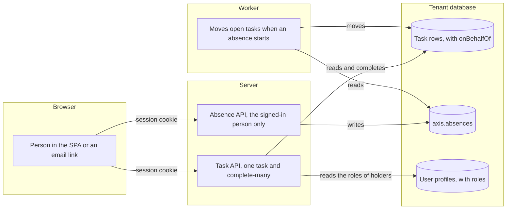
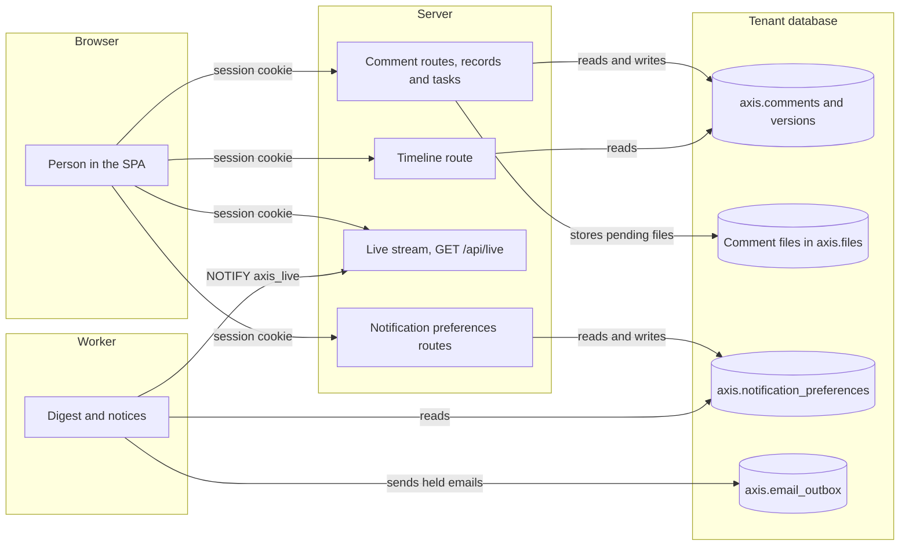

# Threat model: collaboration

_(planned for M43)_

This page holds the threats to people who work together on records and tasks, which belong to the **P** scope of the
[threat model](threat-model.md). They have a page of their own because [the product page](threat-model-product.md)
is close to its size limit. How its rows are found, rated and checked is in
[threat model method](threat-model-method.md), and a row added here takes the next free **P** id.

## Tasks, absences and deciding several tasks

A task goes to a person, who may be away, and a delegate takes the task while they are. A person may decide
several tasks at once, or from a link in an email. Each of these must reach only the people the rules allow, see
[who may act](task-api.md#who-may-act), [absences](user-administration.md#absences) and
[deciding several tasks](task-api.md#deciding-several-tasks).

| Id | Threat | Boundary | Category | Rating | Status | Evidence |
| --- | --- | --- | --- | --- | --- | --- |
| P157 | A forwarded email link decides a task for someone who may not act on it. | Browser and email link | Spoofing | High | **Mitigated** | _(planned for M43)_ The link carries no token, and the task page asks the task API who may act, see [deciding from an email](task-inbox-widget.md#deciding-from-an-email). |
| P158 | An excluded person lists, reads, claims or completes a task. | Task API | Elevation of privilege | High | **Mitigated** | _(planned for M43)_ The task API refuses an excluded person at each action with the same `403`, see [who may act](task-api.md#who-may-act). |
| P159 | A person sets, reads or ends another person's absence. | Absence API | Elevation of privilege | High | **Mitigated** | _(planned for M43)_ The `GET`, `PUT` and `DELETE` routes of `/api/me/absence` act on the signed-in person only, see [absences](user-administration.md#absences). |
| P160 | A task decided for an absent person, or an absence itself, leaves no record of whom it was for. | Task API and worker | Repudiation | Medium | **Mitigated** | _(planned for M43)_ A task keeps `onBehalfOf`, and the audit records `absence.set` and `task.delegated` name the person, see [absences](user-administration.md#absences) and [task read](task-api.md#read-one-task). |
| P161 | Deciding several tasks skips the checks that a single completion makes. | Task API | Elevation of privilege | High | **Mitigated** | _(planned for M43)_ Each task of `complete-many` is checked and completed as a single completion, in its own transaction, see [deciding several tasks](task-api.md#deciding-several-tasks). |
| P162 | A flood of `complete-many` calls takes the server's time from other tenants. | Task API | Denial of service | Medium | **Mitigated** | _(planned for M43)_ A call takes at most 100 task ids, and the server's rate limits apply, see [headers and rate limits](headers-and-rate-limits.md#rate-limits). |
| P163 | An absence, or the roles in a profile, is shown to someone else, or a holder's role is stale when they act. | Tenant database | Information disclosure | Medium | **Mitigated** | _(planned for M43)_ `axis.absences` is read only for its person, and a holder's role is checked when they act, see [sharing role tasks](task-api.md#sharing-role-tasks). |

## Comments, live pages and notification preferences

People comment on records and tasks, mention each other, attach files and watch lists update live. Each of these
must reach only the people the rules allow, and a preference must change only its own person's notices. The rows
below cover the routes and the stored data of [comments](comments.md), the [live stream](frontend.md#live-pages) and
the [notification preferences](notifications.md#notification-preferences).

| Id | Threat | Boundary | Category | Rating | Status | Evidence |
| --- | --- | --- | --- | --- | --- | --- |
| P172 | An internal comment, or a task comment, is read or posted by someone outside its rules. | Browser and server | Information disclosure | High | **Mitigated** | _(planned for M43)_ An internal comment needs the `internalComments` grant, a shared comment needs the record's `read` access to see and the `comment` grant to post, and a task comment needs a person who may act on the task, see [record comments](comments.md#record-comments) and [task comments](comments.md#task-comments). |
| P173 | A mention tells someone who may not read a comment, or carries its text into an email. | Browser and server | Information disclosure | High | **Mitigated** | _(planned for M43)_ A mention tells only people who may read the comment, and its notice never carries the text, see [mentions](comments.md#mentions). |
| P174 | A person edits or deletes another person's comment, or changes a comment's visibility after posting it. | Browser and server | Elevation of privilege | High | **Mitigated** | _(planned for M43)_ Only the author may edit or delete within `Comments:EditWindow`, and an edit never changes visibility, see [editing and deleting](comments.md#editing-and-deleting). |
| P175 | A comment file upload skips the checks of a file field, is made by someone who may not comment, or leaves files that no comment attaches. | Browser and server | Tampering | Medium | **Mitigated** | _(planned for M43)_ A comment file upload needs the grant of a post, runs the checks of [upload](file-fields.md#upload) with `Files:MaxSize`, and a `pending` file that no post attaches is swept, see [files](comments.md#files). |
| P176 | A comment file is downloaded by someone who may not read its comment. | Browser and server | Information disclosure | High | **Mitigated** | _(planned for M43)_ The download route checks that the person may read the comment, and answers the same `404` as for a file they may not read, see [files](comments.md#files). |
| P177 | The timeline shows a comment, a change or an email to someone who may not see it. | Browser and server | Information disclosure | High | **Mitigated** | _(planned for M43)_ Internal comments need the `internalComments` grant, task comments never appear, and an email entry shows no address, subject or body, see [the timeline](comments.md#the-timeline). |
| P178 | A live event tells someone what changed in a record or task they may not read, or who it is for. | Browser and server | Information disclosure | High | **Mitigated** | _(planned for M43)_ An event carries only a kind, an application and an entity name, and is sent only for a `read` grant or an addressed person, see [live pages](frontend.md#live-pages). |
| P179 | Open live streams take a replica's connections, so other people get no service. | Browser and server | Denial of service | Medium | **Mitigated** | _(planned for M43)_ Opening a stream counts in the Session partition, `Live:MaxStreamsPerSession` closes the oldest stream, and `Live:MaxStreams` answers `503` past its limit, see [rate limits](headers-and-rate-limits.md#rate-limits). |
| P180 | A live stream outlives the session that opened it, so a person who signed out still gets events. | Browser and server | Information disclosure | Medium | **Mitigated** | _(planned for M43)_ The server checks the session row at each keep-alive, and the stream closes when the session ends, signs out or passes a limit, see [the session](security.md#the-session). |
| P181 | A person reads or changes another person's notification preferences. | Browser and server | Elevation of privilege | Medium | **Mitigated** | The `GET` and `PUT` routes of `/api/me/notification-preferences` act on the signed-in person only, see [notification preferences](notifications.md#notification-preferences). |
| P182 | A deleted or edited comment keeps an earlier text that someone who may not read the comment can read. | Tenant database | Information disclosure | High | **Mitigated** | _(planned for M43)_ Each version of `axis.comment_versions` is read only by people who may read its comment, and a deleted comment keeps its versions for them alone, see [storage](comments.md#storage) and [editing and deleting](comments.md#editing-and-deleting). |
