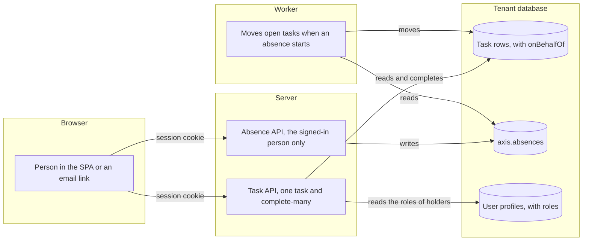

# Threat model: collaboration

_(planned for M43)_

This page holds the threats to people who work together on tasks, which belong to the **P** scope of the
[threat model](threat-model.md). They have a page of their own because [the product page](threat-model-product.md)
is close to its size limit. How its rows are found, rated and checked is in
[threat model method](threat-model-method.md), and a row added here takes the next free **P** id.

## Tasks, absences and deciding several tasks

A task goes to a person, who may be away, and a delegate takes the task while they are. A person may decide
several tasks at once, or from a link in an email. Each of these must reach only the people the rules allow, see
[who may act](task-api.md#who-may-act), [absences](user-administration.md#absences) and
[deciding several tasks](task-api.md#deciding-several-tasks).

| Id | Threat | Boundary | Category | Rating | Status | Evidence |
| --- | --- | --- | --- | --- | --- | --- |
| P157 | A forwarded email link decides a task for someone who may not act on it. | Browser and email link | Spoofing | High | **Mitigated** | _(planned for M43)_ The link carries no token, and the task page asks the task API who may act, see [deciding from an email](task-inbox-widget.md#deciding-from-an-email). |
| P158 | An excluded person lists, reads, claims or completes a task. | Task API | Elevation of privilege | High | **Mitigated** | _(planned for M43)_ The task API refuses an excluded person at each action with the same `403`, see [who may act](task-api.md#who-may-act). |
| P159 | A person sets, reads or ends another person's absence. | Absence API | Elevation of privilege | High | **Mitigated** | _(planned for M43)_ The `GET`, `PUT` and `DELETE` routes of `/api/me/absence` act on the signed-in person only, see [absences](user-administration.md#absences). |
| P160 | A task decided for an absent person, or an absence itself, leaves no record of whom it was for. | Task API and worker | Repudiation | Medium | **Mitigated** | _(planned for M43)_ A task keeps `onBehalfOf`, and the audit records `absence.set` and `task.delegated` name the person, see [absences](user-administration.md#absences) and [task read](task-api.md#read-one-task). |
| P161 | Deciding several tasks skips the checks that a single completion makes. | Task API | Elevation of privilege | High | **Mitigated** | _(planned for M43)_ Each task of `complete-many` is checked and completed as a single completion, in its own transaction, see [deciding several tasks](task-api.md#deciding-several-tasks). |
| P162 | A flood of `complete-many` calls takes the server's time from other tenants. | Task API | Denial of service | Medium | **Mitigated** | _(planned for M43)_ A call takes at most 100 task ids, and the server's rate limits apply, see [headers and rate limits](headers-and-rate-limits.md#rate-limits). |
| P163 | An absence, or the roles in a profile, is shown to someone else, or a holder's role is stale when they act. | Tenant database | Information disclosure | Medium | **Mitigated** | _(planned for M43)_ `axis.absences` is read only for its person, and a holder's role is checked when they act, see [sharing role tasks](task-api.md#sharing-role-tasks). |
