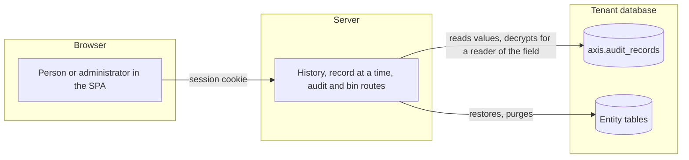

# Threat model: history and recovery

_(planned for M41)_

This page holds the threats to the history of records, the tenant's audit and the recycle bin, which belong to
the **P** scope of the [threat model](threat-model.md). They have a page of their own so that
[the product page](threat-model-product.md) stays under its size limit. How its rows are found, rated and checked is in
[threat model method](threat-model-method.md), and a row added here takes the next free **P** id.

## History, the tenant's audit and the recycle bin

A record's history keeps the old and new value of each change, an administrator reads and exports the tenant's
audit, and a deleted record waits in the recycle bin, see [values in history](record-audit.md#values-in-history),
[the tenant's audit](record-audit.md#the-tenants-audit) and [the recycle bin](recycle-bin.md).

Open threats, which no issue closes, see [threat model method](threat-model-method.md#how-it-is-filled):

- (Information disclosure, High) a history value, a record at a time or an audit export shows a value to a person
  who has no read grant on its field.
- (Information disclosure, High) a person who is not an administrator reads or exports the tenant's audit.
- (Information disclosure, High) a record at a time shows a record, or a value, that today's read filters hide.
- (Information disclosure, High) a sensitive value in history is stored or exported in clear.
- (Elevation of privilege, High) a person without a `delete` grant on the entity restores a record from the bin.
- (Elevation of privilege, High) a person who is not an administrator purges a record.
- (Tampering, High) the erasure path is used to change or remove audit records that hold no value of the person.
- (Repudiation, Medium) a restore, a purge or a change of the bin's period leaves no audit record.
