# Threat model: the product

This page holds the threats to the product, the **P** scope of the [threat model](threat-model.md).
How its rows are found, rated and checked is in [threat model method](threat-model-method.md).

## The product

The product is the server, the worker, the SPA, tenants, Studio and authoring, the MCP server and the
agent host, extension packages, connectors, endpoints and webhooks, the identity provider Axis ships
and the personal data Axis holds. The overview shows how the parts connect, and each boundary below has its own table.

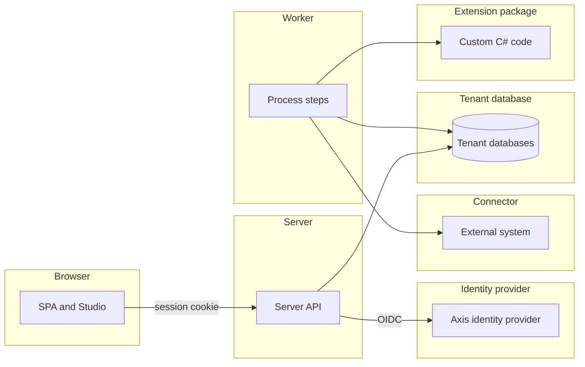

### Browser and server

The browser holds a session cookie that the server issues. The server checks each page and each write against that session.

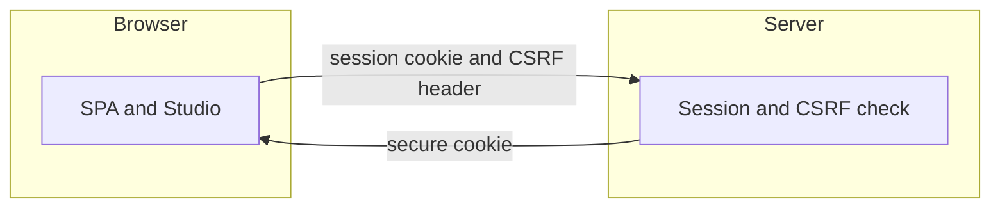

| Id | Threat | Boundary | Category | Rating | Status | Evidence |
| --- | --- | --- | --- | --- | --- | --- |
| P1 | A stolen or fixed session cookie signs someone in as another user. | Browser and server | Spoofing | High | **Mitigated** | `SignInTests` (a copied cookie stops working after sign out, and a new sign-in ends the old session), `SessionCookieTests` (the host cookie is Secure, with path root and no domain). |
| P2 | A page on another site makes the signed-in user write data. | Browser and server | Tampering | High | **Mitigated** | `CsrfHeaderTests` (writes without the header get a 403 and change nothing). |
| P3 | A change is made and no record shows who made it. | Browser and server | Repudiation | Medium | **Mitigated** | `AuditRecordTests` (each create, update and delete adds one record with the signed-in user as actor). |
| P4 | Injected script or a framing page reads or changes the Axis pages. | Browser and server | Information disclosure | High | **Mitigated** | `SecurityHeadersTests` (every answer sends a Content Security Policy that forbids framing, and the nosniff header). |
| P5 | A sign-in sends the user on to an outside address. | Browser and server | Spoofing | Medium | **Mitigated** | `SignInEndpointTests` (a return address that is not a local path is a 400 problem). |
| P6 | A flood of sign-ins or writes slows the service for other users. | Browser and server | Denial of service | Medium | **Mitigated** | `RateLimitTests` (a user past the session limit is refused while other users still pass). |
| P7 | A user reads or changes a page or record without a grant. | Browser and server | Elevation of privilege | High | **Mitigated** | `RecordPolicyTests` (every route is a 401 without a session and a 403 without a grant), `AuthorizationRouteTests` (every route off the open list answers 401 or 403 with no session and no token), `PageAccessTests` (a department manager can read purchase requests but cannot submit them). |
| P8 | A session stays open past its time limit or after an admin ends it. | Browser and server | Elevation of privilege | Medium | **Mitigated** | `SessionLifetimeTests` (a session ends after an hour idle or eight hours after sign in), `AdminTenantSessionEndTests` (ending one person's sessions leaves other people signed in). |
| P100 | Crafted input to a parser, in a record body, an import file or an expression, crashes the parser or reaches SQL. | Browser and server | Tampering | High | **Mitigated** | `RecordBodyFuzzTests` (a body is accepted or refused with a 400 problem), `RecordImportFuzzTests` (any bytes give rows or refusals), `ExpressionFuzzTests` (no SQL the translator emits holds input text outside a parameter). |
| P113 | The public `/licences` page tells an attacker which package versions Axis runs, and so which known weaknesses to try. | Browser and server | Information disclosure | Low | **Mitigated** | `LicenceEndpointTests` (an anonymous caller gets a 401 problem, and only a signed-in caller gets the versions). The public `/licences.json` holds names and licences only. |

### Server and databases

The server finds each tenant from the host. It then reads and writes that tenant's database as the runtime role.

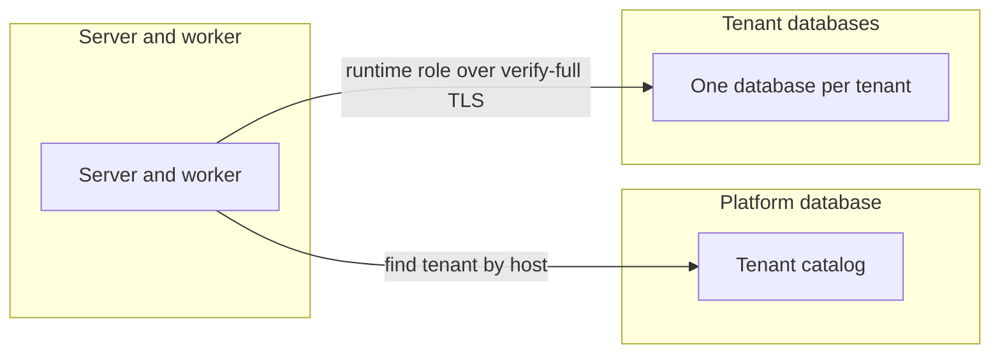

| Id | Threat | Boundary | Category | Rating | Status | Evidence |
| --- | --- | --- | --- | --- | --- | --- |
| P9 | A request for one tenant's host reaches another tenant's data. | Server and databases | Spoofing | Critical | **Mitigated** | `TenantResolutionTests` (an unknown host gets a 404 that names no tenant), `TenantIsolationTests` (a request on tenant a asks the catalog only for tenant a). |
| P10 | A tenant reads or changes another tenant's rows. | Server and databases | Information disclosure | Critical | **Mitigated** | `TenantIsolationTests` (a row written for tenant a is read only through tenant a). |
| P11 | A database connection without verified TLS lets someone alter the traffic. | Server and databases | Tampering | High | **Mitigated** | `DatabaseTlsRequirementTests` (a mode below verify-full is refused outside Development), `TenantDatabaseTlsTests` (each SSL mode maps to its libpq value, and a named root certificate is used). |
| P12 | A database change leaves no audit record, or an audit record is edited. | Server and databases | Repudiation | Medium | **Mitigated** | `AuditRecordTests` (a failed write adds no record, and the database rejects any change to an audit record). |
| P13 | The server or worker uses a database role with more rights than it needs. | Server and databases | Elevation of privilege | High | **Mitigated** | `DatabaseRoleTests` (every server and worker session on a tenant database uses the runtime role). |
| P14 | A tenant's secret is read from the database in clear text. | Server and databases | Information disclosure | High | **Mitigated** | `TenantSecretCipherTests` (an encrypted value hides its plain text and does not decrypt for another tenant or field). |
| P15 | A slow read or write holds a database connection for too long. | Server and databases | Denial of service | Medium | **Mitigated** | `QueryTimeoutTests` and `WriteTimeoutTests` (a slow read or write answers 503, and is logged and counted). |

### Caller and server

A machine caller, such as the purchasing system, sends a bearer token and a DPoP proof to an inbound endpoint.

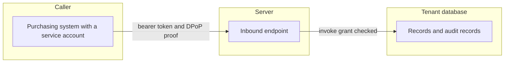

| Id | Threat | Boundary | Category | Rating | Status | Evidence |
| --- | --- | --- | --- | --- | --- | --- |
| P16 | A token that is unusable, forged or meant for another use is accepted. | Caller and server | Spoofing | High | **Mitigated** | `EndpointCallerTests` (an ID token is a 401 even with the expected audience), `ServiceAccountBearerOptionsTests` (both bearer schemes accept only asymmetric signature algorithms). |
| P17 | A bearer token of one tenant opens another tenant's endpoints. | Caller and server | Spoofing | Critical | **Mitigated** | `EndpointCallerTests` (a valid token of tenant a is a 401 on another tenant's host), `ServiceAccountBearerOptionsTests` (a request of another tenant gets no result from the service scheme). |
| P18 | A stolen bearer token is used with a DPoP proof made for another request. | Caller and server | Spoofing | High | **Mitigated** | `DpopProofTests` (a proof for another address, method or access token fails, and so does a proof outside its time window). |
| P19 | A repeated or changed request writes a second record. | Caller and server | Tampering | Medium | **Mitigated** | `EndpointCallTests` (a repeat with the same key returns the first answer, and the same key with other input is a 422 that writes nothing). |
| P20 | A record is created or started with no record of which caller did it. | Caller and server | Repudiation | Medium | **Mitigated** | `EndpointCallTests` (the create and the start are audited with the caller as actor). |
| P21 | A machine caller reads data beyond its own routes or grants. | Caller and server | Information disclosure | High | **Mitigated** | `ServiceAccountRouteTests` (a service token without a session is a 401 on every route outside the service account and endpoint routes), `ServiceAccountRecordTests` (a service account has no grant on another entity, and its record filter hides rows, and the operator commands are 403 without a grant, 404 for a hidden subject and 401 for a token of the wrong audience), `DpopCallerTests` (a plain bearer token is a 401 on every bearer route under `fapi2`). |
| P22 | A machine caller floods the server with requests. | Caller and server | Denial of service | Medium | **Mitigated** | `RateLimitRouteTests` (every route has a partition, and an endpoint route also has the bearer partition). |
| P23 | A caller without the invoke grant starts a process. | Caller and server | Elevation of privilege | High | **Mitigated** | `EndpointCallTests` (a caller without the invoke grant gets a 403 before the body and writes nothing), `ServiceAccountRecordTests` (a service account without the grant gets a 403 on a data source and a process). |
| P114 | A tenant realm token, or a token without the operator role, reads the tenants of the cell. | Caller and server | Elevation of privilege | High | **Mitigated** | `CellProvisioningApiTests` (no token and a tenant realm token are a 401, an operator realm client without the role is a 403, and a tenant host answers 404 for every path under `/api/cell/`), `CellRouteTests` (every route under `/api/cell/` carries the operator route marker and policy and allows no anonymous access). |

### Worker and outside system

The worker calls an outside system through a connector. It uses the tenant's bound URL and secret.

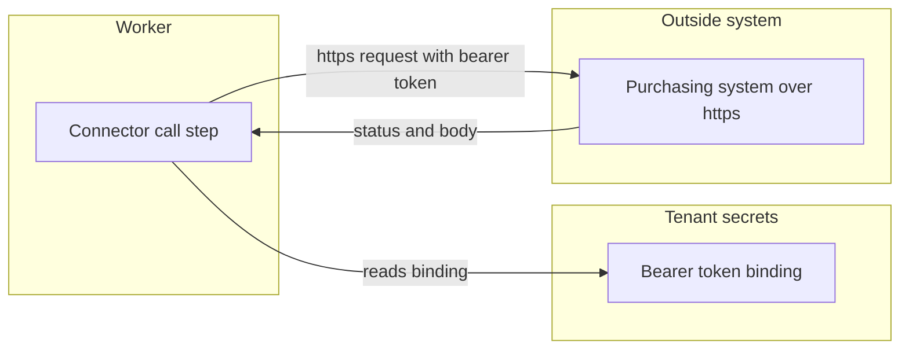

| Id | Threat | Boundary | Category | Rating | Status | Evidence |
| --- | --- | --- | --- | --- | --- | --- |
| P24 | A connector call goes over plain http, where someone else can answer for the outside system. | Worker and outside system | Spoofing | High | **Mitigated** | `ConnectorCallTests` (outside Development the worker sends nothing to an http URL), and the [deployment bindings](integration-resources.md#deployment-bindings) rule that a URL binding is https outside Development. |
| P25 | A reply that does not fit the expected output is written as a result. | Worker and outside system | Tampering | Medium | **Mitigated** | `ConnectorCallTests` (a 200 whose body does not fit leaves the call unknown, even with an idempotency key). |
| P26 | The connector token appears in a log, history row or audit record. | Worker and outside system | Information disclosure | High | **Mitigated** | `SecretValueTests` (a secret shows no part of its value in text, JSON or logs), `ConnectorCallTests` (no audit record, history row, call row or log entry holds the secret token), `ConnectorOAuth2Tests` (no log entry, span tag, audit record, history row, call row or attempt row holds the token or the client secret). |
| P27 | A call is redirected to a host the connector does not name. | Worker and outside system | Elevation of privilege | High | **Mitigated** | [Connector resource](integration-resources.md#connector-resource) (the path is added to the bound base URL, and the worker never follows a redirect), `ConnectorCallTests` (each tenant call uses its own URL and token). |
| P28 | A slow or failing outside system ties up worker capacity. | Worker and outside system | Denial of service | Medium | **Mitigated** | `ConnectorCallBackoffTests` (the wait doubles after each attempt, up to an hour). |
| P29 | A connector call happens with no record in the step history. | Worker and outside system | Repudiation | Low | **Mitigated** | `ProcessConnectorStepTests` (a connector step writes its history and a staged call audit record without input values). |

### Worker and extension package

Extension package code runs inside the worker process, with the secrets and data of every tenant in
reach, see [Not a sandbox](extension-packages.md#not-a-sandbox).

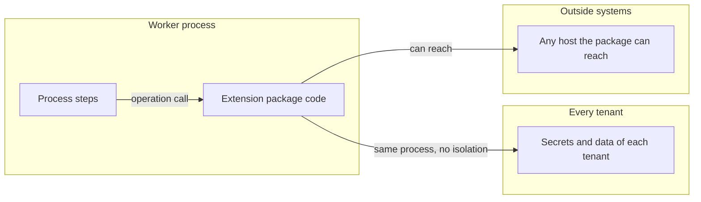

| Id | Threat | Boundary | Category | Rating | Status | Evidence |
| --- | --- | --- | --- | --- | --- | --- |
| P30 | Package code reads the secrets or data of other tenants inside the worker. | Worker and extension package | Information disclosure | High | **Delegated** | The operator. Packages are trusted code that the operator installs and reviews, see [Not a sandbox](extension-packages.md#not-a-sandbox). |
| P31 | Package code goes around its capability limits inside the worker. | Worker and extension package | Elevation of privilege | High | **Delegated** | The operator, see [Not a sandbox](extension-packages.md#not-a-sandbox). The package runners of M21 are not built yet. |
| P32 | A package by mistake reads an undeclared secret or calls an undeclared host. | Worker and extension package | Elevation of privilege | Medium | **Mitigated** | `PackageCapabilityTests` (an undeclared secret fails the instance, and a call to another host fails the call). It stops mistakes, not attacks, see [Not a sandbox](extension-packages.md#not-a-sandbox). |
| P33 | A package version is swapped after a release pins another one. | Worker and extension package | Tampering | Medium | **Mitigated** | `PackagePinningTests` (an instance keeps the version its release pins), `PackageCatalogTests` (an assembly that differs from its manifest version is a diagnostic). |
| P34 | A package call runs with no record of its operation. | Worker and extension package | Repudiation | Low | **Mitigated** | `PackageCallTests` (a settled call writes exactly one called audit record and records the operation identity). |
| P35 | A package operation never returns and holds a worker thread. | Worker and extension package | Denial of service | Medium | **Delegated** | The operator, see [Not a sandbox](extension-packages.md#not-a-sandbox). The timeout stops the wait, but the code keeps running in the worker. |

Spoofing does not apply. The operator installs each package, and a caller does not send a package an identity.

### Worker and webhook receiver

The worker sends each webhook's event to the receiver's bound URL, signed with the webhook's secret.

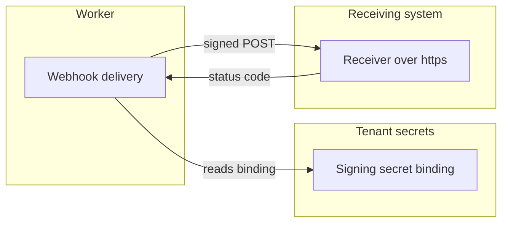

| Id | Threat | Boundary | Category | Rating | Status | Evidence |
| --- | --- | --- | --- | --- | --- | --- |
| P102 | A webhook goes over plain http, where someone else can answer for the receiver. | Worker and webhook receiver | Spoofing | High | **Mitigated** | `WebhookDeliveryTests` (outside Development the worker refuses an http URL and sends nothing). |
| P103 | A request is forged, or a repeat is taken for a new event. | Worker and webhook receiver | Tampering | High | **Mitigated** | `WebhookSignatureTests` (a `whsec_` secret and a plain secret each give the specified signature, and two secrets give two signatures), `WebhookDeliveryTests` (a receiver that answers 500 gets the same webhook-id and body again). |
| P104 | A sensitive value reaches a receiver, or a delivery's body is kept in an audit record. | Worker and webhook receiver | Information disclosure | High | **Mitigated** | `WebhookDeliveryTests` (the audit record of a delivered request holds no body), `RaiseEventSensitiveTests` (a raise step that maps a sensitive field into an event with a webhook is refused at the field), `EndpointEventCompilerTests` (an endpoint's event that reads a sensitive input is refused when a webhook names it). |
| P105 | A receiver redirects the signed request to another host. | Worker and webhook receiver | Elevation of privilege | High | **Mitigated** | `WebhookDeliveryTests` (a redirect is not followed and fails the attempt). |
| P106 | A failing receiver blocks the other webhooks of the same event. | Worker and webhook receiver | Denial of service | Medium | **Mitigated** | `WebhookDeliveryTests` (at the limit a delivery becomes a dead letter, and the other webhook of the event still delivers). |
| P107 | A delivered webhook leaves no record of who sent it. | Worker and webhook receiver | Repudiation | Low | **Mitigated** | `WebhookDeliveryTests` (a delivered request writes one audit record as system). |

### Authoring

Authoring covers what an author changes in Studio, what a release does once it is live, and what a
borrowed module or template brings in. It has five boundaries, each with its own diagram below.

**Author and release**

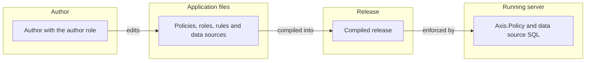

**Studio and the authoring API**

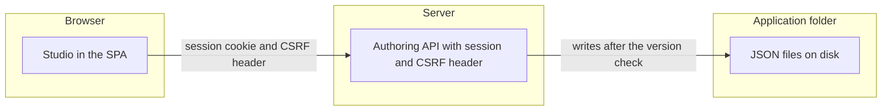

**Publishing and activation**

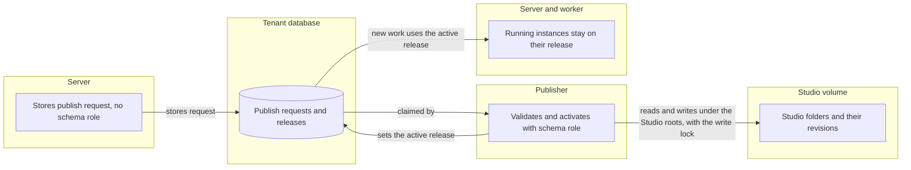

**Preview tenants**

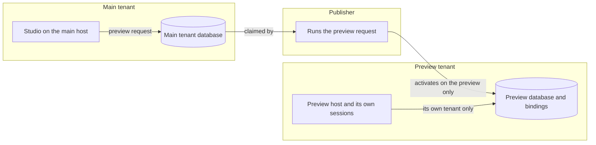

**Modules and templates**

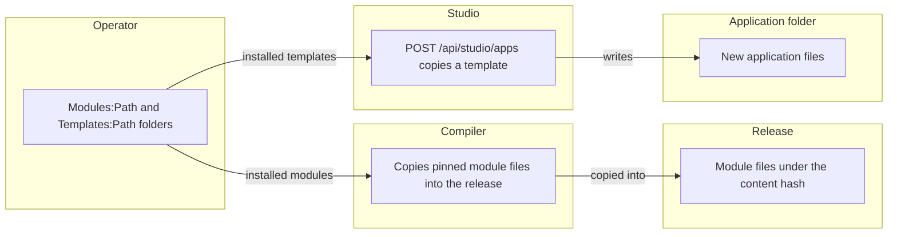

| Id | Threat | Boundary | Category | Rating | Status | Evidence |
| --- | --- | --- | --- | --- | --- | --- |
| P36 | An author widens access by changing a policy or a role. | Author and release | Elevation of privilege | High | **Mitigated** | `StudioPublishTests` and `StudioRollbackTests` show that publishing and activating a release need the publisher role. `PolicyMatrixTests` shows what each policy grants. See [publishing](authoring.md#publishing). |
| P37 | One person holds the author role and the publisher role, and widens access alone. | Author and release | Elevation of privilege | Medium | **Delegated** | The operator decides who holds each role at the identity provider. See [Studio settings](host-settings.md#studio-settings). |
| P38 | An author denies having published a release. | Author and release | Repudiation | Low | **Mitigated** | `AdminPublisherTests` writes one audit record for each publish. `StudioReleaseHistoryTests` lists each activation, newest first. See [audit](authoring.md#audit). |
| P39 | A data source shows a field that the user may not read. | Author and release | Information disclosure | Medium | **Mitigated** | `DataSourcePolicyTests` answers 403 for the whole data source. See [data source authorization](data-sources.md#authorization). |
| P40 | An author expression injects SQL. | Author and release | Tampering | High | **Mitigated** | `SqlTranslatorTests` checks that text and names never reach the SQL unquoted, and that literals are typed parameters. |
| P41 | A user without the author role calls the Studio API. | Studio API | Elevation of privilege | High | **Mitigated** | `StudioEndpointTests` answers 403 without the author role and 401 without a session. `StudioTextWriteTests` does the same for text writes, and `StudioRevisionTests` for the revision list, diff and undo and for the draft diff, where another person's draft answers 404. |
| P42 | A site in another origin sends a write as a signed-in author. | Studio API | Tampering | Medium | **Mitigated** | `StudioEndpointTests` refuses a write without the CSRF header. `CsrfHeaderTests` does the same for record writes. |
| P43 | A write escapes the application folder through `..`, a link or a folder link. | Studio API | Tampering | High | **Mitigated** | `StudioEndpointTests` refuses a name with `..` and does not write through a linked file or folder. `StudioCreateApplicationTests` refuses a name with `..`. |
| P44 | Two authors overwrite each other's changes. | Studio API | Tampering | Medium | **Mitigated** | `StudioWriteLockTests` gives one of two writes that share a version a 409. See [versions](authoring.md#versions). |
| P115 | An author reads the names of a tenant's bindings through `GET /api/studio/bindings`. | Studio API | Information disclosure | Low | **Accepted** | A binding's name is not a secret, and an author needs it to choose a binding. The route answers names by kind, never a value, and only to an author. `StudioResourceFormRouteTests` shows that the answer holds names only and refuses a user without the author role. Accepted on 2026-11-04. See [Studio API](studio-resource-form.md#studio-api). |
| P116 | An author's layer or module resource save moves a module record past a guard or into a protected state. | Studio API | Tampering | Medium | **Mitigated** | `ContractLayerTests` refuses a layer that adds a transition into a protected state with `AXC0370`. `ModuleLifecycleLayerTests` refuses a transition whose guard is false, or one into the protected state, and writes nothing. `StudioModuleLayerTests` refuses a save that changes a contract transition and writes nothing. |
| P45 | The live release differs from the folder the author sent to publish. | Publishing | Tampering | Medium | **Mitigated** | `StudioPublishTests` shows that the release keeps the folder as it was at the call. A later edit is not in it. |
| P46 | A publish from one tenant's host changes another tenant. | Publishing | Elevation of privilege | High | **Mitigated** | `StudioPublishTests` stores the request in that tenant's database only. `AdminPublisherTests` activates the release for that tenant only. |
| P47 | A new release changes work that is already running. | Publishing | Tampering | High | **Mitigated** | Running instances stay on the release they started on. `StudioRollbackTests`, `TaskReleaseTests` and `PinnedReleaseStartTests` cover this. |
| P48 | Activating a new or a stored release breaks data that is already stored. | Publishing | Tampering | High | **Mitigated** | `MigrationActivationTests` and `ModuleUpgradeTests` refuse a change that would break stored data, and change nothing. `PublisherRollbackTests` fails the activation of a stored release across a rename. |
| P49 | A request keeps crashing the publisher and blocks the queue. | Publishing | Denial of service | Medium | **Mitigated** | `AdminPublisherTests` fails a request with `AXC0215` after three expired claims. |
| P50 | The server activates a release or holds a schema connection. | Publishing | Elevation of privilege | High | **Mitigated** | The server stores a publish request and never activates. Only the publisher holds the tenant schema role. See [publishing](authoring.md#publishing) and [D47](../decisions/d47-publishing-from-studio.md). |
| P51 | A test request reaches the tenant's data. | Publishing | Information disclosure | Medium | **Mitigated** | `PublisherTestRequestTests` runs scenarios in their own database and leaves no record in the tenant database. |
| P139 | The publisher writes outside the Studio roots or into another tenant's folder. | Publishing | Tampering | High | **Mitigated** | The publisher finds a folder by name through the rule that Studio uses, and in a cell only inside the tenant's own folder. `StudioFolderTests` shows that `..`, `.`, a path, an absolute path and a blank name find nothing, even when a manifest carries the name, and that a tenant finds no other tenant's application. `AdminPublisherTests` shows that a Studio setting that cannot be used exits with code 2 and names the setting and not the path. `scripts/helm.test.mjs` and `scripts/onprem.test.mjs` show that only the servers and the publisher mount the Studio volume. |
| P52 | A preview reaches its main tenant's data. | Preview tenant | Information disclosure | High | **Mitigated** | `PublisherPreviewTests` activates the release on the preview tenant only. `StudioPreviewTests` leaves the main tenant unchanged. See [preview tenants](../architecture.md#preview-tenants). |
| P53 | A preview uses the main tenant's bindings. | Preview tenant | Information disclosure | Medium | **Mitigated** | `PreviewTenantActivationTests` gives the preview its own bindings, empty by default. `ReleaseActivatorTests` warns for each missing binding on a preview. |
| P54 | A session made on the preview host is used on the main host, or the other way round. | Preview tenant | Spoofing | Medium | **Mitigated** | `PreviewTenantSignInTests` answers 401 when a session made on the preview host is used on the main host. |
| P55 | The preview accepts a service account or machine token. | Preview tenant | Elevation of privilege | Medium | **Mitigated** | The preview has no service or endpoint audience, so it accepts no such token. See [preview tenants](../architecture.md#preview-tenants). |
| P56 | An administrator of the main tenant manages users on the preview. | Preview tenant | Elevation of privilege | Medium | **Mitigated** | `StudioPreviewTests` says that the users route is off on the preview for an administrator. |
| P57 | A module changes under a live release. | Modules and templates | Tampering | Medium | **Mitigated** | `ModulePinningTests` shows that a release holds its own module files. The compiler copies them into the release under its content hash. See [modules](modules-and-templates.md#modules). |
| P58 | A module brings in roles or policies. | Modules and templates | Elevation of privilege | Medium | **Mitigated** | `ModuleCompilerTests` reports a role file in a module as an error. A module policy names only role slots of its module, which the application maps, and grants only on its own module. See [modules](modules-and-templates.md#processes-pages-policies-and-dependencies). |
| P59 | An untrusted module or template is installed. | Modules and templates | Tampering | High | **Delegated** | The operator chooses what sits in `Modules:Path` and `Templates:Path`. See [modules](modules-and-templates.md#modules). |
| P60 | A template brings a wide policy into a new application. | Modules and templates | Elevation of privilege | Medium | **Mitigated** | `StudioCreateApplicationTests` copies a template as a new application. `StudioPublishTests` shows that an author without the publisher role cannot publish it. |

### MCP server and agent host

The MCP server at `/mcp` on each tenant host is the only way an agent acts on Axis. The agent host is
one of its clients, see [MCP server](mcp-server.md) and [authoring requests](authoring-requests.md#the-agent-host).
It has three boundaries, each with its own diagram below.

**Outside client and MCP server**

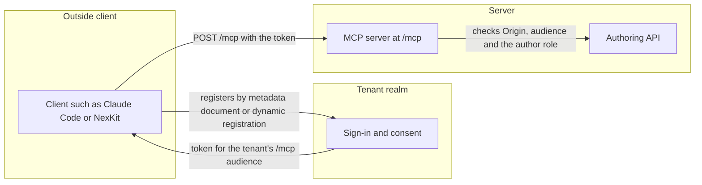

**Author and agent host** _(planned for M35)_

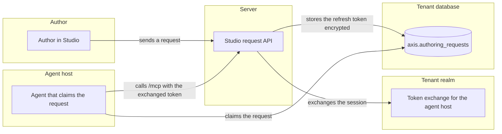

**Agent host and model provider** _(planned for M35)_

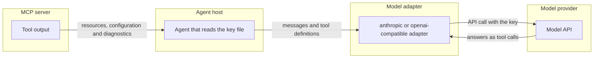

| Id | Threat | Boundary | Category | Rating | Status | Evidence |
| --- | --- | --- | --- | --- | --- | --- |
| P117 | A token for another resource or tenant is accepted. | Outside client and MCP server | Spoofing | Critical | **Mitigated** | `McpServerTests` shows that a token without the `/mcp` audience, and a token for another tenant's `/mcp` URL sent to a host, answer `401` with a challenge that points to the metadata, and that a session opens only for a token whose audience is that host's URL. See [sign-in](mcp-server.md#sign-in). |
| P118 | A malicious client registers under a misleading name or redirect URI and asks for consent. | Outside client and MCP server | Spoofing | High | **Gap** | [#2530](https://github.com/phuongnse/axis/issues/2530) allows only `https` or loopback redirect URIs, and its consent screen shows the client's name. [#2529](https://github.com/phuongnse/axis/issues/2529) shows the client and the scope on the consent screen and issues no token when the person declines. |
| P119 | A client that the `Ai:OutsideClients` setting does not allow gets a token. | Outside client and MCP server | Elevation of privilege | High | **Gap** | Closed by [#2531](https://github.com/phuongnse/axis/issues/2531), which allows no outside client by default and gives no token to a client that is not allowed. See [client registration](mcp-server.md#client-registration). |
| P120 | A page on another origin drives `/mcp` through DNS rebinding. | Outside client and MCP server | Tampering | Medium | **Mitigated** | `McpServerTests` shows that a request with a foreign `Origin` answers `403` before any method runs. See [route and transport](mcp-server.md#route-and-transport). |
| P121 | A tool reads a record, a file, a secret or a binding value, or publishes a release. | Outside client and MCP server | Information disclosure | High | **Mitigated** | `McpToolsDocumentationTests` (the tools table lists exactly the tools the server serves and offers), `McpToolOutputTests` (no output of any tool holds a seeded record value, secret binding, url binding or sign-in client secret), `McpToolGuardSelfTests` (the guard reports a leaking output, a tool with no input and a tool error). See [tools](mcp-server.md#tools). |
| P122 | A person without the author role calls a tool. | Outside client and MCP server | Elevation of privilege | High | **Mitigated** | `McpServerTests` shows that a person without the author role answers `403` before any method runs. See [sign-in](mcp-server.md#sign-in). |
| P123 | A revoked client keeps using its refresh token. | Outside client and MCP server | Spoofing | Medium | **Gap** | `TenantRealmAuthoringTests` shows that a refresh token works once and that a reused one is refused with `invalid_grant`. [#2532](https://github.com/phuongnse/axis/issues/2532) gives a revoked client `401` on its next call. [#2529](https://github.com/phuongnse/axis/issues/2529) ends each refresh token with the realm session. |
| P124 | Tool calls flood the server. | Outside client and MCP server | Denial of service | Medium | **Mitigated** | `McpRateLimitTests` shows that calls past the MCP limit are refused with `429` while another client of the same tenant still passes. See [limits](mcp-server.md#limits). |
| P125 | A write through a tool leaves no record of the person and the client. | Outside client and MCP server | Repudiation | Medium | **Gap** | `McpServerTests` shows one log entry per call with the tool, the client ID and the outcome. The audit record of each write tool call comes with the write tools of [#2528](https://github.com/phuongnse/axis/issues/2528). An accept writes a revision that names its author and request, see [revisions](revisions-and-drafts.md#revisions). |
| P126 | A refused call shows a stack trace or a path on disk. | Outside client and MCP server | Information disclosure | Low | **Mitigated** | `McpServerTests` shows that an unknown tool and bad input answer a tool error with a problem title, never a stack trace or a path. See [tools](mcp-server.md#tools). |
| P127 | The agent host acts beyond the author's grants, or for a person who has lost the author role. | Author and agent host | Elevation of privilege | High | **Gap** | Closed by [#2541](https://github.com/phuongnse/axis/issues/2541), which exchanges the author's session for a token with exactly the author's grants, and refuses an exchange for a person who has lost the author role. |
| P128 | The stored refresh token is read from the request row. | Author and agent host | Information disclosure | High | **Gap** | [#2541](https://github.com/phuongnse/axis/issues/2541) stores the refresh token encrypted with the tenant's data key, and deletes it when the request ends. See [durable requests](authoring-requests.md#durable-requests). |
| P129 | The agent accepts a draft without auto-accept, without passing checks or without plan approval. | Author and agent host | Elevation of privilege | High | **Gap** | [#2549](https://github.com/phuongnse/axis/issues/2549) lets the agent accept only when auto-accept is on, the request asks for it, the last review passed and the author still has the role. [#2548](https://github.com/phuongnse/axis/issues/2548) lets only a publisher turn auto-accept on. [#2543](https://github.com/phuongnse/axis/issues/2543) makes no change before the author approves the plan. |
| P130 | One tenant's long requests starve another tenant, or one request runs without bound. | Author and agent host | Denial of service | Medium | **Gap** | [#2542](https://github.com/phuongnse/axis/issues/2542) serves tenants in turn with leases, so one long request does not hold back another tenant. [#2545](https://github.com/phuongnse/axis/issues/2545) stops a request at its token budget or its time limit, and keeps its draft. |
| P131 | Another author approves, changes or drops a person's request. | Author and agent host | Elevation of privilege | Medium | **Mitigated** | `AuthoringRequestTests` shows that another author cannot approve, change or drop a request, and that a person without the author role cannot send one. See [acting for the author](authoring-requests.md#acting-for-the-author). |
| P132 | An author denies having sent, approved or dropped a request. | Author and agent host | Repudiation | Low | **Mitigated** | `AuthoringRequestTests` shows that sending, approving and dropping each write one audit record with the author, the application and the request. See [audit](authoring-requests.md#audit). |
| P133 | Text in a resource, a module, the request or a tool output makes the agent act beyond the request. | Agent host and model provider | Tampering | High | **Gap** | Tools only, plan approval, an independent review and the accept rules limit what such text can do. They are built by [#2537](https://github.com/phuongnse/axis/issues/2537), [#2543](https://github.com/phuongnse/axis/issues/2543), [#2545](https://github.com/phuongnse/axis/issues/2545) and [#2549](https://github.com/phuongnse/axis/issues/2549). |
| P134 | Tenant data, secrets or people's names reach the model. | Agent host and model provider | Information disclosure | High | **Gap** | [#2543](https://github.com/phuongnse/axis/issues/2543) keeps record values, people's names and tenant secrets out of the messages sent to the adapter. [#2537](https://github.com/phuongnse/axis/issues/2537) keeps them out of tool output. See [what reaches the model](authoring-requests.md#what-reaches-the-model). |
| P135 | A model API key appears in a log, a tool output or a request row. | Agent host and model provider | Information disclosure | High | **Gap** | `ModelAdapterKeyTests` shows that a key read from its file appears in no log line or exception message. `AiSettingsTests` shows that a bad AI setting stops the start with a message that holds no value or key. [#2546](https://github.com/phuongnse/axis/issues/2546) writes audit records for a tenant's own key without its value. [#2537](https://github.com/phuongnse/axis/issues/2537) keeps secrets out of tool output. |
| P136 | The model provider keeps or trains on the configuration Axis sends. | Agent host and model provider | Information disclosure | Medium | **Delegated** | The operator chooses the binding and its provider, and so the provider's terms. See [model bindings](model-bindings.md#bindings). |
| P137 | A forged, another tenant's or another person's `Mcp-Session-Id` is accepted. | Outside client and MCP server | Spoofing | Medium | **Mitigated** | `McpServerTests` shows that an altered session id answers `404`, and `McpSessionTests` that a session id of one tenant does not read on another. A session id also holds the person's subject and client id, which must match the token. See [sessions](mcp-server.md#route-and-transport). |
| P138 | A preview tenant serves the MCP server. | Outside client and MCP server | Elevation of privilege | Medium | **Mitigated** | `McpServerTests` shows that a preview tenant's host answers `404` on `/mcp` and on its metadata. See [route and transport](mcp-server.md#route-and-transport). |

Open threats, which no issue closes, see [threat model method](threat-model-method.md#how-it-is-filled):

- (Information disclosure, High) a model binding's endpoint may be a plain `http` address, which sends the key and the configuration without encryption.

### Identity provider

Axis's identity provider is Keycloak, with one realm for each tenant, see [identity provider](identity-provider.md)
and [user administration](user-administration.md). It has six boundaries, each with its own diagram below.

**Browser and sign-in page**

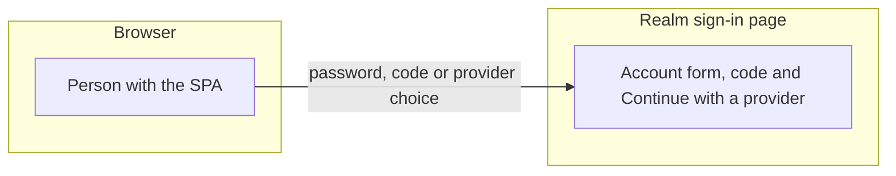

**Realm and brokered provider**

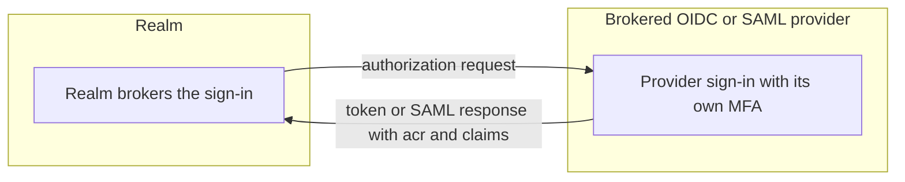

**Server and realm**

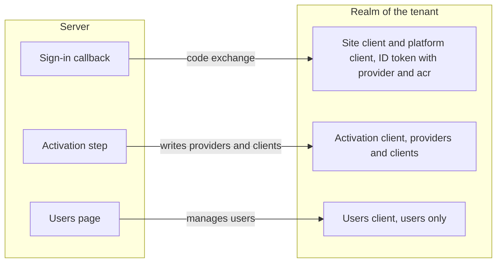

**Site and its providers**

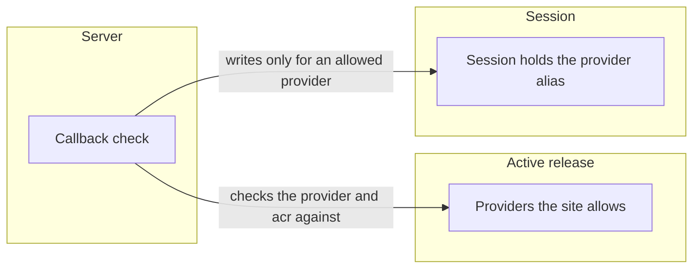

**Preview tenant and main realm**

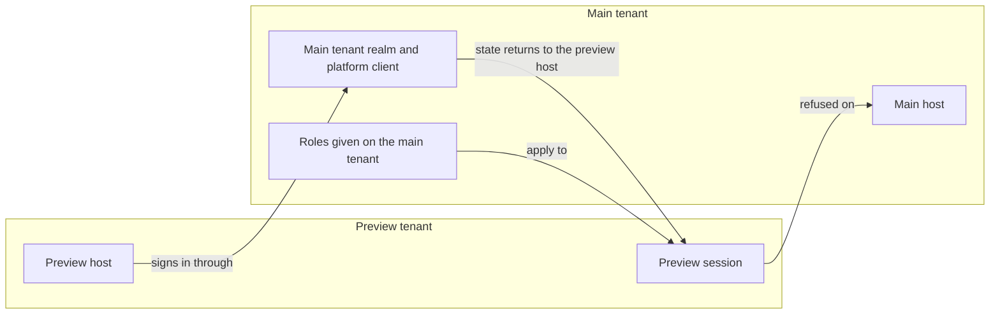

**Administrator and users page**

```mermaid
flowchart LR
    subgraph browser [Browser]
        Admin[Administrator with session, CSRF header and recent sign-in]
    end
    subgraph server [Server]
        Routes[Users routes]
    end
    subgraph realmusers [Realm]
        UsersRealm[Users client, users only]
    end
    subgraph tenantdb [Tenant database]
        Audit[(Audit records)]
    end
    Admin -->|invites, disables and gives roles| Routes
    Routes -->|writes users| UsersRealm
    Routes -->|one audit record per change| Audit
```

| Id | Threat | Boundary | Category | Rating | Status | Evidence |
| --- | --- | --- | --- | --- | --- | --- |
| P74 | A password is guessed or reused. | Browser and sign-in page | Spoofing | High | **Delegated** | The identity provider: at least 12 and at most 128 characters, a list of breached passwords and a wait after repeated failures, see [accounts](user-administration.md#accounts). `TenantRealmAccountRulesTests` refuses a short or breached password in the realm. |
| P75 | A stolen password signs in without a second step. | Browser and sign-in page | Spoofing | High | **Delegated** | The identity provider: a code from an authenticator app at every account sign-in, see [accounts](user-administration.md#accounts). |
| P76 | An account is made without an invitation. | Browser and sign-in page | Elevation of privilege | Medium | **Delegated** | The identity provider: the realm allows no self-registration, see [accounts](user-administration.md#accounts). |
| P77 | The sign-in page shows whether an account exists or is locked. | Browser and sign-in page | Information disclosure | Low | **Delegated** | The identity provider: the sign-in page shows the same message in each case, see [accounts](user-administration.md#accounts). |
| P78 | A provider signs a person in at an `acr` below its list. | Realm and brokered provider | Spoofing | High | **Mitigated** | `SiteSignInTests` (a site callback whose upstream `acr` the provider does not accept is refused), `SignInRefusalsTests` (an `acr` the list does not accept is refused as `acrNotAccepted`). The realm does not forward `acr_values`, so the callback check is the control. |
| P79 | One person is split into two users, because a provider appears twice with other bindings or claims. | Realm and brokered provider | Spoofing | Medium | **Mitigated** | `RealmPlannerTests` (a provider that shares an issuer binding with another client is a conflict, and so is one with the same bindings and other claims), `AdminActivateRealmTests` (a conflicting second application fails activate with `AXC0291` and leaves the realm unchanged). |
| P80 | Two people are merged into one user by a shared email. | Realm and brokered provider | Spoofing | High | **Mitigated** | `RealmBrokeredUsersTests` (one person signed in through two providers with the same email becomes two users), `TenantRealmAccountRulesTests` (a second run keeps a first-login flow that denies access, switched off, and then creates a user, and the realm allows duplicate emails). |
| P81 | A person who signs in through a brokered provider skips its second step. | Realm and brokered provider | Spoofing | Medium | **Delegated** | The brokered provider's MFA policy. [D99](../decisions/d99-axis-ships-its-own-identity-provider.md) says a person who signs in through their organization follows that organization's MFA policy. |
| P82 | A brokered OIDC token is forged or changed. | Realm and brokered provider | Tampering | High | **Delegated** | The identity provider checks the token signature with the provider's published keys, because the realm sync turns on signature validation for OIDC providers. See [identity provider](identity-provider.md). |
| P83 | An ID token for one site's client is used on another site. | Server and realm | Spoofing | High | **Mitigated** | `SiteSignInTests` (an ID token for another site's client is refused and writes no session). |
| P84 | A users client changes providers or clients, or the activation client changes users. | Server and realm | Elevation of privilege | High | **Mitigated** | `TenantRealmTests` (the users client manages users only, and the activation client manages clients and not users). |
| P85 | A provider that no release names still signs people in. | Server and realm | Tampering | Medium | **Mitigated** | `AdminActivateRealmTests` (activating again without the provider removes it from the realm), `RealmSyncTests` (a second sync removes a site that is gone and its provider, and keeps the other clients). |
| P86 | Realm sync output shows the activation secret. | Server and realm | Information disclosure | Medium | **Mitigated** | `AdminActivateRealmTests` (a wrong activation secret fails with a line that names no secret). |
| P87 | A roles claim gives a role in an application that does not map it. | Server and realm | Elevation of privilege | High | **Mitigated** | `ApplicationRolesSignInTests` (a brokered person holds the mapped role in the application that maps it only), `SiteSignInTests` (a roles value the mapping does not list gives no role). |
| P88 | A sign-in goes through a provider the site does not allow, even when `kc_idp_hint` forces it. | Site and its providers | Spoofing | High | **Mitigated** | `SiteSignInTests` (a callback through a provider the site does not allow is refused, for OIDC and for SAML, even when `kc_idp_hint` forces it), `SignInRefusalsTests` (a provider the site does not allow is refused as `providerNotAllowed`). |
| P89 | A session through one provider opens a site that does not allow that provider. | Site and its providers | Elevation of privilege | Medium | **Mitigated** | `SiteSignInTests` (a session opens a second site that allows its provider, and a site that does not allow it asks to sign in again). |
| P90 | A provider that the platform sign-in does not accept opens Studio, the console or the users page. | Site and its providers | Elevation of privilege | High | **Mitigated** | `PlatformSignInTests` (a sign-in through a provider the platform does not accept is refused and writes no session), `PlatformSignInSitesTests` (a person signed in through a site's provider sees no tool). |
| P91 | A refused sign-in leaves no record. | Site and its providers | Repudiation | Low | **Mitigated** | `SiteSignInTests` (a refusal is recorded with the reason `providerNotAllowed`), `SignInTests` (a callback with another tenant's state is refused and recorded). |
| P92 | A preview tenant's sign-in, made through its main tenant's realm and client, is used on the main tenant. | Preview tenant and main realm | Spoofing | Medium | **Mitigated** | `SignInTests` (a callback with another tenant's state is refused and recorded), `PreviewTenantSignInTests` (a preview session gets 401 on the main host, the cookie case in P54). |
| P93 | A role removed on the main tenant keeps working on the preview. | Preview tenant and main realm | Elevation of privilege | Medium | **Mitigated** | `PreviewTenantPlatformSignInTests` (a role the main tenant's users page gives applies on the preview until it is removed, and a person without it is denied). |
| P94 | A stolen or unattended administrator session gives its own user a platform role, such as publisher. | Administrator and users page | Elevation of privilege | High | **Mitigated** | `UserCommandTests` (a platform role change with an old login answers 403 and changes and audits nothing), `UserInvitationTests` (a platform role at invite time needs a recent login). |
| P95 | An administrator gives themselves a role and denies it. | Administrator and users page | Repudiation | Medium | **Mitigated** | `UserCommandTests` (giving and removing a role each write one audit record), `UserInvitationTests` (an invitation with a role writes one record for the invitation and one for the role). |
| P96 | A non-administrator lists, invites or changes users. | Administrator and users page | Elevation of privilege | High | **Mitigated** | `UserListTests` (a person without the administrator role gets 403 and nobody signed in gets 401), `UserCommandTests` (a person without the administrator role gets 403 on the user routes), `UserInvitationTests` (an invitation without an administrator session is refused). |
| P97 | An invitation takes over an account, by a used email or by an old link after a resend. | Administrator and users page | Spoofing | Medium | **Mitigated** | `UserInvitationTests` (an invitation for a used email is refused, and a resent invitation ends the old link). |
| P98 | A disabled person keeps a session or signs in. | Administrator and users page | Elevation of privilege | High | **Mitigated** | `UserCommandTests` (disabling a person ends their sessions and refuses their sign-in). |
| P99 | An administrator locks the tenant out by disabling themselves or removing their own administrator role. | Administrator and users page | Denial of service | Medium | **Mitigated** | `UserCommandTests` (disabling oneself, and removing one's own administrator role, answer 409 and change nothing). |
| P110 | A sign-out ends another person's identity provider session, or a slow identity provider holds sign-out up. | Server and realm | Denial of service | Medium | **Mitigated** | `SignInTests` (sign-out ends only the `sid` stored with the caller's own session, on the CSRF-checked route, and falls back to the end-session address when the call fails). |
| P111 | Keycloak's account console is a second self-service surface, where a person changes their account outside Axis's account page. | Browser and sign-in page | Elevation of privilege | Low | **Mitigated** | `AdminTenantRealmTests` (`tenant create` turns off the `account-console` client and takes `manage-account` out of the default roles, and a rerun restores both after a hand change). |
| P112 | A person denies accepting the terms, or a new terms version is never shown. | Server and realm | Repudiation | Low | **Mitigated** | `AdminTenantLegalRealmTests` (`tenant legal set` turns the Terms and Conditions action on with `defaultAction`, and a new `--terms-version` adds it to every user while a change of the addresses alone adds it to no one). Keycloak records when each person accepted. |

An identity provider session's lifetime and CSRF are covered by P1, P2 and P8.

Open threats, which no issue closes, see [threat model method](threat-model-method.md#how-it-is-filled):

- (Spoofing, High) no test shows that the realm checks the signature of a SAML provider's response. The sync keeps
  what Keycloak's metadata import sets, which may leave the check off.
- (Elevation of privilege, Medium) the `/api/apps/{app}` data endpoints do not check the session's provider, see
  [sites and sign-in](identity-provider.md#sites-and-sign-in).

### Personal data

Axis holds personal data about the people who use it: user profiles with email addresses, records and
their history, audit records with client addresses, notifications, logs and traces, uploaded files,
exports and backups. LINDDUN finds the privacy threats to that data, see
[threat model method](threat-model-method.md#how-it-is-filled).

```mermaid
flowchart LR
    subgraph idp [Identity provider]
        Claims[Identity provider claims]
    end
    subgraph server [Server]
        Api[Server API]
    end
    subgraph worker [Worker]
        Steps[Process steps and notify]
    end
    subgraph tenantdb [Tenant database]
        Profiles[(User profiles)]
        Records[(Records, record history and audit records with client addresses)]
        Files[(Uploaded files)]
        Outbox[(Notifications and email outbox)]
    end
    subgraph outside [Outside systems]
        Smtp[SMTP server]
        Collector[Collector run by the operator]
    end
    subgraph browser [Browser]
        Download[Export file]
    end
    subgraph operator [Operator]
        Admin[Admin tool tenant backup]
        Archive[(Archive kept by the operator)]
    end
    Claims -->|name, email and locale at sign-in| Profiles
    Api -->|writes| Records
    Api -->|stores uploads| Files
    Api -->|builds| Download
    Steps -->|writes| Outbox
    Outbox -->|sent over SMTP| Smtp
    Api -->|logs and traces| Collector
    Steps -->|logs and traces| Collector
    Admin -->|tenant backup| Archive
```

| Id | Threat | Boundary | Category | Rating | Status | Evidence |
| --- | --- | --- | --- | --- | --- | --- |
| P61 | A trace holds a person's user id, a field value or a bound address. | Personal data | Linking | Medium | **Mitigated** | `TraceCorrelationTests` (on the purchase request journey, no span holds a field value, a secret, a user id or a bound address). |
| P62 | A record's history shows a person's actions in another tenant. | Personal data | Linking | Low | **Mitigated** | `RecordHistoryTests` (a record's history holds only its own tenant's audit records). |
| P63 | The reassign picker shows other users' names to someone without the grant. | Personal data | Identifying | Medium | **Mitigated** | `TaskReassignTests` (the picker is 403 for anyone without the grant, and lists at most 20 profiles). |
| P109 | The user id field picker shows other users' names to someone who may not write the field. | Personal data | Identifying | Medium | **Mitigated** | `UserIdFieldTests` (the route is 403 for a user without a create or update grant that covers the field, 401 when not signed in, and answers only `id` and `displayName`). A user who may write the field can list the tenant's display names, which is intended. |
| P64 | A user learns that a record or file exists from the answer code. | Personal data | Detecting | Medium | **Mitigated** | `FileDownloadTests` (no read grant, or a read filter that excludes the record, gets 404), `RecordHistoryTests` (a deleted record's history is 404). |
| P65 | Other users see whether a person has read a notification. | Personal data | Detecting | Low | **Mitigated** | `NotificationEndpointTests` (marking notifications read lowers the unread count only for the caller). |
| P66 | A user reads personal fields without a grant. | Personal data | Data disclosure | High | **Mitigated** | `RecordFieldPolicyTests` (reads and writes hold only the fields the user may read, and a write to any other field is a 403). |
| P67 | An export holds rows or columns that the user may not read. | Personal data | Data disclosure | High | **Mitigated** | `ExportEndpointTests` (hidden rows and columns are absent, a user without the export grant gets 403 and nothing is audited, and each export is audited). |
| P68 | A profile's email reaches a log. | Personal data | Data disclosure | Medium | **Mitigated** | `SignInTests` (a profile that cannot be written logs a warning without the email). |
| P69 | A sensitive input shows in process inspection. | Personal data | Data disclosure | Medium | **Mitigated** | `ProcessInstanceSensitiveFieldTests` (the input that maps a sensitive field is hidden from a user who may read the field). |
| P70 | People do not know what Axis keeps about them. | Personal data | Unawareness | Medium | **Delegated** | The operator. Axis names no regulation, so the operator tells people what the application keeps, see [Restricted](keys-and-data-protection.md#restricted). |
| P71 | A person cannot correct their profile. | Personal data | Unawareness | Low | **Delegated** | The identity provider. Each sign-in rewrites the profile from its claims, see [user profiles](notifications.md#user-profiles). |
| P72 | Notifications are kept longer than needed. | Personal data | Non-compliance | Medium | **Mitigated** | `NotificationRetentionTests` (notifications over the retention days are deleted with their reads, and newer ones stay). |
| P73 | Logs, telemetry and backup archives are kept longer than needed. | Personal data | Non-compliance | Medium | **Delegated** | The operator keeps and removes them, see [log inventory](log-inventory.md#logs) and [Restricted](keys-and-data-protection.md#restricted). |
| P101 | Session audit records keep the full client address forever. | Personal data | Identifying | Medium | **Mitigated** | `ClientAddressTests` (IPv4 loses its last octet and IPv6 its last 80 bits) and `SignInTests` (sign-in, sign-out and refused sign-in records hold the shortened address). |
| P108 | A database login, a dump or a replica reads a sensitive field's value. | Personal data | Data disclosure | High | **Mitigated** | `RecordSensitiveValueTests` (the record API stores a sensitive value as ciphertext) and `LeaveRequestReasonStorageTests` (no runtime-readable column holds a submitted reason, and a backup keeps it as ciphertext). |

Non-repudiation does not apply as a privacy threat. The audit records exist so that a person cannot deny
a business action, see P3, P12 and P20. What they keep about a person is in the list below.

Open threats, which no issue closes, see [threat model method](threat-model-method.md#how-it-is-filled):

- (Identifying, Medium) an audit record whose `actor_name` holds the actor's display name keeps it forever. A new
  audit record stores no name.
- (Non-compliance, Medium) `axis.email_outbox` rows keep the address and the body forever.
- (Non-compliance, Medium) `axis.user_profiles` rows and old audit records cannot be removed for a person's
  removal request.
