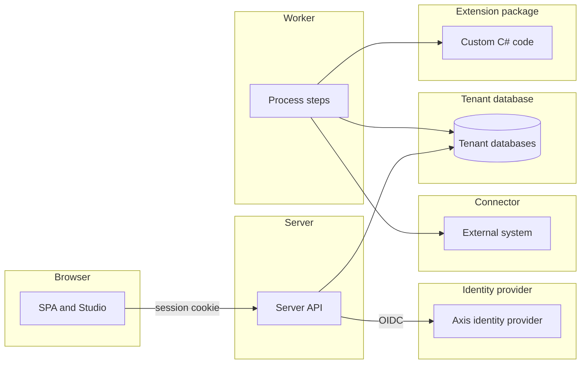
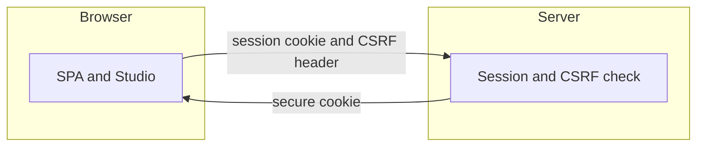
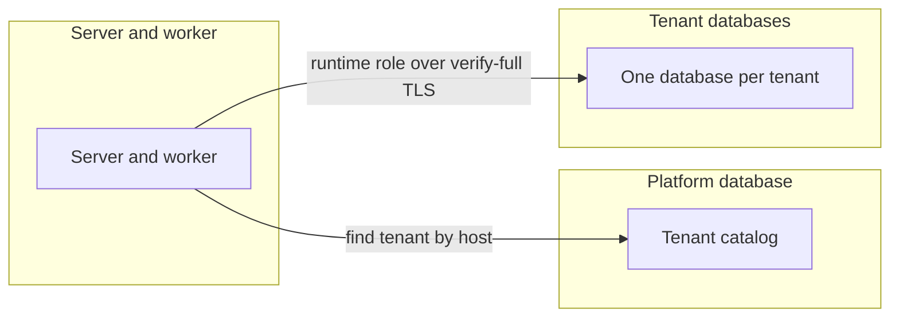
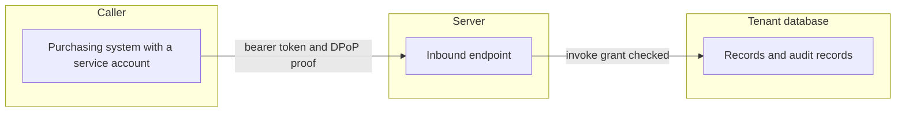
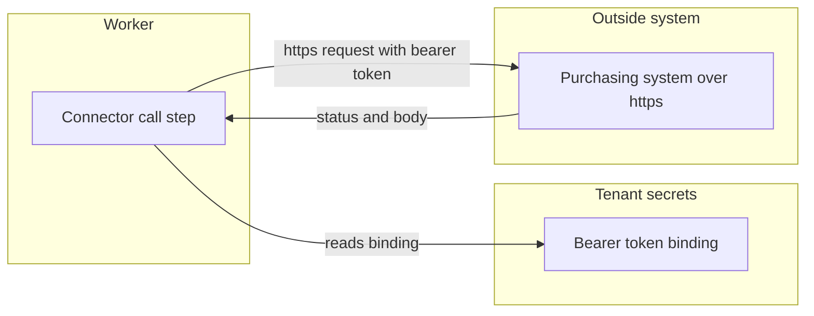
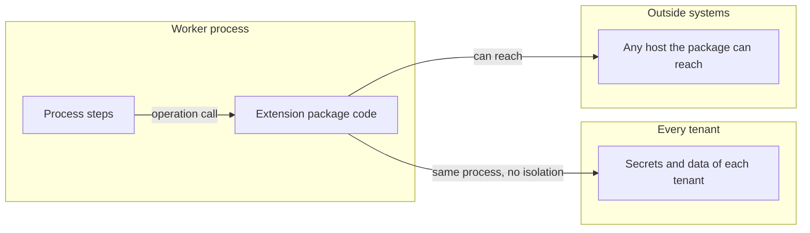
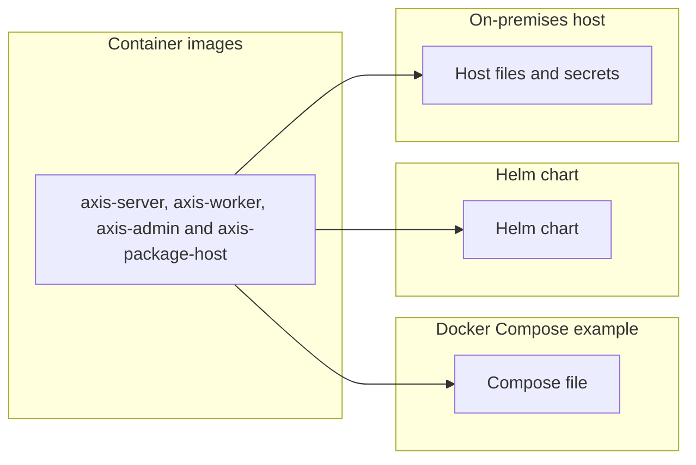
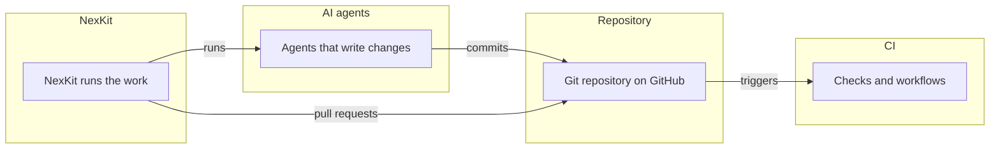

# Threat model

What can go wrong in Axis's own design, and what Axis does about each threat. The model follows
[D106](../decisions/d106-a-threat-model-kept-current-like-the-asvs-tracking.md). Its threat rows are
_(planned for M18)_. Each row comes from the issue that models one trust boundary, and the
[ASVS](asvs.md) page covers the controls that every web application needs.

## How it is filled

- **The four questions.** The Threat Modeling Manifesto frames the model. What are we working on?
  What can go wrong? What are we going to do about it? Did we do a good job?
- **Methods.**
  - STRIDE finds the threats at each trust boundary.
  - LINDDUN finds the privacy threats to personal data.
  - OWASP's agentic AI threats find the threats to the AI agents that write and review code.
- **One row per threat.** The table has these columns: id, threat, boundary, category, rating,
  status and evidence. A scope letter and a number make an id, such as `P1`, `I1` or `B1`. An id is
  unique on the whole page, so a later row or issue can name a threat by its id alone.
- **Rating.** The rating is Low, Medium, High or Critical. It comes from likelihood and impact, a
  short form of the OWASP Risk Rating Methodology.
  - A **Gap** has time to close, as a vulnerable dependency does, see
    [dependency updates](../development.md#dependency-updates). Critical is 7 days, High 30 days,
    Medium 90 days (Moderate in that table) and Low the next routine update.
  - The time starts on the day the row is written.
- **Status.** Each row has one of four statuses.
  - **Mitigated:** Axis has a control. The evidence names a test class in backticks, ending in
    `Tests`, a doc section or a check.
  - **Gap:** Axis does not have the control yet. The evidence links the GitHub issue that closes it.
  - **Delegated:** the identity provider or the operator meets the threat. The evidence names which.
  - **Accepted:** the owner accepts the threat. The evidence gives the reason and the date, as
    YYYY-MM-DD. Only the owner accepts a threat.
- **Checked.** `scripts/check-docs.mjs` fails on these problems:
  - an id that another row already uses, on the whole page
  - a status that is not one of the four above
  - a rating that is missing or is not one of the four above
  - a row without evidence
  - a **Mitigated** row that names a test class no `.cs` file under `tests/` or `samples/` declares
  - a **Gap** row that links no GitHub issue
  - an **Accepted** row that gives no date
  - It does not judge that a test covers its threat, that a time frame was kept, or that a
    **Delegated** row names the right party. A reviewer does.
- **Kept current.** A change that adds a trust boundary updates this page in the same change, see
  [the threat model rule](../delivery.md#keeping-the-docs-current). Each docs sweep reviews the page.
  Once a year the owner rates Axis against OWASP SAMM _(planned for M18)_, see
  [ASVS other evidence](asvs.md#other-evidence).

## The product

The server, the worker, the SPA, tenants, Studio and authoring, extension packages, connectors,
endpoints and webhooks, and the identity provider Axis ships.

### Browser and server

The browser holds a session cookie that the server issues. The server checks each page and each write against that session.

| Id | Threat | Boundary | Category | Rating | Status | Evidence |
| --- | --- | --- | --- | --- | --- | --- |
| P1 | A stolen or fixed session cookie signs someone in as another user. | Browser and server | Spoofing | High | **Mitigated** | `SignInTests` (a copied cookie stops working after sign out, and a new sign-in ends the old session), `SessionCookieTests` (the host cookie is Secure, with path root and no domain). |
| P2 | A page on another site makes the signed-in user write data. | Browser and server | Tampering | High | **Mitigated** | `CsrfHeaderTests` (writes without the header get a 403 and change nothing). |
| P3 | A change is made and no record shows who made it. | Browser and server | Repudiation | Medium | **Mitigated** | `AuditRecordTests` (each create, update and delete adds one record with the signed-in user as actor). |
| P4 | Injected script or a framing page reads or changes the Axis pages. | Browser and server | Information disclosure | High | **Mitigated** | `SecurityHeadersTests` (every answer sends a Content Security Policy that forbids framing, and the nosniff header). |
| P5 | A sign-in sends the user on to an outside address. | Browser and server | Spoofing | Medium | **Mitigated** | `SignInEndpointTests` (a return address that is not a local path is a 400 problem). |
| P6 | A flood of sign-ins or writes slows the service for other users. | Browser and server | Denial of service | Medium | **Mitigated** | `RateLimitTests` (a user past the session limit is refused while other users still pass). |
| P7 | A user reads or changes a page or record without a grant. | Browser and server | Elevation of privilege | High | **Mitigated** | `RecordPolicyTests` (every route is a 401 without a session and a 403 without a grant), `PageAccessTests` (a department manager can read purchase requests but cannot submit them). |
| P8 | A session stays open past its time limit or after an admin ends it. | Browser and server | Elevation of privilege | Medium | **Mitigated** | `SessionLifetimeTests` (a session ends after an hour idle or eight hours after sign in), `AdminTenantSessionEndTests` (ending one person's sessions leaves other people signed in). |

### Server and databases

The server finds each tenant from the host. It then reads and writes that tenant's database as the runtime role.

| Id | Threat | Boundary | Category | Rating | Status | Evidence |
| --- | --- | --- | --- | --- | --- | --- |
| P9 | A request for one tenant's host reaches another tenant's data. | Server and databases | Spoofing | Critical | **Mitigated** | `TenantResolutionTests` (an unknown host gets a 404 that names no tenant), `TenantIsolationTests` (a request on tenant a asks the catalog only for tenant a). |
| P10 | A tenant reads or changes another tenant's rows. | Server and databases | Information disclosure | Critical | **Mitigated** | `TenantIsolationTests` (a row written for tenant a is read only through tenant a). |
| P11 | A database connection without verified TLS lets someone alter the traffic. | Server and databases | Tampering | High | **Mitigated** | `DatabaseTlsRequirementTests` (a mode below verify-full is refused outside Development), `TenantDatabaseTlsTests` (each SSL mode maps to its libpq value, and a named root certificate is used). |
| P12 | A database change leaves no audit record, or an audit record is edited. | Server and databases | Repudiation | Medium | **Mitigated** | `AuditRecordTests` (a failed write adds no record, and the database rejects any change to an audit record). |
| P13 | The server or worker uses a database role with more rights than it needs. | Server and databases | Elevation of privilege | High | **Mitigated** | `DatabaseRoleTests` (every server and worker session on a tenant database uses the runtime role). |
| P14 | A tenant's secret is read from the database in clear text. | Server and databases | Information disclosure | High | **Mitigated** | `TenantSecretCipherTests` (an encrypted value hides its plain text and does not decrypt for another tenant or field). |
| P15 | A slow read holds a database connection for too long. | Server and databases | Denial of service | Medium | **Mitigated** | `QueryTimeoutTests` (a slow read answers 503, and is logged and counted). |

### Caller and server

A machine caller, such as the purchasing system, sends a bearer token and a DPoP proof to an inbound endpoint.

| Id | Threat | Boundary | Category | Rating | Status | Evidence |
| --- | --- | --- | --- | --- | --- | --- |
| P16 | A token that is unusable, forged or meant for another use is accepted. | Caller and server | Spoofing | High | **Mitigated** | `EndpointCallerTests` (an ID token is a 401 even with the expected audience), `ServiceAccountBearerOptionsTests` (both bearer schemes accept only asymmetric signature algorithms). |
| P17 | A bearer token of one tenant opens another tenant's endpoints. | Caller and server | Spoofing | Critical | **Mitigated** | `EndpointCallerTests` (a valid token of tenant a is a 401 on another tenant's host), `ServiceAccountBearerOptionsTests` (a request of another tenant gets no result from the service scheme). |
| P18 | A stolen bearer token is used with a DPoP proof made for another request. | Caller and server | Spoofing | High | **Mitigated** | `DpopProofTests` (a proof for another address, method or access token fails, and so does a proof outside its time window). |
| P19 | A repeated or changed request writes a second record. | Caller and server | Tampering | Medium | **Mitigated** | `EndpointCallTests` (a repeat with the same key returns the first answer, and the same key with other input is a 422 that writes nothing). |
| P20 | A record is created or started with no record of which caller did it. | Caller and server | Repudiation | Medium | **Mitigated** | `EndpointCallTests` (the create and the start are audited with the caller as actor). |
| P21 | A machine caller reads data beyond its own routes or grants. | Caller and server | Information disclosure | High | **Mitigated** | `ServiceAccountRouteTests` (a service token without a session is a 401 on every route outside the service account and endpoint routes), `ServiceAccountRecordTests` (a service account has no grant on another entity, and its record filter hides rows). |
| P22 | A machine caller floods the server with requests. | Caller and server | Denial of service | Medium | **Mitigated** | `RateLimitRouteTests` (every route has a partition, and an endpoint route also has the bearer partition). |
| P23 | A caller without the invoke grant starts a process. | Caller and server | Elevation of privilege | High | **Mitigated** | `EndpointCallTests` (a caller without the invoke grant gets a 403 before the body and writes nothing), `ServiceAccountRecordTests` (a service account without the grant gets a 403 on a data source and a process). |

### Worker and outside system

The worker calls an outside system through a connector. It uses the tenant's bound URL and secret.

| Id | Threat | Boundary | Category | Rating | Status | Evidence |
| --- | --- | --- | --- | --- | --- | --- |
| P24 | A connector call goes over plain http, where someone else can answer for the outside system. | Worker and outside system | Spoofing | High | **Mitigated** | `ConnectorCallTests` (outside Development the worker sends nothing to an http URL), and the [deployment bindings](integration-resources.md#deployment-bindings) rule that a URL binding is https outside Development. |
| P25 | A reply that does not fit the expected output is written as a result. | Worker and outside system | Tampering | Medium | **Mitigated** | `ConnectorCallTests` (a 200 whose body does not fit leaves the call unknown, even with an idempotency key). |
| P26 | The connector token appears in a log, history row or audit record. | Worker and outside system | Information disclosure | High | **Mitigated** | `SecretValueTests` (a secret shows no part of its value in text, JSON or logs), `ConnectorCallTests` (no audit record, history row, call row or log entry holds the secret token). |
| P27 | A call is redirected to a host the connector does not name. | Worker and outside system | Elevation of privilege | High | **Mitigated** | [Connector resource](integration-resources.md#connector-resource) (the path is added to the bound base URL, and the worker never follows a redirect), `ConnectorCallTests` (each tenant call uses its own URL and token). |
| P28 | A slow or failing outside system ties up worker capacity. | Worker and outside system | Denial of service | Medium | **Mitigated** | `ConnectorCallBackoffTests` (the wait doubles after each attempt, up to an hour). |
| P29 | A connector call happens with no record in the step history. | Worker and outside system | Repudiation | Low | **Mitigated** | `ProcessConnectorStepTests` (a connector step writes its history and a staged call audit record without input values). |

### Worker and extension package

Extension package code runs inside the worker process until the package runners of M21 exist.

| Id | Threat | Boundary | Category | Rating | Status | Evidence |
| --- | --- | --- | --- | --- | --- | --- |
| P30 | Package code reads the secrets or data of other tenants inside the worker. | Worker and extension package | Information disclosure | High | **Delegated** | The operator. Packages are trusted code that the operator installs and reviews, see [Not a sandbox](extension-packages.md#not-a-sandbox). |
| P31 | Package code goes around its capability limits inside the worker. | Worker and extension package | Elevation of privilege | High | **Delegated** | The operator, see [Not a sandbox](extension-packages.md#not-a-sandbox). The package runners of M21 are not built yet. |
| P32 | A package by mistake reads an undeclared secret or calls an undeclared host. | Worker and extension package | Elevation of privilege | Medium | **Mitigated** | `PackageCapabilityTests` (an undeclared secret fails the instance, and a call to another host fails the call). It stops mistakes, not attacks, see [Not a sandbox](extension-packages.md#not-a-sandbox). |
| P33 | A package version is swapped after a release pins another one. | Worker and extension package | Tampering | Medium | **Mitigated** | `PackagePinningTests` (an instance keeps the version its release pins), `PackageCatalogTests` (an assembly that differs from its manifest version is a diagnostic). |
| P34 | A package call runs with no record of its operation. | Worker and extension package | Repudiation | Low | **Mitigated** | `PackageCallTests` (a settled call writes exactly one called audit record and records the operation identity). |
| P35 | A package operation never returns and holds a worker thread. | Worker and extension package | Denial of service | Medium | **Delegated** | The operator, see [Not a sandbox](extension-packages.md#not-a-sandbox). The timeout stops the wait, but the code keeps running in the worker. |

Spoofing does not apply. The operator installs each package, and a caller does not send a package an identity.

Webhooks come with M19. The identity provider has its own issue in M18, and Studio authoring is not covered yet.

## The installation

The images, Docker Compose, the Helm chart and an install on premises.

| Id | Threat | Boundary | Category | Rating | Status | Evidence |
| --- | --- | --- | --- | --- | --- | --- |

## The way Axis is built

NexKit, CI, the AI agents that write to the repository, and the repository itself.

| Id | Threat | Boundary | Category | Rating | Status | Evidence |
| --- | --- | --- | --- | --- | --- | --- |
