# Threat model

What can go wrong in Axis's own design, and what Axis does about each threat. The model follows
[D106](../decisions/d106-a-threat-model-kept-current-like-the-asvs-tracking.md). Its threat rows are
_(planned for M18)_. Each row comes from the issue that models one trust boundary, and the
[ASVS](asvs.md) page covers the controls that every web application needs.

## How it is filled

- **The four questions.** The Threat Modeling Manifesto frames the model. What are we working on?
  What can go wrong? What are we going to do about it? Did we do a good job?
- **Methods.**
  - STRIDE finds the threats at each trust boundary.
  - LINDDUN finds the privacy threats to personal data.
  - OWASP's agentic AI threats find the threats to the AI agents that write and review code.
- **One row per threat.** The table has these columns: id, threat, boundary, category, rating,
  status and evidence. A scope letter and a number make an id, such as `P1`, `I1` or `B1`. An id is
  unique on the whole page, so a later row or issue can name a threat by its id alone.
- **Rating.** The rating is Low, Medium, High or Critical. It comes from likelihood and impact, a
  short form of the OWASP Risk Rating Methodology.
  - A **Gap** has time to close, as a vulnerable dependency does, see
    [dependency updates](../development.md#dependency-updates). Critical is 7 days, High 30 days,
    Medium 90 days (Moderate in that table) and Low the next routine update.
  - The time starts on the day the row is written.
- **Status.** Each row has one of four statuses.
  - **Mitigated:** Axis has a control. The evidence names a test class in backticks, ending in
    `Tests`, a doc section or a check.
  - **Gap:** Axis does not have the control yet. The evidence links the GitHub issue that closes it.
  - **Delegated:** the identity provider or the operator meets the threat. The evidence names which.
  - **Accepted:** the owner accepts the threat. The evidence gives the reason and the date, as
    YYYY-MM-DD. Only the owner accepts a threat.
- **Checked.** `scripts/check-docs.mjs` fails on these problems:
  - an id that another row already uses, on the whole page
  - a status that is not one of the four above
  - a rating that is missing or is not one of the four above
  - a row without evidence
  - a **Mitigated** row that names a test class no `.cs` file under `tests/` or `samples/` declares
  - a **Gap** row that links no GitHub issue
  - an **Accepted** row that gives no date
  - It does not judge that a test covers its threat, that a time frame was kept, or that a
    **Delegated** row names the right party. A reviewer does.
- **Kept current.** A change that adds a trust boundary updates this page in the same change, see
  [the threat model rule](../delivery.md#keeping-the-docs-current). Each docs sweep reviews the page.
  Once a year the owner rates Axis against OWASP SAMM _(planned for M18)_, see
  [ASVS other evidence](asvs.md#other-evidence).

## The product

The server, the worker, the SPA, tenants, Studio and authoring, extension packages, connectors,
endpoints and webhooks, and the identity provider Axis ships.

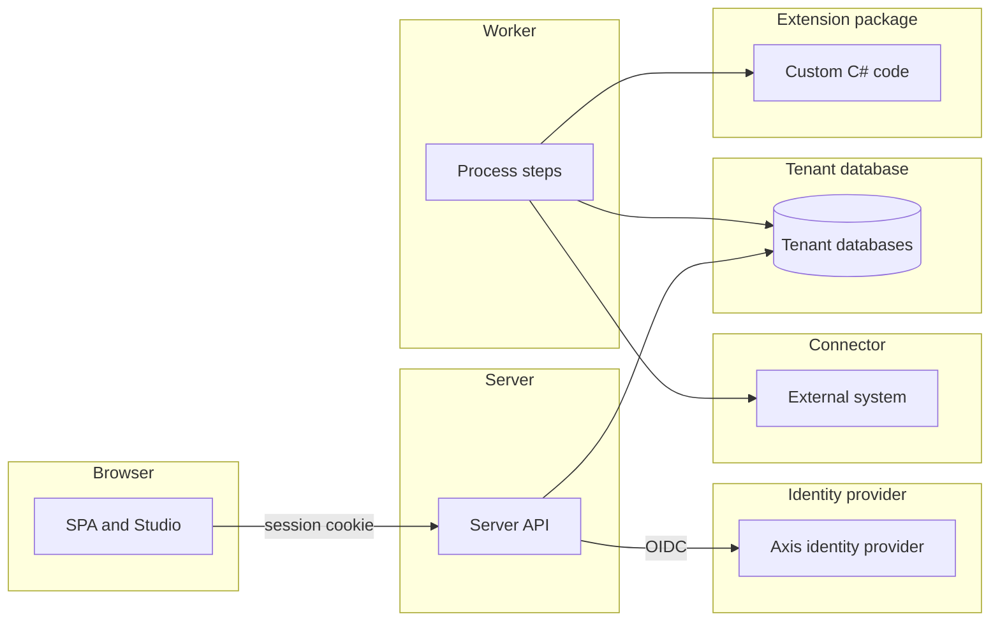

### Browser and server

The browser holds a session cookie that the server issues. The server checks each page and each write against that session.

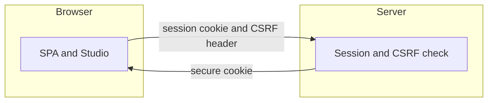

| Id | Threat | Boundary | Category | Rating | Status | Evidence |
| --- | --- | --- | --- | --- | --- | --- |
| P1 | A stolen or fixed session cookie signs someone in as another user. | Browser and server | Spoofing | High | **Mitigated** | `SignInTests` (a copied cookie stops working after sign out, and a new sign-in ends the old session), `SessionCookieTests` (the host cookie is Secure, with path root and no domain). |
| P2 | A page on another site makes the signed-in user write data. | Browser and server | Tampering | High | **Mitigated** | `CsrfHeaderTests` (writes without the header get a 403 and change nothing). |
| P3 | A change is made and no record shows who made it. | Browser and server | Repudiation | Medium | **Mitigated** | `AuditRecordTests` (each create, update and delete adds one record with the signed-in user as actor). |
| P4 | Injected script or a framing page reads or changes the Axis pages. | Browser and server | Information disclosure | High | **Mitigated** | `SecurityHeadersTests` (every answer sends a Content Security Policy that forbids framing, and the nosniff header). |
| P5 | A sign-in sends the user on to an outside address. | Browser and server | Spoofing | Medium | **Mitigated** | `SignInEndpointTests` (a return address that is not a local path is a 400 problem). |
| P6 | A flood of sign-ins or writes slows the service for other users. | Browser and server | Denial of service | Medium | **Mitigated** | `RateLimitTests` (a user past the session limit is refused while other users still pass). |
| P7 | A user reads or changes a page or record without a grant. | Browser and server | Elevation of privilege | High | **Mitigated** | `RecordPolicyTests` (every route is a 401 without a session and a 403 without a grant), `PageAccessTests` (a department manager can read purchase requests but cannot submit them). |
| P8 | A session stays open past its time limit or after an admin ends it. | Browser and server | Elevation of privilege | Medium | **Mitigated** | `SessionLifetimeTests` (a session ends after an hour idle or eight hours after sign in), `AdminTenantSessionEndTests` (ending one person's sessions leaves other people signed in). |

### Server and databases

The server finds each tenant from the host. It then reads and writes that tenant's database as the runtime role.

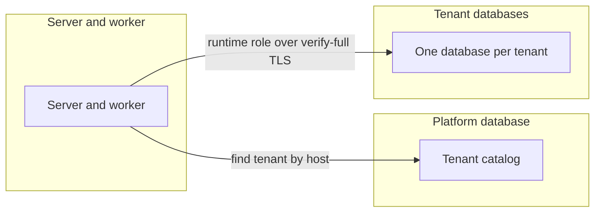

| Id | Threat | Boundary | Category | Rating | Status | Evidence |
| --- | --- | --- | --- | --- | --- | --- |
| P9 | A request for one tenant's host reaches another tenant's data. | Server and databases | Spoofing | Critical | **Mitigated** | `TenantResolutionTests` (an unknown host gets a 404 that names no tenant), `TenantIsolationTests` (a request on tenant a asks the catalog only for tenant a). |
| P10 | A tenant reads or changes another tenant's rows. | Server and databases | Information disclosure | Critical | **Mitigated** | `TenantIsolationTests` (a row written for tenant a is read only through tenant a). |
| P11 | A database connection without verified TLS lets someone alter the traffic. | Server and databases | Tampering | High | **Mitigated** | `DatabaseTlsRequirementTests` (a mode below verify-full is refused outside Development), `TenantDatabaseTlsTests` (each SSL mode maps to its libpq value, and a named root certificate is used). |
| P12 | A database change leaves no audit record, or an audit record is edited. | Server and databases | Repudiation | Medium | **Mitigated** | `AuditRecordTests` (a failed write adds no record, and the database rejects any change to an audit record). |
| P13 | The server or worker uses a database role with more rights than it needs. | Server and databases | Elevation of privilege | High | **Mitigated** | `DatabaseRoleTests` (every server and worker session on a tenant database uses the runtime role). |
| P14 | A tenant's secret is read from the database in clear text. | Server and databases | Information disclosure | High | **Mitigated** | `TenantSecretCipherTests` (an encrypted value hides its plain text and does not decrypt for another tenant or field). |
| P15 | A slow read holds a database connection for too long. | Server and databases | Denial of service | Medium | **Mitigated** | `QueryTimeoutTests` (a slow read answers 503, and is logged and counted). |

### Caller and server

A machine caller, such as the purchasing system, sends a bearer token and a DPoP proof to an inbound endpoint.

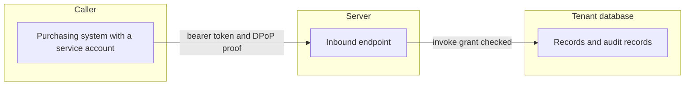

| Id | Threat | Boundary | Category | Rating | Status | Evidence |
| --- | --- | --- | --- | --- | --- | --- |
| P16 | A token that is unusable, forged or meant for another use is accepted. | Caller and server | Spoofing | High | **Mitigated** | `EndpointCallerTests` (an ID token is a 401 even with the expected audience), `ServiceAccountBearerOptionsTests` (both bearer schemes accept only asymmetric signature algorithms). |
| P17 | A bearer token of one tenant opens another tenant's endpoints. | Caller and server | Spoofing | Critical | **Mitigated** | `EndpointCallerTests` (a valid token of tenant a is a 401 on another tenant's host), `ServiceAccountBearerOptionsTests` (a request of another tenant gets no result from the service scheme). |
| P18 | A stolen bearer token is used with a DPoP proof made for another request. | Caller and server | Spoofing | High | **Mitigated** | `DpopProofTests` (a proof for another address, method or access token fails, and so does a proof outside its time window). |
| P19 | A repeated or changed request writes a second record. | Caller and server | Tampering | Medium | **Mitigated** | `EndpointCallTests` (a repeat with the same key returns the first answer, and the same key with other input is a 422 that writes nothing). |
| P20 | A record is created or started with no record of which caller did it. | Caller and server | Repudiation | Medium | **Mitigated** | `EndpointCallTests` (the create and the start are audited with the caller as actor). |
| P21 | A machine caller reads data beyond its own routes or grants. | Caller and server | Information disclosure | High | **Mitigated** | `ServiceAccountRouteTests` (a service token without a session is a 401 on every route outside the service account and endpoint routes), `ServiceAccountRecordTests` (a service account has no grant on another entity, and its record filter hides rows, and the operator commands are 403 without a grant, 404 for a hidden subject and 401 for a token of the wrong audience), `DpopCallerTests` (a plain bearer token is a 401 on every bearer route under `fapi2`). |
| P22 | A machine caller floods the server with requests. | Caller and server | Denial of service | Medium | **Mitigated** | `RateLimitRouteTests` (every route has a partition, and an endpoint route also has the bearer partition). |
| P23 | A caller without the invoke grant starts a process. | Caller and server | Elevation of privilege | High | **Mitigated** | `EndpointCallTests` (a caller without the invoke grant gets a 403 before the body and writes nothing), `ServiceAccountRecordTests` (a service account without the grant gets a 403 on a data source and a process). |

### Worker and outside system

The worker calls an outside system through a connector. It uses the tenant's bound URL and secret.

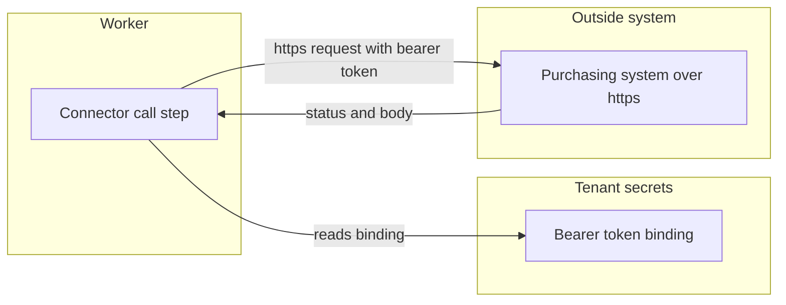

| Id | Threat | Boundary | Category | Rating | Status | Evidence |
| --- | --- | --- | --- | --- | --- | --- |
| P24 | A connector call goes over plain http, where someone else can answer for the outside system. | Worker and outside system | Spoofing | High | **Mitigated** | `ConnectorCallTests` (outside Development the worker sends nothing to an http URL), and the [deployment bindings](integration-resources.md#deployment-bindings) rule that a URL binding is https outside Development. |
| P25 | A reply that does not fit the expected output is written as a result. | Worker and outside system | Tampering | Medium | **Mitigated** | `ConnectorCallTests` (a 200 whose body does not fit leaves the call unknown, even with an idempotency key). |
| P26 | The connector token appears in a log, history row or audit record. | Worker and outside system | Information disclosure | High | **Mitigated** | `SecretValueTests` (a secret shows no part of its value in text, JSON or logs), `ConnectorCallTests` (no audit record, history row, call row or log entry holds the secret token). |
| P27 | A call is redirected to a host the connector does not name. | Worker and outside system | Elevation of privilege | High | **Mitigated** | [Connector resource](integration-resources.md#connector-resource) (the path is added to the bound base URL, and the worker never follows a redirect), `ConnectorCallTests` (each tenant call uses its own URL and token). |
| P28 | A slow or failing outside system ties up worker capacity. | Worker and outside system | Denial of service | Medium | **Mitigated** | `ConnectorCallBackoffTests` (the wait doubles after each attempt, up to an hour). |
| P29 | A connector call happens with no record in the step history. | Worker and outside system | Repudiation | Low | **Mitigated** | `ProcessConnectorStepTests` (a connector step writes its history and a staged call audit record without input values). |

### Worker and extension package

Extension package code runs inside the worker process until the package runners of M21 exist.

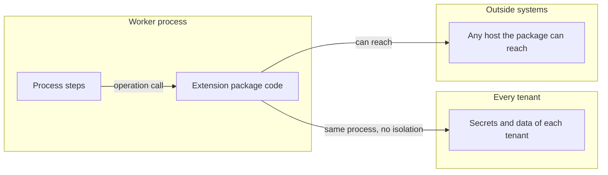

| Id | Threat | Boundary | Category | Rating | Status | Evidence |
| --- | --- | --- | --- | --- | --- | --- |
| P30 | Package code reads the secrets or data of other tenants inside the worker. | Worker and extension package | Information disclosure | High | **Delegated** | The operator. Packages are trusted code that the operator installs and reviews, see [Not a sandbox](extension-packages.md#not-a-sandbox). |
| P31 | Package code goes around its capability limits inside the worker. | Worker and extension package | Elevation of privilege | High | **Delegated** | The operator, see [Not a sandbox](extension-packages.md#not-a-sandbox). The package runners of M21 are not built yet. |
| P32 | A package by mistake reads an undeclared secret or calls an undeclared host. | Worker and extension package | Elevation of privilege | Medium | **Mitigated** | `PackageCapabilityTests` (an undeclared secret fails the instance, and a call to another host fails the call). It stops mistakes, not attacks, see [Not a sandbox](extension-packages.md#not-a-sandbox). |
| P33 | A package version is swapped after a release pins another one. | Worker and extension package | Tampering | Medium | **Mitigated** | `PackagePinningTests` (an instance keeps the version its release pins), `PackageCatalogTests` (an assembly that differs from its manifest version is a diagnostic). |
| P34 | A package call runs with no record of its operation. | Worker and extension package | Repudiation | Low | **Mitigated** | `PackageCallTests` (a settled call writes exactly one called audit record and records the operation identity). |
| P35 | A package operation never returns and holds a worker thread. | Worker and extension package | Denial of service | Medium | **Delegated** | The operator, see [Not a sandbox](extension-packages.md#not-a-sandbox). The timeout stops the wait, but the code keeps running in the worker. |

Spoofing does not apply. The operator installs each package, and a caller does not send a package an identity.

Webhooks come with M19. The identity provider has its own issue in M18, and Studio authoring is not covered yet.

### Authoring

Authoring covers what an author changes in Studio, what a release does once it is live, and what a
borrowed module or template brings in. It has five boundaries, each with its own diagram below.

**Author and release**

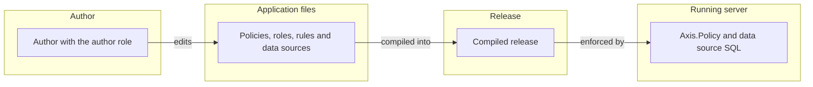

**Studio and the authoring API**

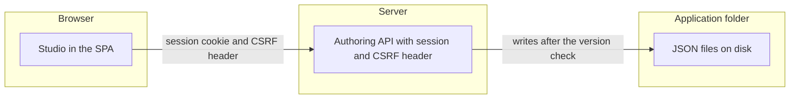

**Publishing with activation and rollback**

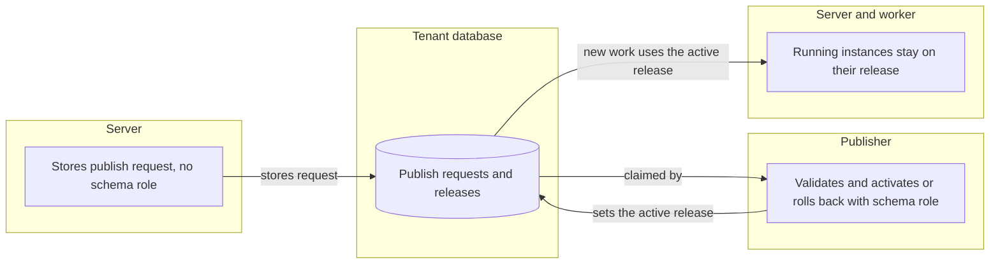

**Preview tenants**

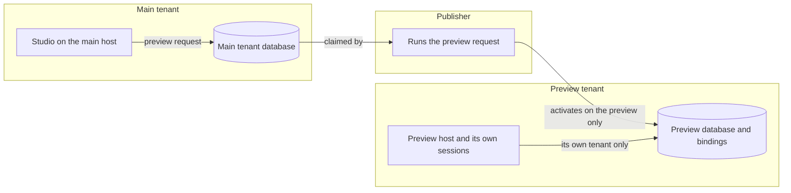

**Modules and templates**

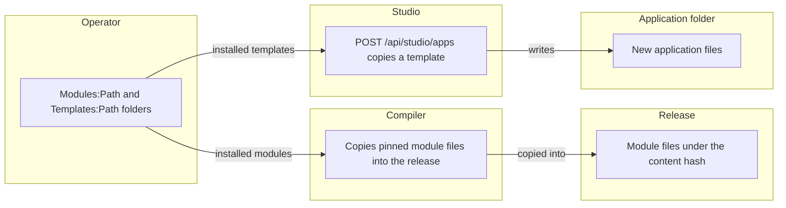

| Id | Threat | Boundary | Category | Rating | Status | Evidence |
| --- | --- | --- | --- | --- | --- | --- |
| P1 | An author widens access by changing a policy or a role. | Author and release | Elevation of privilege | High | **Mitigated** | `StudioPublishTests` and `StudioRollbackTests` show that publishing and rolling back need the publisher role. `PolicyMatrixTests` shows what each policy grants. See [publishing](authoring.md#publishing). |
| P2 | One person holds the author role and the publisher role, and widens access alone. | Author and release | Elevation of privilege | Medium | **Delegated** | The operator decides who holds each role at the identity provider. See [Studio settings](host-settings.md#studio-settings). |
| P3 | An author denies having published a release. | Author and release | Repudiation | Low | **Mitigated** | `AdminPublisherTests` writes one audit record for each publish. `StudioReleaseHistoryTests` lists each activation, newest first. See [audit](authoring.md#audit). |
| P4 | A data source shows a field that the user may not read. | Author and release | Information disclosure | Medium | **Mitigated** | `DataSourcePolicyTests` answers 403 for the whole data source. See [data source authorization](data-sources.md#authorization). |
| P5 | An author expression injects SQL. | Author and release | Tampering | High | **Mitigated** | `SqlTranslatorTests` checks that text and names never reach the SQL unquoted, and that literals are typed parameters. |
| P6 | A user without the author role calls the Studio API. | Studio API | Elevation of privilege | High | **Mitigated** | `StudioEndpointTests` answers 403 without the author role and 401 without a session. `StudioTextWriteTests` does the same for text writes. |
| P7 | A site in another origin sends a write as a signed-in author. | Studio API | Tampering | Medium | **Mitigated** | `StudioEndpointTests` refuses a write without the CSRF header. `CsrfHeaderTests` does the same for record writes. |
| P8 | A write escapes the application folder through `..`, a link or a folder link. | Studio API | Tampering | High | **Mitigated** | `StudioEndpointTests` refuses a name with `..` and does not write through a linked file or folder. `StudioCreateApplicationTests` refuses a name with `..`. |
| P9 | Two authors overwrite each other's changes. | Studio API | Tampering | Medium | **Mitigated** | `StudioWriteLockTests` gives one of two writes that share a version a 409. See [versions](authoring.md#versions). |
| P10 | The live release differs from the folder the author sent to publish. | Publishing | Tampering | Medium | **Mitigated** | `StudioPublishTests` shows that the release keeps the folder as it was at the call. A later edit is not in it. |
| P11 | A publish from one tenant's host changes another tenant. | Publishing | Elevation of privilege | High | **Mitigated** | `StudioPublishTests` stores the request in that tenant's database only. `AdminPublisherTests` activates the release for that tenant only. |
| P12 | A new release changes work that is already running. | Publishing | Tampering | High | **Mitigated** | Running instances stay on the release they started on. `StudioRollbackTests`, `TaskReleaseTests` and `PinnedReleaseStartTests` cover this. |
| P13 | Activation or rollback breaks data that is already stored. | Publishing | Tampering | High | **Mitigated** | `MigrationActivationTests` and `ModuleUpgradeTests` refuse a change that would break stored data, and change nothing. `PublisherRollbackTests` fails a rollback across a rename. |
| P14 | A request keeps crashing the publisher and blocks the queue. | Publishing | Denial of service | Medium | **Mitigated** | `AdminPublisherTests` fails a request with `AXC0215` after three expired claims. |
| P15 | The server activates a release or holds a schema connection. | Publishing | Elevation of privilege | High | **Mitigated** | The server stores a publish request and never activates. Only the publisher holds the tenant schema role. See [publishing](authoring.md#publishing) and [D47](../decisions/d47-publishing-from-studio.md). |
| P16 | A test request reaches the tenant's data. | Publishing | Information disclosure | Medium | **Mitigated** | `PublisherTestRequestTests` runs scenarios in their own database and leaves no record in the tenant database. |
| P17 | A preview reaches its main tenant's data. | Preview tenant | Information disclosure | High | **Mitigated** | `PublisherPreviewTests` activates the release on the preview tenant only. `StudioPreviewTests` leaves the main tenant unchanged. See [preview tenants](../architecture.md#preview-tenants). |
| P18 | A preview uses the main tenant's bindings. | Preview tenant | Information disclosure | Medium | **Mitigated** | `PreviewTenantActivationTests` gives the preview its own bindings, empty by default. `ReleaseActivatorTests` warns for each missing binding on a preview. |
| P19 | A session made on the preview host is used on the main host, or the other way round. | Preview tenant | Spoofing | Medium | **Mitigated** | `PreviewTenantSignInTests` answers 401 when a session made on the preview host is used on the main host. |
| P20 | The preview accepts a service account or machine token. | Preview tenant | Elevation of privilege | Medium | **Mitigated** | The preview has no service or endpoint audience, so it accepts no such token. See [preview tenants](../architecture.md#preview-tenants). |
| P21 | An administrator of the main tenant manages users on the preview. | Preview tenant | Elevation of privilege | Medium | **Mitigated** | `StudioPreviewTests` says that the users route is off on the preview for an administrator. |
| P22 | A module changes under a live release. | Modules and templates | Tampering | Medium | **Mitigated** | `ModulePinningTests` shows that a release holds its own module files. The compiler copies them into the release under its content hash. See [modules](modules-and-templates.md#modules). |
| P23 | A module brings in roles or policies. | Modules and templates | Elevation of privilege | Medium | **Mitigated** | `ModuleCompilerTests` reports a role or policy file in a module as an error. |
| P24 | An untrusted module or template is installed. | Modules and templates | Tampering | High | **Delegated** | The operator chooses what sits in `Modules:Path` and `Templates:Path`. See [modules](modules-and-templates.md#modules). |
| P25 | A template brings a wide policy into a new application. | Modules and templates | Elevation of privilege | Medium | **Mitigated** | `StudioCreateApplicationTests` copies a template as a new application. `StudioPublishTests` shows that an author without the publisher role cannot publish it. |

## The installation

The operator installs Axis from its images, with Docker Compose, the Helm chart or on premises. The
overview shows the parts of an install. Each part has its own table below.

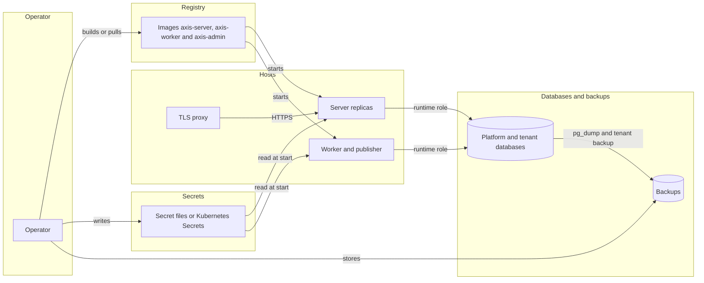

### Operator and installation

The operator writes the secrets and the settings, then starts the hosts. Each row is a threat to that work.

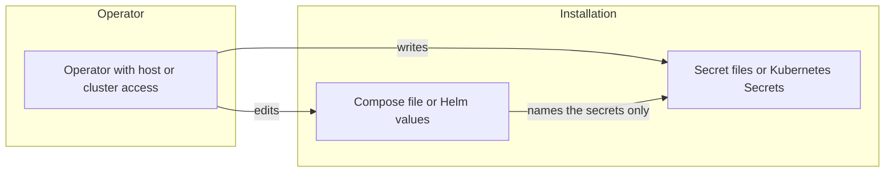

| Id | Threat | Boundary | Category | Rating | Status | Evidence |
| --- | --- | --- | --- | --- | --- | --- |
| I1 | A secret ends up in a Compose or values file, or in an environment variable. | Operator and installation | Information disclosure | High | **Mitigated** | `scripts/onprem.test.mjs` (no file under deploy/compose holds a password, a client secret or a key), `scripts/helm.test.mjs` (no env entry holds a secret setting, and no Secret object is rendered). |
| I2 | Someone with host or cluster access reads the secret files or the TLS private key. | Operator and installation | Information disclosure | High | **Delegated** | The operator controls who can read the secret files and the TLS key, see [On premises](installation.md#on-premises) and [In the cloud](installation.md#in-the-cloud). |
| I3 | An admin command changes a tenant or the platform and leaves no record. | Operator and installation | Repudiation | Medium | **Mitigated** | `AdminPlatformAuditTests` (each of the seven admin commands writes one record with its tenant, user and machine and no secret), `PlatformRekeyTests` (a successful rekey writes one record with no tenant). |
| I4 | A host gets more database rights than its job needs, such as a worker with the schema role. | Operator and installation | Elevation of privilege | High | **Mitigated** | `DatabaseRoleTests` (every server and worker session on a tenant database uses the runtime role), `scripts/compose.test.mjs` (the worker gets only the runtime role), `scripts/helm.test.mjs` (the worker gets no platform schema connection). |

Spoofing, tampering and denial of service do not apply to the operator's own steps. The operator already has host access, see I2.

### Images and registry

The images travel from a registry to each host, where Compose or the Helm chart starts them.

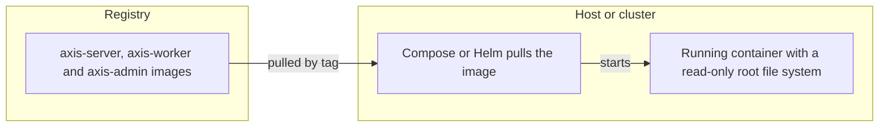

| Id | Threat | Boundary | Category | Rating | Status | Evidence |
| --- | --- | --- | --- | --- | --- | --- |
| I5 | An image is swapped or changed between the registry and the host. | Images and registry | Tampering | High | **Delegated** | The operator builds the images or pulls them from a registry the operator controls, see [Images](installation.md#images). Signed images are planned for M28, see [D107](../decisions/d107-the-dependency-scan-runs-now-and-images-are-scanned-and-signed.md). |
| I6 | An image ships samples, development settings or source control metadata. | Images and registry | Information disclosure | High | **Mitigated** | `scripts/images.test.mjs` (no image holds a sample, a Development settings file or `.git`). |
| I7 | A process in a container writes to its image or runs as root. | Images and registry | Elevation of privilege | High | **Mitigated** | `scripts/images.test.mjs` (each image runs as a user other than root, and the server and worker start read-only with their settings in `/run/secrets`). |
| I8 | An install keeps running a version with a known vulnerability. | Images and registry | Elevation of privilege | Medium | **Delegated** | The operator upgrades to the latest version, the only one that gets security fixes, see [Upgrade](installation.md#upgrade). |

Spoofing and repudiation do not apply to an image, which is a file that signs no one in and writes no record. Denial of service is covered by the server rows, such as P6.

### Proxy and server replicas

Clients reach the server replicas through a TLS proxy. The proxy checks each replica's certificate before it forwards a request.

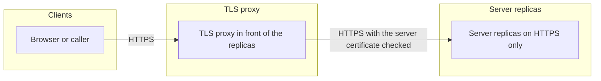

| Id | Threat | Boundary | Category | Rating | Status | Evidence |
| --- | --- | --- | --- | --- | --- | --- |
| I9 | A client fakes its address, scheme or host through forwarded headers. | Proxy and server replicas | Spoofing | High | **Mitigated** | `ForwardedHeadersTests` (an address that is not listed cannot fake its host or its scheme), `scripts/helm.test.mjs` (forwarded header settings render on the server only). |
| I10 | Traffic between a client, the proxy and a server is read or changed. | Proxy and server replicas | Information disclosure | High | **Mitigated** | `scripts/onprem.test.mjs` (the servers answer HTTPS only, the proxy takes only TLS 1.2 and 1.3, refuses CBC ciphers on TLS 1.2, and trusts only the server certificate authority). |
| I11 | A TLS endpoint that the operator runs in front of the server accepts weak TLS or skips the server certificate check. | Proxy and server replicas | Information disclosure | High | **Delegated** | The operator uses only the TLS versions and ciphers that [TLS](installation.md#tls) lists, and checks the server certificate as the Compose proxy does. |
| I12 | A replica restarts and drops sessions, or a replica with another key joins the install. | Proxy and server replicas | Denial of service | Medium | **Mitigated** | `SharedKeyRingTests` (a session survives a restart and another instance accepts it, and a server with another key fails to start), `scripts/onprem.test.mjs` (a restarted replica serves a signed-in user again). |
| I13 | A save through one replica overwrites a newer save made through another. | Proxy and server replicas | Tampering | Medium | **Mitigated** | `scripts/onprem.test.mjs` (a stale save through one replica answers 409 after a save through another). |

Repudiation does not apply here, because the server writes the audit records, see P3. Elevation of privilege does not apply to the proxy, which only forwards requests. The access checks are in the server, see P7.

### Database and backups

The server and the worker reach tenant databases with the runtime role. Backups hold copies of the databases.

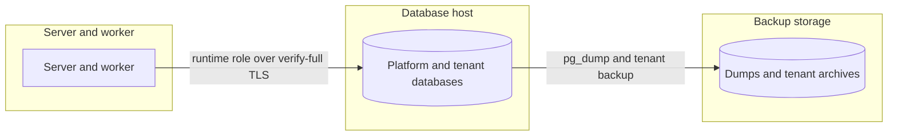

| Id | Threat | Boundary | Category | Rating | Status | Evidence |
| --- | --- | --- | --- | --- | --- | --- |
| I14 | A backup archive or its output holds a tenant secret. | Database and backups | Information disclosure | High | **Mitigated** | `AdminTenantBackupTests` (the archive and the output of a backup hold no secret of the tenant). |
| I15 | A stolen archive or database dump exposes business data. | Database and backups | Information disclosure | High | **Delegated** | The operator stores backups under access control and under disk or database encryption, see [What else to back up](administration.md#what-else-to-back-up) and [Restricted](keys-and-data-protection.md#restricted). Encrypted archives are planned for M27, see [D109](../decisions/d109-sensitive-fields-and-backups-are-encrypted-and-history-keeps-no-names.md). |
| I16 | A backup is stored with the installation key, so a stolen backup yields the stored secrets. | Database and backups | Information disclosure | High | **Delegated** | The operator keeps the installation key apart from the backups, see [What else to back up](administration.md#what-else-to-back-up). |
| I17 | A failed upgrade or a lost database cannot be restored. | Database and backups | Denial of service | Medium | **Delegated** | The operator backs up the platform and tenant databases before each upgrade, see [Upgrade](installation.md#upgrade). |
| I18 | A host connects to PostgreSQL without a full certificate check. | Database and backups | Tampering | High | **Mitigated** | `DatabaseTlsStartTests` (a production server stops at start on a connection string without full certificate checks), `AdminDatabaseTlsTests` (an admin command exits with status 2 for such a string). |

Spoofing, repudiation and elevation of privilege on the database are covered by the server rows, P9, P12 and P13.

### Stored secrets and key ring

The installation key encrypts every stored secret and each data protection key. The data protection keys sit in the platform database.

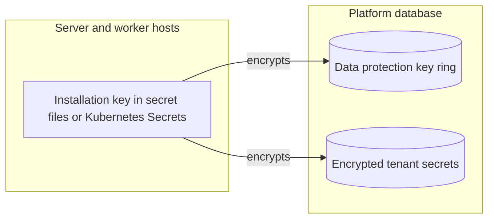

| Id | Threat | Boundary | Category | Rating | Status | Evidence |
| --- | --- | --- | --- | --- | --- | --- |
| I19 | Data protection keys are read in clear from the platform database. | Stored secrets and key ring | Information disclosure | High | **Mitigated** | `SharedKeyRingTests` (the stored keys hold no plain key material and decrypt only with the installation key). |
| I20 | A rekey leaves the old installation key able to decrypt stored values. | Stored secrets and key ring | Information disclosure | High | **Mitigated** | `PlatformRekeyTests` (after a rekey, the new key alone decrypts every encrypted column). |
| I21 | The previous installation key stays on the hosts after a rekey. | Stored secrets and key ring | Information disclosure | Medium | **Delegated** | The operator removes `Platform:PreviousSecretKey` from every host once the rekey has run, see [Installation key](tenant-setting-commands.md#installation-key). |
| I22 | A leaked installation key stays in use until the operator rotates it. | Stored secrets and key ring | Information disclosure | High | **Delegated** | The operator runs `platform rekey` and changes the secrets at once when a key may have leaked, see [Key policy](keys-and-data-protection.md#key-policy). |

Other categories do not apply to stored keys. A changed key ring fails to start, see I12, and a rekey writes a record, see I3.

## The way Axis is built

NexKit, CI, the AI agents that write to the repository, and the repository itself.

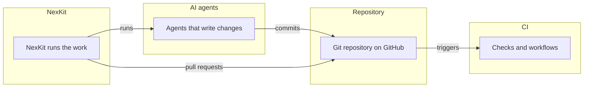

| Id | Threat | Boundary | Category | Rating | Status | Evidence |
| --- | --- | --- | --- | --- | --- | --- |
