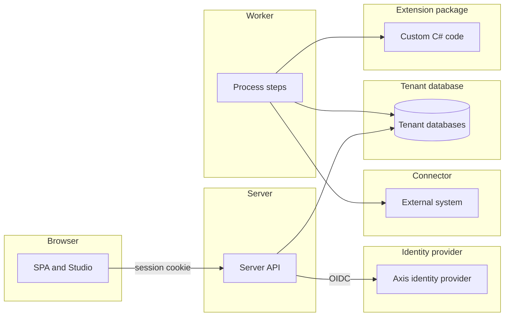
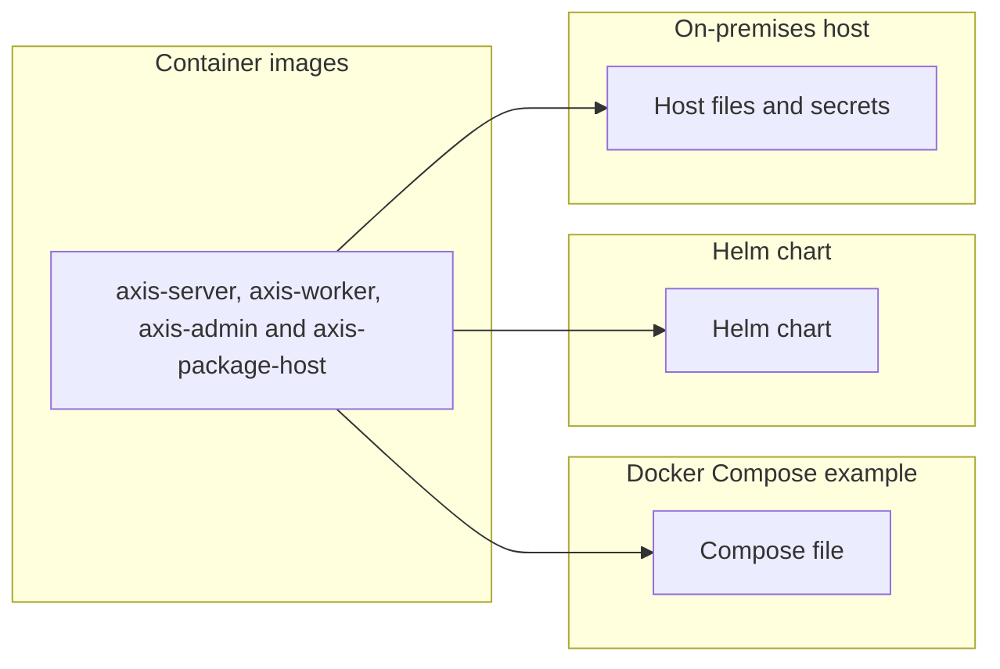
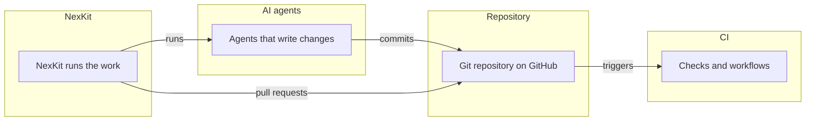

# Threat model

What can go wrong in Axis's own design, and what Axis does about each threat. The model follows
[D106](../decisions/d106-a-threat-model-kept-current-like-the-asvs-tracking.md). Its threat rows are
_(planned for M18)_. Each row comes from the issue that models one trust boundary, and the
[ASVS](asvs.md) page covers the controls that every web application needs.

## How it is filled

- **The four questions.** The Threat Modeling Manifesto frames the model. What are we working on?
  What can go wrong? What are we going to do about it? Did we do a good job?
- **Methods.**
  - STRIDE finds the threats at each trust boundary.
  - LINDDUN finds the privacy threats to personal data.
  - OWASP's agentic AI threats find the threats to the AI agents that write and review code.
- **One row per threat.** The table has these columns: id, threat, boundary, category, rating,
  status and evidence. A scope letter and a number make an id, such as `P1`, `I1` or `B1`. An id is
  unique on the whole page, so a later row or issue can name a threat by its id alone.
- **Rating.** The rating is Low, Medium, High or Critical. It comes from likelihood and impact, a
  short form of the OWASP Risk Rating Methodology.
  - A **Gap** has time to close, as a vulnerable dependency does, see
    [dependency updates](../development.md#dependency-updates). Critical is 7 days, High 30 days,
    Medium 90 days (Moderate in that table) and Low the next routine update.
  - The time starts on the day the row is written.
- **Status.** Each row has one of four statuses.
  - **Mitigated:** Axis has a control. The evidence names a test class in backticks, ending in
    `Tests`, a doc section or a check.
  - **Gap:** Axis does not have the control yet. The evidence links the GitHub issue that closes it.
  - **Delegated:** the identity provider or the operator meets the threat. The evidence names which.
  - **Accepted:** the owner accepts the threat. The evidence gives the reason and the date, as
    YYYY-MM-DD. Only the owner accepts a threat.
- **Checked.** `scripts/check-docs.mjs` fails on these problems:
  - an id that another row already uses, on the whole page
  - a status that is not one of the four above
  - a rating that is missing or is not one of the four above
  - a row without evidence
  - a **Mitigated** row that names a test class no `.cs` file under `tests/` or `samples/` declares
  - a **Gap** row that links no GitHub issue
  - an **Accepted** row that gives no date
  - It does not judge that a test covers its threat, that a time frame was kept, or that a
    **Delegated** row names the right party. A reviewer does.
- **Kept current.** A change that adds a trust boundary updates this page in the same change, see
  [the threat model rule](../delivery.md#keeping-the-docs-current). Each docs sweep reviews the page.
  Once a year the owner rates Axis against OWASP SAMM _(planned for M18)_, see
  [ASVS other evidence](asvs.md#other-evidence).

## The product

The server, the worker, the SPA, tenants, Studio and authoring, extension packages, connectors,
endpoints and webhooks, and the identity provider Axis ships.

| Id | Threat | Boundary | Category | Rating | Status | Evidence |
| --- | --- | --- | --- | --- | --- | --- |

## The installation

The images, Docker Compose, the Helm chart and an install on premises.

| Id | Threat | Boundary | Category | Rating | Status | Evidence |
| --- | --- | --- | --- | --- | --- | --- |

## The way Axis is built

NexKit, CI, the AI agents that write to the repository, and the repository itself.

| Id | Threat | Boundary | Category | Rating | Status | Evidence |
| --- | --- | --- | --- | --- | --- | --- |
