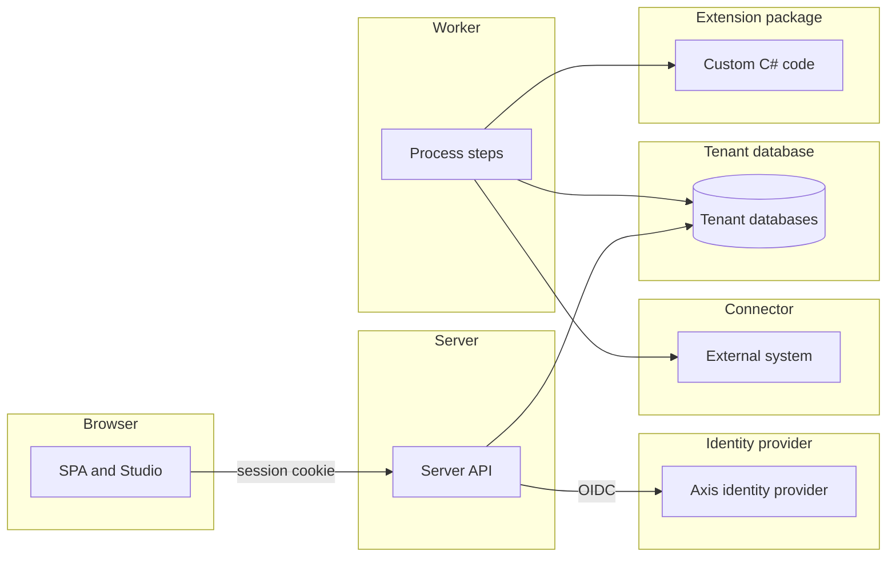
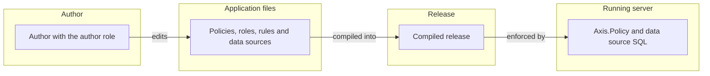
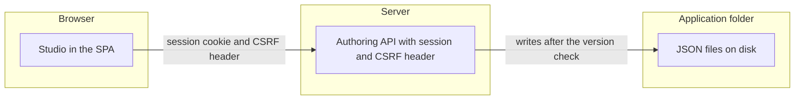
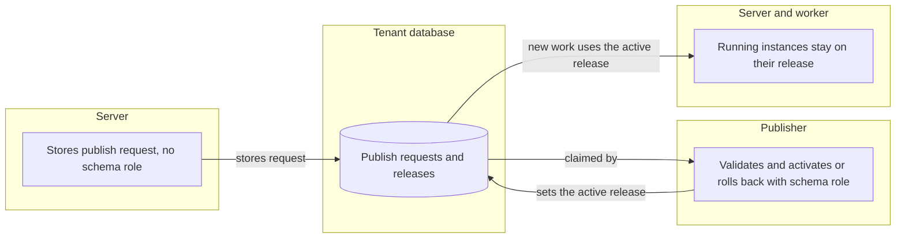
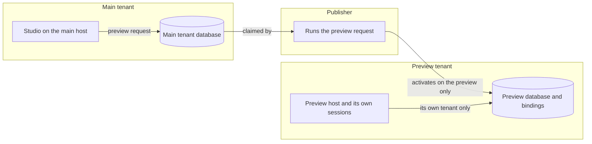
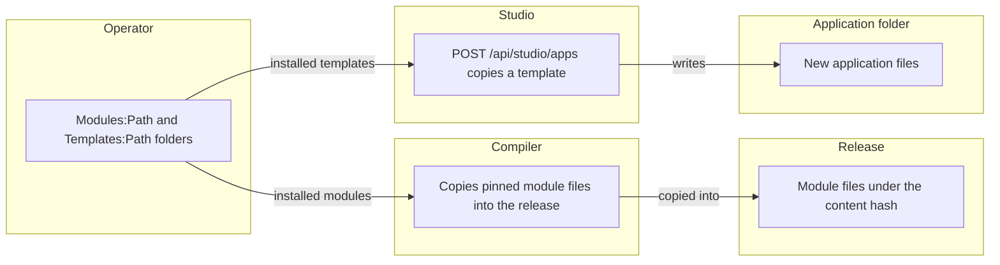
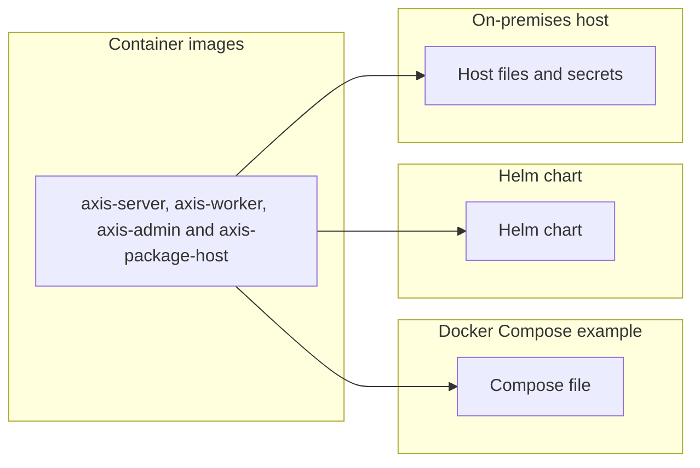
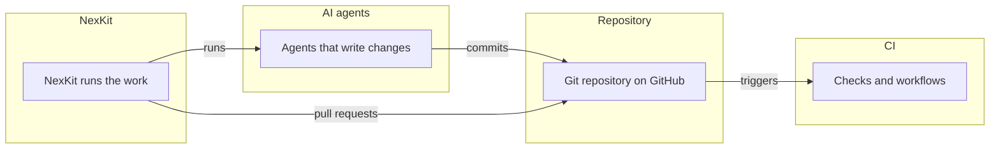

# Threat model

What can go wrong in Axis's own design, and what Axis does about each threat. The model follows
[D106](../decisions/d106-a-threat-model-kept-current-like-the-asvs-tracking.md). Its threat rows are
_(planned for M18)_. Each row comes from the issue that models one trust boundary, and the
[ASVS](asvs.md) page covers the controls that every web application needs.

## How it is filled

- **The four questions.** The Threat Modeling Manifesto frames the model. What are we working on?
  What can go wrong? What are we going to do about it? Did we do a good job?
- **Methods.**
  - STRIDE finds the threats at each trust boundary.
  - LINDDUN finds the privacy threats to personal data.
  - OWASP's agentic AI threats find the threats to the AI agents that write and review code.
- **One row per threat.** The table has these columns: id, threat, boundary, category, rating,
  status and evidence. A scope letter and a number make an id, such as `P1`, `I1` or `B1`. An id is
  unique on the whole page, so a later row or issue can name a threat by its id alone.
- **Rating.** The rating is Low, Medium, High or Critical. It comes from likelihood and impact, a
  short form of the OWASP Risk Rating Methodology.
  - A **Gap** has time to close, as a vulnerable dependency does, see
    [dependency updates](../development.md#dependency-updates). Critical is 7 days, High 30 days,
    Medium 90 days (Moderate in that table) and Low the next routine update.
  - The time starts on the day the row is written.
- **Status.** Each row has one of four statuses.
  - **Mitigated:** Axis has a control. The evidence names a test class in backticks, ending in
    `Tests`, a doc section or a check.
  - **Gap:** Axis does not have the control yet. The evidence links the GitHub issue that closes it.
  - **Delegated:** the identity provider or the operator meets the threat. The evidence names which.
  - **Accepted:** the owner accepts the threat. The evidence gives the reason and the date, as
    YYYY-MM-DD. Only the owner accepts a threat.
- **Checked.** `scripts/check-docs.mjs` fails on these problems:
  - an id that another row already uses, on the whole page
  - a status that is not one of the four above
  - a rating that is missing or is not one of the four above
  - a row without evidence
  - a **Mitigated** row that names a test class no `.cs` file under `tests/` or `samples/` declares
  - a **Gap** row that links no GitHub issue
  - an **Accepted** row that gives no date
  - It does not judge that a test covers its threat, that a time frame was kept, or that a
    **Delegated** row names the right party. A reviewer does.
- **Kept current.** A change that adds a trust boundary updates this page in the same change, see
  [the threat model rule](../delivery.md#keeping-the-docs-current). Each docs sweep reviews the page.
  Once a year the owner rates Axis against OWASP SAMM _(planned for M18)_, see
  [ASVS other evidence](asvs.md#other-evidence).

## The product

The server, the worker, the SPA, tenants, Studio and authoring, extension packages, connectors,
endpoints and webhooks, and the identity provider Axis ships.

| Id | Threat | Boundary | Category | Rating | Status | Evidence |
| --- | --- | --- | --- | --- | --- | --- |

### Authoring

Authoring covers what an author changes in Studio, what a release does once it is live, and what a
borrowed module or template brings in. It has five boundaries, each with its own diagram below.

**Author and release**

**Studio and the authoring API**

**Publishing with activation and rollback**

**Preview tenants**

**Modules and templates**

| Id | Threat | Boundary | Category | Rating | Status | Evidence |
| --- | --- | --- | --- | --- | --- | --- |
| P1 | An author widens access by changing a policy or a role. | Author and release | Elevation of privilege | High | **Mitigated** | `StudioPublishTests` and `StudioRollbackTests` show that publishing and rolling back need the publisher role. `PolicyMatrixTests` shows what each policy grants. See [publishing](authoring.md#publishing). |
| P2 | One person holds the author role and the publisher role, and widens access alone. | Author and release | Elevation of privilege | Medium | **Delegated** | The operator decides who holds each role at the identity provider. See [Studio settings](host-settings.md#studio-settings). |
| P3 | An author denies having published a release. | Author and release | Repudiation | Low | **Mitigated** | `AdminPublisherTests` writes one audit record for each publish. `StudioReleaseHistoryTests` lists each activation, newest first. See [audit](authoring.md#audit). |
| P4 | A data source shows a field that the user may not read. | Author and release | Information disclosure | Medium | **Mitigated** | `DataSourcePolicyTests` answers 403 for the whole data source. See [data source authorization](data-sources.md#authorization). |
| P5 | An author expression injects SQL. | Author and release | Tampering | High | **Mitigated** | `SqlTranslatorTests` checks that text and names never reach the SQL unquoted, and that literals are typed parameters. |
| P6 | A user without the author role calls the Studio API. | Studio API | Elevation of privilege | High | **Mitigated** | `StudioEndpointTests` answers 403 without the author role and 401 without a session. `StudioTextWriteTests` does the same for text writes. |
| P7 | A site in another origin sends a write as a signed-in author. | Studio API | Tampering | Medium | **Mitigated** | `StudioEndpointTests` refuses a write without the CSRF header. `CsrfHeaderTests` does the same for record writes. |
| P8 | A write escapes the application folder through `..`, a link or a folder link. | Studio API | Tampering | High | **Mitigated** | `StudioEndpointTests` refuses a name with `..` and does not write through a linked file or folder. `StudioCreateApplicationTests` refuses a name with `..`. |
| P9 | Two authors overwrite each other's changes. | Studio API | Tampering | Medium | **Mitigated** | `StudioWriteLockTests` gives one of two writes that share a version a 409. See [versions](authoring.md#versions). |
| P10 | The live release differs from the folder the author sent to publish. | Publishing | Tampering | Medium | **Mitigated** | `StudioPublishTests` shows that the release keeps the folder as it was at the call. A later edit is not in it. |
| P11 | A publish from one tenant's host changes another tenant. | Publishing | Elevation of privilege | High | **Mitigated** | `StudioPublishTests` stores the request in that tenant's database only. `AdminPublisherTests` activates the release for that tenant only. |
| P12 | A new release changes work that is already running. | Publishing | Tampering | High | **Mitigated** | Running instances stay on the release they started on. `StudioRollbackTests`, `TaskReleaseTests` and `PinnedReleaseStartTests` cover this. |
| P13 | Activation or rollback breaks data that is already stored. | Publishing | Tampering | High | **Mitigated** | `MigrationActivationTests` and `ModuleUpgradeTests` refuse a change that would break stored data, and change nothing. `PublisherRollbackTests` fails a rollback across a rename. |
| P14 | A request keeps crashing the publisher and blocks the queue. | Publishing | Denial of service | Medium | **Mitigated** | `AdminPublisherTests` fails a request with `AXC0215` after three expired claims. |
| P15 | The server activates a release or holds a schema connection. | Publishing | Elevation of privilege | High | **Mitigated** | The server stores a publish request and never activates. Only the publisher holds the tenant schema role. See [publishing](authoring.md#publishing) and [D47](../decisions/d47-publishing-from-studio.md). |
| P16 | A test request reaches the tenant's data. | Publishing | Information disclosure | Medium | **Mitigated** | `PublisherTestRequestTests` runs scenarios in their own database and leaves no record in the tenant database. |
| P17 | A preview reaches its main tenant's data. | Preview tenant | Information disclosure | High | **Mitigated** | `PublisherPreviewTests` activates the release on the preview tenant only. `StudioPreviewTests` leaves the main tenant unchanged. See [preview tenants](../architecture.md#preview-tenants). |
| P18 | A preview uses the main tenant's bindings. | Preview tenant | Information disclosure | Medium | **Mitigated** | `PreviewTenantActivationTests` gives the preview its own bindings, empty by default. `ReleaseActivatorTests` warns for each missing binding on a preview. |
| P19 | A session made on the preview host is used on the main host, or the other way round. | Preview tenant | Spoofing | Medium | **Mitigated** | `PreviewTenantSignInTests` answers 401 when a session made on the preview host is used on the main host. |
| P20 | The preview accepts a service account or machine token. | Preview tenant | Elevation of privilege | Medium | **Mitigated** | The preview has no service or endpoint audience, so it accepts no such token. See [preview tenants](../architecture.md#preview-tenants). |
| P21 | An administrator of the main tenant manages users on the preview. | Preview tenant | Elevation of privilege | Medium | **Mitigated** | `StudioPreviewTests` says that the users route is off on the preview for an administrator. |
| P22 | A module changes under a live release. | Modules and templates | Tampering | Medium | **Mitigated** | `ModulePinningTests` shows that a release holds its own module files. The compiler copies them into the release under its content hash. See [modules](modules-and-templates.md#modules). |
| P23 | A module brings in roles or policies. | Modules and templates | Elevation of privilege | Medium | **Mitigated** | `ModuleCompilerTests` reports a role or policy file in a module as an error. |
| P24 | An untrusted module or template is installed. | Modules and templates | Tampering | High | **Delegated** | The operator chooses what sits in `Modules:Path` and `Templates:Path`. See [modules](modules-and-templates.md#modules). |
| P25 | A template brings a wide policy into a new application. | Modules and templates | Elevation of privilege | Medium | **Mitigated** | `StudioCreateApplicationTests` copies a template as a new application. `StudioPublishTests` shows that an author without the publisher role cannot publish it. |

## The installation

The images, Docker Compose, the Helm chart and an install on premises.

| Id | Threat | Boundary | Category | Rating | Status | Evidence |
| --- | --- | --- | --- | --- | --- | --- |

## The way Axis is built

NexKit, CI, the AI agents that write to the repository, and the repository itself.

| Id | Threat | Boundary | Category | Rating | Status | Evidence |
| --- | --- | --- | --- | --- | --- | --- |
